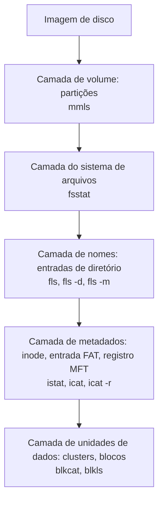
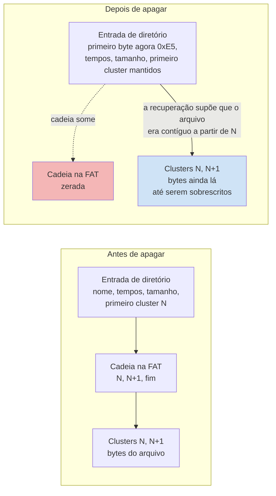

# Dia 51: Forense de sistema de arquivos com The Sleuth Kit

> 🇺🇸 Original: [*Day 51: File system forensics with The Sleuth Kit*](https://github.com/thiefdroppers/cyber-investigator-skills/blob/main/curriculum/phase-4-digital-forensics-incident-investigation/day-51.md) — © ThiefDroppers, licença MIT.
> Aqui: tradução fiel **+** camada brasileira. Nada do original foi removido; tudo o que é novo vem marcado com ➕.

**Fase 4. Forense digital e investigação de incidentes** · Meta da trilha: ler uma imagem de disco abaixo do nível de arquivo, recuperar um arquivo apagado com seus metadados e transformar os *timestamps* do sistema de arquivos numa linha do tempo.

Rank Jutsu: `B` · [](https://colab.research.google.com/github/Ridd1kulusC0d3r/investigador-cyber-90-dias/blob/main/curriculo/fase-4-forense-e-resposta/dia-51/dia-51.ipynb)

---

## 🎬 ➕ Abertura do caso — *O ZIP que sumiu do pen drive*

A imagem do pen drive "AG CENTRO" bate com a origem. Você roda o `fls` e aparece uma linha com asterisco: `_ODULO_S.ZIP`, apagado, 750 bytes.

— Módulo de Segurança — você diz. — É o nome do arquivo que o site falso mandava baixar.

— E a que horas ele foi para o pen drive? — pergunta Rafa.

— 08h35 do dia 5. Logo depois do clique.

— 08h35 em qual fuso?

Você abre a boca e fecha. O FAT não guarda fuso. O pen drive passou por um notebook em Brasília, mas e se alguém o tivesse espetado num computador configurado em UTC? Hoje você aprende a ler o disco por baixo dos arquivos, e a não confiar num relógio que não diz de onde é. *(Personagens e cenário: [Operação Isca](../../../caso-continuo/).)*

---

## 📖 Conceito

Um sistema de arquivos tem duas camadas que interessam a você. Conteúdo são os *clusters* ou blocos que guardam os dados do arquivo. Metadado é o registro que diz quais *clusters* pertencem a qual arquivo, mais os nomes e os *timestamps*: a entrada de diretório e a FAT em volumes FAT, o *inode* no ext4, o registro da MFT no NTFS (Dia 52).

Apagar um arquivo normalmente muda só o metadado. No FAT, o primeiro byte da entrada de diretório vira `0xE5` e a cadeia do arquivo na *File Allocation Table* é zerada, mas os *clusters* guardam seus bytes até que algo seja gravado por cima. É por isso que arquivos apagados são recuperáveis, e por isso a recuperação fica menos provável quanto mais tempo o dispositivo continua em uso. No ext4, a informação de *extents* do *inode* costuma ser apagada na exclusão, então o mesmo truque frequentemente falha ali, e você recorre ao *carving* (procurar nos bytes crus as assinaturas de arquivos).

*Timestamps* vêm em conjuntos. A sigla é MACB: *Modified* (conteúdo), *Accessed* (acesso), *Changed* (o registro de metadados mudou; no NTFS e no ext4), *Born* (criação). O FAT guarda criação, modificação e data do último acesso (só data, sem hora, para o acesso), em horário local, sem fuso. Um investigador que lê horários do FAT como UTC erra pelo deslocamento do dispositivo.

O The Sleuth Kit (TSK) é um conjunto de ferramentas de linha de comando nomeadas por camada: `mm*` para partições (*media management*), `fs*` para o sistema de arquivos, `f*` para nomes de arquivo, `i*` para metadados, `blk*` para unidades de dados. O Autopsy é a interface gráfica dele.

Cada camada, a ferramenta do TSK que a lê, e as que você usa hoje:



O que uma exclusão no FAT muda, e por que o `icat -r` ainda consegue trazer os bytes de volta:



A aresta pontilhada é a razão pela qual arquivos apagados fragmentados no FAT não voltam limpos: com a cadeia zerada, a ferramenta só consegue supor que os *clusters* vêm um depois do outro.

## 📚 Recursos

- [The Sleuth Kit](https://www.sleuthkit.org/sleuthkit/) e as suas [*man pages*](https://www.sleuthkit.org/sleuthkit/man/) (`fls`, `istat`, `icat`, `mactime`).
- [Autopsy](https://www.autopsy.com/), interface gráfica gratuita sobre o TSK.
- Brian Carrier, *File System Forensic Analysis* (Addison-Wesley, 2005): ainda a referência para as estruturas FAT, NTFS e ext.
- [Formato *body file*](https://wiki.sleuthkit.org/index.php?title=Body_file) na wiki do TSK.

### ➕ Recursos do contexto Brasil

- [IPED](https://github.com/sepinf-inc/IPED): ferramenta forense de código aberto desenvolvida por peritos da Polícia Federal brasileira, usada para processar e indexar imagens de disco (lê os mesmos sistemas de arquivos que o TSK e tem interface de análise). Vale conhecer porque é o que muita perícia oficial no Brasil usa.
- Python [`zoneinfo`](https://docs.python.org/3/library/zoneinfo.html): o fuso `America/Sao_Paulo` sabe que o Brasil **não tem** horário de verão desde 2019 (Decreto 9.772/2019), e que tinha antes. Isso importa para imagens antigas.

## 🛠️ Prática: The Sleuth Kit no EVID-004, terminando numa linha do tempo do mactime

Instale no Debian/Ubuntu com `sudo apt install sleuthkit`. Use a sua imagem de trabalho verificada do Dia 50, `~/lab-p4/work/evid-004.raw`. Tudo abaixo só lê a imagem.

**Seu checklist de hoje.** Faça na ordem e marque cada item ao terminar:

- [ ] Procure uma tabela de partições.
- [ ] Descreva o sistema de arquivos.
- [ ] Liste todos os nomes, inclusive os apagados.
- [ ] Leia os metadados do arquivo apagado, depois o conteúdo.
- [ ] Compare assinaturas com extensões.
- [ ] Monte a linha do tempo com `fls -m` e `mactime`.
- [ ] Abra o CSV, mantenha só as linhas de 2026 e acrescente as colunas `observation` e `evidence_ref`.
- [ ] Escreva sua nota sobre fuso horário.
- [ ] ➕ Prática BR: o ZIP apagado do pen drive "AG CENTRO" e o fuso de Brasília.
- [ ] ➕ O notebook do dia: mini-TSK em Python, *body file*, `mactime` e o erro de fuso visível.

1. Procure uma tabela de partições.

   ```bash
   mmls ~/lab-p4/work/evid-004.raw
   ```

   O script construtor formatou a imagem inteira como um volume só, sem tabela de partições, então o `mmls` informa que não consegue determinar o tipo de partição. Pen drives reais normalmente têm um MBR e o `mmls` imprimiria uma tabela como esta:

   ```text
   (ilustrativo, não é do EVID-004)
         Slot      Start        End          Length       Description
   000:  Meta      0000000000   0000000000   0000000001   Primary Table (#0)
   001:  -------   0000000000   0000002047   0000002048   Unallocated
   002:  000:000   0000002048   0030310399   0030308352   Win95 FAT32 (0x0c)
   ```

   Nesse caso você passa o setor inicial para todas as ferramentas seguintes com `-o 2048`. Para o EVID-004 o *offset* é 0 e você pode omitir o `-o`.

2. Descreva o sistema de arquivos.

   ```bash
   fsstat ~/lab-p4/work/evid-004.raw | head -30
   ```

   Registre o tipo de sistema de arquivos (FAT16), o rótulo do volume (`LABUSB04`), o ID do volume (`0x4c414234`, definido pelo construtor), o tamanho do setor e o tamanho do *cluster*. Isso entra nas suas notas como identificadores da imagem.

3. Liste todos os nomes, inclusive os apagados.

   ```bash
   fls -r -p ~/lab-p4/work/evid-004.raw
   ```

   Cada linha tem a forma `tipo/tipo inode: caminho`. Um `*` antes do número do *inode* marca uma entrada apagada. Você deve ver `FINANCE/VENDORS.CSV` marcado com `*`. Mostre só as entradas apagadas com `fls -r -d -p`.

   Os arquivos de usuário do EVID-004, como o script construtor os gravou. O `fls` também lista entradas virtuais que o TSK acrescenta para o FAT, como `$FAT1`, `$FAT2` e `$OrphanFiles`; elas ficaram de fora aqui.

   ```mermaid
   graph TD
       ROOT["/ (FAT16, rótulo LABUSB04)"] --> R1["README.TXT"]
       ROOT --> FIN["FINANCE/"]
       FIN --> V["VENDORS.CSV<br/>apagado, marcado com * pelo fls<br/>recupere com icat -r (passo 4)"]
       FIN --> M["MEETING.TXT"]
       FIN --> S["SCAN0001.TXT<br/>assinatura PNG atrás<br/>de um nome .TXT (passo 5)"]
       style V fill:#f4b6b6
       style S fill:#fbe3b0
   ```

4. Leia os metadados do arquivo apagado, depois o conteúdo.

   ```bash
   istat ~/lab-p4/work/evid-004.raw <inode-of-VENDORS.CSV>
   icat -r ~/lab-p4/work/evid-004.raw <inode-of-VENDORS.CSV> > ~/lab-p4/work/recovered_VENDORS.CSV
   sha256sum ~/lab-p4/work/recovered_VENDORS.CSV
   cat ~/lab-p4/work/recovered_VENDORS.CSV
   ```

   O `istat` mostra "Not Allocated", os horários de escrita, acesso e criação, o tamanho e a lista de setores. O `icat -r` pede ao TSK que tente recuperar um arquivo apagado. Você deve obter de volta a tabela sintética de fornecedores com a linha de cabeçalho intacta. Anote no seu log que a recuperação no FAT de um arquivo pequeno e contíguo é confiável; a de um arquivo apagado fragmentado no FAT não é, porque a cadeia de *clusters* se perdeu.

5. Compare assinaturas com extensões.

   ```bash
   tsk_recover -e ~/lab-p4/work/evid-004.raw ~/lab-p4/work/export/
   file ~/lab-p4/work/export/FINANCE/*
   ```

   O `tsk_recover -e` exporta arquivos alocados e não alocados. O `file` lê os *magic bytes*, então `SCAN0001.TXT` aparece como `PNG image data, 1 x 1` apesar do nome `.TXT`. Uma extensão trocada é, sozinha, evidência fraca de intenção; ela entra na linha do tempo como observação, não como conclusão.

6. Monte a linha do tempo. O `fls -m` grava um *body file* (uma linha por fonte de *timestamp*); o `mactime` ordena.

   ```bash
   timedatectl | grep "Time zone"      # the zone the builder VM wrote FAT times in
   fls -r -m "EVID-004:" -z UTC ~/lab-p4/work/evid-004.raw > ~/lab-p4/work/evid-004.body
   mactime -b ~/lab-p4/work/evid-004.body -d -y -z UTC > ~/lab-p4/work/evid-004-timeline.csv
   ```

   No `fls`, `-z` diz ao TSK em que fuso a máquina original estava quando gravou os horários FAT; troque `UTC` pelo que o `timedatectl` imprimiu se a sua VM não estiver em UTC. No `mactime`, `-z` define o fuso usado na exibição, `-d` dá saída separada por vírgulas e `-y` põe o ano primeiro. Erre o valor do `fls -z` e todo horário FAT da linha do tempo se desloca pelo *offset*, em silêncio. As colunas de saída são *Date*, *Size*, *Type* (as *flags* `macb`), *Mode*, *UID*, *GID*, *Meta*, *File Name*. Linhas de arquivos apagados têm `(deleted)` depois do nome.

7. Abra o CSV no LibreOffice Calc ou no Timeline Explorer, mantenha só as linhas de 2026 e acrescente duas colunas suas: `observation` (o que aconteceu, em palavras) e `evidence_ref` (número do *inode*). Pinte as linhas do arquivo apagado.

8. Escreva sua nota sobre fuso horário: em que fuso estão os *timestamps* do FAT, e como você descobriria o *offset* real de um dispositivo físico (as configurações da estação de trabalho do dono, ou um arquivo com um evento de horário UTC conhecido).

Artefato: `evid-004-timeline.csv` anotado com as suas duas colunas, o `VENDORS.CSV` recuperado com o SHA-256 dele, e um parágrafo sobre como os fusos foram tratados.

### ➕ Prática BR: o ZIP apagado do "AG CENTRO" e o relógio de Brasília

A imagem é a `evid-sa-004.raw` que você gerou no notebook do Dia 50 (o notebook de hoje a recria, igual, se você não a tiver). Rode a mesma sequência, com um detalhe:

```bash
fls -r -p ~/caso-isca/work/evid-sa-004.raw
fls -r -d -p ~/caso-isca/work/evid-sa-004.raw            # só o apagado: MODULO_S.ZIP
istat ~/caso-isca/work/evid-sa-004.raw <inode-do-MODULO_S.ZIP>
icat -r ~/caso-isca/work/evid-sa-004.raw <inode-do-MODULO_S.ZIP> > ~/caso-isca/work/recuperado_MODULO_S.ZIP
sha256sum ~/caso-isca/work/recuperado_MODULO_S.ZIP
fls -r -m "EVID-SA-004:" -z America/Sao_Paulo ~/caso-isca/work/evid-sa-004.raw > ~/caso-isca/work/evid-sa-004.body
mactime -b ~/caso-isca/work/evid-sa-004.body -d -y -z UTC > ~/caso-isca/work/evid-sa-004-timeline.csv
```

**Exercício 1: o fuso.** O pen drive pertence à agência Centro, em Minas Gerais, e o notebook onde ele estava espetado roda em `America/Sao_Paulo` (UTC-3, sem horário de verão desde 2019). Rode o `fls -m` duas vezes, uma com `-z UTC` e outra com `-z America/Sao_Paulo`, e compare a linha do `MODULO_S.ZIP`. Qual das duas põe a cópia do ZIP **depois** do clique no link (11h19m38s UTC no proxy, Dia 49)? Qual põe antes? Escreva qual está certa e qual evidência independente sustenta isso. (Pista: o proxy da cooperativa grava em UTC e mostra o download do "módulo" às 11h23 UTC.)

**Exercício 2: o que você pode e o que não pode dizer.** O `istat` mostra que o `MODULO_S.ZIP` foi **criado** no pen drive às 08h35 e **modificado** às 08h23 (horário local). Criado depois de modificado? Explique em duas frases (copiar um arquivo no Windows preserva a data de modificação e grava a de criação na hora da cópia), e escreva a frase do achado com cuidado: "um arquivo chamado `MODULO_S.ZIP`, de 750 bytes, foi gravado no pen drive às 11h35 UTC e depois apagado". Não escreva "a caixa copiou o malware para o pen drive": o FAT não diz quem copiou nem o que o ZIP faz.

### ➕ O notebook do dia

Abra o [notebook do Dia 51 no Colab](https://colab.research.google.com/github/Ridd1kulusC0d3r/investigador-cyber-90-dias/blob/main/curriculo/fase-4-forense-e-resposta/dia-51/dia-51.ipynb). Nele você:

1. lê o setor de boot como o `fsstat` (rótulo, ID do volume, tamanho de setor e de *cluster*);
2. lista entradas vivas e apagadas como o `fls -r -p`, com o `*` e o `_` no lugar da primeira letra perdida;
3. recupera o arquivo apagado como o `icat -r` e calcula o SHA-256 dele;
4. compara *magic bytes* com extensões (o `file` em miniatura) e acha o PNG disfarçado de `.TXT`;
5. gera um *body file* no formato do TSK e uma linha do tempo no formato do `mactime -d -y`, com as colunas `observation` e `evidence_ref`;
6. alterna o fuso (`UTC` × `America/Sao_Paulo`) e vê o ZIP da Serra Azul "pular" para antes do clique;
7. joga o **quiz das camadas do TSK**.

Há uma célula opcional com `!apt-get install sleuthkit` para rodar `fls`, `istat` e `icat` de verdade na imagem que o notebook grava.

## ✅ Checkpoint

- Sua linha do tempo contém a criação de `FINANCE`.
- Sua linha do tempo contém as quatro gravações de arquivo.
- Sua linha do tempo contém pelo menos uma linha `(deleted)` de `VENDORS.CSV`.
- O hash do arquivo recuperado está escrito nas suas notas, ao lado do número do *inode*.
- O arquivo recuperado abre como um CSV legível.
- Sua nota de fuso diz em que fuso estão os *timestamps* do FAT.
- Sua nota de fuso diz pelo menos uma maneira de descobrir o *offset* real de um dispositivo físico.
- Você consegue dizer, sem consultar, a diferença entre o que o `fls -d` mostra e o que o `icat -r` faz.

### ➕ Checkpoint BR

- Sua linha do tempo do EVID-SA-004 tem o `MODULO_S.ZIP (deleted)` com o fuso `America/Sao_Paulo` e a nota explicando por quê.
- Você aponta a fonte independente (o proxy, em UTC) que confirma a escolha do fuso.
- Sua frase do achado diz "gravado no pen drive" e não "a caixa copiou".
- O hash do ZIP recuperado está nas suas notas.

## ⚖️ ➕ Camada jurídica BR

**Recuperar um arquivo apagado é processamento, não invasão.** O pen drive é patrimônio da cooperativa, foi entregue pela cooperativa e está dentro do escopo escrito. Ler os setores não alocados de uma mídia que o cliente entregou não é "invadir dispositivo" (CP, art. 154-A): o dispositivo não é alheio ao titular que o entregou, e a análise está autorizada. A mesma técnica num pen drive pessoal da caixa, sem consentimento dela, seria outra conversa.

**O achado precisa caber na cadeia de custódia (CPP, art. 158-B, VIII, "processamento").** O arquivo recuperado é um vestígio derivado: registre de qual imagem saiu (com o hash da imagem), qual comando o extraiu, o *inode* e o SHA-256 do arquivo recuperado. Sem isso, um terceiro não consegue refazer a recuperação e chegar ao mesmo arquivo.

**Dados pessoais no espaço não alocado.** Arquivos apagados de um pen drive de agência podem conter planilhas com nomes e CPFs de cooperados. O princípio da necessidade (LGPD, art. 6º, III) vale para o que você **extrai**: recupere e descreva o que interessa ao caso; não exporte tudo "por via das dúvidas".

> Material de estudo, não constitui orientação jurídica.

## 🧠 ➕ Camada 8 — a ilusão de precisão

Um *timestamp* com segundos parece exato. `2026-10-05 08:35:10` tem a cara de um fato. Mas a precisão do número (segundos) não diz nada sobre a sua **exatidão** (o fuso, o relógio do dispositivo, a regra de gravação do FAT, que só guarda segundos pares). A psicologia tem um nome para a tendência de confiar demais em informação que parece detalhada: o **excesso de confiança** (*overconfidence*), estudado por Kahneman, Tversky e outros, que é maior justamente quando a informação é específica e coerente.

Consequência prática: toda linha da sua linha do tempo carrega, ao lado do horário, **de onde veio o fuso**. "08:35:10 local (America/Sao_Paulo, confirmado pelo proxy em UTC)" é um achado. "08:35:10" sozinho é uma armadilha com cara de precisão.

## 🤖 ➕ Skill do dia

O dia propõe um procedimento novo, **"Leitura de sistema de arquivos e linha do tempo MACB"**: camadas do TSK, recuperação de apagado com ressalva de fragmentação, assinatura × extensão como observação e, sobretudo, o fuso declarado em cada horário FAT. Texto e caso de teste em [`_skill-delta.md`](_skill-delta.md).

## 💡 ➕ Inovação OSINT do dia — *magic bytes* sem a biblioteca `python-magic`

O `file` do Linux decide o tipo pelo começo do arquivo, não pela extensão. Para as assinaturas mais comuns em investigação (inclusive arquivos baixados de redes sociais, que muitas vezes chegam com a extensão errada), um dicionário resolve:

```python
ASSINATURAS = {
    b"\x89PNG\r\n\x1a\n": "PNG", b"\xff\xd8\xff": "JPEG", b"%PDF-": "PDF",
    b"PK\x03\x04": "ZIP (também DOCX, XLSX, APK, JAR)", b"MZ": "executável Windows (PE)",
    b"GIF87a": "GIF", b"GIF89a": "GIF", b"\x1f\x8b": "GZIP", b"7z\xbc\xaf\x27\x1c": "7-Zip",
}

def tipo_real(caminho):
    with open(caminho, "rb") as f:
        cabeca = f.read(16)
    return next((t for sig, t in ASSINATURAS.items() if cabeca.startswith(sig)), "desconhecido")
```

As assinaturas acima são as documentadas pelos próprios formatos (por exemplo, a especificação do PNG define os 8 bytes iniciais). Para uma lista ampla, a [lista de assinaturas de arquivo da Wikipédia](https://en.wikipedia.org/wiki/List_of_file_signatures) é um bom ponto de partida para conferir.

## 📝 Diário de estudo

- Data:
- Tempo gasto:
- O que ficou claro:
- O que ainda está nebuloso:
- Artefato produzido: `evid-004-timeline.csv` anotado, `recovered_VENDORS.CSV` com hash, nota de fuso, `evid-sa-004-timeline.csv` com o ZIP apagado

---
<sub>Baseado em [cyber-investigator-skills](https://github.com/thiefdroppers/cyber-investigator-skills) por ThiefDroppers (MIT). Tradução, camada BR, Camada 8, skill pt-BR e notebook por Deivison Lourenço (@Ridd1kulusC0d3r).</sub>
