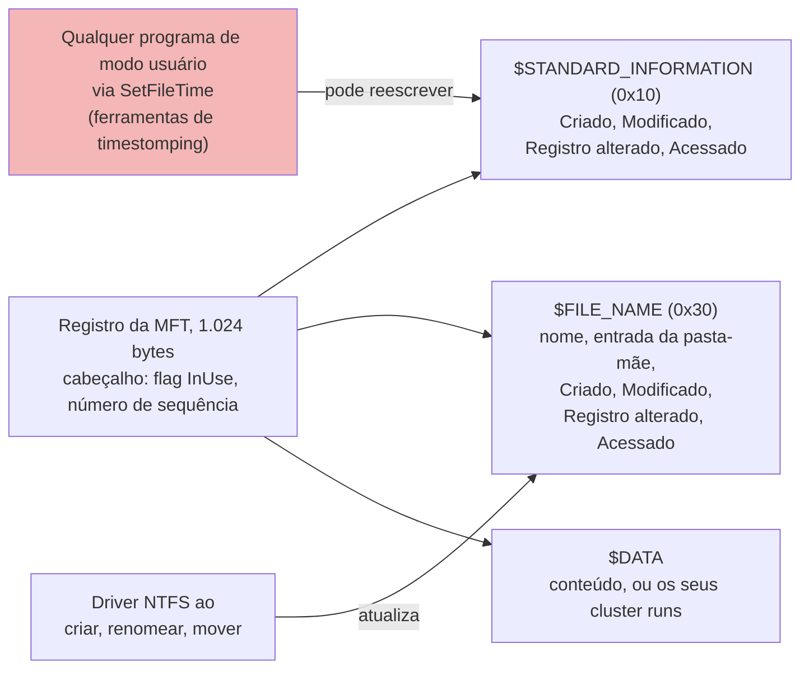
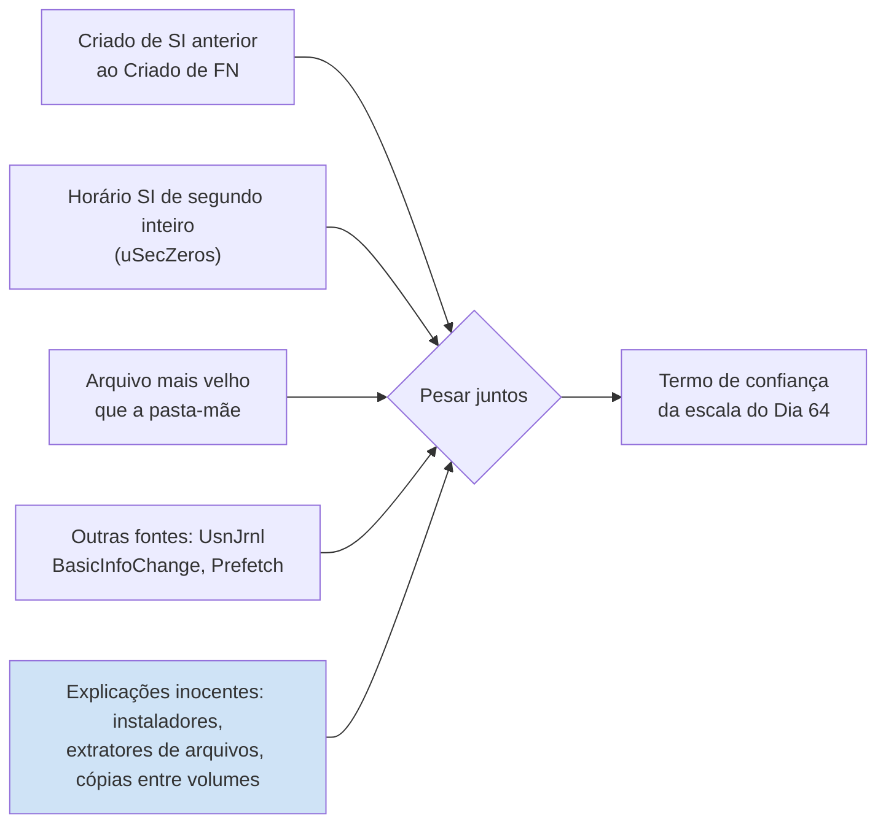

# Dia 52: Artefatos NTFS: a MFT e a manipulação de timestamps

> 🇺🇸 Original: [*Day 52: NTFS artifacts, the MFT and timestamp manipulation*](https://github.com/thiefdroppers/cyber-investigator-skills/blob/main/curriculum/phase-4-digital-forensics-incident-investigation/day-52.md) — © ThiefDroppers, licença MIT.
> Aqui: tradução fiel **+** camada brasileira. Nada do original foi removido; tudo o que é novo vem marcado com ➕.

**Fase 4. Forense digital e investigação de incidentes** · Meta da trilha: ler metadados NTFS bem o bastante para identificar um arquivo cujos *timestamps* visíveis foram alterados, e dizer o quanto você tem confiança nisso.

Rank Jutsu: `B` · [](https://colab.research.google.com/github/Ridd1kulusC0d3r/investigador-cyber-90-dias/blob/main/curriculo/fase-4-forense-e-resposta/dia-52/dia-52.ipynb)

---

## 🎬 ➕ Abertura do caso — *Um arquivo de 2021 numa pasta de ontem*

A TI da Serra Azul abriu a imagem do `SA-CX-07` com a chave de recuperação do BitLocker e exportou a MFT. Rafa projeta o trecho na parede.

— `msa-atualizador.exe`. Criado em 3 de fevereiro de 2021, às 10 horas em ponto.

— Então ele já estava no notebook antes do golpe — você arrisca. — Talvez seja um programa legítimo.

— A pasta dele, `MSA`, foi criada em 5 de outubro de 2026, às 11h24. Um arquivo nasce três anos antes da pasta onde mora?

Rafa rola a planilha para a direita, até a coluna `Created0x30`.

— E aqui está o mesmo arquivo dizendo outra data. Uma dessas duas mentiu. Hoje você descobre qual, e diz com que confiança. *(Personagens e cenário: [Operação Isca](../../../caso-continuo/).)*

---

## 📖 Conceito

No NTFS, todo arquivo e pasta tem pelo menos um registro na *Master File Table* (`$MFT`), normalmente de 1.024 bytes cada. Um registro guarda atributos. Dois deles carregam *timestamps*.

`$STANDARD_INFORMATION` (atributo tipo 0x10) guarda os quatro horários que o Explorer, o `dir` e a maioria das ferramentas mostram: criado, modificado, registro da MFT alterado, acessado. Qualquer programa rodando como o usuário consegue definir esses valores pela API `SetFileTime` do Windows, e é assim que funcionam as ferramentas que alteram *timestamps* (*timestomping*).

`$FILE_NAME` (tipo 0x30) guarda outros quatro horários, mais o nome e a referência à pasta-mãe. As APIs de modo usuário não oferecem um jeito direto de definir esses valores; o Windows os atualiza principalmente quando um arquivo é criado, renomeado ou movido. Então, quando o Criado de `$SI` diz 2019 e o Criado de `$FN` diz ontem, o mais provável é que o arquivo exista só desde ontem e que alguém ou algo tenha reescrito o valor de `$SI`.

Mais dois sinais ajudam. O NTFS guarda horários em intervalos de 100 nanossegundos, então um horário de criação real quase nunca tem sete zeros depois do segundo. Um valor como `09:14:00.0000000` sugere que uma ferramenta gravou um horário de segundo inteiro. Ferramentas como o MFTECmd sinalizam isso como `uSecZeros`. Nenhum dos dois sinais é prova sozinho: alguns instaladores e extratores de arquivos compactados legítimos também gravam horários `$SI` de segundo inteiro, e copiar um arquivo entre volumes produz combinações estranhas próprias. Você procura concordância entre sinais e com outras evidências.

Onde os dois conjuntos de *timestamps* ficam num registro da MFT, e o que pode gravar cada um:



Nenhum sinal isolado resolve uma questão de *timestomping*. Você os pesa juntos, com as explicações inocentes na mesma balança:



Os outros artefatos NTFS que você vai encontrar: `$UsnJrnl:$J`, o *change journal*, registra eventos de criação, renomeação, sobrescrita de dados e exclusão, com um código de motivo e *timestamp* próprio, e sobrevive a algumas exclusões. O `$LogFile` é o log de transações das mudanças de metadados, de vida curta mas detalhado. A *flag* `InUse` num registro da MFT diz se ele está alocado; um registro com `InUse=False` é um arquivo apagado cujos nome e horários continuam legíveis até o registro ser reaproveitado.

## 📚 Recursos

- [MFTECmd](https://github.com/EricZimmerman/MFTECmd) e [Timeline Explorer](https://ericzimmerman.github.io/), de Eric Zimmerman, gratuitos.
- [analyzeMFT](https://github.com/rowingdude/analyzeMFT), uma alternativa em Python que roda no Linux e no macOS.
- Pôster da SANS "Windows Forensic Analysis" (gratuito com cadastro), pela tabela de regras de *timestamps*.
- Documentação da Microsoft sobre [o *change journal*](https://learn.microsoft.com/en-us/windows/win32/fileio/change-journals).

### ➕ Recursos do contexto Brasil

- MITRE ATT&CK, [T1070.006 *Indicator Removal: Timestomp*](https://attack.mitre.org/techniques/T1070/006/): a técnica, com os procedimentos e as detecções. Ligue com o mapeamento do IscaKit que você fez na Fase 3.
- [IPED](https://github.com/sepinf-inc/IPED) (Polícia Federal): também lê a MFT e mostra os dois conjuntos de horários; útil para saber como o perito oficial vai ver o mesmo arquivo.

## 🛠️ Prática: análise no formato do MFTECmd do WS-FIN-07, terminando numa tabela de anomalias de timestamp

Dados reais de MFT vêm de uma imagem Windows: extraia o `$MFT` com o FTK Imager (*File*, *Add Evidence Item*, depois clique com o botão direito em `$MFT` na raiz e *Export Files*) ou com o KAPE, e então interprete:

```powershell
MFTECmd.exe -f "E:\export\C\$MFT" --csv E:\out --csvf ws-fin-07-mft.csv
MFTECmd.exe -f "E:\export\C\$Extend\$J" --csv E:\out --csvf ws-fin-07-usnj.csv
```

Para este laboratório você recebe o resultado já interpretado: [`resources/case-lab-p4/filesystem/ws-fin-07-mft-excerpt.csv`](../../../upstream/curriculum/phase-4-digital-forensics-incident-investigation/resources/case-lab-p4/filesystem/ws-fin-07-mft-excerpt.csv) é um trecho sintético de oito linhas no layout de colunas do MFTECmd (uma `$MFT` real de uma estação produz centenas de milhares de linhas). Calcule o hash dele e registre-o primeiro sob o EVID-002.

**Seu checklist de hoje.** Faça na ordem e marque cada item ao terminar:

- [ ] Abra o trecho da MFT no Timeline Explorer ou no LibreOffice Calc.
- [ ] Filtre as linhas em que `SI<FN` é True.
- [ ] Confira os outros sinais de cada arquivo sinalizado.
- [ ] Olhe a linha apagada, `Invoice_0313.zip`.
- [ ] Monte a tabela de anomalias de *timestamp*.
- [ ] ➕ Prática BR: a MFT do `SA-CX-07` e o `msa-atualizador.exe`.
- [ ] ➕ O notebook do dia: o `csvgrep` em Python, os quatro sinais lado a lado e o quiz das explicações inocentes.

1. Abra no Timeline Explorer (Windows) ou no LibreOffice Calc. Se preferir a linha de comando, o `csvkit` funciona em qualquer sistema:

   ```bash
   pip install csvkit
   F=resources/case-lab-p4/filesystem/ws-fin-07-mft-excerpt.csv
   csvcut -c EntryNumber,InUse,ParentPath,FileName,SI\<FN,uSecZeros,Created0x10,Created0x30 "$F" | csvlook
   ```

2. Filtre as linhas em que `SI<FN` é `True`. O MFTECmd liga essa *flag* quando o horário de criação de `$SI` é anterior ao horário de criação de `$FN`.

   ```bash
   csvgrep -c 'SI<FN' -m True "$F" | csvcut -c FileName,ParentPath,Created0x10,Created0x30,uSecZeros | csvlook
   ```

   Resultado esperado, duas linhas (abreviado; o csvlook pode preencher ou reformatar as colunas de outro jeito):

   ```text
   | FileName       | ParentPath                                         | Created0x10         | Created0x30                 | uSecZeros |
   | synchelper.exe | .\Users\acct.clerk01\AppData\Roaming\SyncHelper    | 2019-06-11 09:14:00 | 2026-03-13 16:42:30.1102964 | True      |
   | svchost.exe    | .\Users\Public                                      | 2018-09-15 07:28:00 | 2026-03-13 16:44:08.8811220 | True      |
   ```

3. Para cada arquivo sinalizado, confira os outros sinais e anote-os:
   - Pasta-mãe: `SyncHelper` (entrada 88412) foi ela própria criada em 2026-03-13 16:42:29, um segundo antes de `synchelper.exe`. Não é plausível que um arquivo seja sete anos mais velho que a pasta em que foi criado.
   - `LastRecordChange0x10` de `synchelper.exe` é 16:42:31, logo depois da criação, o que é coerente com os horários de `$SI` terem sido reescritos logo depois que o arquivo chegou.
   - Local e nome: um arquivo chamado `svchost.exe` em `C:\Users\Public` é um padrão de disfarce (*masquerade*); o verdadeiro mora em `System32` (compare com a entrada 23105, cujos `$SI` e `$FN` concordam).

4. Olhe a linha apagada. `Invoice_0313.zip` (entrada 88398, `InUse=False`) estava na pasta de cache de anexos do Outlook, foi criado às 16:41:52, e o seu registro mudou às 16:48:03. Anote o que você pode e o que não pode dizer: o registro mostra que um zip com esse nome existiu no cache do Outlook 38 segundos antes de `SyncHelper` aparecer. Ele não mostra que o zip continha `synchelper.exe`.

   Seis das oito linhas do trecho, desenhadas pela pasta-mãe, com os dois conjuntos de horários lado a lado. As linhas vermelhas são os acertos de `SI<FN`; o `svchost.exe` do System32 é a comparação conhecida como legítima.

   ```mermaid
   graph TD
       OL["Pasta de cache Content.Outlook"] --> Z["88398 Invoice_0313.zip<br/>InUse False (apagado)<br/>criado 16:41:52"]
       RO["AppData\Roaming"] --> SH["88412 pasta SyncHelper<br/>criada 16:42:29"]
       SH --> EXE["88413 synchelper.exe<br/>Criado SI 2019-06-11 09:14:00<br/>Criado FN 2026-03-13 16:42:30"]
       SH --> CFG["88414 config.dat<br/>SI e FN concordam, 16:42:30"]
       PUB["Users\Public"] --> SV["88420 svchost.exe<br/>Criado SI 2018-09-15 07:28:00<br/>Criado FN 2026-03-13 16:44:08"]
       S32["Windows\System32"] --> SVOK["23105 svchost.exe<br/>SI e FN concordam, 2025-11-12"]
       style EXE fill:#f4b6b6
       style SV fill:#f4b6b6
       style Z fill:#e0e0e0
       style SVOK fill:#cfe3f6
   ```

5. Monte o artefato: uma tabela com uma linha por anomalia e estas colunas: arquivo, entrada da MFT, sinais observados (lista), explicações alternativas consideradas, sua confiança (use a escala do Dia 64: confirmado, altamente provável, provável, possível) e qual evidência adicional a elevaria (por exemplo, entradas do `$UsnJrnl` mostrando `FileCreate` e depois `BasicInfoChange` para a entrada 88413 com segundos de diferença, ou um Prefetch mostrando a primeira execução).

   Comece por este esqueleto. Os sinais já preenchidos vêm dos passos 2 e 3; o resto é com você.

   ```markdown
   | File | MFT entry | Observed signals | Alternatives considered | Confidence | Evidence that would raise it |
   |---|---|---|---|---|---|
   | synchelper.exe | 88413 | SI<FN; uSecZeros; parent 88412 created 16:42:29, one second before FN Created; LastRecordChange0x10 16:42:31 | | | |
   | svchost.exe (Users\Public) | 88420 | SI<FN; uSecZeros; | | | |
   ```

   > ➕ Se preferir em português nas suas notas, as colunas ficam: Arquivo | Entrada MFT | Sinais observados | Alternativas consideradas | Confiança | Evidência que a elevaria.

Artefato: `notes/day52-timestamp-anomalies.md` com a tabela de anomalias e uma mini linha do tempo de quatro linhas entre 16:41:52 e 16:44:09 de 13 de março de 2026, UTC.

### ➕ Prática BR: a MFT do `SA-CX-07`

O trecho exportado pela TI está em [`caso-continuo/dados/dia-52/sa-cx-07-mft-excerpt.csv`](../../../caso-continuo/dados/dia-52/sa-cx-07-mft-excerpt.csv), no mesmo layout do MFTECmd (10 registros, sintético). Os horários da MFT são UTC, como em todo NTFS.

```bash
F=caso-continuo/dados/dia-52/sa-cx-07-mft-excerpt.csv
sha256sum "$F"
csvgrep -c 'SI<FN' -m True "$F" | csvcut -c EntryNumber,FileName,ParentPath,Created0x10,Created0x30,uSecZeros | csvlook
```

**Exercício 1: três acertos, um culpado provável.** O filtro devolve **três** linhas, não uma: o `msa-atualizador.exe` e dois arquivos em `Documents\Normativos` (`tabela-tarifas-2026.xlsx` e `manual-caixa-v7.pdf`). Os três têm `SI<FN` e `uSecZeros`. Preencha a tabela de anomalias para os três. Antes, confira:

- a pasta-mãe de cada um (`MSA` 120944, criada 11:24:28 de 5/out; `Normativos` 118020, criada 14:11:06 de 2/out);
- a linha apagada `pacote-normativos.zip` (118019) em `Downloads`, criada 14:10:58 de 2/out, oito segundos antes da pasta `Normativos`;
- a linha `Modulo_Seguranca_SerraAzul.zip` (120931), criada às 11:23:14 de 5/out em `Downloads`, 74 segundos antes da pasta `MSA`.

**Exercício 2: a explicação inocente que fica e a que cai.** Para os dois arquivos de `Normativos`, a explicação "um extrator de ZIP gravou o horário guardado dentro do pacote, que tem resolução de segundo" é coerente com tudo o que a MFT mostra (pacote baixado, pasta criada 8 segundos depois, horários de segundo inteiro de 2025, nomes de documentos internos). Para o `msa-atualizador.exe`, a mesma explicação **também** é possível (ele pode ter saído de dentro do `Modulo_Seguranca_SerraAzul.zip`). Então o que separa os dois casos? Escreva, em até cinco linhas, quais evidências de outras fontes você pediria (pista: o Dia 49 tem o proxy com `atualiza-modulo.example`; o Dia 53 vai ter a memória; o original sugere `$UsnJrnl` com `BasicInfoChange`) e qual confiança você dá hoje, só com a MFT, a "o `$SI` do `msa-atualizador.exe` foi reescrito".

Frase-modelo, no espírito do `Invoice_0313.zip` do original: *"O `Modulo_Seguranca_SerraAzul.zip` existiu em `Downloads` 74 segundos antes da criação da pasta `MSA`. O registro não mostra que o ZIP continha o `msa-atualizador.exe`."*

### ➕ O notebook do dia

Abra o [notebook do Dia 52 no Colab](https://colab.research.google.com/github/Ridd1kulusC0d3r/investigador-cyber-90-dias/blob/main/curriculo/fase-4-forense-e-resposta/dia-52/dia-52.ipynb). Nele você:

1. baixa o trecho da MFT do WS-FIN-07 (com plano B offline) e confere o hash;
2. refaz o `csvcut | csvlook` e o `csvgrep -c 'SI<FN' -m True` com o módulo `csv`;
3. calcula automaticamente os quatro sinais do diagrama (SI<FN, `uSecZeros`, arquivo mais velho que a pasta-mãe, `LastRecordChange0x10` logo após a criação) e o sinal de nome/local (*masquerade*);
4. gera o esqueleto da tabela de anomalias e a mini linha do tempo;
5. repete com a MFT do `SA-CX-07` e vê os três acertos, inclusive os dois inocentes prováveis;
6. joga o **quiz da explicação inocente**, em que você escolhe a confiança de cada caso.

## ✅ Checkpoint

- Sua tabela nomeia os dois arquivos `SI<FN`.
- Cada uma dessas duas linhas lista pelo menos dois sinais independentes.
- Pelo menos uma linha tem uma explicação alternativa escrita.
- Essa linha diz se você manteve ou descartou a alternativa, e por quê.
- Sua nota sobre `Invoice_0313.zip` diz "precedeu" e não "entregou" ou "continha". A diferença é o ponto central da linguagem calibrada.
- Você explica numa frase, sem notas, por que os horários de `$FN` são mais difíceis de alterar que os de `$SI`, sem afirmar que é impossível alterá-los (ferramentas de nível de kernel e alguns truques de renomeação conseguem mudá-los).

### ➕ Checkpoint BR

- Sua tabela do `SA-CX-07` tem as **três** linhas `SI<FN`, e não só a do `msa-atualizador.exe`.
- Os dois arquivos de `Normativos` têm a explicação inocente (extrator de ZIP) escrita e uma confiança coerente com ela.
- A linha do `msa-atualizador.exe` diz o que falta para subir a confiança, citando pelo menos uma fonte fora da MFT.
- Sua frase sobre o `Modulo_Seguranca_SerraAzul.zip` diz "existiu antes" / "precedeu", e não "continha".

## ⚖️ ➕ Camada jurídica BR

**Timestomping e o crime.** Alterar *timestamps* de arquivos num dispositivo alheio, como parte de uma intrusão, encosta no CP art. 154-A (invasão de dispositivo informático para obter, adulterar ou destruir dados, ou instalar vulnerabilidades). O analista não precisa nem deve "tipificar" a conduta no relatório; mas precisa saber que o achado "o `$SI` foi provavelmente reescrito" pode virar elemento de prova de adulteração, e por isso precisa vir com a confiança calibrada e as alternativas consideradas.

**A sua análise também não pode mudar o vestígio.** Abrir a imagem montada com leitura e escrita e "clicar no arquivo para ver as propriedades" pode alterar o horário de acesso. Na cadeia de custódia (CPP, art. 158-B, VIII), o processamento é feito sobre a cópia verificada, e o trecho exportado da MFT (este CSV) é um vestígio derivado: registre de qual imagem saiu, com qual ferramenta e versão, e o hash do CSV.

**Linguagem calibrada é cuidado jurídico.** "Continha" ou "entregou" no relatório, quando a evidência só mostra "precedeu", é exatamente o tipo de afirmação que um assistente técnico da defesa derruba, e que contamina a credibilidade do resto do relatório.

> Material de estudo, não constitui orientação jurídica.

## 🧠 ➕ Camada 8 — a primeira data que você lê vira âncora

Na abertura, "criado em 2021" levou você a "então é legítimo". Tversky e Kahneman chamaram de **ancoragem** a tendência de ajustar insuficientemente uma estimativa a partir do primeiro número apresentado, mesmo quando ele é irrelevante. O Explorer e a maioria das ferramentas mostram primeiro o `$SI`, o horário mais fácil de falsificar. Quem faz *timestomping* explora exatamente isso: escolhe a âncora que você vai ver primeiro.

E há o espelho: depois de achar um *timestomp*, todo `SI<FN` começa a parecer malicioso (os dois arquivos de `Normativos` da Prática BR estão ali para isso). Duas regras práticas:

- leia sempre os dois conjuntos de horários **antes** de formar uma hipótese;
- para cada anomalia, escreva a explicação inocente **antes** da maliciosa. Se você não consegue escrever nenhuma, ainda não entendeu o artefato.

## 🤖 ➕ Skill do dia

O dia propõe acrescentar ao procedimento "Leitura de sistema de arquivos e linha do tempo MACB" (Dia 51) três itens sobre NTFS: comparar `$SI` e `$FN`, pesar sinais com explicações inocentes, e escrever "precedeu" em vez de "continha". Texto e caso de teste em [`_skill-delta.md`](_skill-delta.md).

## 💡 ➕ Inovação OSINT do dia — converter o FILETIME do Windows sem biblioteca

O NTFS (e muitos artefatos do Windows: registro, LNK, Prefetch, e até metadados de alguns documentos do Office) guarda horários como **FILETIME**: um inteiro de 64 bits com o número de intervalos de 100 nanossegundos desde 1º de janeiro de 1601, UTC (definição da documentação da Microsoft sobre a estrutura `FILETIME`). Converter com a biblioteca padrão:

```python
from datetime import datetime, timedelta, timezone

def filetime_para_utc(ft: int) -> str:
    base = datetime(1601, 1, 1, tzinfo=timezone.utc)
    segundos, resto = divmod(ft, 10_000_000)        # 10^7 intervalos de 100 ns = 1 s
    dt = base + timedelta(seconds=segundos)
    return f"{dt:%Y-%m-%d %H:%M:%S}.{resto:07d}"    # mantém os 7 dígitos: é aí que mora o uSecZeros

print(filetime_para_utc(134_356_730_694_410_087))   # 2026-10-05 11:24:29.4410087: o Created0x30 do msa-atualizador.exe
```

Os sete dígitos depois do segundo são a "assinatura" de uma gravação real ou de uma ferramenta. Guarde essa função: ela serve para qualquer horário do Windows que aparecer em OSINT de documentos.

## 📝 Diário de estudo

- Data:
- Tempo gasto:
- O que ficou claro:
- O que ainda está nebuloso:
- Artefato produzido: `notes/day52-timestamp-anomalies.md` (LAB-P4), tabela de anomalias do `SA-CX-07` com três linhas

---
<sub>Baseado em [cyber-investigator-skills](https://github.com/thiefdroppers/cyber-investigator-skills) por ThiefDroppers (MIT). Tradução, camada BR, Camada 8, skill pt-BR e notebook por Deivison Lourenço (@Ridd1kulusC0d3r).</sub>
