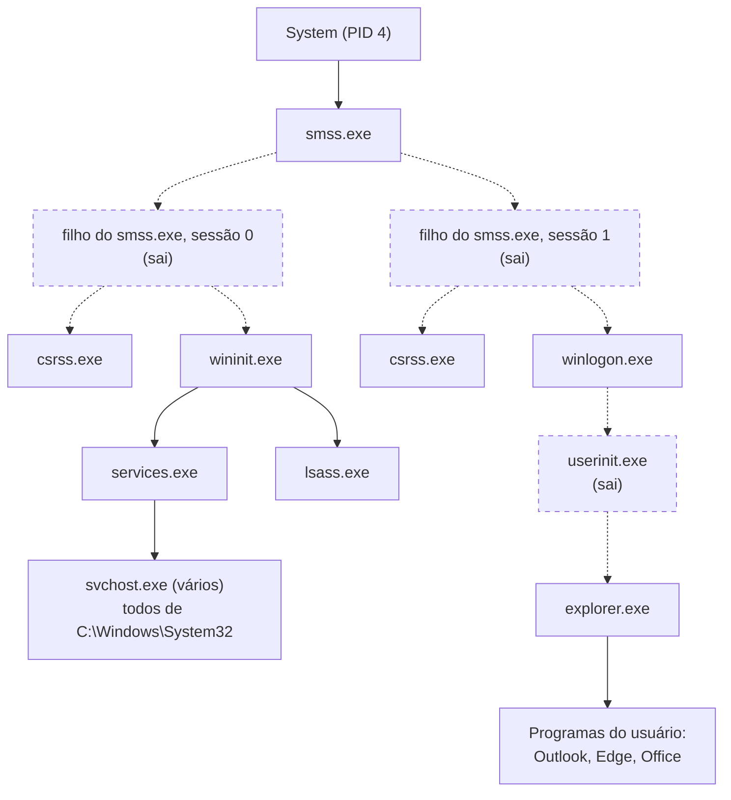
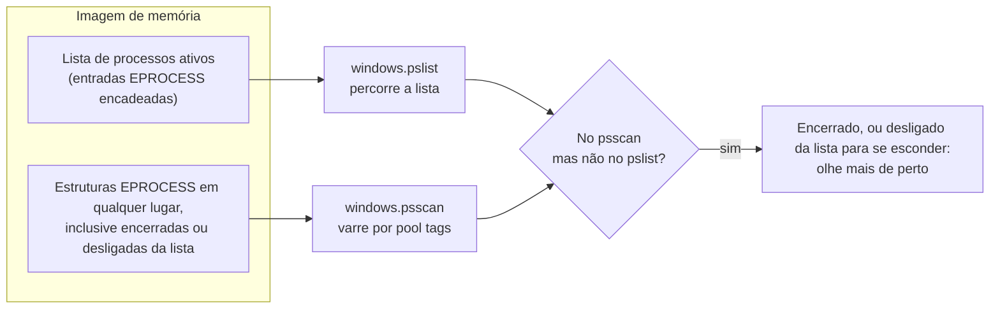

# Dia 53: Forense de memória: aquisição e árvore de processos

> 🇺🇸 Original: [*Day 53: Memory forensics, acquisition and the process tree*](https://github.com/thiefdroppers/cyber-investigator-skills/blob/main/curriculum/phase-4-digital-forensics-incident-investigation/day-53.md) — © ThiefDroppers, licença MIT.
> Aqui: tradução fiel **+** camada brasileira. Nada do original foi removido; tudo o que é novo vem marcado com ➕.

**Fase 4. Forense digital e investigação de incidentes** · Meta da trilha: capturar a memória na ordem certa, rodar os plugins centrais de processos do Volatility 3 e desenhar a árvore de processos como um grafo que mostra quais pares pai-filho são anormais.

Rank Jutsu: `B` · [](https://colab.research.google.com/github/Ridd1kulusC0d3r/investigador-cyber-90-dias/blob/main/curriculo/fase-4-forense-e-resposta/dia-53/dia-53.ipynb)

---

## 🎬 ➕ Abertura do caso — *Os 15 minutos que o Rafa comprou*

Lembra do telefonema de segunda, 14h30? A TI queria desligar o `SA-CX-07` e Rafa disse "primeiro a memória". O analista de TI rodou o WinPmem a partir de um disco externo às 14h41 (17h41 UTC), calculou o hash da captura e só então desligou o notebook, às 14h45.

Agora a saída dos plugins do Volatility está na sua tela.

— O `msa-atualizador.exe` é filho do `explorer.exe` — você diz. — Pai normal. Então foi a própria caixa que deu dois cliques.

— Pai normal, caminho estranho — responde Rafa. — E olha o `pslist`: cadê o `schtasks.exe` que o log de segurança diz que ele chamou às 11h24?

Você procura. Não está lá. Hoje você aprende a ler uma árvore de processos e a perguntar pelos processos que já foram embora. *(Personagens e cenário: [Operação Isca](../../../caso-continuo/).)*

> ➕ **Honestidade do laboratório:** como no original, não existe imagem de memória real do `SA-CX-07`. Os arquivos em [`caso-continuo/dados/dia-53/`](../../../caso-continuo/dados/dia-53/) são texto escrito à mão no layout do Volatility 3.

---

## 📖 Conceito

A RAM guarda o que o disco nunca registra: processos em execução, as suas linhas de comando, conexões de rede abertas, *strings* decifradas e código injetado direto em outro processo. É também a evidência mais volátil que você vai coletar, então num sistema ligado a memória vem antes do disco (Dia 49, ordem de volatilidade).

Ferramentas de aquisição rodam no host ligado e, portanto, o alteram um pouco; você escolhe a ferramenta de menor impacto e anota que a usou. Opções gratuitas comuns: WinPmem e FTK Imager ("Capture Memory") no Windows, AVML ou LiME no Linux, e *snapshots* do hipervisor para VMs (um `.vmem` do VMware ou um *saved state* do Hyper-V podem ser analisados diretamente). Grave a imagem em mídia externa ou num compartilhamento de rede, nunca no disco suspeito, e calcule o hash imediatamente.

O Volatility 3 interpreta a imagem localizando estruturas do kernel, usando tabelas de símbolos que, no caso do Windows, ele baixa da Microsoft. Os primeiros plugins que você roda respondem "o que estava rodando e quem iniciou":

| Plugin | O que lê | O que revela |
|---|---|---|
| `windows.info` | Bloco de depuração do kernel | *Build* do sistema, hora da captura; confirma que os símbolos foram resolvidos |
| `windows.pslist` | A lista encadeada de processos ativos | Os processos como o sistema operacional os relata |
| `windows.psscan` | Varredura de *pool tags* em toda a memória | Encontra também processos encerrados ou desligados da lista; um processo no psscan mas não no pslist merece atenção |
| `windows.pstree` | O pslist organizado por PID do pai | Cadeias pai-filho |
| `windows.cmdline` | O PEB de cada processo | A linha de comando exata |

O pstree é onde a maior parte da triagem começa, porque o Windows tem uma forma normal conhecida. O `smss.exe` é iniciado pelo `System`; `wininit.exe` e `winlogon.exe` vêm de filhos de curta duração do `smss` cujos PIDs não existem mais; `services.exe` e `lsass.exe` são filhos do `wininit.exe`; todo `svchost.exe` legítimo é filho do `services.exe` e roda a partir de `C:\Windows\System32`. Programas do usuário descendem do `explorer.exe`. Desvios são pistas, não veredictos: um programa do Office iniciando o `powershell.exe` é comum em ataques e também em alguns suplementos legítimos.

A forma normal conhecida. Caixas pontilhadas são pais de curta duração que saem durante a inicialização, e é por isso que `wininit.exe`, `csrss.exe`, `winlogon.exe` e `explorer.exe` mostram um PID de pai que não corresponde a nenhum processo em execução.



Por que você roda tanto o `pslist` quanto o `psscan`:



## 📚 Recursos

- [Documentação do Volatility 3](https://volatility3.readthedocs.io/) e [código-fonte](https://github.com/volatilityfoundation/volatility3). Instale com `pip install volatility3`, que fornece o comando `vol`.
- [WinPmem](https://github.com/Velocidex/WinPmem), [AVML](https://github.com/microsoft/avml), [LiME](https://github.com/504ensicsLabs/LiME).
- Pôster da SANS "Hunt Evil" (gratuito com cadastro): a árvore de processos normal do Windows numa página.
- [Graphviz](https://graphviz.org/) para desenhar a árvore.
- Imagens lícitas para praticar: a série de CTF [MemLabs](https://github.com/stuxnet999/MemLabs) publica imagens de memória Windows feitas para treinamento.

### ➕ Recursos do contexto Brasil

- Microsoft, [*Base64 encoding*/`-EncodedCommand` em `about_PowerShell_exe`](https://learn.microsoft.com/en-us/powershell/module/microsoft.powershell.core/about/about_powershell_exe): a documentação oficial confirma que o parâmetro recebe Base64 de uma *string* em UTF-16LE. O mesmo truque aparece em argumentos de programas maliciosos fora do PowerShell, como no `--canal` da Prática BR.
- CERT.br, [Cartilha de Segurança para Internet](https://cartilha.cert.br/): o fascículo de códigos maliciosos serve para explicar à gerência da cooperativa, em português, o que é um "programa que se instala sozinho".

## 🛠️ Prática: saída do Volatility 3 para uma árvore de processos em Graphviz do WS-FIN-07

Este repositório não traz uma imagem de memória crua (elas têm gigabytes e precisariam de uma instalação real de sistema operacional para serem produzidas). A pasta [`resources/case-lab-p4/memory/`](../../../upstream/curriculum/phase-4-digital-forensics-incident-investigation/resources/case-lab-p4/memory/) contém texto sintético no layout que o Volatility 3 imprime, para o host fictício WS-FIN-07. Os comandos abaixo mostram o que você rodaria contra uma imagem real; os passos de análise funcionam sobre o texto fornecido. Se quiser rodar os comandos de verdade, use uma imagem do MemLabs e aplique os mesmos passos à saída dela.

**Seu checklist de hoje.** Faça na ordem e marque cada item ao terminar:

- [ ] Rode os comandos do Volatility 3 e salve cada um num arquivo.
- [ ] Leia `windows.pstree.txt` e liste todos os desvios da árvore normal.
- [ ] Decodifique o comando PowerShell codificado.
- [ ] Transforme a árvore de processos num grafo Graphviz.
- [ ] Escreva a lista de achados, uma linha por nó vermelho.
- [ ] Explique por que `wininit.exe` e `csrss.exe` mostram PIDs de pai que não correspondem a nada.
- [ ] ➕ Prática BR: a árvore do `SA-CX-07`, o `--canal` codificado e o `schtasks.exe` que só o psscan vê.
- [ ] ➕ O notebook do dia: parser do pstree, regras da árvore normal, decodificação e o `.dot` gerado automaticamente.

1. Os comandos contra uma imagem real (`ws-fin-07.mem`), cada um salvo num arquivo para que as suas notas citem a saída exata:

   ```bash
   vol -f ws-fin-07.mem windows.info                  > info.txt
   vol -f ws-fin-07.mem windows.pslist                > pslist.txt
   vol -f ws-fin-07.mem windows.psscan                > psscan.txt
   vol -f ws-fin-07.mem windows.pstree                > pstree.txt
   vol -f ws-fin-07.mem windows.cmdline               > cmdline.txt
   vol -f ws-fin-07.mem -r csv windows.pslist         > pslist.csv
   vol -f ws-fin-07.mem windows.pslist --pid 7316 7488
   ```

   `-r csv` (ou `-r json`) troca o *renderer* para você carregar os resultados numa planilha. `--pid` limita a saída aos processos listados.

2. Leia [`windows.pstree.txt`](../../../upstream/curriculum/phase-4-digital-forensics-incident-investigation/resources/case-lab-p4/memory/windows.pstree.txt). Os asteriscos mostram a profundidade. Percorra-o comparando com a árvore normal acima e liste todos os desvios. Você deve encontrar pelo menos estes:

   - `OUTLOOK.EXE` (6632) é pai do `powershell.exe` (7316), iniciado às 16:42:18 UTC com `-WindowStyle Hidden -EncodedCommand`.
   - `synchelper.exe` (7488) roda a partir de `AppData\Roaming\SyncHelper`, pai 7316. O mesmo caminho é o do arquivo com *timestomping* do Dia 52.
   - `rundll32.exe` (7704) não tem argumento de DLL. O `rundll32` existe para carregar uma função exportada de uma DLL, então uma linha de comando vazia é incomum.
   - `svchost.exe` (5124) é filho do `explorer.exe` e roda a partir de `C:\Users\Public`.

3. Decodifique o comando codificado. O `-EncodedCommand` do PowerShell é Base64 de texto em UTF-16LE.

   ```bash
   B64=$(awk -F'\t' '$1==7316 {print $3}' resources/case-lab-p4/memory/windows.cmdline.txt | awk '{print $NF}')
   echo "$B64" | base64 -d | iconv -f UTF-16LE -t UTF-8; echo
   ```

   Neste laboratório sintético, ele decodifica para um texto inofensivo: `Write-Output 'LAB-P4 synthetic placeholder, no payload'`. No trabalho real, decodifique numa VM de análise isolada e trate o texto decodificado como evidência a documentar, não como algo a executar.

4. Transforme a árvore num grafo. Escreva `pstree.dot` à mão ou com algumas linhas de awk; os nós são `nome (PID)`, as arestas vão do pai para o filho, e os nós anômalos ficam preenchidos de vermelho com o motivo no rótulo.

   ```dot
   digraph pstree {
     rankdir=LR; node [shape=box, fontname="Helvetica"];
     p4120 [label="explorer.exe (4120)"];
     p6632 [label="OUTLOOK.EXE (6632)"];
     p7316 [label="powershell.exe (7316)\n-EncodedCommand, hidden window\n16:42:18Z", style=filled, fillcolor="#f4b6b6"];
     p7488 [label="synchelper.exe (7488)\nAppData\\Roaming, timestomped (day 52)", style=filled, fillcolor="#f4b6b6"];
     p7704 [label="rundll32.exe (7704)\nno DLL argument", style=filled, fillcolor="#f4b6b6"];
     p5124 [label="svchost.exe (5124)\nC:\\Users\\Public, parent explorer", style=filled, fillcolor="#f4b6b6"];
     p6208 [label="msedge.exe (6208)"];
     p4120 -> p6632 -> p7316 -> p7488 -> p7704;
     p4120 -> p5124; p4120 -> p6208;
   }
   ```

   Acrescente também o ramo do sistema (`System` → `smss.exe`; `wininit.exe` → `services.exe` → os três `svchost.exe` normais; `wininit.exe` → `lsass.exe`), desenhado no estilo padrão, para que o leitor veja o normal e o anormal lado a lado. Renderize:

   ```bash
   dot -Tpng pstree.dot -o ws-fin-07-pstree.png
   ```

5. Embaixo do grafo, escreva uma lista de achados com uma linha por nó vermelho: a observação, o arquivo e a linha de onde ela veio, e uma explicação legítima que você considerou. Uma linha no formato esperado, com a explicação deixada para você:

   ```text
   rundll32.exe (7704) | Cmd column is the bare path C:\Windows\system32\rundll32.exe, no DLL argument | windows.pstree.txt, PID 7704 row | legitimate explanation considered: ...
   ```

6. Embaixo da lista de achados, escreva por que `wininit.exe` e `csrss.exe` aparecem com PIDs de pai (444, 524) que não correspondem a nenhum processo em execução, e por que isso é normal.

Artefato: `ws-fin-07-pstree.png` com todos os processos do arquivo pstree, anomalias em vermelho com o motivo no rótulo, mais a lista de achados.

### ➕ Prática BR: a árvore do `SA-CX-07`

Os arquivos estão em [`caso-continuo/dados/dia-53/`](../../../caso-continuo/dados/dia-53/): `pslist`, `psscan`, `pstree` e `cmdline` do `SA-CX-07`, capturados (na ficção) às 17:41 UTC de 5/out. Leia o [`LEIA-ME`](../../../caso-continuo/dados/dia-53/LEIA-ME.md).

**Exercício 1: pai normal, caminho anormal.** Percorra o `sa-cx-07.windows.pstree.txt` como no passo 2. O processo 7712 tem pai `explorer.exe` (3988), o que é **normal** para um programa iniciado pelo usuário. Liste, ainda assim, os desvios dele, coluna por coluna:

- `ImageFileName` truncado em `msa-atualizado` (o Volatility mostra o nome do EPROCESS, limitado a 14 caracteres; o nome completo está em `Path`);
- `Path` em `AppData\Roaming\MSA`, a pasta com o `$SI` reescrito do Dia 52;
- `Cmd` com `--canal` seguido de um texto em Base64;
- `CreateTime` 11:24:31 UTC, dois segundos depois do `$FN` Created do executável (Dia 52) e quatro minutos depois do download do ZIP no proxy (Dia 49).

Compare com o `caixa-sa.exe` (6120): também filho do `explorer.exe`, também fora do `System32`, mas em `Program Files\SerraAzul\Caixa`, com `$SI` e `$FN` iguais na MFT. É o seu controle.

**Exercício 2: o `--canal`.** Decodifique como no passo 3, trocando o PID:

```bash
B64=$(awk -F'\t' '$1==7712 {print $3}' caso-continuo/dados/dia-53/sa-cx-07.windows.cmdline.txt | awk '{print $NF}')
echo "$B64" | base64 -d | iconv -f UTF-16LE -t UTF-8; echo
```

Ele decodifica para um nome de domínio. Qual? Em que outro arquivo do caso esse nome já apareceu (Dia 49, proxy)? Escreva a ligação como "mesmo nome de domínio", não como "o programa se comunicou com".

**Exercício 3: o processo que só o psscan vê.** Compare `pslist` e `psscan`:

```bash
cut -f1,3 caso-continuo/dados/dia-53/sa-cx-07.windows.pslist.txt | sort > /tmp/pslist.pids
cut -f1,3 caso-continuo/dados/dia-53/sa-cx-07.windows.psscan.txt | sort > /tmp/psscan.pids
comm -13 /tmp/pslist.pids /tmp/psscan.pids
```

Sobra um `schtasks.exe` (7790), pai 7712, com `ExitTime` preenchido: ele rodou um segundo e saiu. O log de segurança do Windows (pacote do Dia 57) tem um 4688 do `schtasks.exe` às 11:24:44 com o `msa-atualizador.exe` como pai. Duas fontes independentes. O que o `psscan` **não** diz: qual tarefa foi criada e com que nome. Isso vem do registro ou da pasta `C:\Windows\System32\Tasks` da imagem de disco.

### ➕ O notebook do dia

Abra o [notebook do Dia 53 no Colab](https://colab.research.google.com/github/Ridd1kulusC0d3r/investigador-cyber-90-dias/blob/main/curriculo/fase-4-forense-e-resposta/dia-53/dia-53.ipynb). Nele você:

1. baixa a saída sintética do Volatility (com plano B offline) e interpreta o `pstree` (asteriscos, colunas separadas por tabulação);
2. aplica as regras da árvore normal como código: cada desvio sai com a coluna que o causou;
3. decodifica o `-EncodedCommand` e o `--canal` com `base64` e UTF-16LE, sem executar nada;
4. gera o `pstree.dot` completo (ramo do sistema + ramo do usuário, nós vermelhos com motivo) e, se o Graphviz existir, o PNG;
5. compara `pslist` e `psscan` do `SA-CX-07` e acha o `schtasks.exe`;
6. joga o **quiz do pai certo**: para cada processo, qual é o pai normal.

## ✅ Checkpoint

- Todos os 19 processos do arquivo de texto aparecem no seu grafo.
- Todo processo do seu grafo está embaixo do pai certo.
- Quatro nós estão em vermelho.
- O rótulo de cada nó vermelho dá um motivo ligado a uma coluna específica (caminho, pai, linha de comando).
- Sua nota do passo 6 diz que os pais com PIDs 444 e 524 são instâncias de curta duração do `smss.exe` que saíram durante a inicialização.
- Sem consultar notas, você diz qual plugin rodaria para encontrar um processo que já saiu, e por que o `pslist` não o veria.

### ➕ Checkpoint BR

- Sua lista de achados do `SA-CX-07` tem o 7712 com pelo menos três desvios, cada um ligado a uma coluna, e diz que o pai (`explorer.exe`) é normal.
- O `caixa-sa.exe` aparece como controle, não como anomalia.
- Você decodificou o `--canal` e escreveu a ligação com o proxy como "mesmo nome de domínio".
- O `schtasks.exe` 7790 está nas suas notas como "visto só no psscan, encerrado, confirmado pelo 4688", com o que ainda falta saber (o nome da tarefa).

## Observação

Uma imagem de memória crua do WS-FIN-07 não existe e não será acrescentada; os arquivos de texto são os dados do laboratório. Para praticar os comandos de ponta a ponta, baixe uma imagem do MemLabs e calcule o hash dela antes de usar.

> ➕ O mesmo vale para o `SA-CX-07`: não há `.mem`. A cena da captura é ficção; os dados são texto escrito à mão para o exercício.

## ⚖️ ➕ Camada jurídica BR

**A captura de memória altera o sistema, e isso precisa estar escrito.** Rodar o WinPmem carrega um *driver* e grava na RAM. O original manda escolher a ferramenta de menor impacto e anotar que a usou. No vocabulário do CPP, isso é a etapa de **coleta** (art. 158-B, IV), e a alteração inevitável causada pela coleta deve ficar documentada para não ser confundida, depois, com alteração do vestígio. Anote ferramenta, versão, horário (UTC e local), quem rodou, onde gravou e o hash da captura.

**Quem rodou a captura.** Na cena, foi o analista de TI da cooperativa, orientado por telefone. Isso é comum e aceitável, desde que o formulário diga exatamente isso. Não escreva "a Vigia capturou a memória" se a Vigia só orientou.

**Dados pessoais na RAM.** Uma imagem de memória pode conter senhas, conversas e dados de cooperados abertos no sistema de caixa. O tratamento segue a mesma base legal do caso e o princípio da necessidade (LGPD, art. 6º, III): a análise se limita aos processos e artefatos relevantes. *Strings* com dados pessoais que aparecerem por acaso não vão para o relatório.

> Material de estudo, não constitui orientação jurídica.

## 🧠 ➕ Camada 8 — "pai normal" não é "processo normal"

Na abertura, "filho do `explorer.exe`" virou "foi a caixa que deu dois cliques" e, logo depois, "então não é tão grave". É um atalho mental que Kahneman e Tversky estudaram como **heurística da representatividade**: julgamos a probabilidade de algo pela semelhança com um protótipo ("processo filho do explorer = programa de usuário = normal"), ignorando as outras informações (o caminho, a linha de comando, o horário). O `caixa-sa.exe` e o `msa-atualizador.exe` se parecem no protótipo e diferem em tudo o resto.

E há a outra metade da Camada 8 aqui: **a caixa provavelmente deu, sim, dois cliques**. O site falso mandou baixar um "Módulo de Segurança" com a marca da cooperativa (autoridade, no vocabulário de Cialdini) e com urgência ("sua chave Pix foi bloqueada"). Isso explica o comportamento dela, não a culpa. No relatório, escreva "o processo foi iniciado na sessão do usuário `cx.centro07`" e não "a funcionária executou o malware". A primeira frase é o que a memória mostra; a segunda é um juízo que a memória não sustenta e que pode prejudicar uma pessoa que foi vítima de engenharia social.

## 🤖 ➕ Skill do dia

O dia propõe um procedimento novo, **"Triagem de memória: árvore de processos"**: comparar com a árvore normal do Windows coluna por coluna, rodar `pslist` e `psscan` e cruzar, decodificar argumentos codificados sem executar, e redigir sem atribuir culpa ao usuário. Texto e caso de teste em [`_skill-delta.md`](_skill-delta.md).

## 💡 ➕ Inovação OSINT do dia — decodificador de "Base64 do PowerShell" em uma linha

Argumentos em Base64 de UTF-16LE aparecem em linhas de comando, em logs de EDR, em *tweets* e *posts* de pesquisadores compartilhando IOCs. Decodificar com segurança, sem executar nada, é uma linha de Python:

```python
import base64
def decodificar_ps(b64: str) -> str:
    return base64.b64decode(b64).decode("utf-16-le", errors="replace")

print(decodificar_ps("VwByAGkAdABlAC0ATwB1AHQAcAB1AHQAIAAnAEwAQQBCAC0AUAA0ACAAcwB5AG4AdABoAGUAdABpAGMAIABwAGwAYQBjAGUAaABvAGwAZABlAHIALAAgAG4AbwAgAHAAYQB5AGwAbwBhAGQAJwA="))
# Write-Output 'LAB-P4 synthetic placeholder, no payload'
```

Dica de reconhecimento: Base64 de texto ASCII em UTF-16LE tem um padrão visível, com muitos `A` alternados (`VwByAGkA...`), porque cada caractere vira dois bytes e o segundo é zero. Quando você vê isso num argumento, já sabe o que tentar primeiro.

## 📝 Diário de estudo

- Data:
- Tempo gasto:
- O que ficou claro:
- O que ainda está nebuloso:
- Artefato produzido: `ws-fin-07-pstree.png` (ou `.dot`) com a lista de achados, árvore do `SA-CX-07` com o `--canal` decodificado e o `schtasks.exe` do psscan

---
<sub>Baseado em [cyber-investigator-skills](https://github.com/thiefdroppers/cyber-investigator-skills) por ThiefDroppers (MIT). Tradução, camada BR, Camada 8, skill pt-BR e notebook por Deivison Lourenço (@Ridd1kulusC0d3r).</sub>
