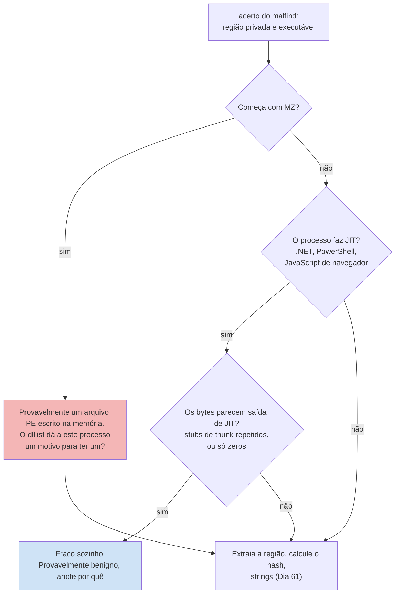
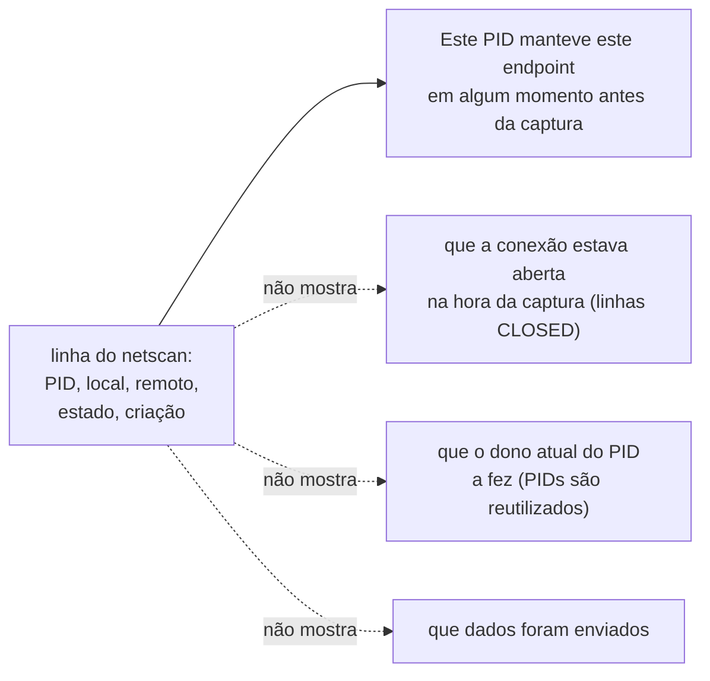

# Dia 54: Forense de memória: conexões de rede e código injetado

> 🇺🇸 Original: [*Day 54: Memory forensics, network connections and injected code*](https://github.com/thiefdroppers/cyber-investigator-skills/blob/main/curriculum/phase-4-digital-forensics-incident-investigation/day-54.md) — © ThiefDroppers, licença MIT.
> Aqui: tradução fiel **+** camada brasileira. Nada do original foi removido; tudo o que é novo vem marcado com ➕.

**Fase 4. Forense digital e investigação de incidentes** · Meta da trilha: ligar processos aos *endpoints* de rede que eles mantiveram e a regiões de memória que parecem código injetado, e separar acertos reais dos falsos positivos pelos quais esses plugins são conhecidos.

Rank Jutsu: `B` · [](https://colab.research.google.com/github/Ridd1kulusC0d3r/investigador-cyber-90-dias/blob/main/curriculo/fase-4-forense-e-resposta/dia-54/dia-54.ipynb)

---

## 🎬 ➕ Abertura do caso — *Cinco minutos, de novo*

Você coloca lado a lado a saída do `netscan` do `SA-CX-07` e o log do proxy da cooperativa.

— Olha: o `msa-atualizador` tem uma conexão fechada com 198.51.100.140 às 17h35 e uma aberta às 17h40. E o proxy tem um `CONNECT atualiza-modulo.example` a cada cinco minutos desde as 11h25. É um *beacon*!

Rafa não discorda. Só pergunta:

— Duas linhas de memória e uma planilha de proxy. O que cada uma mostra, separadamente? E aquela linha de 3 megabytes às 12h07 no proxy: você sabe o que tinha dentro?

Você não sabe. O proxy só vê o tamanho do túnel TLS. Hoje você aprende a dizer exatamente o que uma linha do `netscan` e um acerto do `malfind` provam, e o que não provam. *(Personagens e cenário: [Operação Isca](../../../caso-continuo/).)*

> ➕ **Honestidade do laboratório:** como no Dia 53, não existe imagem de memória; `netscan` e `malfind` do `SA-CX-07` são texto sintético em [`caso-continuo/dados/dia-54/`](../../../caso-continuo/dados/dia-54/), com bytes ilustrativos e nada executável.

---

## 📖 Conceito

A árvore de ontem diz o que rodou. Os plugins de hoje dizem o que esses processos estavam fazendo.

O `windows.netscan` varre a memória atrás de estruturas de *endpoints* TCP e UDP e imprime endereço local e remoto, estado, PID dono e hora de criação. Como ele varre em vez de percorrer uma lista viva, também encontra conexões fechadas cujas estruturas ainda não foram sobrescritas. Isso é útil (uma entrada `CLOSED` mostra uma conexão anterior) e é uma armadilha (uma estrutura velha pode carregar um PID que desde então foi reutilizado por outro processo). Trate uma linha do netscan como "este processo manteve este *endpoint* em algum momento antes da captura".

O `windows.malfind` procura regiões de memória que são privadas (não respaldadas por um arquivo em disco), marcadas como executáveis e normalmente graváveis também (`PAGE_EXECUTE_READWRITE`). Essa combinação é o que a injeção de código clássica deixa para trás: um processo aloca memória, escreve código nela e a executa. Se a região começa com `MZ`, provavelmente um arquivo PE inteiro foi escrito ali. O malfind é ruidoso por natureza. Compiladores *just-in-time* (o .NET, que o PowerShell usa, e os motores de JavaScript dos navegadores) criam legitimamente memória privada executável. Um acerto é uma pergunta: o que há nesta região, e isso combina com o processo?

Um jeito de trabalhar cada acerto do malfind antes de dar um veredito:



O que uma linha do netscan pode e não pode dizer:



Mais dois plugins respondem perguntas de acompanhamento. O `windows.dlllist --pid N` lista os módulos carregados do disco, para você ver se o `rundll32.exe` carregou de fato alguma DLL. O `windows.handles --pid N` lista arquivos, chaves de registro, *mutexes* e outros objetos abertos, o que muitas vezes mostra o arquivo ou a chave com que um processo suspeito estava trabalhando.

O Volatility 3 moveu o malfind e vários outros plugins de detecção para um prefixo `windows.malware.`. Na v2.28.2 (a versão atual em setembro de 2026), o nome canônico é `windows.malware.malfind`; o antigo `windows.malfind` ainda roda, mas é um *alias* obsoleto que o código-fonte marca para remoção, então espere que ele desapareça numa versão futura. Rode `vol -h` e use o que a sua versão instalada listar.

## 📚 Recursos

- [Referência de plugins](https://volatility3.readthedocs.io/en/latest/volatility3.plugins.html) do Volatility 3.
- *The Art of Memory Forensics* (Ligh, Case, Levy, Walters; Wiley, 2014): capítulos sobre memória de processos e rede. Escrito para o Volatility 2, mas os conceitos continuam valendo.
- Documentação da Microsoft sobre [constantes de proteção de memória](https://learn.microsoft.com/en-us/windows/win32/memory/memory-protection-constants).
- [Gephi](https://gephi.org/) ou Graphviz para o grafo.

### ➕ Recursos do contexto Brasil

- MITRE ATT&CK, [T1071.001 *Application Layer Protocol: Web Protocols*](https://attack.mitre.org/techniques/T1071/001/) e [T1029 *Scheduled Transfer*](https://attack.mitre.org/techniques/T1029/): as técnicas que um *beacon* HTTPS em intervalo fixo costuma evocar. Use como vocabulário, não como conclusão.
- [RFC 9293](https://www.rfc-editor.org/rfc/rfc9293) (TCP, versão consolidada de 2022): a máquina de estados com `SYN-SENT`, `ESTABLISHED`, `CLOSED`, para quem quiser a fonte primária do que cada estado significa.

## 🛠️ Prática: netscan e malfind para um grafo processo-rede

Dados: [`windows.netscan.txt`](../../../upstream/curriculum/phase-4-digital-forensics-incident-investigation/resources/case-lab-p4/memory/windows.netscan.txt) e [`windows.malfind.txt`](../../../upstream/curriculum/phase-4-digital-forensics-incident-investigation/resources/case-lab-p4/memory/windows.malfind.txt), saída sintética do WS-FIN-07 (10.10.40.57). Contra uma imagem real, os comandos são:

```bash
vol -f ws-fin-07.mem windows.netscan            > netscan.txt
vol -f ws-fin-07.mem windows.malware.malfind    > malfind.txt
vol -f ws-fin-07.mem -o ./malfind_dump/ windows.malware.malfind --pid 7704 --dump
vol -f ws-fin-07.mem windows.dlllist --pid 7704
vol -f ws-fin-07.mem windows.handles --pid 7488
```

O `--dump` grava cada região sinalizada num arquivo dentro do diretório `-o`, para você calcular o hash e rodar `strings` nela (Dia 61). Faça isso dentro de uma VM de análise.

**Seu checklist de hoje.** Faça na ordem e marque cada item ao terminar:

- [ ] Filtre o netscan para conexões externas e ordene pelo dono.
- [ ] Anote o detalhe de tempo nas duas conexões do `synchelper.exe`.
- [ ] Registre o vínculo entre hosts por 198.51.100.23.
- [ ] Leia o malfind e julgue cada uma das três regiões sinalizadas.
- [ ] Monte o grafo processo-rede em Graphviz.
- [ ] Escreva o que `SYN_SENT` significa para o `svchost.exe` (5124).
- [ ] ➕ Prática BR: netscan e malfind do `SA-CX-07`, cruzados com o proxy e o firewall.
- [ ] ➕ O notebook do dia: o `awk` em Python, a tabela de veredictos do malfind, o teste do intervalo e o grafo.

1. Filtre o netscan para conexões com *endpoint* remoto e ordene pelo dono.

   ```bash
   N=resources/case-lab-p4/memory/windows.netscan.txt
   awk -F'\t' '$1 ~ /^0x/ && $5!="0.0.0.0" && $5!="*" {print $9" ("$8")", $3":"$4, "->", $5":"$6, $7, $10}' "$N" | sort
   ```

   Você deve obter cinco linhas. Classifique cada endereço remoto: 192.0.2.30 e 192.0.2.31 são os serviços de e-mail e web que a empresa fictícia usa (trate-os como esperados); 198.51.100.23 e 203.0.113.80 não são.

2. Anote o detalhe de tempo no `synchelper.exe` (7488): uma conexão `CLOSED` com 198.51.100.23:443 criada às 05:02:30 e uma `ESTABLISHED` às 05:07:31. Cinco minutos de diferença. Um intervalo não é um padrão; é uma pergunta a testar no Dia 59 contra dados de rede.

3. Registre o vínculo entre hosts. 198.51.100.23 é também o destino da transferência de saída de cerca de 48 MB a partir do `fs01` no `firewall.log` (você vai alinhar isso no Dia 56). Esse endereço compartilhado liga dois hosts do caso. Escreva-o como "mesmo IP remoto", que é o que você observou, e não como "mesmo atacante", que você não mostrou.

   O mapa do caso depois de hoje. As arestas sólidas vêm dos arquivos de texto da memória; a aresta tracejada é o único fato que liga o WS-FIN-07 ao resto do caso, e ele é só um endereço compartilhado. O horário da transferência do `fs01` fica de fora até o Dia 56, quando você alinha todas as fontes num só relógio.

   ```mermaid
   flowchart LR
       subgraph WS["WS-FIN-07 10.10.40.57 (EVID-003)"]
           PS["powershell.exe 7316"] --> SH["synchelper.exe 7488"]
           SH --> RD["rundll32.exe 7704<br/>MZ em região RWX"]
       end
       SH -->|"CLOSED, criada 05:02:30Z<br/>ESTABLISHED, criada 05:07:31Z"| IP["198.51.100.23:443"]
       FS["fs01 10.10.30.17<br/>(firewall.log, EVID-001)"] -.->|"cerca de 48 MB de saída<br/>mesmo IP remoto, nada mais mostrado"| IP
       style IP fill:#fbe3b0
   ```

4. Leia o malfind. Três regiões estão sinalizadas. Julgue cada uma:

   | PID | Processo | Proteção | Primeiros bytes | Seu veredito |
   |---|---|---|---|---|
   | 7704 | rundll32.exe | PAGE_EXECUTE_READWRITE, privada | `4d 5a 90 00` (MZ) | ? |
   | 7316 | powershell.exe | PAGE_EXECUTE_READWRITE, privada | stubs `49 ba ... 41 ff e3` | ? |
   | 6208 | msedge.exe | PAGE_EXECUTE_READWRITE, privada | só zeros | ? |

   Orientação: um cabeçalho MZ em memória RWX privada de um processo sem argumento de DLL é um indicador forte de injeção. *Stubs* repetidos de `mov r10, imm64; jmp r11` (`49 ba` ... `41 ff e3`) preenchidos com `cc` são típicos de *thunks* de JIT do .NET, que o PowerShell produz; fraco sozinho. Uma região RWX só de zeros num navegador é quase sempre uma alocação de JIT ainda não preenchida. Escreva seu veredito e uma frase de raciocínio por linha.

5. Monte o grafo. Nós: processos (caixas), IPs remotos (elipses), regiões do malfind (losangos). Arestas: processo para IP remoto rotulada com `estado, hora de criação`; processo para região rotulada com a `proteção`; e as arestas pai-filho do Dia 53 só para a cadeia suspeita. Pinte conforme o seu veredito do passo 4. Um começo em Graphviz:

   ```dot
   digraph net {
     rankdir=LR;
     p7316 [shape=box, label="powershell.exe (7316)"];
     p7488 [shape=box, label="synchelper.exe (7488)", style=filled, fillcolor="#f4b6b6"];
     p7704 [shape=box, label="rundll32.exe (7704)", style=filled, fillcolor="#f4b6b6"];
     ip23  [shape=ellipse, label="198.51.100.23:443\nalso fs01 egress (firewall.log)"];
     r7704 [shape=diamond, label="0x1c0000 RWX\nMZ header"];
     p7316 -> p7488 -> p7704 [color=gray];
     p7488 -> ip23 [label="ESTABLISHED 05:07:31Z"];
     p7488 -> ip23 [label="CLOSED 05:02:30Z", style=dashed];
     p7704 -> r7704 [label="PAGE_EXECUTE_READWRITE"];
   }
   ```

   Termine com o `svchost.exe` (5124) e 203.0.113.80:8443 (`SYN_SENT`, que significa que a tentativa de conexão não tinha sido concluída), a região de JIT do PowerShell marcada como provavelmente benigna, e as conexões do Outlook e do Edge em cinza.

6. Nas suas notas, escreva uma linha sobre o que `SYN_SENT` significa para o `svchost.exe` (5124) e 203.0.113.80:8443.

Artefato: `ws-fin-07-process-network.png` mais a tabela de veredictos do malfind preenchida.

### ➕ Prática BR: o `SA-CX-07` na rede

Arquivos: [`sa-cx-07.windows.netscan.txt`](../../../caso-continuo/dados/dia-54/sa-cx-07.windows.netscan.txt) e [`sa-cx-07.windows.malfind.txt`](../../../caso-continuo/dados/dia-54/sa-cx-07.windows.malfind.txt). O mesmo `awk` do passo 1 funciona sem mudança:

```bash
N=caso-continuo/dados/dia-54/sa-cx-07.windows.netscan.txt
awk -F'\t' '$1 ~ /^0x/ && $5!="0.0.0.0" && $5!="*" {print $9" ("$8")", $3":"$4, "->", $5":"$6, $7, $10}' "$N" | sort
```

**Exercício 1: classifique os cinco remotos.** `10.20.5.30:8443` é o servidor interno do sistema de caixa (esperado para o `caixa-sa.exe`); `192.0.2.24` é um portal de notícias que aparece no proxy de outros caixas (esperado). Restam três linhas para você classificar: duas do `msa-atualizado` (7712) com 198.51.100.140:443 e uma do `msedge.exe` (5216), `CLOSED`, com **203.0.113.77:443**, criada às 11:21:05. O que é 203.0.113.77 no caso? (Fatos fixos da Operação Isca.) Por que é plausível que uma estrutura `CLOSED` de seis horas antes ainda esteja na memória, e por que você não pode afirmar que ela "estava conectada" na hora da captura?

**Exercício 2: o intervalo, agora com uma segunda fonte.** No netscan: `CLOSED` às 17:35:09 e `ESTABLISHED` às 17:40:14, de novo cerca de cinco minutos. No [`proxy-sa.log`](../../../caso-continuo/dados/dia-49/EVID-SA-001/proxy-sa.log) do Dia 49 (em UTC), filtre as linhas do 10.20.40.57 para `atualiza-modulo.example` e calcule os intervalos:

```bash
grep 'atualiza-modulo.example' caso-continuo/dados/dia-49/EVID-SA-001/proxy-sa.log | cut -c8-15
```

Agora o "um intervalo não é um padrão" do original pode virar padrão: a série do proxy é longa. Escreva a frase: *"O proxy registra conexões do 10.20.40.57 para `atualiza-modulo.example` (198.51.100.140) a intervalos de cerca de 300 s entre 11:25 e 12:35 UTC (trecho do EVID-SA-001; o pacote completo do Dia 57 segue até 13:40); a memória do `SA-CX-07` mostra o processo 7712 com duas conexões para o mesmo IP às 17:35 e 17:40 UTC."* Duas fontes, cada uma dizendo só o que mostra.

**Exercício 3: o envio que ninguém viu por dentro.** O proxy tem, às 12:07:10 UTC, uma linha com `out=3145728` (3 MiB exatos) para o mesmo destino, e o firewall (em horário de Brasília, sem fuso: 09:07:10) tem 3.150.210 bytes. Escreva o que você pode afirmar ("3 MiB saíram do `SA-CX-07` para 198.51.100.140 num túnel TLS") e o que não pode ("o conteúdo"; "foram dados de cooperados"). O conteúdo não foi observado por nenhuma fonte do caso.

**Exercício 4: os três acertos do malfind.** Preencha a mesma tabela do passo 4 para o `msa-atualizado` (7712, MZ), o `caixa-sa.exe` (6120, *stubs* `49 ba`/`41 ff e3`; o sistema de caixa da cooperativa é um aplicativo .NET) e o `msedge.exe` (5216, zeros). Lembre que o 7712 já é ele mesmo um executável: um `MZ` em memória privada RWX dentro dele pode ser desempacotamento ou um segundo PE. Em qualquer caso, o próximo passo é o mesmo do original (`--dump`, hash, Dia 61), que só uma imagem real permitiria.

### ➕ O notebook do dia

Abra o [notebook do Dia 54 no Colab](https://colab.research.google.com/github/Ridd1kulusC0d3r/investigador-cyber-90-dias/blob/main/curriculo/fase-4-forense-e-resposta/dia-54/dia-54.ipynb). Nele você:

1. refaz o `awk` do passo 1 em Python e classifica os remotos por lista de "esperados";
2. interpreta o `malfind` (cabeçalho, *hexdump*) e aplica o fluxograma do conceito como função, com o veredito e a frase de raciocínio;
3. mede intervalos entre conexões e testa se o "cinco minutos" vira padrão quando a série do proxy entra;
4. gera o `.dot` do grafo processo-rede (e o PNG, se houver Graphviz), com as arestas `CLOSED` tracejadas;
5. joga o **quiz do "o que esta linha prova"**: para cada afirmação, se a linha do netscan/malfind a sustenta.

## ✅ Checkpoint

- Seu grafo tem todas as linhas do netscan que não estão em escuta (*listening*).
- Seu grafo tem todas as regiões do malfind.
- Toda linha do netscan e toda região do malfind no grafo traz um rótulo tirado do arquivo de texto.
- Sua tabela do malfind chama a região do Edge de benigna ou provavelmente benigna.
- Sua tabela do malfind dá um motivo para o veredito sobre a região do PowerShell, seja ele qual for.
- Sua nota do passo 6 diz o que `SYN_SENT` significa para o 5124.
- Em nenhum lugar das suas notas ou do grafo o 5124 é descrito como "conectado a" 203.0.113.80.
- Sem notas, você diz o que rodaria em seguida contra uma imagem real para confirmar que a região do rundll32 é um arquivo PE, e para onde vai a saída.

### ➕ Checkpoint BR

- Sua classificação dos remotos do `SA-CX-07` identifica 203.0.113.77 como o IP do site falso e trata a linha do Edge como "manteve em algum momento", não "estava conectado".
- Sua frase do *beacon* cita as duas fontes separadamente e diz "cerca de 300 s", não "*beacon* confirmado do malware X".
- Sua nota sobre os 3 MiB diz "conteúdo não observado".
- Sua tabela do malfind do `SA-CX-07` chama o Edge de provavelmente benigno, justifica o `caixa-sa.exe` (.NET) e diz o próximo passo para o 7712.

## Observação

Como no Dia 53, os dados de memória são texto sintético e não há imagem crua. Os passos `--dump` e `dlllist` precisam de uma imagem real, como uma do MemLabs.

## ⚖️ ➕ Camada jurídica BR

**"Exfiltração" e "vazamento" são palavras com consequência.** Um envio de 3 MiB para um IP desconhecido, com conteúdo não observado, ainda não é "vazamento de dados pessoais". Mas a LGPD (art. 48) obriga o controlador a comunicar à ANPD e aos titulares a ocorrência de incidente de segurança que possa acarretar risco ou dano relevante. A decisão de comunicar é da cooperativa (com o encarregado e o jurídico), não da Vigia; o papel do analista é entregar o fato com a confiança certa e com o que falta saber. Se o relatório diz "vazamento confirmado" sem base, empurra a cooperativa para uma comunicação errada; se diz "nada aconteceu", também. Pelo Regulamento de Comunicação de Incidente de Segurança (Resolução CD/ANPD nº 15/2024), a comunicação à ANPD e aos titulares é feita em **três dias úteis**, contados do conhecimento de que o incidente afetou dados pessoais (em dobro para agentes de pequeno porte), com complementação à ANPD em até 20 dias úteis. Há risco ou dano relevante quando o incidente pode afetar significativamente os titulares **e** envolve ao menos um destes critérios: dados sensíveis; de crianças, adolescentes ou idosos; financeiros; de autenticação; protegidos por sigilo; ou em larga escala. O registro do incidente, comunicado ou não, é guardado por no mínimo cinco anos.

**Conexão com IP externo não é identificação de pessoa.** 198.51.100.140 é infraestrutura. Descobrir quem a contratou exige dados cadastrais do provedor, que, pelo Marco Civil (arts. 10 e 22), só saem por requisição de autoridade ou ordem judicial. O que a Vigia faz: documenta, preserva e entrega para a cooperativa levar à autoridade.

> Material de estudo, não constitui orientação jurídica.

## 🧠 ➕ Camada 8 — apofenia de analista

Ver um padrão em duas linhas ("cinco minutos, é *beacon*!") é o cérebro fazendo o que faz bem: achar regularidade. A psicologia chama de **apofenia** a tendência de perceber conexões e padrões significativos em dados aleatórios ou sem relação; a **ilusão de agrupamento** (*clustering illusion*), estudada por Gilovich, é a versão estatística: achar que sequências curtas têm estrutura que elas não têm. O original é preciso ao dizer que "um intervalo não é um padrão; é uma pergunta".

No caso Serra Azul o padrão existe, mas ele só fica de pé quando a série do proxy (dezenas de pontos) entra. A disciplina é a mesma nos dois casos: formule a pergunta com a evidência que você tem, e só promova a "padrão" quando uma série independente responder. E note o efeito inverso, igualmente humano: depois que você viu o *beacon*, toda conexão de cinco em cinco minutos vai parecer maliciosa (a atualização de antivírus também é).

## 🤖 ➕ Skill do dia

O dia propõe acrescentar ao procedimento "Triagem de memória: árvore de processos" (Dia 53) três itens sobre `netscan` e `malfind`: o que uma linha prova e não prova, o fluxograma de veredito do malfind com JIT como explicação inocente, e intervalo × padrão. Texto e caso de teste em [`_skill-delta.md`](_skill-delta.md).

## 💡 ➕ Inovação OSINT do dia — medir a regularidade de um *beacon* com `statistics`

A biblioteca padrão tem o módulo `statistics`. Com ele, a pergunta "isso é regular?" vira um número: a média dos intervalos e o coeficiente de variação (desvio padrão dividido pela média). Quanto mais perto de zero, mais "relógio" e menos "humano".

```python
from datetime import datetime
from statistics import mean, pstdev

horas = ["11:25:02", "11:29:54", "11:34:56", "11:39:47", "11:44:51", "11:49:50"]   # proxy-sa.log, Dia 49
t = [datetime.strptime(h, "%H:%M:%S") for h in horas]
gaps = [(b - a).total_seconds() for a, b in zip(t, t[1:])]
print(f"média {mean(gaps):.0f} s, CV {pstdev(gaps) / mean(gaps):.2%}")   # média ~300 s, CV baixo
```

A mesma conta serve em OSINT para perfis automatizados: horários de publicação de uma conta suspeita de ser robô, intervalos entre mensagens num grupo, *timestamps* de comentários. CV baixo não prova automação; é uma pergunta bem formulada, com número.

## 📝 Diário de estudo

- Data:
- Tempo gasto:
- O que ficou claro:
- O que ainda está nebuloso:
- Artefato produzido: `ws-fin-07-process-network.png` (ou `.dot`) e tabela do malfind; classificação dos remotos e tabela do malfind do `SA-CX-07`; frase do *beacon* com duas fontes

---
<sub>Baseado em [cyber-investigator-skills](https://github.com/thiefdroppers/cyber-investigator-skills) por ThiefDroppers (MIT). Tradução, camada BR, Camada 8, skill pt-BR e notebook por Deivison Lourenço (@Ridd1kulusC0d3r).</sub>
