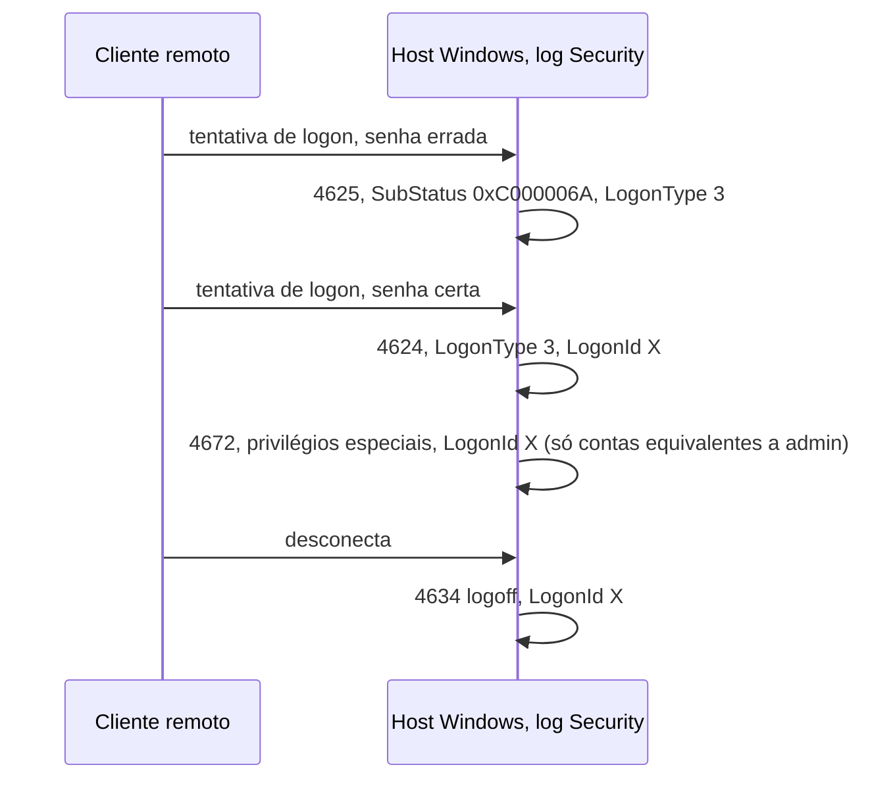
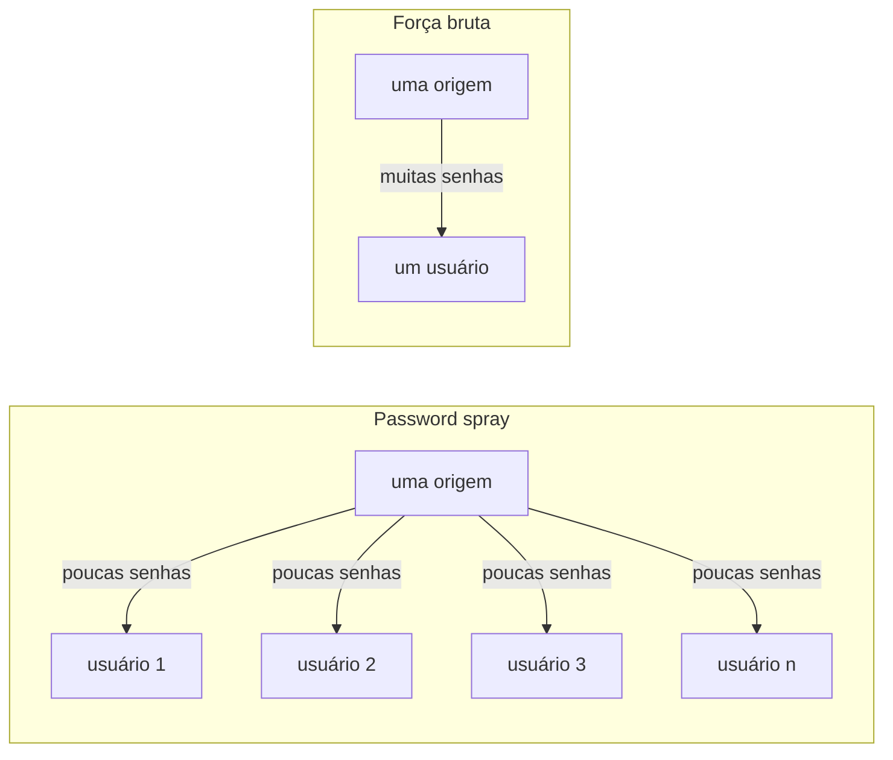

# Dia 55: Lendo logs de autenticação Windows e Linux

> 🇺🇸 Original: [*Day 55: Reading Windows and Linux authentication logs*](https://github.com/thiefdroppers/cyber-investigator-skills/blob/main/curriculum/phase-4-digital-forensics-incident-investigation/day-55.md) — © ThiefDroppers, licença MIT.
> Aqui: tradução fiel **+** camada brasileira. Nada do original foi removido; tudo o que é novo vem marcado com ➕.

**Fase 4. Forense digital e investigação de incidentes** · Meta da trilha: saber quais eventos de log respondem "quem entrou, de onde, como e quando", e transformar uma semana deles num mapa de calor que torna óbvia a hora anormal.

Rank Jutsu: `B` · [](https://colab.research.google.com/github/Ridd1kulusC0d3r/investigador-cyber-90-dias/blob/main/curriculo/fase-4-forense-e-resposta/dia-55/dia-55.ipynb)

---

## 🎬 ➕ Abertura do caso — *O login que a caixa não fez*

Marta Quintão manda um áudio: — A caixa jura que não abriu o e-mail depois do almoço. Mas o webmail dela criou uma regra às 9h33 para mandar tudo que tem "Pix" para uma pasta escondida.

Você abre o log do webmail da semana inteira. Segunda a sexta, todo dia, o mesmo desenho: `cx.centro07`, de 10.20.40.57, entre 7h45 e 8h, horário de Brasília. Até segunda, 5 de outubro.

— Quatro tentativas, três erradas, a quarta certa — você lê. — De 203.0.113.91. Um IP de fora.

— Quatro tentativas de um IP só, para uma conta só — diz Rafa. — Isso é força bruta, *spray* ou alguém que tinha a senha e errou a digitação?

E ele aponta para o que vem antes: às 8h19 a caixa digitou a senha no site falso. Hoje você aprende a ler logs de autenticação e a desenhar o "normal" para que o anormal grite. *(Personagens e cenário: [Operação Isca](../../../caso-continuo/).)*

---

## 📖 Conceito

A maioria das intrusões passa pela autenticação, então os logs de autenticação são onde as linhas do tempo normalmente começam. Você precisa saber de cor uma lista curta de tipos de evento e os campos que importam em cada um.

Log Security do Windows (habilite antes a política de auditoria certa; boa parte disto vem desligada por padrão em estações de trabalho):

| Event ID | Significado | Campos a ler |
|---|---|---|
| 4624 | *Logon* bem-sucedido | `TargetUserName`, `LogonType`, `IpAddress`, `WorkstationName`, `LogonId` |
| 4625 | *Logon* com falha | Os mesmos, mais `Status`/`SubStatus` (por exemplo, `0xC000006A` senha errada, `0xC0000064` usuário inexistente) |
| 4634 / 4647 | *Logoff* / *logoff* iniciado pelo usuário | `LogonId` faz par com o 4624 |
| 4648 | *Logon* com credenciais explícitas (runas, alguns movimentos laterais) | Conta e servidor de destino |
| 4672 | Privilégios especiais atribuídos ao novo *logon* | Vem depois de um 4624 para contas equivalentes a administrador |
| 4688 | Processo criado (precisa de "Audit Process Creation"; a linha de comando precisa de outra política) | `NewProcessName`, `CommandLine`, `ParentProcessName` |
| 4720 / 4732 | Conta criada / adicionada a um grupo local com segurança habilitada | Quem fez (`SubjectUserName`) |
| 7045 (log System) | Serviço instalado | Nome do serviço e caminho do binário |
| 1102 | Log de auditoria apagado | Quem apagou |

Tipos de *logon* no 4624/4625: 2 interativo (teclado), 3 rede (SMB, muitas ferramentas remotas), 4 *batch*, 5 serviço, 7 desbloqueio, 10 *RemoteInteractive* (RDP), 11 credenciais em cache. Um *logon* tipo 3 vindo de outro servidor às 03:00 significa algo diferente de um tipo 7 às 14:00.

O Sysmon, se estiver implantado, acrescenta eventos mais ricos: 1 criação de processo com hashes, 3 conexão de rede, 11 criação de arquivo, 22 consulta DNS.

No Linux, o `sshd` e o PAM gravam em `/var/log/auth.log` (Debian/Ubuntu) ou `/var/log/secure` (família RHEL), ou só no *journal* (`journalctl -u ssh` ou `-u sshd`). As linhas a conhecer: `Failed password for <user>`, `Failed password for invalid user <user>` (a conta não existe), `Accepted password` ou `Accepted publickey`, e `session opened/closed` vindo do `pam_unix`. Linhas clássicas de syslog não trazem ano nem fuso. Você precisa estabelecer os dois a partir da configuração do host.

Como os eventos do Windows de um *logon* se encaixam. O `LogonId` do 4624 é a chave que liga a ele os eventos de privilégio e de *logoff*:



As duas formas de adivinhação que você precisa distinguir num log de autenticação:



Um mapa de calor de *logons* por dia e hora é um dos jeitos mais rápidos de mostrar ao leitor como é o "normal" de uma conta ou de um host e onde fica a exceção.

## 📚 Recursos

- Microsoft: [referência do evento 4624](https://learn.microsoft.com/en-us/previous-versions/windows/it-pro/windows-10/security/threat-protection/auditing/event-4624) e as demais páginas de eventos de "Advanced security audit".
- Documentação do [Sysmon](https://learn.microsoft.com/en-us/sysinternals/downloads/sysmon) (lista de IDs de evento).
- [Hayabusa](https://github.com/Yamato-Security/hayabusa) e [Chainsaw](https://github.com/WithSecureLabs/chainsaw): triagem rápida de EVTX com regras Sigma.
- [EVTX-ATTACK-SAMPLES](https://github.com/sbousseaden/EVTX-ATTACK-SAMPLES): arquivos EVTX públicos gravados em laboratório enquanto técnicas de ataque eram simuladas, para praticar Hayabusa ou Chainsaw em EVTX real.

### ➕ Recursos do contexto Brasil

- MITRE ATT&CK, [T1110.003 *Password Spraying*](https://attack.mitre.org/techniques/T1110/003/), [T1110.001 *Password Guessing*](https://attack.mitre.org/techniques/T1110/001/) e [T1078 *Valid Accounts*](https://attack.mitre.org/techniques/T1078/): este último é o que sobra quando a senha foi capturada por *phishing* e o atacante simplesmente entra, que é o caso da Serra Azul.
- MITRE ATT&CK, [T1564.008 *Hide Artifacts: Email Hiding Rules*](https://attack.mitre.org/techniques/T1564/008/): regras de caixa postal criadas para esconder mensagens da vítima, como a que a Marta descreveu.
- CERT.br, [Cartilha de Segurança: fascículo de senhas](https://cartilha.cert.br/): para a conversa com a cooperativa sobre troca de senha e segundo fator depois do caso.

## 🛠️ Prática: grep/awk no auth.log, depois um mapa de calor em pandas dos logons do WS-FIN-07

Dados: [`resources/case-lab-p4/logs/bastion01-auth.log`](../../../upstream/curriculum/phase-4-digital-forensics-incident-investigation/resources/case-lab-p4/logs/bastion01-auth.log) (Linux sintético, UTC) e [`resources/case-lab-p4/windows/ws-fin-07-security.csv`](../../../upstream/curriculum/phase-4-digital-forensics-incident-investigation/resources/case-lab-p4/windows/ws-fin-07-security.csv) (eventos sintéticos 4624/4625/4672 do Windows exportados para CSV, UTC). Trabalhe nas suas cópias com hash do Dia 49.

**Seu checklist de hoje.** Faça na ordem e marque cada item ao terminar:

- [ ] Monte o perfil das falhas de autenticação do Linux.
- [ ] Anote o que a linha de sucesso do `svc_backup` mostra e o que não mostra.
- [ ] Monte os mapas de calor de *logon* do WS-FIN-07.
- [ ] Aprofunde nas duas células fora da curva.
- [ ] Anote os dois PNGs dos mapas de calor com os detalhes das células fora da curva.
- [ ] Acrescente a entrada de questão em aberto para as falhas das 02:10 vindas do `bastion01`.
- [ ] ➕ Prática BR: uma semana de *logons* do `SA-CX-07` e do webmail da Serra Azul.
- [ ] ➕ O notebook do dia: o `grep | uniq -c` em Python, o mapa de calor em texto (sem pandas) e o classificador *spray* × força bruta × conta válida.

1. Monte o perfil das falhas do Linux.

   ```bash
   L=~/lab-p4/work/EVID-001/bastion01-auth.log
   grep -c 'Failed password' "$L"
   grep 'Failed password' "$L" | awk '{for(i=1;i<=NF;i++) if($i=="from") print $(i+1)}' | sort | uniq -c
   grep -oE 'Failed password for (invalid user )?[^ ]+' "$L" | awk '{print $NF}' | sort | uniq -c | sort -rn
   grep 'Failed password' "$L" | sed -n '1p;$p' | cut -c1-15
   grep -E 'Accepted (password|publickey)' "$L"
   ```

   Esperado: 112 falhas, todas de 203.0.113.45, distribuídas por igual entre oito nomes de usuário (14 cada), a primeira em `Mar 14 02:51:03`, a última em `Mar 14 03:13:36`, seguidas de `Accepted password for svc_backup from 203.0.113.45 port 50122` às 03:14:07. Muitos nomes de usuário, poucas tentativas para cada um, a partir de uma única origem: essa é a forma de um *password spray*, em oposição a força bruta (muitas senhas contra uma conta). As linhas anteriores de `Accepted publickey` para `ops.admin` vindas de 10.10.50.12 são a linha de base normal.

2. Anote o que a linha de sucesso diz e o que não diz. Ela mostra um *login* por senha numa conta que normalmente usa chaves (confira: o `svc_backup` aparece em alguma linha `Accepted` anterior?). Ela não mostra como a senha era conhecida.

3. Monte o mapa de calor do WS-FIN-07. Instale `pip install pandas matplotlib` num ambiente virtual, salve isto como `heatmap.py` e rode `python heatmap.py ws-fin-07-security.csv`:

   ```python
   import sys
   import pandas as pd
   import matplotlib
   matplotlib.use("Agg")
   import matplotlib.pyplot as plt

   df = pd.read_csv(sys.argv[1], parse_dates=["TimeCreatedUtc"])
   df = df[df["EventID"].isin([4624, 4625]) & (df["TargetUserName"] != "SYSTEM")]
   df["day"] = df["TimeCreatedUtc"].dt.strftime("%Y-%m-%d %a")
   df["hour"] = df["TimeCreatedUtc"].dt.hour

   for eid, title in [(4624, "Successful logons (4624)"), (4625, "Failed logons (4625)")]:
       grid = (df[df["EventID"] == eid]
               .pivot_table(index="day", columns="hour", values="EventID", aggfunc="count", fill_value=0)
               .reindex(columns=range(24), fill_value=0))
       fig, ax = plt.subplots(figsize=(12, 3.5))
       im = ax.imshow(grid.values, aspect="auto", cmap="Reds")
       ax.set_xticks(range(24)); ax.set_yticks(range(len(grid.index))); ax.set_yticklabels(grid.index)
       ax.set_xlabel("Hour of day (UTC)"); ax.set_title(f"WS-FIN-07 {title}, synthetic case LAB-P4")
       for (r, c), v in pd.DataFrame(grid.values).stack().items():
           if v:
               ax.text(c, r, int(v), ha="center", va="center", fontsize=8)
       fig.colorbar(im, ax=ax); fig.tight_layout()
       fig.savefig(f"ws-fin-07-heatmap-{eid}.png", dpi=150)
       print(title); print(grid.loc[:, (grid != 0).any()].to_string())
   ```

   A grade impressa para as falhas deve mostrar falhas isoladas espalhadas no horário comercial de segunda a sexta, e 23 falhas na hora 02 do sábado, 14 de março. A grade de sucessos mostra atividade em horário comercial (13:00 a 21:00 UTC, que é 09:00 a 17:00 em Nova York durante o horário de verão) e um sucesso na hora 03 do dia 14.

4. Aprofunde nas duas células fora da curva.

   ```bash
   C=~/lab-p4/work/EVID-002/ws-fin-07-security.csv
   awk -F, '$1 >= "2026-03-14T02" && $1 < "2026-03-14T04"' "$C"
   ```

   Você vai ver falhas de rede (tipo 3) vindas de 10.10.20.5, que é o `bastion01`, contra `administrator`, `acct.clerk01` e `svc_backup` entre 02:10 e 02:16, e às 03:27:41 um sucesso tipo 3 para `svc_backup` vindo de 10.10.30.17 (`fs01`), seguido de 4672 (privilégios especiais). Acrescente isso às suas notas do caso com as linhas exatas.

   Suas notas do caso devem conter agora esta sequência. As duas fontes nela gravam em UTC, então ainda não há correção envolvida.

   ```mermaid
   sequenceDiagram
       participant X as 203.0.113.45
       participant B as bastion01 10.10.20.5
       participant F as fs01 10.10.30.17
       participant W as WS-FIN-07 10.10.40.57
       B->>W: 23 logons tipo 3 com falha, 02:10:00 a 02:16:14<br/>administrator, acct.clerk01, svc_backup
       Note over B,W: Questão em aberto: antes do spray, e de um host interno
       X->>B: 112 senhas com falha, 8 usuários x 14<br/>02:51:03 a 03:13:36
       X->>B: Accepted password para svc_backup, 03:14:07
       F->>W: logon tipo 3 de svc_backup, depois 4672<br/>03:27:41
   ```

5. Anote os dois PNGs (qualquer editor de imagem, ou uma caixa de texto no próprio gráfico) com setas para as células fora da curva e uma linha para cada uma: o que a célula contém, e as linhas de origem.

6. Acrescente às suas notas do caso uma entrada de questão em aberto para os *logons* com falha contra o WS-FIN-07 vindos do `bastion01` às 02:10. Numa frase, diga por que eles são estranhos, dado que o *spray* contra o `bastion01` começou às 02:51 (eles acontecem antes, e a partir de um host interno). Não os explique ainda; sinalize-os para o Dia 56.

Artefato: dois PNGs de mapa de calor do WS-FIN-07 (4624 e 4625) com as células fora da curva anotadas, e uma lista curta dos fatos do *spray* no `bastion01`, com contagens e horários da primeira e da última ocorrência.

### ➕ Prática BR: a semana da `cx.centro07`

Dois arquivos sintéticos em [`caso-continuo/dados/dia-55/`](../../../caso-continuo/dados/dia-55/), ambos em UTC:

- [`sa-cx-07-security-semana.csv`](../../../caso-continuo/dados/dia-55/sa-cx-07-security-semana.csv): 4624/4625 do notebook, de segunda 28/set a segunda 5/out (mesmo layout do CSV do WS-FIN-07, então o `heatmap.py` roda sem mudança);
- [`webmail-sa-semana.jsonl`](../../../caso-continuo/dados/dia-55/webmail-sa-semana.jsonl): *logins* do webmail da cooperativa no mesmo período (contas `cx.centro07` e `ger.centro01`).

**Exercício 1: o normal.** Rode o `heatmap.py` no CSV do notebook e descreva, em duas frases, a linha de base: a que horas a caixa liga o notebook (tipo 2) e quando desbloqueia (tipo 7)? Converta para Brasília (UTC-3). Repare que o `SA-CX-07` não tem nenhum *logon* anormal: a intrusão do caso **não** passou pela autenticação do notebook.

**Exercício 2: o anormal está em outro sistema.** Agora o webmail:

```bash
W=caso-continuo/dados/dia-55/webmail-sa-semana.jsonl
grep '"cx.centro07"' "$W" | grep -o '"src_ip": "[^"]*"' | sort | uniq -c
grep '203.0.113.91' "$W"
```

Quatro tentativas de 203.0.113.91 contra **uma** conta: não é *spray* (muitas contas) nem a força bruta do diagrama (muitas senhas). Três falhas e um acerto em 63 segundos, cerca de 68 minutos depois da última conexão da caixa ao site falso (proxy, Dia 49: 11:19:41 a 11:23:12 UTC). Escreva as hipóteses que cabem e o que cada uma prevê:

| Hipótese | O que preveria |
|---|---|
| Senha capturada pelo kit, atacante errou na digitação ou testou variações | Poucas tentativas, uma conta, origem nova, logo depois da captura |
| Força bruta | Muitas tentativas, uma conta |
| *Spray* | Poucas tentativas por conta, muitas contas da mesma origem |

A primeira é a mais compatível, mas **o log não mostra a senha usada nem como foi obtida**, exatamente como o original diz sobre o `svc_backup`. Em seguida há `mailbox.rule_create` às 12:33:50 UTC, da mesma origem: anote como "regra de caixa postal criada na sessão aberta a partir de 203.0.113.91", sem afirmar o conteúdo da regra (o log não traz).

**Exercício 3: falha da gerente, não é ataque.** O webmail também tem falhas da `ger.centro01`, de 10.20.40.52, em dias normais, seguidas de sucesso 18 segundos depois. Coloque-as no mapa de calor e explique em uma frase por que não entram como achado (origem interna conhecida, padrão de digitação errada, sucesso logo depois, repetido em vários dias).

### ➕ O notebook do dia

Abra o [notebook do Dia 55 no Colab](https://colab.research.google.com/github/Ridd1kulusC0d3r/investigador-cyber-90-dias/blob/main/curriculo/fase-4-forense-e-resposta/dia-55/dia-55.ipynb). Nele você:

1. refaz os cinco `grep`/`awk` do passo 1 com `re` e `collections.Counter`, e confere 112 / 14×8 / 02:51:03 / 03:13:36 / 03:14:07;
2. desenha os mapas de calor 4624 e 4625 **em texto** (sem pandas nem matplotlib, porque só biblioteca padrão), com as células fora da curva marcadas; uma célula opcional roda o `heatmap.py` original com pandas;
3. filtra a janela das 02h às 04h (o `awk` do passo 4) e gera a entrada de questão em aberto;
4. roda um classificador simples: *spray*, força bruta ou "poucas tentativas, uma conta" por origem;
5. repete tudo com a semana da `cx.centro07`, em UTC e em Brasília;
6. joga o **quiz dos tipos de *logon***.

## ✅ Checkpoint

- Seu resumo do *spray* dá o IP de origem.
- Seu resumo do *spray* dá a contagem de falhas.
- Seu resumo do *spray* dá o número de nomes de usuário distintos.
- Seu resumo do *spray* dá os horários da primeira falha, da última falha e do sucesso.
- Todo valor do seu resumo do *spray* confere com o arquivo.
- Seu mapa de calor 4625 mostra falhas espalhadas em horário comercial.
- Seu mapa de calor 4625 mostra uma célula quente.
- Sua anotação na célula quente nomeia o host de origem como `bastion01`, não só pelo IP.
- Suas notas do caso têm uma entrada de questão em aberto para as falhas das 02:10 contra o WS-FIN-07 vindas do `bastion01`.
- Essa entrada diz que as falhas vieram antes do *spray* das 02:51 e de um host interno.
- Essa entrada não oferece explicação para elas.
- Você lista, de memória, os números de tipo de *logon* para RDP, rede e desbloqueio.

### ➕ Checkpoint BR

- Sua linha de base do `SA-CX-07` está em UTC **e** em Brasília, e diz que o notebook não tem *logon* anormal.
- Sua tabela de hipóteses do webmail tem as três linhas e escolhe a mais compatível sem afirmar como a senha foi obtida.
- A regra de caixa postal está anotada sem afirmar o conteúdo dela.
- As falhas da `ger.centro01` estão explicadas como linha de base, não como achado.

## ⚖️ ➕ Camada jurídica BR

**Entrar no webmail com a senha capturada é crime, mesmo "sem quebrar nada".** O acesso de 203.0.113.91 à conta `cx.centro07` com uma senha obtida por *phishing* encosta no CP art. 154-A (invasão de dispositivo informático). A redação dada pela Lei 14.155/2021 tirou do tipo a exigência de "violação indevida de mecanismo de segurança", e por isso o fato de a senha estar "certa" não torna o acesso autorizado. O golpe em si, se gerar prejuízo, é fraude eletrônica (CP art. 171, §2º-A). Você não tipifica no relatório; você entrega os fatos que a autoridade vai usar.

**Os registros do webmail são da cooperativa; os do provedor de 203.0.113.91, não.** A Serra Azul pode entregar os logs do próprio webmail. Quem está por trás de 203.0.113.91 só sai dos registros do provedor de conexão mediante ordem judicial (Marco Civil, arts. 10, §1º, e 22). O que cabe à cooperativa, e ao relatório da Vigia, é pedir a preservação e levar o caso à autoridade.

**Dados da conta da caixa.** Os logs de *login* da `cx.centro07` são dados pessoais dela. Tratá-los aqui tem base legal (proteção da própria titular e prevenção à fraude), mas o relatório deve usar o necessário: horários, origens e eventos, não o conteúdo dos e-mails dela.

> Material de estudo, não constitui orientação jurídica.

## 🧠 ➕ Camada 8 — a vítima que "jura que não abriu"

A abertura tem duas reações humanas possíveis à frase da caixa ("não abri o e-mail depois do almoço"): desconfiança ("está mentindo para se proteger") ou aceitação. O log resolve a favor dela: o acesso das 9h32 (Brasília) veio de 203.0.113.91, não do notebook. Mas repare em quantas vezes, num incidente, a primeira hipótese da equipe é a culpa de quem clicou. Lerner chamou de **crença no mundo justo** a tendência de achar que as pessoas recebem o que merecem, o que leva a culpar vítimas para preservar a sensação de que "isso não aconteceria comigo".

Consequência prática dupla. Na análise: teste a versão da pessoa contra o log antes de descartá-la, porque testemunho e log são fontes independentes e, quando batem, se reforçam. Na comunicação: a caixa é uma fonte essencial (ela sabe o que viu na tela do site falso), e uma pessoa que se sente acusada lembra menos e conta menos. Isso volta com força na Fase 5, na entrevista sem revitimização.

## 🤖 ➕ Skill do dia

O dia propõe um procedimento novo, **"Leitura de logs de autenticação"**: eventos e tipos de *logon* de cor, linha de base antes da exceção, *spray* × força bruta × conta válida, e "o log não mostra como a senha foi obtida". Texto e caso de teste em [`_skill-delta.md`](_skill-delta.md).

## 💡 ➕ Inovação OSINT do dia — mapa de calor em texto, só com `collections.Counter`

Nem sempre você tem pandas e matplotlib (num servidor de cliente, num Colab offline, num terminal SSH). Um mapa de calor legível cabe em dez linhas da biblioteca padrão:

```python
from collections import Counter
import csv

c = Counter()
for r in csv.DictReader(open("ws-fin-07-security.csv")):
    if r["EventID"] == "4625" and r["TargetUserName"] != "SYSTEM":
        c[(r["TimeCreatedUtc"][:10], int(r["TimeCreatedUtc"][11:13]))] += 1
dias = sorted({d for d, _ in c})
print("           " + "".join(f"{h:>3}" for h in range(24)))
for d in dias:
    print(d, "".join(f"{c[(d, h)] or '.':>3}" for h in range(24)))
```

A mesma grade dia × hora é uma técnica clássica de OSINT para estimar o fuso de atividade de uma conta pública (quando ela publica e quando "dorme"). Use só para padrões de contas investigadas dentro de um caso autorizado, nunca para traçar a rotina de uma pessoa privada.

## 📝 Diário de estudo

- Data:
- Tempo gasto:
- O que ficou claro:
- O que ainda está nebuloso:
- Artefato produzido: mapas de calor 4624/4625 do WS-FIN-07 anotados, resumo do *spray*, questão em aberto das 02:10, mapa de calor e tabela de hipóteses da `cx.centro07`

---
<sub>Baseado em [cyber-investigator-skills](https://github.com/thiefdroppers/cyber-investigator-skills) por ThiefDroppers (MIT). Tradução, camada BR, Camada 8, skill pt-BR e notebook por Deivison Lourenço (@Ridd1kulusC0d3r).</sub>
