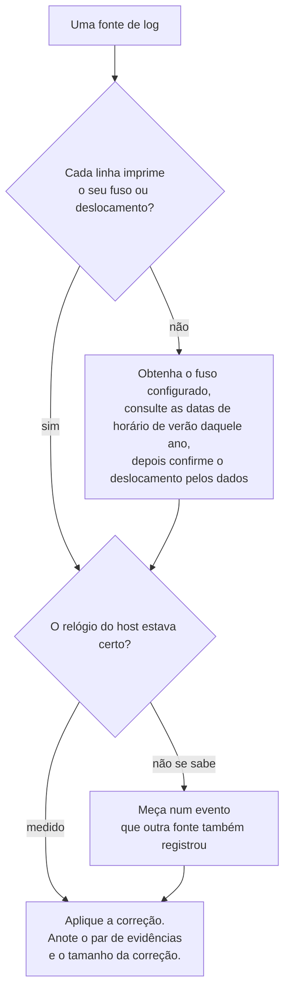
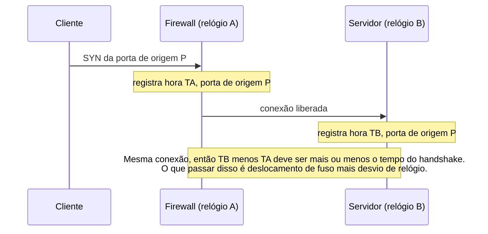
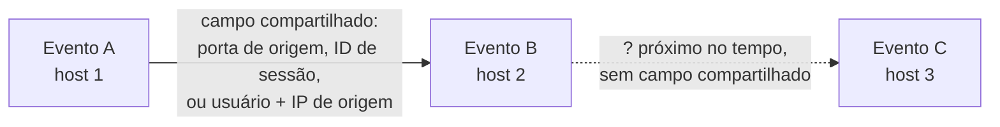

# Dia 56: Normalizando o tempo e correlacionando logs entre hosts

> 🇺🇸 Original: [*Day 56: Normalising time and correlating logs across hosts*](https://github.com/thiefdroppers/cyber-investigator-skills/blob/main/curriculum/phase-4-digital-forensics-incident-investigation/day-56.md) — © ThiefDroppers, licença MIT.
> Aqui: tradução fiel **+** camada brasileira. Nada do original foi removido; tudo o que é novo vem marcado com ➕.

**Fase 4. Forense digital e investigação de incidentes** · Meta da trilha: juntar logs de quatro fontes numa única linha do tempo em UTC, provar as correções de tempo que você aplicou, e desenhar a cadeia causal como um grafo em que cada aresta nomeia o campo que liga dois eventos.

Rank Jutsu: `B` · [](https://colab.research.google.com/github/Ridd1kulusC0d3r/investigador-cyber-90-dias/blob/main/curriculo/fase-4-forense-e-resposta/dia-56/dia-56.ipynb)

---

## 🎬 ➕ Abertura do caso — *O ataque que começou antes do clique*

Marta Quintão pediu "a linha do tempo, numa página, até amanhã". Você junta o firewall da cooperativa, o proxy e o webmail numa planilha, ordena pela primeira coluna e manda para o Rafa.

Dez minutos depois ele liga.

— Na sua planilha, o atacante entra no webmail às 9h32. E a caixa só clica no link às 11h19. O golpista entrou antes de roubar a senha?

Você olha. O firewall escreve `09:32:05`; o webmail escreve `12:32:05Z`. São o mesmo evento, três horas e zero segundos de diferença.

— O firewall grava em Brasília e não diz — fala Rafa. — O proxy grava em UTC e não diz o ano. O webmail é o único que diz tudo. Antes de ordenar, você prova cada relógio. Com par de eventos, não com palpite.

Hoje você aprende a normalizar o tempo e a ligar eventos só quando um campo os liga. *(Personagens e cenário: [Operação Isca](../../../caso-continuo/).)*

---

## 📖 Conceito

Uma linha do tempo combinada é tão boa quanto os seus relógios. Antes de ordenar qualquer coisa, responda três perguntas para cada fonte: em que fuso ela grava, se ela imprime esse fuso, e se o relógio do host estava certo.

Fusos causam os maiores erros. Syslog sem fuso, um *firewall* configurado em horário local, um volume FAT (Dia 51), uma aplicação que grava no *locale* do servidor: tudo comum. O horário de verão piora as coisas, porque o deslocamento muda numa data que você precisa consultar. Em 2026 os Estados Unidos adiantaram os relógios em 8 de março, então Nova York está em UTC-4 dessa data até 1º de novembro, e em UTC-5 antes.

O desvio de relógio (*skew*) é o segundo erro. Um host cuja sincronização NTP falhou pode derivar segundos ou minutos. Você mede em vez de chutar: encontre um evento que duas fontes registraram, em que você conhece a ordem real e aproximadamente o intervalo, e calcule a diferença. Logs de rede são bons para isso porque uma conexão TCP tem uma porta de origem que as duas pontas registram. Uma linha do *firewall* e uma linha do `sshd` com o mesmo IP e a mesma porta de origem descrevem a mesma conexão.

A correlação é o terceiro passo. Duas linhas próximas no tempo são adjacentes, não ligadas. Uma ligação precisa de um campo compartilhado que não poderia coincidir por acaso (uma porta de origem, um ID de sessão, um usuário mais IP de origem, um nome de arquivo mais tamanho) e de uma ordem que faça sentido. Quando você desenha a linha do tempo como grafo, cada aresta carrega esse campo como rótulo. Uma aresta que você não consegue rotular é um palpite e fica fora do grafo, ou entra como linha pontilhada com um ponto de interrogação.

As três perguntas como um procedimento que você roda uma vez por fonte:



Como uma única conexão TCP mede dois relógios ao mesmo tempo. Nada aqui é dado do LAB-P4; isso você faz na prática.



Adjacente não é ligado. Só a primeira aresta abaixo pode entrar sólida no seu grafo:



## 📚 Recursos

- [Banco de dados de fusos da IANA](https://www.iana.org/time-zones); no Linux, `zdump -v America/New_York | grep 2026` imprime as transições exatas de 2026.
- Documentação do [`zoneinfo`](https://docs.python.org/3/library/zoneinfo.html) do Python (biblioteca padrão desde o Python 3.9).
- [Graphviz](https://graphviz.org/) e a sua [referência de atributos](https://graphviz.org/doc/info/attrs.html).
- Rob Lee e outros, artigos do SANS FOR508 sobre "*super timeline*", pela disciplina de marcar a fonte de cada linha.

### ➕ Recursos do contexto Brasil

- [Decreto 9.772/2019](https://www.planalto.gov.br/ccivil_03/_ato2019-2022/2019/decreto/d9772.htm): encerrou o horário de verão no Brasil. Desde então `America/Sao_Paulo` é UTC-3 o ano todo; em logs anteriores a 2019, o verão brasileiro tinha UTC-2, com datas que mudaram ano a ano. Confira com `zdump -v America/Sao_Paulo | grep 2018`.
- [NTP.br](https://ntp.br/) (NIC.br): serviço público de hora legal brasileira por NTP. Útil para a recomendação final à cooperativa: todos os equipamentos sincronizados e, de preferência, gravando em UTC com fuso explícito.
- [Observatório Nacional, Divisão Serviço da Hora](https://www.gov.br/observatorio/pt-br): o órgão responsável pela hora legal brasileira.

## 🛠️ Prática: uma junção em Python com correções medidas, depois um grafo da linha do tempo em Graphviz

Dados: os quatro arquivos sintéticos na sua cópia de trabalho do EVID-001 (`bastion01-auth.log`, `fs01-auth.log`, `docportal-app.jsonl`, `firewall.log`). Não presuma nada sobre os relógios deles; as notas do caso só dizem que o fuso configurado do *firewall* é `America/New_York` e que o ano é 2026.

**Seu checklist de hoje.** Faça na ordem e marque cada item ao terminar:

- [ ] Confirme o deslocamento UTC do *firewall* a partir dos dados.
- [ ] Meça o desvio de relógio do `fs01`.
- [ ] Escreva o `merge_timeline.py` e junte as quatro fontes.
- [ ] Extraia os eventos materiais na ordem corrigida.
- [ ] Desenhe o grafo causal da linha do tempo com arestas rotuladas.
- [ ] ➕ Prática BR: firewall (Brasília), proxy (UTC, sem ano) e webmail da Serra Azul numa só linha do tempo.
- [ ] ➕ O notebook do dia: pares de portas, `zoneinfo`, a junção com `evidence_ref` e o grafo, no LAB-P4 e no caso BR.

1. Confirme o deslocamento do *firewall* pelos dados, não pela nota de configuração. A primeira tentativa do *spray* usou a porta de origem 49208.

   ```bash
   cd ~/lab-p4/work/EVID-001
   grep ':49208 ' firewall.log
   grep 'port 49208 ' bastion01-auth.log
   ```

   ```text
   2026-03-13 22:51:02 fw01 ACCEPT TCP 203.0.113.45:49208 -> 10.10.20.5:22 rule=allow-ssh-bastion bytes=4120
   Mar 14 02:51:03 bastion01 sshd[21815]: Failed password for invalid user admin from 203.0.113.45 port 49208 ssh2
   ```

   Mesma conexão, 4 horas e 1 segundo de diferença. Então ou o *firewall* está em UTC-4 e o `bastion01` está certo, ou os dois estão errados. Confira um segundo par (escolha qualquer outra porta do *spray*) para descartar um caso isolado. Depois confira com o `zdump` de 2026 que UTC-4 é o que o horário de verão de Nova York prevê para 14 de março. Agora você tem duas razões independentes para a correção.

2. Meça o desvio do `fs01`. O salto do `bastion01` para o `fs01` usou a porta de origem 41766.

   ```bash
   grep ':41766 ' firewall.log
   grep 'port 41766 ' fs01-auth.log
   ```

   O *firewall* mostra 23:19:21 local (03:19:21 UTC). O `fs01` registra a chave aceita às 03:20:45. Descontando cerca de um segundo do *handshake*, o `fs01` está cerca de 83 segundos adiantado. O `docportal-app.jsonl` é gravado no `fs01`, então a mesma correção se aplica; escreva isso como suposição nas suas notas, porque você não a mediu nos eventos da própria aplicação.

3. Junte. Salve como `merge_timeline.py`:

   ```python
   import csv, json, sys
   from datetime import datetime, timedelta, timezone
   from pathlib import Path
   from zoneinfo import ZoneInfo

   D = Path(sys.argv[1])                                  # folder with the four logs
   FS01_SKEW = timedelta(seconds=int(sys.argv[2]))        # measured in step 2
   FW_TZ = ZoneInfo("America/New_York")
   YEAR = 2026                                            # syslog has no year
   rows = []

   def syslog(path, host, skew=timedelta(0)):
       for n, line in enumerate(open(path), 1):
           ts = datetime.strptime(f"{YEAR} {line[:15]}", "%Y %b %d %H:%M:%S").replace(tzinfo=timezone.utc)
           rows.append((ts - skew, host, line[16:].strip(), f"{path.name}:{n}"))

   syslog(D / "bastion01-auth.log", "bastion01")
   syslog(D / "fs01-auth.log", "fs01", FS01_SKEW)
   for n, line in enumerate(open(D / "docportal-app.jsonl"), 1):
       r = json.loads(line)
       ts = datetime.strptime(r["ts"], "%Y-%m-%dT%H:%M:%SZ").replace(tzinfo=timezone.utc) - FS01_SKEW
       rows.append((ts, "fs01/docportal", f'{r["event"]} user={r["user"]} count={r.get("count")}', f"docportal-app.jsonl:{n}"))
   for n, line in enumerate(open(D / "firewall.log"), 1):
       local = datetime.strptime(line[:19], "%Y-%m-%d %H:%M:%S").replace(tzinfo=FW_TZ)
       rows.append((local.astimezone(timezone.utc), "fw01", line[20:].strip(), f"firewall.log:{n}"))

   rows.sort(key=lambda r: r[0])
   w = csv.writer(sys.stdout)
   w.writerow(["utc", "host", "event", "evidence_ref"])
   for ts, host, ev, ref in rows:
       w.writerow([ts.strftime("%Y-%m-%dT%H:%M:%SZ"), host, ev, ref])
   ```

   ```bash
   python3 merge_timeline.py ~/lab-p4/work/EVID-001 83 > ~/lab-p4/work/lab-p4-merged.csv
   wc -l ~/lab-p4/work/lab-p4-merged.csv        # 297 lines including the header
   ```

   A coluna `evidence_ref` (arquivo e número da linha) é o que permite a qualquer pessoa conferir uma linha contra o original. O `ZoneInfo` aplica o deslocamento correto para cada data, então ele também cuida da mudança de 8 de março se você algum dia alimentá-lo com linhas mais antigas do *firewall*.

4. Extraia os eventos materiais e leia-os em ordem:

   ```bash
   grep -E 'Accepted password|:41766|port 41766|docportal|tar -czf|198\.51\.100\.23' ~/lab-p4/work/lab-p4-merged.csv \
     | grep -v document.view
   ```

   Corrigida, a sequência fica: 03:14:07 *login* por senha como `svc_backup` no `bastion01` a partir de 203.0.113.45; 03:19:21 o *firewall* libera SSH do `bastion01` para o `fs01` a partir da porta 41766; 03:19:22 o `fs01` aceita `svc_backup` por chave a partir dessa porta; 03:23:10 a 03:24:02 o portal de documentos registra o `svc_backup` entrando localmente e exportando em massa 412 arquivos; 03:31:40 o `svc_backup` roda `tar -czf /var/tmp/.q1.tgz` sobre a pasta de finanças com `sudo`; 03:41:02 o *firewall* libera 48.213.904 bytes do `fs01` para 198.51.100.23:443.

   Sem as correções, a linha de exfiltração do *firewall* ficaria às 23:41 de 13 de março, antes de o atacante sequer entrar, e a exportação pareceria acontecer 83 segundos depois do que aconteceu.

   Os mesmos eventos num gráfico, como cada fonte os imprimiu e depois das suas duas correções. As linhas vermelhas são as que as correções movem. No lado bruto, o *firewall* põe os seus eventos, inclusive a transferência de saída, na noite do dia 13, horas antes do *login* no `bastion01` do qual eles dependem.

   ```mermaid
   gantt
       title LAB-P4, eventos materiais: relógios brutos vs UTC corrigido
       dateFormat YYYY-MM-DD HH:mm:ss
       axisFormat %d %H:%M
       todayMarker off
       section Como impresso
       fw01 SSH de 203.0.113.45           :crit, r1, 2026-03-13 22:51:02, 2026-03-13 23:14:06
       fw01 bastion01 para fs01 porta 41766 :crit, milestone, r2, 2026-03-13 23:19:21, 0d
       fw01 48 MB para 198.51.100.23      :crit, milestone, r3, 2026-03-13 23:41:02, 0d
       bastion01 falhas do spray          :r4, 2026-03-14 02:51:03, 2026-03-14 03:13:36
       bastion01 login svc_backup         :milestone, r5, 2026-03-14 03:14:07, 0d
       fs01 aceita chave do svc_backup    :crit, milestone, r6, 2026-03-14 03:20:45, 0d
       docportal exportação em massa      :crit, milestone, r7, 2026-03-14 03:25:11, 0d
       fs01 sudo tar                      :crit, milestone, r8, 2026-03-14 03:33:03, 0d
       section UTC corrigido
       fw01 SSH de 203.0.113.45           :c0, 2026-03-14 02:51:02, 2026-03-14 03:14:06
       bastion01 falhas do spray          :c1, 2026-03-14 02:51:03, 2026-03-14 03:13:36
       login svc_backup no bastion01      :milestone, c2, 2026-03-14 03:14:07, 0d
       fw01 bastion01 para fs01 porta 41766 :milestone, c3, 2026-03-14 03:19:21, 0d
       fs01 aceita chave do svc_backup    :milestone, c4, 2026-03-14 03:19:22, 0d
       docportal exportação em massa      :milestone, c5, 2026-03-14 03:23:48, 0d
       fs01 sudo tar                      :milestone, c6, 2026-03-14 03:31:40, 0d
       fw01 48 MB para 198.51.100.23      :milestone, c7, 2026-03-14 03:41:02, 0d
   ```

   O desvio do `fs01` é pequeno demais para aparecer nessa escala. Ampliado, cada barra é o intervalo de 83 segundos entre o horário que o `fs01` imprimiu e o horário corrigido, com a visão do *firewall* sobre o salto como referência fixa:

   ```mermaid
   gantt
       title Desvio do fs01, 03:19 a 03:33 UTC de 14 de março de 2026
       dateFormat YYYY-MM-DD HH:mm:ss
       axisFormat %H:%M
       todayMarker off
       section Referência
       salto no fw01, porta 41766     :milestone, f1, 2026-03-14 03:19:21, 0d
       section Desvio do fs01
       sshd aceita, 83 s              :crit, s1, 2026-03-14 03:19:22, 2026-03-14 03:20:45
       docportal exportação, 83 s     :crit, s2, 2026-03-14 03:23:48, 2026-03-14 03:25:11
       sudo tar, 83 s                 :crit, s3, 2026-03-14 03:31:40, 2026-03-14 03:33:03
   ```

5. Desenhe o grafo da linha do tempo. Os nós são eventos em ordem de tempo (da esquerda para a direita), com horário UTC, host e referência de evidência. As arestas são vínculos causais rotulados com o campo que os liga.

   ```dot
   digraph lab_p4 {
     rankdir=LR; node [shape=box, fontsize=10];
     a [label="03:14:07Z bastion01\nAccepted password svc_backup\nfrom 203.0.113.45\nbastion01-auth.log:117"];
     b [label="03:19:21Z fw01\nbastion01:41766 -> fs01:22\nfirewall.log:147"];
     c [label="03:19:22Z fs01 (skew -83s)\nAccepted publickey svc_backup\nfs01-auth.log:2"];
     d [label="03:23:48Z docportal (skew -83s)\nbulk_export 412 files\ndocportal-app.jsonl:16"];
     e [label="03:31:40Z fs01\nsudo tar -czf /var/tmp/.q1.tgz\nfs01-auth.log:4"];
     f [label="03:41:02Z fw01\nfs01 -> 198.51.100.23:443\n48,213,904 bytes\nfirewall.log:150"];
     a -> b [label="source 10.10.20.5 = bastion01;\nsvc_backup session open 03:14:08-03:52:44"];
     b -> c [label="src port 41766"];
     c -> d [label="user svc_backup,\nsession open on fs01"];
     d -> e [label="path finance/2026-Q1"];
     e -> f [label="size ~ 48 MB export\n(inferred, not matched)", style=dashed];
   }
   ```

   ```bash
   dot -Tpng lab-p4-timeline.dot -o lab-p4-timeline.png
   ```

   A última aresta é tracejada de propósito. A exportação teve 48.006.112 bytes e a transferência teve 48.213.904 bytes. Os tamanhos são próximos, o que combina com um arquivo compactado mais o *overhead* de TLS e HTTP, mas o *firewall* não vê o conteúdo. Esse vínculo é inferido.

Artefato: `lab-p4-merged.csv` (todas as fontes, em UTC, com referências de evidência), `lab-p4-timeline.png`, e uma nota de "correções de tempo" listando cada correção, o par de evidências usado para medi-la e o seu tamanho.

### ➕ Prática BR: três relógios da Serra Azul

Fontes: o pen drive do Dia 49 ([`caso-continuo/dados/dia-49/EVID-SA-001/`](../../../caso-continuo/dados/dia-49/EVID-SA-001/)) e o log Security do notebook em [`caso-continuo/dados/dia-56/`](../../../caso-continuo/dados/dia-56/) (veja o [`LEIA-ME`](../../../caso-continuo/dados/dia-56/LEIA-ME.md)). As notas da TI dizem: "o *firewall* grava no horário de Brasília; o proxy, em UTC".

**Exercício 1: prove o firewall com dois pares.** O proxy da cooperativa não registra porta de origem, então o par aqui é **IP de origem + IP de destino + mesmo segundo**. E o webmail registra o IP do cliente.

```bash
cd caso-continuo/dados/dia-49/EVID-SA-001
grep '203.0.113.77' fw-serraazul.log | head -1
grep 'dst=203.0.113.77' proxy-sa.log | head -1
grep '203.0.113.91' fw-serraazul.log | tail -1
grep '"success"' webmail-sa.jsonl | grep 203.0.113.91
```

O primeiro par (*firewall* 08:19:41 × proxy 11:19:41) e o segundo (*firewall* 09:32:05 × webmail 12:32:05Z) dão o mesmo resultado: exatamente 3 horas, zero segundos. Duas razões independentes, como no passo 1 do original: os dados e `zdump -v America/Sao_Paulo | grep 2026` (sem transição: UTC-3 o ano todo). Note também o que **não** há: desvio de relógio mensurável entre as três fontes.

**Exercício 2: o ano do proxy.** O proxy não imprime o ano. Que evidência independente fixa 2026? (O webmail imprime a data completa e tem eventos ligados aos do proxy pelo par do Exercício 1.) Anote isso nas correções.

**Exercício 3: junte e leia.** Adapte o `merge_timeline.py` (ou use o notebook): *firewall* com `ZoneInfo("America/Sao_Paulo")`, proxy com `YEAR = 2026` e UTC, webmail e Security já em UTC. Leia os eventos materiais na ordem corrigida:

| UTC | Fonte | Evento |
|---|---|---|
| 11:19:38 | proxy / fw | `GET http://lnk.example/sa7` (302) do 10.20.40.57 |
| 11:19:41 | proxy / fw | `CONNECT serraazul-pix.example` (203.0.113.77) |
| 11:23:12 | proxy / fw | ~412 KB recebidos de 203.0.113.77 |
| 11:24:31 | Security 4688 | `msa-atualizador.exe` iniciado, pai `explorer.exe` |
| 11:24:44 | Security 4688 | `schtasks.exe`, pai `msa-atualizador.exe` |
| 11:25:02 | proxy / fw | primeira conexão a `atualiza-modulo.example` (198.51.100.140) |
| 12:07:10 | proxy / fw | 3.145.728 bytes enviados a 198.51.100.140 |
| 12:31:02 a 12:32:05 | webmail / fw | 3 falhas e 1 sucesso de 203.0.113.91 na conta `cx.centro07` |
| 12:33:50 | webmail | `mailbox.rule_create` na mesma sessão |

**Exercício 4: o grafo, com as arestas honestas.** Desenhe como no passo 5. Rotule cada aresta com o campo que a liga: "src 10.20.40.57 + mesmo segundo" (proxy × fw), "dst 203.0.113.77" (redirecionamento → site falso), "caminho `AppData\Roaming\MSA`" (MFT do Dia 52 × 4688), "dst 198.51.100.140" (proxy × netscan do Dia 54). Duas arestas precisam ficar **tracejadas com o motivo**, e uma terceira precisa de uma ressalva no rótulo:

- site falso (11:23:12, 412 KB) → `msa-atualizador.exe` (11:24:31), tracejada: "próximo no tempo; o download do ZIP está na MFT (Dia 52), mas o proxy não mostra o nome do arquivo baixado";
- site falso (11:19–11:23) → *login* externo no webmail (12:32:05), tracejada: "a senha digitada no site falso **não** aparece em nenhum log; a ligação é inferida pela ordem e pela conta";
- *beacon* → envio de 3 MiB para 198.51.100.140, sólida (mesmo destino), mas com "conteúdo não observado" no rótulo.

### ➕ O notebook do dia

Abra o [notebook do Dia 56 no Colab](https://colab.research.google.com/github/Ridd1kulusC0d3r/investigador-cyber-90-dias/blob/main/curriculo/fase-4-forense-e-resposta/dia-56/dia-56.ipynb). Nele você:

1. baixa o EVID-001 (com plano B offline) e encontra **automaticamente** todos os pares *firewall* × `sshd` pela porta de origem, calculando a diferença de cada um;
2. confirma UTC-4 com `zoneinfo` (sem `zdump`) e mede os 83 s do `fs01`;
3. roda o `merge_timeline.py` do original como função e confere as 297 linhas;
4. extrai os eventos materiais e mostra a linha do tempo "como impressa" ao lado da corrigida;
5. gera o `.dot` do grafo com a aresta inferida tracejada;
6. repete tudo com os três relógios da Serra Azul e o log Security do `SA-CX-07`;
7. joga o **quiz do relógio**: dado um erro de fuso, para onde o evento vai.

## ✅ Checkpoint

- Sua nota de correções cita dois pares *firewall*/*bastion* de portas para o deslocamento UTC-4.
- Sua nota de correções cita o par da porta 41766 para o desvio do `fs01`.
- Toda aresta do seu grafo tem rótulo.
- Pelo menos uma aresta está marcada como inferida.
- O rótulo de cada aresta inferida diz por que ela é inferida.
- A questão em aberto do Dia 55 (falhas no WS-FIN-07 vindas do `bastion01` às 02:10) continua listada como aberta nas suas notas. Nada nesses quatro logs a responde.
- Sem notas, você diz qual evento se moveria mais se alguém supusesse o *firewall* em UTC-5, e para que horário.

### ➕ Checkpoint BR

- Sua nota de correções da Serra Azul cita os dois pares (fw × proxy e fw × webmail) e diz "3 h, 0 s de desvio".
- Ela diz de onde veio o ano do proxy.
- Seu grafo do caso BR tem as duas arestas tracejadas com o motivo escrito e a ressalva "conteúdo não observado" na aresta dos 3 MiB.
- Sem notas, você diz o que a planilha da abertura errou e por que o "atacante entrou antes do clique" era um artefato de fuso.

## ⚖️ ➕ Camada jurídica BR

**Hora é elemento de prova, e o erro de fuso tem consequência processual.** Uma linha do tempo que põe o acesso ao webmail antes do clique, como a planilha da abertura, poderia sustentar a tese errada de que a funcionária participou do golpe, ou derrubar a ligação entre o *phishing* e o acesso indevido. Na cadeia de custódia (CPP, art. 158-B), a correção de tempo é parte do **processamento**: precisa estar documentada (fonte, par de evidências, tamanho da correção) para que o perito oficial ou um assistente técnico refaça a conta.

**Registros de conexão e o Marco Civil.** O Marco Civil (art. 5º) define registro de conexão e registro de acesso a aplicações como o conjunto de informações sobre data e hora de início e término, com o endereço IP. Por isso pedidos de dados a provedores (sempre por ordem judicial, arts. 10 e 22) precisam trazer data, hora **e fuso** exatos: um pedido "às 9h32" sem fuso pode devolver o assinante errado, sobretudo quando o IP é compartilhado por NAT, caso em que a porta de origem também importa. A nota de correções que você faz hoje é a base de um eventual pedido.

> Material de estudo, não constitui orientação jurídica.

## 🧠 ➕ Camada 8 — a planilha ordenada parece verdade

Uma lista ordenada por horário tem cara de narrativa: o que vem antes "causou" o que vem depois. É a falácia ***post hoc ergo propter hoc*** (depois disso, logo por causa disso), e o original a desmonta com uma regra simples: adjacente não é ligado. O outro lado é a **coerência narrativa**: Kahneman descreve como o "Sistema 1" constrói a história mais coerente com o que está à mão e ignora o que falta (*WYSIATI*, "o que você vê é tudo o que existe"). A planilha da abertura contava uma história coerente (atacante entra, depois a vítima clica) e estava errada por um detalhe que não aparecia na tela: o fuso.

Duas práticas que funcionam contra isso:

- **Rotule a aresta antes de desenhá-la.** Se você não consegue escrever o campo que liga dois eventos, a ligação é sua, não dos dados.
- **Leia a sua linha do tempo procurando o impossível.** Efeito antes da causa, sessão usada antes de aberta, exfiltração antes do *login*: cada impossibilidade é quase sempre um relógio que você não provou.

## 🤖 ➕ Skill do dia

O dia propõe um procedimento novo, **"Normalização de tempo e correlação entre fontes"**: as três perguntas por fonte, correção medida por pares de eventos, `evidence_ref` em cada linha, e arestas rotuladas pelo campo que liga, com as inferidas tracejadas e justificadas. Texto e caso de teste em [`_skill-delta.md`](_skill-delta.md).

## 💡 ➕ Inovação OSINT do dia — achar o fuso de uma fonte pela diferença mais frequente

Quando você tem duas fontes que registram os mesmos eventos (por exemplo, a hora de publicação de um *post* numa plataforma, em UTC, e a hora que aparece num *print* enviado por uma vítima, em horário local), a diferença mais frequente entre pares é o deslocamento. Com `collections.Counter`:

```python
from collections import Counter
from datetime import datetime

pares = [("2026-10-05 08:19:41", "2026-10-05T11:19:41Z"),   # (fonte sem fuso, fonte em UTC)
         ("2026-10-05 09:32:05", "2026-10-05T12:32:05Z"),
         ("2026-10-05 09:07:10", "2026-10-05T12:07:10Z")]
dif = Counter()
for local, utc in pares:
    a = datetime.strptime(local, "%Y-%m-%d %H:%M:%S")
    b = datetime.strptime(utc, "%Y-%m-%dT%H:%M:%SZ")
    dif[round((b - a).total_seconds())] += 1
print(dif.most_common(1))      # [(10800, 3)] -> a fonte "local" está em UTC-3
```

É a mesma lógica dos pares de porta, generalizada: em OSINT, serve para checar o fuso de *prints*, de metadados de fotos (EXIF costuma gravar hora local sem fuso) e de documentos, antes de pôr qualquer um deles numa linha do tempo.

## 📝 Diário de estudo

- Data:
- Tempo gasto:
- O que ficou claro:
- O que ainda está nebuloso:
- Artefato produzido: `lab-p4-merged.csv`, `lab-p4-timeline.png` (ou `.dot`), nota de correções do LAB-P4; linha do tempo combinada, grafo e nota de correções da Serra Azul

---
<sub>Baseado em [cyber-investigator-skills](https://github.com/thiefdroppers/cyber-investigator-skills) por ThiefDroppers (MIT). Tradução, camada BR, Camada 8, skill pt-BR e notebook por Deivison Lourenço (@Ridd1kulusC0d3r).</sub>
