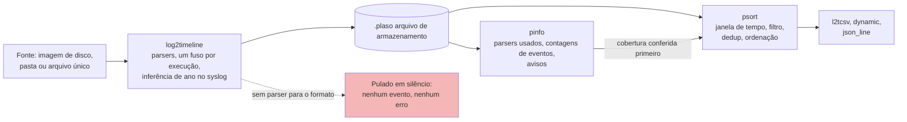

# Dia 57: Super-linhas do tempo com Plaso (log2timeline, pinfo, psort)

> 🇺🇸 Original: [*Day 57: Super-timelines with Plaso (log2timeline, pinfo, psort)*](https://github.com/thiefdroppers/cyber-investigator-skills/blob/main/curriculum/phase-4-digital-forensics-incident-investigation/day-57.md) — © ThiefDroppers, licença MIT.
> Aqui: tradução fiel **+** camada brasileira. Nada do original foi removido; tudo o que é novo vem marcado com ➕.

**Fase 4. Forense digital e investigação de incidentes** · Meta da trilha: rodar o Plaso sobre uma imagem de disco e uma pasta de logs, verificar quais fontes ele de fato interpretou e exportar uma super-linha do tempo filtrada que você consiga defender.

Rank Jutsu: `B` · [](https://colab.research.google.com/github/Ridd1kulusC0d3r/investigador-cyber-90-dias/blob/main/curriculo/fase-4-forense-e-resposta/dia-57/dia-57.ipynb)

---

## 🎬 ➕ Abertura do caso — *O proxy que não sabia o ano*

A TI da Serra Azul mandou o pacote do notebook `SA-CX-07` (10.20.40.57), o da caixa da agência Centro que abriu o link na manhã de 5 de outubro: log do proxy, log do firewall, eventos de segurança do Windows, um trecho da MFT e o log de login do webmail. Cinco arquivos, cinco formatos.

— Joga tudo no Plaso e me traz a super-linha do tempo — diz Rafa.

Você roda, sai um arquivo enorme, você sorri. Rafa aponta para a tela.

— Quantos eventos do firewall tem aí dentro?

Você procura. Nenhum. Nenhum erro também.

— E o proxy: em que ano ele diz que a caixa clicou?

O syslog do proxy não tem ano na linha. O firewall grava no horário de Brasília sem dizer o fuso. Hoje você aprende a perguntar à ferramenta o que ela **não** leu. *(Personagens e cenário: [Operação Isca](../../../caso-continuo/).)*

---

## 📖 Conceito

Ontem você juntou quatro logs com um script que você mesmo escreveu. Casos reais têm centenas de tipos de artefato: tempos do sistema de arquivos, chaves de registro, histórico do navegador, logs de eventos, *prefetch*, arquivos de atalho, syslog. O Plaso ("Plaso Langar Að Safna Öllu") extrai os carimbos de tempo de todos os formatos que conhece para um único armazenamento, para que você possa ordenar e filtrar tudo junto. Essa saída combinada se chama super-linha do tempo (*super-timeline*).

O Plaso é um conjunto de ferramentas:

| Ferramenta | Função |
|---|---|
| `log2timeline` | Percorre uma fonte (imagem de disco, pasta montada, arquivo único), roda os *parsers* e grava os eventos num arquivo de armazenamento `.plaso` (SQLite) |
| `pinfo` | Relata o que há num arquivo de armazenamento: versão da ferramenta, linha de comando, *parsers* usados, contagem de eventos por *parser*, avisos |
| `psort` | Filtra, ordena, remove duplicatas e grava os eventos no formato escolhido |
| `psteal` | `log2timeline` e `psort` num passo só, para execuções rápidas |

Três coisas decidem se uma execução do Plaso é confiável. Primeiro, a cobertura de *parsers*: o Plaso pula em silêncio os arquivos para os quais não tem *parser*. Um formato de firewall próprio ou um log de aplicação em JSON feito em casa produz zero eventos e nenhum erro. É no `pinfo` que você descobre isso. Segundo, o fuso horário: para fontes que gravam hora local sem indicador de fuso, o Plaso precisa ser informado do fuso (`log2timeline -z ZONA`, também escrito `--zone` ou `--timezone`; `-z list` imprime os nomes aceitos; sem isso, o Plaso usa um fuso tirado dos próprios dados da fonte quando consegue e, caso contrário, assume UTC), e aplica um único fuso à execução inteira. Terceiro, o ano: linhas clássicas de syslog não têm ano, então o Plaso precisa inferi-lo (a partir da data de modificação do arquivo e de outras pistas). Se você copiou o log num ano posterior àquele em que ele foi escrito, o ano inferido pode estar errado.

As ferramentas como um *pipeline*. A aresta pontilhada é a falha que não produz mensagem de erro:



A saída do próprio Plaso também é volumosa. Uma única imagem de estação Windows costuma render milhões de eventos. Você filtra primeiro por janela de tempo, depois por fonte, e só então faz buscas.

## 📚 Recursos

- [Documentação do Plaso](https://plaso.readthedocs.io/): "Using log2timeline", "Using psort", "Using pinfo" e "Installing with Docker".
- [Plaso no GitHub](https://github.com/log2timeline/plaso) e a [lista de formatos suportados](https://plaso.readthedocs.io/en/latest/sources/user/Parsers-and-plugins.html).
- Imagem Docker `log2timeline/plaso` no Docker Hub (evita instalar dependências Python).

### ➕ Recursos do contexto Brasil

- [Módulo `zoneinfo` do Python](https://docs.python.org/pt-br/3/library/zoneinfo.html): o banco de fusos IANA, com o histórico do horário de verão brasileiro (extinto pelo Decreto 9.772/2019). É o que o notebook usa para converter o firewall da cooperativa.
- [Hora Legal Brasileira — Observatório Nacional](https://www.gov.br/observatorio/pt-br/assuntos/hora-legal-brasileira): a referência oficial de hora no Brasil, útil para justificar no relatório qual fuso você assumiu.
- [ABNT NBR ISO/IEC 27037:2013](https://www.abntcatalogo.com.br/): diretrizes para identificação, coleta, aquisição e preservação de evidência digital (norma paga; a biblioteca da sua instituição costuma ter acesso).
- Os dados sintéticos do caso brasileiro de hoje: [`caso-continuo/dados/dia-57/`](../../../caso-continuo/dados/dia-57/).

## 🛠️ Prática: log2timeline sobre EVID-001 e EVID-004, checagem de cobertura com pinfo, exportação de janela com psort

Tudo roda via Docker, para que a versão da ferramenta fique fixada e registrada. `~/lab-p4` é montado em `/data` dentro do contêiner.

**Seu checklist de hoje.** Faça na ordem e marque cada item ao terminar:

- [ ] Registre a versão do Plaso que você está usando.
- [ ] Liste os *parsers* e *presets* disponíveis.
- [ ] Rode o `log2timeline` sobre o pacote de logs EVID-001.
- [ ] Confira a cobertura de *parsers* com o `pinfo` antes de confiar na saída.
- [ ] Verifique e confirme o ano inferido.
- [ ] Rode o `log2timeline` sobre a imagem de disco EVID-004.
- [ ] Exporte a janela do incidente com o `psort`.
- [ ] Compare a janela do Plaso com a sua linha do tempo do Dia 56.
- [ ] Escreva nas suas notas de método como você confirmou o ano.
- [ ] ➕ Prática BR: tabela de cobertura do pacote do `SA-CX-07` e a armadilha do "um fuso por execução".
- [ ] ➕ O notebook do dia no Colab (mini-Plaso em Python puro).

1. Registre a versão que você está usando.

   ```bash
   docker pull log2timeline/plaso
   docker run --rm log2timeline/plaso log2timeline --version
   ```

   Escreva a versão nas suas notas de método. As opções de linha de comando do Plaso mudaram entre versões; então, se uma *flag* abaixo for rejeitada, rode `log2timeline --help` ou `psort --help` na mesma imagem e use o que ela listar.

2. Liste os *parsers* existentes e os *presets* que os agrupam.

   ```bash
   docker run --rm log2timeline/plaso log2timeline --info | less
   ```

   Procure `syslog`, `filestat` e os *presets* (`linux`, `win7`, `webhist` e outros). Note que nada ali interpreta um formato arbitrário de firewall.

3. Extraia o pacote de logs.

   ```bash
   docker run --rm -v ~/lab-p4:/data log2timeline/plaso log2timeline \
     --storage-file /data/work/lab-p4-logs.plaso /data/work/EVID-001
   ```

4. Confira a cobertura antes de confiar em qualquer coisa.

   ```bash
   docker run --rm -v ~/lab-p4:/data log2timeline/plaso pinfo /data/work/lab-p4-logs.plaso
   ```

   Encontre a seção que lista os eventos gerados por *parser*. Espere que o *parser* de syslog responda pelos dois arquivos `*-auth.log`, e o `filestat` por um conjunto de carimbos de tempo do sistema de arquivos por arquivo. Não espere eventos interpretados a partir do conteúdo de `firewall.log` ou `docportal-app.jsonl`. Escreva uma tabela de cobertura:

   | Arquivo de origem | *Parser* que o tratou | Contagem de eventos | Problema |
   |---|---|---|---|
   | bastion01-auth.log | syslog | ? | Ano inferido |
   | fs01-auth.log | syslog | ? | Relógio 83 s adiantado, sem correção |
   | firewall.log | nenhum (só filestat) | ? | Formato próprio; hora local |
   | docportal-app.jsonl | nenhum (só filestat) | ? | Formato JSON próprio |

   Preencha as contagens a partir da saída do seu `pinfo`. Esta tabela vai para a seção de método do relatório do Dia 64, porque diz ao leitor o que a super-linha do tempo não consegue mostrar.

   O roteamento esperado, como figura. É o que a tabela acima prevê; então confira contra a sua própria saída do `pinfo` em vez de copiá-la:

   ```mermaid
   flowchart LR
       B["bastion01-auth.log"] --> SY["parser syslog"]
       F["fs01-auth.log"] --> SY
       B --> FST["filestat<br/>só tempos do arquivo"]
       F --> FST
       FW["firewall.log"] --> FST
       DP["docportal-app.jsonl"] --> FST
       SY --> EV[("lab-p4-logs.plaso<br/>ano inferido,<br/>fs01 ainda 83 s adiantado")]
       FST --> EV
       FW -.->|"conteúdo não interpretado"| GAP["Ausente da super-linha do tempo:<br/>todos os eventos do firewall e do portal"]
       DP -.->|"conteúdo não interpretado"| GAP
       style GAP fill:#f4b6b6
   ```

5. Verifique o ano inferido. Os tempos de `filestat` da sua cópia de trabalho são o momento em que você copiou os arquivos, e o `git` define a data de modificação dos arquivos como a hora do *checkout*. Exporte algumas linhas de syslog e olhe o ano:

   ```bash
   docker run --rm -v ~/lab-p4:/data log2timeline/plaso psort -o dynamic \
     -w /data/work/check-year.csv /data/work/lab-p4-logs.plaso
   grep -m3 'Accepted' ~/lab-p4/work/check-year.csv
   ```

   Se as linhas não disserem 2026, rode de novo o passo 3 com o ano declarado explicitamente (`--preferred_year 2026`, presente na versão 20260720 do Plaso) num novo arquivo de armazenamento, e registre por quê.

6. Extraia a imagem de disco para um arquivo de armazenamento próprio.

   ```bash
   docker run --rm -v ~/lab-p4:/data log2timeline/plaso log2timeline \
     --storage-file /data/work/evid-004.plaso /data/work/evid-004.raw
   docker run --rm -v ~/lab-p4:/data log2timeline/plaso pinfo /data/work/evid-004.plaso
   ```

   O Plaso abre a imagem bruta sozinho, pela camada dfVFS; não é preciso montá-la. Compare as entradas de arquivo dele com a sua linha do tempo `mactime` do Dia 51. As duas devem listar o `VENDORS.CSV` apagado.

7. Exporte só a janela do incidente. O filtro do psort recebe uma expressão; datas entre aspas são comparadas como UTC.

   ```bash
   docker run --rm -v ~/lab-p4:/data log2timeline/plaso psort -o l2tcsv \
     -w /data/work/lab-p4-window.csv /data/work/lab-p4-logs.plaso \
     "date > '2026-03-14 02:45:00' AND date < '2026-03-14 04:00:00'"
   ```

   E uma fatia de cinco minutos para cada lado do primeiro login bem-sucedido:

   ```bash
   docker run --rm -v ~/lab-p4:/data log2timeline/plaso psort -o dynamic \
     -w /data/work/lab-p4-slice.csv --slice "2026-03-14T03:14:07" /data/work/lab-p4-logs.plaso
   ```

   `-o l2tcsv` grava o CSV clássico do log2timeline, de 17 colunas (date, time, timezone, MACB, source, sourcetype, type, user, host, short, desc, version, filename, inode, notes, format, extra). `-o dynamic` grava um conjunto menor e configurável. `-o json_line` é o mais fácil de pós-processar com `jq`.

8. Compare com o Dia 56. Abra `lab-p4-window.csv` e o seu `lab-p4-merged.csv` lado a lado. Liste o que o Plaso tem e o seu script não tinha (tempos do sistema de arquivos) e o que o seu script tem e o Plaso não tem (os eventos do firewall e da aplicação, e a correção do `fs01`).

9. Nas suas notas de método, escreva como você confirmou o ano no passo 5.

Artefato: `lab-p4-window.csv`, a tabela de cobertura de *parsers* e uma lista de diferenças entre a janela do Plaso e a sua linha do tempo montada à mão.

### ➕ Prática BR: o pacote do `SA-CX-07`

O pacote que a TI da Serra Azul entregou está em [`caso-continuo/dados/dia-57/`](../../../caso-continuo/dados/dia-57/). Todos os arquivos são sintéticos.

| Arquivo | O que é | Armadilha |
|---|---|---|
| `proxy-sa.log` | Proxy da cooperativa, formato syslog clássico | Sem ano na linha; o relógio do proxy está em UTC |
| `fw-serraazul.log` | Firewall da cooperativa | Hora local de Brasília (UTC-3) sem fuso impresso |
| `sa-cx-07-security.csv` | Exportação do log Security do notebook, já em UTC | CSV, não `.evtx`: o Plaso não tem *parser* para ele |
| `sa-cx-07-mft.csv` | Trecho da MFT exportado em CSV | Idem |
| `webmail-sa.jsonl` | Log de login do webmail | JSON próprio |

**Exercício 1: preveja antes de rodar.** Copie a pasta para `~/caso-isca/work/SA-CX-07`, registre o SHA-256 de cada arquivo e, **antes** de rodar o Plaso, preencha a coluna "*Parser* esperado" da tabela abaixo. Depois rode e preencha o resto com o seu `pinfo`:

```bash
mkdir -p ~/caso-isca/work && cp -r caso-continuo/dados/dia-57 ~/caso-isca/work/SA-CX-07
sha256sum ~/caso-isca/work/SA-CX-07/* | tee ~/caso-isca/work/SA-CX-07.sha256
docker run --rm -v ~/caso-isca:/data log2timeline/plaso log2timeline \
  --storage-file /data/work/sa-cx-07.plaso /data/work/SA-CX-07
docker run --rm -v ~/caso-isca:/data log2timeline/plaso pinfo /data/work/sa-cx-07.plaso
```

| Arquivo | *Parser* esperado | *Parser* no `pinfo` | Eventos | Problema |
|---|---|---|---|---|
| proxy-sa.log | | | | |
| fw-serraazul.log | | | | |
| sa-cx-07-security.csv | | | | |
| sa-cx-07-mft.csv | | | | |
| webmail-sa.jsonl | | | | |

**Exercício 2: a armadilha do "um fuso por execução".** Alguém sugere rodar de novo com `-z America/Sao_Paulo` "porque o firewall é de Brasília". Responda por escrito, em duas frases: (a) o que essa *flag* faria com os eventos do proxy, que estão em UTC; (b) por que ela não ajudaria em nada com o firewall. Depois confira no notebook. Resposta esperada: o Plaso aplicaria UTC-3 a uma fonte que já está em UTC, deslocando o clique da caixa em 3 horas; e o conteúdo do firewall nem é interpretado pelo Plaso, então a correção dele é sua, feita fora do Plaso e documentada.

### ➕ O notebook do dia

Abra o [notebook do Dia 57 no Colab](https://colab.research.google.com/github/Ridd1kulusC0d3r/investigador-cyber-90-dias/blob/main/curriculo/fase-4-forense-e-resposta/dia-57/dia-57.ipynb). Sem Docker, em Python puro, você:

1. baixa o EVID-001 do LAB-P4 (com plano B offline) e registra o SHA-256 de cada arquivo;
2. roda um **mini-Plaso**: *parsers* só para o que ele conhece, e vê o firewall e o portal "sumirem" sem erro;
3. reproduz a inferência de ano do syslog e o erro que ela causa quando a cópia é feita no ano seguinte;
4. gera a tabela de cobertura, a janela `02:45–04:00 UTC` em formato l2tcsv e a fatia de ±5 min;
5. repete tudo no pacote do `SA-CX-07` e joga o **quiz da cobertura**.

## ✅ Checkpoint

- Sua tabela de cobertura nomeia cada arquivo de origem.
- Sua tabela de cobertura nomeia o *parser* que tratou cada arquivo.
- Sua tabela de cobertura dá uma contagem de eventos para cada arquivo, tirada do `pinfo`.
- A coluna Problema da sua tabela está preenchida para todos os arquivos.
- Os eventos derivados de syslog na sua saída do Plaso trazem o ano 2026.
- Suas notas de método dizem como você confirmou o ano.
- `lab-p4-window.csv` começa não antes de 02:45 e termina não depois de 04:00 UTC de 14 de março de 2026.
- Sem consultar notas, você explica por que os eventos do `fs01` na saída do Plaso estão 83 segundos depois dos da sua linha do tempo do Dia 56, e qual dos dois você poria num relatório.

## Nota

Os nomes das opções do Plaso e o leiaute do `pinfo` mudam entre versões, e as contagens esperadas de *parser* acima não foram produzidas por uma execução registrada sobre estes dados. Se a sua versão imprimir algo diferente, confie na sua saída e registre-a.

### ➕ Checkpoint BR

- Sua tabela do `SA-CX-07` tem a coluna "*Parser* esperado" preenchida **antes** da execução, e você marcou onde errou a previsão.
- Você explica, sem notas, por que `-z America/Sao_Paulo` estragaria o proxy e não consertaria o firewall.
- Você converteu à mão (ou no notebook) a linha do firewall `2026-10-05 08:19:38` para UTC e chegou a `11:19:38Z`, o mesmo segundo do `GET http://lnk.example/sa7` no proxy.
- No quiz do notebook, você acertou pelo menos 5 de 6.

## ⚖️ ➕ Camada jurídica BR

**CPP, art. 158-A (cadeia de custódia).** O Código de Processo Penal, com a redação da Lei 13.964/2019, define a cadeia de custódia como o conjunto de procedimentos usados para manter e documentar a história cronológica do vestígio, da coleta ao descarte. A super-linha do tempo é um produto do **processamento** do vestígio (uma das etapas listadas no art. 158-B). Por isso a versão da ferramenta, a linha de comando, os hashes das cópias de trabalho e a tabela de cobertura não são burocracia: são a parte da história cronológica que mostra que o vestígio não foi alterado e o que foi (e o que não foi) extraído dele.

**Marco Civil da Internet, arts. 13 e 15.** Provedores de conexão guardam registros de conexão por 1 ano; provedores de aplicação guardam registros de acesso por 6 meses. Na prática, isso define até quando um pedido de preservação e, depois, uma ordem judicial ainda encontram algo do outro lado. Uma linha do tempo com fuso errado pede ao provedor os registros da hora errada, e a resposta "nada encontrado" chega depois do prazo.

> Este repositório é material de estudo e não substitui orientação jurídica.

## 🧠 ➕ Camada 8 — viés de automação: "a ferramenta não reclamou"

Parasuraman e Riley (1997) descreveram o uso indevido da automação (*misuse*): a pessoa confia na saída do sistema automático além do que ele merece, e para de procurar o que o sistema não mostrou. Na literatura isso aparece como **viés de automação**, com dois erros típicos: o de comissão (seguir uma saída errada) e o de **omissão** (não perceber um problema porque a ferramenta não avisou).

O Plaso é o caso perfeito do erro de omissão: ele pula o firewall em silêncio. A super-linha do tempo grande e bem formatada transmite completude; o volume parece cobertura. A consequência prática: **toda saída automática chega à sua mesa com a pergunta "o que ela não leu?" anexada**, e a tabela de cobertura é a resposta escrita. Se você não consegue preencher a coluna Problema, ainda não pode usar a saída.

## 🤖 ➕ Skill do dia

O dia propõe à [skill pt-BR](../../../skills/investigador-cyber/SKILL.md) um procedimento novo, **"Super-linha do tempo: cobertura, fuso e ano antes de confiar"**. Texto e caso de teste em [`_skill-delta.md`](_skill-delta.md).

## 💡 ➕ Inovação OSINT do dia — `zoneinfo`: fuso brasileiro sem adivinhação

Converter "hora de Brasília" somando 3 horas funciona em 2026, mas quebra em logs antigos: até 2019 o Brasil teve horário de verão (UTC-2 em parte do ano, em parte dos estados). O módulo `zoneinfo`, da biblioteca padrão desde o Python 3.9, usa o banco IANA, que guarda esse histórico:

```python
from datetime import datetime                     # data e hora
from zoneinfo import ZoneInfo                     # banco de fusos IANA, stdlib
sp = ZoneInfo("America/Sao_Paulo")                # o fuso, com todo o histórico de horário de verão
for s in ("2026-10-05 08:19:38", "2018-12-01 08:19:38"):
    local = datetime.fromisoformat(s).replace(tzinfo=sp)   # "esta hora estava no relógio de SP"
    print(s, "->", local.astimezone(ZoneInfo("UTC")))       # 2026: +3 h; dez/2018 (verão): +2 h
```

Vale para qualquer fonte brasileira sem fuso impresso: o firewall de uma cooperativa, um print de WhatsApp, um extrato bancário. Registre no relatório o nome do fuso IANA que você assumiu, não "UTC-3".

## 📝 Diário de estudo

- Data:
- Tempo gasto:
- O que ficou claro:
- O que ainda está nebuloso:
- Artefato produzido: `lab-p4-window.csv`, tabela de cobertura do LAB-P4, tabela de cobertura do `SA-CX-07`, lista de diferenças Plaso × Dia 56

---
<sub>Baseado em [cyber-investigator-skills](https://github.com/thiefdroppers/cyber-investigator-skills) por ThiefDroppers (MIT). Tradução, camada BR, Camada 8, skill pt-BR e notebook por Deivison Lourenço (@Ridd1kulusC0d3r).</sub>
