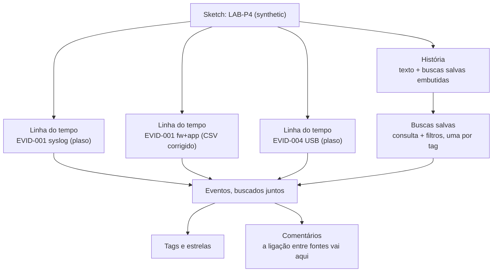

# Dia 58: Do armazenamento Plaso a uma história investigativa no Timesketch

> 🇺🇸 Original: [*Day 58: From Plaso storage to a Timesketch investigation story*](https://github.com/thiefdroppers/cyber-investigator-skills/blob/main/curriculum/phase-4-digital-forensics-incident-investigation/day-58.md) — © ThiefDroppers, licença MIT.
> Aqui: tradução fiel **+** camada brasileira. Nada do original foi removido; tudo o que é novo vem marcado com ➕.

**Fase 4. Forense digital e investigação de incidentes** · Meta da trilha: carregar todas as fontes do LAB-P4 num único *sketch* do Timesketch, inclusive as que o Plaso não conseguiu interpretar, e escrever uma história que ligue eventos de fontes diferentes, com a evidência de cada ligação.

Rank Jutsu: `B` · [](https://colab.research.google.com/github/Ridd1kulusC0d3r/investigador-cyber-90-dias/blob/main/curriculo/fase-4-forense-e-resposta/dia-58/dia-58.ipynb)

---

## 🎬 ➕ Abertura do caso — *A história que a Marta vai ler*

Marta Quintão manda mensagem às 18h: *"A diretoria quer saber amanhã cedo: a caixa abriu o link, e daí? O que aconteceu depois? Em ordem, por favor."*

Você tem a tabela de cobertura de ontem, o proxy convertido, o firewall convertido para UTC fora do Plaso e uma lista solta de horários. Rafa puxa uma cadeira.

— Ordem cronológica não é história. História é: este evento aqui está ligado àquele ali **por causa deste campo**. Porta, usuário, IP, caminho. Se você não consegue nomear o campo, não escreve a seta.

Ele aponta para a linha das 12h07 no proxy: 3 MB saindo do notebook para `atualiza-modulo.example`.

— E esta seta aqui você escreve tracejada. Você viu o tamanho. Não viu o conteúdo.

Hoje você escreve a história da invasão do `SA-CX-07` evento por evento, cada ligação com o seu campo. *(Personagens e cenário: [Operação Isca](../../../caso-continuo/).)*

---

## 📖 Conceito

Um CSV de 300 linhas dá para ler. Uma super-linha do tempo de três milhões de linhas não dá, e muitas vezes várias pessoas precisam trabalhar nela ao mesmo tempo. O Timesketch é uma aplicação web de código aberto feita para isso: você envia linhas do tempo (arquivos de armazenamento do Plaso, CSV ou JSON *lines*) para um *sketch*, busca em todas juntas e registra o seu raciocínio no mesmo lugar que a evidência.

Os recursos que você vai usar todo dia:

- A busca usa a sintaxe *query-string* do OpenSearch: `message:"Accepted password"`, `198.51.100.23`, booleanos `AND`/`OR`/`NOT`, e um intervalo de datas como *chip* de filtro ou `datetime:[2026-03-14T03:00:00 TO 2026-03-14T04:00:00]`.
- *Tags* e estrelas marcam eventos. *Tags* são texto livre; combine uma lista curta com o seu time (por exemplo `initial-access`, `lateral`, `staging`, `exfil`, `open-question`) para que as buscas por *tag* funcionem.
- Comentários ficam em eventos individuais. É aqui que vai a ligação com outra fonte: "mesma porta de origem 41766 da linha do fw01 às 03:19:21Z".
- Buscas salvas (*saved searches*) guardam uma consulta e seus filtros com um nome.
- Histórias (*stories*) são narrativas escritas que embutem buscas salvas e listas de eventos, para que o leitor possa clicar de uma frase para as linhas que a sustentam.

Como essas peças se relacionam dentro de um *sketch*, usando as três linhas do tempo de hoje:



O Timesketch mostra qualquer horário que você entregar a ele. Ele não conserta um firewall que registrou hora local nem um servidor com relógio adiantado. Você corrige o tempo antes da importação (fez isso no Dia 56) e escreve a correção dentro do *sketch*, para que o próximo analista saiba.

Os campos obrigatórios para importar CSV e JSONL são `message`, `datetime` (ISO 8601, por exemplo `2026-03-14T03:41:02+00:00`) e `timestamp_desc` (o que o horário significa, como `Connection Allowed` ou `Event Recorded`). Qualquer outra coluna vira atributo pesquisável.

## 📚 Recursos

- Documentação do [Timesketch](https://timesketch.org/): "Install", "Upload data", "Import from JSON or CSV", "Search query guide".
- [Timesketch no GitHub](https://github.com/google/timesketch), incluindo `contrib/deploy_timesketch.sh`.
- [Módulos de saída do psort do Plaso](https://plaso.readthedocs.io/en/latest/sources/user/Using-psort.html), que incluem saídas para OpenSearch em *pipelines* grandes.

### ➕ Recursos do contexto Brasil

- [Lei 13.964/2019 ("Pacote Anticrime")](https://www.planalto.gov.br/ccivil_03/_ato2019-2022/2019/lei/l13964.htm): inseriu no CPP os arts. 158-A a 158-F (cadeia de custódia). Leia o 158-B: as etapas de rastreamento do vestígio. A história do Timesketch documenta a etapa de processamento.
- [CPP compilado](https://www.planalto.gov.br/ccivil_03/decreto-lei/del3689compilado.htm), arts. 158-A a 158-F.
- Os dados sintéticos do `SA-CX-07` continuam em [`caso-continuo/dados/dia-57/`](../../../caso-continuo/dados/dia-57/); o notebook de hoje os converte para CSV do Timesketch.

## 🛠️ Prática: *sketch* "LAB-P4" no Timesketch com três linhas do tempo e uma história escrita

Você precisa de uma VM Linux com Docker, pelo menos 8 GB de RAM e 4 núcleos, porque o Timesketch roda OpenSearch, PostgreSQL, Redis e vários *workers*.

**Seu checklist de hoje.** Faça na ordem e marque cada item ao terminar:

- [ ] Instale o Timesketch na sua VM de laboratório.
- [ ] Prepare as fontes que o Plaso não conseguiu interpretar como CSV do Timesketch.
- [ ] Crie o *sketch* "LAB-P4" e envie as três linhas do tempo.
- [ ] Trate o desvio do `fs01` com uma nota na história e comentários.
- [ ] Busque e aplique *tags* nas cinco consultas-chave.
- [ ] Comente as ligações entre linhas do tempo.
- [ ] Escreva a história "LAB-P4 intrusion path".
- [ ] Exporte a história e as buscas salvas.
- [ ] ➕ Prática BR: a história "Isca — SA-CX-07" com as ligações por campo.
- [ ] ➕ O notebook do dia no Colab (mini-Timesketch em Python puro).

1. Instale (instalação de laboratório em host único, conforme a documentação do Timesketch):

   ```bash
   curl -s -O https://raw.githubusercontent.com/google/timesketch/master/contrib/deploy_timesketch.sh
   chmod 755 deploy_timesketch.sh
   sudo ./deploy_timesketch.sh
   cd timesketch && sudo docker compose up -d
   sudo docker compose exec timesketch-web tsctl create-user analyst
   ```

   Leia o script antes de rodá-lo; ele grava configuração e segredos gerados em `./timesketch`. Acesse `http://<ip-da-vm>` e faça login. Esta instalação de laboratório não tem TLS e serve só para uma VM isolada.

2. Prepare as fontes que o Plaso não conseguiu interpretar. Converta a sua linha do tempo consolidada do Dia 56 (já corrigida para UTC) em CSV do Timesketch, mantendo só as linhas do firewall e do portal de documentos:

   ```bash
   python3 - <<'EOF'
   import csv, os
   W = os.path.expanduser("~/lab-p4/work/")
   src = csv.DictReader(open(W + "lab-p4-merged.csv"))
   out = csv.writer(open(W + "lab-p4-fw-app.ts.csv", "w", newline=""))
   out.writerow(["message", "datetime", "timestamp_desc", "host", "evidence_ref", "time_correction"])
   for r in src:
       if r["host"] == "fw01":
           desc, corr = "Connection Allowed" if "ACCEPT" in r["event"] else "Connection Dropped", "America/New_York to UTC (UTC-4, measured on port pairs)"
       elif r["host"] == "fs01/docportal":
           desc, corr = "Event Recorded", "fs01 clock -83 s (measured on port 41766)"
       else:
           continue
       out.writerow([r["event"], r["utc"].replace("Z", "+00:00"), desc, r["host"], r["evidence_ref"], corr])
   EOF
   head -3 ~/lab-p4/work/lab-p4-fw-app.ts.csv
   ```

   A coluna `time_correction` põe a sua correção em todas as linhas, onde ninguém deixa de ver.

3. Crie um *sketch* chamado `LAB-P4 (synthetic)` e envie três linhas do tempo pela interface web (Upload timeline) ou pelo cliente de importação (`pip install timesketch-import-client`, depois `timesketch_importer`):

   | Nome da linha do tempo | Arquivo | Contém |
   |---|---|---|
   | `EVID-001 syslog (plaso)` | `lab-p4-logs.plaso` do Dia 57 | logs de autenticação do `bastion01` e do `fs01`, desvio do `fs01` sem correção |
   | `EVID-001 fw+app (corrected CSV)` | `lab-p4-fw-app.ts.csv` | firewall e portal de documentos, em UTC |
   | `EVID-004 USB (plaso)` | `evid-004.plaso` do Dia 57 | tempos do sistema de arquivos da imagem USB |

   Espere o status de cada linha do tempo indicar que ela está pronta antes de buscar.

4. Trate o desvio do `fs01` na linha do tempo do Plaso. Você não consegue editar carimbos de tempo no Timesketch; então acrescente uma nota no nível do *sketch* (uma seção de história intitulada "Time corrections") dizendo que os eventos do `fs01` em `EVID-001 syslog (plaso)` estão 83 segundos adiantados, e comente cada evento do `fs01` que você citar com a hora corrigida.

5. Busque e aplique *tags*. Rode cada consulta, abra os eventos correspondentes e marque-os:

   | Consulta | *Tag* |
   |---|---|
   | `message:"Failed password" AND message:"203.0.113.45"` | `initial-access` (marque só o primeiro e o último; dê estrela ao primeiro) |
   | `message:"Accepted password for svc_backup"` | `initial-access` |
   | `"41766"` | `lateral` |
   | `message:"bulk_export" OR message:"tar -czf"` | `staging` |
   | `"198.51.100.23"` | `exfil` |

   Salve cada consulta como busca salva com o mesmo nome da sua *tag*.

6. Comente as ligações. Em cada evento marcado, acrescente um comentário que nomeie o evento de outra linha do tempo ao qual ele se liga e o campo que faz a ligação. Por exemplo, no evento "Accepted publickey" do `fs01`: "Mesma conexão que o fw01 ACCEPT 10.10.20.5:41766 -> 10.10.30.17:22 às 03:19:21Z (EVID-001 fw+app, firewall.log:147). Hora corrigida 03:19:22Z." Busque ter pelo menos quatro comentários entre linhas do tempo.

7. Escreva a história. Crie uma história chamada `LAB-P4 intrusion path`. Seções, cada uma com uma ou duas frases e a busca salva embutida:

   1. Correções de tempo aplicadas, com a evidência de cada uma.
   2. *Password spray* contra o `bastion01`, de 02:51:03 a 03:13:36, 112 falhas, oito nomes de usuário, uma origem.
   3. Login por senha como `svc_backup` às 03:14:07.
   4. SSH do `bastion01` para o `fs01`, de 03:19:21 a 03:19:22, ligado pela porta de origem.
   5. Exportação e arquivamento de `finance/2026-Q1` no `fs01`, às 03:23:48 e 03:31:40.
   6. 48.213.904 bytes para 198.51.100.23:443 às 03:41:02, e o mesmo IP visto a partir da WS-FIN-07 na memória (Dia 54). Marque a ligação por tamanho e a ligação entre hosts como inferidas.
   7. Questões em aberto: como a senha do `svc_backup` era conhecida; as falhas das 02:10 contra a WS-FIN-07 a partir do `bastion01`; se a imagem USB (EVID-004) tem alguma ligação com essa sequência.

   A história como sequência. Os números são a ordem das mensagens, todos os horários estão em UTC corrigido, setas cheias são ligações por um campo compartilhado, e as setas tracejadas são as duas ligações que você deve marcar como inferidas:

   ```mermaid
   sequenceDiagram
       autonumber
       participant X as 203.0.113.45
       participant B as bastion01 10.10.20.5
       participant FW as fw01
       participant F as fs01 10.10.30.17
       participant Y as 198.51.100.23
       participant W as WS-FIN-07 10.10.40.57
       Note over X,W: Seção 1. Correções de tempo: fw01 de hora local para UTC, fs01 menos 83 s
       X->>B: spray, 112 falhas, 8 usuários<br/>02:51:03 a 03:13:36
       X->>B: Accepted password<br/>para svc_backup, 03:14:07
       B->>FW: SSH para fs01<br/>porta de origem 41766, 03:19:21
       FW->>F: mesma porta de origem 41766<br/>Accepted publickey, 03:19:22
       F->>F: bulk_export 412 arquivos 03:23:48<br/>sudo tar .q1.tgz 03:31:40
       F-->>Y: 48.213.904 bytes, 03:41:02<br/>(conteúdo inferido pelo tamanho)
       W-->>Y: synchelper.exe na memória<br/>(só o mesmo IP, inferido)
       Note over X,W: Seção 7. Em aberto: como a senha era conhecida, as falhas das 02:10 na WS-FIN-07 a partir do bastion01, qualquer ligação com o EVID-004
   ```

8. Exporte a história (a tela da história tem opção de exportar nas versões recentes; senão, imprima em PDF) e exporte cada busca salva para CSV.

Artefato: um *sketch* do Timesketch com três linhas do tempo, cinco buscas salvas, pelo menos quatro comentários entre linhas do tempo e a história exportada `LAB-P4 intrusion path`.

### ➕ Prática BR: a história "Isca — SA-CX-07"

Use os arquivos de [`caso-continuo/dados/dia-57/`](../../../caso-continuo/dados/dia-57/). O notebook gera `isca-sa-cx-07.ts.csv` (proxy, firewall já em UTC, Security, MFT e webmail, com a coluna `time_correction`). Envie-o como uma quarta linha do tempo num *sketch* separado, `Isca SA-CX-07 (sintético)`. Nunca misture casos de clientes diferentes no mesmo *sketch*.

**Exercício 1: *tags* e buscas salvas.**

| Consulta | *Tag* |
|---|---|
| `"lnk.example" OR "serraazul-pix.example"` | `initial-access` |
| `"msa-atualizador.exe" OR "Modulo_Seguranca_SerraAzul.zip"` | `execution` |
| `"198.51.100.140"` | `c2-suspeito` |
| `"203.0.113.91"` | `conta-webmail` |
| `"mailbox.rule_create"` | `persistencia-email` |

**Exercício 2: a história, com o campo de cada seta.** Seções:

1. Correções de tempo: `fw-serraazul.log` de `America/Sao_Paulo` para UTC (+3 h), medida pelo par proxy/firewall do `GET lnk.example/sa7` (mesmo segundo, 11:19:38Z); o proxy já está em UTC; ano do syslog do proxy confirmado como 2026.
2. Clique: 11:19:38Z, `GET http://lnk.example/sa7` (302) e, 3 s depois, `CONNECT serraazul-pix.example:443`; ligação por **IP de origem 10.20.40.57 e usuário `cx.centro07`** no proxy.
3. Download: 11:23:12Z, resposta de ~412 KB do site falso; 11:23:14Z, `Modulo_Seguranca_SerraAzul.zip` (410.624 bytes) criado em `Downloads`. Ligação por **horário e tamanho**: marque como **inferida**.
4. Execução: 11:24:29Z, `msa-atualizador.exe` gravado em `AppData\Roaming\MSA` (`$SI` criado em 2021, `$FN` em 2026: lembre do Dia 52); 11:24:31Z, processo iniciado; 11:24:44Z, `schtasks.exe` filho dele. Ligação por **caminho do arquivo**.
5. Contato periódico: a partir de 11:25:02Z, conexões a `atualiza-modulo.example` (198.51.100.140) a cada ~300 s; às 12:07:10Z, uma conexão com 3.145.728 bytes enviados. Conteúdo **não observado**.
6. Conta de webmail: 12:31Z a 12:33Z, três falhas e um sucesso de `cx.centro07` a partir de 203.0.113.91, seguidos de criação de regra de caixa postal. A ligação entre o notebook e esse login é **só o nome da conta**: marque como **inferida**; a origem da senha não é mostrada.
7. Questões em aberto: a caixa digitou credenciais no site falso? (nenhuma fonte entregue mostra o conteúdo do formulário); o que havia nos 3 MB; o que a regra de caixa postal faz; outros notebooks da agência contataram 198.51.100.140?

```mermaid
sequenceDiagram
    autonumber
    participant C as SA-CX-07 10.20.40.57
    participant P as proxy-sa
    participant S as serraazul-pix.example 203.0.113.77
    participant K as atualiza-modulo.example 198.51.100.140
    participant E as 203.0.113.91
    participant M as webmail-sa
    Note over C,M: Seção 1. Correções: firewall de America/Sao_Paulo para UTC; proxy já em UTC; ano 2026 confirmado
    C->>P: GET lnk.example/sa7, 11:19:38<br/>(mesmo segundo no firewall)
    P->>S: CONNECT 443, 11:19:41
    S-->>C: ~412 KB, 11:23:12 → .zip de 410.624 bytes em 11:23:14<br/>(inferido por horário e tamanho)
    C->>C: msa-atualizador.exe 11:24:31<br/>schtasks.exe 11:24:44 (mesmo caminho)
    C->>K: CONNECT a cada ~300 s desde 11:25:02
    C-->>K: 3.145.728 bytes, 12:07:10<br/>(conteúdo não observado)
    E-->>M: cx.centro07: 3 falhas + sucesso, 12:31-12:32<br/>(liga ao notebook só pelo nome da conta)
    Note over C,M: Seção 7. Em aberto: credenciais digitadas? conteúdo dos 3 MB? efeito da regra de e-mail? outros hosts?
```

### ➕ O notebook do dia

Abra o [notebook do Dia 58 no Colab](https://colab.research.google.com/github/Ridd1kulusC0d3r/investigador-cyber-90-dias/blob/main/curriculo/fase-4-forense-e-resposta/dia-58/dia-58.ipynb). Sem servidor, você:

1. reconstrói a parte "fw+app" do LAB-P4 com as correções (fw01 → UTC, `fs01`/docportal −83 s) e gera `lab-p4-fw-app.ts.csv` no formato exigido (`message`, `datetime`, `timestamp_desc` + `time_correction`);
2. roda um **mini-Timesketch**: busca por texto, aplica *tags*, salva buscas e encontra automaticamente as ligações entre fontes pelo campo compartilhado (porta 41766, IP 198.51.100.23);
3. gera a história em Markdown com as setas cheias e tracejadas;
4. faz o mesmo para o `SA-CX-07` e exporta `isca-sa-cx-07.ts.csv`;
5. joga o quiz **"seta cheia ou tracejada?"**.

## ✅ Checkpoint

- Todo evento citado na história tem *tag*.
- Toda afirmação entre fontes na história nomeia o campo compartilhado (porta, nome de usuário, IP, caminho).
- A seção "Time corrections" lista as mesmas correções da sua nota de correções do Dia 56.
- A seção 7 lista pelo menos três questões em aberto. Se a sua história não tem nenhuma, você concluiu mais do que os dados mostram.
- A busca salva `lateral` devolve tanto o evento do fw01 com porta de origem 41766 quanto o evento "Accepted publickey" do `fs01`.
- O evento "Accepted publickey" do `fs01` tem um comentário que nomeia o evento do fw01 ao qual se liga e a porta de origem compartilhada 41766.
- Sem consultar notas, você diz por que o desvio do `fs01` é tratado com uma nota na história e comentários, e não alterando os carimbos de tempo no Timesketch.

## Nota

O caminho do `deploy_timesketch.sh`, o comando `tsctl create-user` e o nome do cliente de importação correspondem ao guia de instalação do Timesketch e ao pacote `timesketch-import-client` do PyPI, conforme conferido em setembro de 2026. Eles já mudaram antes; confira o guia de instalação atual se um comando falhar.

### ➕ Checkpoint BR

- Sua história do `SA-CX-07` tem as sete seções, e as seções 3, 5 e 6 trazem a palavra "inferido" ou "não observado" onde cabe.
- Nenhuma seção diz que a caixa "entregou a senha" ou que "os dados da cooperativa vazaram": nenhuma fonte entregue mostra isso.
- O *sketch* da Isca é separado do *sketch* do LAB-P4.
- No quiz do notebook, você acertou pelo menos 5 de 6.

## ⚖️ ➕ Camada jurídica BR

**CPP, art. 158-B (etapas da cadeia de custódia).** O artigo lista as etapas do rastreamento do vestígio, entre elas o reconhecimento, a coleta, o acondicionamento, o processamento, o armazenamento e o descarte. Não poder editar o carimbo de tempo no Timesketch não é limitação, é proteção: o dado original continua como foi coletado, e a sua correção fica registrada ao lado, com autoria e motivo. Um laudo em que o perito "consertou" a hora do vestígio sem deixar rastro abre espaço para a defesa questionar a integridade da cadeia.

**CPP, art. 158-F.** O vestígio processado volta à central de custódia, e o perito guarda o material que permite a contraprova. Na prática do MSSP: exporte a história, as buscas salvas e os CSV importados, com hash, e guarde junto do dossiê do caso.

**LGPD, art. 46.** O agente de tratamento deve adotar medidas de segurança para proteger dados pessoais de acessos não autorizados. Um Timesketch de laboratório sem TLS, com logs reais de cooperados, numa VM exposta, é exatamente o que esse artigo pede para evitar. Dados de cliente só em instância protegida.

> Este repositório é material de estudo e não substitui orientação jurídica.

## 🧠 ➕ Camada 8 — a falácia narrativa e o "e depois"

Uma história bem contada convence mais do que uma lista de fatos, mesmo quando é menos provável. Tversky e Kahneman mostraram isso com a **falácia da conjunção** (o problema "Linda", 1983): pessoas julgam "A e B" mais provável do que "A" sozinho quando "A e B" forma uma história coerente, o que é matematicamente impossível. Kahneman, em *Rápido e devagar*, liga isso ao "o que você vê é tudo o que há" (*WYSIATI*): a mente monta a história mais coerente com o que está à vista e não pesa o que falta.

Na Isca: "a caixa clicou, baixou o módulo, o módulo roubou a senha, e o Pescador entrou no webmail" é uma história redonda. Cada "e" multiplica uma incerteza. A seta tracejada é o antídoto visual: ela obriga a separar o que foi **observado** do que foi **costurado**. Consequência prática: antes de entregar a história, conte as setas tracejadas. Se forem zero, você provavelmente desenhou alguma tracejada como cheia.

## 🤖 ➕ Skill do dia

O dia propõe à [skill pt-BR](../../../skills/investigador-cyber/SKILL.md) um acréscimo ao procedimento "Grafo de vínculos (link analysis)": ligações entre fontes de uma linha do tempo só valem com o campo compartilhado nomeado, e ligações por tamanho, horário ou nome de conta são marcadas como inferidas. Texto e caso de teste em [`_skill-delta.md`](_skill-delta.md).

## 💡 ➕ Inovação OSINT do dia — achar ligações entre fontes por campo compartilhado, em 10 linhas

O comentário mais valioso do Timesketch ("mesma porta de origem 41766") pode ser encontrado automaticamente: indexe cada evento pelos seus campos (IPs, portas, usuários, caminhos) e procure valores que aparecem em **fontes diferentes**. Só stdlib:

```python
import re
from collections import defaultdict
CAMPO = re.compile(r"\b(?:\d{1,3}\.){3}\d{1,3}\b|\bport[= ](\d+)|:(\d{4,5})\b")   # IPs e portas
indice = defaultdict(set)                                  # valor -> {fontes onde aparece}
for fonte, linha in eventos:                               # eventos = [(nome_da_fonte, texto), ...]
    for m in CAMPO.finditer(linha):
        indice[m.group(1) or m.group(2) or m.group(0)].add(fonte)
pontes = {v: f for v, f in indice.items() if len(f) > 1}  # valor visto em 2+ fontes = candidato a ligação
```

Cada valor em `pontes` é uma **candidata** a seta; você ainda precisa conferir horário e direção antes de escrevê-la. O notebook do dia usa essa ideia para achar a porta 41766 sozinho.

## 📝 Diário de estudo

- Data:
- Tempo gasto:
- O que ficou claro:
- O que ainda está nebuloso:
- Artefato produzido: *sketch* `LAB-P4 (synthetic)`, história `LAB-P4 intrusion path` exportada, `lab-p4-fw-app.ts.csv`, `isca-sa-cx-07.ts.csv`, história "Isca — SA-CX-07"

---
<sub>Baseado em [cyber-investigator-skills](https://github.com/thiefdroppers/cyber-investigator-skills) por ThiefDroppers (MIT). Tradução, camada BR, Camada 8, skill pt-BR e notebook por Deivison Lourenço (@Ridd1kulusC0d3r).</sub>
