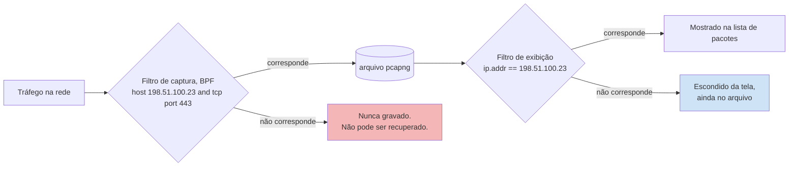
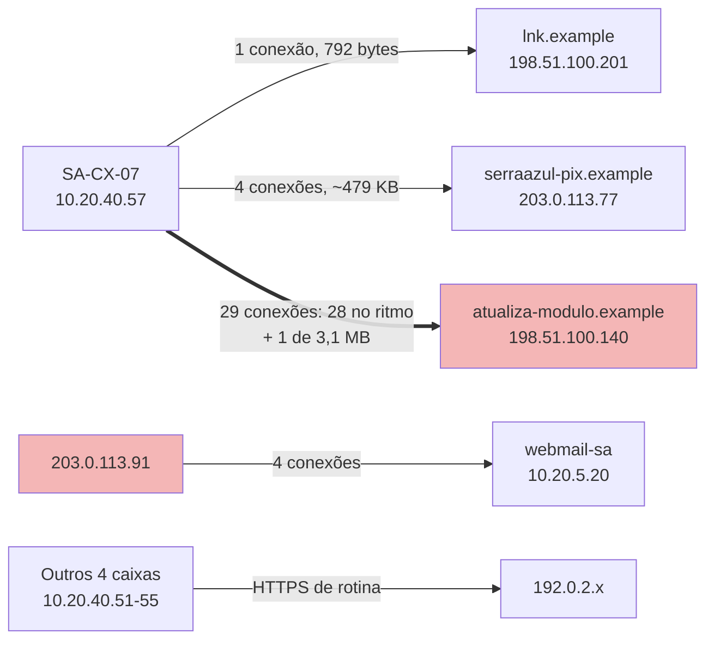

# Dia 59: Forense de rede com Wireshark e tshark

> 🇺🇸 Original: [*Day 59: Network forensics with Wireshark and tshark*](https://github.com/thiefdroppers/cyber-investigator-skills/blob/main/curriculum/phase-4-digital-forensics-incident-investigation/day-59.md) — © ThiefDroppers, licença MIT.
> Aqui: tradução fiel **+** camada brasileira. Nada do original foi removido; tudo o que é novo vem marcado com ➕.

**Fase 4. Forense digital e investigação de incidentes** · Meta da trilha: filtrar uma captura até sobrarem as conversas que importam, medi-las e apresentar o tráfego como grafo em vez de como rolagem de tela.

Rank Jutsu: `B` · [](https://colab.research.google.com/github/Ridd1kulusC0d3r/investigador-cyber-90-dias/blob/main/curriculo/fase-4-forense-e-resposta/dia-59/dia-59.ipynb)

---

## 🎬 ➕ Abertura do caso — *Cinco minutos, mais ou menos*

A TI da Serra Azul não guarda pacotes. Guarda proxy e firewall por 90 dias, e foi isso que mandou. Rafa imprime a coluna de horários das conexões do `SA-CX-07` para `atualiza-modulo.example` e espalha as folhas na mesa.

— Diz para mim o intervalo.

— Uns cinco minutos.

— "Uns" não vai para o relatório. Média, mínimo, máximo, desvio. E me explica aquele buraco das 12h07.

Do outro lado da sala, Marta pergunta pelo telefone se dá para "ver o que foi mandado". Rafa responde por você:

— Dá para ver que foram 3 megabytes, para onde e quando. O que tinha dentro, não. É HTTPS e ninguém guardou pacote.

Hoje você mede o ritmo de uma conexão e desenha quem falou com quem, sem abrir um único pacote do caso. *(Personagens e cenário: [Operação Isca](../../../caso-continuo/).)*

---

## 📖 Conceito

A evidência de rede vem em dois graus. A captura completa de pacotes (pcap ou pcapng) guarda todos os bytes, então você pode reconstruir sessões e extrair arquivos transferidos, mas raramente é mantida por mais de horas ou dias. Registros de fluxo e de firewall (NetFlow, IPFIX, `conn.log` do Zeek, logs de firewall como os do LAB-P4) guardam só quem falou com quem, quando, em quais portas e quantos bytes, mas são mantidos por muito mais tempo. A maioria das investigações reais tem registros de fluxo para o período inteiro e pacotes para uma parte pequena dele, se tiver.

O Wireshark tem duas linguagens de filtro, e confundi-las é o erro de iniciante mais comum. Filtros de captura usam a sintaxe BPF e decidem o que é gravado (`host 198.51.100.23 and tcp port 443`); tudo o que eles excluem se perde. Filtros de exibição usam a sintaxe de campos do próprio Wireshark e só escondem pacotes da tela (`ip.addr == 198.51.100.23 && tcp.port == 443`). Em investigações, você quase sempre captura de forma ampla e filtra na exibição.

Onde cada filtro age, e o que você perde com cada um:



Filtros de exibição que você vai usar o tempo todo:

| Filtro | Mostra |
|---|---|
| `ip.addr == 198.51.100.23` | Qualquer pacote de ou para esse endereço |
| `ip.src == 10.10.30.17 && tcp.dstport == 443` | HTTPS de saída de um host |
| `ip.addr == 10.10.0.0/16` | Uma sub-rede inteira (CIDR funciona) |
| `tcp.flags.syn == 1 && tcp.flags.ack == 0` | Só tentativas de conexão |
| `dns.qry.name contains "example"` | Consultas DNS com uma substring |
| `dns.flags.rcode == 3` | Respostas NXDOMAIN (comuns em malware com geração de domínios) |
| `http.request.method == "POST"` | Envios por HTTP em claro |
| `tls.handshake.type == 1` | TLS Client Hello; acrescente a coluna `tls.handshake.extensions_server_name` para ver o SNI |
| `frame.time >= "2026-03-14 03:40:00"` | Pacotes depois de um horário (no fuso que o Wireshark está exibindo) |
| `tcp.analysis.retransmission` | Retransmissões, sinal de perda ou de um enlace com dificuldade |
| `!(arp \|\| dns \|\| icmp)` | Esconde o ruído comum |

Tráfego cifrado (TLS) esconde o conteúdo, mas não os metadados: pontas, horários, tamanhos, o nome do servidor no Client Hello e os detalhes do certificado no TLS 1.2. Conexões pequenas, regulares e igualmente espaçadas para um mesmo destino (*beaconing*) e uma grande transferência de saída ficam visíveis sem decifrar nada.

Duas visões de estatística transformam pacotes em figuras. Statistics, Conversations lista cada par de pontas com pacotes, bytes e duração, e dá para ordenar. Statistics, I/O Graphs plota pacotes ou bytes por intervalo; picos e pulsos regulares saltam aos olhos.

## 📚 Recursos

- [Guia do usuário do Wireshark](https://www.wireshark.org/docs/wsug_html_chunked/), capítulos "Filtering Packets While Viewing" e "Statistics".
- [Página de manual `wireshark-filter`](https://www.wireshark.org/docs/man-pages/wireshark-filter.html) e a [referência de filtros de exibição](https://www.wireshark.org/docs/dfref/).
- [Página de manual do `tshark`](https://www.wireshark.org/docs/man-pages/tshark.html), em especial as estatísticas `-z` e `--export-objects`.
- [Wireshark SampleCaptures](https://wiki.wireshark.org/SampleCaptures), capturas públicas pequenas de protocolos comuns.
- [Gephi](https://gephi.org/) para o grafo de conversas a partir de dados de fluxo.

### ➕ Recursos do contexto Brasil

- [CERT.br — Práticas de segurança para administradores de redes](https://www.cert.br/docs/seg-adm-redes/): inclui a recomendação de sincronizar relógios (NTP) e manter logs, base de qualquer correlação de fluxo.
- [NTP.br](https://ntp.br/): o serviço público de hora do NIC.br. Se a cooperativa sincroniza com ele, você tem um argumento a mais para a hora do firewall no relatório.
- Dados sintéticos do caso brasileiro: o firewall do `SA-CX-07` em [`caso-continuo/dados/dia-57/fw-serraazul.log`](../../../caso-continuo/dados/dia-57/fw-serraazul.log) e um pcap sintético gerado pelo [notebook do dia](dia-59.ipynb).

## 🛠️ Prática: tshark e Wireshark na sua própria captura de laboratório, mais um grafo no Gephi dos fluxos de firewall do LAB-P4

O LAB-P4 não tem captura de pacotes (veja a Nota). Você vai praticar os filtros e grafos numa captura que você mesmo faz do tráfego da sua VM de laboratório, que você está autorizado a gravar, e montar o grafo do caso a partir do log sintético do firewall.

**Seu checklist de hoje.** Faça na ordem e marque cada item ao terminar:

- [ ] Capture o tráfego do seu laboratório e gere atividade conhecida.
- [ ] Resuma a captura com o `tshark` antes de abrir a interface gráfica.
- [ ] Meça o intervalo do *beacon* entre as requisições.
- [ ] Produza as capturas de tela do I/O graph e de Conversations no Wireshark.
- [ ] Recupere o envio POST e confira o hash.
- [ ] Converta o log do firewall numa lista de arestas para o Gephi.
- [ ] Monte e exporte o grafo de fluxos no Gephi.
- [ ] Termine suas notas da Parte A sobre os picos e a contagem de bytes do POST.
- [ ] ➕ Prática BR: ritmo do *beacon* do `SA-CX-07` (média, desvio, *outliers*) e o grafo de fluxos da agência Centro.
- [ ] ➕ O notebook do dia no Colab (inclui um pcap sintético lido byte a byte com `struct`).

Parte A, a sua própria captura.

1. Na sua VM de laboratório, inicie uma captura e gere tráfego conhecido, para poder conferir cada resultado com o que você fez.

   ```bash
   sudo tshark -i any -w ~/lab-p4/work/own-lab.pcapng -a duration:300 &
   for i in 1 2 3 4 5; do curl -s -o /dev/null http://example.com/; sleep 30; done
   curl -s -o /dev/null https://example.org/
   dig example.net; dig nonexistent-lab-name.example
   head -c 200000 /dev/urandom > ~/lab-p4/work/blob.bin
   curl -s -o /dev/null -X POST --data-binary @$HOME/lab-p4/work/blob.bin http://example.com/ || true
   wait
   sha256sum ~/lab-p4/work/own-lab.pcapng
   ```

   Você fez um "*beacon*" de cinco requisições, a 30 segundos uma da outra, para example.com, uma conexão TLS, consultas DNS incluindo um NXDOMAIN, e um POST grande. O servidor vai rejeitar o POST; o envio ainda atravessa a rede, e é isso que você está medindo.

   O tráfego que você acabou de gerar, em ordem. Use-o como gabarito quando rotular o I/O graph no passo 4. Espere consultas DNS para cada nome antes da conexão, e tráfego de fundo do sistema operacional que você não gerou; rotule esse como inexplicado, não como seu.

   ```mermaid
   sequenceDiagram
       participant VM as VM de laboratório
       participant R as Resolvedor DNS
       participant C as example.com
       participant O as example.org
       loop 5 vezes, cerca de 30 s de intervalo
           VM->>C: HTTP GET / (o beacon)
       end
       VM->>O: TLS Client Hello, SNI example.org
       VM->>R: consulta example.net
       VM->>R: consulta nonexistent-lab-name.example
       R-->>VM: NXDOMAIN
       VM->>C: HTTP POST, corpo de 200.000 bytes
       C-->>VM: resposta de erro, corpo já enviado
   ```

2. Resuma com o tshark antes de abrir a interface gráfica.

   ```bash
   P=~/lab-p4/work/own-lab.pcapng
   tshark -r $P -q -z conv,tcp          # conversas TCP, bytes em cada sentido, duração
   tshark -r $P -q -z endpoints,ip
   tshark -r $P -q -z io,stat,10         # pacotes e bytes por intervalo de 10 s
   tshark -r $P -Y 'dns.flags.response == 0' -T fields -e frame.time_utc -e dns.qry.name
   tshark -r $P -Y 'dns.flags.rcode == 3' -T fields -e dns.qry.name
   tshark -r $P -Y 'tls.handshake.type == 1' -T fields -e ip.dst -e tls.handshake.extensions_server_name
   tshark -r $P -Y 'http.request.method == "POST"' -T fields -e frame.time_utc -e ip.dst -e http.content_length
   ```

3. Meça o intervalo do *beacon*. Extraia o horário de início de cada requisição HTTP para example.com e calcule as diferenças:

   ```bash
   tshark -r $P -Y 'http.request && http.host == "example.com"' -T fields -e frame.time_epoch \
     | awk 'NR>1 {printf "%.1f s\n", $1-prev} {prev=$1}'
   ```

   Você deve ver quatro intervalos de aproximadamente 30 segundos, mais o tempo que o `curl` leva. *Beacons* reais costumam acrescentar *jitter* (variação aleatória); você olharia a dispersão dos intervalos, não só a média.

4. No Wireshark, abra a captura e produza duas capturas de tela: Statistics, I/O Graphs com intervalo de 1 segundo (acrescente uma segunda linha de gráfico com o filtro de exibição `http.request.method == "POST"`, para o envio se destacar), e Statistics, Conversations, aba IPv4, ordenada por bytes. Rotule em cada captura de tela qual pico ou linha corresponde a qual comando do passo 1.

5. Recupere o envio. Clique com o botão direito na requisição POST, Follow, TCP Stream, e confira a contagem de bytes do lado do cliente. Depois tente File, Export Objects, HTTP (ou `tshark -r $P --export-objects http,./objects`); dependendo da sua versão do Wireshark, a lista pode incluir corpos de requisição além das respostas. Se o corpo for exportado, calcule o hash e compare com `sha256sum ~/lab-p4/work/blob.bin`.

Parte B, os fluxos do LAB-P4 como grafo.

6. Converta o log sintético do firewall numa lista de arestas para o Gephi, somando bytes por origem, destino e ação:

   ```bash
   F=~/lab-p4/work/EVID-001/firewall.log
   { echo "Source,Target,Action,Weight,Connections"
     awk '{split($6,s,":"); split($8,d,":"); sub("bytes=","",$10);
           k=s[1]","d[1]","$4; b[k]+=$10; c[k]++}
          END {for (k in b) print k","b[k]","c[k]}' "$F" | sort -t, -k4 -nr
   } > ~/lab-p4/work/fw-edges.csv
   head -4 ~/lab-p4/work/fw-edges.csv
   ```

   ```text
   Source,Target,Action,Weight,Connections
   10.10.30.17,198.51.100.23,ACCEPT,48213904,1
   203.0.113.45,10.10.20.5,ACCEPT,465560,113
   10.10.40.61,192.0.2.29,ACCEPT,85848,1
   ```

7. No Gephi: File, Import spreadsheet, escolha `fw-edges.csv` como tabela de arestas, direcionada. Rode um *layout* ForceAtlas 2, dimensione as arestas por Weight, colora os nós por sub-rede (10.10.x.x internos *versus* faixas de documentação da RFC 5737) e rotule os nós com os nomes de host que você conhece (`bastion01`, `fs01`, `WS-FIN-07`). A aresta de 48 MB saindo do `fs01` e o leque de 113 conexões chegando ao `bastion01` devem dominar. Exporte como PNG.

   Um esboço do formato que o seu grafo no Gephi deve alcançar, desenhado a partir da mesma lista de arestas. Arestas grossas são as duas que devem dominar. O HTTPS de rotina de três hosts internos para 192.0.2.x (29 arestas, nenhuma acima de 90.000 bytes) está condensado numa só aresta aqui, e a única aresta do `fs01` para 10.10.0.2 (92 bytes) ficou de fora; o seu grafo deve mostrar todas.

   ```mermaid
   flowchart LR
       X["203.0.113.45"] ==>|"ACCEPT, 113 conexões<br/>465.560 bytes"| B["bastion01<br/>10.10.20.5"]
       D["198.51.100.68, .71, .81,<br/>.86, .90"] -.->|"DROP, 6 conexões"| B
       B -->|"ACCEPT, 1 conexão<br/>18.844 bytes"| F["fs01<br/>10.10.30.17"]
       F ==>|"ACCEPT, 1 conexão<br/>48.213.904 bytes"| Y["198.51.100.23"]
       I["WS-FIN-07 10.10.40.57,<br/>10.10.40.61, 10.10.50.12"] -->|"ACCEPT, muitos HTTPS pequenos"| N["192.0.2.x<br/>faixa de documentação"]
       style Y fill:#f4b6b6
       style X fill:#f4b6b6
   ```

8. Termine suas notas da Parte A:
   - Para qualquer pico no seu I/O graph que nenhum comando do passo 1 explique, rotule-o como "inexplicado" na captura de tela e liste o tráfego que ele contém.
   - Anote a contagem de bytes do lado do cliente do POST do passo 5. Se não for 200.000 bytes, escreva o motivo da diferença.

Artefato: da Parte A, duas capturas de tela anotadas do Wireshark e a saída do intervalo do *beacon*; da Parte B, `lab-p4-flows.png` do Gephi com pesos de aresta por bytes e hosts rotulados.

### ➕ Prática BR: o ritmo do `SA-CX-07` e o grafo da agência Centro

**Exercício 1: o *beacon* em números.** Do `fw-serraazul.log` (lembre: hora de Brasília), extraia as conexões de 10.20.40.57 para 198.51.100.140 e calcule os intervalos:

```bash
F=caso-continuo/dados/dia-57/fw-serraazul.log
grep '10.20.40.57:.* -> 198.51.100.140:443' "$F" \
  | awk '{split($2,t,":"); s=t[1]*3600+t[2]*60+t[3]; if (NR>1) printf "%d s  bytes=%s\n", s-prev, $10; prev=s}'
```

Escreva: número de conexões, média, mínimo, máximo e desvio-padrão dos intervalos; e explique o intervalo mais curto (dica: olhe os bytes da conexão de 09:07:10 local). Responda: um intervalo de 300 s com *jitter* de ±9 s parece pessoa navegando ou programa?

**Exercício 2: o grafo da agência.** Rode o mesmo `awk` do passo 6 sobre `fw-serraazul.log` (o leiaute das colunas é idêntico ao do LAB-P4) e importe no Gephi. Rotule `SA-CX-07`, o gateway do webmail (10.20.5.20) e os destinos do caso (`serraazul-pix.example` 203.0.113.77, `lnk.example` 198.51.100.201, `atualiza-modulo.example` 198.51.100.140, a origem externa 203.0.113.91). Qual aresta é a mais pesada que **não** é tráfego de rotina para 192.0.2.x? Quantas conexões tem?



### ➕ O notebook do dia

Abra o [notebook do Dia 59 no Colab](https://colab.research.google.com/github/Ridd1kulusC0d3r/investigador-cyber-90-dias/blob/main/curriculo/fase-4-forense-e-resposta/dia-59/dia-59.ipynb). Nele você:

1. gera um **pcap sintético** (só cabeçalhos, nenhum conteúdo real) com o *beacon* do `SA-CX-07` e o lê byte a byte com `struct`, como o tshark faria (`-z conv,tcp`, `-z io,stat`);
2. mede o intervalo do *beacon* (média, desvio, coeficiente de variação) e vê por que a média sozinha engana;
3. converte o firewall do LAB-P4 e o da Serra Azul em listas de arestas para o Gephi (CSV e GEXF), conferindo as três primeiras linhas com as do original;
4. desenha um I/O graph em texto;
5. joga o quiz **"filtro de captura ou de exibição?"**.

## ✅ Checkpoint

- Todo pico no seu I/O graph tem um rótulo.
- Cada rótulo de pico nomeia um comando do passo 1 ou diz "inexplicado".
- Cada rótulo "inexplicado" lista o tráfego que aquele pico contém.
- Sua saída do tshark lista o nome NXDOMAIN que você gerou.
- Sua saída do tshark lista o SNI da sua conexão TLS.
- Suas notas registram a contagem de bytes do lado do cliente do corpo do POST.
- Essa contagem é 200.000 bytes, ou suas notas dão o motivo da diferença.
- Se você exportou o corpo, o SHA-256 dele bate com o de `~/lab-p4/work/blob.bin`.
- No seu PNG do Gephi, a aresta do `fs01` para 198.51.100.23 é a mais grossa.
- No seu PNG do Gephi, o nó `bastion01`, que recebeu mais conexões de entrada, está rotulado pelo nome.
- Sem consultar notas, você diz por que olharia a dispersão dos intervalos do *beacon*, e não só a média.

## Nota

Um pcap sintético para o LAB-P4 (a transferência do `fs01` para 198.51.100.23 e o padrão de 5 minutos visto a partir da WS-FIN-07) ainda é necessário e não está em `resources/`. Até que um seja acrescentado, a Parte A usa a sua própria captura e a Parte B usa o log do firewall.

### ➕ Checkpoint BR

- Suas notas do `SA-CX-07` têm número de conexões, média, mínimo, máximo e desvio-padrão dos intervalos, e explicam o *outlier* (a conexão de 3,1 MB).
- Seu grafo da agência tem `SA-CX-07` e os quatro destinos do caso rotulados.
- Você escreveu, em uma frase, o que **não** dá para afirmar sobre os 3,1 MB sem pacotes.
- No quiz do notebook, você acertou pelo menos 5 de 6.

## ⚖️ ➕ Camada jurídica BR

**Interceptação × registro de fluxo.** A Lei 9.296/1996 trata da interceptação de comunicações telefônicas e, pelo parágrafo único do art. 1º, também do fluxo de comunicações em sistemas de informática e telemática; o art. 10 tipifica como crime fazê-la sem autorização judicial. Capturar o **conteúdo** de comunicações de terceiros é terreno dela. Por isso o original insiste em capturar só o tráfego da **sua própria** VM de laboratório. Logs de firewall e proxy que a própria cooperativa mantém sobre a rede dela, para segurança, são outra coisa, mas o uso deles para tratar dados de pessoas (a caixa, os cooperados) continua sob a LGPD.

**LGPD, art. 7º, IX e art. 6º, III.** A análise dos logs da rede da cooperativa para investigar o incidente pode se apoiar no legítimo interesse (art. 7º, IX), mas o princípio da necessidade (art. 6º, III) limita o tratamento ao mínimo: você analisa os fluxos do `SA-CX-07` e dos destinos do caso, não o histórico de navegação de todos os caixas da agência. No grafo, os outros quatro caixas aparecem como "rotina para 192.0.2.x", sem nomes de usuário.

> Este repositório é material de estudo e não substitui orientação jurídica.

## 🧠 ➕ Camada 8 — por que o olho vê *beacon* em tudo

O cérebro é um detector de padrões ansioso. **Apofenia** é perceber conexões ou padrões significativos em dados aleatórios; a **ilusão de agrupamento** (*clustering illusion*), descrita por Gilovich, é ver aglomerados "suspeitos" em sequências que são puro acaso. Num I/O graph, qualquer sequência de picos começa a parecer regular depois que alguém disse a palavra "*beacon*", e isso é **viés de confirmação**.

O antídoto é numérico e humilde: meça a dispersão. Um *beacon* de software tem coeficiente de variação baixo (desvio pequeno em relação à média), e humanos navegando têm intervalos muito irregulares. Mas atualizadores legítimos, sincronizadores de nuvem e antivírus também batem a cada N minutos. Consequência prática: "regular" é um **achado de comportamento**; "malicioso" é outra afirmação, que precisa de outra evidência (o executável, o destino, a cadeia de processos).

## 🤖 ➕ Skill do dia

O dia propõe à [skill pt-BR](../../../skills/investigador-cyber/SKILL.md) um procedimento novo, **"Análise de fluxo e *beacon* sem pacotes"**. Texto e caso de teste em [`_skill-delta.md`](_skill-delta.md).

## 💡 ➕ Inovação OSINT do dia — medir um *beacon* com `statistics`

O módulo `statistics` da biblioteca padrão resolve o passo 3 sem `awk`, e dá o coeficiente de variação, que é o número que separa "regular" de "irregular":

```python
import statistics as st                                  # stdlib: média, desvio, mediana
horarios = [0, 299, 597, 902, 1199, 1503]                # segundos desde a 1ª conexão
gaps = [b - a for a, b in zip(horarios, horarios[1:])]   # intervalos entre conexões
media, desvio = st.mean(gaps), st.pstdev(gaps)
print(f"média {media:.1f} s, desvio {desvio:.1f} s, CV {desvio/media:.3f}")  # CV perto de 0 = muito regular
```

Use a **mediana** junto com a média: um único envio fora do ritmo (como os 3,1 MB do `SA-CX-07`) puxa a média e o desvio, e a mediana quase não se move.

## 📝 Diário de estudo

- Data:
- Tempo gasto:
- O que ficou claro:
- O que ainda está nebuloso:
- Artefato produzido: capturas de tela anotadas (I/O graph, Conversations), saída do intervalo do *beacon*, `lab-p4-flows.png`, notas do *beacon* do `SA-CX-07`, grafo da agência Centro

---
<sub>Baseado em [cyber-investigator-skills](https://github.com/thiefdroppers/cyber-investigator-skills) por ThiefDroppers (MIT). Tradução, camada BR, Camada 8, skill pt-BR e notebook por Deivison Lourenço (@Ridd1kulusC0d3r).</sub>
