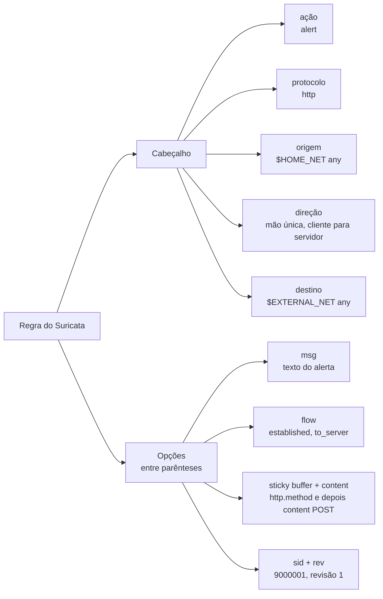
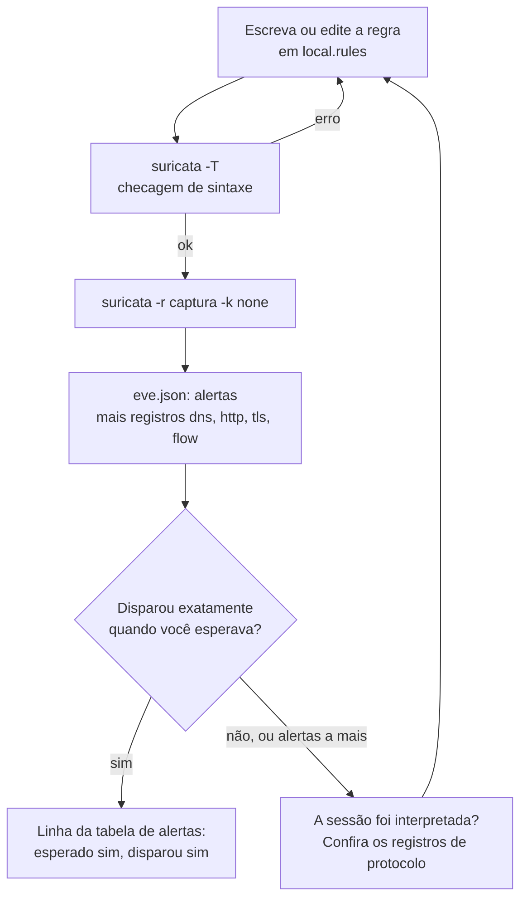

# Dia 60: Regras de detecção com Suricata

> 🇺🇸 Original: [*Day 60: Detection rules with Suricata*](https://github.com/thiefdroppers/cyber-investigator-skills/blob/main/curriculum/phase-4-digital-forensics-incident-investigation/day-60.md) — © ThiefDroppers, licença MIT.
> Aqui: tradução fiel **+** camada brasileira. Nada do original foi removido; tudo o que é novo vem marcado com ➕.

**Fase 4. Forense digital e investigação de incidentes** · Meta da trilha: transformar o que você aprendeu sobre o tráfego do LAB-P4 em regras do Suricata, testar cada regra contra uma captura em que você sabe a resposta certa e ler os alertas do `eve.json`.

Rank Jutsu: `B` · [](https://colab.research.google.com/github/Ridd1kulusC0d3r/investigador-cyber-90-dias/blob/main/curriculo/fase-4-forense-e-resposta/dia-60/dia-60.ipynb)

---

## 🎬 ➕ Abertura do caso — *A regra que morre na quinta-feira*

O time de infraestrutura da Serra Azul pede uma coisa simples: "manda uma regra para o IDS pegar isso se acontecer em outra agência". Você escreve em dois minutos:

`alert ip $HOME_NET any -> 198.51.100.140 any (...)`

Rafa lê e devolve o notebook.

— Essa regra morre na quinta-feira. O kit da Isca já trocou de domínio quatro vezes na Fase 3, lembra? Coopvale, Credminas... O IP vai junto. Me escreve uma que ainda funcione quando o IP mudar.

— Pelo comportamento?

— Pelo comportamento: uma estação de caixa que fala com o mesmo destino externo a cada cinco minutos, ou que manda megabytes para fora. E testa. Regra que você não viu disparar é desejo, não detecção.

Hoje você escreve regras, testa onde sabe a resposta e anota com honestidade o que ainda não foi testado. *(Personagens e cenário: [Operação Isca](../../../caso-continuo/).)*

---

## 📖 Conceito

Uma investigação produz indicadores e comportamentos. Escrevê-los como regras de detecção faz dois trabalhos: permite varrer outras capturas e sensores atrás da mesma atividade (dimensionamento do escopo) e entrega aos defensores algo que dispara da próxima vez. O Suricata é um IDS/IPS e monitor de segurança de rede de código aberto que lê tráfego ao vivo ou arquivos pcap, aplica regras e registra alertas e metadados de protocolo em JSON.

Uma regra do Suricata tem um cabeçalho e opções:

```text
alert http $HOME_NET any -> $EXTERNAL_NET any (msg:"..."; flow:established,to_server; http.method; content:"POST"; sid:9000001; rev:1;)
|     |    |         |   |  |             |    |
ação proto origem   porta dir destino    porta opções entre parênteses, cada uma terminando em ;
```

A mesma anatomia como árvore, usando a regra de exemplo acima:



As ações são `alert`, `pass`, `drop` e `reject` (as duas últimas só importam em modo *inline*). O protocolo pode ser de transporte (`tcp`, `udp`, `ip`) ou um protocolo de aplicação que o Suricata interpreta (`http`, `dns`, `tls`, `ssh`, `smb` e outros), o que libera palavras-chave de protocolo. `$HOME_NET` e `$EXTERNAL_NET` são variáveis definidas no `suricata.yaml`.

As opções que você mais vai usar:

| Opção | Finalidade |
|---|---|
| `msg:"..."` | Texto do alerta; comece com um prefixo de projeto para que seus alertas sejam fáceis de achar |
| `flow:established,to_server` | Só pacotes de uma sessão estabelecida, do cliente para o servidor |
| `http.method; content:"POST";` | *Sticky buffer*: o `content` se aplica só ao método HTTP |
| `http.host`, `http.uri`, `dns.query`, `tls.sni` | Outros *sticky buffers* para campos comuns |
| `content:"..."; nocase;` | Correspondência de bytes ou texto, sem diferenciar maiúsculas |
| `flags:S,12;` | TCP SYN ligado (ignorando os dois bits de ECN) |
| `threshold: type threshold, track by_src, count 10, seconds 60;` | Alerta só quando uma origem acerta a regra 10 vezes em 60 s |
| `sid:9000001; rev:1;` | ID único da regra (use 9.000.000 em diante para regras locais) e revisão |

Escreva regras para comportamento quando puder, e para indicadores isolados quando precisar. Uma regra para "qualquer tráfego para 198.51.100.23" deixa de ser útil no dia em que o endereço muda; uma regra para "um host interno manda mais de 20 MB para um endereço externo numa sessão HTTPS" não.

O ciclo de teste de cada regra. Um `suricata -T` limpo só faz você passar pela primeira checagem; a regra está pronta quando dispara onde você esperava, em tráfego que você entende.



## 📚 Recursos

- [Documentação do Suricata](https://docs.suricata.io/), capítulos "Rules" (formato, palavras-chave de HTTP/DNS/TLS, *thresholding*) e "Output" (`eve.json`).
- [Conjunto de regras Emerging Threats Open](https://rules.emergingthreats.net/) para exemplos reais de estilo de regra.
- Manual do `jq` para ler o `eve.json`.

### ➕ Recursos do contexto Brasil

- [CAIS/RNP](https://www.rnp.br/sistema-rnp/cais): o centro de resposta da rede acadêmica brasileira publica alertas com indicadores; bom material para treinar a diferença entre regra por indicador e regra por comportamento.
- [CERT.br — Estatísticas e notificações](https://www.cert.br/stats/): o tipo de comunicação que um MSSP brasileiro faz quando acha infraestrutura de terceiros comprometida.
- O pcap sintético do `SA-CX-07` é gerado pelo [notebook do Dia 59](../dia-59/dia-59.ipynb); o notebook de hoje gera uma versão própria para os testes.

## 🛠️ Prática: regras do Suricata testadas contra a sua captura do Dia 59, com uma tabela de alertas

Instalação em Debian/Ubuntu: `sudo apt install suricata jq`. Registre o `suricata -V`.

**Seu checklist de hoje.** Faça na ordem e marque cada item ao terminar:

- [ ] Escreva as seis regras do Suricata em `local.rules`.
- [ ] Teste a sintaxe das regras com `suricata -T`.
- [ ] Rode o Suricata contra a sua própria captura.
- [ ] Leia os alertas do `eve.json` e do `fast.log`.
- [ ] Olhe os registros DNS, HTTP, TLS e de fluxo que não são alertas.
- [ ] Reproduza a lógica do *threshold* do *spray* sobre o log do firewall.
- [ ] Termine a tabela de alertas e as suas notas.
- [ ] ➕ Prática BR: três regras da Isca (`sid` 9000020 a 9000022) e a tabela de alertas do `SA-CX-07`.
- [ ] ➕ O notebook do dia no Colab (mini-motor de regras em Python puro).

1. Escreva `~/lab-p4/work/local.rules`. As quatro primeiras regras são testadas contra a sua própria captura, então você sabe exatamente quando cada uma deve disparar. As duas últimas carregam as lições do LAB-P4 e não podem ser testadas até existir um pcap do LAB-P4 (veja a Nota).

   ```text
   alert http $HOME_NET any -> $EXTERNAL_NET any (msg:"LAB own-capture HTTP POST to example.com"; flow:established,to_server; http.method; content:"POST"; http.host; content:"example.com"; sid:9000001; rev:1;)
   alert dns $HOME_NET any -> any any (msg:"LAB own-capture DNS query for lab NXDOMAIN name"; dns.query; content:"nonexistent-lab-name"; nocase; sid:9000002; rev:1;)
   alert tls $HOME_NET any -> $EXTERNAL_NET any (msg:"LAB own-capture TLS SNI example.org"; tls.sni; content:"example.org"; sid:9000003; rev:1;)
   alert http $HOME_NET any -> $EXTERNAL_NET any (msg:"LAB own-capture repeated GET to example.com"; flow:established,to_server; http.method; content:"GET"; http.host; content:"example.com"; threshold: type threshold, track by_src, count 3, seconds 180; sid:9000004; rev:1;)
   alert tcp $EXTERNAL_NET any -> $HOME_NET 22 (msg:"LAB-P4 SSH connection burst from one source"; flow:to_server; flags:S,12; threshold: type threshold, track by_src, count 20, seconds 300; sid:9000010; rev:1;)
   alert ip $HOME_NET any -> 198.51.100.23 any (msg:"LAB-P4 traffic to case indicator 198.51.100.23"; sid:9000011; rev:1;)
   ```

2. Teste a sintaxe antes de rodar.

   ```bash
   sudo suricata -T -c /etc/suricata/suricata.yaml -S ~/lab-p4/work/local.rules -v
   ```

   `-S` carrega só este arquivo (o conjunto de regras instalado é ignorado), o que restringe os alertas de hoje às suas próprias regras. Corrija qualquer erro relatado; as causas comuns são um `;` faltando ou uma palavra-chave que a sua versão não suporta.

3. Rode contra a captura.

   ```bash
   mkdir -p ~/lab-p4/work/suri-out
   sudo suricata -c /etc/suricata/suricata.yaml -S ~/lab-p4/work/local.rules \
     -r ~/lab-p4/work/own-lab.pcapng -l ~/lab-p4/work/suri-out -k none \
     --set vars.address-groups.HOME_NET="[10.0.0.0/8,172.16.0.0/12,192.168.0.0/16]"
   ```

   `-k none` desliga a validação de *checksum*. Capturas feitas no mesmo host que enviou o tráfego costumam ter *checksums* errados, porque a placa de rede os calcula depois da captura; sem `-k none`, o Suricata pode ignorar esses pacotes, e as suas regras deixam de disparar em silêncio.

4. Leia os alertas.

   ```bash
   cd ~/lab-p4/work/suri-out
   cat fast.log
   jq -c 'select(.event_type=="alert") | {ts:.timestamp, sid:.alert.signature_id, sig:.alert.signature, src:.src_ip, dst:.dest_ip, dport:.dest_port}' eve.json
   jq -r 'select(.event_type=="alert") | .alert.signature' eve.json | sort | uniq -c
   ```

   Esperado: 9000001 uma vez (o seu POST), 9000002 uma vez (talvez mais uma, se o seu resolvedor repetiu a consulta), 9000003 uma vez, e 9000004 uma vez, quando chegar o seu terceiro GET dentro de 180 segundos. 9000010 e 9000011 não devem disparar na sua captura. Se uma regra esperada não disparou, confira `jq 'select(.event_type=="http")' eve.json` para ver se o Suricata chegou a interpretar a sessão.

5. Olhe também os registros que não são alertas. O `eve.json` também registra eventos `dns`, `http`, `tls` e `flow`. Esses registros de metadados costumam ser mais úteis a um investigador do que os alertas:

   ```bash
   jq -c 'select(.event_type=="tls") | {ts:.timestamp, dst:.dest_ip, sni:.tls.sni, version:.tls.version}' eve.json
   jq -c 'select(.event_type=="flow") | {src:.src_ip, dst:.dest_ip, proto:.proto, app:.app_proto, bytes_out:.flow.bytes_toserver, bytes_in:.flow.bytes_toclient}' eve.json | head
   ```

6. Reproduza a lógica do caso sobre dados de fluxo. A regra 9000010 descreve o *spray* do LAB-P4. Confira se o *threshold* dela teria disparado, usando o log do firewall em vez de pacotes: conte as conexões de 203.0.113.45 para a porta 22 em cada intervalo de 5 minutos.

   ```bash
   grep '203.0.113.45' ~/lab-p4/work/EVID-001/firewall.log \
     | awk '{split($2,t,":"); b=$1" "t[1]":"sprintf("%02d", int(t[2]/5)*5); c[b]++} END {for (k in c) print k, c[k]}' | sort
   ```

   Os intervalos estão na hora local do firewall (22:50 local é 02:50 UTC). Os três intervalos completos têm de 23 a 27 conexões, e o primeiro e o último, parciais, têm 20 e 19. Um *threshold* de 20 em 300 segundos teria disparado nos primeiros cinco minutos, mas por pouco; um *spray* um pouco mais lento ficaria abaixo dele. Escreva o *threshold* que você recomendaria e o que ele custaria em falsos positivos vindos de administradores legítimos.

7. Termine a tabela de alertas e as suas notas:
   - Marque as regras 9000010 e 9000011 como "não testadas em pacotes" e escreva a data em que vai testar cada uma.
   - Esboce em palavras uma regra baseada em comportamento que detecte, por volume, a mesma atividade da regra 9000011.

Artefato: `local.rules` (seis regras, cada uma com uma linha de comentário acima dizendo o que detecta e como foi testada) e uma tabela de alertas: sid, esperado disparar (sim/não), disparou (sim/não), contagem e notas.

### ➕ Prática BR: três regras para a Isca

Acrescente a `local.rules`:

```text
# Isca: indicador (vai envelhecer) — testada no pcap sintético do Dia 59/60
alert tcp $HOME_NET any -> 198.51.100.140 443 (msg:"ISCA SA-CX-07 conexao ao indicador atualiza-modulo"; flow:to_server; flags:S,12; sid:9000020; rev:1;)
# Isca: comportamento — mesma origem abrindo conexoes HTTPS repetidas; testada no pcap sintético
alert tcp $HOME_NET any -> $EXTERNAL_NET 443 (msg:"ISCA conexoes HTTPS repetidas de uma origem"; flow:to_server; flags:S,12; threshold: type threshold, track by_src, count 10, seconds 3600; sid:9000021; rev:1;)
# Isca: comportamento — SNI de dominio imitacao da cooperativa; NAO testada em pacotes (o pcap sintético não tem TLS)
alert tls $HOME_NET any -> $EXTERNAL_NET any (msg:"ISCA SNI imitando serraazul"; tls.sni; content:"serraazul"; nocase; sid:9000022; rev:1;)
```

**Exercício 1.** Para cada uma, preencha a tabela de alertas (esperado/disparou/contagem/notas) usando o notebook (que roda as três contra o pcap sintético) ou, se você tiver o Suricata, rodando-as contra o pcap exportado pelo notebook.

**Exercício 2.** A 9000021 é ruidosa: na agência inteira, qualquer navegador abre 10 conexões HTTPS por hora. Proponha, por escrito, como torná-la útil sem voltar ao IP fixo. Pistas: o Suricata sozinho não mede regularidade de intervalo; isso é trabalho para o SIEM (Dia 63) ou para um script sobre `flow` do `eve.json`. E a 9000022 também casa com o site **legítimo** `serraazul.example`: escreva a exceção que você acrescentaria e por quê.

### ➕ O notebook do dia

Abra o [notebook do Dia 60 no Colab](https://colab.research.google.com/github/Ridd1kulusC0d3r/investigador-cyber-90-dias/blob/main/curriculo/fase-4-forense-e-resposta/dia-60/dia-60.ipynb). Nele você:

1. faz um **analisador de regras** em Python que separa cabeçalho e opções e acusa o `;` faltando (o seu `suricata -T` de bolso);
2. roda um **mini-motor** que aplica `flags:S`, destino e `threshold` a pacotes sintéticos e gera linhas no estilo `eve.json`;
3. reproduz o passo 6 (intervalos de 5 minutos do *spray*) e testa vários *thresholds*;
4. monta a tabela de alertas do LAB-P4 e da Isca, com "não testada em pacotes" onde cabe;
5. joga o quiz **"indicador ou comportamento?"**.

## ✅ Checkpoint

- `suricata -T` passa no seu arquivo de regras.
- Sua tabela de alertas tem uma linha para cada regra.
- Toda regra "esperado sim" disparou ou tem um motivo escrito para não ter disparado.
- As regras 9000010 e 9000011 estão marcadas como "não testadas em pacotes".
- As regras 9000010 e 9000011 têm, cada uma, a data em que você vai testá-las.
- Suas notas contêm o esboço do passo 7 de uma regra por volume para a atividade que a regra 9000011 mira.
- Sem consultar notas, você explica por que a regra 9000011 é mais fraca do que uma regra por volume para a mesma atividade.

## Nota

Um pcap sintético do LAB-P4 ainda é necessário para testar as regras 9000010 e 9000011 em pacotes. Ele não está em `resources/`. A checagem pelo log de fluxo do passo 6 é o substituto até lá.

### ➕ Checkpoint BR

- Sua tabela tem linhas para 9000020, 9000021 e 9000022, e a 9000022 está marcada "não testada em pacotes".
- Você escreveu a exceção da 9000022 para o domínio legítimo da cooperativa.
- Você explicou, em uma frase, por que regularidade de intervalo é melhor medida fora do Suricata.
- No quiz do notebook, você acertou pelo menos 5 de 6.

## ⚖️ ➕ Camada jurídica BR

**Detectar é tratar dado pessoal.** Um IDS na rede da cooperativa registra IP de origem, horários e destinos de estações usadas por pessoas identificáveis. Isso é tratamento de dado pessoal (LGPD, art. 5º, I e X), e a base legal típica é o legítimo interesse do controlador (art. 7º, IX), com a avaliação de que o uso é esperado e proporcional. Regras de segurança voltadas a ameaças, com retenção definida, cabem aí; uma regra que registre "todo site que o caixa X visita" já é outra conversa.

**LGPD, art. 48 (comunicação de incidente).** Se o incidente puder acarretar risco ou dano relevante aos titulares, o controlador deve comunicá-lo à ANPD e aos titulares; o Regulamento de Comunicação de Incidente de Segurança da ANPD (Resolução CD/ANPD nº 15/2024) detalha prazo e conteúdo. Pelo Regulamento de Comunicação de Incidente de Segurança (Resolução CD/ANPD nº 15/2024), a comunicação à ANPD e aos titulares é feita em **três dias úteis**, contados do conhecimento de que o incidente afetou dados pessoais (em dobro para agentes de pequeno porte), com complementação à ANPD em até 20 dias úteis. Há risco ou dano relevante quando o incidente pode afetar significativamente os titulares **e** envolve ao menos um destes critérios: dados sensíveis; de crianças, adolescentes ou idosos; financeiros; de autenticação; protegidos por sigilo; ou em larga escala. O registro do incidente, comunicado ou não, é guardado por no mínimo cinco anos. A regra que você escreve hoje ajuda a responder a pergunta que a ANPD vai fazer: "o incidente atingiu outras estações?".

> Este repositório é material de estudo e não substitui orientação jurídica.

## 🧠 ➕ Camada 8 — a falácia da taxa-base e o analista que deixa de ler alertas

Kahneman e Tversky mostraram que as pessoas ignoram a **taxa-base** (*base rate neglect*): diante de um teste "99% preciso", esquecem quão raro é o evento. Uma regra que acerta 99% dos ataques e erra em 1% do tráfego normal, numa agência com dezenas de milhares de conexões por dia e talvez um ataque por ano, produz centenas de alarmes falsos para cada verdadeiro.

O efeito humano disso tem nome na segurança: **fadiga de alertas**. Depois de cem falsos positivos, o analista aprende (corretamente, do ponto de vista dele) que aquele alerta "nunca é nada", e fecha o verdadeiro junto. Consequência prática: toda regra que você entrega vem com a estimativa de falsos positivos por dia, como o original pede no passo 6. Uma regra boa e silenciosa vale mais do que uma regra perfeita e barulhenta.

## 🤖 ➕ Skill do dia

O dia propõe à [skill pt-BR](../../../skills/investigador-cyber/SKILL.md) um procedimento novo, **"Da investigação à regra de detecção"**. Texto e caso de teste em [`_skill-delta.md`](_skill-delta.md).

## 💡 ➕ Inovação OSINT do dia — ler o `eve.json` sem `jq`

Nem todo computador de cliente tem `jq`. Cada linha do `eve.json` é um JSON independente (JSON *lines*), e a biblioteca padrão resolve:

```python
import json
from collections import Counter
alertas = Counter()
with open("eve.json", encoding="utf-8") as f:
    for linha in f:                                        # uma linha = um evento
        ev = json.loads(linha)
        if ev.get("event_type") == "alert":
            alertas[(ev["alert"]["signature_id"], ev["alert"]["signature"])] += 1
for (sid, sig), n in alertas.most_common():
    print(n, sid, sig)                                     # o mesmo que o 'sort | uniq -c' do passo 4
```

Troque `"alert"` por `"flow"` e some `flow.bytes_toserver` por destino: é o embrião da regra por volume que o passo 7 pede.

## 📝 Diário de estudo

- Data:
- Tempo gasto:
- O que ficou claro:
- O que ainda está nebuloso:
- Artefato produzido: `local.rules` comentado (9 regras), tabela de alertas, esboço da regra por volume, exceção da 9000022

---
<sub>Baseado em [cyber-investigator-skills](https://github.com/thiefdroppers/cyber-investigator-skills) por ThiefDroppers (MIT). Tradução, camada BR, Camada 8, skill pt-BR e notebook por Deivison Lourenço (@Ridd1kulusC0d3r).</sub>
