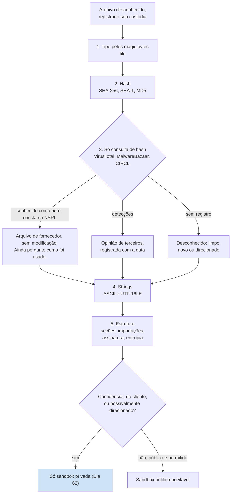

# Dia 61: Triagem estática de um arquivo suspeito

> 🇺🇸 Original: [*Day 61: Static triage of a suspicious file*](https://github.com/thiefdroppers/cyber-investigator-skills/blob/main/curriculum/phase-4-digital-forensics-incident-investigation/day-61.md) — © ThiefDroppers, licença MIT.
> Aqui: tradução fiel **+** camada brasileira. Nada do original foi removido; tudo o que é novo vem marcado com ➕.

**Fase 4. Forense digital e investigação de incidentes** · Meta da trilha: identificar, tirar a impressão digital e consultar um arquivo sem executá-lo, e registrar o resultado num cartão de triagem que diz o que se sabe e o que não se sabe.

Rank Jutsu: `B` · [](https://colab.research.google.com/github/Ridd1kulusC0d3r/investigador-cyber-90-dias/blob/main/curriculo/fase-4-forense-e-resposta/dia-61/dia-61.ipynb)

> ⚠️ **Sem malware hoje.** Como no original, nada aqui é malicioso: um binário legítimo, o **hash** do arquivo de teste EICAR (o arquivo em si não é criado) e um `config.ini` sintético, texto puro, escrito para o curso.

---

## 🎬 ➕ Abertura do caso — *O executável que ninguém vai abrir*

A TI da Serra Azul copiou a pasta `AppData\Roaming\MSA` do `SA-CX-07` antes de reinstalar o notebook. Veio por e-mail, num zip com a senha `infected`, e o técnico escreveu: *"Vocês podem rodar para ver o que faz?"*

Rafa responde antes de você.

— Ninguém roda nada. E ninguém sobe isso no VirusTotal. Isso saiu de uma estação de caixa de uma cooperativa: pode ter dado de cooperado dentro, e o Pescador pode estar vigiando quem envia o arquivo dele.

Ele abre a pasta na VM isolada, sem rede. Dois arquivos: `msa-atualizador.exe` (389.120 bytes) e `config.ini` (744 bytes).

— Hash primeiro. Depois a gente pergunta ao mundo se alguém já viu esse hash. Depois strings. E no cartão só vai o que você **viu**.

Hoje você faz a primeira meia hora com um arquivo suspeito. *(Personagens e cenário: [Operação Isca](../../../caso-continuo/).)*

---

## 📖 Conceito

A triagem é a primeira meia hora com um arquivo. Ela responde a quatro perguntas: que tipo de arquivo é, se alguém já o viu antes, o que ele contém em texto legível, e se merece análise mais profunda ou uma execução em *sandbox* (Dia 62). Descobrir tudo o que um programa faz é engenharia reversa, uma disciplina à parte.

A triagem estática nunca executa o arquivo. Faça-a dentro de uma VM de análise com a rede desligada e as pastas compartilhadas desativadas, e guarde as amostras num arquivo compactado protegido por senha quando elas circularem entre máquinas (a convenção antiga é um zip com a senha `infected`, que impede filtros de e-mail e antivírus de desktop de agir sobre ele em trânsito; não é um controle de segurança). Se você estiver triando algo de um caso real, calcule o hash primeiro e registre-o sob cadeia de custódia como qualquer outra evidência.

Os passos, em ordem:

1. Tipo. O `file` lê os *magic bytes*, não a extensão. `MZ` no deslocamento 0 é um executável Windows; `PK` é um zip (e, portanto, também `.docx`, `.xlsx`, `.jar`, `.apk`); `%PDF` é um PDF; `\x7fELF` é um binário Linux.
2. Hash. O SHA-256 é o identificador que todo serviço de reputação aceita. Registre também MD5 e SHA-1, porque relatórios mais antigos e algumas ferramentas só listam esses.
3. Reputação. Busque o hash, não o arquivo. Enviar um arquivo a um serviço público o compartilha com todos que usam esse serviço, o que pode vazar o documento de um cliente ou alertar um atacante que vigia a própria amostra. Consulte primeiro; envie só quando tiver permissão e o arquivo não tiver nada confidencial.
4. *Strings*. Texto legível dentro de um binário costuma incluir URLs, IPs, caminhos de arquivo, chaves de registro, *user-agents*, mensagens de erro e nomes de bibliotecas. Programas Windows guardam boa parte do texto em UTF-16LE, que o `strings` padrão não pega; peça explicitamente.
5. Estrutura. Para arquivos PE, os nomes das seções, as importações (quais funções da API do Windows ele chama), o *timestamp* de compilação e se é assinado. Arquivos compactados (*packed*) mostram poucas importações e seções de alta entropia.

Os cinco passos como um fluxo só, com a bifurcação que decide para onde o arquivo pode ir em seguida:



Um resultado de reputação é evidência sobre a opinião de outras pessoas a respeito de um arquivo, não sobre o seu caso. "0 de 70 motores detectam" pode significar limpo, novo ou direcionado. "Conhecido como bom na NSRL" significa que os bytes exatos batem com um arquivo distribuído por um fornecedor de software, o que é evidência forte de que o arquivo em si não foi modificado, embora uma ferramenta legítima ainda possa ser mal usada.

## 📚 Recursos

- `file(1)`, GNU `strings(1)` (binutils; a opção `-e l` lê UTF-16LE), `sha256sum(1)`.
- [FLOSS](https://github.com/mandiant/flare-floss), da Mandiant: extrai *strings* simples, de pilha e algumas ofuscadas de arquivos PE.
- [pefile](https://github.com/erocarrera/pefile) (Python) e [PE-bear](https://github.com/hasherezade/pe-bear) (interface gráfica) para a estrutura PE.
- Busca por hash no [VirusTotal](https://www.virustotal.com/); [MalwareBazaar](https://bazaar.abuse.ch/), do abuse.ch; [CIRCL hashlookup](https://hashlookup.circl.lu/) para arquivos conhecidos como bons (NSRL e outros).
- [Arquivo de teste EICAR](https://www.eicar.org/download-anti-malware-testfile/): uma *string* inofensiva que todo antivírus detecta de propósito, para testar sem malware real.

### ➕ Recursos do contexto Brasil

- [CERT.br — Cartilha de Segurança, fascículo "Códigos maliciosos"](https://cartilha.cert.br/): linguagem simples para explicar à Marta e à caixa o que é um "atualizador" falso.
- [CTIR Gov](https://www.gov.br/ctir/pt-br): o centro de tratamento de incidentes do governo federal publica alertas com hashes; bom para treinar a consulta "alguém já viu isto?" com fonte brasileira.
- O `config.ini` sintético do caso: [`caso-continuo/dados/dia-61/config.ini`](../../../caso-continuo/dados/dia-61/config.ini) (texto puro, inofensivo, 744 bytes).

## 🛠️ Prática: cartões de triagem para um binário conhecido como bom, o hash do teste EICAR e o arquivo desconhecido do LAB-P4

Nenhum malware é usado hoje. Você faz a triagem de um programa legítimo que já tem, consulta o hash do arquivo de teste EICAR para ver como é um registro "detectado", e escreve o cartão que você abriria para o `synchelper.exe` dos Dias 52 a 54, cujos bytes você não tem.

**Seu checklist de hoje.** Faça na ordem e marque cada item ao terminar:

- [ ] Prepare um binário de amostra e calcule os hashes dele.
- [ ] Consulte o hash no CIRCL, no VirusTotal e no MalwareBazaar.
- [ ] Extraia as *strings* ASCII e UTF-16LE da amostra.
- [ ] Consulte o arquivo de teste EICAR pelo hash.
- [ ] Escreva o cartão de triagem do `synchelper.exe`.
- [ ] Acrescente as frases de explicação aos cartões do `sample01` e do EICAR.
- [ ] ➕ Prática BR: cartões do `config.ini` (bytes disponíveis) e do `msa-atualizador.exe` (bytes não disponíveis para você).
- [ ] ➕ O notebook do dia no Colab (triagem com `hashlib`, *magic bytes* e *strings* em Python puro).

1. Prepare. Na sua VM Linux de análise, copie um binário legítimo para a área de trabalho e trate-o como amostra desconhecida.

   ```bash
   mkdir -p ~/lab-p4/triage && cd ~/lab-p4/triage
   cp /usr/bin/curl sample01
   file sample01
   sha256sum sample01; sha1sum sample01; md5sum sample01
   ls -l sample01
   ```

   O `file` imprime algo como `ELF 64-bit LSB pie executable, x86-64, dynamically linked ...`. Se você também tiver uma VM Windows, copie `C:\Windows\System32\notepad.exe` como `sample02` e repita; o `file` vai relatar `PE32+ executable (GUI) x86-64, for MS Windows`.

2. Consulte o hash em três lugares e registre cada resposta com a data da consulta.

   ```bash
   H=$(sha256sum sample01 | cut -d' ' -f1)
   curl -s "https://hashlookup.circl.lu/lookup/sha256/$H" | jq .
   ```

   O CIRCL devolve um registro JSON (com campos como `FileName`, `ProductName` e o banco de origem) quando conhece o arquivo, e uma mensagem "Non existing" quando não conhece. A versão do `curl` compilada pela sua distribuição pode ou não estar nos dados dele; qualquer das duas respostas é um achado. Depois cole o hash na caixa de busca do VirusTotal (só busca; não envie o arquivo) e na busca do MalwareBazaar. Espere que o VirusTotal mostre um arquivo com nenhuma ou pouquíssimas detecções e um histórico de muitos envios, e que o MalwareBazaar não tenha registro.

3. Extraia as *strings*, nas duas codificações, e fique só com as úteis.

   ```bash
   strings -n 8 sample01 > sample01.ascii.txt
   strings -n 8 -e l sample01 > sample01.utf16.txt
   wc -l sample01.*.txt
   grep -Eo 'https?://[^ "]+' sample01.ascii.txt | sort -u | head
   grep -Ei 'user-agent|\.so(\.|$)|/etc/|/tmp/' sample01.ascii.txt | sort -u | head -20
   ```

   No `curl` você vai achar URLs do texto de ajuda e da licença, nomes de bibliotecas compartilhadas e nomes de opções. Esse é o ponto do exercício: *strings* sugerem capacidade e contexto, e uma ferramenta de rede legítima contém muitas *strings* "com cara de rede". *Strings* sozinhas nunca tornam um arquivo malicioso. Numa amostra Windows, rode `floss sample02` e compare a contagem de *strings* decodificadas com a do `strings` simples.

4. Consulte o arquivo de teste EICAR só pelo hash (não baixe nem crie o arquivo numa máquina de trabalho, porque a proteção de *endpoint* vai colocá-lo em quarentena e gerar um alerta). O SHA-256 da *string* EICAR padrão de 68 bytes é:

   ```text
   275a021bbfb6489e54d471899f7db9d1663fc695ec2fe2a2c4538aabf651fd0f
   ```

   Busque-o no VirusTotal. Registre quantos motores o sinalizam e três dos nomes de detecção. Note que os nomes variam por fornecedor (`EICAR-Test-File`, `EICAR_Test_File` e similares). Nomes de detecção são rótulos de fornecedor, não uma taxonomia compartilhada; nunca construa um achado sobre o nome de família dado por um único motor.

5. Escreva o cartão de triagem do `synchelper.exe`. Você não tem cópia do arquivo; então o cartão registra o que as outras evidências dizem e o que solicitar:

   | Campo | Registro |
   |---|---|
   | Caso / item | LAB-P4 / EVID-002 (MFT), EVID-003 (memória) |
   | Nome e caminho | `C:\Users\acct.clerk01\AppData\Roaming\SyncHelper\synchelper.exe` |
   | Tamanho | 412.160 bytes (entrada 88413 da MFT) |
   | Primeira observação | `$FN` criado 2026-03-13 16:42:30 UTC; início do processo 16:42:31 UTC |
   | Hashes | Não disponíveis. Solicitar: arquivo da imagem de disco, ou *dump* do processo na memória (`windows.pslist --pid 7488 --dump`) |
   | Reputação | Não consultada (sem hash) |
   | Relacionados | Pai `powershell.exe` 7316; filho `rundll32.exe` 7704 com região MZ injetada; conexões para 198.51.100.23:443 |
   | Decisão de triagem | Adquirir e calcular hash; triagem estática em VM isolada; *sandbox* só em instância privada, porque o arquivo pode conter dados do cliente ou ser direcionado |

   De onde vem cada linha desse cartão. Tudo nele é emprestado de outras evidências; a caixa tracejada é o que uma triagem real ainda precisaria:

   ```mermaid
   graph LR
       MFT["EVID-002 MFT entrada 88413<br/>caminho, 412.160 bytes,<br/>FN criado 16:42:30"] --> CARD["Cartão de triagem<br/>synchelper.exe"]
       PST["EVID-003 pstree<br/>PID 7488 iniciado 16:42:31,<br/>pai powershell.exe 7316"] --> CARD
       NET["EVID-003 netscan<br/>198.51.100.23:443"] --> CARD
       MAL["EVID-003 pstree + malfind<br/>filho rundll32.exe 7704,<br/>MZ em região RWX"] --> CARD
       CARD -.->|"ainda falta"| NEED["Hashes, strings, reputação:<br/>precisa do arquivo da imagem de disco<br/>ou de um dump do processo"]
       style NEED stroke-dasharray: 5 5
   ```

6. Acrescente as explicações a dois cartões:
   - No cartão do `sample01`, uma frase sobre por que as *strings* relacionadas a rede não o tornam suspeito (passo 3).
   - No cartão do EICAR, uma frase sobre por que os nomes de detecção divergem (passo 4).

Artefato: `~/lab-p4/triage/cards.md` com três cartões de triagem (`sample01`, o hash do EICAR, `synchelper.exe`), todos com os mesmos campos, e cada resultado de reputação datado.

### ➕ Prática BR: os dois arquivos da pasta `MSA`

**Exercício 1: cartão do `config.ini` (você tem os bytes).** Copie [`caso-continuo/dados/dia-61/config.ini`](../../../caso-continuo/dados/dia-61/config.ini) para `~/caso-isca/triage/` e rode os passos 1 a 3 nele (`file`, os três hashes, `strings`, consulta de hash). Preencha o cartão com os mesmos campos do original. Perguntas para o cartão:

- O tamanho bate com a entrada 120946 da MFT do `SA-CX-07` (744 bytes, [`sa-cx-07-mft.csv`](../../../caso-continuo/dados/dia-57/sa-cx-07-mft.csv))?
- Quais *strings* viram **indicadores** (domínio, IP, caminho, nome de tarefa, *user-agent*) e quais são só **contexto**?
- O `intervalo_segundos=300` bate com o que você mediu no Dia 59? Isso **confirma** que este arquivo controla o *beacon*, ou só é **consistente** com ele?
- O comentário `; TODO pescador` é um achado sobre o arquivo. Ele identifica alguém?

**Exercício 2: cartão do `msa-atualizador.exe` (você não tem os bytes).** A TI tem o arquivo, mas a cópia ainda não chegou por canal com custódia. Escreva o cartão como o original faz com o `synchelper.exe`: só o que outras evidências mostram (MFT `120945`: 389.120 bytes, `$SI` criado em 2021-02-03 e `$FN` em 2026-10-05 11:24:29 UTC; Security 4688 às 11:24:31Z, pai `explorer.exe`, filho `schtasks.exe` às 11:24:44Z; proxy/firewall: `atualiza-modulo.example` a cada ~300 s) e o que solicitar. Decisão de triagem: por que só *sandbox* privada?

| Campo | Registro |
|---|---|
| Caso / item | Isca / SA-CX-07, pasta `AppData\Roaming\MSA` |
| Nome e caminho | `C:\Users\cx.centro07\AppData\Roaming\MSA\msa-atualizador.exe` |
| Tamanho | 389.120 bytes (MFT 120945) |
| Primeira observação | |
| Hashes | |
| Reputação | |
| Relacionados | |
| Decisão de triagem | |

### ➕ O notebook do dia

Abra o [notebook do Dia 61 no Colab](https://colab.research.google.com/github/Ridd1kulusC0d3r/investigador-cyber-90-dias/blob/main/curriculo/fase-4-forense-e-resposta/dia-61/dia-61.ipynb). Nele você:

1. identifica o tipo pelos *magic bytes* (a tabela do Conceito em código) e testa com arquivos sintéticos de cabeçalho `MZ`, `PK`, `%PDF` e `\x7fELF` que não executam nada;
2. calcula SHA-256, SHA-1 e MD5 num único passe de leitura;
3. reimplementa o `strings` (ASCII e UTF-16LE) e separa indicadores de contexto;
4. consulta o CIRCL hashlookup **só com o hash** (com plano B offline) e confere o hash EICAR **sem criar o arquivo**;
5. calcula a entropia de Shannon e vê por que um arquivo compactado "parece" aleatório;
6. gera `cards.md` com os cartões do original e da Isca e joga o quiz **"o que vai no cartão?"**.

## ✅ Checkpoint

- Cada cartão lista um SHA-256 ou diz por que ele falta.
- Cada cartão lista o tipo de arquivo pelos *magic bytes* ou diz por que ele falta.
- Cada cartão lista pelo menos uma fonte de reputação com o resultado e a data, ou diz por que nenhuma foi consultada.
- Seu cartão do `sample01` diz em palavras por que as *strings* relacionadas a rede não o tornam suspeito.
- Seu cartão do EICAR lista pelo menos três nomes de detecção diferentes.
- Seu cartão do EICAR tem uma frase sobre por que os nomes divergem.
- Seu cartão do `synchelper.exe` não contém nenhuma afirmação sobre o que o programa faz.
- Toda entrada do seu cartão do `synchelper.exe` foi observada em outra evidência ou está marcada como solicitação.
- Sem consultar notas, você diz por que o nome de família dado por um único motor não é base para um achado.

### ➕ Checkpoint BR

- Seu cartão do `config.ini` tem SHA-256 `c1581726b27e0d672fa76856638b6ed3dcd5e1ae4b638fbd3a106cafab22d039` (confira) e o tamanho conferido com a MFT.
- Seu cartão do `config.ini` usa "consistente com" (e não "confirma") para a relação entre `intervalo_segundos=300` e o *beacon*.
- Seu cartão do `msa-atualizador.exe` não diz o que o programa faz, e a linha Hashes é uma solicitação.
- Ninguém enviou nenhum arquivo do caso a serviço público.
- No quiz do notebook, você acertou pelo menos 5 de 6.

## ⚖️ ➕ Camada jurídica BR

**Enviar o arquivo do cliente a um serviço público é tratamento e compartilhamento de dados.** Um arquivo tirado da estação de uma caixa pode conter dados pessoais de cooperados (o `config.ini` aponta para `%USERPROFILE%\Documents`). Enviá-lo a uma *sandbox* ou a um agregador público é compartilhar dado pessoal com terceiros e, a depender do serviço, transferi-lo para fora do país, o que a LGPD só admite nas hipóteses do art. 33. Consultar **o hash** não expõe conteúdo algum. Por isso o "busque o hash, não o arquivo" do original, no Brasil, também é regra de conformidade.

**Sigilo bancário (LC 105/2001).** Instituições financeiras, e a lei inclui as cooperativas de crédito, têm dever de sigilo sobre operações ativas e passivas e serviços prestados. Um arquivo de uma estação de caixa pode conter dado coberto por esse sigilo; o contrato com a Vigia precisa prever o tratamento, e a regra prática é a mesma: o arquivo não sai do ambiente controlado.

**CP, art. 154-A, §1º.** O tipo também alcança quem produz, oferece, distribui, vende ou difunde dispositivo ou programa de computador com o intuito de permitir a invasão. É mais uma razão para a amostra circular só em zip protegido, entre analistas autorizados e com registro de custódia, e nunca ser "compartilhada para ajudar" em grupos.

> Este repositório é material de estudo e não substitui orientação jurídica.

## 🧠 ➕ Camada 8 — a heurística do afeto e o nome que dá medo

Slovic e colegas descreveram a **heurística do afeto**: a reação emocional a um estímulo (bom/ruim, seguro/perigoso) vem antes e guia o julgamento de risco. Em triagem, isso aparece de dois jeitos. O nome assusta ("Trojan.Banker.Generic" em um motor) e o analista passa a ler todas as *strings* como ameaça. Ou o nome tranquiliza ("Módulo de Segurança Serra Azul", ícone de cadeado, versão 2.1.7) e o arquivo ganha um crédito que não mereceu.

O golpista conta com o segundo efeito na vítima: a caixa instalou o "módulo de segurança" exatamente porque o nome evocava proteção, uma forma de **autoridade emprestada** (Cialdini). O analista se protege dos dois com o formato do cartão: campos fixos, cada um preenchido com uma observação e a fonte. Consequência prática: escreva o cartão **antes** de ler qualquer nome de família; o rótulo de terceiros entra por último, com data, na linha Reputação.

## 🤖 ➕ Skill do dia

O dia propõe à [skill pt-BR](../../../skills/investigador-cyber/SKILL.md) um procedimento novo, **"Cartão de triagem estática (sem executar, sem enviar)"**. Texto e caso de teste em [`_skill-delta.md`](_skill-delta.md).

## 💡 ➕ Inovação OSINT do dia — CIRCL hashlookup em uma linha de Python

O [CIRCL hashlookup](https://hashlookup.circl.lu/) é uma API pública e gratuita do CSIRT de Luxemburgo que responde "este hash é de um arquivo conhecido (NSRL e outras bases)?". Só stdlib, e só o hash sai da sua máquina:

```python
import hashlib, json, urllib.request
h = hashlib.sha256(open("/usr/bin/curl", "rb").read()).hexdigest()           # o hash, não o arquivo
try:
    with urllib.request.urlopen(f"https://hashlookup.circl.lu/lookup/sha256/{h}", timeout=10) as r:
        print(json.load(r).get("FileName", "conhecido"))                       # registro encontrado
except urllib.error.HTTPError as e:
    print("sem registro" if e.code == 404 else f"erro {e.code}")              # 'Non existing' volta como 404
```

Registre a data da consulta: o mesmo hash pode passar a existir na base amanhã. E lembre do Conceito: "sem registro" não é "malicioso".

## 📝 Diário de estudo

- Data:
- Tempo gasto:
- O que ficou claro:
- O que ainda está nebuloso:
- Artefato produzido: `~/lab-p4/triage/cards.md` (três cartões do original + `config.ini` + `msa-atualizador.exe`)

---
<sub>Baseado em [cyber-investigator-skills](https://github.com/thiefdroppers/cyber-investigator-skills) por ThiefDroppers (MIT). Tradução, camada BR, Camada 8, skill pt-BR e notebook por Deivison Lourenço (@Ridd1kulusC0d3r).</sub>
