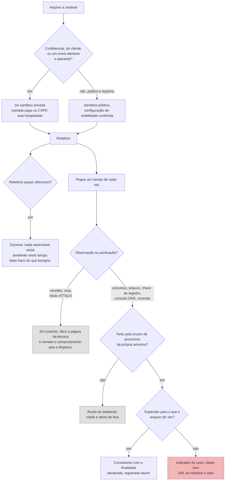

# Dia 62: Lendo relatórios de *sandbox* sem se enganar

> 🇺🇸 Original: [*Day 62: Reading sandbox reports without fooling yourself*](https://github.com/thiefdroppers/cyber-investigator-skills/blob/main/curriculum/phase-4-digital-forensics-incident-investigation/day-62.md) — © ThiefDroppers, licença MIT.
> Aqui: tradução fiel **+** camada brasileira. Nada do original foi removido; tudo o que é novo vem marcado com ➕.

**Fase 4. Forense digital e investigação de incidentes** · Meta da trilha: usar uma *sandbox* pública com segurança, ler o relatório dela campo a campo e separar o que a *sandbox* observou do veredito que ela imprimiu.

Rank Jutsu: `B` · [](https://colab.research.google.com/github/Ridd1kulusC0d3r/investigador-cyber-90-dias/blob/main/curriculo/fase-4-forense-e-resposta/dia-62/dia-62.ipynb)

> ⚠️ **Sem malware hoje.** Como no original, o arquivo enviado a *sandbox* pública é um instalador legítimo (7-Zip). Na camada brasileira, o relatório do `msa-atualizador.exe` é **inventado para o curso**, num formato simplificado, e marcado como sintético; nenhum arquivo do caso é executado ou enviado.

---

## 🎬 ➕ Abertura do caso — *Score 10/10*

Às 9h, o técnico da TI da Serra Azul manda um *print*: *"Rodei o executável numa sandbox grátis aqui. Deu 10/10 malicioso!! E apareceu 'Credential Access'. Era isso, roubou a senha."*

Rafa respira fundo.

— Primeiro: grátis quer dizer público. Esse arquivo agora está disponível para qualquer pessoa baixar, inclusive para quem o escreveu. Segundo: o 10/10 é a opinião de um conjunto de regras. Terceiro: "Credential Access" é um rótulo de tática. Me mostra a linha do relatório que gerou esse rótulo.

A Vigia já tinha pedido a cópia por canal com custódia e rodado o `msa-atualizador.exe` numa *sandbox* **privada**. O relatório está na sua tela. Rafa traça uma linha vertical no quadro: de um lado "observado", do outro "pontuado".

— Cada campo vai para um lado. O relatório para a Marta só usa a coluna da esquerda.

Hoje você lê um relatório de *sandbox* como evidência, não como sentença. *(Personagens e cenário: [Operação Isca](../../../caso-continuo/).)*

---

## 📖 Conceito

Uma *sandbox* de malware executa um arquivo numa máquina virtual instrumentada por alguns minutos e registra o que acontece: processos iniciados, arquivos e chaves de registro gravados, consultas DNS e conexões de rede, e às vezes capturas de tela e *dumps* de memória. Depois ela pontua o comportamento e mapeia partes dele para técnicas do MITRE ATT&CK.

O relatório é útil e fácil de superinterpretar. Tenha em mente três limites.

Visibilidade. As camadas gratuitas e comunitárias do Any.Run, do Hybrid Analysis e do Triage tornam os envios públicos: qualquer pessoa pode buscar e baixar o seu arquivo e o relatório dele. Isso exclui qualquer coisa confidencial, qualquer coisa de um cliente e qualquer coisa cujo envio diria a um atacante que ele foi notado. Camadas pagas e *sandboxes* auto-hospedadas (CAPE, por exemplo) mantêm os envios privados. Sempre confira a configuração de visibilidade antes de apertar o botão de envio.

Cobertura. A *sandbox* vê uma execução, numa imagem de sistema operacional, por tempo limitado, muitas vezes sem a interação do usuário, o ingresso em domínio, a localidade ou os argumentos de linha de comando que a amostra espera. Malware costuma verificar se está numa máquina virtual ou esperar antes de agir. Um relatório silencioso significa "não fez nada observável neste ambiente neste tempo", o que é mais fraco do que "benigno".

Pontuação. Rótulos de comportamento e mapeamentos para o ATT&CK são gerados por regras. Instaladores legítimos gravam em `Program Files`, criam tarefas agendadas para atualizadores e consultam informações do sistema, e as *sandboxes* rotulam essas ações com os mesmos IDs de técnica que usam para malware. Um rótulo é uma observação que casou com uma regra; você decide se ela importa.

O que você leva de um relatório para um caso: os indicadores observados (hashes de arquivos gravados, domínios, IPs, URLs, *mutexes*, caminhos de arquivo), a árvore de processos e a linha do tempo das ações, cada um citado com a URL do relatório e a data. A nota do veredito entra como contexto, nunca como achado.

O processo de julgamento para ler um relatório, da decisão de enviar até o que entra no dossiê do caso:



## 📚 Recursos

- [ANY.RUN](https://any.run/) (interativa; plano comunitário gratuito com envios públicos; as regras de cadastro mudam, e alguns serviços recusam endereços de *webmail* gratuitos).
- [Hybrid Analysis](https://www.hybrid-analysis.com/) (CrowdStrike Falcon Sandbox, envios comunitários gratuitos com conta).
- [Triage](https://tria.ge/), da Recorded Future (contas gratuitas de pesquisador mediante solicitação).
- [CAPE Sandbox](https://github.com/kevoreilly/CAPEv2), auto-hospedada e privada.
- [Páginas de técnicas](https://attack.mitre.org/techniques/enterprise/) do MITRE ATT&CK, para conferir o que um ID mapeado realmente significa.

### ➕ Recursos do contexto Brasil

- [7-Zip, site oficial](https://www.7-zip.org/): a amostra legítima do dia; o 7-Zip tem tradução para o português, o que permite testar como a *sandbox* lida com a localidade.
- [MITRE ATT&CK](https://attack.mitre.org/): não há versão oficial em português; no relatório, use o ID e o nome em inglês (como faz este repositório) para não criar ambiguidade com traduções livres.
- O relatório sintético do `msa-atualizador.exe` é gerado pelo [notebook do dia](dia-62.ipynb); os cartões de triagem vêm do [Dia 61](../dia-61/).

## 🛠️ Prática: dois relatórios de *sandbox* do mesmo instalador conhecido como bom, avaliados contra o que você já sabe

Você vai enviar um arquivo público e legítimo, então o envio não vaza nada: o instalador oficial do 7-Zip para Windows (baixe de 7-zip.org). O comportamento dele é conhecido de antemão, o que permite avaliar a *sandbox* em vez de confiar nela.

**Seu checklist de hoje.** Faça na ordem e marque cada item ao terminar:

- [ ] Prepare a amostra do instalador do 7-Zip e o cartão dela.
- [ ] Envie ou recupere relatórios de dois serviços de *sandbox*.
- [ ] Preencha a planilha das duas *sandboxes*.
- [ ] Separe o ruído do ambiente das ações da própria amostra.
- [ ] Avalie cada rótulo ATT&CK contra a página dele no MITRE.
- [ ] Compare os resultados da *sandbox* com as suas previsões estáticas do Dia 61.
- [ ] Escreva o plano de *sandbox* privada para o `synchelper.exe`.
- [ ] Feche as lacunas restantes da planilha.
- [ ] ➕ Prática BR: leia o relatório sintético do `msa-atualizador.exe` campo a campo e escreva o parágrafo "observado × pontuado" para a Marta.
- [ ] ➕ O notebook do dia no Colab (classificador observado/pontuado/ruído em Python puro).

1. Prepare a amostra e o cartão dela.

   ```bash
   cd ~/lab-p4/triage
   # depois de baixar 7z<versão>-x64.exe de https://www.7-zip.org/ para esta pasta
   file 7z*-x64.exe
   sha256sum 7z*-x64.exe
   ```

   Busque o hash no VirusTotal primeiro (Dia 61). Se uma *sandbox* já analisou exatamente este arquivo, você pode ler o relatório público existente em vez de enviar um novo; anote qual dos dois você fez.

2. Envie ou recupere em dois serviços. No ANY.RUN, crie uma nova tarefa, defina a privacidade como pública (é um instalador público) e, durante a execução, clique no instalador para que ele de fato instale; *sandboxes* interativas existem exatamente para isso. No Hybrid Analysis ou no Triage, envie o mesmo arquivo e aceite o ambiente padrão. Salve a URL de cada relatório e a data do relatório.

3. Preencha uma planilha com uma linha por campo do relatório. Para cada um, escreva o que a *sandbox* registrou e se isso corresponde ao que uma instalação do 7-Zip deve fazer (gravar arquivos em `C:\Program Files\7-Zip`, registrar uma extensão de *shell* e associações de arquivo em `HKLM\SOFTWARE\Classes` ou similar, criar uma entrada de desinstalação em `...\CurrentVersion\Uninstall\7-Zip`).

   | Campo | *Sandbox* A | *Sandbox* B | Esperado para uma instalação do 7-Zip? |
   |---|---|---|---|
   | Veredito / nota | | | Benigno |
   | Árvore de processos | | | Processo do instalador, possivelmente `regsvr32` ou interação com o explorer |
   | Arquivos gravados (5 principais caminhos) | | | Program Files\7-Zip\... |
   | Chaves de registro gravadas (5 principais) | | | Classes, extensão de *shell*, Uninstall |
   | DNS / rede | | | Normalmente nenhum, ou ruído de fundo do sistema |
   | Técnicas ATT&CK rotuladas | | | Algumas ações benignas podem ser rotuladas |
   | Assinaturas / rótulos de comportamento | | | |
   | Arquivos gravados com hashes | | | Os próprios binários do 7-Zip |

4. Separe o ruído do ambiente da amostra. *Sandboxes* registram tráfego de fundo do sistema operacional (Windows Update, checagens de revogação de certificado, telemetria). Marque cada linha de rede como "amostra" ou "ambiente" e diga como decidiu (o processo que fez a conexão costuma ser a resposta).

5. Avalie os rótulos ATT&CK. Para cada ID de técnica listado no relatório, abra a página dele no MITRE e escreva uma linha: o comportamento que o disparou, e se esse comportamento é malicioso aqui. Uma gravação de registro para acrescentar uma entrada de desinstalação, por exemplo, pode ser rotulada como "Modify Registry" (T1112), o que é exato como descrição e vazio como acusação.

6. Compare com a visão estática. Do Dia 61, o que você previu só pelas *strings* e pelo tipo, e o que a *sandbox* acrescentou? Escreva duas frases.

7. Transfira a lição para o LAB-P4. Usando o cartão do `synchelper.exe` do Dia 61, escreva o plano que você seguiria se obtivesse o arquivo: só *sandbox* privada, qual imagem de sistema (a WS-FIN-07 é Windows; use uma *build* correspondente), que interação de usuário fornecer, por quanto tempo rodar e quais indicadores do caso você procuraria no relatório (conexões para 198.51.100.23, um filho `rundll32.exe` sem argumentos, gravações em `AppData\Roaming\SyncHelper`).

8. Feche as lacunas:
   - Em qualquer célula da planilha que um relatório de *sandbox* não cubra, escreva "não mostrado por esta *sandbox*".
   - Acrescente ao plano do `synchelper.exe` uma frase sobre por que um envio público seria errado para um arquivo da estação de trabalho de um cliente.

Artefato: a planilha das duas *sandboxes* preenchida, com URLs e datas dos relatórios, a lista de avaliação dos rótulos ATT&CK e o plano de *sandbox* privada para o `synchelper.exe`.

### ➕ Prática BR: o relatório privado do `msa-atualizador.exe`

O notebook gera `relatorio-sandbox-msa.json`, um relatório **sintético** no formato simplificado de uma *sandbox* privada fictícia (imagem Windows 10 22H2 pt-BR, 300 s, usuário simulado clicando "Avançar"). Ele mistura de propósito: ações da amostra, ruído do ambiente (Windows Update, revogação de certificado), uma nota 10/10 e rótulos ATT&CK.

**Exercício 1: a planilha "observado × pontuado".** Para cada campo, uma linha: o que foi registrado; **observado** ou **pontuado**; **amostra** ou **ambiente** (pelo processo dono); esperado para "um módulo de segurança de cooperativa"? (sim/não); e se vira indicador do caso. Confira os indicadores contra o `config.ini` e o cartão do Dia 61.

**Exercício 2: os rótulos.** O relatório traz T1053.005 (*Scheduled Task*), T1082 (*System Information Discovery*), T1071.001 (*Web Protocols*), T1041 (*Exfiltration Over C2 Channel*) e T1555.003 (*Credentials from Web Browsers*). Para cada um, encontre no relatório o comportamento que o disparou. Um deles não tem nenhum comportamento observado por trás no relatório (só uma *string* casada por regra): qual? Como ele deve aparecer no informe à Marta? E o T1041: a conexão existe, mas o que nela justifica a palavra "exfiltração"?

**Exercício 3: o parágrafo.** Escreva cinco frases para a Marta, só com a coluna "observado", sem nota e sem nome de família.

### ➕ O notebook do dia

Abra o [notebook do Dia 62 no Colab](https://colab.research.google.com/github/Ridd1kulusC0d3r/investigador-cyber-90-dias/blob/main/curriculo/fase-4-forense-e-resposta/dia-62/dia-62.ipynb). Nele você:

1. carrega dois relatórios sintéticos (um do instalador do 7-Zip, no espírito do exercício do original, e um do `msa-atualizador.exe`), ambos marcados como inventados;
2. roda o **fluxograma do Conceito como código**: cada campo vira observado/pontuado, amostra/ambiente, esperado/não esperado;
3. avalia os rótulos ATT&CK procurando o comportamento que disparou cada um, e acha o rótulo sem comportamento;
4. gera a planilha das duas *sandboxes*, o plano privado do `synchelper.exe` e o do `msa-atualizador.exe`;
5. joga o quiz **"isso entra no dossiê?"**.

## ✅ Checkpoint

- Toda célula da planilha está preenchida a partir de um relatório ou marcada como "não mostrado por esta *sandbox*".
- Pelo menos um rótulo ATT&CK está avaliado como "descrição exata, não malicioso no contexto".
- Essa avaliação tem um motivo escrito.
- Toda linha de rede está rotulada como amostra ou ambiente.
- Seu plano para o `synchelper.exe` nomeia uma opção de análise privada.
- Seu plano para o `synchelper.exe` diz por que um envio público seria errado para um arquivo da estação de trabalho de um cliente.
- Sem consultar notas, você diz por que um rótulo "Modify Registry" (T1112) numa instalação do 7-Zip não é uma acusação.

### ➕ Checkpoint BR

- Sua planilha do `msa-atualizador.exe` separa observado de pontuado em todas as linhas, e as conexões de `svchost.exe` (Windows Update) e da checagem de revogação estão rotuladas como ambiente.
- Você identificou o rótulo sem comportamento observado (T1555.003) e o tratou como "regra casou numa *string*; não observado".
- O seu parágrafo para a Marta não contém "10/10", "malicioso" nem nome de família, e contém "nesta execução, neste ambiente".
- No quiz do notebook, você acertou pelo menos 5 de 6.

## ⚖️ ➕ Camada jurídica BR

**O envio público do técnico é um incidente dentro do incidente.** Enviar a uma *sandbox* pública um arquivo tirado de uma estação de caixa pode ter compartilhado dados pessoais e dados sob sigilo bancário (LC 105/2001) com terceiros, possivelmente fora do país (LGPD, art. 33). A conduta certa não é esconder: registrar o que foi enviado, quando, a qual serviço e com que visibilidade; pedir a remoção ao serviço quando ele oferece esse canal; e informar o encarregado de dados (LGPD, art. 41) da cooperativa, que avalia se isso entra na comunicação do art. 48.

**Laudo e rótulo.** Num processo, o que conta é o que o perito observou e consegue demonstrar (CPP, art. 160: o laudo descreve minuciosamente o que foi examinado). Um "10/10" de um serviço de terceiros, sem os registros que o sustentam, é opinião não verificável. O relatório que você escreve cita cada observação com a URL do relatório e a data, para que outra pessoa possa conferir.

> Este repositório é material de estudo e não substitui orientação jurídica.

## 🧠 ➕ Camada 8 — viés de autoridade e o número que encerra a conversa

Milgram mostrou o quanto obedecemos a uma figura de autoridade; Cialdini incluiu a **autoridade** entre os princípios de influência. Uma interface com logotipo de empresa de segurança, um medidor vermelho e "10/10 MALICIOUS" é autoridade em forma de painel. Some a isso o **efeito de ancoragem** (Tversky e Kahneman, 1974): o primeiro número visto puxa todos os julgamentos seguintes. Depois de ver "10/10", o técnico leu "Credential Access" como confirmação, não como hipótese.

O antídoto é procedimental: leia o relatório **de baixo para cima**. Primeiro processos, arquivos, registro e rede; só no fim a nota. Consequência prática: no seu relatório, a nota da *sandbox* aparece numa linha só, no fim da seção, com a palavra "contexto". Quem lê o seu trabalho não deve ser ancorado pelo número de outra pessoa.

## 🤖 ➕ Skill do dia

O dia propõe à [skill pt-BR](../../../skills/investigador-cyber/SKILL.md) um acréscimo ao procedimento "Cartão de triagem estática (sem executar, sem enviar)" (proposto no Dia 61): como ler e citar um relatório de *sandbox*. Texto e caso de teste em [`_skill-delta.md`](_skill-delta.md).

## 💡 ➕ Inovação OSINT do dia — conferir um ID do ATT&CK pelos dados oficiais

O MITRE publica o ATT&CK em STIX 2.1 no repositório [`mitre-attack/attack-stix-data`](https://github.com/mitre-attack/attack-stix-data). Em vez de confiar no nome que a *sandbox* imprimiu, confira o ID no dado oficial (só stdlib; o arquivo tem dezenas de MB, então baixe uma vez e guarde):

```python
import json, urllib.request
URL = "https://raw.githubusercontent.com/mitre-attack/attack-stix-data/master/enterprise-attack/enterprise-attack.json"
dados = json.load(urllib.request.urlopen(URL, timeout=60))
tecnicas = {ref["external_id"]: o["name"]
            for o in dados["objects"] if o.get("type") == "attack-pattern" and not o.get("revoked")
            for ref in o.get("external_references", []) if ref.get("source_name") == "mitre-attack"}
for tid in ("T1112", "T1053.005", "T1555.003"):
    print(tid, "→", tecnicas.get(tid, "não encontrado (revogado? digitado errado?)"))
```

Uma *sandbox* com mapeamento antigo pode citar uma técnica revogada ou renumerada; o dado oficial resolve.

## 📝 Diário de estudo

- Data:
- Tempo gasto:
- O que ficou claro:
- O que ainda está nebuloso:
- Artefato produzido: planilha das duas *sandboxes* (URLs e datas), avaliação dos rótulos ATT&CK, plano privado do `synchelper.exe`, planilha e parágrafo do `msa-atualizador.exe`

---
<sub>Baseado em [cyber-investigator-skills](https://github.com/thiefdroppers/cyber-investigator-skills) por ThiefDroppers (MIT). Tradução, camada BR, Camada 8, skill pt-BR e notebook por Deivison Lourenço (@Ridd1kulusC0d3r).</sub>
