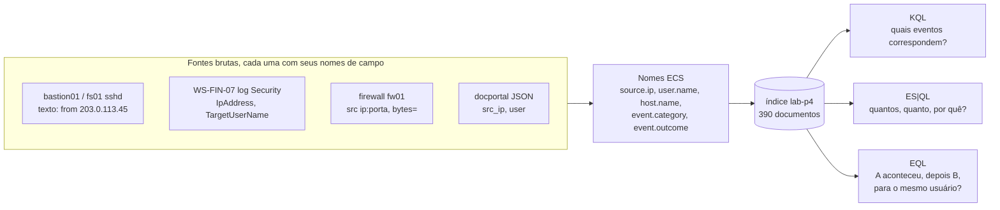

# Dia 63: Correlacionando fontes no Elasticsearch e Kibana

> 🇺🇸 Original: [*Day 63: Correlating across sources in Elasticsearch and Kibana*](https://github.com/thiefdroppers/cyber-investigator-skills/blob/main/curriculum/phase-4-digital-forensics-incident-investigation/day-63.md) — © ThiefDroppers, licença MIT.
> Aqui: tradução fiel **+** camada brasileira. Nada do original foi removido; tudo o que é novo vem marcado com ➕.

**Fase 4. Forense digital e investigação de incidentes** · Meta da trilha: carregar os eventos do LAB-P4 no Elasticsearch, responder perguntas investigativas com KQL, ES|QL e EQL e montar um *dashboard* no Kibana que mostre o incidente num relance.

Rank Jutsu: `B` · [](https://colab.research.google.com/github/Ridd1kulusC0d3r/investigador-cyber-90-dias/blob/main/curriculo/fase-4-forense-e-resposta/dia-63/dia-63.ipynb)

---

## 🎬 ➕ Abertura do caso — *Uma consulta, uma conta, três sistemas*

A Serra Azul tem um SIEM, e a TI finalmente liberou para a Vigia uma exportação do dia 5 de outubro: proxy, firewall, Security do `SA-CX-07` e webmail, já com nomes de campo padronizados e em UTC. São 154 documentos.

— Você passou três dias juntando arquivo por arquivo — diz Rafa. — Agora faz uma pergunta só: `user.name : "cx.centro07"`.

A tela devolve o notebook, o proxy e o webmail, em ordem. O login da manhã, de dentro da agência. O clique. O executável. E, às 12h32, um login bem-sucedido no webmail vindo de `203.0.113.91`, um endereço que não é da cooperativa, seguido da criação de uma regra de caixa postal.

— Isso não estava na sua história de ontem com esse destaque, estava?

Não estava. Hoje você aprende que a pergunta certa, numa base normalizada, acha em segundos o que três dias de arquivos soltos esconderam. E aprende a desconfiar dela também. *(Personagens e cenário: [Operação Isca](../../../caso-continuo/).)*

---

## 📖 Conceito

Um SIEM (*security information and event management*, sistema de gestão de informações e eventos de segurança) é onde os logs de uma organização já moram, normalizados com nomes de campo compartilhados e pesquisáveis entre hosts. Para um investigador, isso muda o fluxo de trabalho: em vez de coletar arquivos de cada servidor e juntá-los você mesmo (Dias 56 a 58), você consulta o parque inteiro de uma vez e depois coleta os originais dos eventos que importam.

A normalização é o que torna possíveis as consultas entre fontes. O Elastic Common Schema (ECS) dá a todas as fontes os mesmos nomes para a mesma ideia: `source.ip`, `destination.ip`, `user.name`, `host.name`, `event.category` (como `authentication` ou `network`), `event.outcome` (`success` ou `failure`). Uma única consulta em `user.name : "svc_backup"` então devolve juntos logs de SSH do Linux, logons do Windows e eventos de aplicação. A exportação do LAB-P4 em `resources/case-lab-p4/siem/lab-events.ndjson` usa nomes ECS e já está corrigida para UTC.

De quatro formatos brutos a um índice e três tipos de pergunta:



O Kibana oferece três linguagens de consulta, cada uma para um trabalho diferente:

| Linguagem | Use para | Formato de exemplo |
|---|---|---|
| KQL (Kibana Query Language) | Filtrar eventos no Discover e em *dashboards* | `user.name : "svc_backup" and event.outcome : "success"` |
| ES\|QL (Elasticsearch Query Language) | Consultas encadeadas que agregam: contagens, somas, primeiro/último por grupo | `FROM idx \| WHERE ... \| STATS ... BY ...` |
| EQL (Event Query Language) | Sequências ordenadas: "A e depois B pelo mesmo usuário em até 30 minutos" | `sequence by user.name with maxspan=30m [..] [..]` |

Uma resposta do SIEM é tão boa quanto a ingestão por trás dela. Antes de confiar numa consulta, confira se o campo que você está filtrando está preenchido para as fontes que importam e se os campos de tempo estão em UTC. Em sistemas reais, confira também se há lacunas de ingestão: uma hora silenciosa num *dashboard* pode significar que nada aconteceu ou que um coletor de logs parou.

## 📚 Recursos

- Documentação da Elastic: [Run Elasticsearch locally](https://www.elastic.co/docs/deploy-manage/deploy/self-managed/local-development-installation-quickstart) (o script `start-local`), [KQL](https://www.elastic.co/docs/explore-analyze/query-filter/languages/kql), [ES|QL](https://www.elastic.co/docs/explore-analyze/query-filter/languages/esql), [sintaxe EQL](https://www.elastic.co/docs/reference/query-languages/eql/eql-syntax).
- [Referência de campos do Elastic Common Schema](https://www.elastic.co/docs/reference/ecs).
- O recurso de [envio de arquivo](https://www.elastic.co/docs/manage-data/ingest/upload-data-files) do Kibana (arquivos CSV, NDJSON e de log até um tamanho configurável).

### ➕ Recursos do contexto Brasil

- [Resolução BCB nº 85/2021](https://www.bcb.gov.br/estabilidadefinanceira/buscanormas): política de segurança cibernética e requisitos para contratação de processamento e armazenamento de dados e de computação em nuvem a serem observados pelas instituições de pagamento autorizadas pelo Banco Central. Para instituições financeiras e cooperativas, a norma de referência equivalente é a [Resolução CMN nº 4.893/2021](https://www.bcb.gov.br/estabilidadefinanceira/buscanormas). Ambas pedem registro e monitoramento de incidentes; o SIEM é onde isso vive. A Res. CMN 4.893/2021 se dirige às instituições financeiras e demais instituições autorizadas a funcionar pelo Banco Central, o que inclui as cooperativas de crédito. Ela foi alterada pela Res. CMN 5.274/2025 (publicada em 22/12/2025, com adequação até 1º/3/2026), que acrescentou, entre outros pontos, testes de intrusão ao menos anuais por terceiro independente e controles específicos para os ambientes Pix.
- O índice sintético da Isca: [`caso-continuo/dados/dia-63/sa-eventos.ndjson`](../../../caso-continuo/dados/dia-63/sa-eventos.ndjson) (154 documentos, ECS, UTC, `labels.synthetic: true`).

## 🛠️ Prática: *dashboard* "LAB-P4 (synthetic)" no Kibana e um conjunto de consultas salvas

**Seu checklist de hoje.** Faça na ordem e marque cada item ao terminar:

- [ ] Suba uma pilha Elastic local na sua VM de laboratório.
- [ ] Envie o `lab-events.ndjson` e defina os mapeamentos de campo.
- [ ] Confira a ingestão no Discover.
- [ ] Rode as perguntas em KQL e salve cada consulta.
- [ ] Rode as consultas ES|QL de autenticações com falha e de bytes transferidos.
- [ ] Rode a sequência EQL falha-depois-sucesso e aperte-a.
- [ ] Monte o *dashboard* `LAB-P4 (synthetic)`.
- [ ] Termine suas notas e a planilha de resultados.
- [ ] ➕ Prática BR: índice `isca-sa` com as mesmas três linguagens e a cadeia da conta `cx.centro07`.
- [ ] ➕ O notebook do dia no Colab (KQL, ES|QL e EQL emulados em Python puro sobre os dois NDJSON).

1. Suba uma pilha Elastic local de nó único na sua VM de laboratório (Docker necessário). O script `start-local` da Elastic é só para desenvolvimento local e se liga ao localhost:

   ```bash
   curl -fsSL https://elastic.co/start-local | sh
   cat elastic-start-local/.env | grep -E 'ES_LOCAL_PASSWORD|ES_LOCAL_URL|KIBANA_LOCAL_URL'
   ```

   Registre as versões do Elasticsearch e do Kibana que ele instalou (mostradas no Kibana em Help e no arquivo `.env`). Faça login no Kibana em `http://localhost:5601` como `elastic` com a senha do `.env`. Não imprima essa senha nas suas notas do caso.

2. Envie os dados. No Kibana, abra a página de envio de arquivo (procure "Upload a file" na barra de busca do topo), escolha a sua cópia de trabalho com hash do `lab-events.ndjson` e, na tela de importação, defina o nome do índice como `lab-p4`. Abra as configurações avançadas antes de importar e confira os mapeamentos: defina `source.ip` e `destination.ip` como tipo `ip`, `network.bytes` como `long` e deixe `@timestamp` como `date`. Marque "Create data view". Depois da importação, a página deve relatar 390 documentos.

3. Confira a ingestão no Discover antes de qualquer análise. Ajuste o seletor de tempo para 9 a 15 de março de 2026 e rode:

   ```text
   labels.synthetic : true
   ```

   Depois detalhe: na lista de campos, clique em `event.dataset` e `host.name` para ver as contagens de valores. Você deve ter quatro *datasets* em `bastion01`, `fs01`, `fw01` e `WS-FIN-07`. Se faltar um host, corrija a ingestão agora.

4. KQL: responda a cada pergunta e salve cada consulta (Save query, na barra de consulta) com a pergunta como nome.

   ```text
   event.dataset : "system.auth" and event.outcome : "failure" and source.ip : "203.0.113.45"
   user.name : "svc_backup" and event.outcome : "success"
   source.ip : "198.51.100.23" or destination.ip : "198.51.100.23"
   source.ip : "203.0.113.0/24" or destination.ip : "203.0.113.0/24"
   ```

   A segunda consulta mostra o `svc_backup` tendo sucesso em três hosts, em ordem: `bastion01` a partir de 203.0.113.45, `fs01` a partir do `bastion01`, e `WS-FIN-07` (logon tipo 3) a partir do `fs01` às 03:27:41. Escreva essa cadeia nas suas notas. Você viu o logon na WS-FIN-07 no Dia 55 como um ponto fora da curva isolado; uma consulta agora o coloca 8 minutos depois de o `svc_backup` chegar ao `fs01`.

   A cadeia que essa consulta devolve, uma conta em três hosts:

   ```mermaid
   sequenceDiagram
       participant X as 203.0.113.45
       participant B as bastion01
       participant F as fs01
       participant W as WS-FIN-07
       X->>B: svc_backup sucesso, senha, 03:14:07
       B->>F: svc_backup sucesso, publickey, 03:19:22
       F->>W: svc_backup sucesso, logon tipo 3 (depois 4672), 03:27:41
       Note over F,W: Este salto falta na história do Dia 58
   ```

5. ES|QL: abra o Discover, mude para ES|QL e rode o perfil de autenticações com falha.

   ```esql
   FROM lab-p4
   | WHERE event.category == "authentication" AND event.outcome == "failure"
   | STATS failures = COUNT(*), users = COUNT_DISTINCT(user.name),
           first = MIN(@timestamp), last = MAX(@timestamp) BY source.ip, host.name
   | SORT failures DESC
   ```

   Esperado: três linhas: 112 falhas a partir de 203.0.113.45 no `bastion01` (8 usuários), 23 a partir de 10.10.20.5 na `WS-FIN-07` (3 usuários) e 5 com `source.ip` vazio na `WS-FIN-07` (falhas interativas locais durante o horário de expediente). Depois descubra para onde foram os bytes:

   ```esql
   FROM lab-p4
   | WHERE event.dataset == "firewall" AND event.action == "accept"
       AND NOT CIDR_MATCH(destination.ip, "10.0.0.0/8")
   | STATS total_bytes = SUM(network.bytes), connections = COUNT(*) BY source.ip, destination.ip
   | SORT total_bytes DESC
   | LIMIT 5
   ```

   A primeira linha é 10.10.30.17 para 198.51.100.23, 48.213.904 bytes numa conexão; a seguinte tem menos de 90.000 bytes. `CIDR_MATCH` precisa de `destination.ip` mapeado como `ip` (passo 2).

6. EQL: encontre "falhas e depois sucesso para a mesma conta". Rode no Dev Tools do Kibana:

   ```text
   GET lab-p4/_eql/search
   {
     "query": """
       sequence by user.name with maxspan=30m
         [authentication where event.outcome == "failure"]
         [authentication where event.outcome == "success"]
     """
   }
   ```

   Olhe cada sequência devolvida. O `svc_backup` no `bastion01` deve aparecer. Você também pode receber sequências para `acct.clerk01`, que erra a senha cerca de uma vez por dia e depois entra normalmente: uma regra ingênua produz falsos positivos. Aperte-a para que um único erro de digitação não case, por exemplo exigindo várias falhas antes (a EQL tem um modificador de repetição, `[authentication where event.outcome == "failure"] with runs=5`, nas versões recentes), e registre como o conjunto de resultados mudou.

7. Monte o *dashboard*. Crie um *dashboard* chamado `LAB-P4 (synthetic)` com pelo menos três painéis Lens:
   - Mapa de calor: `@timestamp` por hora no eixo horizontal, `host.name` no vertical, contagem de registros, filtrado por `event.outcome : "failure"`.
   - Gráfico de barras: soma de `network.bytes` por `destination.ip`, top 10, filtrado por `event.dataset : "firewall"`.
   - Tabela: `@timestamp`, `host.name`, `user.name`, `source.ip`, `event.outcome` para `user.name : "svc_backup"`, ordenada por tempo.

   Defina o intervalo de tempo do *dashboard* como 13 de março 12:00 a 14 de março 06:00 UTC e salve-o com "Store time with dashboard" marcado.

8. Termine suas notas e a planilha de resultados:
   - Ao lado da cadeia do `svc_backup` do passo 4, registre que a história do Dia 58 não incluía o salto para a WS-FIN-07.
   - Se a sua tabela ES|QL de autenticações com falha do passo 5 não bater com as três linhas esperadas, escreva a diferença e a causa.

Artefato: o *dashboard* salvo `LAB-P4 (synthetic)` (exporte-o em Stack Management, Saved Objects, como NDJSON), as consultas KQL salvas e uma planilha de resultados com cada consulta ES|QL e EQL e as linhas que ela devolveu.

### ➕ Prática BR: índice `isca-sa`

Envie [`sa-eventos.ndjson`](../../../caso-continuo/dados/dia-63/sa-eventos.ndjson) como índice `isca-sa`, com os mesmos mapeamentos (`source.ip`, `destination.ip` como `ip`; `network.bytes`, `source.bytes`, `destination.bytes` como `long`). Ingestão esperada: 154 documentos, quatro *datasets* (`firewall`, `proxy`, `windows.security`, `webmail`) em `fw-sa`, `proxy-sa`, `SA-CX-07` e `webmail-sa`, entre 10:00 e 13:59 UTC de 5/out/2026.

**KQL:**

```text
user.name : "cx.centro07"
destination.ip : "198.51.100.140" or url.original : *atualiza-modulo*
source.ip : "203.0.113.0/24" and not destination.ip : "203.0.113.0/24"
event.dataset : "webmail" and event.action : "mailbox.rule_create"
```

**ES|QL (para onde foram os bytes, a partir do proxy):**

```esql
FROM isca-sa
| WHERE event.dataset == "proxy"
| STATS enviados = SUM(source.bytes), conexoes = COUNT(*) BY source.ip, url.original
| SORT enviados DESC
| LIMIT 5
```

**EQL (falha depois sucesso, a mesma conta):**

```text
GET isca-sa/_eql/search
{
  "query": """
    sequence by user.name with maxspan=30m
      [authentication where event.outcome == "failure"]
      [authentication where event.outcome == "success"]
  """
}
```

Perguntas: (a) quantas sequências a EQL devolve e quais são falsos positivos (dica: há dois funcionários que erram a senha uma vez e entram; um deles é a própria `cx.centro07` no notebook, às 13:15)? (b) Com `with runs=3` na falha, o que sobra? (c) A cadeia da `cx.centro07`: escreva-a como no passo 4 e marque qual salto **não** compartilha nada além do nome da conta.

```mermaid
sequenceDiagram
    participant C as SA-CX-07 (10.20.40.57)
    participant W as webmail-sa
    participant E as 203.0.113.91
    C->>W: cx.centro07 sucesso, de dentro, 10:53:02
    Note over C: 11:19 clique; 11:24 msa-atualizador.exe; beacon a cada ~300 s
    E->>W: cx.centro07: 3 falhas, 12:31:02 a 12:31:40
    E->>W: cx.centro07 sucesso, 12:32:05
    E->>W: mailbox.rule_create, 12:33:50
    Note over C,E: Liga o notebook ao login externo só o nome da conta (inferido)
```

### ➕ O notebook do dia

Abra o [notebook do Dia 63 no Colab](https://colab.research.google.com/github/Ridd1kulusC0d3r/investigador-cyber-90-dias/blob/main/curriculo/fase-4-forense-e-resposta/dia-63/dia-63.ipynb). Sem Elastic, você:

1. carrega o `lab-events.ndjson` (rede, com plano B embutido) e o `sa-eventos.ndjson`, e confere a ingestão (390 e 154 documentos, *datasets* e hosts);
2. roda um **mini-KQL** (`campo : valor`, `and`/`or`/`not`, CIDR) e salva as consultas;
3. reproduz as duas consultas **ES|QL** e confere as três linhas esperadas;
4. emula a **EQL** `sequence by user.name with maxspan=30m`, com e sem `runs`, e acha os falsos positivos (`acct.clerk01` no LAB-P4; `ger.centro01` e `cx.centro07` na Isca);
5. desenha o mapa de calor em texto e a tabela do `svc_backup`/`cx.centro07`;
6. joga o quiz **"qual linguagem?"**.

## ✅ Checkpoint

- Sua conferência de ingestão mostra os quatro hosts.
- Sua conferência de ingestão mostra 390 documentos.
- Sua tabela ES|QL de autenticações com falha bate com as três linhas esperadas, ou sua planilha de resultados diz a diferença e a causa.
- Suas notas registram a cadeia do `svc_backup` em três hosts.
- Suas notas registram que a história do Dia 58 não incluía o salto para a WS-FIN-07.
- Sua planilha de resultados registra o que a sequência EQL devolveu antes do aperto.
- Sua planilha de resultados registra o que a sequência EQL devolveu depois do aperto.
- Sua planilha de resultados nomeia a conta do falso positivo.
- Aberto sem ajustes, o intervalo de tempo do *dashboard* é de 13 de março 12:00 a 14 de março 06:00 UTC.
- Aberto sem ajustes, o mapa de calor mostra células quentes nas horas de 02:00 a 04:00.
- Aberto sem ajustes, a maior barra do gráfico de barras é o único destino externo 198.51.100.23.
- Sem consultar notas, você diz por que a segunda consulta ES|QL precisa de `destination.ip` mapeado como `ip`.

## Nota

O script `start-local`, a localização da página de envio de arquivo e alguns recursos de ES|QL e EQL diferem entre versões da Elastic. Os resultados esperados acima vêm dos próprios dados sintéticos (contados com `jq`); se o Kibana mostrar números diferentes, confira os mapeamentos e o intervalo de tempo antes de duvidar dos dados.

### ➕ Checkpoint BR

- Sua conferência do `isca-sa` mostra 154 documentos e os quatro hosts.
- Sua planilha nomeia os dois falsos positivos da EQL na Isca e mostra que `runs=3` deixa só a `cx.centro07` a partir de 203.0.113.91.
- Sua cadeia da `cx.centro07` marca como inferido o salto entre o notebook e o login externo.
- No quiz do notebook, você acertou pelo menos 5 de 6.

## ⚖️ ➕ Camada jurídica BR

**O login de fora no webmail muda a pergunta jurídica.** Até aqui, o caso era um golpe contra cooperados e uma estação infectada. Um acesso bem-sucedido à caixa de e-mail de uma funcionária, a partir de um IP externo, seguido de regra de caixa postal, é possível acesso não autorizado a um sistema da cooperativa (CP, art. 154-A, se demonstrada a invasão de dispositivo informático alheio) e, sobretudo, é um **incidente de segurança com dados pessoais** se a caixa contém dados de cooperados: o controlador avalia a comunicação à ANPD e aos titulares (LGPD, art. 48). O trabalho do investigador é deixar isso **mensurável**: quais mensagens, de quando, acessíveis por aquela sessão.

**Marco Civil, art. 15, e o IP 203.0.113.91.** Quem estava atrás do IP é pergunta para o provedor de conexão, e a resposta só sai com ordem judicial (art. 10, §1º; o pedido segue o art. 22). Os registros de acesso a aplicações de internet ficam guardados por 6 meses (art. 15); a cooperativa pode pedir ao provedor, por notificação, que preserve, enquanto o pedido judicial é preparado. Você documenta IP, data, hora com fuso e porta de origem, que é o que o pedido vai precisar.

> Este repositório é material de estudo e não substitui orientação jurídica.

## 🧠 ➕ Camada 8 — a cegueira por desatenção e a consulta que você não fez

Simons e Chabris (1999) pediram a voluntários que contassem passes de basquete num vídeo; cerca de metade não viu uma pessoa fantasiada de gorila atravessar a cena. É a **cegueira por desatenção** (*inattentional blindness*): quando a atenção está presa numa tarefa, o inesperado fica invisível, mesmo bem à vista. Drew, Võ e Wolfe (2013) repetiram a ideia com radiologistas procurando nódulos em tomografias, e a maioria não viu um gorila desenhado na imagem.

Nos Dias 56 a 58 você estava contando passes: o clique, o executável, o *beacon*. O login externo no webmail estava nos dados o tempo todo. O SIEM não deixa você mais inteligente; ele deixa barata a consulta pela **entidade** (`user.name`, `source.ip`) em vez da consulta pela **hipótese**. Consequência prática: em todo caso, rode pelo menos uma consulta por entidade sem filtro de hipótese ("tudo da conta X", "tudo do IP Y") e leia o resultado inteiro antes de escrever a história.

## 🤖 ➕ Skill do dia

O dia propõe à [skill pt-BR](../../../skills/investigador-cyber/SKILL.md) um procedimento novo, **"Correlação no SIEM: ingestão primeiro, entidade antes da hipótese"**. Texto e caso de teste em [`_skill-delta.md`](_skill-delta.md).

## 💡 ➕ Inovação OSINT do dia — um "SIEM de bolso" com `sqlite3`

A biblioteca padrão do Python traz o SQLite. Para um NDJSON de alguns milhares de linhas (uma exportação de SIEM que o cliente mandou por e-mail), dá para fazer as perguntas do ES|QL em SQL, sem instalar nada:

```python
import json, sqlite3
db = sqlite3.connect(":memory:")
db.execute("CREATE TABLE ev (ts TEXT, host TEXT, usuario TEXT, ip TEXT, categoria TEXT, resultado TEXT)")
with open("sa-eventos.ndjson", encoding="utf-8") as f:
    db.executemany("INSERT INTO ev VALUES (?,?,?,?,?,?)",
                   [(d["@timestamp"], d["host.name"], d.get("user.name"), d.get("source.ip"),
                     d.get("event.category"), d.get("event.outcome")) for d in map(json.loads, f)])
for linha in db.execute("""SELECT ip, host, COUNT(*), MIN(ts), MAX(ts) FROM ev
                           WHERE categoria='authentication' AND resultado='failure'
                           GROUP BY ip, host ORDER BY 3 DESC"""):
    print(linha)                                   # o mesmo perfil de falhas do passo 5
```

Não substitui o SIEM (sem tipo `ip`, sem sequências), mas responde o essencial quando o cliente só tem um arquivo.

## 📝 Diário de estudo

- Data:
- Tempo gasto:
- O que ficou claro:
- O que ainda está nebuloso:
- Artefato produzido: *dashboard* `LAB-P4 (synthetic)` exportado, consultas KQL salvas, planilha de resultados (ES|QL e EQL antes/depois), cadeia da `cx.centro07`

---
<sub>Baseado em [cyber-investigator-skills](https://github.com/thiefdroppers/cyber-investigator-skills) por ThiefDroppers (MIT). Tradução, camada BR, Camada 8, skill pt-BR e notebook por Deivison Lourenço (@Ridd1kulusC0d3r).</sub>
