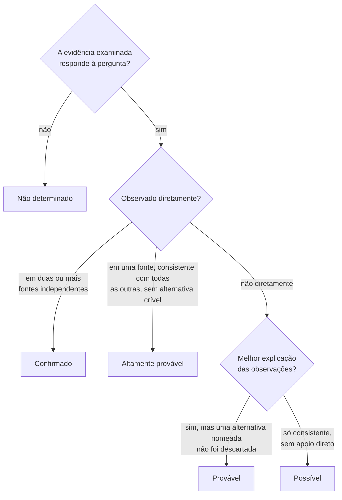
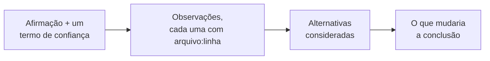
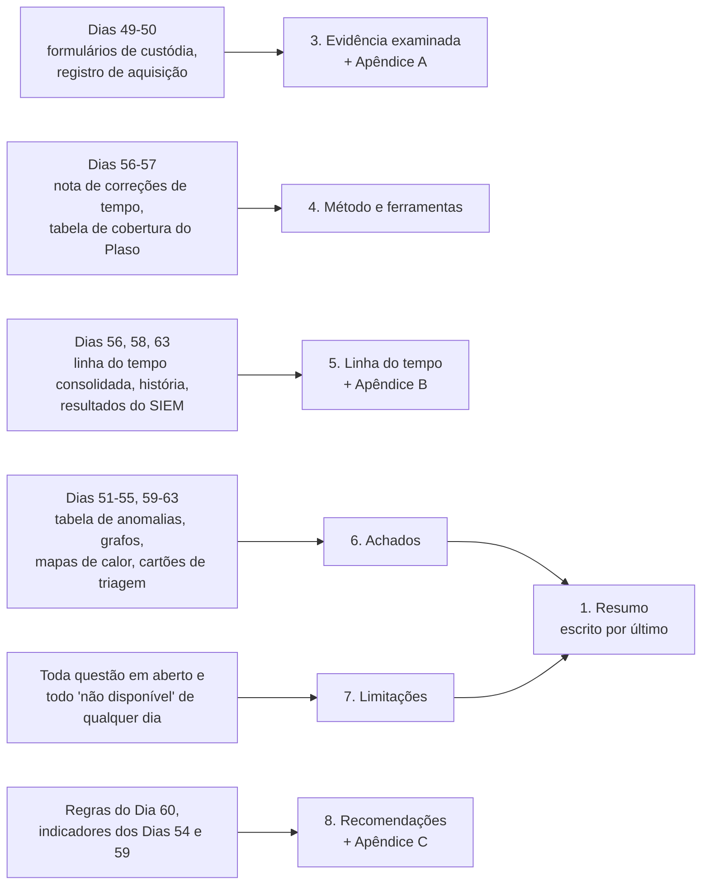

# Dia 64: Escrevendo o relatório de achados forenses

> 🇺🇸 Original: [*Day 64: Writing the forensic findings report*](https://github.com/thiefdroppers/cyber-investigator-skills/blob/main/curriculum/phase-4-digital-forensics-incident-investigation/day-64.md) — © ThiefDroppers, licença MIT.
> Aqui: tradução fiel **+** camada brasileira. Nada do original foi removido; tudo o que é novo vem marcado com ➕.

**Fase 4. Forense digital e investigação de incidentes** · Meta da trilha: transformar dezesseis dias de notas do LAB-P4 num relatório com o qual um tomador de decisão consiga agir e que um examinador cético consiga conferir linha a linha.

Rank Jutsu: `B` · [](https://colab.research.google.com/github/Ridd1kulusC0d3r/investigador-cyber-90-dias/blob/main/curriculo/fase-4-forense-e-resposta/dia-64/dia-64.ipynb)

---

## 🎬 ➕ Abertura do caso — *A frase que o Dr. Hélio riscou*

Sexta-feira, 16h. O rascunho do relatório do `SA-CX-07` volta do jurídico da Serra Azul. O Dr. Hélio Brandão riscou uma frase só, a primeira do resumo: *"O hacker invadiu o notebook da caixa e roubou a senha do webmail."*

Na margem, com a letra miúda de quem já leu muitos laudos: *"Qual hacker? Qual linha prova o roubo? Se isto for parar num inquérito, a defesa começa por aqui."*

Rafa lê por cima do seu ombro.

— Ele está certo em tudo. Você não viu ninguém. Viu uma conta logar de um IP de fora. E não viu a senha sair do notebook: viu 3 megabytes de conteúdo desconhecido.

Marta, na mesma mensagem, pede o contrário: *"Preciso decidir até segunda se aviso os cooperados. Me diz em três linhas o que aconteceu."*

Dois leitores, um documento. Hoje você escreve o relatório que serve aos dois: a Marta age pelo primeiro parágrafo; o Dr. Hélio confere cada citação. *(Personagens e cenário: [Operação Isca](../../../caso-continuo/).)*

---

## 📖 Conceito

O relatório é a única parte de uma investigação que a maioria das pessoas vai ver. O jurídico, um gestor decidindo se notifica clientes, uma seguradora ou um tribunal o leem sem as suas notas, sem as suas ferramentas e sem você na sala. Dois leitores importam ao mesmo tempo: o que precisa agir e quer a resposta no primeiro parágrafo, e o que quer derrubar as suas conclusões e vai conferir cada linha citada.

A estrutura serve aos dois. O resumo abre com o que aconteceu, quando, o que foi afetado, quão seguro você está e o que ainda é desconhecido. Os achados vêm depois, cada um construído da mesma forma: a afirmação com o seu nível de confiança, as observações com referências à evidência, as alternativas que você considerou e o que mudaria a sua opinião. As seções de método e de evidência permitem que outro examinador repita o seu trabalho: versões das ferramentas, comandos, hashes, correções de tempo.

Linguagem calibrada é a habilidade central. Toda frase factual ou relata uma observação ("o log do firewall registra ...") ou declara uma inferência com a sua força ("isto é provável porque ..."). As palavras que fazem relatórios serem destroçados são as que afirmam mais do que a evidência: "prova", "claramente", "o atacante" quando você quer dizer "a conta", "roubou" quando o log mostra bytes saindo mas não o conteúdo deles, "todos" quando você conferiu uma amostra. Escolha uma escala de confiança pequena, defina-a no relatório e use só aquelas palavras.

Escolhendo o termo de confiança de um achado, com as definições do modelo abaixo:



Todo achado tem as mesmas quatro partes, nesta ordem:



Limitações são achados sobre a sua própria evidência. Uma lacuna que você nomeia não lhe custa nada; uma lacuna que o advogado da outra parte nomeia primeiro lhe custa o relatório.

## 📚 Recursos

- NIST SP 800-86, seção 3.4 "Reporting".
- [ODNI Intelligence Community Directive 203, Analytic Standards](https://www.dni.gov/files/documents/ICD/ICD-203.pdf): a fonte da linguagem de probabilidade de muitas equipes e da exigência de separar inteligência de premissas.
- Sherman Kent, "Words of Estimative Probability" (CIA Studies in Intelligence, 1964), sobre por que palavras de confiança precisam de significados definidos.
- SWGDE "Requirements for Report Writing in Digital and Multimedia Forensics" (na página de documentos do SWGDE).

### ➕ Recursos do contexto Brasil

- [Código de Processo Penal](https://www.planalto.gov.br/ccivil_03/decreto-lei/del3689compilado.htm), arts. 158 a 184 (exame de corpo de delito e perícias em geral), em especial os arts. 159 (perito oficial; peritos não oficiais com diploma superior e compromisso), 160 (laudo que descreve minuciosamente o que examinaram e responde aos quesitos) e 158-A a 158-F (cadeia de custódia).
- [Código de Processo Civil](https://www.planalto.gov.br/ccivil_03/_ato2015-2018/2015/lei/l13105.htm), art. 473: o que o laudo pericial deve conter no processo civil (exposição do objeto, análise técnica, indicação do método e resposta conclusiva aos quesitos, em linguagem simples).
- [ABNT NBR ISO/IEC 27037:2013](https://www.abntcatalogo.com.br/) (identificação, coleta, aquisição e preservação de evidência digital) e [ABNT NBR ISO/IEC 27042](https://www.abntcatalogo.com.br/) (análise e interpretação de evidência digital); normas pagas, disponíveis em bibliotecas institucionais.
- [ANPD — Comunicação de incidente de segurança](https://www.gov.br/anpd/pt-br/canais_atendimento/agente-de-tratamento/comunicado-de-incidente-de-seguranca-cis): o formulário pede exatamente o que o seu relatório deve responder (natureza dos dados, titulares afetados, medidas tomadas).

## 🛠️ Prática: o relatório de achados do LAB-P4

Use o modelo abaixo. Tudo o que você cita vem dos seus próprios artefatos: os formulários de custódia (Dia 49), o registro de aquisição (50), as linhas do tempo (51, 56, 57), a tabela de anomalias (52), os grafos de processos e de rede (53, 54), os mapas de calor (55), a história no Timesketch (58), o grafo de fluxos e as regras (59, 60), os cartões de triagem (61, 62) e o *dashboard* (63).

Onde o artefato de cada dia entra no relatório:



**Seu checklist de hoje.** Faça na ordem e marque cada item ao terminar:

- [ ] Rascunhe os cinco achados antes do resumo.
- [ ] Calibre a linguagem de cada achado ao termo de confiança dele.
- [ ] Monte a seção de linha do tempo a partir do CSV consolidado e dos resultados do SIEM.
- [ ] Escreva a seção de limitações.
- [ ] Escreva o resumo por último.
- [ ] Anexe os formulários de custódia, a linha do tempo, a lista de indicadores e o apêndice de comandos.
- [ ] Confira cada citação com o script de verificação.
- [ ] ➕ Prática BR: o relatório técnico da Isca (`SA-CX-07`) na estrutura de laudo usada no Brasil, com quesitos.
- [ ] ➕ O notebook do dia no Colab (verificador de citações e de palavras que superafirmam, em Python puro).

1. Rascunhe os achados primeiro e o resumo por último. Parta destas cinco perguntas e escreva um achado para cada uma:

   1. Como foi obtido o acesso ao `bastion01`?
   2. O que o ator fez no `fs01`?
   3. Dados financeiros saíram da rede?
   4. Como a WS-FIN-07 se relaciona com o resto?
   5. Como a senha do `svc_backup` foi obtida?

2. Calibre cada achado. Aqui está a pergunta 3 escrita mal e depois de forma aceitável.

   Mal: "O atacante roubou os arquivos financeiros do 1º trimestre enviando-os para o seu servidor de C2 em 198.51.100.23."

   Essa frase afirma uma identidade ("o atacante"), uma correspondência de conteúdo ("os arquivos financeiros do 1º trimestre") e uma finalidade ("servidor de C2"), e nenhum log mostra nenhuma das três.

   Aceitável: "É provável que um arquivo compactado da pasta `finance/2026-Q1` tenha saído da rede às 03:41:02 UTC de 14 de março de 2026. O portal de documentos no `fs01` registrou uma exportação em massa de 412 arquivos (48.006.112 bytes) pela conta `svc_backup` às 03:23:48 (docportal-app.jsonl:16, corrigido para um desvio de relógio de 83 segundos); o `svc_backup` executou `tar -czf /var/tmp/.q1.tgz` sobre essa pasta às 03:31:40 (fs01-auth.log:4); e o firewall permitiu uma única conexão de 48.213.904 bytes do `fs01` para 198.51.100.23:443 às 03:41:02 (firewall.log:150, convertido de UTC-4). O firewall não registra conteúdo; então a correspondência entre o arquivo compactado e a transferência se apoia no tamanho e na sequência. Uma captura de pacotes, um log de *proxy* ou o tamanho do arquivo compactado em disco (`/var/tmp/.q1.tgz`, se ainda existir) confirmaria ou refutaria isso."

   A pergunta 5 tem uma única resposta honesta a partir destes dados: "Não determinado. Nenhuma das evidências examinadas mostra como a senha foi obtida." Não preencha a lacuna com a atividade da WS-FIN-07 só porque ela é suspeita e está próxima no tempo; você pode listá-la como uma pista a investigar, com esse rótulo.

3. Monte a seção de linha do tempo a partir do `lab-p4-merged.csv` e dos resultados do SIEM. Mantenha só os eventos materiais, cada um com hora UTC, host, descrição e referência à evidência, e declare cada correção de tempo uma única vez, com a forma como você a mediu.

4. Escreva a seção de limitações. No mínimo: nenhuma captura de pacotes; nenhuma imagem bruta de memória nem cópia do `synchelper.exe`; desvio de relógio do `fs01` medido numa única conexão; formatos do firewall e da aplicação não interpretados pelo Plaso; as falhas de logon inexplicadas contra a WS-FIN-07 a partir do `bastion01`, das 02:10 às 02:16; a imagem USB (EVID-004) sem ligação observada com a intrusão.

   Compare o mapa do caso do Dia 49 com o que a evidência agora sustenta. Arestas cheias são ligações por um campo compartilhado que você pode citar; arestas tracejadas são inferidas ou inexplicadas. Decidir o termo de confiança de cada uma é o seu trabalho no passo 2.

   ```mermaid
   flowchart LR
       X["203.0.113.45"] -->|"spray, depois login por senha<br/>bastion01-auth.log:117"| B["bastion01"]
       B -->|"porta de origem 41766<br/>firewall.log:147, fs01-auth.log:2"| F["fs01"]
       F -->|"exportação, depois tar<br/>docportal-app.jsonl:16, fs01-auth.log:4"| F
       F -.->|"48.213.904 bytes, conteúdo não visto<br/>firewall.log:150"| Y["198.51.100.23"]
       F -->|"logon tipo 3 do svc_backup<br/>ws-fin-07-security.csv:119"| W["WS-FIN-07"]
       W -.->|"mesmo IP remoto na memória<br/>windows.netscan.txt"| Y
       Q1["Não determinado:<br/>como a senha do<br/>svc_backup era conhecida"] -.- B
       Q2["Inexplicado: 23 falhas<br/>a partir do bastion01, 02:10-02:16"] -.- W
       style Q1 fill:#fbe3b0
       style Q2 fill:#fbe3b0
   ```

5. Escreva o resumo por último, em três a seis frases, sem nomes de ferramentas e sem siglas não explicadas.

6. Anexe os formulários de custódia, a exportação da linha do tempo, uma lista de indicadores (tipo, valor, primeira observação, última observação, fonte, todos os IPs das faixas de documentação e marcados como sintéticos) e o apêndice de comandos com os hashes dos arquivos de saída.

7. Confira as suas citações com um script antes que um revisor o faça. Ele extrai do relatório toda referência `arquivo:linha`, encontra o arquivo nas suas cópias de trabalho e imprime a linha citada, para que você possa ler cada afirmação contra a sua fonte:

   ```bash
   cd ~/lab-p4
   grep -oE '[A-Za-z0-9._-]+\.(log|jsonl|csv|txt):[0-9]+' LAB-P4-findings.md | sort -u |
   while IFS=: read -r f n; do
     p=$(find work -name "$f" -print -quit)
     if [ -z "$p" ]; then echo "$f:$n  FILE NOT FOUND"; continue; fi
     line=$(sed -n "${n}p" "$p")
     echo "$f:$n  ${line:-LINE DOES NOT EXIST}"
   done
   grep -nowiE 'proves?|clearly|obviously|stole|hacker|attacker' LAB-P4-findings.md
   ```

   Para `firewall.log:150`, a primeira parte imprime a linha de 48.213.904 bytes. Qualquer `FILE NOT FOUND` ou `LINE DOES NOT EXIST` é uma citação quebrada a corrigir. O segundo `grep` lista toda palavra que superafirma, com o número da linha; cada uma sai, ou fica com evidência que a sustente.

   > ➕ Se você escrever o relatório em português, acrescente ao segundo `grep` as equivalentes: `grep -nowiE 'prova(m)?|claramente|obviamente|roubou|roubaram|hacker|atacante|invasor|criminoso|certamente|com certeza' LAB-P4-achados.md`.

### Modelo de relatório

Copie isto em `~/lab-p4/LAB-P4-findings.md` e preencha todas as seções.

```markdown
# Achados forenses: LAB-P4 (caso de treinamento sintético)

## 1. Resumo
Três a seis frases: o que aconteceu, quando (UTC), o que foi afetado, quão seguro você está,
o que continua desconhecido. Sem nomes de ferramentas.

## 2. Escopo e autoridade
Quem solicitou o trabalho, sob qual autoridade (LAB-P4-EL, fictícia), as perguntas feitas,
o que ficou fora do escopo e quaisquer limites de tempo ou de acesso.

## 3. Evidência examinada
| Item | Descrição | Adquirido por / data (UTC) | SHA-256 | Verificado no recebimento? |
|---|---|---|---|---|

## 4. Método e ferramentas
Cada ferramenta com a versão exata e para que foi usada. Correções de tempo aplicadas.

## 5. Linha do tempo
Só eventos materiais, em UTC, cada um com host, descrição e referência à evidência.

## 6. Achados
### Achado 1: <uma frase, com o termo de confiança>
Observações (com referências à evidência):
Alternativas consideradas:
O que mudaria esta conclusão:

(repita para cada achado)

Termos de confiança usados neste relatório:
| Termo | Significado |
|---|---|
| Confirmado | Observado diretamente em duas ou mais fontes independentes |
| Altamente provável | Observado diretamente em uma fonte, consistente com todas as outras, sem alternativa crível |
| Provável | Melhor explicação das observações; uma alternativa nomeada não foi descartada |
| Possível | Consistente com as observações, sem apoio de evidência direta |
| Não determinado | A evidência examinada não responde à pergunta |

## 7. Limitações

## 8. Recomendações
Cada uma ligada a um número de achado.

## Apêndices
A. Formulários de cadeia de custódia  B. Linha do tempo completa  C. Indicadores  D. Comandos executados, em ordem, com os hashes das saídas
```

Artefato: `LAB-P4-findings.md` (ou PDF), completo, com cinco achados, uma linha do tempo, as limitações e os quatro apêndices.

### ➕ Prática BR: o relatório técnico do `SA-CX-07`, na estrutura de laudo

O relatório da Vigia para a Serra Azul é um **relatório técnico de assistente privado**, não um laudo oficial: no processo penal, laudo pericial é feito por perito oficial ou, na falta dele, por duas pessoas idôneas com diploma superior que prestam compromisso (CPP, art. 159). Mas, se o caso virar inquérito, o seu relatório vai ser lido por um perito, por um delegado e por um advogado. Vale a pena escrevê-lo na **estrutura que eles conhecem**, que costuma organizar o documento assim:

| Seção do relatório técnico (prática brasileira) | Corresponde a, no modelo do original |
|---|---|
| **Preâmbulo**: quem elaborou, a pedido de quem, quando, com que autorização | 2. Escopo e autoridade |
| **Quesitos**: as perguntas formuladas pelo solicitante, numeradas | as cinco perguntas do passo 1 |
| **Histórico**: o que motivou o exame, em poucas linhas | parte do 1. Resumo |
| **Objeto / material examinado**: cada item com descrição, origem, hash, cadeia de custódia | 3. Evidência examinada + Apêndice A |
| **Metodologia / exames**: ferramentas, versões, procedimentos, correções de tempo | 4. Método e ferramentas |
| **Análise / discussão**: linha do tempo e achados, com confiança | 5. Linha do tempo + 6. Achados + 7. Limitações |
| **Conclusão**: síntese | 1. Resumo (o original o põe no início; aqui ele também fica no início, e a conclusão o repete) |
| **Respostas aos quesitos**: uma resposta por quesito, com o termo de confiança | os achados, um por pergunta |
| **Encerramento**: número de páginas, anexos, assinatura, data | Apêndices |

Os **quesitos** do caso Serra Azul, formulados por Marta Quintão e pelo Dr. Hélio:

1. O notebook `SA-CX-07` acessou o link do SMS do golpe? Quando?
2. Algum programa foi instalado ou executado no notebook em decorrência desse acesso?
3. O notebook transmitiu dados para fora da rede da cooperativa? Quais, quanto e para onde?
4. A conta de webmail `cx.centro07` foi acessada por terceiros? Como a credencial foi obtida?
5. Outras estações da agência Centro apresentaram a mesma atividade?

**Exercício 1.** Escreva a resposta a cada quesito no formato do original (afirmação + **um** termo de confiança, observações com `arquivo:linha`, alternativas, o que mudaria). Gabarito de calibração (confira depois de tentar; as referências de linha estão em [`caso-continuo/dados/dia-57/`](../../../caso-continuo/dados/dia-57/)):

- Quesito 1: **Confirmado**. Proxy (`proxy-sa.log:16`, GET `lnk.example/sa7` às 11:19:38Z) e firewall (`fw-serraazul.log:16`, 08:19:38 BRT = 11:19:38Z) são fontes independentes.
- Quesito 2: **Altamente provável** que `msa-atualizador.exe` tenha sido gravado e executado às 11:24 (MFT `sa-cx-07-mft.csv:4`; Security 4688 `sa-cx-07-security.csv:6` e `:7`); a ligação causal com o download do site falso (11:23:12Z, `proxy-sa.log:20`) é **provável**, por horário e tamanho.
- Quesito 3: **Confirmado** que houve conexões regulares e uma de 3.145.728 bytes enviados para 198.51.100.140 às 12:07:10Z (`proxy-sa.log:36`, `fw-serraazul.log:36`). **Não determinado** o conteúdo.
- Quesito 4: **Confirmado** o acesso bem-sucedido a partir de 203.0.113.91 às 12:32:05Z (`webmail-sa.jsonl:6`) e a criação de regra (`webmail-sa.jsonl:7`). **Não determinado** como a credencial foi obtida: digitação no site falso, captura pelo programa e reúso de senha continuam como alternativas.
- Quesito 5: **Não determinado** com a evidência entregue: o índice cobre a agência das 10:00 às 13:59Z de um único dia; nenhuma outra estação aparece contatando 198.51.100.140 nesse intervalo. Pedir mais dias e mais agências.

**Exercício 2.** Escreva a **conclusão** em até cinco frases para a Marta (sem siglas, sem nomes de ferramenta) e passe o verificador do notebook. A frase riscada pelo Dr. Hélio tem de sumir; o que fica no lugar dela?

### ➕ O notebook do dia

Abra o [notebook do Dia 64 no Colab](https://colab.research.google.com/github/Ridd1kulusC0d3r/investigador-cyber-90-dias/blob/main/curriculo/fase-4-forense-e-resposta/dia-64/dia-64.ipynb). Nele você:

1. carrega os logs do LAB-P4 e do `SA-CX-07` (rede com plano B embutido);
2. roda o **verificador de citações** do passo 7 em Python: extrai cada `arquivo:linha`, imprime a linha e acusa `FILE NOT FOUND` / `LINE DOES NOT EXIST`;
3. roda o **verificador de superafirmação** em inglês e português, que também confere se cada achado usa **exatamente um** termo da escala;
4. testa os dois verificadores num rascunho ruim e num bom (o exemplo do passo 2);
5. gera o esqueleto do relatório da Isca na estrutura de laudo, com os quesitos, e a lista de indicadores (Apêndice C) marcada como sintética;
6. joga o quiz **"qual termo de confiança?"**.

## ✅ Checkpoint

Troque relatórios com outro aluno, ou deixe o seu de lado por um dia e revise-o a frio, usando este checklist. Todo item que não se sustentar é uma revisão.

- O relatório tem cinco achados, um para cada pergunta do passo 1.
- A seção 1 (Resumo) diz o que aconteceu.
- A seção 1 diz quando aconteceu, em UTC.
- A seção 1 diz quão seguro você está.
- A seção 1 não contém nomes de ferramentas.
- A seção 1 não contém siglas não explicadas.
- Todo achado usa exatamente um termo da tabela de confiança.
- Todo achado classificado como "Confirmado" cita duas ou mais fontes independentes.
- Todo achado classificado como "Altamente provável" cita uma observação direta em pelo menos uma fonte.
- Todo achado classificado como "Provável" nomeia uma alternativa que não foi descartada.
- Três frases factuais escolhidas ao acaso trazem, cada uma, um arquivo e uma linha citados.
- Você encontra cada uma dessas três linhas citadas em menos de um minuto.
- Cada uma dessas três linhas citadas contém o horário, a contagem, o endereço ou o nome que a frase afirma.
- A checagem de citações do passo 7 não imprime nenhuma linha `FILE NOT FOUND`.
- A checagem de citações do passo 7 não imprime nenhuma linha `LINE DOES NOT EXIST`.
- As palavras "proves", "clearly", "obviously", "stole" e "the hacker" (e as equivalentes em português) estão ausentes, exceto quando a mesma frase cita evidência que as sustente.
- O achado da pergunta 5 é "não determinado".
- As falhas das 02:10 estão listadas como inexplicadas.
- Cada correção de tempo é declarada uma única vez.
- Cada correção de tempo declara a medição por trás dela.
- Toda recomendação nomeia o achado ou a limitação de onde vem (por exemplo: desativar a autenticação por senha no SSH do `bastion01`, por causa do achado 1; restringir os direitos de sudo do `svc_backup` no `fs01`, por causa do achado 2; corrigir o NTP do `fs01`, por causa da limitação que ele causou).
- Sem consultar notas, você diz a diferença entre "Provável" e "Altamente provável" na tabela de confiança.

### ➕ Checkpoint BR

- O relatório da Isca tem preâmbulo, quesitos, objeto, metodologia, análise, conclusão, respostas aos quesitos e encerramento.
- Cada resposta a quesito usa exatamente um termo de confiança, e o quesito 4 separa o acesso (confirmado) da origem da credencial (não determinado).
- A palavra "hacker", "invasor" ou "o Pescador" não aparece como sujeito de nenhuma frase factual; o apelido, se aparecer, é citado como artefato do kit.
- O verificador do notebook não acusa citação quebrada nem palavra que superafirma sem evidência.
- No quiz do notebook, você acertou pelo menos 5 de 6.

## ⚖️ ➕ Camada jurídica BR

**Laudo oficial × relatório técnico privado.** No processo penal, o exame é feito por perito oficial com diploma superior ou, na falta, por duas pessoas idôneas com diploma superior, preferencialmente na área, que prestam compromisso (CPP, art. 159). O laudo descreve minuciosamente o que foi examinado e responde aos quesitos (art. 160). As partes podem formular quesitos e indicar **assistente técnico** (art. 159, §§ 3º a 5º, na redação da Lei 11.690/2008). O relatório da Vigia, feito a pedido da cooperativa, é um documento técnico de parte: tem valor na medida em que outro examinador consegue refazer o caminho. Por isso a estrutura de laudo, as citações `arquivo:linha` e os hashes: é o formato que o perito oficial vai querer conferir.

**Processo civil (CPC, art. 473).** Se a cooperativa for processada por um cooperado lesado, o laudo pericial no processo civil precisa conter a exposição do objeto, a análise técnica, a indicação do método (com a demonstração de que é predominantemente aceito pelos especialistas da área) e resposta conclusiva a todos os quesitos, em linguagem simples e com coerência lógica. A escala de confiança definida no próprio documento é o jeito honesto de dar "resposta conclusiva" quando a resposta verdadeira é "não determinado".

**Cadeia de custódia (CPP, arts. 158-A a 158-F).** O Apêndice A (formulários de custódia) e o Apêndice D (comandos com hashes das saídas) materializam a história cronológica do vestígio. Vestígio sem cadeia documentada pode ter o seu valor probatório questionado pela defesa.

**LGPD, art. 48.** O relatório é o insumo da comunicação de incidente: dados afetados, titulares, riscos, medidas. Se a resposta ao quesito 3 é "conteúdo não determinado", o relatório diz isso, e a decisão de comunicar fica com o controlador, informada e não maquiada.

> Este repositório é material de estudo e não substitui orientação jurídica. Este repositório não ensina a fazer laudo oficial; ensina a escrever um relatório que um perito oficial consiga conferir.

## 🧠 ➕ Camada 8 — a maldição do conhecimento e o leitor que não estava lá

Camerer, Loewenstein e Weber (1989) chamaram de **maldição do conhecimento** a dificuldade de imaginar o que é não saber algo que você já sabe. No experimento de Elizabeth Newton (1990), quem batucava canções famosas na mesa previa que metade dos ouvintes acertaria; acertaram cerca de 2,5%. Quem escreve o relatório depois de dezesseis dias "ouve a música" em cada linha: "o salto da porta 41766" é óbvio para você e é ruído para a Marta.

O segundo leitor, o Dr. Hélio, sofre do oposto: não sabe nada e desconfia de tudo. O relatório atende os dois por estrutura, não por talento: o resumo é escrito para quem não estava lá (sem ferramenta, sem sigla), e os achados são escritos para quem quer derrubá-los (cada frase com `arquivo:linha`). Consequência prática: o teste do checkpoint ("deixe o relatório de lado por um dia e revise-o a frio") é a única cura conhecida para a maldição do conhecimento. Se não houver um dia, peça a alguém que não trabalhou no caso para ler só o resumo e contar com as próprias palavras o que aconteceu.

## 🤖 ➕ Skill do dia

O dia propõe à [skill pt-BR](../../../skills/investigador-cyber/SKILL.md) um acréscimo ao procedimento "Informe de inteligência ou relatório de caso": a escala de confiança de cinco termos definida no relatório, o achado em quatro partes, a verificação de citações e a lista de palavras que superafirmam. Texto e caso de teste em [`_skill-delta.md`](_skill-delta.md).

## 💡 ➕ Inovação OSINT do dia — verificador de citações em Python puro

O `grep`/`sed` do passo 7 não roda em Windows sem WSL. A mesma verificação, só com stdlib, funciona em qualquer máquina e pode virar um *hook* antes de enviar o relatório:

```python
import re
from pathlib import Path
relatorio = Path("LAB-P4-findings.md").read_text(encoding="utf-8")
arquivos = {p.name: p for p in Path("work").rglob("*") if p.is_file()}
for nome, n in sorted(set(re.findall(r"([\w.-]+\.(?:log|jsonl|csv|txt)):(\d+)", relatorio))):
    p = arquivos.get(nome)
    if not p:
        print(f"{nome}:{n}  FILE NOT FOUND"); continue
    linhas = p.read_text(encoding="utf-8", errors="replace").splitlines()
    print(f"{nome}:{n}  {linhas[int(n)-1] if 0 < int(n) <= len(linhas) else 'LINE DOES NOT EXIST'}")
```

O notebook do dia estende a ideia: confere também se cada achado tem um único termo de confiança e se cada "Confirmado" cita pelo menos dois arquivos diferentes.

## 📝 Diário de estudo

- Data:
- Tempo gasto:
- O que ficou claro:
- O que ainda está nebuloso:
- Artefato produzido: `LAB-P4-findings.md` (cinco achados, linha do tempo, limitações, quatro apêndices), relatório técnico `SA-CX-07` com respostas aos quesitos

---
<sub>Baseado em [cyber-investigator-skills](https://github.com/thiefdroppers/cyber-investigator-skills) por ThiefDroppers (MIT). Tradução, camada BR, Camada 8, skill pt-BR e notebook por Deivison Lourenço (@Ridd1kulusC0d3r).</sub>
