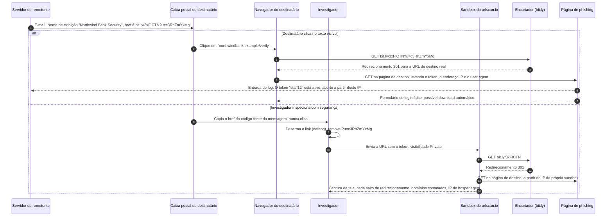
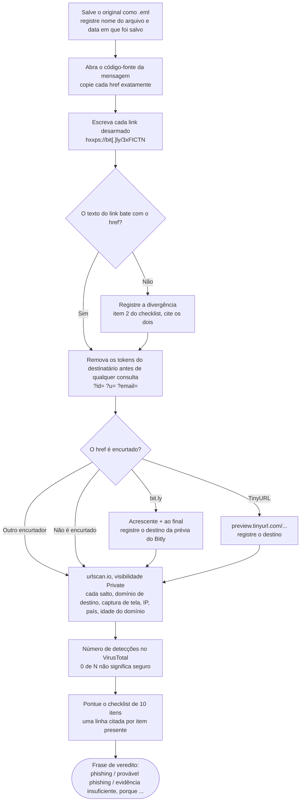

# Dia 65: Sinais de phishing e como inspecionar um link sem clicar

> 🇺🇸 Original: [*Day 65: Phishing red flags and inspecting a link without clicking it*](https://github.com/thiefdroppers/cyber-investigator-skills/blob/main/curriculum/phase-5-fraud-social-engineering/day-65.md) — © ThiefDroppers, licença MIT.
> Aqui: tradução fiel **+** camada brasileira. Nada do original foi removido; tudo o que é novo vem marcado com ➕.

**Fase 5. Fraude, golpes e engenharia social** · Meta da trilha: desmontar uma mensagem suspeita com segurança, registrar cada sinal de alerta com a evidência por trás dele e descobrir para onde o link leva sem nunca carregar a página no seu próprio navegador.

Rank Jutsu: `A` · [](https://colab.research.google.com/github/Ridd1kulusC0d3r/investigador-cyber-90-dias/blob/main/curriculo/fase-5-fraude-e-engenharia-social/dia-65/dia-65.ipynb)

---

## 🎬 ➕ Abertura do caso — *A segunda onda*

Segunda-feira, 19 de outubro, duas semanas depois do primeiro SMS. O time de fraude da Serra Azul acabou de devolver o que conseguiu pelos canais entre instituições: os Pix dos três cooperados lesados caíram em contas de pessoas físicas que o relatório chama só de **L-01**, **L-02** e **L-03**. Você quer começar por elas.

Antes que você abra a planilha, Marta Quintão encaminha um e-mail. Um cooperado recebeu hoje cedo: *"Cadastro Pix suspenso: atualize em até 2 horas"*. Outro mandou o print de um WhatsApp com o logotipo da cooperativa.

— Segunda onda — diz Rafa. — E repara no link do e-mail: tem um `?c=` no final. Se você clicar, quem você acha que fica sabendo?

Você tira a mão do mouse.

— Os laranjas esperam. Hoje você desmonta essas três mensagens sem carregar uma página sequer.

É isso que o Dia 65 ensina. *(Personagens e cenário: [Operação Isca](../../../caso-continuo/).)*

---

## 📖 Conceito

O phishing é a porta de entrada de quase tudo o que esta fase cobre. Uma falsa oferta de emprego, um contato romântico e uma fatura falsificada normalmente chegam como uma mensagem que quer que você clique, responda ou pague. No relatório anual de 2025 do IC3 do FBI, *phishing* e *spoofing* foi, com folga, o tipo de crime mais denunciado: 191.561 queixas de um total de 1.008.597. As perdas declaradas nessa categoria subiram de cerca de US$ 70 milhões em 2024 para cerca de US$ 216 milhões em 2025, enquanto o número de queixas ficou quase estável.

O investigador trata uma amostra de phishing do mesmo jeito que um perito trata um disco. Primeiro preserva o original, depois trabalha numa cópia, e nunca "só confere" o link clicando nele. Abrir uma página de phishing pode confirmar ao remetente que o seu endereço está ativo, disparar um download automático (*drive-by download*) ou registrar o seu endereço IP associado a um *token* de rastreamento na URL. Cada uma dessas coisas altera a evidência e pode colocar você em risco.

O diagrama acompanha a amostra fictícia do Northwind Bank, do exemplo resolvido abaixo, pelos dois caminhos. No ramo de cima, o destinatário clica, e o *token* por destinatário chega aos logs do remetente junto com o endereço IP do destinatário. No ramo de baixo, o investigador remove o *token* e deixa a *sandbox* do urlscan.io fazer as mesmas requisições, de modo que nada liga a visita ao destinatário.



Os sinais de alerta abaixo se repetem em quase toda campanha de phishing. Nenhum deles prova que uma mensagem é maliciosa. Três ou quatro juntos, cada um apoiado numa linha específica da mensagem, formam um caso sólido.

### Checklist de sinais de alerta

1. O nome de exibição diz uma organização, e o endereço ou domínio de envio real pertence a outra ("PayPal Support" de `notice@secure-acct-update.example`).
2. O texto do link e o destino do link são diferentes. O texto visível diz `www.yourbank.com` e o `href` por baixo aponta para outro lugar.
3. O domínio é uma imitação: caracteres trocados (`rn` no lugar de `m`), uma palavra a mais (`yourbank-verify.example`), outro domínio de topo, ou *punycode* (`xn--`) que aparece na tela como letras familiares.
4. O link passa por um encurtador de URL ou por um redirecionamento aberto (*open redirect*), de modo que o destino real fica escondido até que algo o expanda.
5. A mensagem impõe um prazo ou uma ameaça ("conta suspensa em 24 horas", "último aviso") que não deixa tempo para verificar.
6. Ela pede credenciais, um código de MFA ou dados de pagamento por um canal que a organização verdadeira diz nunca usar para isso.
7. A saudação é genérica ("Prezado cliente") quando o remetente verdadeiro saberia o seu nome, ou a mensagem usa o seu nome e nada mais que ela deveria saber.
8. Chega um anexo inesperado, principalmente um arquivo compactado, um arquivo HTML, uma imagem de disco ou um documento do Office que pede para você "habilitar conteúdo".
9. O endereço de resposta (*reply-to*) é diferente do endereço de envio (*from*).
10. A mensagem cita uma transação, entrega ou conta da qual você não tem registro.

## 📚 Recursos

- [Relatório de Crimes na Internet de 2025 do IC3/FBI (PDF)](https://www.ic3.gov/AnnualReport/Reports/2025_IC3Report.pdf): as tabelas de queixas e perdas citadas acima, por tipo de crime.
- [FTC: como reconhecer e evitar golpes de phishing](https://consumer.ftc.gov/articles/how-recognize-and-avoid-phishing-scams): sinais de alerta em linguagem simples, para comparar com o checklist.
- [CISA: como evitar ataques de engenharia social e phishing](https://www.cisa.gov/news-events/news/avoiding-social-engineering-and-phishing-attacks).
- [urlscan.io](https://urlscan.io/): carrega uma URL no próprio navegador isolado e devolve uma captura de tela, a cadeia de redirecionamentos, os domínios contatados e os recursos da página. Conta gratuita; configure as varreduras como Private ou Unlisted.
- [Varredura de URL do VirusTotal](https://www.virustotal.com/gui/home/url): confere uma URL em dezenas de mecanismos de reputação. Tudo o que você envia publicamente fica visível para outros usuários, então leia "Antes de enviar qualquer coisa", mais abaixo, primeiro.
- Prévias de encurtadores: acrescente `+` ao fim de um link do bit.ly (`bit.ly/abc123+`) para ver a página de prévia do próprio Bitly, e coloque `preview.` na frente de um link do TinyURL (`preview.tinyurl.com/abc123`).
- [Google Phishing Quiz](https://phishingquiz.withgoogle.com/): um autoteste curto para calibrar antes do laboratório.

### ➕ Recursos do contexto Brasil

- [Febraban: golpes e fraudes](https://portal.febraban.org.br/): a federação dos bancos publica alertas e campanhas sobre os golpes mais comuns no país (falsa central, Pix, WhatsApp).
- [Banco Central: Pix, segurança e MED](https://www.bcb.gov.br/estabilidadefinanceira/pix): como funciona o Mecanismo Especial de Devolução, que é por onde a cooperativa tenta recuperar os valores, e por que o "Pix bloqueado" do SMS não existe como procedimento.
- [CERT.br: Cartilha de Segurança para Internet](https://cartilha.cert.br/): fascículos sobre golpes e phishing em português, bons para comparar com o checklist.
- [Registro.br RDAP](https://rdap.registro.br/): se o domínio do golpe for `.br`, a data de criação e o titular vêm daqui (o original usa o ICANN Lookup).
- [Lei 14.155/2021](https://www.planalto.gov.br/ccivil_03/_ato2019-2022/2021/lei/l14155.htm): criou a fraude eletrônica (CP art. 171, §2º-A), o enquadramento de quase toda a Fase 5.

## 🛠️ Prática: urlscan.io, uma planilha de inspeção de links para três amostras

Você precisa de três amostras de phishing. Use mensagens da sua própria pasta de spam, os exemplos das páginas da FTC e da CISA acima, ou a amostra fictícia abaixo. Não peça aos amigos que encaminhem as deles; uma mensagem encaminhada perde os cabeçalhos originais.

### Antes de enviar qualquer coisa

Uma URL pode carregar dados sobre o alvo. *Tokens* como `?id=8f3a...` ou `?email=jane%40company.example` muitas vezes identificam o destinatário específico. Enviar essa URL a um verificador público avisa o atacante (que pode acompanhar os *feeds* públicos) de que alguém investigou, e publica o identificador do destinatário. Remova ou substitua identificadores pessoais antes de enviar, e configure as varreduras do urlscan.io como Private. Se a amostra vier de um caso real, verifique se a política da sua organização permite envio externo.

### Exemplo resolvido (fictício)

Esta mensagem foi inventada para treino. Os domínios usam o domínio de topo reservado `.example` e não resolvem.

```
From: "Northwind Bank Security" <alerts@nw-secure-login.example>
Reply-To: helpdesk.nwbank@freemail.example
Subject: Unusual sign-in blocked: verify within 24 hours

Dear Customer,
We blocked a sign-in attempt from a new device. To keep your account
open, confirm your identity at https://www.northwindbank.example/verify
before 5:00 PM today.
```

No HTML bruto (na maioria dos clientes de e-mail: "Exibir código-fonte" ou "Mostrar original"), o link aparece assim:

```
<a href="https://bit.ly/3xFICTN?u=c3RhZmYxMg">https://www.northwindbank.example/verify</a>
```

Linha da planilha para esta amostra:

| Checagem | Achado | Evidência |
|---|---|---|
| Nome de exibição vs. endereço | Divergente | Exibição "Northwind Bank Security", domínio `nw-secure-login.example` |
| Reply-To | Diferente do From | `helpdesk.nwbank@freemail.example` |
| Texto do link vs. href | Divergente | O texto mostra `northwindbank.example/verify`, o href é `bit.ly/3xFICTN` |
| Token de rastreamento | Presente | `?u=c3RhZmYxMg` é base64 de `staff12`, um ID por destinatário |
| Expansão do encurtador | (Amostra real: resultado da prévia com `+`) | Domínio final registrado aqui |
| Prazo | Presente | "within 24 hours", "before 5:00 PM today" |
| Saudação | Genérica | "Dear Customer" |

### Passos para cada uma das suas três amostras

**Seu checklist de hoje.** Faça na ordem e marque cada item ao terminar:

- [ ] Salvar o arquivo original `.eml` ou `.msg` e registrar a data em que foi salvo.
- [ ] Extrair cada link do código-fonte e desarmá-lo (*defang*) na planilha.
- [ ] Comparar o texto do link com o `href` e registrar o resultado.
- [ ] Expandir qualquer link encurtado.
- [ ] Remover os *tokens* do destinatário e enviar a URL final ao urlscan.io, como Private.
- [ ] Conferir a URL no VirusTotal e anotar o número de detecções.
- [ ] Pontuar a mensagem no checklist de dez itens, citando a evidência.
- [ ] Conferir a visibilidade de cada varredura e apagar qualquer uma que tenha ficado Public.
- [ ] ➕ Prática BR: desmontar as três amostras da segunda onda da Operação Isca.
- [ ] ➕ Rodar o notebook do dia e sair com a planilha `notas/dia65-planilha-links.md`.

1. Salve o original. No Gmail, "Mostrar original" e depois "Fazer download do original" gera um arquivo `.eml`. No Outlook, arraste a mensagem para uma pasta ou use "Salvar como". Registre o nome do arquivo e a data em que o salvou.
2. Extraia cada link do código-fonte, não da mensagem renderizada. Copie o valor do `href` exatamente. Escreva-o na planilha "desarmado", para que ninguém clique por acidente: `hxxps://bit[.]ly/3xFICTN`.
3. Compare o texto do link com o `href` e registre o resultado.
4. Se o link for encurtado, expanda-o com a prévia do provedor (`+` no Bitly, `preview.` no TinyURL). Para outros encurtadores, envie-o ao urlscan.io, que segue os redirecionamentos e lista cada salto.
5. Remova os *tokens* do destinatário e então envie a URL final ao urlscan.io com visibilidade Private. Na página de resultado, registre o domínio de destino final, a captura de tela da página (é um formulário de login falso?), o endereço IP e o país de hospedagem, e a idade do domínio, se aparecer.
6. Confira a mesma URL no VirusTotal e anote quantos mecanismos a sinalizam. Uma pontuação 0 é comum para uma página de phishing que entrou no ar nas últimas horas, então zero detecções não significa que o link é seguro.
7. Pontue a mensagem no checklist de dez itens, citando a linha exata para cada item marcado como presente.
8. Confira a visibilidade de cada varredura que você enviou. Se alguma ficou como Public, anote isso e os identificadores que ela expôs, e apague a varredura se o serviço permitir.

Os mesmos passos como fluxo, com os pontos de decisão em que as amostras se diferenciam:



### O artefato

Uma planilha (de cálculo ou tabela em markdown) com uma seção por amostra. Cada seção tem os links desarmados, a comparação entre texto do link e `href`, a cadeia completa de redirecionamentos, o domínio de destino final com o link do resultado do urlscan.io, o número de detecções no VirusTotal e a pontuação do checklist com a evidência citada por item. Termine cada seção com uma frase: "Phishing / provável phishing / evidência insuficiente, porque ...".

### ➕ Prática BR: a segunda onda da Operação Isca

As três amostras estão em [`caso-continuo/dados/dia-65/`](../../../caso-continuo/dados/dia-65/). Todas são fictícias e nenhum link resolve.

| Amostra | Canal | O que ela tem de especial |
|---|---|---|
| `amostra-1-sms.txt` | SMS (5/out) | A primeira onda, fato fixo do caso: remetente `+55 00 00000-0003`, link nu e variante encurtada `lnk.example/sa7`. |
| `amostra-2-email.eml` | E-mail (19/out) | Nome de exibição "Serra Azul Seguranca", Reply-To num webmail, link com texto `serraazul.example` e `href` para `lnk.example/sa9?c=...`, anexo `.html` citado. |
| `amostra-3-whatsapp.txt` | WhatsApp (19/out) | Perfil "Serra Azul Atendimento" com logotipo, pedido do código que chegou por SMS, prazo de 30 minutos. |

Para cada uma:

1. Registre o arquivo com `python scripts/registrar_evidencia.py caso-continuo/dados/dia-65/amostra-2-email.eml "segunda onda, e-mail"` (o mesmo para as outras duas). A cópia de trabalho é outra; o original não se abre num editor que salve por cima.
2. No `.eml`, ache o `?c=`. Decodifique o base64 (o notebook faz isso) e responda: o que ele identifica? (Resposta: o cooperado, por um código. É exatamente o caso do `staff12` do original.)
3. Não existe urlscan.io para `.example`. Use o arquivo `cadeia-redirecionamento.csv`, que simula o resultado de uma varredura privada, e diga **qual salto escondeu o destino real**.
4. Repare no IP do último salto (`203.0.113.77`). Ele já apareceu no caso: é o mesmo servidor do `serraazul-pix.example` do Dia 1. Registre isso como uma aresta para o Dia 68 ("mesmo IP de hospedagem"), com a ressalva de força que o Dia 68 vai ensinar.
5. Pontue as três amostras no checklist de dez itens. Dois itens pedem adaptação ao canal: no SMS e no WhatsApp não há "Reply-To" (item 9) nem `href` separado do texto (item 2); marque "não se aplica", não "ausente".
6. Escreva a frase de veredito de cada uma.

> **O que não fazer, mesmo podendo:** colar o link da amostra 2 com o `?c=` num verificador público "só para ver". Isso publica o código do cooperado e avisa o "Pescador" de que a segunda onda foi detectada.

### ➕ O notebook do dia

Abra o [notebook do Dia 65 no Colab](https://colab.research.google.com/github/Ridd1kulusC0d3r/investigador-cyber-90-dias/blob/main/curriculo/fase-5-fraude-e-engenharia-social/dia-65/dia-65.ipynb). Nele você:

1. extrai os links do HTML com `html.parser` e compara texto com `href` automaticamente;
2. desarma links, decodifica o *token* base64 e remove-o com `urllib.parse`, sem fazer nenhuma requisição;
3. vê como o *punycode* (`xn--`) engana o olho, com o codec `idna` do Python;
4. joga o **quiz dos dez sinais** sobre a amostra 2 e sai com a planilha `notas/dia65-planilha-links.md` pronta.

## ✅ Checkpoint

- Nenhum link da planilha está escrito de forma clicável. Entregue a planilha a outra pessoa e peça que ela encontre um; não deve haver nenhum.
- Todo item do checklist marcado como presente tem uma linha citada ao lado.
- Em pelo menos uma amostra, a cadeia de redirecionamentos mostra mais de um salto.
- Para essa amostra, você sabe dizer qual salto escondeu o destino real.
- Qualquer varredura que tenha ficado Public está anotada na planilha, com os identificadores que expôs.
- Qualquer varredura Public foi apagada, se o serviço permitir.
- Sem consultar notas, você consegue explicar por que zero detecções no VirusTotal não significam que um link é seguro?

### ➕ Checkpoint BR

- Você explica, sem notas, o que o `?c=` da amostra 2 identifica e por que ele nunca vai para um verificador público.
- Você aponta o salto 2 de `cadeia-redirecionamento.csv` como o que escondeu o destino e diz por que um encurtador seguido de um redirecionador dificulta a derrubada.
- Você distingue "ausente" de "não se aplica" na pontuação de SMS e WhatsApp.
- Você explica por que o "Pix bloqueado" é, por si só, um sinal: o procedimento descrito não existe no Pix.
- Você acertou pelo menos 8 dos 10 itens do quiz do notebook.

## ⚖️ ➕ Camada jurídica BR

**Fraude eletrônica (CP art. 171, §2º-A).** A Lei 14.155/2021 criou uma forma qualificada do estelionato para a fraude cometida com informações fornecidas pela vítima ou por terceiro induzido a erro por redes sociais, contatos telefônicos, envio de correio eletrônico fraudulento ou meio fraudulento análogo, com pena de reclusão de 4 a 8 anos e multa. É o tipo penal do SMS, do e-mail e do WhatsApp da segunda onda. O §2º-B aumenta a pena quando o crime é praticado com servidor mantido fora do território nacional, o que torna a geografia da hospedagem (o "país" do urlscan.io) um dado juridicamente relevante.

**Por que não clicar também é cuidado jurídico.** O *token* `?c=` é dado pessoal (identifica um cooperado). Enviá-lo a um serviço público é um tratamento de dado pessoal sem necessidade, fora da finalidade do caso (LGPD, art. 6º, princípios da finalidade e da necessidade). A remoção do *token* antes de qualquer consulta é a forma prática de cumprir a lei e a técnica ao mesmo tempo.

**Preservação.** O `.eml` salvo e registrado com hash é o primeiro elo da cadeia de custódia (CPP, arts. 158-A a 158-F). Uma mensagem encaminhada, além de perder os cabeçalhos, começa uma cadeia nova, sem o elo da origem.

> Este repositório é material de estudo e não constitui orientação jurídica.

## 🧠 ➕ Camada 8 — o relógio é a arma

Todas as três amostras da segunda onda têm um prazo: "até 2 horas", "até as 10h de hoje", "30 minutos". Robert Cialdini descreve a **escassez** como um dos princípios de influência: o que parece prestes a ser perdido ganha valor e urgência. O golpista soma escassez de tempo com **autoridade** (o logotipo, o "central de segurança"), e o resultado previsível é o que Daniel Kahneman chamou de pensamento rápido (Sistema 1): decidir pelo atalho, sem a checagem lenta que pegaria o domínio errado.

O investigador não está imune. O "só vou ver para onde vai" é o mesmo atalho, agora do seu lado: curiosidade sob pressão de tempo. A consequência prática é a mesma do Dia 1, escrita para hoje: o procedimento (salvar, desarmar, remover *token*, *sandbox*) existe para ser seguido justamente quando você está com pressa. E, quando for orientar os cooperados, ensine a regra que derrota a escassez: **nenhuma instituição séria resolve segurança com prazo de minutos por link**; desligue e ligue para o número do cartão.

## 🤖 ➕ Skill do dia

O dia propõe acrescentar à skill a **inspeção segura de link** (preservar, desarmar, remover *token*, nunca clicar) como passos do procedimento de triagem de fraude. Ver [`_skill-delta.md`](_skill-delta.md) e a [skill atual](../../../skills/investigador-cyber/SKILL.md).

## 💡 ➕ Inovação OSINT do dia — extrair, desarmar e limpar links só com a biblioteca padrão

Antes de qualquer serviço externo, o Python já resolve a parte mais delicada: ler os links do HTML sem renderizá-lo e tirar deles o que identifica a vítima.

```python
from html.parser import HTMLParser                  # lê HTML sem executar nada
from urllib.parse import urlsplit, urlunsplit       # separa e remonta a URL

class Links(HTMLParser):
    def __init__(self):
        super().__init__(); self.achados = []; self._href = None
    def handle_starttag(self, tag, attrs):
        if tag == "a": self._href = dict(attrs).get("href")       # guarda o destino real
    def handle_data(self, texto):
        if self._href: self.achados.append((texto.strip(), self._href)); self._href = None

p = Links(); p.feed(open("amostra-2-email.eml", encoding="utf-8").read())
for texto, href in p.achados:
    u = urlsplit(href)
    limpo = urlunsplit((u.scheme, u.netloc, u.path, "", ""))        # sem ?c= nem #
    print(texto, "→", limpo.replace("http", "hxxp").replace(".", "[.]"))
```

E um detalhe que vale guardar: `"xn--pple-43d.example".encode().decode("idna")` mostra a forma Unicode de um domínio em *punycode*, que é como o domínio aparece para a vítima. O notebook usa os dois.

## 📝 Diário de estudo

- Data:
- Tempo gasto:
- O que ficou claro:
- O que ainda está nebuloso:
- Artefato produzido: `notas/dia65-planilha-links.md`

---
<sub>Baseado em [cyber-investigator-skills](https://github.com/thiefdroppers/cyber-investigator-skills) por ThiefDroppers (MIT). Tradução, camada BR, Camada 8, skill pt-BR e notebook por Deivison Lourenço (@Ridd1kulusC0d3r).</sub>
