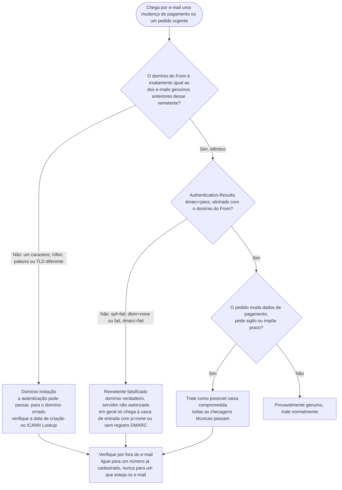
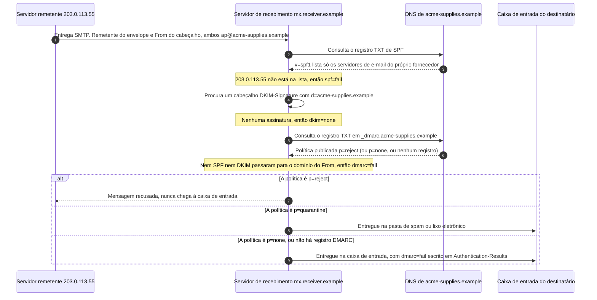

# Dia 66: Comprometimento de e-mail corporativo (BEC) e detecção de domínios falsificados

> 🇺🇸 Original: [*Day 66: Business email compromise and how spoofed domains are detected*](https://github.com/thiefdroppers/cyber-investigator-skills/blob/main/curriculum/phase-5-fraud-social-engineering/day-66.md) — © ThiefDroppers, licença MIT.
> Aqui: tradução fiel **+** camada brasileira. Nada do original foi removido; tudo o que é novo vem marcado com ➕.

**Fase 5. Fraude, golpes e engenharia social** · Meta da trilha: ler um cabeçalho de e-mail bem o bastante para distinguir um remetente falsificado, um domínio imitação e uma caixa postal realmente comprometida, e escrever qual dos três você está vendo e por quê.

Rank Jutsu: `A` · [](https://colab.research.google.com/github/Ridd1kulusC0d3r/investigador-cyber-90-dias/blob/main/curriculo/fase-5-fraude-e-engenharia-social/dia-66/dia-66.ipynb)

---

## 🎬 ➕ Abertura do caso — *O boleto da Gráfica Jatobá*

Terça, 20 de outubro, 10h40. O telefone da Marta toca no viva-voz da sala da Vigia.

— O contas a pagar quase pagou um boleto "reemitido" da Gráfica Jatobá hoje cedo. Depois chegou outro e-mail da mesma gráfica pedindo para mandar os próximos pagamentos para uma chave Pix nova. E o Dr. Hélio quer saber se a gráfica foi invadida, porque, se foi, os dados da cooperativa que estão com eles também estão em risco.

Rafa olha para você.

— São três perguntas diferentes que parecem uma só. Alguém se passou pelo domínio da gráfica, alguém registrou um domínio parecido, ou alguém entrou na caixa de verdade da gráfica? Cada resposta muda para quem a Marta liga.

Ele vira o monitor: no segundo e-mail, a chave nova é **PIXFICT-L04**. Um quarto laranja.

— O cabeçalho responde. Começa pelo domínio, não pelo SPF.

É isso que o Dia 66 ensina. *(Personagens e cenário: [Operação Isca](../../../caso-continuo/).)*

---

## 📖 Conceito

O comprometimento de e-mail corporativo (*business email compromise*, BEC) é uma fraude de pagamento. O atacante faz uma empresa mandar dinheiro para a conta errada se passando por alguém a quem a empresa já paga ou obedece: um fornecedor com uma "nova conta bancária", um CEO que precisa de uma transferência feita em silêncio, um advogado ou uma empresa de escritura fechando a venda de um imóvel. O relatório de 2025 do IC3 registra 24.768 queixas de BEC e US$ 3,05 bilhões em perdas declaradas, atrás apenas da fraude de investimento em valor.

O BEC muitas vezes não envolve *malware* nem link. A arma é um único e-mail convincente, então o trabalho do investigador se resume a uma pergunta: esta mensagem veio mesmo da conta de onde diz ter vindo? Há três respostas diferentes, e cada uma leva a uma resposta diferente.

1. Remetente falsificado (*spoofed sender*). O endereço From mostra o domínio verdadeiro (`ap@acme-supplies.example`), mas a mensagem foi enviada de um servidor que esse domínio nunca autorizou. A autenticação de e-mail (SPF, DKIM, DMARC) existe para pegar isso, e ela aparece nos cabeçalhos.
2. Domínio imitação. O atacante registrou um domínio parecido (`acme-suppIies.example` com um I maiúsculo, ou `acme-supplies-billing.example`). A mensagem passa em SPF, DKIM e DMARC, porque o atacante controla esse domínio e configurou a autenticação dele. As checagens de cabeçalho passam; só uma comparação cuidadosa do domínio pega o golpe.
3. Caixa postal comprometida. O atacante entrou na conta verdadeira do fornecedor verdadeiro. Toda checagem técnica passa, o domínio está correto, e a mensagem pode até estar dentro de uma conversa de e-mail que já existia. Só o próprio pedido (novos dados bancários, sigilo, urgência) e uma ligação por fora do e-mail, para um número já conhecido, pegam o golpe.

A ordem das checagens importa. Compare o domínio primeiro, porque um domínio imitação passa na autenticação. Só quando o domínio é idêntico é que SPF, DKIM e DMARC dizem alguma coisa sobre quem enviou.



### Como a autenticação aparece num cabeçalho

Os servidores de recebimento registram seus vereditos no cabeçalho `Authentication-Results`. Uma mensagem falsificada costuma ficar assim (fictício):

```
Authentication-Results: mx.receiver.example;
  spf=fail (sender IP 203.0.113.55 not permitted by domain of acme-supplies.example)
  dkim=none;
  dmarc=fail (p=REJECT) header.from=acme-supplies.example
```

O SPF verifica se o endereço IP do servidor que enviou está na lista que o domínio publicou no DNS. O DKIM verifica uma assinatura criptográfica que o domínio remetente acrescenta à mensagem. O DMARC verifica se pelo menos um dos dois passou e se o domínio que passou é igual ("alinhado") ao domínio da linha From visível, e então aplica a política publicada pelo dono do domínio: `none`, `quarantine` ou `reject`. Um domínio com `p=none`, ou sem registro DMARC nenhum, pode ser falsificado e a mensagem ainda assim pode cair na caixa de entrada, marcada apenas por um resultado de falha num cabeçalho que ninguém lê.

Veja de onde vem cada um desses vereditos quando a mensagem falsificada acima chega. O servidor de recebimento faz todas as consultas sozinho; o remetente nunca vê os resultados.



Num domínio imitação, a mesma troca acontece contra o DNS do próprio atacante, que lista o servidor do próprio atacante, então todo passo devolve *pass*.

### Checklist de sinais de alerta

1. Uma mudança nos dados de pagamento (novo banco, nova conta, "nosso banco está em auditoria") chegando por e-mail.
2. Urgência amarrada a um prazo ("a transferência tem de sair antes das 15h ou perdemos o negócio").
3. Um pedido para pular a etapa de aprovação de sempre "só desta vez".
4. Um pedido de sigilo ("não comente com ninguém até a aquisição ser anunciada").
5. O remetente está viajando, em reunião ou, por algum motivo, inacessível por telefone.
6. O endereço Reply-To é diferente do From, ou as respostas vão para uma conta de e-mail gratuito.
7. `Authentication-Results` mostra `spf=fail`, `dkim=fail` ou `dmarc=fail`.
8. O domínio difere do usado na correspondência genuína anterior por um caractere, um hífen, uma palavra ou um domínio de topo.
9. O domínio foi registrado há dias ou semanas (verifique no WHOIS ou RDAP).
10. A mensagem entra numa conversa existente, mas o histórico citado abaixo dela tem pequenas diferenças em relação às mensagens originais.

## 📚 Recursos

- [Relatório de Crimes na Internet de 2025 do IC3/FBI (PDF)](https://www.ic3.gov/AnnualReport/Reports/2025_IC3Report.pdf): números de BEC e os resultados da *Financial Fraud Kill Chain* da *Recovery Asset Team*. Em 2025, a equipe congelou cerca de US$ 679 milhões de aproximadamente US$ 1,16 bilhão em tentativas de roubo, em 3.900 incidentes. O conselho do relatório: contate o banco imediatamente para pedir o estorno (*recall*) e depois registre a queixa em ic3.gov com os detalhes completos da transação.
- [Google Admin Toolbox Messageheader](https://toolbox.googleapps.com/apps/messageheader/): cole um cabeçalho bruto e receba o caminho salto a salto, os atrasos e os resultados de SPF/DKIM/DMARC numa tabela.
- [MXToolbox Email Header Analyzer](https://mxtoolbox.com/EmailHeaders.aspx) e [MXToolbox DMARC lookup](https://mxtoolbox.com/DMARC.aspx): um segundo analisador, e um jeito rápido de ler a política DMARC publicada por um domínio.
- [dnstwist](https://github.com/elceef/dnstwist): ferramenta de código aberto que gera permutações de imitação de um domínio (erros de digitação, homóglifos, palavras acrescentadas, outros TLDs) e verifica quais estão registradas. `pip install dnstwist`.
- [ICANN Lookup](https://lookup.icann.org/): dados de registro (RDAP), incluindo a data de criação.
- [Visão geral de DMARC da dmarcian](https://dmarcian.com/what-is-dmarc/): como política e alinhamento funcionam, com exemplos.

### ➕ Recursos do contexto Brasil

- [Antispam.br (CERT.br)](https://antispam.br/): material do CERT.br, em português, sobre SPF, DKIM e DMARC para administradores.
- [Registro.br RDAP](https://rdap.registro.br/) e [consulta WHOIS do Registro.br](https://registro.br/tecnologia/ferramentas/whois/): data de criação e titular de domínios `.br`, o equivalente do ICANN Lookup para o país. Em `.com.br`, o titular é CPF ou CNPJ, o que torna a imitação de fornecedor um pouco mais cara para o golpista.
- [Banco Central: Pix e MED](https://www.bcb.gov.br/estabilidadefinanceira/pix): quando o "novo dado bancário" é uma chave Pix, a contestação corre pelo Mecanismo Especial de Devolução, acionado pela instituição de quem pagou. É o equivalente brasileiro do *recall* do original, e o tempo conta do mesmo jeito.
- [Febraban: golpe do boleto](https://portal.febraban.org.br/): orientação pública sobre boleto adulterado, a variante brasileira mais comum do "fornecedor com conta nova".

## 🛠️ Prática: Google Admin Toolbox e dnstwist, um cabeçalho anotado e uma tabela de domínios imitação

**Seu checklist de hoje.** Faça na ordem e marque cada item ao terminar:

- [ ] Parte 1: leia os seus próprios cabeçalhos
- [ ] Parte 2: domínios imitação de um fornecedor fictício
- [ ] Parte 3: classifique três casos fictícios
- [ ] ➕ Parte 4: os três e-mails da Gráfica Jatobá (Operação Isca)
- [ ] ➕ Parte 5: o notebook do dia

### Parte 1: leia os seus próprios cabeçalhos

Use duas mensagens da sua própria caixa: uma mensagem genuína de uma empresa grande e uma da sua pasta de spam. No Gmail, abra "Mostrar original"; no Outlook, abra "Exibir detalhes da mensagem" ou "Propriedades".

Para cada mensagem:

1. Cole o cabeçalho completo no Google Admin Toolbox Messageheader.
2. Registre os resultados de SPF, DKIM e DMARC, o domínio que cada um verificou e se o domínio `d=` do DKIM bate com o domínio do From.
3. Leia as linhas `Received:` de baixo para cima. A mais baixa é a mais próxima do remetente. Registre o nome e o endereço IP do primeiro servidor externo.
4. Compare From, Reply-To e Return-Path. Anote os que forem diferentes.
5. Consulte a política DMARC do domínio do From no MXToolbox e registre-a (`p=none`, `quarantine` ou `reject`).

### Parte 2: domínios imitação de um fornecedor fictício

Rode o dnstwist contra o domínio de uma marca grande e conhecida (um banco ou um varejista; qualquer domínio público serve, porque você só está lendo dados de registro):

```
dnstwist --registered --format csv <brand-domain> > lookalikes.csv
```

Da saída, escolha cinco domínios imitação registrados. Para cada um, registre o tipo de permutação que o dnstwist informa (*addition*, *homoglyph*, *hyphenation*, *tld-swap* e assim por diante), se ele tem registros MX (se pode receber e-mail) e a data de criação no ICANN Lookup. Não visite os domínios no seu navegador. Se precisar ver o que um deles hospeda, use uma varredura privada no urlscan.io, como no Dia 65.

### Parte 3: classifique três casos fictícios

Para cada caso, diga se é um remetente falsificado, um domínio imitação ou uma caixa comprometida, e qual evidência decidiu.

- Caso A: From `ceo@harborline.example`. `spf=fail`, `dkim=none`, `dmarc=fail (p=none)`. Entregue na caixa de entrada. Pede ao *controller* que compre cartões-presente "antes da minha reunião do conselho às 14h".
- Caso B: From `billing@harborIine.example` (I maiúsculo). `spf=pass`, `dkim=pass (d=harborIine.example)`, `dmarc=pass`. Domínio criado 9 dias antes do e-mail. Pede para atualizar a conta de recebimento.
- Caso C: From `billing@harborline.example`. Todas as checagens passam, `d=harborline.example`. Chega dentro de uma conversa real de cobrança de três semanas. Pede para atualizar a conta de recebimento. Depois, o fornecedor confirma que alguém entrou na caixa postal dele a partir de um país desconhecido.

(Respostas: A é falsificado e mostra por que `p=none` importa. B é um domínio imitação, em que a autenticação passa para o domínio errado. C é uma caixa comprometida, e o único controle confiável teria sido ligar para o fornecedor num número já cadastrado.)

### O artefato

Um único documento com três partes: dois cabeçalhos anotados (cada um com a tabela de autenticação, o salto `Received:` externo mais baixo, a comparação From/Reply-To/Return-Path e a política DMARC do domínio); a tabela de cinco linhas de domínios imitação do dnstwist, com tipo de permutação, presença de MX e data de criação; e as classificações dos três casos com a evidência decisiva citada.

### ➕ Parte 4: os três e-mails da Gráfica Jatobá

Em [`caso-continuo/dados/dia-66/`](../../../caso-continuo/dados/dia-66/) estão os três e-mails que o contas a pagar da Serra Azul recebeu em nome da **Gráfica Jatobá Ltda** (fornecedora fictícia de talões). O domínio verdadeiro da gráfica, em dois anos de correspondência, é `graficajatoba.example`.

| Arquivo | Pista de partida |
|---|---|
| `caso-BR-A.eml` | "Boleto atualizado, pagar hoje antes das 14h. Estou em viagem, sem telefone." |
| `caso-BR-B.eml` | "Por auditoria em nosso banco, os próximos pagamentos devem ir para a chave PIXFICT-L04." |
| `caso-BR-C.eml` | "Seguindo nossa conversa: mudamos de banco", dentro de uma conversa de três semanas. |

Para cada um: (1) compare o domínio do From com `graficajatoba.example`, letra por letra; (2) só se for idêntico, leia o `Authentication-Results`; (3) leia o primeiro `Received:` externo; (4) liste os sinais do checklist com a linha citada; (5) classifique; (6) escreva para quem a Marta liga (a resposta muda por classificação).

Gabarito de conferência: A é **remetente falsificado** (domínio idêntico, `spf=fail`, `dmarc=fail (p=none)`: a gráfica nunca publicou política que barre falsificação). B é **domínio imitação** (`graficajatoba-cobranca.example`, criado 6 dias antes, tudo passa para o domínio errado). C é **caixa comprometida** (tudo passa para o domínio certo; só o pedido e a ligação para o número já cadastrado revelam). Para a Fase 5, B é o que importa: a chave **PIXFICT-L04** vira um nó do grafo do Dia 68.

### ➕ Parte 5: o notebook do dia

Abra o [notebook do Dia 66 no Colab](https://colab.research.google.com/github/Ridd1kulusC0d3r/investigador-cyber-90-dias/blob/main/curriculo/fase-5-fraude-e-engenharia-social/dia-66/dia-66.ipynb). Nele você:

1. lê `Authentication-Results` e `Received:` com o módulo `email` e expressões regulares;
2. transforma o fluxograma do dia numa função `classificar_bec()` comentada linha a linha;
3. gera permutações de imitação no estilo do dnstwist só com stdlib, para a gráfica e para a cooperativa;
4. joga o **quiz das seis classificações** (os três casos do original e os três da Gráfica Jatobá).

## ✅ Checkpoint

- Nos seus cabeçalhos anotados, todo resultado de autenticação nomeia o domínio que avaliou, e não só "pass".
- Para cada cabeçalho anotado, você aponta a linha `Received:` que é o primeiro salto externo. Se não conseguir, refaça o passo 3 da Parte 1 até conseguir.
- Para cada cabeçalho anotado, você explica quais linhas `Received:` acima desse salto pertencem ao seu próprio provedor de e-mail.
- Sem consultar notas, você consegue explicar por que o caso B passou no DMARC e por que isso não o torna legítimo?

### ➕ Checkpoint BR

- Você classificou os três e-mails da Gráfica Jatobá com a evidência decisiva citada.
- Você explica por que, no caso BR-A, a falha está na política da gráfica (`p=none`) e não no servidor da cooperativa.
- Você diz para quem a Marta liga em cada caso: banco/MED e polícia em todos os que houve pagamento; a própria gráfica, por número já cadastrado, em BR-C, porque o incidente é dela.
- Você acertou pelo menos 5 das 6 classificações do quiz do notebook.

## ⚖️ ➕ Camada jurídica BR

**Estelionato e fraude eletrônica (CP art. 171 e §2º-A).** O "fornecedor com conta nova" é estelionato clássico: vantagem ilícita mediante erro induzido. Quando o meio é correio eletrônico fraudulento, entra a forma qualificada do §2º-A, criada pela Lei 14.155/2021.

**Caixa comprometida (CP art. 154-A).** No caso BR-C há, além da fraude, o acesso indevido à conta de e-mail da gráfica. O enquadramento desse acesso como invasão de dispositivo informático é tarefa da autoridade, mas é por isso que a cooperativa não "investiga a caixa da gráfica": quem tem os logs de acesso é a gráfica e o provedor dela, e esses registros saem por ordem judicial (Marco Civil, arts. 15 e 22).

**LGPD, art. 48.** Se a caixa da gráfica guardava dados pessoais (de cooperados, por exemplo), o incidente é da gráfica como controladora ou operadora daqueles dados, e a comunicação à ANPD e aos titulares, quando houver risco ou dano relevante, segue o art. 48. É a pergunta do Dr. Hélio na abertura: o caso BR-C abre um incidente de terceiro que a cooperativa precisa acompanhar contratualmente.

**Chave Pix do laranja.** Quem recebe o dinheiro em PIXFICT-L04 não é necessariamente quem enganou. O recebimento e o repasse podem ser investigados como lavagem de dinheiro (Lei 9.613/1998), e a conta pode pertencer a alguém também enganado (Dia 67). O analista registra a chave como indicador; não conclui papel de ninguém.

> Este repositório é material de estudo e não constitui orientação jurídica.

## 🧠 ➕ Camada 8 — a verdade como padrão

Timothy Levine propôs a **teoria do padrão de verdade** (*truth-default theory*): na comunicação do dia a dia, as pessoas presumem que o outro está dizendo a verdade e só saem dessa presunção quando algo dispara a suspeita. Isso não é ingenuidade; é o que permite trabalhar. O BEC de caixa comprometida explora exatamente esse padrão: a mensagem chega na conversa certa, do endereço certo, com o histórico certo. Não há nada para disparar a suspeita, exceto o pedido.

Por isso a regra do original não é "desconfie de tudo" (impossível num contas a pagar com centenas de e-mails por semana), mas uma **regra de gatilho**: mudança de dado de pagamento por e-mail sempre dispara a ligação para o número já cadastrado, não importa quão perfeita a mensagem pareça. Para o investigador, a consequência é dupla: no relatório, recomende o gatilho (processo), não "mais atenção" (traço pessoal); e, ao entrevistar o funcionário que quase pagou, lembre que ele fez o que todo mundo faz. Culpa individual não previne o próximo caso.

## 🤖 ➕ Skill do dia

O dia propõe acrescentar à triagem de fraude a **classificação de BEC em três respostas** (falsificado, imitação, caixa comprometida), na ordem "domínio primeiro". Ver [`_skill-delta.md`](_skill-delta.md) e a [skill atual](../../../skills/investigador-cyber/SKILL.md).

## 💡 ➕ Inovação OSINT do dia — permutações de domínio sem instalar nada

O dnstwist é a ferramenta certa para o trabalho real. Mas a ideia dele cabe em poucas linhas de Python puro, e vale entender antes de usar:

```python
def permutacoes(dominio: str) -> set:
    nome, tld = dominio.rsplit(".", 1)
    saida = set()
    for i in range(len(nome)):
        saida.add(nome[:i] + nome[i+1:])              # omissão: graficajatba
        saida.add(nome[:i] + nome[i] * 2 + nome[i+1:])  # repetição: graficajatobba
        saida.add(nome[:i] + "-" + nome[i:])          # hifenização: grafica-jatoba
    trocas = {"o": "0", "l": "1", "i": "l", "m": "rn"}
    for a, b in trocas.items():
        saida.add(nome.replace(a, b))                 # homóglifo simples: graficajat0ba
    for extra in ("cobranca", "financeiro", "boleto"):
        saida.add(f"{nome}-{extra}")                  # palavra acrescentada
    return {f"{n}.{tld}" for n in saida if n and n != nome}

print(len(permutacoes("graficajatoba.example")), "candidatas")
```

Com uma lista de domínios recém-registrados (os *feeds* de novos registros e os logs de *Certificate Transparency* do Dia 8 servem para isso), a interseção com esse conjunto vira um alerta precoce de BEC contra os seus fornecedores, antes do primeiro e-mail.

## 📝 Diário de estudo

- Data:
- Tempo gasto:
- O que ficou claro:
- O que ainda está nebuloso:
- Artefato produzido: `notas/dia66-cabecalhos-e-imitacoes.md`

---
<sub>Baseado em [cyber-investigator-skills](https://github.com/thiefdroppers/cyber-investigator-skills) por ThiefDroppers (MIT). Tradução, camada BR, Camada 8, skill pt-BR e notebook por Deivison Lourenço (@Ridd1kulusC0d3r).</sub>
