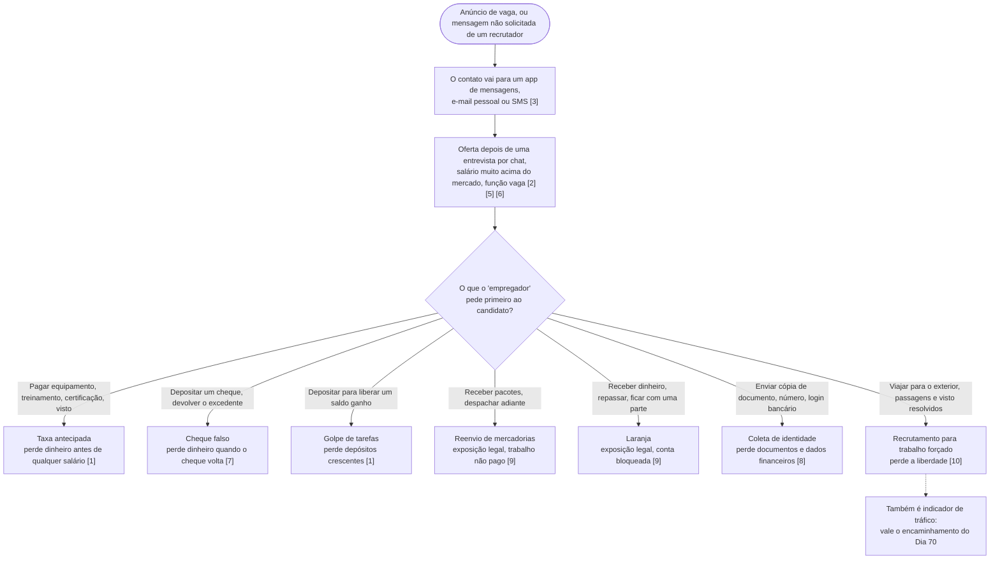
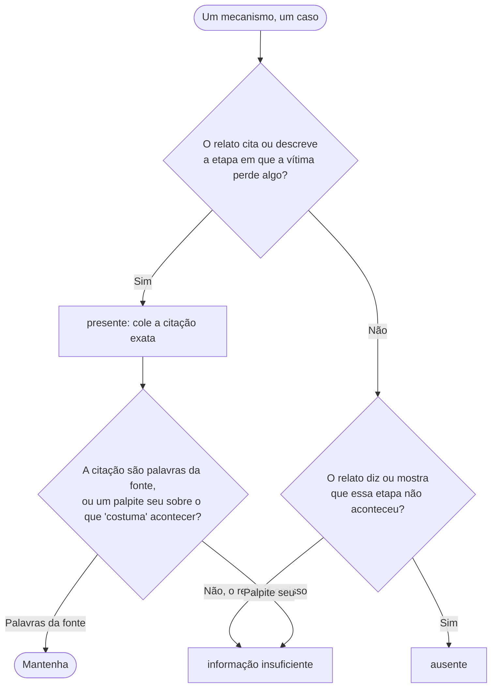

# Dia 67: Fraude de recrutamento: os mecanismos e um checklist pontuado por evidência

> 🇺🇸 Original: [*Day 67: Recruitment fraud, the mechanisms and an evidence-scored checklist*](https://github.com/thiefdroppers/cyber-investigator-skills/blob/main/curriculum/phase-5-fraud-social-engineering/day-67.md) — © ThiefDroppers, licença MIT.
> Aqui: tradução fiel **+** camada brasileira. Nada do original foi removido; tudo o que é novo vem marcado com ➕.

**Fase 5. Fraude, golpes e engenharia social** · Meta da trilha: pontuar uma oferta de emprego contra os mecanismos conhecidos de fraude de recrutamento, com uma evidência citada por mecanismo, e produzir registros limpos o bastante para alimentar o grafo de relações de amanhã.

Rank Jutsu: `A` · [](https://colab.research.google.com/github/Ridd1kulusC0d3r/investigador-cyber-90-dias/blob/main/curriculo/fase-5-fraude-e-engenharia-social/dia-67/dia-67.ipynb)

---

## 🎬 ➕ Abertura do caso — *A conta L-03*

Quarta, 21 de outubro. O time de fraude de outra instituição devolve, pelo canal entre instituições, uma informação sobre a conta **L-03**: a dona dela registrou um relato. Ela não sabia que estava recebendo dinheiro de golpe. Achava que tinha um emprego.

Junto vêm mais três relatos anonimizados de "vagas" que circulam na mesma região, todos com códigos (E1 a E4) no lugar de nomes.

— Então L-03 é vítima? — você pergunta.

— Talvez as duas coisas — responde Rafa. — E não somos nós que decidimos isso. O que a gente decide é o que cada relato **diz**. Mecanismo presente só com citação. Relato calado é "informação insuficiente", não "provavelmente pediram documento depois".

Ele empurra a planilha vazia para você. As colunas de indicadores, no fim, são as que importam amanhã.

É isso que o Dia 67 ensina. *(Personagens e cenário: [Operação Isca](../../../caso-continuo/).)*

---

## 📖 Conceito

A fraude de recrutamento usa um emprego falso para tirar dinheiro, documentos de identidade ou trabalho de quem se candidata. O IC3 registrou 24.688 queixas de fraude de emprego em 2025, com US$ 362,9 milhões em perdas declaradas, contra US$ 264,2 milhões em 2024. A FTC informou que as perdas com golpes de emprego mais que triplicaram entre 2020 e 2023 e passaram de US$ 220 milhões só no primeiro semestre de 2024, com os "golpes de tarefas" (*task scams*) passando de nenhum caso encontrado numa amostra de denúncias de 2020, para cerca de 5.000 denúncias em todo o ano de 2023, e para cerca de 20.000 no primeiro semestre de 2024.

Os golpes variam na superfície (uma vaga remota de digitação, um "bico" de avaliar produtos, uma vaga de "controle de qualidade" num depósito), mas reaproveitam um conjunto pequeno de mecanismos. Cada mecanismo tem um ponto em que o candidato perde alguma coisa. Saber onde fica esse ponto permite escrever exatamente qual evidência mostra que o mecanismo está presente.

| Mecanismo | O que a vítima perde, e quando | Evidência que o confirma |
|---|---|---|
| Taxa antecipada | Dinheiro, antes de qualquer trabalho pago: "equipamento", "treinamento", "certificação", "processamento de visto" | Um pedido de pagamento, com valor e forma, antes do primeiro salário |
| Cheque falso | Dinheiro, dias depois, quando o cheque depositado volta | Um cheque ou transferência maior que o esperado, com instrução para devolver ou repassar a diferença |
| Golpe de tarefas | Dinheiro, em "depósitos" crescentes para liberar comissões ganhas | Um app ou site mostrando um saldo que a vítima só pode sacar depois de depositar, muitas vezes em criptomoeda |
| Reenvio de mercadorias (*reshipping*) | Exposição legal, e trabalho não pago | Instruções para receber pacotes em casa e despachá-los para outro endereço, muitas vezes no exterior, com etiquetas pré-pagas |
| Laranja (*money mule*) / "processador de pagamentos" | Exposição legal, e uma conta bancária bloqueada | Instruções para receber valores numa conta pessoal e repassá-los, ficando com uma porcentagem |
| Coleta de identidade | Documentos de identidade e dados financeiros | Pedidos de número de documento, cópia de documento ou login bancário antes de qualquer entrevista real ou oferta assinada |
| Recrutamento para trabalho forçado | Liberdade | Um emprego no exterior com passagens e visto "resolvidos", função vaga e um destino conhecido por centros de golpe (veja abaixo) |

As primeiras etapas são muito parecidas, seja qual for o mecanismo que vem depois. A separação acontece na primeira coisa que o "empregador" pede ao candidato, e é nesse pedido que a perda acontece. Os números entre colchetes são itens do checklist de sinais de alerta abaixo.



Em agosto de 2023, o Escritório de Direitos Humanos da ONU (OHCHR) informou que pelo menos 120 mil pessoas em Mianmar e cerca de 100 mil no Camboja podem estar retidas em centros de golpe e forçadas a operar fraudes on-line, muitas recrutadas por anúncios falsos de emprego para atendimento ao cliente, TI ou marketing. Um alerta da FinCEN de setembro de 2026 (FIN-2026-Alert005) descreve o mesmo ecossistema de centros de golpe pelo lado da lavagem de dinheiro. A pessoa que manda uma mensagem de golpe romântico ou de investimento pode ser uma vítima de tráfico que respondeu a um anúncio de recrutamento, o que amarra os Dias 67, 69 e 70.

### Checklist de sinais de alerta

1. Qualquer pagamento do candidato antes do primeiro salário.
2. Uma oferta feita sem entrevista ao vivo, ou depois de uma "entrevista" só por chat.
3. O contato sai do site de vagas para um app de mensagens, e-mail pessoal ou SMS já na primeira troca.
4. O domínio do e-mail do recrutador não bate com o domínio real da empresa, ou é um endereço de e-mail gratuito.
5. Salário muito acima do mercado para as habilidades e horas informadas.
6. Uma descrição vaga da função, que nunca nomeia um gestor, uma equipe ou uma entrega.
7. Um cheque ou transferência chega antes de qualquer trabalho, com instruções sobre o que fazer com o excedente.
8. Pedidos de números de documentos, cópias de documentos ou dados bancários antes de uma oferta assinada por um empregador verificável.
9. Receber e despachar pacotes, ou receber e repassar dinheiro, como o núcleo do trabalho.
10. Para vagas no exterior: o empregador paga passagens e visto sem um contrato verificável, a cidade de destino é vaga e pedem que o candidato viaje com visto de turista.

## 📚 Recursos

- [FTC: golpes de emprego](https://consumer.ftc.gov/articles/job-scams): os tipos de golpe nomeados pela FTC (reenvio de mercadorias, revenda, vagas de babá e assistente com cheque falso, cliente oculto, taxas de colocação, taxas para vaga no governo).
- [FTC Data Spotlight: pagar para receber, golpes de emprego gamificados geram perdas recorde (dez. 2024)](https://www.ftc.gov/news-events/data-visualizations/data-spotlight/2024/12/paying-get-paid-gamified-job-scams-drive-record-losses): como funcionam os golpes de tarefas, com contagem de denúncias.
- [OHCHR: operações de golpe on-line e tráfico para criminalidade forçada no Sudeste Asiático (2023)](https://bangkok.ohchr.org/sites/default/files/documents/2025-01/online-scam-operations-2582023.pdf): o lado do recrutamento do problema dos centros de golpe, a partir de relatos de vítimas.
- [Relatório de Crimes na Internet de 2025 do IC3/FBI (PDF)](https://www.ic3.gov/AnnualReport/Reports/2025_IC3Report.pdf): números e perdas de fraude de emprego, mais uma nota sobre falsificação de voz em entrevistas de emprego on-line.
- [Canadian Anti-Fraud Centre](https://antifraudcentre-centreantifraude.ca/) e [Report Fraud (Reino Unido)](https://reportfraud.police.uk/): alertas nacionais com variantes recentes de golpes de emprego.

### ➕ Recursos do contexto Brasil

- [Lei 9.613/1998 (lavagem de dinheiro)](https://www.planalto.gov.br/ccivil_03/leis/l9613.htm): o enquadramento possível para o repasse de valores ilícitos por contas de terceiros, o "laranja".
- [Ministério Público do Trabalho (MPT)](https://mpt.mp.br/): recebe denúncias de irregularidades trabalhistas, incluindo anúncios de emprego fraudulentos e trabalho em condição análoga à de escravo.
- [Disque 100](https://www.gov.br/mdh/pt-br/disque100): recebe denúncias de tráfico de pessoas; é o canal da linha 10 do checklist quando a vaga é no exterior.
- [Ministério das Relações Exteriores: alertas a brasileiros no exterior](https://www.gov.br/mre/pt-br): o Itamaraty já publicou alertas sobre ofertas de emprego no Sudeste Asiático ligadas a centros de golpe; procure na seção de assistência consular.
- Variante brasileira mais comum do golpe de tarefas: "curtir vídeos" ou "avaliar produtos" com pagamento por Pix, em que a "taxa de liberação" aparece na hora do saque. O mecanismo é o mesmo da tabela; muda só o meio de pagamento.

## 🛠️ Prática: um *scorecard* de fraude de recrutamento pontuado por evidência

Monte uma planilha com uma linha por caso e uma coluna por mecanismo da tabela acima. Cada célula contém "ausente", "informação insuficiente" ou a evidência citada que mostra o mecanismo presente. Acrescente colunas para: link da fonte, data do relato, canal do primeiro contato, e cada indicador concreto que você conseguir extrair (endereços de e-mail, domínios, telefones, identificadores de pagamento, nomes de empresa, nomes de app, endereços de criptomoeda e frases características). Essas colunas de indicadores são o que o Dia 68 vai transformar em grafo.

Comece por este cabeçalho. Cada tipo de indicador tem a própria coluna, então, quando você transformar os valores em nós de indicador no Dia 68, cada um já carrega o tipo de nó (telefone, domínio, carteira e assim por diante). Separe valores múltiplos numa célula com ponto e vírgula, e ponha entre aspas qualquer célula que contenha vírgula.

```
case_id,source_link,report_date,first_contact_channel,interview,upfront_fee,fake_check,task_scam,reshipping,money_mule,identity_harvest,forced_labor_recruitment,off_platform_move,phones,emails,domains,payment_handles,crypto_addresses,company_names,app_names,phrases
```

> ➕ O cabeçalho fica em inglês de propósito: é o mesmo que o Dia 68 importa, e mantê-lo igual ao original deixa você comparar o seu arquivo com o de qualquer outra pessoa que fez o currículo. Os **valores** das células podem ficar em português.

Toda célula de mecanismo recebe um de três valores, decidido assim:



### Exemplo resolvido (fictício)

O caso abaixo é inventado. Os telefones usam a faixa 555-01xx reservada para ficção, e os domínios usam `.example`.

> Uma pessoa em busca de emprego se candidatou a uma vaga de "Remote Order Review Associate" num site de vagas. Em uma hora, "Dana da Brightwell Staffing" mandou mensagem de +1 202 555 0147 pedindo para continuar num app de mensagens. A "entrevista" foi um chat de texto. Dana ofereceu US$ 45/hora, 10 horas por semana, sem experiência. O treinamento envolvia avaliar produtos num app em `brightwell-tasks.example`. Depois de dois dias, o app mostrava um saldo de US$ 310, mas o saque exigia um depósito de "merchant upgrade" de US$ 95 em USDT para uma carteira que começava com `TFICT`. Depois do depósito, o nível seguinte exigia US$ 480.

| Campo | Registro |
|---|---|
| Taxa antecipada | Ausente na forma clássica (nenhuma taxa antes de começar) |
| Golpe de tarefas | Presente: "o saque exigia um depósito de 'merchant upgrade' de US$ 95 em USDT", seguido de um nível de US$ 480 |
| Coleta de identidade | Informação insuficiente |
| Reenvio / laranja | Ausente |
| Saída da plataforma | Presente: "mandou mensagem ... pedindo para continuar num app de mensagens" em uma hora |
| Entrevista | Só chat de texto |
| Indicadores | +1 202 555 0147; "Brightwell Staffing"; "Dana"; `brightwell-tasks.example`; carteira `TFICT...`; frase "merchant upgrade" |
| Novo ou conhecido? | Padrão conhecido (corresponde à descrição de golpe de tarefas da FTC) |

**Seu checklist de hoje.** Faça na ordem e marque cada item ao terminar:

- [ ] Pontue o exemplo resolvido você mesmo, depois compare
- [ ] Encontre três relatos publicados de fraude de recrutamento
- [ ] Pontue cada relato, marcando o silêncio como "informação insuficiente"
- [ ] Registre cada indicador exatamente como publicado, com o link da fonte
- [ ] Conte as células "informação insuficiente" dos seus três casos reais
- [ ] ➕ Prática BR: pontue os quatro relatos E1 a E4 da Operação Isca
- [ ] ➕ Rode o notebook do dia e confira o seu scorecard com o validador

### Passos

1. Pontue o exemplo resolvido você mesmo antes de ler a tabela, depois compare.
2. Encontre três relatos reais, já publicados, de fraude de recrutamento. Boas fontes: alertas ao consumidor da FTC, avisos do CAFC ou do Report Fraud, matérias de jornal local que citam as mensagens de uma vítima, e comunicados à imprensa do DOJ sobre casos denunciados. Não interaja com um anúncio ou recrutador de golpe ativo, e não se candidate a uma vaga suspeita "para ver o que acontece".

   Estas buscas devolvem material já publicado e são um ponto de partida razoável:

   ```
   site:justice.gov "reshipping" scheme sentenced
   site:justice.gov "money mule" "job" pleaded guilty
   site:consumer.ftc.gov job scam
   site:ftc.gov "task scam"
   site:antifraudcentre-centreantifraude.ca employment scam
   ```

   Escolha relatos que citem mensagens ou detalhes de pagamento. Um relato que só diz "vítimas perderam dinheiro para um emprego falso" vai deixar todas as células em "informação insuficiente".

   > ➕ Buscas equivalentes em fontes brasileiras públicas (comunicados de polícias civis, do MPF e do MPT, e matérias que citam as mensagens):
   > ```
   > site:gov.br "falsa vaga de emprego" golpe Pix
   > site:mpf.mp.br "lavagem" "contas de terceiros" emprego
   > site:mpt.mp.br anúncio emprego fraudulento
   > "golpe das tarefas" "taxa" Pix polícia civil
   > ```

3. Pontue cada relato. Onde o relato for omisso, escreva "informação insuficiente". Não preencha uma lacuna com o que o golpe "costuma" fazer.
4. Registre cada indicador exatamente como publicado. Mantenha o link da fonte ao lado de cada um.
5. Conte quantas células dos seus três casos reais estão como "informação insuficiente" e anote o número nas suas notas (não no `day67-scorecard.csv`, que o Dia 68 importa). Relatos publicados costumam ser incompletos, e um *scorecard* sem nenhuma lacuna geralmente significa que alguém as preencheu por palpite.

### O artefato

Uma planilha de *scorecard* com quatro linhas (o exemplo resolvido mais os seus três casos reais), todo mecanismo presente apoiado por uma citação, e uma coluna de indicadores completa por caso. Salve como `day67-scorecard.csv`; o Dia 68 o importa.

### ➕ Prática BR: os relatos E1 a E4

Os quatro relatos (fictícios, anonimizados) estão em [`caso-continuo/dados/dia-67/relatos-recrutamento.txt`](../../../caso-continuo/dados/dia-67/relatos-recrutamento.txt). Pontue cada um **antes** de abrir o gabarito em [`scorecard-br.csv`](../../../caso-continuo/dados/dia-67/scorecard-br.csv).

| Relato | Em uma linha |
|---|---|
| E1 | "Conferente de pagamentos home office": receber transferências na própria conta e repassar, ficando com 5%. É a dona da conta **L-03**. |
| E2 | "Curtir vídeos e avaliar produtos": saldo no app, "taxa de liberação" por Pix para **PIXFICT-L02**. |
| E3 | "Auxiliar de estoque": aprovada sem entrevista, R$ 89 de "uniforme e exame admissional". |
| E4 | "Atendimento no exterior, passagem e visto por nossa conta", viajar com visto de turista, destino não informado. |

Pontos de atenção:

- **E1 tem dois papéis possíveis.** O mecanismo "laranja" está presente com citação; isso descreve o que o golpe fez com a conta dela, não a intenção dela. O scorecard registra mecanismos, não culpa.
- **E2 não fala de documentos.** Coleta de identidade é "informação insuficiente", não "ausente" e muito menos "presente porque esses golpes sempre pedem".
- **E4 dispara a linha 10 e o Dia 70.** Recrutamento para o exterior com visto de turista e destino vago é indicador de tráfico. Aqui o trabalho do analista para na pontuação e no encaminhamento (Disque 100); não se investiga a pessoa nem o recrutador.
- **Indicadores repetidos:** repare que `+55 00 00000-0011` e "Agil Recebiveis" aparecem em mais de um relato. Não conclua nada hoje. Amanhã é o dia de decidir quanto isso pesa.

### ➕ O notebook do dia

Abra o [notebook do Dia 67 no Colab](https://colab.research.google.com/github/Ridd1kulusC0d3r/investigador-cyber-90-dias/blob/main/curriculo/fase-5-fraude-e-engenharia-social/dia-67/dia-67.ipynb). Nele você:

1. transforma a árvore de decisão das três respostas numa função que **recusa** "presente" sem citação literal da fonte;
2. pontua o relato E2 célula por célula, num quiz guiado;
3. passa o `scorecard-br.csv` (e o seu) por um **validador** que acusa citação que não está na fonte, coluna faltando e *scorecard* "perfeito demais";
4. extrai os indicadores com expressões regulares e grava o CSV pronto para o Dia 68.

## ✅ Checkpoint

- Escolha qualquer célula marcada como presente: você consegue mostrar a citação que a sustenta.
- Nenhuma célula marcada como presente se apoia numa inferência sua ("provavelmente pediram documento depois"). Qualquer uma que se apoiava agora diz "informação insuficiente".
- As suas notas registram a contagem de células "informação insuficiente" dos seus três casos reais.
- Sem consultar notas, você consegue explicar por que um *scorecard* sem nenhuma lacuna é um sinal de alerta?

### ➕ Checkpoint BR

- Os quatro relatos E1 a E4 estão pontuados, e as suas células "presente" batem com o gabarito ou você sabe dizer por que diferem.
- Você explica por que o mecanismo "laranja" presente em E1 não equivale a dizer que a dona de L-03 cometeu lavagem de dinheiro.
- Você encaminhou E4 para o fluxo do Dia 70 em vez de aprofundar a pesquisa sobre o recrutador.
- O validador do notebook não acusou nenhuma citação inexistente no seu scorecard.

## ⚖️ ➕ Camada jurídica BR

**Estelionato (CP art. 171) e fraude eletrônica (§2º-A).** As "taxas" de E2 e E3 são vantagem ilícita obtida por erro induzido. Quando o meio é app de mensagens, rede social ou site falso, entra a forma qualificada do §2º-A (Lei 14.155/2021).

**Lavagem de dinheiro (Lei 9.613/1998, art. 1º).** Ocultar ou dissimular a origem, a localização, a disposição ou a movimentação de valores provenientes de infração penal é crime. A conta de passagem do "laranja" é um dos meios clássicos de dissimular a movimentação. Mas a lei pune quem age com dolo: a pessoa que achava ter um emprego e não sabia da origem ilícita está numa situação que só a investigação policial e o processo resolvem. O analista não presume nem uma coisa nem outra.

**Tráfico de pessoas (CP art. 149-A).** Criado pela Lei 13.344/2016, tipifica agenciar, recrutar, transportar ou alojar pessoa mediante grave ameaça, violência, coação, fraude ou abuso, com finalidades que incluem trabalho em condições análogas à de escravo. O recrutamento por anúncio falso para o exterior (E4) é o tipo de fato que encosta nesse artigo, e por isso sai das mãos do analista e vai para o canal de denúncia.

**LGPD.** Os relatos chegam anonimizados por código. Mantenha assim: a finalidade do scorecard (padrões e indicadores) não precisa de nome de ninguém (princípio da necessidade, art. 6º, III).

> Este repositório é material de estudo e não constitui orientação jurídica.

## 🧠 ➕ Camada 8 — o pé na porta do golpe de tarefas

O golpe de tarefas é uma aula de psicologia social em escada. Primeiro, um pedido pequeno e sem custo (curtir vídeos), depois um ganho visível (o saldo), depois um pagamento pequeno para liberar, depois um maior. Jonathan Freedman e Scott Fraser descreveram em 1966 a técnica do **pé na porta**: quem aceita um pedido pequeno fica mais propenso a aceitar um maior. Somam-se o **compromisso e coerência** de Cialdini (desistir agora significa admitir que o saldo nunca existiu) e a **aversão à perda** de Kahneman e Tversky (o saldo de R$ 640 já é sentido como "meu").

A consequência para o analista é dupla. No relato da vítima, os depósitos crescentes não são sinal de "ganância" ou "ingenuidade"; são o mecanismo funcionando como foi desenhado, e é assim que o relatório deve descrevê-los. E, do seu lado da mesa, o mesmo viés aparece quando você quer completar o scorecard: cada célula vazia pede para ser preenchida, e a coerência com o padrão "conhecido" puxa o palpite. A regra "silêncio = informação insuficiente" é o seu antídoto contra a sua própria escada.

## 🤖 ➕ Skill do dia

O dia propõe acrescentar à triagem de fraude a **regra das três respostas por mecanismo** (presente com citação, ausente, informação insuficiente) e as variantes brasileiras do falso emprego. Ver [`_skill-delta.md`](_skill-delta.md) e a [skill atual](../../../skills/investigador-cyber/SKILL.md).

## 💡 ➕ Inovação OSINT do dia — validar que a citação existe na fonte

O erro mais comum de um scorecard é a "citação" que é paráfrase do analista. Uma checagem automática pega isso com a biblioteca padrão:

```python
import csv, re, unicodedata

def normal(t):                                   # minúsculas, sem acento, espaços únicos
    t = unicodedata.normalize("NFKD", t).encode("ascii", "ignore").decode()
    return " ".join(t.lower().split())

fonte = normal(open("relatos-recrutamento.txt", encoding="utf-8").read())
for linha in csv.DictReader(open("scorecard-br.csv", encoding="utf-8")):
    for col, valor in linha.items():
        for citacao in re.findall(r'"([^"]+)"', valor or ""):   # trechos entre aspas
            if normal(citacao) not in fonte:
                print(f"{linha['case_id']}/{col}: citação não encontrada → {citacao}")
```

Para relatos publicados na web, o mesmo princípio vale com a página salva (e com hash) no lugar do `.txt`. O notebook traz a versão completa, com a regra do "perfeito demais".

## 📝 Diário de estudo

- Data:
- Tempo gasto:
- O que ficou claro:
- O que ainda está nebuloso:
- Artefato produzido: `day67-scorecard.csv`, `notas/dia67-contagem-lacunas.md`

---
<sub>Baseado em [cyber-investigator-skills](https://github.com/thiefdroppers/cyber-investigator-skills) por ThiefDroppers (MIT). Tradução, camada BR, Camada 8, skill pt-BR e notebook por Deivison Lourenço (@Ridd1kulusC0d3r).</sub>
