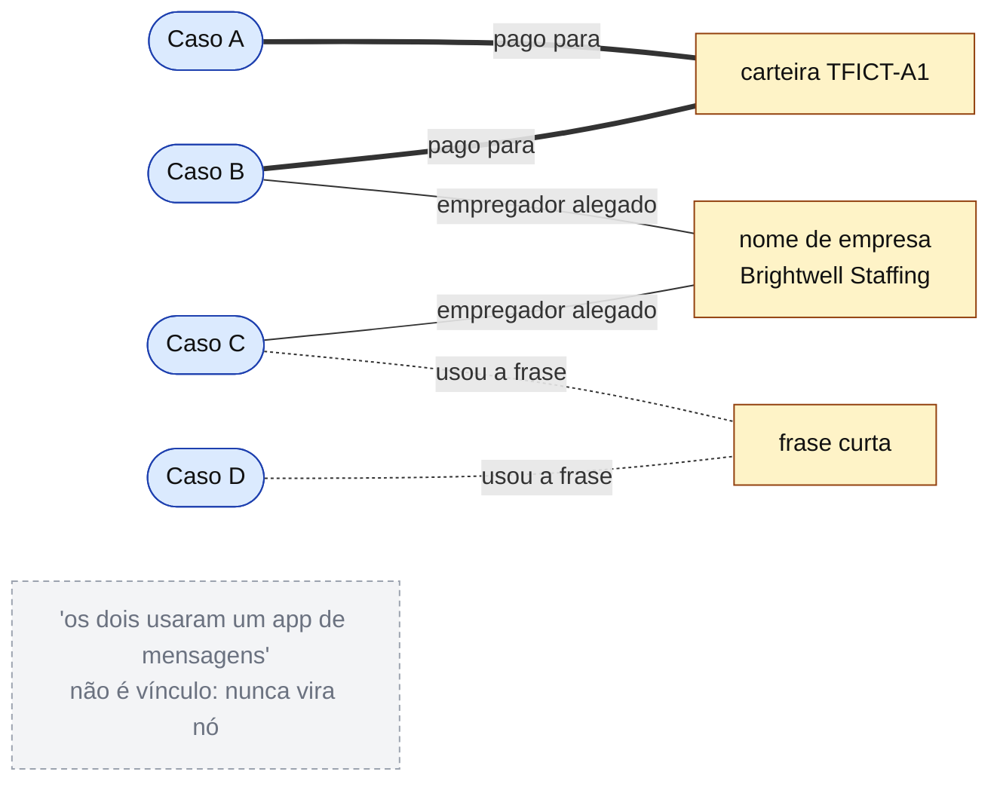
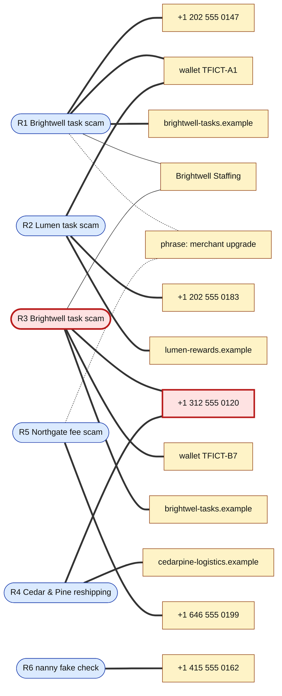

# Dia 68: Mapeando uma quadrilha de fraude: grafo de relações a partir de indicadores compartilhados

> 🇺🇸 Original: [*Day 68: Mapping a fraud ring, a relationship graph built from shared indicators*](https://github.com/thiefdroppers/cyber-investigator-skills/blob/main/curriculum/phase-5-fraud-social-engineering/day-68.md) — © ThiefDroppers, licença MIT.
> Aqui: tradução fiel **+** camada brasileira. Nada do original foi removido; tudo o que é novo vem marcado com ➕.

**Fase 5. Fraude, golpes e engenharia social** · Meta da trilha: transformar relatos separados de fraude de recrutamento num grafo em que toda aresta é um valor exato compartilhado, e depois dizer quais casos pertencem a uma mesma operação, quais não pertencem, e com que confiança.

Rank Jutsu: `A` · [](https://colab.research.google.com/github/Ridd1kulusC0d3r/investigador-cyber-90-dias/blob/main/curriculo/fase-5-fraude-e-engenharia-social/dia-68/dia-68.ipynb)

---

## 🎬 ➕ Abertura do caso — *O quadro na parede*

Quinta, 22 de outubro. Rafa cola na parede da sala de reunião nove cartões amarelos: os três cooperados lesados do primeiro dia (V1, V2, V3), os quatro relatos de falso emprego (E1 a E4), o e-mail da "Gráfica Jatobá" (BEC-B) e um relato que chegou ontem da Coopvale, de um WhatsApp clonado (W1).

— Marta quer saber se é uma quadrilha só. O Dr. Hélio quer saber se dá para dizer isso num ofício para a delegacia.

Você já pegou o barbante vermelho. Rafa segura o seu pulso.

— Cada barbante precisa de uma etiqueta com o valor **exato** que os dois cartões têm em comum. "Os dois usaram WhatsApp" não é barbante. "Os dois falam de taxa de liberação" é barbante fino. A mesma chave Pix é barbante grosso.

Ele aponta para os códigos L-01 a L-05 escritos num canto do quadro.

— E os laranjas entram como chave, não como gente.

É isso que o Dia 68 ensina. *(Personagens e cenário: [Operação Isca](../../../caso-continuo/).)*

---

## 📖 Conceito

Um relato de golpe é um caso. Vários relatos que compartilham um número de telefone, uma carteira de criptomoeda ou um identificador de pagamento provavelmente são uma operação, e isso muda o que dá para fazer com eles. Uma plataforma pode remover todas as contas do agrupamento de uma vez, um banco pode bloquear uma conta de laranja que aparece em cinco relatos, e um encaminhamento à polícia que diz "estas onze queixas compartilham duas carteiras e um telefone" é muito mais fácil de levar adiante do que onze queixas separadas.

O trabalho está em decidir o que conta como vínculo. Os indicadores variam muito no quanto provam quando dois casos os compartilham.

| Força | Exemplos | Por quê |
|---|---|---|
| Forte | Mesmo endereço de depósito de criptomoeda, conta bancária, identificador de app de pagamento, número de telefone ou domínio registrado | Uma única parte controla cada um deles por vez. Duas vítimas que pagaram para a mesma carteira pagaram ao mesmo operador, ou a um laranja que o operador comanda. |
| Média | Mesmo nome de "empresa", domínios imitação registrados em datas próximas, redação incomum idêntica em trechos longos | Sugere ferramentas ou roteiro compartilhados. Roteiros e kits são vendidos e copiados, então grupos diferentes podem compartilhá-los. |
| Fraca | Mesmo cargo, mesma plataforma de primeiro contato, mesma tática geral, frases curtas comuns | Milhares de golpes sem relação entre si compartilham isso. Descrevem o padrão, que você já registrou no scorecard do Dia 67. |
| Não é vínculo | "Os dois usaram um app de mensagens", "os dois pediram cripto", os dois hospedados no mesmo grande provedor de nuvem | Compartilhado por quase todos os casos; uma aresta construída sobre isso faz tudo parecer conectado. |

Um grafo para este trabalho tem dois tipos de nó: casos (um por relato) e indicadores (um por valor exato). Um caso se liga a cada indicador encontrado nele. Um nó de indicador que se liga a dois ou mais casos é onde está o achado. As arestas carregam a relação ("pago para", "mensagem enviada de", "domínio registrado"), e os nós de indicador carregam o valor exato, nunca uma paráfrase como "número parecido".

No esboço abaixo, os nós arredondados são casos e os quadrados são indicadores. A espessura da linha segue a tabela de força: grossa para forte, normal para média, pontilhada para fraca. Só o caminho grosso justifica chamar o Caso A e o Caso B de uma operação. O caminho pontilhado ligaria quase quaisquer dois golpes, e a linha "não é vínculo" nunca vira nó.



## 📚 Recursos

- [Gephi](https://gephi.org/): análise de grafos gratuita e de código aberto. Importa CSVs de nós e arestas, roda *layouts* e calcula centralidade.
- [draw.io (diagrams.net)](https://app.diagrams.net/): diagramação gratuita, se você preferir posicionar os nós à mão. Não tem análise, então serve para grafos pequenos.
- [Maltego Community Edition](https://www.maltego.com/): exige cadastro gratuito. Útil se você já o configurou no Dia 22.
- [FTC: golpes de emprego](https://consumer.ftc.gov/articles/job-scams) e [IC3](https://www.ic3.gov/): descrições públicas de casos para a parte de casos reais do laboratório.

### ➕ Recursos do contexto Brasil

- [Banco Central: Pix, MED e regulamento](https://www.bcb.gov.br/estabilidadefinanceira/pix): o MED permite à instituição do pagador pedir a devolução e o bloqueio cautelar de valores na conta recebedora em caso de fraude. É por isso que uma chave que aparece em vários relatos (o "barbante grosso" deste dia) vale tanto para a cooperativa: cada relato a mais fortalece o pedido.
- [COAF (Conselho de Controle de Atividades Financeiras)](https://www.gov.br/coaf/pt-br): instituições financeiras e cooperativas de crédito comunicam operações suspeitas ao COAF, nos termos da Lei 9.613/1998. Um grafo de contas de passagem é exatamente o tipo de padrão que alimenta essas comunicações, pelo canal da própria instituição.
- [NetworkX](https://networkx.org/) (opcional, `pip install networkx`): a biblioteca Python de grafos mais conhecida, se você quiser ir além do notebook só com stdlib.

## 🛠️ Prática: Gephi, um grafo caso-indicador para seis relatos fictícios mais os seus

**Seu checklist de hoje.** Faça na ordem e marque cada item ao terminar:

- [ ] Parte 1: o conjunto de treino (fictício)
- [ ] Parte 2: monte e leia o grafo
- [ ] Parte 3: os seus casos reais
- [ ] ➕ Parte 4: o grafo da quadrilha da Operação Isca
- [ ] ➕ Parte 5: o notebook do dia (grafo, centralidade e teste de remoção só com stdlib)

### Parte 1: o conjunto de treino (fictício)

Todo relato, nome, número, domínio e carteira abaixo foi inventado para este laboratório. Os telefones usam a faixa 555-01xx reservada para ficção, os domínios usam `.example`, e os valores de carteira são marcadores, não endereços reais.

- R1: golpe de tarefas da "Brightwell Staffing". A vítima recebeu mensagem de +1 202 555 0147. Depósitos pagos para a carteira `TFICT-A1`. App em `brightwell-tasks.example`. Usou a frase "merchant upgrade".
- R2: golpe de tarefas da "Lumen Talent Group". Mensagem de +1 202 555 0183. Depósitos pagos para a carteira `TFICT-A1`. App em `lumen-rewards.example`.
- R3: golpe de tarefas da "Brightwell Staffing". Mensagem de +1 312 555 0120. Depósitos pagos para a carteira `TFICT-B7`. App em `brightwel-tasks.example` (com um "l" só).
- R4: vaga de reenvio de mercadorias da "Cedar & Pine Logistics". Telefone do recrutador +1 312 555 0120. Contato `hr@cedarpine-logistics.example`.
- R5: vaga de digitação da "Northgate Remote" com uma taxa de "licença de software" de US$ 150 paga com cartão-presente. Telefone +1 646 555 0199. O recrutador usou a frase "merchant upgrade" uma vez.
- R6: vaga de babá com cheque falso. Contato por um app de mensagens. Telefone +1 415 555 0162.

Salve estes dois arquivos.

`nodes.csv`
```
Id,Label,Type
R1,R1 Brightwell task scam,case
R2,R2 Lumen task scam,case
R3,R3 Brightwell task scam,case
R4,R4 Cedar & Pine reshipping,case
R5,R5 Northgate fee scam,case
R6,R6 nanny fake check,case
P0147,+1 202 555 0147,phone
P0183,+1 202 555 0183,phone
P0120,+1 312 555 0120,phone
P0199,+1 646 555 0199,phone
P0162,+1 415 555 0162,phone
WA1,wallet TFICT-A1,wallet
WB7,wallet TFICT-B7,wallet
D1,brightwell-tasks.example,domain
D2,lumen-rewards.example,domain
D3,brightwel-tasks.example,domain
D4,cedarpine-logistics.example,domain
N1,"Brightwell Staffing",company_name
PH1,"phrase: merchant upgrade",phrase
```

`edges.csv`
```
Source,Target,Type,Label,Weight
R1,P0147,Undirected,texted from,3
R1,WA1,Undirected,paid to,3
R1,D1,Undirected,app domain,3
R1,N1,Undirected,claimed employer,2
R1,PH1,Undirected,used phrase,1
R2,P0183,Undirected,texted from,3
R2,WA1,Undirected,paid to,3
R2,D2,Undirected,app domain,3
R3,P0120,Undirected,texted from,3
R3,WB7,Undirected,paid to,3
R3,D3,Undirected,app domain,3
R3,N1,Undirected,claimed employer,2
R4,P0120,Undirected,recruiter phone,3
R4,D4,Undirected,email domain,3
R5,P0199,Undirected,recruiter phone,3
R5,PH1,Undirected,used phrase,1
R6,P0162,Undirected,texted from,3
```

O peso segue a tabela de força: 3 para forte, 2 para média, 1 para fraca. "Contato por um app de mensagens" (R6) e "pago em cripto" não aparecem em lugar nenhum como nós, porque caem na linha "não é vínculo".

### Parte 2: monte e leia o grafo

1. Abra o Gephi, crie um novo projeto e abra a aba Data Laboratory. Use "Import Spreadsheet" para carregar `nodes.csv` como tabela de nós e depois `edges.csv` como tabela de arestas, acrescentando os dois ao mesmo *workspace*.
2. Na aba Overview, rode o *layout* ForceAtlas 2 até ele estabilizar. Colora os nós pelo atributo `Type` (painel Appearance, Nodes, Partition) e defina a espessura das arestas por `Weight`.
3. Rode Statistics, Network Diameter. Isso calcula a centralidade de intermediação (*betweenness centrality*). Dimensione os nós pela intermediação.
4. Anote o que você vê, depois compare com esta leitura:
   - R1 e R2 compartilham a carteira `TFICT-A1`, um vínculo forte: o mesmo operador, ou um laranja que ele controla, recebeu dinheiro das duas vítimas, embora os nomes de empresa e os domínios sejam diferentes.
   - R1 e R3 compartilham o nome de empresa e domínios quase idênticos. Isso, sozinho, tem força média, mas combina com um grupo que troca de domínio depois das derrubadas.
   - R3 e R4 compartilham o telefone +1 312 555 0120, um vínculo forte entre um golpe de tarefas e uma vaga de reenvio de mercadorias. R3 é o nó-ponte: remova-o e o caso de reenvio sai do agrupamento. A centralidade de intermediação deve colocar R3 e o nó de telefone P0120 perto do topo.
   - R5 se liga a R1 só por uma frase de duas palavras. Registre como fraco e mantenha R5 fora do agrupamento até aparecer um indicador forte.
   - R6 não se liga a nada. É um resultado normal.
5. Redija o achado como você o entregaria: "R1, R2, R3 e R4 provavelmente são uma operação (vínculos fortes: carteira compartilhada entre R1 e R2, telefone compartilhado entre R3 e R4; vínculo médio: nome de empresa compartilhado e domínio imitação entre R1 e R3). R5 tem só uma correspondência fraca de frase. R6 não está conectado."

O *layout* do seu Gephi vai posicionar os nós de outro jeito, mas a estrutura deve bater com este desenho do mesmo `edges.csv`. Linhas grossas são peso 3, linhas normais peso 2, linhas pontilhadas peso 1. Os rótulos das arestas ficaram de fora para o desenho continuar legível; a relação de cada aresta está na coluna `Label` de `edges.csv`. R3 é o nó-ponte e P0120 é o indicador por onde ele passa, os dois contornados em vermelho. Apague qualquer um dos dois e R4 sai do agrupamento.



Indicadores que tocam só um caso (P0183, D2, D4 e os demais) continuam no grafo. Hoje não ligam nada, mas são o que um relato futuro vai encontrar.

### Parte 3: os seus casos reais

Importe as colunas de indicadores do seu scorecard do Dia 67 (`day67-scorecard.csv`) como novos nós de caso e de indicador, usando o mesmo esquema de Id e de peso. Procure qualquer correspondência exata com o conjunto fictício (não deve haver nenhuma, o que confirma que a sua importação não fundiu valores por engano) e entre os seus três casos reais. Três relatos públicos sem relação e sem nenhum indicador compartilhado é um resultado comum e legítimo. Relate como "nenhum vínculo encontrado", e não como um vínculo fraco do qual você se convenceu.

### O artefato

Um arquivo de projeto do Gephi (`.gephi`) e uma imagem exportada (File, Export, SVG/PDF/PNG) do grafo, com os tipos de nó coloridos e as arestas rotuladas, mais um achado escrito de quatro a seis frases na forma do passo 5, cobrindo os casos fictícios e os reais, com cada vínculo nomeado pela sua força.

### ➕ Parte 4: o grafo da quadrilha da Operação Isca

Os arquivos estão em [`caso-continuo/dados/dia-68/`](../../../caso-continuo/dados/dia-68/) (`nos.csv` e `arestas.csv`, no mesmo formato do Gephi). São nove casos:

| Caso | O que é | De onde veio |
|---|---|---|
| V1, V2, V3 | Cooperados da Serra Azul que fizeram Pix no golpe do "Pix bloqueado" | Dia 1 e retorno do time de fraude (Dia 65) |
| E1 a E4 | Relatos de falso emprego | Dia 67 |
| BEC-B | E-mail da "Gráfica Jatobá" pelo domínio imitação | Dia 66 |
| W1 | WhatsApp clonado: "troquei de número, me faz um Pix" (relato da Coopvale) | novo hoje |

As contas recebedoras aparecem só como **chave Pix fictícia com o código do laranja** (`PIXFICT-L01` = laranja L-01, e assim por diante). Nenhum nó representa uma pessoa.

Importe no Gephi como na Parte 2, depois compare com esta leitura:

- **V1, V2 e V3** compartilham o domínio `serraazul-pix.example` (forte) e V1 e V2 compartilham a chave de L-01 (forte). É a campanha do primeiro dia, sem surpresa.
- **V2 e E2** compartilham a chave de **L-02** (forte): o dinheiro de um cooperado lesado no golpe do Pix e a "taxa de liberação" do golpe das tarefas caíram na mesma conta.
- **V3 e E1** compartilham a chave de **L-03** (forte): E1 é o relato da própria dona de L-03, recrutada pelo falso emprego para "receber e repassar".
- **E1 e E4** compartilham o telefone do recrutador `+55 00 00000-0011` (forte). E2 se liga a E1 e E4 também pelo nome "Agil Recebiveis" (médio).
- **E3** só se liga a E2 pela frase "taxa de liberação" (fraco). Fica fora do agrupamento.
- **BEC-B** (L-04) e **W1** (L-05) não se ligam a nada hoje. Resultado normal. Guarde L-04: ele volta amanhã.

As **pontes** são as chaves de L-02 e L-03. Remova a de L-03 e, considerando só arestas fortes, E1 e E4 saem do agrupamento; remova a de L-02 e E2 sai. A leitura que isso sustenta é uma hipótese com nome: **a mesma operação que dispara o phishing recruta, por falso emprego, as contas que recebem o dinheiro**. Achado escrito no padrão do passo 5:

> "V1, V2, V3, E1, E2 e E4 provavelmente são uma operação (vínculos fortes: domínio `serraazul-pix.example` em V1–V3; chave de L-01 em V1 e V2; chave de L-02 em V2 e E2; chave de L-03 em V3 e E1; telefone `+55 00 00000-0011` em E1 e E4; vínculo médio: nome 'Agil Recebiveis' em E1, E2 e E4). As chaves de L-02 e L-03 são os nós-ponte entre o golpe do 'Pix bloqueado' e o falso emprego. E3 tem só uma correspondência fraca de frase. BEC-B e W1 não estão conectados."

Repare no que o achado **não** diz: não diz quem é o "Pescador", não diz que os titulares de L-01 a L-05 são criminosos, e usa "provavelmente" (confiança: provável), não "confirmado".

### ➕ Parte 5: o notebook do dia

Abra o [notebook do Dia 68 no Colab](https://colab.research.google.com/github/Ridd1kulusC0d3r/investigador-cyber-90-dias/blob/main/curriculo/fase-5-fraude-e-engenharia-social/dia-68/dia-68.ipynb). Nele você:

1. carrega os dois conjuntos (original e Operação Isca) e monta o grafo com dicionários;
2. calcula componentes conectados e centralidade de intermediação (algoritmo de Brandes) só com stdlib, e confere com a leitura do Gephi;
3. roda o **teste de remoção**: apaga cada nó e vê quem sai do agrupamento;
4. joga o **quiz da força do vínculo** (forte, médio, fraco ou não é vínculo) e gera o achado escrito e um diagrama mermaid pronto para colar.

## ✅ Checkpoint

- Toda aresta do seu grafo leva a um nó de indicador que contém um valor exato.
- Nenhum nó diz "telefone parecido", "mesmo grupo" ou qualquer outra paráfrase. Apague qualquer um que diga.
- O seu achado escrito nomeia o nó-ponte do conjunto fictício.
- O seu achado escrito explica o que aconteceria com o agrupamento sem esse nó-ponte.
- Todo valor de indicador nos seus nós de casos reais aparece na fonte publicada de onde veio.

Reveja a sua resposta do Dia 1 para "o que me faria parar, mesmo que eu pudesse continuar". Alguma coisa neste laboratório tentou você a pesquisar um número de telefone, uma carteira ou um nome real dos seus casos reais além do que a fonte publicada continha? Se sim, anote a tentação e confirme que não agiu nela. Pesquisar indicadores num caso sancionado é um passo posterior e autorizado; a curiosidade sobre as pessoas por trás deles é onde fica a linha.

### ➕ Checkpoint BR

- O seu achado da Operação Isca nomeia as chaves de L-02 e L-03 como pontes e explica o que acontece sem cada uma.
- Você explica por que E3 fica fora mesmo compartilhando uma frase com E2.
- Nenhum nó do seu grafo BR representa uma pessoa; laranjas só como código de chave.
- Você não digitou nenhuma chave, telefone ou nome do caso em buscador ou app de banco "para ver de quem é" (Dia 1: o diretório de chaves é para pagar, não para investigar).
- Você acertou pelo menos 8 das 10 classificações de força do quiz.

## ⚖️ ➕ Camada jurídica BR

**Organização criminosa (Lei 12.850/2013, art. 1º, §1º).** A lei define organização criminosa como a associação de quatro ou mais pessoas, estruturalmente ordenada e com divisão de tarefas, para obter vantagem mediante infrações com pena máxima superior a quatro anos ou de caráter transnacional. Um grafo que mostra papéis distintos (disparo de phishing, recrutamento, contas de passagem) é o tipo de material que ajuda a autoridade a avaliar essa hipótese. **Quem enquadra é a autoridade**; o seu relatório descreve vínculos e papéis de indicadores, não imputa o crime.

**Lavagem de dinheiro (Lei 9.613/1998).** As chaves de L-01 a L-05 são, no grafo, contas de passagem. A lei trata da ocultação e dissimulação da movimentação de valores de origem ilícita e impõe às instituições financeiras (cooperativas de crédito incluídas) deveres de identificação, registro e comunicação de operações suspeitas ao COAF. O caminho certo para o grafo dentro da cooperativa é o setor de prevenção à lavagem de dinheiro dela, não um contato direto com os titulares.

**Fraude eletrônica (CP art. 171, §2º-A).** Cada caso V, E e W é, isoladamente, um fato do §2º-A. O valor do grafo é juntar fatos dispersos em vários boletins de ocorrência e várias instituições.

**Sigilo bancário (LC 105/2001).** Os dados de titularidade e movimentação das contas são protegidos por sigilo bancário. Por isso os laranjas aparecem como códigos que a cooperativa recebeu pelos canais próprios: o analista do MSSP trabalha com o indicador, e a quebra de sigilo, quando houver, é da autoridade judicial.

> Este repositório é material de estudo e não constitui orientação jurídica.

## 🧠 ➕ Camada 8 — o barbante vermelho e a apofenia

**Apofenia** é a tendência de perceber conexões e significado em dados aleatórios ou sem relação. O quadro com barbante vermelho é a imagem clássica dela: com barbante suficiente, tudo se liga. Some o **viés de confirmação** (depois que a hipótese "uma quadrilha só" aparece, cada coincidência parece prova) e a **ilusão de agrupamento** (*clustering illusion*), que nos faz ver grupos onde há só acaso.

A tabela de força do original é o freio cognitivo escrito antes da tentação, como o registro de autorização do Dia 1: ela decide o que vira barbante antes de você querer que vire. No caso BR, o teste é E3: a frase "taxa de liberação" está nos dois relatos, a história ficaria mais bonita com E3 dentro, e ele fica fora. Consequência prática: escreva no relatório **também** o que você decidiu não ligar e por quê. A ausência documentada de vínculo é o que torna os vínculos que ficaram críveis para o Dr. Hélio e para o delegado.

## 🤖 ➕ Skill do dia

O dia propõe acrescentar ao procedimento de grafo de vínculos a **tabela de força dos indicadores** (forte, médio, fraco, não é vínculo), o modelo caso-indicador e o teste de remoção do nó-ponte. Ver [`_skill-delta.md`](_skill-delta.md) e a [skill atual](../../../skills/investigador-cyber/SKILL.md).

## 💡 ➕ Inovação OSINT do dia — centralidade de intermediação em 25 linhas de stdlib

O Gephi calcula a intermediação com o algoritmo de Ulrik Brandes (2001). Ele cabe em poucas linhas, e entendê-lo explica por que a ponte aparece no topo: ela está em muitos caminhos mais curtos entre outros nós.

```python
from collections import deque, defaultdict

def intermediacao(adj):                       # adj: {nó: {vizinhos}}
    C = dict.fromkeys(adj, 0.0)
    for s in adj:                             # um BFS a partir de cada nó
        pilha, pred = [], defaultdict(list)
        sigma = dict.fromkeys(adj, 0); sigma[s] = 1    # nº de caminhos mais curtos
        dist = dict.fromkeys(adj, -1); dist[s] = 0
        fila = deque([s])
        while fila:
            v = fila.popleft(); pilha.append(v)
            for w in adj[v]:
                if dist[w] < 0: dist[w] = dist[v] + 1; fila.append(w)
                if dist[w] == dist[v] + 1: sigma[w] += sigma[v]; pred[w].append(v)
        delta = dict.fromkeys(adj, 0.0)
        while pilha:                          # acumula do mais distante para o mais perto
            w = pilha.pop()
            for v in pred[w]: delta[v] += sigma[v] / sigma[w] * (1 + delta[w])
            if w != s: C[w] += delta[w]
    return {n: c / 2 for n, c in C.items()}   # grafo não direcionado: cada par contou 2x
```

Rode só com as arestas de peso 3 e depois com todas: o que muda no topo da lista é exatamente o efeito das arestas médias e fracas. O notebook faz essa comparação.

## 📝 Diário de estudo

- Data:
- Tempo gasto:
- O que ficou claro:
- O que ainda está nebuloso:
- Artefato produzido: projeto `.gephi`, imagem exportada, `notas/dia68-achado.md`

---
<sub>Baseado em [cyber-investigator-skills](https://github.com/thiefdroppers/cyber-investigator-skills) por ThiefDroppers (MIT). Tradução, camada BR, Camada 8, skill pt-BR e notebook por Deivison Lourenço (@Ridd1kulusC0d3r).</sub>
