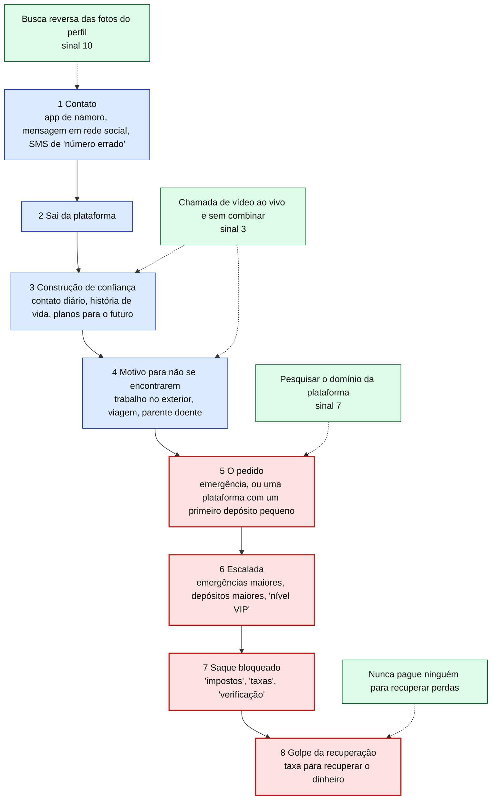
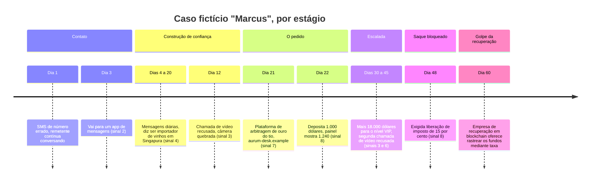

# Dia 69: Golpes românticos e de investimento por relacionamento

> 🇺🇸 Original: [*Day 69: Romance and relationship-investment scams*](https://github.com/thiefdroppers/cyber-investigator-skills/blob/main/curriculum/phase-5-fraud-social-engineering/day-69.md) — © ThiefDroppers, licença MIT.
> Aqui: tradução fiel **+** camada brasileira. Nada do original foi removido; tudo o que é novo vem marcado com ➕.

**Fase 5. Fraude, golpes e engenharia social** · Meta da trilha: dispor um golpe romântico ou de investimento por relacionamento já publicado numa linha do tempo por estágios, marcar os sinais de alerta no estágio em que cada um apareceu e identificar o primeiro ponto em que uma única checagem o teria exposto.

Rank Jutsu: `A` · [](https://colab.research.google.com/github/Ridd1kulusC0d3r/investigador-cyber-90-dias/blob/main/curriculo/fase-5-fraude-e-engenharia-social/dia-69/dia-69.ipynb)

---

## 🎬 ➕ Abertura do caso — *L-04 em outro lugar*

Sexta, 23 de outubro. O grafo de ontem ainda está na parede quando chega um relato da `credminas.example`, uma das cooperativas que o IscaKit atingiu na Fase 3. Código do relato: **R-CRED-09**. Uma cooperada perdeu R\$ 21,5 mil num "robô de investimento em ouro" que um homem que ela conheceu numa rede social apresentou depois de quase dois meses de conversa.

Você corre o dedo pela lista de chaves do relato. O último Pix foi para **PIXFICT-L04**. A mesma chave do e-mail da "Gráfica Jatobá".

— Então o BEC-B entra no agrupamento? — você pergunta.

— Calma — diz Rafa. — Primeiro, a história dela, na ordem em que aconteceu. Em que dia uma única checagem teria parado tudo? E, quando você escrever, ninguém aqui vai chamar essa senhora de ingênua.

É isso que o Dia 69 ensina. *(Personagens e cenário: [Operação Isca](../../../caso-continuo/).)*

---

## 📖 Conceito

Golpes românticos constroem primeiro uma relação e pedem dinheiro depois, às vezes meses depois. O relatório de 2025 do IC3 contabiliza 23.159 queixas de golpe de confiança/romance e US\$ 929,3 milhões em perdas declaradas. Para vítimas com 60 anos ou mais, as perdas com golpe de confiança/romance, sozinhas, foram de US\$ 584 milhões. Uma forma relacionada mistura romance com um falso investimento: o contato nunca pede dinheiro diretamente e, em vez disso, apresenta uma plataforma de *trading* que mostra à vítima ganhos grandes e fictícios. O alerta da FinCEN de setembro de 2023 (FIN-2023-Alert005) chama isso de *pig butchering* ("abate do porco"), e o alerta de 2026 usa "golpe de investimento em ativos digitais", seguindo o apelo da INTERPOL, de dezembro de 2024, para abandonar o termo antigo porque ele humilha as vítimas. Este currículo usa "golpe de investimento por relacionamento", e você deve usar também ao falar com qualquer pessoa que tenha perdido dinheiro.

As duas formas seguem uma sequência que os alertas publicados descrevem de modo consistente:

1. Contato: um app de namoro, uma mensagem em rede social ou um SMS de "número errado" que vira conversa.
2. Saída da plataforma, geralmente para um app de mensagens, logo no começo.
3. Construção de confiança: contato diário, uma história de vida detalhada, planos para o futuro juntos.
4. O motivo pelo qual não podem se encontrar: trabalho no exterior (a FTC cita plataformas de petróleo, as forças armadas, organizações internacionais), viagem, um parente doente.
5. O pedido. No golpe romântico, uma emergência: contas médicas, uma passagem aérea, taxas de alfândega, um problema jurídico. No golpe de investimento por relacionamento, uma "oportunidade" numa plataforma que o contato recomenda, com um primeiro depósito pequeno que mostra ganhos rápidos.
6. Escalada: emergências maiores, ou depósitos maiores para chegar a um "nível VIP".
7. Saque bloqueado: "impostos", "taxas" ou "verificação de conta" precisam ser pagos antes que o dinheiro possa sair.
8. Golpe da recuperação: depois da perda, alguém que diz ser advogado, órgão público ou serviço de "recuperação de fundos" oferece recuperar o dinheiro mediante uma taxa. O alerta da FinCEN de 2026 observa que os golpistas voltam repetidamente à mesma vítima dessa forma.

O diagrama acrescenta o lado da vítima: as checagens da Prática deste dia, presas ao estágio em que cada uma pode expor o golpe pela primeira vez. Os estágios contornados em vermelho são onde o dinheiro se move.



### Por que uma chamada de vídeo recusada pesa tanto

Uma chamada de vídeo ao vivo e sem combinar é a checagem de identidade mais barata que a vítima tem, e durante anos ela desmontou golpes românticos de forma confiável. As fotos do perfil normalmente são roubadas de uma pessoa real que não faz ideia de que estão sendo usadas, e o operador por trás da conta muitas vezes não corresponde a elas em idade, sexo ou nacionalidade. O operador também pode ser uma de várias pessoas que trabalham na mesma conta em turnos. Por isso a conta precisa evitar vídeo ao vivo, e as desculpas se repetem: câmera quebrada, sinal ruim, regras de segurança no trabalho, "tenho vergonha da câmera". Um padrão de recusas ao longo de semanas é um dos sinais isolados mais fortes nesta categoria.

O vídeo *deepfake* enfraqueceu essa checagem sem eliminá-la. O relatório de 2025 do IC3 menciona perfis falsos e roteiros gerados por IA em golpes românticos. Uma troca de rosto pré-gravada ou em tempo real pode passar numa chamada curta e passiva. O que ainda ajuda é uma chamada sem combinar, com pedidos para os quais o operador não se preparou, como virar a cabeça totalmente de lado ou passar a mão na frente do rosto, e muitas contas de golpe ainda evitam vídeo de todo jeito. O Dia 71 trata disso com mais profundidade.

### Checklist de sinais de alerta

1. Declarações de amor ou conversa de "alma gêmea" em poucos dias, antes de qualquer encontro presencial.
2. Pressão para sair do app de namoro ou da rede social para um app de mensagens privado.
3. Desculpas repetidas e variadas para não fazer uma chamada de vídeo ao vivo.
4. Um trabalho que mantém a pessoa longe e é difícil de verificar.
5. Detalhes pessoais que mudam entre conversas (idade, cidade natal, nomes dos filhos).
6. Qualquer pedido de dinheiro, cartão-presente ou criptomoeda de alguém que nunca foi encontrado pessoalmente.
7. Conversa sobre investimento sem ninguém ter perguntado, especialmente sobre uma plataforma ou app específico de que a vítima nunca ouviu falar.
8. "Lucros" iniciais que parecem grandes, seguidos de taxas para sacar.
9. Pedidos de segredo em relação à família e aos amigos ("eles não entenderiam a gente").
10. Fotos de perfil que a busca reversa de imagem encontra sob outro nome.

## 📚 Recursos

- [FTC: o que saber sobre golpes românticos](https://consumer.ftc.gov/articles/what-know-about-romance-scams): as mentiras de sempre, os meios de pagamento e o conselho central ("nunca mande dinheiro ou presentes para alguém por quem você se apaixonou e que nunca encontrou pessoalmente").
- [Alerta FinCEN FIN-2023-Alert005 (PDF)](https://www.fincen.gov/sites/default/files/shared/FinCEN_Alert_Pig_Butchering_FINAL_508c.pdf): a descrição estágio a estágio dos golpes de investimento por relacionamento, mais sinais de alerta comportamentais, financeiros e técnicos.
- [Alerta FinCEN FIN-2026-Alert005 (PDF)](https://www.fincen.gov/system/files/2026-08/FinCEN-Alert-Scam-Centers.pdf): centros de golpe, golpes de recuperação e sinais de alerta de lavagem.
- [Relatório de Crimes na Internet de 2025 do IC3/FBI (PDF)](https://www.ic3.gov/AnnualReport/Reports/2025_IC3Report.pdf): números de confiança/romance, o recorte de 60 anos ou mais e a seção sobre IA.
- [TinEye](https://tineye.com/) e [Google Lens](https://lens.google/): busca reversa de imagem.
- [TimelineJS](https://timeline.knightlab.com/): criador gratuito de linhas do tempo do Knight Lab da Northwestern, alimentado por um modelo de planilha do Google Sheets.

### ➕ Recursos do contexto Brasil

- [Estatuto da Pessoa Idosa (Lei 10.741/2003)](https://www.planalto.gov.br/ccivil_03/leis/2003/l10.741.htm): o recorte de 60 anos ou mais do IC3 tem paralelo direto aqui; a lei define pessoa idosa a partir dos 60 anos.
- [CVM: alertas sobre ofertas irregulares](https://www.gov.br/cvm/pt-br): a Comissão de Valores Mobiliários publica alertas (*stop orders*) sobre pessoas e sites que oferecem investimentos sem autorização. É a checagem "pesquise o domínio da plataforma" (sinal 7) em versão brasileira: plataforma que capta investimento do público e não aparece como autorizada é sinal forte.
- [Banco Central: instituições autorizadas](https://www.bcb.gov.br/): para conferir se uma "corretora" ou "banco digital" citado na conversa existe como instituição autorizada.
- [Disque 100](https://www.gov.br/mdh/pt-br/disque100): recebe denúncias de violência contra a pessoa idosa, incluindo a violência financeira.

## 🛠️ Prática: TimelineJS, uma linha do tempo por estágios de um caso publicado

### Exemplo resolvido (fictício)

Este caso foi inventado para treino e não corresponde a nenhuma pessoa real.

| Dia | Evento | Estágio | Sinais de alerta |
|---|---|---|---|
| 1 | SMS de "número errado": "Oi Lena, o jantar de sexta continua de pé?" A vítima responde que é engano; o remetente pede desculpas e continua conversando | Contato | Abertura não solicitada de "número errado" |
| 3 | O remetente, "Marcus", sugere ir para um app de mensagens | Saída da plataforma | 2 |
| 4 a 20 | Mensagens diárias. Marcus diz ser importador de vinhos baseado em Singapura. Manda fotos de refeições e de uma vista do porto | Construção de confiança | 4 |
| 12 | A vítima propõe chamada de vídeo. "Minha câmera quebrou, o celular novo chega semana que vem" | Construção de confiança | 3 |
| 21 | Marcus menciona a estratégia de "arbitragem de ouro" do tio e uma plataforma em `aurum-desk.example` | O pedido | 7 |
| 22 | A vítima deposita US\$ 1.000; o painel mostra US\$ 1.240 dois dias depois | O pedido | 8 |
| 30 a 45 | A vítima deposita mais US\$ 18.000 para chegar ao "nível VIP". Segundo pedido de chamada de vídeo recusado ("no trabalho, não é permitido") | Escalada | 3, 6 |
| 48 | Saque bloqueado até o pagamento de uma "liberação de imposto" de 15% | Saque bloqueado | 8 |
| 60 | Uma "empresa de recuperação em *blockchain*" procura a vítima oferecendo rastrear os fundos mediante taxa | Golpe da recuperação | Oferta de recuperação não solicitada |

A primeira checagem isolada que teria exposto o caso é a do dia 12: a chamada de vídeo recusada, somada à abertura do dia 1. A busca reversa das fotos da refeição e do porto talvez também as encontrasse sob outros nomes.

O mesmo caso organizado por estágio é mais ou menos o que a sua saída no TimelineJS deve comunicar: toda entrada marcada, e as entradas de dinheiro fáceis de destacar.



**Seu checklist de hoje.** Faça na ordem e marque cada item ao terminar:

- [ ] Escolha um caso publicado com pelo menos oito eventos dignos de linha do tempo
- [ ] Preencha o modelo do TimelineJS, uma linha por evento, marcada por estágio e sinal
- [ ] Publique a planilha e gere o link do TimelineJS
- [ ] Escreva a análise de dois parágrafos: a primeira checagem que exporia o golpe, e cada ponto em que o dinheiro se moveu
- [ ] Teste a busca reversa de imagem com uma foto de banco de imagens, não com a foto de uma pessoa real
- [ ] ➕ Prática BR: monte a linha do tempo do relato R-CRED-09 da Operação Isca
- [ ] ➕ Rode o notebook do dia e passe a sua análise pelo verificador de linguagem

### Passos

1. Escolha um caso publicado com detalhe suficiente para montar pelo menos oito entradas na linha do tempo. Boas fontes: um comunicado à imprensa do DOJ ou o resumo de uma denúncia sobre um esquema de investimento por relacionamento, uma reportagem que reconstrói as mensagens de uma vítima com o consentimento dela, ou a narrativa do alerta de 2023 da FinCEN. Use só o relato publicado. Não contate a vítima, as fontes do jornalista ou qualquer conta citada na matéria.
2. Copie o modelo de planilha do TimelineJS no Google Sheets, preencha uma linha por evento com a data (ou o dia relativo), um título e um campo de texto que cite ou parafraseie de perto a fonte, e então marque cada linha com o estágio e os números do checklist.
3. Publique a planilha na web (Arquivo, Compartilhar, Publicar na web) e cole a URL dela no gerador do TimelineJS para obter o link da linha do tempo.
4. Abaixo da linha do tempo, escreva dois parágrafos curtos: o primeiro ponto em que uma checagem (uma chamada de vídeo, uma busca reversa de imagem, uma pesquisa sobre o domínio da plataforma) teria exposto o golpe, e cada ponto em que o dinheiro se moveu.
5. Para aprender as ferramentas de busca reversa sem envolver uma pessoa real, passe uma foto de um site gratuito de banco de imagens pelo TinEye e pelo Google Lens e anote quantos outros sites a usam. Não envie fotos de pessoas privadas identificáveis, incluindo fotos de perfil que aparecem em alertas de golpe; esses rostos normalmente pertencem a alguém cujas imagens foram roubadas.

### O artefato

Uma linha do tempo publicada no TimelineJS do caso escolhido, com toda entrada marcada por estágio e número de sinal de alerta, e a análise de dois parágrafos. Guarde também a planilha; o link da linha do tempo, sozinho, não é um registro.

### ➕ Prática BR: o relato R-CRED-09

O relato fictício está em [`caso-continuo/dados/dia-69/linha-do-tempo-rcred09.csv`](../../../caso-continuo/dados/dia-69/linha-do-tempo-rcred09.csv), já com as colunas do modelo do TimelineJS (Year, Month, Day, Display Date, Headline, Text, Group...). Dá para colar direto na planilha do modelo.

| Dia relativo | O que aconteceu (resumo) | Estágio |
|---|---|---|
| 1 | Pedido de amizade e elogios de "Ricardo", "engenheiro em plataforma de petróleo" | Contato |
| 3 | Vai para o WhatsApp (`+55 00 00000-0031`) | Saída da plataforma |
| 4 a 25 | Mensagens diárias, "morar juntos quando eu desembarcar"; declara amor no dia 9 | Construção de confiança |
| 14 | Chamada de vídeo recusada: "na plataforma não pode câmera" | Construção de confiança |
| 26 | "Robô de investimento em ouro" em `ouro-facil.example` | O pedido |
| 27 | Pix de R\$ 500; painel mostra R\$ 640 | O pedido |
| 39 a 55 | Mais R\$ 21.000 em quatro Pix, o último para **PIXFICT-L04**; segunda chamada recusada | Escalada |
| 62 | "Imposto de liberação" de 18%; "sua família não entenderia" | Saque bloqueado |
| 90 | "Escritório de recuperação de ativos" com taxa adiantada | Golpe da recuperação |

Tarefas:

1. Monte a linha do tempo (TimelineJS, ou o diagrama `timeline` que o notebook gera).
2. Escreva os dois parágrafos do passo 4. Qual é a primeira checagem que teria exposto o caso? (Pista: compare o dia 14 com o dia 26. No Brasil, a checagem do dia 26 tem um nome: a lista de alertas da CVM.)
3. Volte ao grafo do Dia 68 e acrescente o caso R-CRED-09 com a aresta "Pix para" PIXFICT-L04 (forte). Responda: o BEC-B agora entra no agrupamento principal? (Resposta: R-CRED-09 e BEC-B passam a formar um par ligado por L-04, mas **nenhum dos dois se liga ao agrupamento V/E**. A mesma conta recebendo dinheiro de um BEC e de um golpe do amor sugere que L-04 é conta de passagem usada por mais de um esquema, não que tudo seja a mesma operação.)
4. Não faça busca reversa de nenhuma foto do "Ricardo", mesmo que o relato tivesse fotos: aquele rosto quase certamente é de uma pessoa real cuja imagem foi roubada.

### ➕ O notebook do dia

Abra o [notebook do Dia 69 no Colab](https://colab.research.google.com/github/Ridd1kulusC0d3r/investigador-cyber-90-dias/blob/main/curriculo/fase-5-fraude-e-engenharia-social/dia-69/dia-69.ipynb). Nele você:

1. lê o CSV no formato do TimelineJS e confere os três estágios obrigatórios do checkpoint;
2. calcula automaticamente o primeiro ponto de exposição e cada ponto em que o dinheiro se moveu, com o total;
3. joga o **quiz do estágio** (qual estágio é este evento?) com os eventos do "Marcus" e do "Ricardo";
4. passa a sua análise por um **verificador de linguagem revitimizante** e gera o diagrama `timeline` em mermaid.

## ✅ Checkpoint

- A sua linha do tempo tem pelo menos uma entrada no estágio 1 (Contato).
- A sua linha do tempo tem pelo menos uma entrada no estágio 5 (O pedido).
- A sua linha do tempo tem pelo menos uma entrada no estágio 7 (Saque bloqueado).
- Cada marcação de sinal de alerta aponta para um trecho da fonte.
- A sua análise nunca chama a vítima de "ingênua", "gananciosa" ou de "porco". Se chamou, essa redação foi reescrita em termos do que o golpista fez.
- Sem consultar notas, você consegue explicar por que uma chamada de vídeo recusada pesava tanto antes dos *deepfakes*?
- Sem consultar notas, você consegue explicar o que uma chamada sem combinar ainda testa hoje?

### ➕ Checkpoint BR

- A linha do tempo do R-CRED-09 tem os estágios 1, 5 e 7, com os sinais marcados.
- A sua análise aponta o dia 14 como primeira exposição e cita a consulta à CVM como a checagem do dia 26.
- Você explica por que L-04 ligar BEC-B e R-CRED-09 **não** os junta ao agrupamento V/E.
- O verificador de linguagem do notebook não acusou nada na sua análise.

## ⚖️ ➕ Camada jurídica BR

**Fraude eletrônica (CP art. 171, §2º-A) e a vítima idosa (§4º).** O golpe do amor e o de investimento por relacionamento, praticados por rede social e app de mensagens, se enquadram na forma qualificada do §2º-A. O §4º do art. 171, com redação da Lei 14.155/2021, prevê aumento de pena quando o crime é cometido contra pessoa idosa ou vulnerável, considerada a relevância do resultado. É o paralelo jurídico do recorte de 60 anos ou mais do IC3.

**Oferta irregular de investimento.** A "plataforma" que capta dinheiro do público prometendo rendimento pode, além do estelionato, encostar em crimes contra o mercado de capitais e contra a economia popular. <!-- TODO jurídico: confirmar o enquadramento específico (Lei 7.492/1986, Lei 6.385/1976 art. 27-E, Lei 1.521/1951) antes de citar artigos. --> Para o analista, o ponto prático é a checagem na CVM, não o enquadramento.

**Golpe da recuperação.** A "taxa para recuperar" é um novo estelionato contra a mesma vítima. Nenhum órgão público brasileiro cobra taxa adiantada para devolver dinheiro de golpe; a devolução de Pix corre pelo MED, acionado pelo banco da vítima, sem custo para ela.

**Violência financeira contra a pessoa idosa.** O Estatuto da Pessoa Idosa trata da apropriação e do desvio de bens da pessoa idosa; quando houver suspeita de que a vítima segue sob influência do golpista, o Disque 100 é canal de denúncia.

> Este repositório é material de estudo e não constitui orientação jurídica.

## 🧠 ➕ Camada 8 — o custo afundado e a vergonha

Dois mecanismos explicam por que o estágio 6 (escalada) e o estágio 8 (recuperação) funcionam. O primeiro é a **falácia do custo afundado** (*sunk cost*), descrita por Hal Arkes e Catherine Blumer em 1985: quanto mais se investiu, maior a tendência de continuar investindo para não "perder o que já foi". O "nível VIP" e o "imposto de liberação" são desenhados para ela. O segundo é a **vergonha**: a pessoa lesada esconde o caso da família (exatamente o que o sinal 9 pediu), o que a isola e a deixa disponível para o golpe da recuperação.

O analista entra nessa história de dois jeitos. Na escrita: termos como "ingênua" ou "gananciosa" (e o próprio *pig butchering*, abandonado pela INTERPOL) são **atribuição disposicional**, explicar o resultado pelo caráter da pessoa e não pela situação que o golpista construiu. Lee Ross chamou essa tendência de **erro fundamental de atribuição**. Num relatório, ele aumenta a vergonha, diminui as denúncias e, portanto, piora os dados que você terá no próximo caso. Na prática: descreva o que o golpista fez em cada estágio, com verbos dele. E, no Dia 74, quando for falar com o "Seu Antônio", lembre que a vergonha é o que mais atrapalha a entrevista.

## 🤖 ➕ Skill do dia

O dia propõe acrescentar à triagem de fraude a **linha do tempo por estágios** do golpe de relacionamento, o "primeiro ponto de exposição" e a regra de linguagem não revitimizante. Ver [`_skill-delta.md`](_skill-delta.md) e a [skill atual](../../../skills/investigador-cyber/SKILL.md).

## 💡 ➕ Inovação OSINT do dia — o checkpoint de linguagem como código

A regra "nunca chame a vítima de ingênua" é fácil de esquecer na hora de escrever. Um verificador de 10 linhas resolve:

```python
import re
PROIBIDOS = {
    r"\bingênu[oa]s?\b": "descreva a técnica do golpista, não o caráter da vítima",
    r"\bgananci\w*": "o 'ganho' foi fabricado pelo painel falso",
    r"\b(pig butchering|abate do porco|porco)\b": "use 'golpe de investimento por relacionamento'",
    r"\bcaiu (no|em) golpe\b": "prefira 'foi alvo de' ou 'foi enganada por'",
    r"\bdeixou[- ]se enganar\b": "o sujeito da frase é o golpista",
}
def revisar(texto):
    for padrao, dica in PROIBIDOS.items():
        for m in re.finditer(padrao, texto, re.I):
            print(f"⚠️ '{m.group()}' → {dica}")
```

Coloque isso no fim do seu fluxo de relatório (ou como *hook* de *pre-commit* do repositório de casos). O notebook traz a versão completa.

## 📝 Diário de estudo

- Data:
- Tempo gasto:
- O que ficou claro:
- O que ainda está nebuloso:
- Artefato produzido: link do TimelineJS, planilha salva, `notas/dia69-analise.md`

---
<sub>Baseado em [cyber-investigator-skills](https://github.com/thiefdroppers/cyber-investigator-skills) por ThiefDroppers (MIT). Tradução, camada BR, Camada 8, skill pt-BR e notebook por Deivison Lourenço (@Ridd1kulusC0d3r).</sub>
