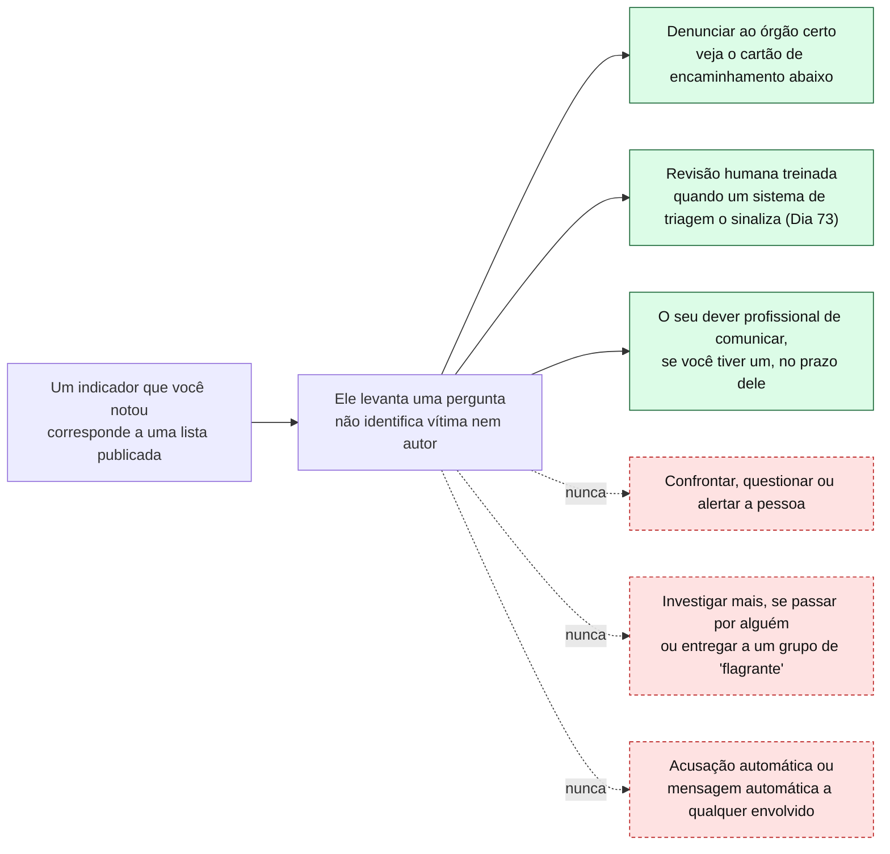
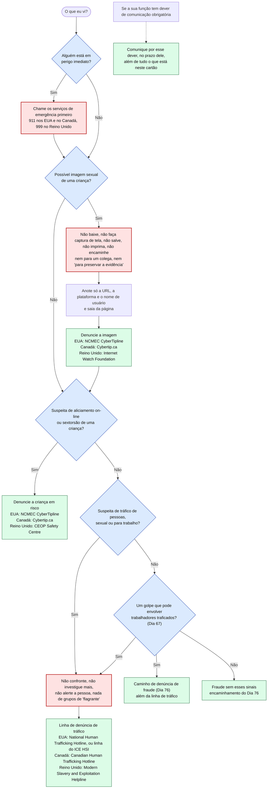
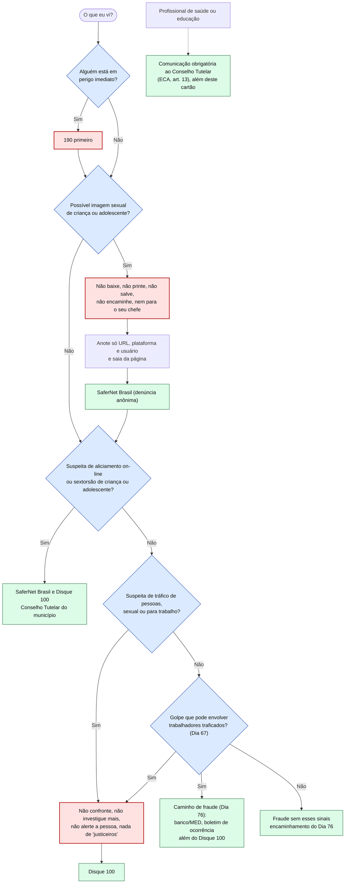

# Dia 70: Reconhecendo indicadores de aliciamento e tráfico em fontes publicadas

> 🇺🇸 Original: [*Day 70: Recognizing grooming and trafficking indicators from published sources*](https://github.com/thiefdroppers/cyber-investigator-skills/blob/main/curriculum/phase-5-fraud-social-engineering/day-70.md) — © ThiefDroppers, licença MIT.
> Aqui: tradução fiel **+** camada brasileira. Nada do original foi removido; tudo o que é novo vem marcado com ➕.

**Fase 5. Fraude, golpes e engenharia social** · Meta da trilha: conhecer os indicadores comportamentais que os órgãos de proteção à infância e de combate ao tráfico publicam, saber o que esses indicadores podem e não podem dizer, e saber exatamente a quem denunciar e o que nunca fazer enquanto isso.

Rank Jutsu: `A` · 

> ➕ **Como este dia é diferente.** Este é o único dia do currículo em que o produto do investigador é **parar e encaminhar**. A camada brasileira fica no mesmo nível do original: indicadores como os órgãos os publicam, canais de denúncia e enquadramento legal. Não há aqui exemplos de mensagens, roteiros ou cenários envolvendo crianças ou adolescentes, nem na Operação Isca.

---

## 🎬 ➕ Abertura do caso — *A parada obrigatória*

Segunda, 26 de outubro. Você chega com o scorecard do Dia 67 aberto no relato **E4**: "atendimento ao cliente no exterior, salário em dólar, passagem e visto por nossa conta", viajar com visto de turista, destino não informado. Você já tinha separado três buscas para descobrir quem é o recrutador do `+55 00 00000-0011`.

Rafa fecha a aba antes que você aperte Enter.

— Esse aqui não é mais nosso. É indicador de tráfico de pessoas. A partir de agora a gente não pesquisa o recrutador, não manda mensagem para a pessoa que desistiu, não "confirma" nada. Encaminha.

— Mas e se a gente descobrir mais e o encaminhamento ficar melhor?

— Encaminhamento melhor é encaminhamento rápido para quem tem autoridade. Um indicador levanta uma pergunta, não responde. E tem uma regra que vale mais que todo o resto deste mês: se algum dia, em qualquer caso, aparecer algo que possa envolver uma criança, você não salva, não printa, não encaminha nem para mim. Anota onde viu, sai e denuncia.

Ele escreve três coisas no quadro: **190**, **Disque 100**, **SaferNet**.

É isso que o Dia 70 ensina. *(Personagens e cenário: [Operação Isca](../../../caso-continuo/).)*

---

## 📖 Conceito

Este dia trata de reconhecimento e encaminhamento. Ele cobre os indicadores que órgãos como o *National Center for Missing & Exploited Children* (NCMEC), o *Canadian Centre for Child Protection* (C3P), a *Blue Campaign* do Departamento de Segurança Interna dos EUA (DHS) e a Polaris publicam para pais, educadores, plataformas e o público. Ele não cobre investigar suspeitos, interagir com eles, se passar por uma criança ou por um comprador, nem manusear conteúdo sexual envolvendo menores. Essas são funções da autoridade policial, que exigem autoridade legal, treinamento especializado e apoio ao bem-estar do investigador. Nenhuma boa intenção faz disso um projeto individual, e este currículo não inclui nenhum exemplo de mensagem ou conversa de aliciamento pelo mesmo motivo.

Três regras valem antes de qualquer outra coisa.

Primeira: se você algum dia encontrar o que pode ser imagem sexual de uma criança, não baixe, não faça captura de tela, não salve, não imprima e não encaminhe, nem para um colega nem "para preservar a evidência". Na maioria das jurisdições, possuir ou distribuir esse material é crime independentemente da intenção, e cada cópia aumenta o dano. Anote onde viu (a URL, a plataforma e o nome de usuário), saia e denuncie (veja o cartão de encaminhamento abaixo). A orientação publicada pelo *Florida Department of Law Enforcement* diz o mesmo.

Segunda: se uma criança ou qualquer pessoa puder estar em perigo imediato, chame os serviços de emergência primeiro. Todo o resto vem depois.

Terceira: isto é reconhecimento e encaminhamento, não investigação amadora, e isso inclui os chamados grupos de "caça a predadores" ou de "flagrante" (*sting*), que confrontam suspeitos por conta própria, às vezes diante da câmera. Não entre nem se coordene com um desses grupos. Eles rotineiramente comprometem a evidência e o eventual processo, expõem quem faz o confronto a riscos legais e físicos reais, e a própria cautela do DHS mencionada acima (nunca confronte um suspeito de tráfico nem demonstre suas suspeitas) vale do mesmo jeito para casos de aliciamento. Se você quer agir além da denúncia, o caminho lícito é o treinamento e a seleção por um programa de verdade, ligado à autoridade policial ou ao NCMEC, e não um grupo auto-organizado.

### O que dizem os indicadores publicados

A página do NCMEC sobre aliciamento on-line (*online enticement*) lista as táticas que a CyberTipline mais vê, incluindo construir afinidade por meio de elogios e interesses em comum, fingir ser mais jovem, oferecer incentivos como cartões-presente e encaminhar a conversa para o tema sexual ou para pedidos de imagens. O Cybertip.ca, do C3P, alerta os jovens sobre o *love-bombing* (uma enxurrada de elogios de alguém novo), a falsa compatibilidade (um estranho que diz ter tudo em comum) e as alegações de ter a mesma idade, ser da mesma região ou ter amigos em comum. O NCMEC informa que as denúncias de aliciamento on-line à CyberTipline cresceram mais de 300% de 2021 a 2023, e publicou diretrizes formais de indicadores para plataformas on-line em outubro de 2024, nos termos do *REPORT Act*.

Vários desses indicadores se sobrepõem à lista de golpe romântico do Dia 69, então as habilidades de reconhecimento se aproveitam. A diferença é quem está em risco e quem deve agir: quando um menor pode estar envolvido, o trabalho é denunciar rapidamente ao órgão certo, e não reunir mais.

Para o tráfico de pessoas, a *Blue Campaign* do DHS publica indicadores como uma pessoa que parece desligada da família e da comunidade, parece instruída sobre o que dizer, está sempre acompanhada por alguém que parece estar no controle, não tem pertences pessoais, mostra sinais de privação de comida, sono ou cuidados médicos, ou não pode se locomover livremente. O DHS acrescenta duas cautelas: nenhum indicador isolado prova tráfico, e você nunca deve confrontar um suspeito de tráfico nem demonstrar suas suspeitas a uma possível vítima. A Polaris vai além em "*Know the story, not the signs*" ("conheça a história, não os sinais"), argumentando que sinais superficiais sem contexto levam a conclusões erradas e muitas vezes enviesadas, e que as pessoas mais bem posicionadas para ajudar são as que têm contato real e contínuo (uma enfermeira, um professor, um cliente habitual).

O problema dos centros de golpe do Dia 67 também é tráfico: pessoas recrutadas por anúncios falsos de emprego e forçadas a operar fraudes. Os sinais de alerta de recrutamento que você já pontuou são indicadores de tráfico quando a vaga envolve mudança para o exterior.

### O que um indicador não pode dizer

Um indicador levanta uma pergunta para as pessoas com autoridade e contexto para respondê-la. Ele não identifica uma vítima nem um autor. Um laboratório que termina com "esta pessoa é traficante" ou "esta criança está sendo aliciada" foi além do que os indicadores sustentam. Quando esta taxonomia alimentar um sistema de triagem (Dia 73), uma correspondência deve encaminhar o caso para revisão humana treinada, nunca produzir uma acusação automática.

Todo caminho que sai de um indicador termina em alguém com autoridade e contexto. As setas tracejadas são os caminhos que este dia descarta.

Se você trabalha numa função com dever legal de comunicação obrigatória (ensino, saúde, assistência social e outras, conforme a jurisdição), esse dever é separado deste laboratório e não espera nada dele: comunique pela sua obrigação profissional, no prazo dela, além do que este exercício pede que você construa. Este dia ensina reconhecimento e encaminhamento em termos gerais; ele não substitui conhecer as regras de comunicação da sua própria profissão.

> ➕ No Brasil, o ECA (art. 13) determina que casos de suspeita ou confirmação de maus-tratos contra criança ou adolescente sejam obrigatoriamente comunicados ao **Conselho Tutelar**, e o art. 245 prevê infração administrativa para o médico, o professor ou o responsável por estabelecimento de saúde ou de ensino que deixar de comunicar. Se essa é a sua profissão, esse é o seu dever "no prazo dele".

## 📚 Recursos

- [NCMEC: aliciamento on-line](https://www.missingkids.org/theissues/onlineenticement): táticas, fatores de risco, estatísticas e a CyberTipline.
- [NCMEC: diretrizes sobre identificadores de aliciamento on-line e de tráfico sexual infantil (PDF, 2024)](https://www.missingkids.org/content/dam/missingkids/pdfs/NCMEC-REPORT-Act-Guidelines.pdf): as diretrizes voltadas a plataformas, emitidas nos termos do *REPORT Act*. Leia a introdução e a estrutura de categorias; você não precisa do detalhe para fazer este laboratório.
- [Cybertip.ca: danos on-line](https://cybertip.ca/en/online-harms/) e [alertas](https://cybertip.ca/en/online-harms/alerts/): os alertas públicos do C3P, incluindo sextorsão e golpes de "remoção de imagens" que se passam por recuperação.
- [DHS Blue Campaign: como identificar e denunciar tráfico de pessoas](https://www.dhs.gov/blue-campaign/identify-victim): lista de indicadores, cautelas e linhas de denúncia.
- [DHS Know2Protect: como denunciar](https://www.dhs.gov/know2protect/how-to-report): os caminhos de denúncia de exploração infantil on-line nos EUA.
- [Polaris: *Know the story, not the signs*](https://polarisproject.org/know-the-story-not-the-signs/) e [Reconhecendo o tráfico para trabalho](https://polarisproject.org/labor-trafficking/).
- [FDLE: material de abuso sexual infantil](https://www.fdle.state.fl.us/fco/child-pornography): a orientação de não baixar e não encaminhar.
- [NCMEC Take It Down](https://takeitdown.ncmec.org/): ajuda menores (e adultos, para imagens feitas quando eram menores) a remover imagens explícitas das plataformas participantes sem enviar a própria imagem.

### ➕ Recursos do contexto Brasil

- [SaferNet Brasil: central de denúncias](https://new.safernet.org.br/denuncie): recebe denúncias anônimas de crimes contra os direitos humanos na internet, incluindo imagens de abuso sexual infantil, e as encaminha às autoridades. É o equivalente brasileiro mais próximo da CyberTipline para o ramo "imagem" do cartão.
- [SaferNet Brasil](https://new.safernet.org.br/): além da denúncia, mantém um canal de ajuda com orientação para crianças, adolescentes, famílias e educadores em situações de violência on-line, como sextorsão.
- [Disque 100 (Disque Direitos Humanos)](https://www.gov.br/mdh/pt-br/disque100): recebe denúncias de violações de direitos humanos, incluindo violência contra crianças e adolescentes e tráfico de pessoas. Também atende pelo WhatsApp e pelo site da Ouvidoria Nacional de Direitos Humanos; confirme os canais no próprio site.
- **190 (Polícia Militar)**: perigo imediato, sempre primeiro.
- **Conselho Tutelar** do município: destinatário da comunicação obrigatória do ECA, art. 13.
- [Ministério da Justiça: enfrentamento ao tráfico de pessoas](https://www.gov.br/mj/pt-br): a política nacional e os núcleos estaduais de enfrentamento ao tráfico de pessoas.
- [CVV (Centro de Valorização da Vida), 188](https://cvv.org.br/): apoio emocional, se este conteúdo mexer com você (veja o fim do dia).

## 🛠️ Prática: draw.io, uma matriz de fontes de indicadores e um cartão de encaminhamento de denúncias

Você constrói duas coisas hoje. Nenhuma delas envolve coletar dados sobre qualquer pessoa real ou qualquer conversa real.

**Seu checklist de hoje.** Faça na ordem e marque cada item ao terminar:

- [ ] Parte 1: matriz de fontes de indicadores
- [ ] Parte 2: cartão de encaminhamento de denúncias
- [ ] ➕ Parte 3: o cartão brasileiro e o encaminhamento do relato E4
- [ ] ➕ Parte 4: o notebook do dia (procedimento de parada e encaminhamento)

### Parte 1: matriz de fontes de indicadores

Numa planilha, monte uma matriz com estas colunas: indicador (parafraseado no nível de categoria, como a fonte o descreve), categoria (aliciamento on-line, sextorsão, tráfico sexual, tráfico para trabalho), publicado por, público para o qual a fonte escreveu (pais, jovens, plataformas, público em geral, autoridade policial), o que o indicador sozinho não pode dizer, e o link da fonte.

Preencha pelo menos 15 linhas a partir de pelo menos quatro das fontes acima. Mantenha cada indicador tão geral quanto a fonte o mantém. Se perceber que está acrescentando detalhe que a fonte não deu, pare e corte.

Linhas de exemplo:

| Indicador | Categoria | Publicado por | Público | Sozinho, não pode dizer | Fonte |
|---|---|---|---|---|---|
| Adulto finge ser mais jovem ao contatar uma criança | Aliciamento on-line | NCMEC | Pais, público | Se o contato é um autor ou alguém mentindo por outro motivo; precisa de denúncia e revisão | missingkids.org/theissues/onlineenticement |
| A pessoa parece instruída sobre o que dizer | Tráfico | DHS Blue Campaign | Público | Se isso é coação, ansiedade, barreira de idioma ou medo da situação migratória | dhs.gov/blue-campaign/identify-victim |
| Recrutador oferece emprego no exterior com viagem e visto "resolvidos" e função vaga | Tráfico para trabalho | OHCHR (relatório de 2023 sobre centros de golpe) | Formuladores de políticas, público | Se a oferta é fraude, tráfico ou uma agência legítima mal administrada | Relatório do OHCHR, recursos do Dia 67 |

### Parte 2: cartão de encaminhamento de denúncias

No draw.io, monte uma árvore de decisão de uma página para a sua jurisdição, que começa em "O que eu vi?" e termina num órgão de denúncia nomeado, com URL ou número de telefone. Ela precisa ter estes ramos:

- Perigo imediato a qualquer pessoa: serviços de emergência primeiro (911 nos EUA e no Canadá, 999 no Reino Unido).
- Possível imagem sexual de uma criança: um nó "não baixe, não faça captura de tela, não encaminhe", depois o órgão de denúncia.
- Suspeita de aliciamento on-line ou sextorsão de uma criança.
- Suspeita de tráfico de pessoas (sexual ou para trabalho).
- Um golpe que pode envolver trabalhadores traficados (Dia 67), que vai tanto para o caminho de denúncia de fraude (Dia 76) quanto para uma linha de denúncia de tráfico.
- Um nó "não confronte, não investigue mais, não alerte a pessoa" no ramo de tráfico.

Órgãos de denúncia para pôr no cartão, conforme a jurisdição:

| Jurisdição | Exploração infantil | Tráfico de pessoas |
|---|---|---|
| Estados Unidos | NCMEC CyberTipline, report.cybertip.org ou 1-800-843-5678 | National Human Trafficking Hotline, 1-888-373-7888 ou texto para 233733; linha de denúncias do ICE HSI, 1-866-347-2423 |
| Canadá | Cybertip.ca | Canadian Human Trafficking Hotline, 1-833-900-1010 |
| Reino Unido | CEOP Safety Centre (ceop.police.uk) para crianças em risco; Internet Watch Foundation para imagens | Modern Slavery & Exploitation Helpline, 08000 121 700 |
| ➕ Brasil | SaferNet Brasil (new.safernet.org.br/denuncie) para imagens e crimes on-line; Disque 100; Conselho Tutelar | Disque 100 |

Se você mora em outro lugar, encontre os equivalentes nacionais no site do próprio governo ou de um órgão de proteção à infância, e anote no cartão onde encontrou cada um.

O fluxograma abaixo mostra a forma que o seu cartão deve ter. Ele nomeia os órgãos mas deixa os telefones de fora de propósito: os números do seu cartão precisam vir do site de cada órgão, então procure-os lá em vez de copiá-los daqui. A ordem das perguntas importa. A pergunta do perigo vem sempre primeiro, e a pergunta da imagem vem antes de qualquer denúncia, para que a regra de não copiar se aplique antes que alguém pense em evidência.

### O artefato

A matriz de fontes de indicadores (pelo menos 15 linhas, quatro ou mais fontes, toda linha com link) e o cartão de encaminhamento do draw.io exportado em PDF ou PNG.

### ➕ Parte 3: o cartão brasileiro e o encaminhamento do relato E4

**O cartão brasileiro.** Mesma forma e mesma ordem de perguntas do fluxograma acima, com os destinos do Brasil:

Como no original, os telefones e URLs do seu cartão impresso vêm do site de cada órgão, conferidos por você no dia em que o fizer.

**O encaminhamento do E4.** No caso brasileiro, o único item que toca este dia é o relato E4 do Dia 67 (adulto, vaga no exterior). Escreva em `notas/dia70-encaminhamento-e4.md`, em no máximo cinco linhas: qual ramo do cartão ele percorre (D5: golpe que pode envolver trabalhadores traficados), para onde vai (Disque 100 **e** o caminho de fraude do Dia 76, pela cooperativa), o que a Vigia **não** faz (pesquisar o recrutador, contatar quem registrou o relato, publicar o número) e quem decide o resto (a autoridade). Repare que o telefone `+55 00 00000-0011` continua no grafo do Dia 68 como indicador, porque também aparece no E1: o encaminhamento não apaga o dado, só interrompe a sua investigação sobre ele.

### ➕ Parte 4: o notebook do dia

Abra o [notebook do Dia 70 no Colab](https://colab.research.google.com/github/Ridd1kulusC0d3r/investigador-cyber-90-dias/blob/main/curriculo/fase-5-fraude-e-engenharia-social/dia-70/dia-70.ipynb). Ele é sobre o **procedimento**, não sobre reconhecer conversas. Nele você:

1. transforma o cartão de encaminhamento numa função que respeita a ordem das perguntas (perigo primeiro, imagem antes de qualquer evidência);
2. joga o **quiz "pare e encaminhe" ou "prossiga"**, com situações descritas de forma abstrata, de trabalho de analista;
3. monta a matriz de fontes com um validador (link obrigatório, coluna "sozinho não pode dizer" obrigatória, nenhuma linha que nomeie pessoa);
4. gera o cartão brasileiro em mermaid e o registro do encaminhamento do E4.

## ✅ Checkpoint

- Escolha qualquer linha da sua matriz: você consegue mostrar a frase da fonte de onde ela veio. Se não conseguir, apague a linha.
- O seu cartão de encaminhamento tem o nó "não baixe nem encaminhe".
- O seu cartão de encaminhamento tem o ramo dos serviços de emergência.
- Todo telefone no seu cartão veio do site do próprio órgão.
- Você consegue responder em duas ou três frases: por que este currículo para no reconhecimento e no encaminhamento neste tema, quando outros dias seguem para a investigação? Uma resposta completa cobre o risco legal de manusear imagens e o que acontece com uma vítima se um investigador sem treinamento alertar o autor.

Se alguma parte deste dia foi difícil de ler ou trouxe à tona algo pessoal, essa é uma reação normal a este material. Faça uma pausa antes do Dia 71. Se quiser conversar com alguém: nos EUA, ligue ou mande mensagem para o 988 (Suicide & Crisis Lifeline); no Reino Unido, os Samaritans atendem no 116 123; se estiver em outro lugar, encontre o equivalente do seu país, do mesmo jeito que fez para o cartão de encaminhamento. ➕ No Brasil, o **CVV** atende pelo **188**, por chat e por e-mail, 24 horas, gratuitamente.

### ➕ Checkpoint BR

- O seu cartão brasileiro tem 190 primeiro, o nó "não baixe nem encaminhe" antes da SaferNet, e o Disque 100 no ramo de tráfico.
- Você sabe dizer qual órgão recebe a comunicação obrigatória do ECA, art. 13, e quem tem esse dever.
- O seu encaminhamento do E4 cabe em cinco linhas e não contém nenhuma pesquisa nova sobre o recrutador.
- Você acertou todas as situações "pare e encaminhe" do quiz do notebook. Neste quiz, errar uma situação de parada não é "quase lá": refaça.

## ⚖️ ➕ Camada jurídica BR

Esta seção é enquadramento, para que você entenda **por que** o procedimento é parar; não é roteiro de investigação.

**ECA, arts. 240 a 241-E.** Com a redação da Lei 11.829/2008, esses artigos tipificam a produção, a venda, a divulgação, a aquisição, a posse e o armazenamento de material que retrate cena de sexo explícito ou pornográfica envolvendo criança ou adolescente, e o aliciamento de criança por qualquer meio de comunicação com fim libidinoso. Para o analista, a consequência é direta: **a posse e o armazenamento são crime** (art. 241-B), e a lei não abre exceção para "guardar como evidência" por iniciativa própria. É a base brasileira da primeira regra do original. A comunicação às autoridades pelos canais próprios é o caminho.

**Tráfico de pessoas (CP art. 149-A).** Incluído pela Lei 13.344/2016, que também estabelece a política de prevenção e repressão ao tráfico e de atenção às vítimas. A finalidade de submeter alguém a trabalho em condições análogas à de escravo está entre as previstas, o que liga este artigo aos centros de golpe do Dia 67.

**ECA, arts. 13 e 245.** A comunicação obrigatória ao Conselho Tutelar e a infração administrativa de quem, sendo profissional de saúde ou de ensino, deixa de comunicar. É o "dever profissional" do fluxograma do original, na versão brasileira.

**Por que não "justiceiros".** Além dos riscos que o original descreve, quem se passa por outra pessoa, expõe um suspeito ou o confronta pode cometer crimes (falsa identidade, CP art. 307; crimes contra a honra; exercício arbitrário das próprias razões) e, pior, contaminar a prova que a polícia precisaria.

> Este repositório é material de estudo e não constitui orientação jurídica.

## 🧠 ➕ Camada 8 — o impulso de resgate e o trauma vicário

Dois fatores humanos atravessam este dia, ambos do lado do investigador.

O primeiro é o **impulso de resgate**: diante de uma possível vítima vulnerável, a vontade de "fazer alguma coisa já" é intensa e parece virtuosa. É exatamente o que leva bons analistas a guardar uma prova que não podiam guardar, a mandar uma mensagem que alerta o autor ou a entregar um caso a um grupo de "flagrante". É o mesmo **desengajamento moral** do Dia 1 (justificação moral: "é para salvar alguém"), agora no ponto de maior risco. O antídoto é o mesmo: um procedimento escrito antes, e a compreensão de que encaminhar rápido **é** a ação mais útil.

O segundo é o **trauma vicário** (também descrito como traumatização secundária): a exposição repetida ao sofrimento de outras pessoas, mesmo indiretamente, afeta quem trabalha com ela. Por isso o original não inclui exemplos de conversas e por isso os órgãos especializados oferecem apoio ao bem-estar dos seus investigadores. Consequência prática: a parada obrigatória protege a vítima, a prova **e você**. Faça a pausa que o fim do dia sugere, e trate esse cuidado como parte do trabalho, não como fraqueza.

## 🤖 ➕ Skill do dia

O dia propõe acrescentar à parada obrigatória da skill a **ordem do cartão de encaminhamento** (perigo primeiro, regra de não copiar antes de qualquer evidência), a recusa explícita a guardar, pedir ou descrever material e a distinção "indicador levanta pergunta, não identifica ninguém". Ver [`_skill-delta.md`](_skill-delta.md) e a [skill atual](../../../skills/investigador-cyber/SKILL.md).

## 💡 ➕ Inovação OSINT do dia — *hash matching*, a tecnologia que existe para ninguém precisar olhar

O original termina com o NCMEC Take It Down, que remove imagens das plataformas **sem que a imagem seja enviada**. A técnica por trás disso é a comparação por *hash*: a própria pessoa gera, no seu aparelho, uma impressão digital da imagem, e só essa impressão vai para a lista que as plataformas participantes consultam. O mesmo princípio existe em escala industrial: o PhotoDNA, criado pela Microsoft com o Dartmouth College, gera *hashes* perceptuais que plataformas usam para detectar material de abuso já conhecido sem que um humano precise ver de novo cada cópia.

A lição para o investigador não é técnica, é de desenho: **o melhor sistema neste tema é o que reduz o número de pessoas que olham**. Você já conhece a versão simples dessa ideia do Dia 2: o SHA-256 identifica um arquivo sem descrevê-lo. Aqui, a versão que cabe a você é ainda mais simples: anotar a URL, a plataforma e o usuário, e entregar a quem tem a lista de *hashes* e a autoridade. Não há trecho de código neste dia, de propósito.

## 📝 Diário de estudo

- Data:
- Tempo gasto:
- O que ficou claro:
- O que ainda está nebuloso:
- Artefato produzido: matriz de fontes de indicadores, cartão de encaminhamento (PDF/PNG), `notas/dia70-encaminhamento-e4.md`

---
Baseado em [cyber-investigator-skills](https://github.com/thiefdroppers/cyber-investigator-skills) por ThiefDroppers (MIT). Tradução, camada BR, Camada 8, skill pt-BR e notebook por Deivison Lourenço (@Ridd1kulusC0d3r).
