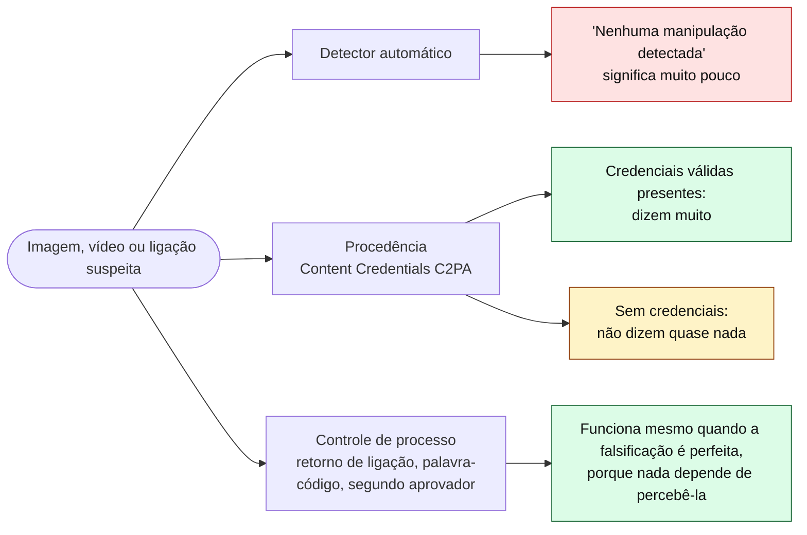
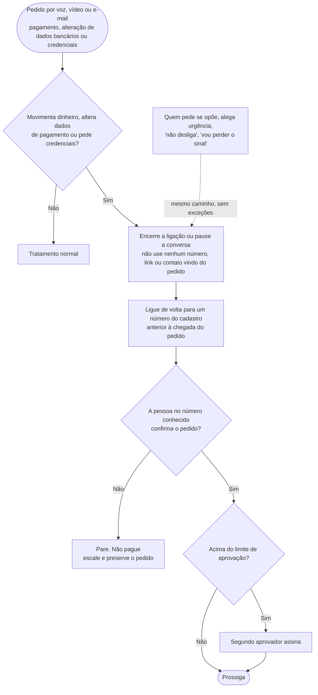

# Dia 71: Deepfake de voz, vídeo e imagem em fraudes

> 🇺🇸 Original: [*Day 71: Deepfake voice, video, and images in fraud*](https://github.com/thiefdroppers/cyber-investigator-skills/blob/main/curriculum/phase-5-fraud-social-engineering/day-71.md) — © ThiefDroppers, licença MIT.
> Aqui: tradução fiel **+** camada brasileira. Nada do original foi removido; tudo o que é novo vem marcado com ➕.

**Fase 5. Fraude, golpes e engenharia social** · Meta da trilha: verificar uma imagem ou um vídeo suspeito com ferramentas gratuitas de procedência e forenses, registrar o que cada checagem consegue e não consegue estabelecer, e escrever um procedimento de verificação que continue funcionando quando a falsificação for boa o bastante para enganar você.

Rank Jutsu: `A` · [](https://colab.research.google.com/github/Ridd1kulusC0d3r/investigador-cyber-90-dias/blob/main/curriculo/fase-5-fraude-e-engenharia-social/dia-71/dia-71.ipynb)

---

## 🎬 ➕ Abertura do caso — *A voz do gerente Cláudio*

Segunda-feira, 26 de outubro, fim da tarde. Marta Quintão entra na sala de reunião da Vigia com o celular na mão e a cara de quem não dormiu.

— Quarto cooperado com Pix que ele não reconhece. Seu Antônio, 71 anos, da agência Centro. Só que ele *autorizou* as transferências. Diz que foi o Cláudio, o gerente dele, que ligou.

Ela dá play num áudio de WhatsApp que o cooperado recebeu no domingo à noite, de um número `+55 00 00000-0021`: *"Seu Antônio, boa noite, aqui é o Cláudio, da agência. Amanhã cedo eu ligo pro senhor, é sobre aquele Pix bloqueado, coisa rápida."* A voz é a do Cláudio. O jeito de falar é o do Cláudio.

— O Cláudio estava em Belo Horizonte num treinamento, com o celular desligado. E ele aparece num vídeo institucional da cooperativa no Instagram, falando dois minutos sobre Pix seguro.

Rafa cruza os braços.

— Então a pergunta errada é "esse áudio é falso?". A pergunta certa é: **que procedimento teria parado o Seu Antônio mesmo que a voz fosse perfeita?**

É isso que o Dia 71 ensina. *(Personagens e cenário: [Operação Isca](../../../caso-continuo/).)*

---

## 📖 Conceito

Mídia sintética aparece em fraudes de algumas maneiras que se repetem. Uma voz clonada liga para um pai, uma mãe ou um avô dizendo ser um parente em apuros. Um "executivo" com o rosto trocado entra numa videochamada e aprova um pagamento. Uma celebridade em *deepfake* recomenda uma plataforma de investimento num anúncio de rede social. Um candidato falso faz entrevista para uma vaga remota para conseguir acesso à rede. Uma foto de documento fabricada passa pela checagem de abertura de conta num banco. O relatório 2025 do IC3 recebeu mais de 22.000 reclamações que mencionavam IA, com perdas ajustadas acima de US$ 893 milhões. Ele descreve golpes de aflição assistidos por IA usando clonagem de voz (mais de US$ 5 milhões relatados) e entrevistas de emprego em que o movimento dos lábios não bate com o áudio e uma tosse ou um espirro é ouvido sem ser visto. No início de 2024, a polícia de Hong Kong descreveu um caso em que um funcionário do financeiro transferiu cerca de US$ 25 milhões depois de uma videoconferência em que, segundo a polícia, todos os outros participantes eram *deepfakes* de colegas reais.

Detectores automáticos de *deepfake* existem, mas perdem terreno a cada melhoria dos geradores, e um resultado "nenhuma manipulação detectada" significa muito pouco. Duas outras abordagens se sustentam melhor.

A **procedência** pergunta de onde o arquivo veio. As *Content Credentials* (o padrão C2PA) anexam informação assinada sobre como um arquivo foi criado e editado. Quando as credenciais estão presentes e válidas, elas dizem muito. Quando estão ausentes, não dizem quase nada, já que a maioria das câmeras e plataformas ainda remove essas credenciais ou nunca as adiciona.

Os **controles de processo** não dependem de perceber a falsificação. O comunicado de utilidade pública (*public service announcement*, PSA) do FBI de dezembro de 2024 recomenda uma palavra ou frase secreta combinada com a família, e desligar e ligar de volta para um número que você já conhece. O alerta da FinCEN de novembro de 2024 (FIN-2024-Alert004) orienta os bancos a observar clientes que evitam a verificação ao vivo alegando "problemas técnicos" ou que parecem usar software que apresenta vídeo pré-gravado. Para um pedido de pagamento, ligar de volta para um número que já estava no cadastro derrota um clone de voz perfeito.

As três abordagens, e quanto vale cada tipo de resultado:



### Checklist de sinais de alerta
1. Um pedido urgente de dinheiro ou credenciais que chega por voz ou vídeo, de alguém que normalmente usa outro canal.
2. Quem liga resiste ao retorno da ligação ("vou perder o sinal", "não desliga").
3. O participante do vídeo evita movimentos não planejados: não vira totalmente de lado, não passa a mão na frente do rosto, não se levanta.
4. O movimento dos lábios se desencontra do áudio; sons (tosse, risada) não batem com o que está na tela.
5. Imperfeições visuais que o PSA do FBI lista: mãos ou pés distorcidos, dentes ou olhos irreais, rostos indistintos ou irregulares, óculos ou joias irreais, sombras incorretas, atraso (*lag*) e movimento irreal.
6. Áudio chapado, estranhamente limpo, ou sem respiração e sem som de ambiente.
7. Do lado da plataforma: uma foto de documento inconsistente com o resto do cadastro, ou "erros de câmera" repetidos durante uma prova de vida (*liveness check*).
8. Um vídeo de recomendação de uma figura pública promovendo uma plataforma de investimento específica ou um sorteio.

## 📚 Recursos

- [FBI IC3 PSA: Criminals use generative AI to facilitate financial fraud (dez/2024)](https://www.ic3.gov/PSA/2024/PSA241203): exemplos por tipo de mídia e os passos de proteção citados acima.
- [Alerta FinCEN FIN-2024-Alert004 sobre mídia *deepfake* (PDF)](https://www.fincen.gov/sites/default/files/shared/FinCEN-Alert-DeepFakes-Alert508FINAL.pdf): sinais de alerta da abertura de conta e da movimentação bancária.
- [Relatório de Crimes na Internet 2025 do FBI IC3 (PDF)](https://www.ic3.gov/AnnualReport/Reports/2025_IC3Report.pdf): a seção *"How AI could be used in frauds/scams"*.
- [Content Credentials Verify](https://contentcredentials.org/verify): envie uma imagem ou um vídeo para ler as credenciais C2PA que ele carregar.
- [Plugin de verificação InVID-WeVerify](https://www.invid-project.eu/tools-and-services/invid-verification-plugin/): extensão de navegador gratuita para jornalistas. Extrai quadros-chave (*keyframes*) de um vídeo para busca reversa, amplia quadros, lê metadados e dá acesso a filtros forenses.
- [ExifTool](https://exiftool.org/): lê metadados de arquivos pela linha de comando.
- Checagens publicadas com explicação detalhada: [AFP Fact Check](https://factcheck.afp.com/) e [Reuters Fact Check](https://www.reuters.com/fact-check/). Procure em qualquer um dos dois por "AI-generated" ou "deepfake".

### ➕ Recursos do contexto Brasil

- [AFP Checamos](https://checamos.afp.com/), [Aos Fatos](https://www.aosfatos.org/) e [Projeto Comprova](https://projetocomprova.com.br/): checagens em português, com muitos casos de anúncios falsos de investimento usando voz ou rosto de apresentadores e figuras públicas brasileiras. Procure por "deepfake" ou "voz clonada". A Agência Lupa também publica checagens do tipo.
- [Cartilha de Segurança para Internet (CERT.br)](https://cartilha.cert.br/): fascículos sobre golpes, em linguagem para o público geral. Útil para escrever o material de prevenção da cooperativa.
- [Pix — página do Banco Central](https://www.bcb.gov.br/estabilidadefinanceira/pix): regras do arranjo, incluindo limites noturnos e o MED (Mecanismo Especial de Devolução), que voltam nos Dias 75 e 76.
- [Constituição Federal, art. 5º](https://www.planalto.gov.br/ccivil_03/constituicao/constituicao.htm): o inciso XXVIII, alínea "a", protege a reprodução da imagem e da voz humanas. O gerente cuja voz foi clonada também é vítima.

## 🛠️ Prática: InVID-WeVerify e Content Credentials, um registro de verificação de mídia e um procedimento de retorno de ligação

**Seu checklist de hoje.** Faça na ordem e marque cada item ao terminar:

- [ ] Parte 1: verifique três itens publicados
- [ ] Parte 2: um procedimento de retorno de ligação
- [ ] ➕ Parte 3: o áudio do "gerente Cláudio" e o procedimento da Serra Azul (Prática BR)
- [ ] ➕ Parte 4: o notebook do dia no Colab

### Parte 1: verifique três itens publicados

Escolha três imagens ou vídeos que a AFP ou a Reuters já checaram como gerados por IA ou manipulados, de preferência usados em golpes (anúncios falsos de investimento com celebridades são comuns). Trabalhar a partir de itens já desmentidos permite comparar seus achados com uma resposta conhecida. Não use mídia de pessoas privadas, e não use imagens íntimas ou sexuais de ninguém, reais ou sintéticas.

Para cada item, registre o seguinte num log:

1. Fonte e data: onde a checagem encontrou o item e a URL da checagem.
2. Procedência: resultado do Content Credentials Verify. Escreva "sem credenciais" se não houver nenhuma, e não trate isso como evidência para nenhum dos lados.
3. Metadados: rode `exiftool <arquivo>` na sua cópia baixada. Anote o software de criação, as datas e se os metadados foram removidos (comum depois do envio para redes sociais).
4. Busca reversa: para imagens, TinEye e Google Lens; para vídeo, extraia quadros-chave com o InVID-WeVerify e faça a busca reversa deles. Registre a versão mais antiga que conseguir encontrar e se ela difere da que está circulando.
5. Inspeção visual: use a lupa do plugin em mãos, dentes, orelhas, joias, texto ao fundo e na borda do rosto. Registre cada artefato com a marcação de tempo ou a referência do recorte.
6. Sua conclusão, a conclusão da checagem e onde elas diferem. Nomeie a única checagem que mais pesou na sua conclusão.

Exemplo resolvido de linha (item fictício, só para mostrar o formato):

| Checagem | Resultado |
|---|---|
| Item | Vídeo de 38 segundos, "ministro da Fazenda" recomendando `quantum-yield.example` |
| Procedência | Sem credenciais |
| Metadados | Removidos; recodificado pela plataforma |
| Busca reversa | O quadro-chave 3 corresponde a uma entrevista televisionada de 2023, com o mesmo fundo e áudio diferente |
| Visual | A sincronia labial se desencontra a partir de 0:12; os dentes borram em "garantido"; nenhuma piscada entre 0:05 e 0:19 |
| Conclusão | Filmagem original com áudio sintético e reanimação labial. Evidência mais forte: a correspondência do quadro-chave com um original sem relação. Os artefatos visuais são só de apoio |

### Parte 2: um procedimento de retorno de ligação

Escreva um procedimento de uma página para a equipe financeira de uma pequena empresa, cobrindo qualquer pagamento ou alteração de dados bancários pedida por voz, vídeo ou e-mail. Ele precisa especificar o gatilho (que tipo de pedido o aciona), a regra do retorno de ligação (para um número que já estava no cadastro antes de o pedido chegar, nunca um número fornecido no pedido), quem mais precisa aprovar e acima de que valor, e o que fazer se quem pede se opuser ou alegar urgência. Acrescente uma seção curta para os funcionários sobre a palavra-código da família, usando a redação do PSA do FBI.

Um esqueleto para você construir em cima. O seu procedimento preenche os valores, os nomes dos aprovadores e onde ficam guardados os números do cadastro. Repare que nenhum passo pede a ninguém que julgue se a voz ou o rosto eram reais.



Depois, teste seu procedimento contra o caso de Hong Kong da seção Conceito. Anote em que passo ele teria parado a transferência, considerando que a videochamada em si foi convincente. Se a resposta depender de alguém perceber o *deepfake*, reescreva o procedimento para que não dependa.

### O artefato

Um registro de verificação cobrindo três itens publicados, seis checagens cada, e o procedimento de retorno de ligação de uma página.

### ➕ Prática BR

**Exercício A — o registro de verificação do áudio do "Cláudio".** Monte, para o áudio de WhatsApp que o Seu Antônio recebeu (item `E02` do caso; é fictício, você trabalha com a descrição abaixo), as mesmas seis linhas da Parte 1:

| Checagem | O que o caso fornece |
|---|---|
| Item | Áudio de WhatsApp de 14 segundos, recebido em 25/10/2026 às 21:58 (horário de Brasília) de `+55 00 00000-0021`, com a voz atribuída a "Cláudio, gerente da agência Centro" |
| Procedência | O arquivo veio do celular do cooperado, exportado pela opção "Exportar conversa" com mídia. Áudio de WhatsApp não carrega Content Credentials |
| Metadados | Contêiner Opus recodificado pelo aplicativo; sem software de criação |
| Busca reversa | Frases idênticas ("coisa rápida", "aquele Pix bloqueado") aparecem no vídeo institucional público da cooperativa? Compare a transcrição com a do vídeo |
| Escuta | Ausência de respiração entre frases, silêncio digital absoluto entre palavras, ausência de ruído de ambiente |
| Controle de processo | O Cláudio real estava com o celular desligado, num treinamento com lista de presença; o número `+55 00 00000-0021` não consta em nenhum cadastro da cooperativa |

Escreva a conclusão e nomeie a checagem que mais pesou. (Dica: não é a escuta.)

**Exercício B — o procedimento da Serra Azul.** Reescreva o esqueleto da Parte 2 para os **cooperados** (não para o financeiro): uma página, linguagem simples, letra grande, pensada para quem tem 71 anos e nunca ouviu falar de *deepfake*. Ela precisa dizer, sem termos técnicos:

- a cooperativa nunca pede transferência para "conta de segurança", nunca pede senha, código do SMS ou que você instale aplicativo;
- se alguém da cooperativa ligar pedindo dinheiro ou dados, desligue e ligue para o número que está no verso do seu cartão ou no seu contrato, mesmo que a voz seja conhecida;
- combine uma palavra-segredo com a família para pedidos de dinheiro por telefone ou áudio (o "golpe do falso parente" usa o mesmo mecanismo);
- quem estiver com pressa para você não desligar é motivo para desligar.

Depois, teste o procedimento contra a ligação do Seu Antônio, como o original manda fazer com o caso de Hong Kong: em qual passo ele teria parado, considerando que a voz era convincente?

### ➕ Parte 4: o notebook do dia

Abra o [notebook do Dia 71 no Colab](https://colab.research.google.com/github/Ridd1kulusC0d3r/investigador-cyber-90-dias/blob/main/curriculo/fase-5-fraude-e-engenharia-social/dia-71/dia-71.ipynb). Nele você:

1. gera dois áudios sintéticos com a biblioteca `wave` (um com ruído de sala, outro "limpo demais") e mede o piso de ruído quadro a quadro, para ver na prática por que esse sinal é **só de apoio**;
2. procura credenciais C2PA dentro de um JPEG lendo os segmentos APP11 byte a byte, e entende por que "sem credenciais" não diz nada;
3. joga o quiz **"qual checagem pesa mais?"**, com itens do original e da Operação Isca;
4. preenche um formulário e sai com o procedimento de retorno de ligação da Serra Azul em `.md`, com SHA-256.

## ✅ Checkpoint

- Para cada item, seu registro nomeia a única checagem que mais pesou na sua conclusão.
- Essa checagem quase nunca deve ser a nota de um detector ou "parecia falso". Deve ser algo como uma correspondência na busca reversa, um registro de procedência ou uma contradição com um original verificável.
- Você anotou em que passo seu procedimento teria parado a transferência de Hong Kong, considerando que a videochamada em si foi convincente.
- Esse passo não depende de ninguém perceber o *deepfake*.
- Sem consultar notas: você consegue explicar por que o resultado "nenhuma manipulação detectada" de um detector significa muito pouco?

### ➕ Checkpoint BR

- Seu registro do áudio do "Cláudio" nomeia como checagem mais pesada a contradição com um fato verificável (o Cláudio real com o celular desligado e o número fora de qualquer cadastro), não a escuta.
- O procedimento para cooperados cabe numa página, não usa a palavra "deepfake" e não pede ao cooperado que julgue se a voz é real.
- Você explica por que "áudio de WhatsApp sem Content Credentials" não é evidência de falsificação.
- No notebook, você acertou pelo menos 7 das 9 perguntas do quiz.

## ⚖️ ➕ Camada jurídica BR

**Fraude eletrônica (CP, art. 171, §2º-A).** Incluído pela Lei 14.155/2021, qualifica o estelionato quando a fraude usa informações fornecidas pela vítima, ou por terceiro, induzidos a erro por redes sociais, contatos telefônicos, correio eletrônico fraudulento ou meio fraudulento análogo. A falsa central com voz clonada cabe exatamente aí. Quando a vítima é idosa ou vulnerável, o §4º do mesmo artigo prevê aumento de pena.

**Falsa identidade (CP, art. 307).** Atribuir-se falsa identidade para obter vantagem. O operador que fala "como o Cláudio" pratica, em tese, também essa conduta; enquadrar é trabalho da polícia e do Ministério Público, não seu.

**A voz do gerente é dele.** A Constituição (art. 5º, XXVIII, "a") protege a reprodução da imagem e da voz humanas. Para a LGPD, voz usada para identificar alguém pode ser dado biométrico, que é dado pessoal sensível (art. 5º, II). Duas consequências para o caso: o Cláudio real é vítima e deve ser ouvido e protegido; e o áudio, como evidência, contém dado pessoal de duas pessoas (o cooperado e o gerente), o que restringe quem pode recebê-lo.

**Vídeos institucionais viram matéria-prima.** Não existe regra que proíba a cooperativa de publicar o gerente falando, mas a recomendação de risco é óbvia: menos áudio limpo e longo de funcionários que atendem cooperados por telefone.

> Material de estudo, não constitui orientação jurídica.

## 🧠 ➕ Camada 8 — por que a voz conhecida desliga a dúvida

Timothy Levine descreveu a **teoria do padrão de verdade** (*truth-default theory*): em conversas comuns, presumimos que o outro fala a verdade, e só saímos desse modo quando algo forte nos tira dele. Uma voz conhecida é o oposto de "algo forte": ela reforça o padrão. O golpe de falsa central soma a isso dois princípios de influência descritos por Robert Cialdini: **autoridade** (é o gerente, é "da segurança") e **escassez**, aqui na forma de urgência ("coisa rápida", "antes que bloqueiem o resto").

Para alguém de 71 anos que conhece o gerente pelo nome há anos, desconfiar da voz dele não é só difícil, é socialmente custoso: parece desfeita. Por isso o procedimento não pode pedir que o cooperado *desconfie da pessoa*; ele precisa pedir que o cooperado *siga uma regra que vale para todo mundo*, inclusive para o gerente verdadeiro. "Desligue e ligue para o número do cartão" não ofende ninguém.

Consequência prática para o analista: no relatório, nunca escreva que a vítima "deveria ter percebido a voz falsa". Escreva qual controle de processo faltou. O primeiro texto culpa a pessoa; o segundo protege os próximos 40 mil cooperados.

## 🤖 ➕ Skill do dia

O dia propõe à skill um procedimento novo, **"Verificação de mídia suspeita e controle de processo"**, que ordena as checagens por peso (procedência e contradição verificável antes de inspeção visual e detector) e manda sempre recomendar um controle de processo que funcione mesmo com a falsificação perfeita. Texto e caso de teste em [`_skill-delta.md`](_skill-delta.md).

## 💡 ➕ Inovação OSINT do dia — achar um manifesto C2PA num JPEG sem instalar nada

O padrão C2PA embute o manifesto de Content Credentials em JPEGs dentro de segmentos **APP11** (marcador `0xFFEB`), em caixas no formato JUMBF rotuladas `c2pa`. Antes de enviar um arquivo a um site de verificação (o que pode não ser permitido num caso com dado sensível), dá para saber localmente se existe *algum* manifesto:

```python
def tem_manifesto_c2pa(caminho):
    dados = open(caminho, "rb").read()
    i = 2                                    # pula o SOI (FFD8)
    while i + 4 <= len(dados) and dados[i] == 0xFF:
        marcador = dados[i + 1]
        tamanho = int.from_bytes(dados[i + 2:i + 4], "big")
        if marcador == 0xEB and b"c2pa" in dados[i + 4:i + 2 + tamanho]:
            return True                      # APP11 com caixa JUMBF "c2pa"
        if marcador == 0xDA:                 # início da imagem comprimida: acabou o cabeçalho
            break
        i += 2 + tamanho
    return False
```

Isso só diz se o manifesto **existe**. Validar a assinatura exige a ferramenta oficial de código aberto da Content Authenticity Initiative (`c2patool`) ou o Content Credentials Verify. E a regra do dia vale aqui também: `False` não é evidência de nada.

## 📝 Diário de estudo

- Data:
- Tempo gasto:
- O que ficou claro:
- O que ainda está nebuloso:
- Artefato produzido: `notas/dia-71-registro-verificacao.md`, `notas/dia-71-procedimento-retorno.md`, `notas/dia-71-procedimento-cooperados.md`

---
<sub>Baseado em [cyber-investigator-skills](https://github.com/thiefdroppers/cyber-investigator-skills) por ThiefDroppers (MIT). Tradução, camada BR, Camada 8, skill pt-BR e notebook por Deivison Lourenço (@Ridd1kulusC0d3r).</sub>
