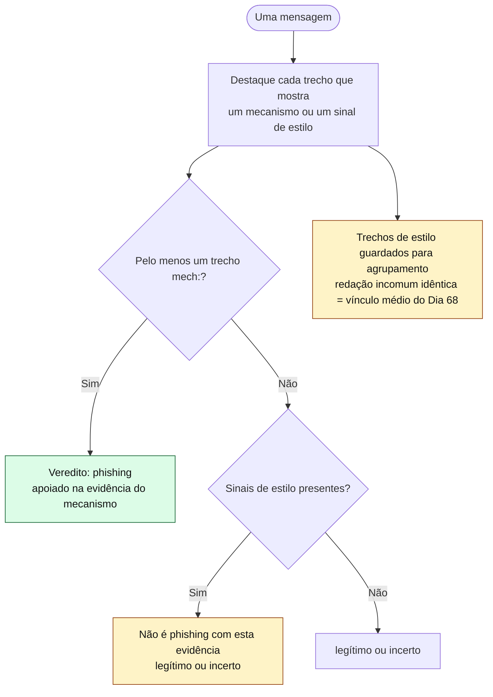
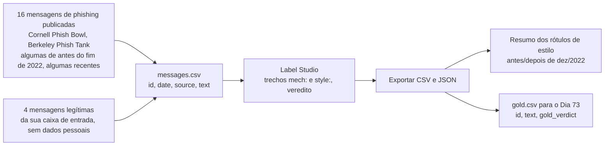

# Dia 72: Phishing e textos de golpe escritos por IA

> 🇺🇸 Original: [*Day 72: AI-written phishing and scam text*](https://github.com/thiefdroppers/cyber-investigator-skills/blob/main/curriculum/phase-5-fraud-social-engineering/day-72.md) — © ThiefDroppers, licença MIT.
> Aqui: tradução fiel **+** camada brasileira. Nada do original foi removido; tudo o que é novo vem marcado com ➕.

**Fase 5. Fraude, golpes e engenharia social** · Meta da trilha: anotar um conjunto de mensagens de phishing reais e publicadas, tanto pelos mecanismos de fraude quanto pelos sinais de escrita por máquina, e aprender qual dos dois tipos de rótulo consegue sustentar um achado.

Rank Jutsu: `A` · [](https://colab.research.google.com/github/Ridd1kulusC0d3r/investigador-cyber-90-dias/blob/main/curriculo/fase-5-fraude-e-engenharia-social/dia-72/dia-72.ipynb)

---

## 🎬 ➕ Abertura do caso — *"Claro! Aqui está uma versão mais formal"*

Terça, 27 de outubro. A Marta encaminha para a Vigia um pacote de mensagens que a ouvidoria juntou desde o começo do caso: os SMS do dia 5, mensagens de WhatsApp de um perfil "Serra Azul Atendimento" e, para comparar, quatro comunicados verdadeiros da cooperativa.

Você abre a mensagem M04 e ri alto. Começa assim: *"Claro! Aqui está uma versão mais formal da mensagem: Prezado(a) cooperado(a)..."*

— O Pescador está usando ChatGPT! — você diz. — Isso prova que é golpe.

Rafa nem levanta os olhos.

— Abre o M09. O e-mail do aplicativo novo, que a própria comunicação da Serra Azul mandou. "Uma nova etapa em nossa jornada", "mais rápido, mais seguro e mais completo". Também parece ChatGPT. É golpe?

Ele deixa a pergunta no ar.

— O "Claro! Aqui está" não prova que é golpe. Prova outra coisa, e essa outra coisa vale ouro. Descobre qual.

É isso que o Dia 72 ensina. *(Personagens e cenário: [Operação Isca](../../../caso-continuo/).)*

---

## 📖 Conceito

Durante anos, o conselho padrão contra phishing foi "procure erros de ortografia e de gramática". Os grandes modelos de linguagem eliminaram a maior parte desses erros, sem custo nenhum para quem envia. O relatório 2025 do IC3 descreve geradores de chat produzindo e-mails de executivos que "soam oficiais" para BEC, e golpistas de investimento usando IA para gerar milhares de conversas que se leem de modo diferente umas das outras. A gramática deixou de ser um filtro útil, e uma mensagem bem escrita não é evidência de remetente legítimo.

Texto escrito por máquina às vezes é reconhecível, mas isso importa menos do que parece. A OpenAI retirou o próprio classificador de texto de IA em julho de 2023, seis meses depois do lançamento. Pelos números da própria OpenAI, ele identificava corretamente só 26% do texto escrito por IA e rotulava erroneamente 9% do texto humano como escrito por IA. Outras pesquisas publicadas constataram que alguns detectores marcam com mais frequência como gerada por IA a escrita em inglês de não nativos. Empresas legítimas também usam IA para escrever e-mails. Por isso, "isto parece escrito por IA" nunca responde à pergunta que o investigador recebe, que é se a mensagem é fraudulenta.

Os sinais de estilo ainda ganham um lugar na investigação, de três formas:

1. **Persona incompatível.** Um "soldado em missão" ou uma "viúva aposentada" que escreve em parágrafos corporativos polidos, com títulos em negrito, merece uma anotação. Também merece uma mudança repentina de voz no meio de uma conversa, que pode significar um novo operador ou a troca para um modelo.
2. **Agrupamento por modelo de texto (*template clustering*).** O mesmo fraseado incomum em muitas mensagens sustenta o vínculo de força média "redação idêntica" do Dia 68, tenha sido escrito por uma pessoa ou por um modelo.
3. **Sobras.** Resíduo de chatbot não editado ("Claro! Aqui está uma versão revisada do e-mail:", "Como modelo de linguagem de IA, não posso...") colado numa mensagem de golpe mostra que o remetente usou um modelo e não leu a saída. Reportagens de 2024 encontraram anúncios de produtos *online* com títulos formados por mensagens de recusa de chatbot.

Os sinais a procurar vêm da página *"Signs of AI writing"* da Wikipédia, mantida por editores que removem texto gerado por máquina da enciclopédia. O mesmo catálogo é o que as ferramentas de edição "humanizadoras" usam para tirar esses sinais de rascunhos de IA, então um remetente cuidadoso também pode removê-los, e a ausência deles não diz nada. Os grupos que mais aparecem em texto de golpe:

| Grupo de sinais | Como aparece numa mensagem de golpe |
|---|---|
| Importância inflada | "Esta é uma oportunidade decisiva que pode transformar o seu futuro financeiro" |
| Linguagem de venda | "uma plataforma de investimento exclusiva, de nível mundial, reconhecida por sua abordagem inovadora" |
| Tríades forçadas | "seguro, simples e rentável"; três benefícios por parágrafo, em todo parágrafo |
| Rótulos em negrito e títulos com emoji | `**Próximos passos:**` ou `✅ Retorno garantido` no que se diz uma mensagem pessoal |
| Aberturas encenadas | "Vamos mergulhar em como você pode começar a ganhar hoje" |
| Resíduo de chatbot | "Espero que isso ajude!", "Fique à vontade para me dizer", "Aqui está um...", texto de recusa |
| Travessões e aspas curvas uniformes | Pontuação tipográfica num texto supostamente digitado no celular |

Cada um deles pode aparecer em escrita humana. Trate-os como sinais fracos que precisam de companhia, nunca como mecanismo.

Os dois tipos de rótulo vão para lugares diferentes. Rótulos de mecanismo decidem o veredito. Rótulos de estilo nunca decidem; no máximo, ajudam a agrupar mensagens que podem compartilhar autor ou modelo de texto.



## 📚 Recursos

- [Wikipedia: Signs of AI writing](https://en.wikipedia.org/wiki/Wikipedia:Signs_of_AI_writing): o catálogo de sinais, com exemplos, do WikiProject AI Cleanup.
- [Relatório de Crimes na Internet 2025 do FBI IC3 (PDF)](https://www.ic3.gov/AnnualReport/Reports/2025_IC3Report.pdf): *"How AI could be used in frauds/scams"*.
- [OpenAI: New AI classifier for indicating AI-written text](https://openai.com/index/new-ai-classifier-for-indicating-ai-written-text/): o anúncio, com a nota de julho de 2023 de que o classificador foi retirado por baixa precisão.
- [Cornell IT Phish Bowl](https://it.cornell.edu/phish-bowl) e [UC Berkeley Phish Tank](https://security.berkeley.edu/resources/phish-tank): e-mails de phishing higienizados publicados pelos escritórios de segurança das universidades, cobrindo vários anos. Não interaja com nenhum endereço ou link deles.
- [Label Studio](https://labelstud.io/): ferramenta gratuita e de código aberto para rotular dados. Instale com `pip install label-studio` e inicie com `label-studio start`.

### ➕ Recursos do contexto Brasil

- [Cartilha de Segurança para Internet (CERT.br)](https://cartilha.cert.br/): o fascículo de golpes traz exemplos de mensagens em português e os mecanismos que se repetem (urgência, link, pedido de dados).
- A própria lista *"Signs of AI writing"* é em inglês. Em português, os sinais mais comuns que você vai ver em isca brasileira são: "Prezado(a)" com a flexão entre parênteses, marcadores não preenchidos (`[Nome do Cooperado]`), tríades do tipo "prioridade, compromisso e missão", e a abertura "Claro! Aqui está...". Trate a lista desta seção como adaptação sua, não como fonte.
- Os mecanismos brasileiros já estão na skill: chave Pix de pessoa física diferente de quem cobra, e "bloqueio"/"regularização" que exige ação imediata por link ou ligação (padrão falsa central). Ver [`SKILL.md`](../../../skills/investigador-cyber/SKILL.md).

## 🛠️ Prática: Label Studio, um conjunto rotulado de 20 mensagens de phishing publicadas

Este conjunto vira os dados de teste do Dia 73, então rotule com cuidado.



**Seu checklist de hoje.** Faça na ordem e marque cada item ao terminar:

- [ ] Coletar
- [ ] Configurar o projeto de rotulagem
- [ ] Rotular
- [ ] Exportar
- [ ] ➕ Prática BR: rotular as 12 mensagens da Operação Isca
- [ ] ➕ O notebook do dia no Colab

### Coletar

Copie o texto de 20 mensagens: 16 dos arquivos de Cornell e Berkeley (pegue algumas de antes do fim de 2022 e algumas dos últimos dois anos, e registre a data de cada uma) e 4 mensagens legítimas da sua própria caixa de entrada, sem dados pessoais (um aviso de entrega, um e-mail de redefinição de senha que você pediu, uma *newsletter*, um alerta real de site de vagas). Salve como CSV com as colunas `id`, `date`, `source`, `text`. Não gere texto de phishing com um chatbot para completar o conjunto. Você precisa de mensagens reais para o teste ter sentido, e produzir texto de golpe pronto para envio não é uma habilidade que este roteiro ensina.

### Configurar o projeto de rotulagem

No Label Studio, crie um projeto, importe o CSV e use esta configuração de rotulagem:

```xml
<View>
  <Text name="text" value="$text"/>
  <Labels name="span" toName="text">
    <Label value="mech:credential_request"/>
    <Label value="mech:payment_request"/>
    <Label value="mech:urgency_deadline"/>
    <Label value="mech:link_or_attachment"/>
    <Label value="mech:impersonated_sender"/>
    <Label value="mech:off_platform_move"/>
    <Label value="style:inflated_or_sales"/>
    <Label value="style:triad"/>
    <Label value="style:bold_or_emoji_heading"/>
    <Label value="style:chatbot_residue"/>
    <Label value="style:generic_greeting"/>
  </Labels>
  <Choices name="verdict" toName="text" choice="single">
    <Choice value="phishing"/>
    <Choice value="legitimate"/>
    <Choice value="unsure"/>
  </Choices>
</View>
```

(Os nomes dos rótulos ficam em inglês, como no original, porque o `screen.py` do Dia 73 usa os mesmos nomes. Em português: pedido de credencial, pedido de pagamento, urgência/prazo, link ou anexo, remetente falsificado, mudança para fora da plataforma; inflado ou de venda, tríade, título em negrito ou emoji, resíduo de chatbot, saudação genérica.)

### Rotular

Para cada mensagem, destaque o trecho exato que mostra cada mecanismo ou sinal e escolha um veredito. Seu veredito precisa se apoiar em rótulos `mech:`. Se uma mensagem tem sinais de estilo mas nenhum mecanismo, ela não é phishing só com essa evidência.

Exemplo resolvido (fictício):

> Dear Valued Employee, We are excited to inform you about a pivotal update to our payroll platform that will transform how you receive payments, making it faster, safer, and more rewarding. To avoid any interruption, please re-verify your direct deposit details within 24 hours here: [link]. I hope this helps!
>
> *(Tradução: "Prezado colaborador, temos o prazer de informar sobre uma atualização decisiva da nossa plataforma de folha de pagamento, que vai transformar a forma como você recebe, tornando-a mais rápida, mais segura e mais vantajosa. Para evitar qualquer interrupção, confirme novamente os dados do seu depósito em conta em até 24 horas aqui: [link]. Espero que isso ajude!")*

Rótulos: `style:generic_greeting` em "Dear Valued Employee"; `style:inflated_or_sales` em "pivotal update ... will transform"; `style:triad` em "faster, safer, and more rewarding"; `mech:urgency_deadline` em "within 24 hours"; `mech:credential_request` e `mech:link_or_attachment` em "re-verify your direct deposit details ... here: [link]"; `style:chatbot_residue` em "I hope this helps!". Veredito: phishing, pela força dos rótulos de mecanismo. Os rótulos de estilo sugerem redação por máquina e sustentariam agrupar esta mensagem com outras.

### Exportar

Exporte as anotações em CSV e JSON. Depois faça uma pequena tabela-resumo: para as mensagens datadas antes de dezembro de 2022 e depois, conte quantas trazem pelo menos um rótulo `style:`. Escreva duas frases sobre o que mudou, se algo mudou, e uma frase sobre por que a resposta não consegue dizer quais mensagens foram escritas por IA.

Por fim, conte os rótulos `style:` de cada uma das suas quatro mensagens legítimas e registre as contagens ao lado da tabela-resumo. Se uma *newsletter* legítima pontua tantos sinais de estilo quanto um e-mail de phishing, você viu na prática por que esses sinais não decidem um caso sozinhos.

### O artefato

A exportação do projeto do Label Studio (CSV e JSON) com 20 mensagens rotuladas, cada veredito apoiado em pelo menos um trecho `mech:` ou marcado explicitamente como legítimo ou incerto, mais a tabela-resumo antes/depois e as suas três frases.

### ➕ Prática BR

O arquivo [`caso-continuo/dados/dia-72/mensagens.csv`](../../../caso-continuo/dados/dia-72/mensagens.csv) tem 12 mensagens fictícias da Operação Isca: 8 da campanha (SMS do dia 5, WhatsApp do perfil "Serra Azul Atendimento", uma mensagem do mesmo kit mirando a Coopvale, a mensagem "salva meu número novo" do falso Cláudio) e 4 comunicados legítimos da cooperativa. São mensagens de **laboratório**, escritas para o exercício; não são texto de golpe pronto para uso.

1. Importe o CSV num segundo projeto do Label Studio, com a mesma configuração XML. Acrescente, se quiser, dois rótulos brasileiros de mecanismo: `mech:pix_to_individual` (pagamento para chave Pix de pessoa física) e `mech:fake_block_or_regularize` ("bloqueio"/"regularização" que exige ação imediata). Eles são os mecanismos ➕ que a skill já tem.
2. Rotule as 12. Regras de sempre: veredito só com `mech:`.
3. Responda, por escrito:
   - Quais mensagens têm **resíduo de chatbot** (`Claro! Aqui está...`, `[Nome do Cooperado]`)? Elas vieram do mesmo remetente? De quantas cooperativas?
   - O e-mail M09 (legítimo) pontua quantos sinais de estilo? Mais ou menos que o M01 (SMS do golpe)?
   - Qual é a resposta à pergunta do Rafa: o que o "Claro! Aqui está" prova, se não prova que é golpe? (Dica: releia "Agrupamento por modelo de texto" e pense no M06.)
4. Desenhe a aresta que você acrescentaria ao grafo do Dia 68: entre quais casos, com que rótulo e com que peso (forte, médio ou fraco).

### ➕ O notebook do dia

Abra o [notebook do Dia 72 no Colab](https://colab.research.google.com/github/Ridd1kulusC0d3r/investigador-cyber-90-dias/blob/main/curriculo/fase-5-fraude-e-engenharia-social/dia-72/dia-72.ipynb). Nele você:

1. carrega as 12 mensagens (do repositório ou da amostra embutida);
2. roda um marcador de sinais de estilo em pt-BR, só com `re`, e um marcador de mecanismos, e vê na tabela que um e-mail legítimo pode pontuar mais estilo que um golpe;
3. aplica a regra do fluxograma (veredito só com `mech:`) e monta a tabela-resumo;
4. encontra a **mesma frase incomum** em mensagens contra duas cooperativas, e gera a aresta para o grafo;
5. joga o quiz **"mecanismo ou estilo?"** e exporta o `gold.csv` do Dia 73.

## ✅ Checkpoint

- Filtre sua exportação pelas mensagens rotuladas como phishing: cada uma tem pelo menos um trecho `mech:`.
- Toda mensagem cujo veredito de phishing se apoiava só em rótulos `style:` foi mudada para incerto.
- Cada veredito mudado para incerto tem um motivo escrito.
- A contagem de rótulos `style:` de cada uma das suas quatro mensagens legítimas está registrada ao lado da tabela-resumo.
- Sem consultar notas: você consegue explicar por que sinais de estilo não decidem um caso sozinhos?

### ➕ Checkpoint BR

- Suas 12 mensagens da Operação Isca têm veredito, e os oito phishing apoiam-se em pelo menos um `mech:`.
- Você registrou que o M09 (legítimo) tem sinais de estilo e mesmo assim é legítimo.
- Você propôs a aresta "resíduo de chatbot idêntico" entre a campanha Serra Azul e a mensagem contra a Coopvale, com **peso médio** (2), e explicou por que não é forte.
- Você explica, sem notas, por que a mensagem M08 ("salva esse meu número novo") é phishing mesmo sem nenhum sinal de estilo.

## ⚖️ ➕ Camada jurídica BR

**O texto gerado não muda o crime.** Para a fraude eletrônica (CP, art. 171, §2º-A), é indiferente se a mensagem foi escrita à mão ou por um modelo; o que importa é a indução a erro por meio eletrônico. Por isso o veredito continua nos mecanismos.

**Rotular mensagem de cooperado é tratar dado pessoal.** As mensagens da Prática BR vieram da ouvidoria, isto é, de cooperados. Se fossem reais, conteriam nome, número de telefone e às vezes valores. Antes de importar no Label Studio: anonimize (troque número e nome por códigos), rode a ferramenta na sua máquina ou em infraestrutura aprovada pela cooperativa, e registre a base legal (LGPD, art. 7º; para a Serra Azul, a mesma do registro de autorização do Dia 1). Não cole mensagens de caso real em chatbot público "para ver se foi IA": isso é compartilhamento com terceiro, e é exatamente o que o Dia 73 proíbe.

**Gerar isca para treino.** O original proíbe completar o conjunto com phishing gerado por chatbot. No Brasil, produzir e distribuir texto de golpe pronto pode, conforme o uso, encostar em participação na fraude; mesmo sem isso, contamina o seu teste. As mensagens da Prática BR são fictícias, curtas e sem link funcional (domínios `.example`).

> Material de estudo, não constitui orientação jurídica.

## 🧠 ➕ Camada 8 — a fluência que se passa por verdade

Por décadas, "português errado" foi o sinal de alarme que ensinamos a idosos e a funcionários. O problema é que o cérebro também funciona ao contrário: pesquisas sobre **fluência de processamento** mostram que texto fácil de ler tende a ser julgado como mais verdadeiro e mais confiável (o efeito de verdade ilusória ligado à repetição é da mesma família). Um modelo de linguagem entrega exatamente isso: frases limpas, tom institucional, "Prezado(a) cooperado(a)". A campanha educativa antiga ("desconfie de erro de português") agora trabalha *a favor* do golpista.

Do lado do analista, o perigo é o oposto: o **viés de confirmação**. Achar o "Claro! Aqui está" dá uma sensação de prova, e a tentação é parar de procurar os mecanismos. A Prática BR foi montada para isso: o e-mail legítimo M09 pontua estilo; o M08, que é golpe, não tem estilo nenhum.

Consequência prática: no material para os cooperados, troque "desconfie de erros" por **"desconfie do pedido"** (Pix para pessoa física, código do SMS, "não desliga"). No relatório, sinal de estilo vai na seção de vínculos, nunca na de veredito.

## 🤖 ➕ Skill do dia

A skill já tem o procedimento de verificação de texto gerado por máquina. O dia propõe **acréscimos** a ele: os marcadores de resíduo em pt-BR (flexões "Prezado(a)", marcadores entre colchetes como "[Nome do Cooperado]"), a regra de que a persona incompatível e a mudança de voz no meio da conversa se registram como observação, e o peso **médio** da aresta de resíduo idêntico. Ver [`_skill-delta.md`](_skill-delta.md).

## 💡 ➕ Inovação OSINT do dia — impressão digital de modelo de texto com *shingles*

Para achar "a mesma redação" em centenas de denúncias sem ler uma a uma, quebre cada mensagem em *shingles* (sequências de 5 palavras) e compare os conjuntos com o índice de Jaccard. É a mesma ideia que buscadores usam para achar páginas quase duplicadas, e roda só com a biblioteca padrão:

```python
import re
def shingles(texto, n=5):
    p = re.findall(r"\w+", texto.lower())               # palavras, sem pontuação
    return {" ".join(p[i:i + n]) for i in range(len(p) - n + 1)}

def jaccard(a, b):
    A, B = shingles(a), shingles(b)
    return len(A & B) / len(A | B) if A | B else 0.0    # 0 = nada em comum, 1 = idênticas
```

Duas mensagens com Jaccard alto contra cooperativas diferentes sugerem o mesmo modelo de texto: é um vínculo **médio** no grafo (kits e roteiros são vendidos e copiados), nunca a prova de um mesmo operador. O notebook do dia aplica isso às 12 mensagens.

## 📝 Diário de estudo

- Data:
- Tempo gasto:
- O que ficou claro:
- O que ainda está nebuloso:
- Artefato produzido: exportação do Label Studio (20 mensagens), tabela-resumo antes/depois de dez/2022, `notas/dia-72-isca-rotulada.csv`, `gold.csv` para o Dia 73

---
<sub>Baseado em [cyber-investigator-skills](https://github.com/thiefdroppers/cyber-investigator-skills) por ThiefDroppers (MIT). Tradução, camada BR, Camada 8, skill pt-BR e notebook por Deivison Lourenço (@Ridd1kulusC0d3r).</sub>
