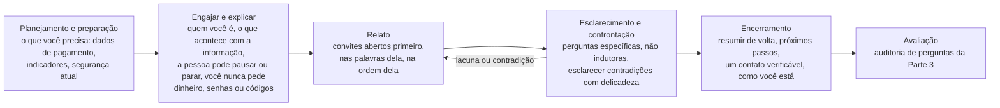
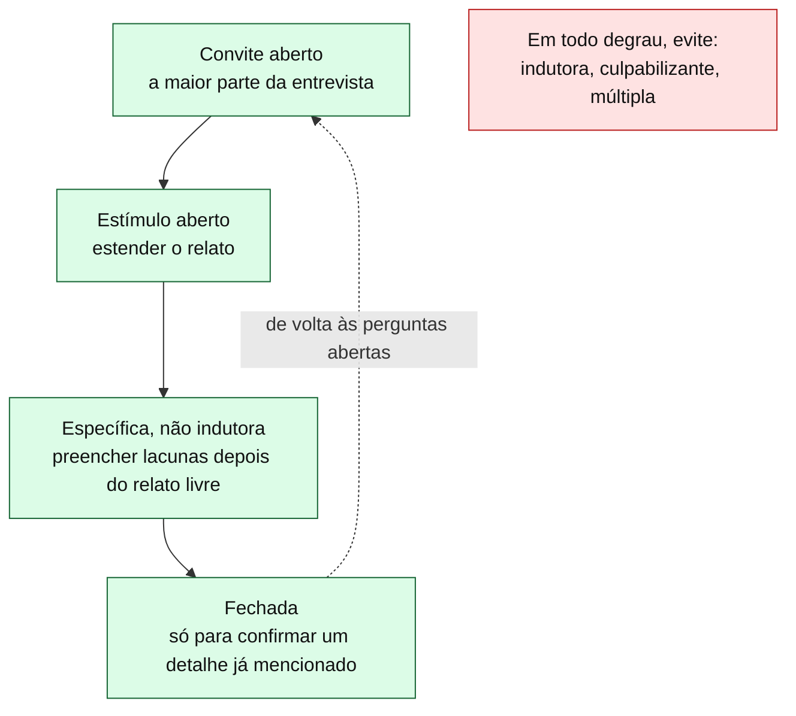

# Dia 74: Entrevistando vítimas de fraude sem revitimizá-las

> 🇺🇸 Original: [*Day 74: Interviewing fraud victims without re-harming them*](https://github.com/thiefdroppers/cyber-investigator-skills/blob/main/curriculum/phase-5-fraud-social-engineering/day-74.md) — © ThiefDroppers, licença MIT.
> Aqui: tradução fiel **+** camada brasileira. Nada do original foi removido; tudo o que é novo vem marcado com ➕.

**Fase 5. Fraude, golpes e engenharia social** · Meta da trilha: planejar e conduzir uma entrevista de treino com uma vítima adulta de fraude (interpretada por um parceiro, com um cenário fictício) que obtenha um relato preciso sem culpa, sem perguntas indutoras e sem promessas que você não pode cumprir.

Rank Jutsu: `A` · [](https://colab.research.google.com/github/Ridd1kulusC0d3r/investigador-cyber-90-dias/blob/main/curriculo/fase-5-fraude-e-engenharia-social/dia-74/dia-74.ipynb)

---

## 🎬 ➕ Abertura do caso — *"Minha filha nem sabe ainda"*

Quinta, 29 de outubro, 14h. Sala pequena da agência Centro da Serra Azul, com uma janela para o estacionamento e uma garrafa de café que ninguém tocou. A Marta pediu que fosse ali, e não na Vigia: é o lugar que o Seu Antônio conhece.

Ele chega sozinho, de camisa social, com uma pasta de plástico com o extrato impresso e um papel dobrado. Antes de sentar, diz:

— Eu sei que fui burro. Pode falar.

Você tinha um roteiro pronto. A primeira pergunta era "por que o senhor não desconfiou?". Rafa, sentado ao fundo, só observando, encontra seus olhos e balança a cabeça uma vez, devagar.

O papel dobrado tem um número de telefone e o nome "Dr. Silva — recupera Pix". Seu Antônio ainda não sabe que isso é outro golpe.

É isso que o Dia 74 ensina. *(Personagens e cenário: [Operação Isca](../../../caso-continuo/). O Seu Antônio é fictício; neste dia, ele é interpretado por um colega num exercício de treino.)*

---

## 📖 Conceito

A maior parte do que você descobre sobre uma fraude vem da pessoa a quem ela aconteceu, e essa pessoa costuma estar envergonhada, com raiva de si mesma, preocupada com a família descobrir e com medo de perder mais. O modo como você pergunta molda o que você ouve. Uma vítima que se sente julgada deixa de fora as partes embaraçosas, e as partes embaraçosas (o segundo pagamento, o empréstimo contratado, o segredo guardado do cônjuge) costumam ser onde está a evidência.

Dois modelos dão estrutura ao trabalho.

O **modelo PEACE**, usado em entrevista investigativa na Inglaterra e no País de Gales e ensinado pelo *College of Policing*, tem cinco fases: Planejamento e preparação (*Planning and preparation*), Engajar e explicar (*Engage and explain*), Relato (*Account*, com esclarecimento e confrontação), Encerramento (*Closure*) e Avaliação (*Evaluation*). Com uma vítima, "confrontação" significa esclarecer com delicadeza as contradições, que muitas vezes vêm do estresse e não da desonestidade.

As fases mapeadas para a entrevista de treino deste dia. O laço entre Relato e esclarecimento é normal: você volta às perguntas abertas sempre que aparece uma lacuna ou uma contradição.



A *Substance Abuse and Mental Health Services Administration* (SAMHSA), dos EUA, estabelece seis princípios de uma abordagem informada pelo trauma (*trauma-informed*): segurança; confiabilidade e transparência; apoio de pares; colaboração e mutualidade; empoderamento, voz e escolha; e questões culturais, históricas e de gênero. Numa entrevista, eles viram hábitos concretos: explicar o que você vai fazer com a informação, deixar a pessoa escolher por onde começar e quando pausar, e não decidir por ela o que ela quis dizer.

O guia da *International Association of Chiefs of Police* (IACP) sobre entrevista de vítimas informada pelo trauma foi escrito para investigações de violência sexual, mas os conselhos sobre a redação das perguntas valem para qualquer vítima. Ele recomenda reformular perguntas que começam com "por que", ordens como "me explique...", e exigências de um relato em ordem cronológica estrita. O estresse afeta o modo como a memória é armazenada, então uma vítima pressionada por ordem e horário exatos pode produzir uma estimativa confiante que depois parece mentira.

A fraude acrescenta um risco próprio. As vítimas são muitas vezes visadas de novo por golpistas de "recuperação" que se passam por investigadores, advogados ou órgãos públicos (o alerta da FinCEN de 2026 sobre centrais de golpe descreve isso). Um entrevistador legítimo precisa parecer e agir de modo nada parecido com um deles: nunca pedir dinheiro, taxas, senhas de conta, códigos de uso único ou acesso remoto a um dispositivo, e dar à pessoa um modo de verificar quem você é por um número oficial que ela mesma procure.

### Tipos de pergunta

| Tipo | Exemplo | Uso |
|---|---|---|
| Convite aberto | "Por onde você gostaria de começar?" / "Me conte como você entrou em contato com eles pela primeira vez." | A maior parte da entrevista |
| Estímulo aberto | "O que aconteceu depois disso?" / "O que você consegue me contar sobre a plataforma?" | Para estender o relato |
| Específica, não indutora | "Que nome a pessoa usou?" / "Como você mandou o primeiro pagamento?" | Para preencher lacunas depois do relato livre |
| Fechada | "Foi por transferência bancária?" | Só para confirmar um detalhe já mencionado |
| Indutora (evite) | "Ele pediu para você manter segredo, não pediu?" | Planta detalhes; a resposta não vale nada como evidência |
| Culpabilizante (evite) | "Por que você não verificou o site antes?" / "Você não achou que era bom demais para ser verdade?" | Fecha a pessoa |
| Múltipla (evite) | "Quando você pagou, quanto e para quem?" | Obtém uma resposta parcial |

Os tipos utilizáveis formam uma escada. Comece no alto e desça só o necessário para preencher uma lacuna, depois suba de novo.



### Checklist de linguagem

1. Use as palavras da própria pessoa para o que aconteceu. Se ela diz "caí num golpe", não a corrija para "a senhora foi vítima de estelionato".
2. Diga "o golpista" ou "a pessoa que usou o nome Marcus", nunca "seu namorado".
3. Evite *"pig butchering"* ("abate de porcos"); use "golpe de investimento por relacionamento". A INTERPOL pediu que o termo antigo fosse abandonado porque humilha as vítimas.
4. Não prometa o dinheiro de volta. Diga o que acontece de fato em seguida (uma comunicação, um encaminhamento, um pedido de devolução ao banco) e quem decide.
5. Evite "você deveria ter", "por que você não", "obviamente" e "todo mundo sabe".
6. Pergunte "Alguém ainda está entrando em contato com você sobre isso?" e "Alguém ameaçou você ou pediu mais dinheiro?". Um contato em andamento muda o que a pessoa precisa primeiro.

Este dia trata de adultos. Entrevistar crianças é uma habilidade forense especializada, com protocolos e exigências legais próprios; se uma criança revelar um dano, escute, não faça mais perguntas e siga o cartão de encaminhamento do Dia 70.

## 📚 Recursos

- [College of Policing: Investigative interviewing (APP)](https://www.college.police.uk/app/investigation/investigative-interviewing/investigative-interviewing): o modelo PEACE como é ensinado à polícia do Reino Unido.
- [SAMHSA's concept of trauma and guidance for a trauma-informed approach](https://library.samhsa.gov/product/samhsas-concept-trauma-and-guidance-trauma-informed-approach/sma14-4884): fonte dos seis princípios.
- [IACP: Successful trauma-informed victim interviewing (PDF)](https://www.theiacp.org/sites/default/files/2020-06/Final%20Design%20Successful%20Trauma%20Informed%20Victim%20Interviewing.pdf): uma tabela de perguntas a evitar, com alternativas reformuladas e o motivo de cada uma.
- [Alerta FinCEN FIN-2026-Alert005 (PDF)](https://www.fincen.gov/system/files/2026-08/FinCEN-Alert-Scam-Centers.pdf): golpes de recuperação mirando vítimas anteriores.
- [OpenAI Whisper](https://github.com/openai/whisper): transcrição de fala para texto, de código aberto, que roda localmente. `pip install -U openai-whisper` (precisa do `ffmpeg`), depois `whisper roleplay.m4a --model small --language en`. ➕ Para uma entrevista em português, troque para `--language pt`.

### ➕ Recursos do contexto Brasil

- [Estatuto da Pessoa Idosa — Lei 10.741/2003](https://www.planalto.gov.br/ccivil_03/leis/2003/l10.741.htm): a lei de base sobre direitos da pessoa com 60 anos ou mais (o nome "da Pessoa Idosa" veio com a Lei 14.423/2022).
- [Lei 13.431/2017](https://www.planalto.gov.br/ccivil_03/_ato2015-2018/2017/lei/l13431.htm): estabelece a **escuta especializada** e o **depoimento especial** de crianças e adolescentes vítimas ou testemunhas de violência. É o equivalente brasileiro do "habilidade forense especializada" do último parágrafo do Conceito: se o relato envolver uma criança, não é você quem escuta.
- **Disque 100** (Disque Direitos Humanos): recebe denúncias de violência contra a pessoa idosa, inclusive violência financeira.
- [Cartilha de Segurança para Internet (CERT.br)](https://cartilha.cert.br/): material de prevenção em linguagem simples para deixar com o cooperado no Encerramento.
- A entrevista cognitiva (Fisher e Geiselman), base de boa parte da formação brasileira em entrevista investigativa, está resumida na Camada 8 abaixo.

## 🛠️ Prática: Whisper, a transcrição de uma entrevista de treino com auditoria de perguntas

**Seu checklist de hoje.** Faça na ordem e marque cada item ao terminar:

- [ ] Parte 1: reescreva 15 perguntas ruins
- [ ] Parte 2: a entrevista de treino
- [ ] Parte 3: a auditoria de perguntas
- [ ] ➕ Parte 4: a entrevista do Seu Antônio (Prática BR)
- [ ] ➕ Parte 5: o notebook do dia no Colab

### Parte 1: reescreva 15 perguntas ruins

Reescreva cada uma destas numa pergunta que obtenha a mesma informação sem culpa e sem induzir. Mantenha os originais e as suas reescritas lado a lado.

1. Por que você mandou dinheiro para alguém que nunca tinha visto?
2. Comece do começo e me diga exatamente o que aconteceu, em ordem.
3. Ele disse que o retorno era garantido, certo?
4. O seu banco não avisou você?
5. Quanto você perdeu no total?
6. Por que você não denunciou isso antes?
7. Você percebe que isso era um golpe, não percebe?
8. Você acreditou mesmo que um estranho ia deixar você rico?
9. A que horas exatamente foi a primeira ligação?
10. Por que você baixou o aplicativo que eles mandaram?
11. Então você deu sua senha para eles?
12. Você contou para o seu marido?
13. Quando você pagou, quanto e para qual conta?
14. Você não desconfiou de nada?
15. Por que você continuou pagando depois que o primeiro saque falhou?

Exemplo resolvido: a número 1 vira "O que estava acontecendo na sua vida na época em que você mandou o primeiro pagamento?" ou "Pode me contar sobre a primeira vez em que o assunto dinheiro apareceu?". A número 5 não é culpabilizante, mas é difícil de responder de memória sob estresse; uma versão melhor é "Podemos passar pelos pagamentos um de cada vez? Qualquer registro que você tenha ajuda, e tudo bem se você não tiver certeza de alguns."

### Parte 2: a entrevista de treino

Trabalhe com um parceiro que aceite interpretar a vítima. Entregue a ele o caso fictício abaixo e deixe que acrescente detalhes como quiser. Não use a experiência real de uma pessoa real neste exercício, incluindo a do seu próprio parceiro.

> Cenário fictício para quem interpreta: você tem 58 anos. Há oito meses, um desconhecido simpático começou a conversar com você depois de uma mensagem de "número errado". Com o tempo, ele apresentou você a um aplicativo de negociação de ouro. Você depositou US$ 19.000 em cinco pagamentos, parte das economias e um deles com um empréstimo pessoal que seu cônjuge não conhece. Quando tentou sacar, o aplicativo pediu um "imposto" de 15%. Na semana passada, alguém dizendo ser de uma "empresa de recuperação em *blockchain*" ligou oferecendo recuperar seu dinheiro mediante uma taxa. Você se sente tolo e está preocupado com seu cônjuge descobrir.

1. Planeje (PEACE: Planejamento e preparação). Escreva um plano de uma página: o que você precisa descobrir (dados de pagamento para um pedido de devolução ao banco, indicadores para o grafo, segurança atual), sua explicação de abertura, e o que você não vai perguntar até mais tarde.
2. Grave a entrevista com o consentimento explícito do seu parceiro, por 15 a 20 minutos. Use a fase Engajar e explicar para dizer quem você é, por que está perguntando, o que acontece com a informação, que a pessoa pode pausar ou parar, e que você nunca vai pedir dinheiro nem senhas.
3. Encerre direito: resuma de volta o que ouviu, dê os próximos passos e uma via de contato verificável, e pergunte como a pessoa está.
4. Transcreva a gravação localmente com o Whisper. Apague o arquivo de áudio quando a auditoria terminar, e diga ao seu parceiro que apagou.
5. Faça uma pergunta ao seu parceiro depois: "Houve algum momento em que você se sentiu julgado?". Registre a resposta como foi dada.

### Parte 3: a auditoria de perguntas

Percorra a transcrição e classifique cada pergunta que você fez como convite aberto, estímulo aberto, específica, fechada, indutora, culpabilizante ou múltipla. Conte cada tipo. Marque os pontos em que seu parceiro deu os detalhes mais úteis e anote qual pergunta veio logo antes. Se encontrar alguma pergunta indutora ou culpabilizante, ache o momento em que escorregou e escreva a pergunta que deveria ter feito.

### O artefato

A tabela das 15 perguntas reescritas, o plano da entrevista, a transcrição com todas as perguntas classificadas, e uma tabela de contagem por tipo de pergunta com duas ou três frases sobre o que você mudaria.

### ➕ Parte 4: Prática BR — a entrevista do Seu Antônio

Repita as Partes 2 e 3 com um segundo cenário, brasileiro. Mesmas regras: um colega interpreta; nada de experiência real de ninguém.

> **Cenário fictício para quem interpreta (Seu Antônio, 71 anos).** Você é aposentado, viúvo, cooperado da Serra Azul há 20 anos, e conhece o gerente Cláudio pelo nome há 12. No domingo à noite recebeu um áudio de WhatsApp com a voz dele, de um número novo. Na segunda cedo, "o Cláudio" ligou: disse que tinha gente tentando tirar dinheiro da sua conta e que você precisava passar o saldo para uma "conta de segurança". Ficou 23 minutos no telefone, sendo guiado no aplicativo, e fez dois Pix, quase R$ 10 mil no total, para um nome de pessoa que você não lembra. "Ele" pediu para não desligar. Só percebeu à tarde, quando ligou para a agência. Sua filha mora em outra cidade e você ainda não contou a ela, porque tem medo de que ela ache que você não pode mais cuidar das próprias contas. Na quarta, ligou um "Dr. Silva, advogado", que recupera Pix por R$ 800 adiantados; você anotou o número num papel. Você se sente burro, e diz isso logo no começo.

O que muda em relação ao cenário do original, e que o seu **plano** precisa prever:

1. **Lugar e horário.** Num ambiente que ele conhece (a agência), de dia, sem pressa. Pergunte se ele quer alguém de confiança junto; a escolha é dele.
2. **Ritmo.** Frases curtas, uma pergunta por vez, pausas. Confira se ele está ouvindo bem e se precisa de óculos para ver o extrato. Nada de jargão ("MED", "E2E", "laranja"): diga "pedido de devolução", "o comprovante do Pix", "a conta que recebeu".
3. **A primeira frase dele ("eu sei que fui burro").** Não concorde e não discuta. Uma resposta possível: *"Esse golpe foi feito para enganar gente cuidadosa. Usaram a voz de uma pessoa que o senhor conhece há anos."* Depois, volte para o convite aberto.
4. **O "Dr. Silva".** É um golpe de recuperação em andamento: trate **antes** do relato completo, porque contato em andamento muda o que ele precisa primeiro (item 6 do checklist de linguagem). Diga com clareza que nem a cooperativa nem a Vigia pedem dinheiro, e que ninguém recupera Pix mediante taxa adiantada.
5. **A filha.** Ele não pediu ajuda para contar, e a decisão é dele. Você não liga para a família. Se ele perguntar, ajude a pensar em como contar.
6. **Encerramento.** O próximo contato vem da Marta, pelo número que está no cadastro dele; diga isso e entregue por escrito, em letra grande, o número oficial da cooperativa (o do verso do cartão) e a frase "a Serra Azul nunca pede transferência, senha ou código".

Depois da entrevista, audite a **transcrição de exemplo** que está em [`caso-continuo/dados/dia-74/transcricao-roleplay.csv`](../../../caso-continuo/dados/dia-74/transcricao-roleplay.csv) (uma entrevista fictícia, com erros colocados de propósito). Classifique cada pergunta, conte os tipos, ache o momento em que o entrevistador escorregou e reescreva. O notebook faz uma primeira passada automática.

### ➕ Parte 5: o notebook do dia

Abra o [notebook do Dia 74 no Colab](https://colab.research.google.com/github/Ridd1kulusC0d3r/investigador-cyber-90-dias/blob/main/curriculo/fase-5-fraude-e-engenharia-social/dia-74/dia-74.ipynb). Nele você:

1. roda (opcionalmente) o Whisper numa célula marcada como opcional;
2. usa um **classificador de perguntas** em pt-BR, só com `re`, que propõe o tipo de cada pergunta da transcrição (você confirma ou corrige: ele é ajuda, não juiz);
3. gera a tabela de contagem e confere o Checkpoint (metade aberta, zero indutora, zero culpabilizante);
4. joga o **quiz da reescrita**: dez perguntas ruins, escolha a melhor versão;
5. gera o plano de entrevista do Seu Antônio por formulário.

## ✅ Checkpoint

- Na sua transcrição, pelo menos metade das suas perguntas antes da fase de Encerramento são convites abertos ou estímulos abertos.
- Sua transcrição não tem perguntas indutoras.
- Sua transcrição não tem perguntas culpabilizantes.
- Se algum dos dois itens acima falhar, toda pergunta indutora ou culpabilizante tem ao lado a pergunta que você deveria ter feito.
- Sua fase Engajar e explicar disse à pessoa que você nunca vai pedir dinheiro, taxas, senhas ou códigos. A ligação do golpe de recuperação no cenário é o motivo.
- A resposta do seu parceiro a "Houve algum momento em que você se sentiu julgado?" está registrada como foi dada.

### ➕ Checkpoint BR

- Seu plano para o Seu Antônio trata o "Dr. Silva" antes do relato completo e explica por quê.
- Sua entrevista não usou "MED", "laranja" nem "estelionato" com ele.
- Você não prometeu devolução; disse que existe um pedido de devolução e que quem decide é o processo entre as instituições.
- Na auditoria da transcrição de exemplo, você achou a pergunta culpabilizante, a indutora e a múltipla, e reescreveu as três (e anotou por que a resposta à indutora, "acho que pediu, sim", não vale como evidência).
- A transcrição real que você gravou foi apagada depois da auditoria (o áudio), e o seu colega foi avisado.

## ⚖️ ➕ Camada jurídica BR

**Gravação e dado pessoal.** Gravar a entrevista é tratar dado pessoal (voz, relato, dados financeiros). Use o consentimento explícito, como o original manda, informe a finalidade e apague o áudio quando a auditoria terminar (LGPD, arts. 6º e 7º; o princípio da necessidade pede só o que for preciso). Num caso real, a guarda da gravação segue o registro de autorização e a cadeia de custódia do caso (CPP, arts. 158-A a 158-F, se o material for virar prova).

**Pessoa idosa.** O Estatuto da Pessoa Idosa (Lei 10.741/2003) garante prioridade e proteção à pessoa com 60 anos ou mais e prevê crimes específicos contra o patrimônio dela. No estelionato, o art. 171, §4º, do Código Penal aumenta a pena quando a vítima é idosa ou vulnerável. Nada disso muda o seu papel: você documenta; quem enquadra é a polícia e o Ministério Público.

**Revitimização pelo Estado.** A Lei 14.321/2022 tipificou a violência institucional, que alcança o agente público que submete a vítima a procedimentos desnecessários, repetitivos ou invasivos que a façam reviver a situação de violência. A lei vale para agentes públicos, não para um analista de MSSP, mas é o melhor resumo jurídico da regra do dia: **uma boa entrevista evita que ele precise contar tudo de novo cinco vezes**. Entregue à cooperativa e, depois, à delegacia um relato limpo e bem documentado.

**Crianças e adolescentes.** Se surgir qualquer relato envolvendo criança ou adolescente, a escuta é especializada e segue a Lei 13.431/2017. Pare, não pergunte mais e siga o cartão do Dia 70 (SaferNet, Disque 100, 190 em risco imediato).

> Material de estudo, não constitui orientação jurídica.

## 🧠 ➕ Camada 8 — vergonha, memória e a pessoa idosa como alvo

Este é o dia em que a Camada 8 é o próprio conteúdo. Três coisas acontecem ao mesmo tempo na sala com o Seu Antônio.

**1. A vergonha decide o que ele vai contar.** Na psicologia das emoções, a vergonha é a emoção de ser visto como falho por inteiro ("eu sou burro"), diferente da culpa, que se refere a um ato ("eu fiz uma coisa errada"). A vergonha empurra para esconder e para sair da situação; por isso a vítima omite justamente o segundo Pix, o empréstimo, o segredo da família. A pergunta "por que o senhor não desconfiou?" confirma a vergonha e fecha a porta. O original diz o mesmo com outras palavras: as partes embaraçosas são onde está a evidência.

**2. A memória sob estresse não é um gravador.** A **entrevista cognitiva**, desenvolvida por Ronald Fisher e Edward Geiselman, organiza a escuta a partir de como a memória funciona: reconstrução do contexto (onde o senhor estava quando o telefone tocou?), relato livre sem interrupção, e mudança de perspectiva ou de ordem só como recurso, nunca como cobrança. Um relato com lacunas e horários aproximados é o esperado de alguém que passou 23 minutos sob pressão; uma ordem perfeita e horários exatos seriam até mais suspeitos. Por isso a pergunta 9 da Parte 1 ("a que horas exatamente?") é ruim, e o extrato do Pix responde melhor que a memória.

**3. Por que pessoas idosas são alvo — sem o estereótipo.** O golpe não escolheu o Seu Antônio por ele "não entender de tecnologia". Escolheu porque ele tem saldo, tem um vínculo de confiança longo com a instituição e com o gerente (a confiança é o ativo que o golpista rouba), muitas vezes mora só, e tem mais a perder socialmente se contar. O medo dele não é só do dinheiro: é de a filha concluir que ele não pode mais cuidar da própria vida. Esse medo de perder autonomia é o que mais o empurra ao silêncio, e é o que o "Dr. Silva" explora a seguir. Tratar a vítima idosa como incapaz (falar devagar demais, dirigir-se ao acompanhante em vez dela, decidir por ela) é outra forma de revitimizar.

**Consequência prática para o analista.** Escreva no relatório a dinâmica do golpe ("voz de pessoa conhecida, pressão para não desligar, conta de segurança"), não o julgamento da vítima. Faça do próprio relato dele um ato de proteção: diga, no Encerramento, que o que ele contou vai servir para avisar outros cooperados. Isso devolve a ele um papel ativo, que é exatamente o "empoderamento, voz e escolha" da SAMHSA.

## 🤖 ➕ Skill do dia

O dia propõe à skill um procedimento novo, **"Apoio a entrevista de vítima de fraude"**: o agente ajuda a planejar e auditar a entrevista (tipos de pergunta, PEACE, linguagem, golpe de recuperação, pessoa idosa), mas nunca conduz a entrevista no lugar de uma pessoa e para em qualquer relato envolvendo criança. Ver [`_skill-delta.md`](_skill-delta.md).

## 💡 ➕ Inovação OSINT do dia — Whisper local com marcação de tempo para a auditoria

A auditoria fica muito mais rápida se cada fala tiver hora de início. O Whisper já grava isso: além do `.txt`, ele produz `.srt`, `.vtt` e `.json` com os segmentos. Rodando em português:

```
whisper entrevista-treino.m4a --model small --language pt --output_format json
```

E, só com a biblioteca padrão, você lista as falas com o tempo e já marca as que terminam em interrogação, que são as candidatas a pergunta:

```python
import json
segmentos = json.load(open("entrevista-treino.json", encoding="utf-8"))["segments"]
for s in segmentos:
    marca = "❓" if s["text"].strip().endswith("?") else "  "
    print(f"{marca} {s['start']:7.1f}s  {s['text'].strip()}")
```

O Whisper não separa quem fala (entrevistador ou vítima). Para a auditoria, isso se resolve marcando à mão; para separar automaticamente, existem ferramentas de diarização, que exigem bibliotecas externas e ficam fora deste dia.

## 📝 Diário de estudo

- Data:
- Tempo gasto:
- O que ficou claro:
- O que ainda está nebuloso:
- Artefato produzido: tabela das 15 reescritas, `notas/dia-74-plano-entrevista.md`, transcrição auditada, tabela de contagem por tipo, auditoria da transcrição de exemplo

---
<sub>Baseado em [cyber-investigator-skills](https://github.com/thiefdroppers/cyber-investigator-skills) por ThiefDroppers (MIT). Tradução, camada BR, Camada 8, skill pt-BR e notebook por Deivison Lourenço (@Ridd1kulusC0d3r).</sub>
