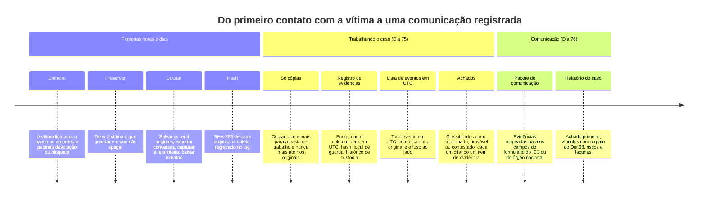
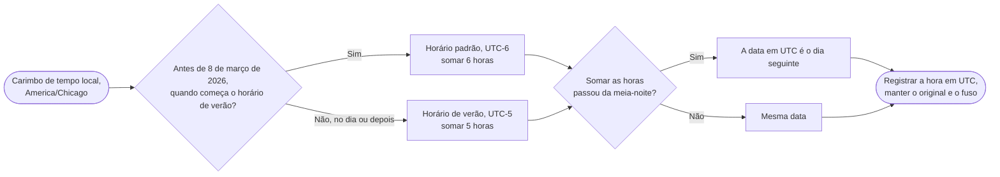
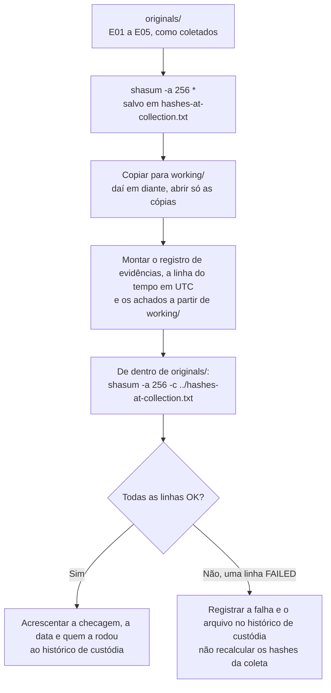

# Dia 75: Documentação do caso: da evidência preservada à linha do tempo

> 🇺🇸 Original: [*Day 75: Case documentation, from preserved evidence to a timeline*](https://github.com/thiefdroppers/cyber-investigator-skills/blob/main/curriculum/phase-5-fraud-social-engineering/day-75.md) — © ThiefDroppers, licença MIT.
> Aqui: tradução fiel **+** camada brasileira. Nada do original foi removido; tudo o que é novo vem marcado com ➕.

**Fase 5. Fraude, golpes e engenharia social** · Meta da trilha: preservar as evidências de uma vítima fictícia com *hashes* e um registro de evidências, reconstruir o caso como uma linha do tempo num único fuso horário e classificar cada achado pelo grau de sustentação.

Rank Jutsu: `A` · [](https://colab.research.google.com/github/Ridd1kulusC0d3r/investigador-cyber-90-dias/blob/main/curriculo/fase-5-fraude-e-engenharia-social/dia-75/dia-75.ipynb)

---

## 🎬 ➕ Abertura do caso — *Sete arquivos e um papel dobrado*

Sexta, 30 de outubro, 9h. Na mesa da Vigia, o que sobrou da conversa de ontem: o extrato do Pix do Seu Antônio, a exportação da conversa de WhatsApp (com o áudio), um print do histórico de chamadas, o papel do "Dr. Silva" (fotografado, o original ficou com ele), o protocolo que a cooperativa abriu e uma declaração do RH dizendo onde o Cláudio estava.

Você já abriu o CSV do extrato no editor para "dar uma olhada". Rafa vê a janela e não diz nada; só puxa uma cadeira.

— Quantos arquivos você tem?

— Sete.

— Quantos hashes?

Silêncio.

— E o extrato está em UTC, o celular dele em horário de Brasília, e o print das chamadas não diz fuso nenhum. Se a linha do tempo errar a hora do primeiro Pix, o pedido de devolução que a Marta mandou fala de um horário, e o nosso relatório de outro. Quem você acha que a delegacia vai achar que está mentindo?

É isso que o Dia 75 ensina. *(Personagens e cenário: [Operação Isca](../../../caso-continuo/).)*

---

## 📖 Conceito

Um caso de fraude costuma ser ganho ou perdido na papelada feita nos primeiros dias. Os bancos às vezes conseguem reaver uma transferência se ficam sabendo rápido e com detalhes exatos. A Equipe de Recuperação de Ativos (*Recovery Asset Team*) do IC3 congelou cerca de 58% do dinheiro nos incidentes em que trabalhou em 2025, e a orientação dela é ligar imediatamente para o banco e depois registrar a queixa com "todos os detalhes da transação". As plataformas conseguem remover contas se você lhes der a URL exata do perfil ou o nome de usuário. A polícia consegue ligar o seu caso a outros se os números de telefone, carteiras e domínios estiverem escritos com exatidão. Nada disso funciona a partir de um resumo como "ela pagou uns 20 mil dólares em cripto, em algum dia de março".

O caminho do primeiro contato com a vítima até uma comunicação registrada, com este dia cobrindo as duas primeiras seções e o Dia 76 a última:



Uma boa documentação tem três propriedades.

**Ela preserva os originais.** Você guarda o arquivo de e-mail original (`.eml`) com os cabeçalhos, não uma cópia encaminhada. Você exporta a conversa com a função de exportação do próprio aplicativo e, além da exportação, faz capturas de tela. As capturas mostram a tela inteira, incluindo o relógio do celular e o identificador do contato. Você anota os *hashes* de transação e os endereços de carteira a partir dos registros da corretora, e os números de conta e de referência a partir dos extratos bancários. Você trabalha em cópias e mantém os originais intactos.

**Ela prova que nada mudou.** Ao coletar um arquivo, calcule o *hash* SHA-256 dele e registre. Se mais tarde alguém questionar se o arquivo foi alterado, calcular o *hash* de novo e obter o mesmo valor mostra que não foi. O registro anota o que o item é, de onde veio, quem coletou, quando, e como foi guardado e transferido desde então. Esse registro é a cadeia de custódia.

**Ela separa o que se sabe do que se infere.** O modelo de registro de reconhecimento do Dia 22 classifica os achados como confirmado, provável ou contestado. Continue usando-o. "O pagamento 3 foi para a carteira `TFICT-A1`" é confirmado se o registro da corretora mostra isso. "O operador está no exterior" é, na melhor das hipóteses, provável, e só se você souber dizer o que sustenta isso.

**Os fusos horários pegam quase todo mundo.** O celular da vítima mostra a hora local, a corretora registra em UTC, o cabeçalho do e-mail tem o próprio deslocamento, e o extrato do banco pode mostrar só a data. Converta todo evento para UTC na linha do tempo e mantenha o carimbo de tempo original e o fuso dele numa coluna separada.

Para o caso deste dia, toda hora local passa pelas mesmas três perguntas:



### O que pedir à vítima que guarde (e que não faça)

1. Não apague a conversa, o aplicativo ou a conta antes de exportar. Bloquear o golpista tudo bem, depois que a exportação estiver feita.
2. Não responda ao golpista nem a ninguém que ofereça recuperar o dinheiro.
3. Salve os e-mails como arquivos com "Baixar original" ou "Salvar como", não encaminhando.
4. Exporte as conversas pela opção de exportação do próprio aplicativo, onde ela existir (por exemplo, "Exportar conversa" no WhatsApp; "Export chat history" no Telegram Desktop).
5. Baixe do banco e da corretora os extratos que mostram cada pagamento.
6. Anote, enquanto a memória está fresca, todo nome, número, nome de usuário, site e aplicativo que o golpista usou.

## 📚 Recursos

- [Relatório de Crimes na Internet 2025 do FBI IC3 (PDF)](https://www.ic3.gov/AnnualReport/Reports/2025_IC3Report.pdf): a seção sobre a *Recovery Asset Team* e a *Financial Fraud Kill Chain*, sobre por que velocidade e detalhe da transação importam.
- [FAQ do IC3](https://www.ic3.gov/Home/FAQ): que evidências o IC3 manda os denunciantes guardarem (recibos, registros bancários, "de preferência cópias eletrônicas dos e-mails") para a polícia.
- [NIST SP 800-86, Guide to Integrating Forensic Techniques into Incident Response](https://csrc.nist.gov/pubs/sp/800/86/final): as fases de coleta, exame, análise e relato, e por que *hash* e documentação importam.
- Ferramentas de *hash* embutidas, nada para instalar: `shasum -a 256 <arquivo>` no macOS, `sha256sum <arquivo>` no Linux, `Get-FileHash <arquivo> -Algorithm SHA256` no PowerShell do Windows.
- [`worksheets/osint-recon-log.md`](https://github.com/thiefdroppers/cyber-investigator-skills/blob/main/worksheets/osint-recon-log.md): a classificação confirmado / provável / contestado que você vai reutilizar. ➕ Versão pt-BR: [`fichas/registro-recon-osint.md`](../../../fichas/registro-recon-osint.md).

### ➕ Recursos do contexto Brasil

- [Código de Processo Penal, arts. 158-A a 158-F](https://www.planalto.gov.br/ccivil_03/decreto-lei/del3689.htm): a cadeia de custódia na lei brasileira (incluída pela Lei 13.964/2019). O art. 158-B lista as etapas, do reconhecimento ao descarte.
- [Pix — página do Banco Central](https://www.bcb.gov.br/estabilidadefinanceira/pix): o MED (Mecanismo Especial de Devolução), que é o "*recall*" do Pix. É acionado pela instituição de quem pagou, e o tempo conta.
- **Fuso do Brasil.** `America/Sao_Paulo` (horário de Brasília) é UTC-3 o ano todo desde que o horário de verão foi extinto em 2019. Isso **não** dispensa a conversão: o caso cruza dados em UTC (comprovantes e registros técnicos), em hora local sem fuso declarado (prints de celular) e, às vezes, de outros fusos brasileiros (Manaus é UTC-4; Fernando de Noronha, UTC-2).
- `python scripts/registrar_evidencia.py <arquivo> "<descrição>"`: o *script* deste repositório que calcula o SHA-256, anota a hora UTC e acrescenta a linha em `notas/registro-de-custodia.csv` (Dia 01).

## 🛠️ Prática: *hash* SHA-256 e uma planilha, um registro de evidências e uma linha do tempo em UTC

### O caso fictício

Este caso se baseia no cenário da entrevista de treino do Dia 74. Tudo nele é inventado. Crie cada item abaixo como um arquivo numa pasta chamada `case-FICT-075/originals/`, digitando o conteúdo como está. (Num caso real, estas seriam as exportações da vítima; aqui você as cria para ter algo a preservar.)

- `E01-first-text.txt`: "SMS from +1 202 555 0147, received 2026-01-06 19:42 (phone set to America/Chicago): Hi Lena, is the dinner still on for Friday?"
- `E02-app-screenshot-note.txt`: "Screenshot description: aurum-desk.example dashboard showing balance $1,240.00, phone clock 2026-01-24 08:15 America/Chicago."
- `E03-exchange-record.csv`:
  ```
  time_utc,amount_usdt,to_address,tx_hash
  2026-01-22T15:03:11Z,1000,TFICT-A1,0xFICT01
  2026-02-03T16:40:55Z,5000,TFICT-A1,0xFICT02
  2026-02-10T17:02:09Z,4000,TFICT-A1,0xFICT03
  2026-02-18T15:20:47Z,6000,TFICT-B7,0xFICT04
  2026-02-26T19:11:30Z,3000,TFICT-B7,0xFICT05
  ```
- `E04-withdrawal-message.txt`: "In-app message 2026-03-01 10:05 America/Chicago: Withdrawal pending. Tax clearance of 15% ($2,850) required."
- `E05-recovery-call-note.txt`: "Victim's note: call 2026-03-09 about 14:00 local from +1 646 555 0108, caller said 'Chainsafe Recovery', asked for $1,500 fee."

*(Os arquivos ficam em inglês, como no original, para que o seu `hashes-at-collection.txt` bata com o de qualquer outro aluno. Em português: E01, SMS de "número errado" perguntando se o jantar de sexta está de pé; E02, descrição da captura do painel de `aurum-desk.example` com saldo de US$ 1.240,00; E03, registro da corretora com os cinco pagamentos em USDT; E04, mensagem do app exigindo "taxa de liberação" de 15% (US$ 2.850) para o saque; E05, anotação da vítima sobre a ligação da "Chainsafe Recovery" pedindo US$ 1.500.)*

**Seu checklist de hoje.** Faça na ordem e marque cada item ao terminar:

- [ ] Calcular o *hash* de todos os arquivos em originals/ e salvar a saída
- [ ] Copiar originals/ para working/ e, daí em diante, abrir só as cópias
- [ ] Montar o registro de evidências
- [ ] Montar a linha do tempo em UTC, convertendo toda hora local
- [ ] Acrescentar a tabela de achados classificados
- [ ] Recalcular os *hashes* de originals/ e comparar com hashes-at-collection.txt
- [ ] Se algum *hash* falhar, registrar isso no histórico de custódia, e não nos *hashes* da coleta
- [ ] ➕ Prática BR: o caso do Seu Antônio (`caso-ISCA-075`)
- [ ] ➕ O notebook do dia no Colab

### Passos

1. Calcule o *hash* de todos os arquivos em `originals/` e salve a saída:
   ```
   cd case-FICT-075/originals
   shasum -a 256 * > ../hashes-at-collection.txt
   ```
   (Use `sha256sum *` no Linux ou `Get-FileHash * -Algorithm SHA256` no Windows.)
2. Copie a pasta para `working/`. Daí em diante, abra só as cópias.
3. Monte o registro de evidências com as colunas: ID do item, descrição, fonte (quem forneceu e como), coletado por, data e hora da coleta (UTC), SHA-256, local de guarda, e uma coluna de histórico de custódia em que todo acesso ou transferência posterior entra como uma nova linha.
4. Monte a linha do tempo com as colunas: ID do evento, hora (UTC), carimbo original e fuso, evento, ID(s) do item de evidência, indicadores (valores exatos) e confiança (confirmado, provável, contestado). Converta toda hora local para UTC. America/Chicago é UTC-6 em janeiro e fevereiro de 2026, já que o horário de verão começa em 8 de março de 2026. A ligação de 9 de março, portanto, está em horário de verão (UTC-5).
5. Acrescente uma tabela de achados no formato do Dia 22. Inclua pelo menos estes achados e classifique cada um: o total depositado; que duas carteiras receberam o dinheiro; que a exigência do "imposto" era um golpe; que a ligação de recuperação está ligada aos golpistas originais. Este último deve sair como contestado ou sem sustentação: nada nas evidências liga +1 646 555 0108 aos outros indicadores, e golpistas de recuperação costumam comprar listas de vítimas de outras fontes.
6. De dentro de `originals/`, recalcule os *hashes* dos arquivos e compare com `hashes-at-collection.txt`:
   ```
   shasum -a 256 -c ../hashes-at-collection.txt
   ```
   Toda linha deve terminar em `OK`. Registre a checagem no histórico de custódia.
7. Se alguma linha do passo 6 não terminar em `OK` (por exemplo, porque você editou sem querer um arquivo em `originals/`), registre isso no histórico de custódia em vez de recalcular os *hashes* da coleta.

Os passos de *hash* como um ciclo. A regra fácil de quebrar sob pressão está no ramo da falha: os *hashes* da coleta nunca são recalculados.



### Exemplo resolvido de linha (linha do tempo)

| ID | Hora (UTC) | Original | Evento | Evidência | Indicadores | Confiança |
|---|---|---|---|---|---|---|
| T01 | 2026-01-07 01:42 | 2026-01-06 19:42 America/Chicago | Primeiro contato por SMS, abertura de "número errado" | E01 | +1 202 555 0147 | Confirmado (registro do celular da vítima) |

Repare que a data em UTC é o dia seguinte à data local. Uma linha do tempo ordenada pela data local poria este evento no dia errado.

### O artefato

A pasta `case-FICT-075/` contendo `originals/`, `working/`, `hashes-at-collection.txt` e uma planilha com três abas: registro de evidências, linha do tempo em UTC (pelo menos nove eventos: primeiro contato, a captura do painel, cinco pagamentos, a exigência do imposto, a ligação de recuperação) e achados classificados.

### ➕ Prática BR — o caso do Seu Antônio (`caso-ISCA-075`)

Os sete arquivos estão em [`caso-continuo/dados/dia-75/caso-ISCA-075/originais/`](../../../caso-continuo/dados/dia-75/caso-ISCA-075/originais/). Copie a pasta `caso-ISCA-075/` inteira para fora do repositório e repita os passos 1 a 7:

| Item | Arquivo | O que é |
|---|---|---|
| E01 | `E01-sms-isca.txt` | O SMS do dia 5/out que ele também recebeu (não clicou) |
| E02 | `E02-audio-whatsapp-descricao.txt` | Descrição do áudio do falso Cláudio exportado do WhatsApp |
| E03 | `E03-historico-chamadas.txt` | Print do histórico: a ligação de 23 minutos |
| E04 | `E04-extrato-pix.csv` | Os dois Pix, em UTC, para as contas dos laranjas L-03 e L-05 |
| E05 | `E05-nota-ligacao-recuperacao.txt` | O papel do "Dr. Silva" |
| E06 | `E06-protocolo-cooperativa.txt` | O registro da ligação dele à central oficial e o protocolo do pedido de devolução |
| E07 | `E07-declaracao-rh.txt` | A declaração do RH sobre o treinamento do Cláudio |

O que muda em relação ao caso do original:

1. **Fuso.** Tudo o que veio do celular dele está em `America/Sao_Paulo` (UTC-3, sem horário de verão); o extrato do Pix já está em UTC. O E05 diz "por volta das 15:00 hora local": registre a hora convertida **e** a incerteza ("~18:00 UTC, aproximado, anotação da vítima").
2. **Ordem dos eventos.** Monte a linha do tempo e confira: a ligação começou às 08:05 locais (11:05 UTC) e durou 23 minutos. Os dois Pix (11:14 e 11:31 UTC) caem dentro dela? Se um deles cair **depois** do fim da ligação, isso é um achado ou um problema de fuso? Escreva a resposta.
3. **Achados obrigatórios, classificados:**
   - o total transferido e o número de transferências;
   - que o dinheiro foi para **duas** contas recebedoras, as dos laranjas L-03 e L-05;
   - que a voz do áudio não era do Cláudio (o que E07 sustenta, e o que **não** sustenta: ele prova onde o Cláudio estava, não quem gravou o áudio);
   - que o número `+55 00 00000-0021` está ligado à campanha do SMS de 5/out (dica: qual evidência liga os dois? Se nenhuma, contestado);
   - que o "Dr. Silva" (`+55 00 00000-0029`) é o mesmo grupo que aplicou o golpe. Pelo mesmo motivo do original, este deve sair como **contestado ou sem sustentação**.
4. **Custódia mais exigente.** O áudio em si (o arquivo `.opus` da exportação) não está no repositório; na vida real, ele seria o item mais sensível do caso (voz de duas pessoas). Registre no histórico de custódia onde ele ficaria guardado e quem pode ouvi-lo.

### ➕ O notebook do dia

Abra o [notebook do Dia 75 no Colab](https://colab.research.google.com/github/Ridd1kulusC0d3r/investigador-cyber-90-dias/blob/main/curriculo/fase-5-fraude-e-engenharia-social/dia-75/dia-75.ipynb). Nele você:

1. cria os cinco arquivos do original e os sete do caso brasileiro, calcula os SHA-256 com `hashlib` e grava um `hashes-at-collection.txt` no mesmo formato do `shasum`;
2. converte cada hora local para UTC com `zoneinfo`, e vê o Chicago mudar de UTC-6 para UTC-5 no dia 8 de março, enquanto São Paulo fica em UTC-3;
3. monta a linha do tempo ordenada em UTC e confere os achados do Checkpoint ($19.000 em cinco pagamentos, duas carteiras; o total e as duas contas do Seu Antônio);
4. "estraga" um original de propósito e vê a checagem falhar, e o histórico de custódia registrar a falha sem tocar nos *hashes* da coleta;
5. joga o quiz **"confirmado, provável ou contestado?"**.

## ✅ Checkpoint

- Some os pagamentos do registro da corretora: sua tabela de achados diz US$ 19.000.
- Sua tabela de achados diz que os US$ 19.000 foram em cinco pagamentos.
- Sua tabela de achados diz que os pagamentos foram para duas carteiras.
- Esse achado está classificado como confirmado.
- Esse achado cita o item de evidência.
- Sua checagem de *hash* mostra `OK` para todos os arquivos.
- Se a checagem falhou para algum arquivo, o histórico de custódia registra a falha, e o `hashes-at-collection.txt` não foi recalculado.
- O evento cuja data em UTC difere da data local está convertido corretamente.
- O evento que cai depois da mudança para o horário de verão está convertido corretamente.
- Lido como um cético leria, todo "confirmado" da sua tabela de achados aponta para um item de evidência que o mostra diretamente.
- Sem consultar notas: você consegue explicar por que nunca se recalculam os *hashes* da coleta depois de uma checagem que falhou?

### ➕ Checkpoint BR

- Sua tabela de achados do `caso-ISCA-075` diz R$ 9.750,00 em duas transferências Pix, para duas contas recebedoras (L-03 e L-05), confirmado, citando E04.
- A linha do tempo mostra os dois Pix **dentro** da janela da ligação de 23 minutos (11:05 a 11:28 UTC)… ou registra explicitamente que o segundo Pix (11:31 UTC) caiu três minutos depois do fim da ligação, e o que isso pode significar (relógio do print, duração arredondada, ou uma segunda instrução por mensagem). Os dois são respostas aceitáveis; ignorar a diferença não é.
- O achado "a voz não era do Cláudio" está como **provável**, não confirmado, e diz por quê.
- O achado "o Dr. Silva é do mesmo grupo" está como contestado ou sem sustentação.
- O vínculo entre o `+55 00 00000-0021` e a campanha do SMS está como contestado ou sem sustentação (nenhuma evidência deste lote liga os dois; o vínculo, se houver, vem do grafo, no Dia 76).

## ⚖️ ➕ Camada jurídica BR

**Cadeia de custódia (CPP, arts. 158-A a 158-F).** Incluídos pela Lei 13.964/2019, definem a cadeia de custódia como o conjunto de procedimentos para manter e documentar a história cronológica do vestígio, da coleta ao descarte, e listam etapas como reconhecimento, coleta, acondicionamento, transporte, armazenamento e descarte. Os artigos foram escritos para a perícia oficial; o seu registro de evidências não "vira" cadeia de custódia oficial por si só. Mas ele é o que permite à autoridade, ao receber o material, demonstrar de onde cada arquivo veio e que não foi alterado. Um *hash* recalculado "para consertar" uma falha destrói exatamente essa demonstração.

**Quem coleta.** No caso do Seu Antônio, as evidências são dele (o celular, o extrato) e da cooperativa (o protocolo, a declaração do RH). A Vigia trata o material como operadora da cooperativa, dentro do contrato e da base legal registrada no Dia 1 (LGPD, art. 7º). O ideal é que a própria vítima faça a exportação no próprio celular, com você orientando, em vez de você manusear o aparelho.

**Dados de terceiros nas evidências.** O extrato do Pix mostra a conta recebedora: dado pessoal de um terceiro (o laranja), que pode ele próprio ter sido enganado (Dia 67). No relatório, ele aparece só pelo código L-03/L-05; a identificação completa fica no material entregue à autoridade e ao banco, que têm base legal para tratá-la.

> Material de estudo, não constitui orientação jurídica.

## 🧠 ➕ Camada 8 — o viés retrospectivo e a linha do tempo bonita demais

Uma linha do tempo bem feita produz uma ilusão perigosa: tudo parece óbvio. Baruch Fischhoff descreveu o **viés retrospectivo** (*hindsight bias*): depois de saber o desfecho, superestimamos o quanto ele era previsível. Olhando a planilha, "áudio de número novo no domingo à noite → ligação às 8h → conta de segurança" parece um roteiro de golpe evidente. Às 8h05 de uma segunda-feira, com a voz do gerente de 12 anos no ouvido, não era.

Isso tem duas consequências práticas. A primeira é na redação: o relatório descreve a sequência e os controles que faltaram, não o "erro" da vítima; a frase "ele deveria ter percebido às 8h05" é viés retrospectivo escrito como achado. A segunda é no próprio analista: a coerência da linha do tempo aumenta a sua confiança em achados que **não** têm evidência própria (é o que acontece com o "Dr. Silva": ele "encaixa" na história, mas nada o liga ao resto). A regra do original, todo "confirmado" apontando para um item que o mostra diretamente, é a defesa contra isso.

## 🤖 ➕ Skill do dia

O dia propõe **acréscimos** ao procedimento "informe de inteligência ou relatório de caso": antes de redigir, conferir que cada evento está em UTC com o carimbo original ao lado, que cada "confirmado" cita um item de evidência com hash, e que os *hashes* da coleta nunca são recalculados. Ver [`_skill-delta.md`](_skill-delta.md).

## 💡 ➕ Inovação OSINT do dia — `shasum -c` em Python puro, com `zoneinfo` na mesma passada

O formato que o `shasum -a 256` e o `sha256sum` gravam é simples (`<hash>  <arquivo>`), então dá para recalcular e conferir em qualquer máquina, até no Colab, sem depender da ferramenta do sistema:

```python
import hashlib
from pathlib import Path

def conferir(pasta, arquivo_de_hashes):
    for linha in Path(arquivo_de_hashes).read_text().splitlines():
        esperado, nome = linha.split(maxsplit=1)
        nome = nome.lstrip("*")                        # sha256sum marca modo binário com '*'
        atual = hashlib.sha256((Path(pasta) / nome).read_bytes()).hexdigest()
        print(f"{nome}: {'OK' if atual == esperado else 'FAILED'}")
```

E a conversão de fuso, sem tabela de horário de verão escrita à mão, com o banco de fusos que vem no Python 3.9+:

```python
from datetime import datetime
from zoneinfo import ZoneInfo
local = datetime(2026, 3, 9, 14, 0, tzinfo=ZoneInfo("America/Chicago"))
print(local.astimezone(ZoneInfo("UTC")))              # 2026-03-09 19:00:00+00:00 (já em UTC-5)
```

(No Windows, o `zoneinfo` pode precisar do pacote `tzdata`; no Colab e no Linux já funciona.)

## 📝 Diário de estudo

- Data:
- Tempo gasto:
- O que ficou claro:
- O que ainda está nebuloso:
- Artefato produzido: `case-FICT-075/` (originals, working, hashes, planilha de três abas), `caso-ISCA-075/` com o mesmo conjunto

---
<sub>Baseado em [cyber-investigator-skills](https://github.com/thiefdroppers/cyber-investigator-skills) por ThiefDroppers (MIT). Tradução, camada BR, Camada 8, skill pt-BR e notebook por Deivison Lourenço (@Ridd1kulusC0d3r).</sub>
