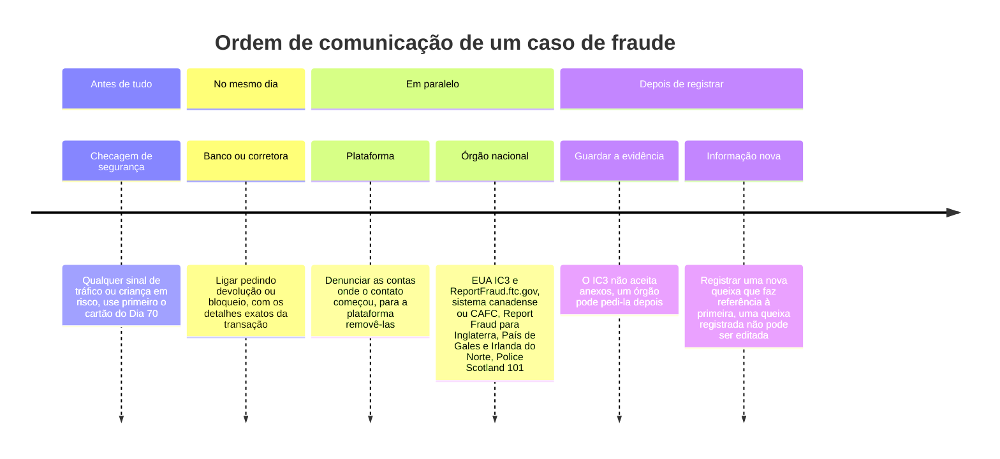
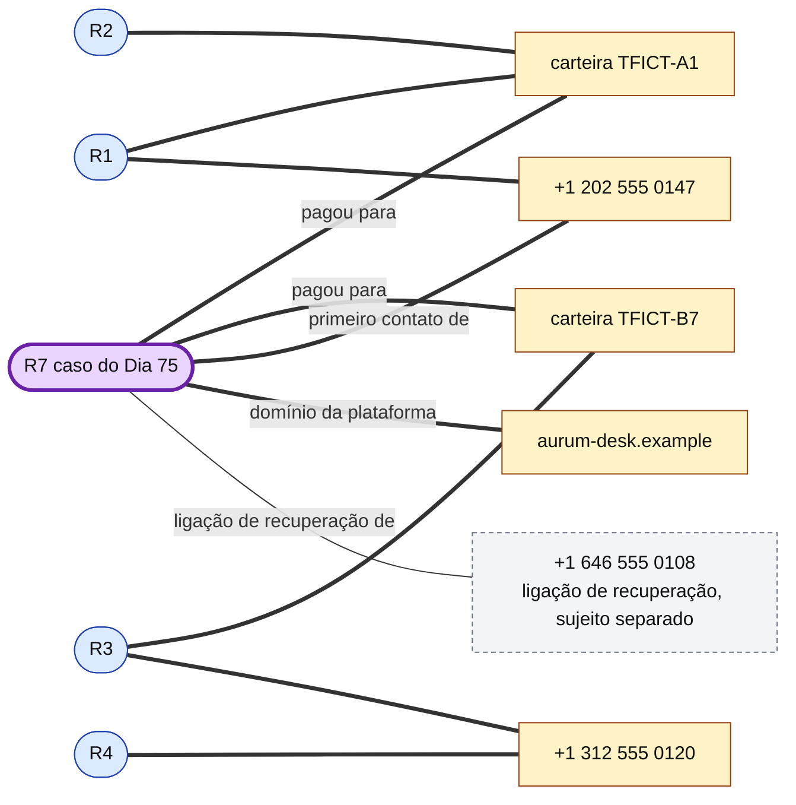
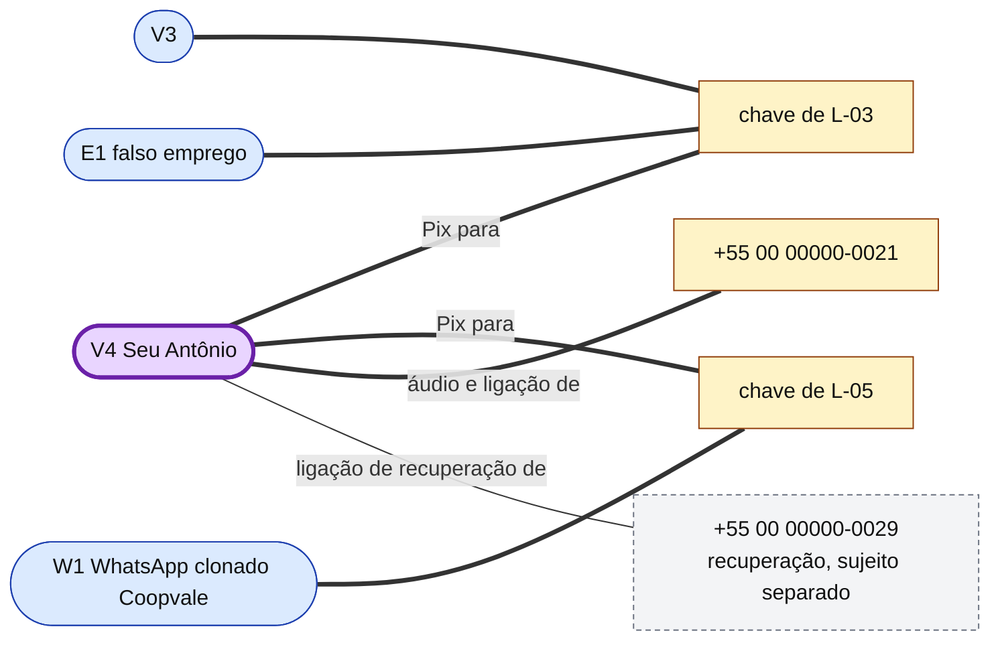

# Dia 76: Comunicando um caso de fraude ao IC3 ou a um centro nacional antifraude

> 🇺🇸 Original: [*Day 76: Reporting a fraud case to IC3 or a national anti-fraud centre*](https://github.com/thiefdroppers/cyber-investigator-skills/blob/main/curriculum/phase-5-fraud-social-engineering/day-76.md) — © ThiefDroppers, licença MIT.
> Aqui: tradução fiel **+** camada brasileira. Nada do original foi removido; tudo o que é novo vem marcado com ➕.

**Fase 5. Fraude, golpes e engenharia social** · Meta da trilha: transformar o dossiê do caso do Dia 75 num pacote de comunicação completo, mapeado para o que um órgão nacional de denúncia pede, escrever o relatório do caso que o acompanha e fechar a fase com o grafo de relações atualizado.

Rank Jutsu: `A` · [](https://colab.research.google.com/github/Ridd1kulusC0d3r/investigador-cyber-90-dias/blob/main/curriculo/fase-5-fraude-e-engenharia-social/dia-76/dia-76.ipynb)

---

## 🎬 ➕ Abertura do caso — *O cartão V4*

Terça, 3 de novembro, 10h (a segunda foi feriado de Finados). O Dr. Hélio Brandão, o jurídico da cooperativa, está na sala da Vigia com um bloco de notas e a pergunta de quem vai assinar alguma coisa.

— A Marta quer saber para quem a cooperativa comunica o quê. O Seu Antônio quer saber se precisa ir à delegacia. E eu quero saber se o que vocês vão me entregar aguenta uma pergunta de defesa.

Rafa não responde. Levanta, vai até a parede onde ainda estão os nove cartões amarelos do Dia 68 e cola um décimo: **V4 — Seu Antônio, falsa central com voz clonada**. Puxa um fio vermelho do V4 até a chave de **L-03**, que já estava ligada ao V3 e ao falso emprego. Depois puxa outro, até a chave de **L-05**.

O cartão W1, o WhatsApp clonado da Coopvale, que estava sozinho num canto da parede desde o Dia 68, de repente tem um fio.

— Agora tem um pacote para a delegacia — diz Rafa. — E um relatório que começa com uma frase só, com a confiança escrita nela.

É isso que o Dia 76 ensina. *(Personagens e cenário: [Operação Isca](../../../caso-continuo/).)*

---

## 📖 Conceito

A maioria das comunicações de fraude é rasa porque quem as registra só tem uma história e uma estimativa grosseira do prejuízo. O órgão que recebe não consegue congelar uma transferência, ligar o caso a outros nem repassá-lo a uma unidade de investigação sem detalhes exatos. O seu trabalho, quando você ajuda alguém a comunicar, é ter esses detalhes prontos antes de o formulário abrir.

Os órgãos nacionais de denúncia pedem, de modo geral, as mesmas coisas. O FAQ do IC3, do FBI, lista:

- Nome, endereço, telefone e e-mail do denunciante.
- Informação da transação financeira: dados da conta, data e valor da transação, e quem recebeu o dinheiro. O formulário de queixa detalha isso em tipo de pagamento, valor, números de conta, nome e endereço do banco recebedor e endereços de criptomoeda recebedores.
- Informação sobre o sujeito (a pessoa ou entidade que cometeu o crime): nome, endereço, telefone, e-mail, site e endereço IP, até onde se saiba.
- Detalhes específicos do que aconteceu, nas palavras do denunciante.

O IC3 não aceita anexos, não investiga as queixas por conta própria (ele as encaminha à polícia) e não fornece atualizações de andamento. Uma queixa registrada não pode ser cancelada nem editada, então informação nova entra como uma nova queixa que faz referência à primeira. O IC3 também pede aos denunciantes que guardem as evidências (recibos, registros bancários, cópias eletrônicas de e-mails) para o caso de um órgão pedi-las. É por isso que o registro de evidências do Dia 75 importa, mesmo que nada dele seja enviado.

Onde comunicar depende de onde a vítima mora:

| Jurisdição | Comunicação de fraude e crime cibernético | Observações |
|---|---|---|
| Estados Unidos | [IC3](https://www.ic3.gov/) para crimes praticados pela internet; [ReportFraud.ftc.gov](https://reportfraud.ftc.gov/) para fraude ao consumidor | Registrar nos dois é comum; eles servem a propósitos diferentes |
| Canadá | [National Cybercrime and Fraud Reporting System](https://reportcyberandfraud.canada.ca/), operado pelo *National Cybercrime Coordination Centre* da RCMP e pelo *Canadian Anti-Fraud Centre*; telefone do CAFC 1-888-495-8501 | Podem comunicar vítimas, alvos ou testemunhas, inclusive de forma anônima |
| Inglaterra, País de Gales, Irlanda do Norte | [Report Fraud](https://reportfraud.police.uk/), 0300 123 2040, operado pela *City of London Police* | Substituiu o *Action Fraud*: entrou no ar no começo de dezembro de 2025, lançamento público completo em janeiro de 2026; mesmo número de telefone |
| Escócia | Police Scotland, 101 | O Report Fraud não cobre a Escócia |
| ➕ Brasil | Boletim de ocorrência na delegacia especializada em crimes cibernéticos do estado, ou pela delegacia online (delegacia virtual) da Polícia Civil do estado; o banco ou instituição da vítima, que aciona o MED nos casos de Pix | Não há um "IC3" nacional único; o registro é estadual. Veja a seção ➕ abaixo |

Uma comunicação a um órgão nacional corre em paralelo com outros passos e não os substitui. O banco ou a corretora recebe a ligação primeiro, no mesmo dia, para um pedido de devolução ou bloqueio. A plataforma onde o contato começou (aplicativo de relacionamento, site de vagas, rede social) recebe a sua própria denúncia, para poder remover as contas. Se houver qualquer sinal de tráfico ou de criança em risco, o cartão de encaminhamento do Dia 70 vale antes de tudo isso.

A ordem, lida da esquerda para a direita:



### O que torna uma comunicação utilizável

1. Cada pagamento listado separadamente, com data, valor, meio e a conta ou o endereço recebedor exatamente como escritos. Só o total não basta.
2. Cada identificador exatamente como visto: telefones com código do país, nomes de usuário com a plataforma, domínios e URLs completos (desativados — *defanged* — nas suas notas, e como escritos no formulário).
3. Uma narrativa em ordem cronológica simples, curta o bastante para ser lida em dois minutos, nas palavras da vítima sempre que possível.
4. Fatos e inferências mantidos separados. "O site era aurum-desk.example" é um fato. "O mesmo grupo opera lumen-rewards.example" só entra na comunicação se você tiver a evidência, e rotulado como avaliação sua.
5. Nenhum identificador pessoal que o formulário não peça. O próprio formulário de queixa do IC3 diz aos denunciantes que não informem números de *Social Security* nem datas de nascimento.

### ➕ O caminho brasileiro, em detalhe

O Brasil não tem um centro nacional único de denúncia de fraude que receba a queixa do cidadão e a encaminhe. O caminho equivalente ao do original tem quatro portas, e a ordem é a mesma da linha do tempo acima:

| Porta | Para quê | O que levar |
|---|---|---|
| **1. A instituição da vítima** (no caso, a Serra Azul), pelo canal oficial que a vítima já conhece (número do cartão, aplicativo, agência) | Bloqueio e **pedido de devolução pelo MED** (Mecanismo Especial de Devolução do Pix), que a instituição de quem pagou abre junto à instituição que recebeu. É o "*recall*" brasileiro: quanto antes, maior a chance de haver saldo para bloquear. | Cada Pix: data, hora, valor, identificador da transação (o *end-to-end ID* do comprovante), nome e instituição do recebedor como aparecem no comprovante |
| **2. Polícia Civil do estado** | **Boletim de ocorrência**: na delegacia especializada em crimes cibernéticos (onde houver) ou pela **delegacia online/virtual** da Polícia Civil do estado, que a maioria dos estados mantém para estelionato e fraudes eletrônicas. O BO é o que permite a investigação e é muitas vezes pedido pelo banco. | A narrativa curta, as transações, os identificadores do golpista e a informação de que as evidências estão preservadas (com hash) e disponíveis |
| **3. A plataforma** | Remoção da conta usada no golpe (no WhatsApp: denunciar pelo próprio aplicativo, na conversa; no Instagram e outras redes: "denunciar" no perfil) | O número ou perfil exatamente como aparece, e prints com data |
| **4. Órgãos de apoio, conforme o caso** | Reclamação ao **Banco Central** se a instituição não tratar o pedido; **consumidor.gov.br** para conflito com a empresa; **Disque 100** se houver violência contra pessoa idosa; **SaferNet** e Disque 100 se houver criança | O protocolo do pedido feito na instituição |

Três diferenças práticas em relação ao IC3:

- **O BO aceita (e às vezes pede) anexos**, ao contrário do IC3. Mesmo assim, a regra do original vale: guarde os originais e o registro de evidências; o que vai anexado é cópia.
- **Não há uma "queixa nova que faz referência à primeira" padronizada.** Informação nova vai como aditamento ou complemento do BO, pelo canal que a delegacia indicar, citando o número do BO original.
- **Não registre BO de treino.** A regra do original ("nunca envie um relato de prática a um portal real") vale com mais força ainda aqui: comunicação falsa de crime é crime (Código Penal, art. 340).

> As URLs das delegacias online variam por estado e mudam com frequência. Este repositório não as lista; procure no site oficial da Polícia Civil do seu estado. <!-- TODO: se o mantenedor quiser, acrescentar uma tabela de delegacias online por estado, com links conferidos na data. -->

## 📚 Recursos

- [FAQ do IC3](https://www.ic3.gov/Home/FAQ): o que as queixas precisam conter, a regra de não aceitar anexos e o que acontece depois do registro.
- [Formulário de queixa do IC3](https://complaint.ic3.gov/): percorra as seções para conhecer a ordem delas. Não envie nada neste exercício.
- [Report Cybercrime and Fraud (Canadá)](https://reportcyberandfraud.canada.ca/) e [Canadian Anti-Fraud Centre](https://antifraudcentre-centreantifraude.ca/).
- [Report Fraud (Reino Unido)](https://reportfraud.police.uk/).
- [Relatório de Crimes na Internet 2025 do FBI IC3 (PDF)](https://www.ic3.gov/AnnualReport/Reports/2025_IC3Report.pdf): a seção da *Financial Fraud Kill Chain*, sobre ligar primeiro para o banco.
- [`ai-agent-skills/SKILL.md`](https://github.com/thiefdroppers/cyber-investigator-skills/blob/main/ai-agent-skills/SKILL.md): o procedimento de redação do relatório do caso (veredito primeiro, no nível de confiança correto). ➕ Versão pt-BR: [`skills/investigador-cyber/SKILL.md`](../../../skills/investigador-cyber/SKILL.md).

### ➕ Recursos do contexto Brasil

- [Pix — página do Banco Central](https://www.bcb.gov.br/estabilidadefinanceira/pix): regras do arranjo e do MED. As regras do MED vêm sendo atualizadas pelo BC; confira a versão vigente antes de explicar prazos a uma vítima.
- [consumidor.gov.br](https://www.consumidor.gov.br/): plataforma pública de reclamação contra empresas, quando a instituição não resolve.
- **Delegacia online da Polícia Civil do seu estado** e **delegacia especializada em crimes cibernéticos**: sem link aqui (ver aviso acima).
- [Código Penal compilado](https://www.planalto.gov.br/ccivil_03/decreto-lei/del2848compilado.htm): art. 171, §§ 2º-A, 4º e 5º, e art. 340.
- [Código de Processo Penal](https://www.planalto.gov.br/ccivil_03/decreto-lei/del3689.htm): art. 70, § 4º (competência no estelionato por transferência), e arts. 158-A a 158-F (cadeia de custódia).
- [SaferNet Brasil — denúncia](https://new.safernet.org.br/denuncie) e **Disque 100**, para o que o cartão do Dia 70 cobre.

## 🛠️ Prática: campos da queixa do IC3, um pacote de comunicação e um relatório para o caso fictício

Nunca envie um relato de prática a um portal de denúncia real. Relatos fictícios desperdiçam o tempo dos investigadores e poluem os dados que ligam os casos reais. Tudo abaixo fica nos seus próprios arquivos.

**Seu checklist de hoje.** Faça na ordem e marque cada item ao terminar:

- [ ] Parte 1: o pacote de comunicação
- [ ] Parte 2: o relatório do caso
- [ ] Parte 3: atualizar o grafo
- [ ] ➕ Parte 4: o pacote brasileiro do Seu Antônio e o V4 no grafo da Operação Isca (Prática BR)
- [ ] ➕ Parte 5: o notebook do dia no Colab

### Parte 1: o pacote de comunicação

Usando a sua planilha do Dia 75, monte um documento com uma seção por área do formulário do IC3, preenchida a partir do caso fictício:

1. Informação da vítima: use dados evidentemente fictícios ("Lena Doe, 100 Example St, +1 312 555 0101").
2. Transações financeiras: um registro por pagamento, com data (UTC e local), valor em USDT e valor aproximado em USD, meio (transferência de criptomoeda a partir de uma conta de corretora), endereço recebedor e *hash* da transação. Cinco registros.
3. Informação do sujeito: todo identificador das evidências, cada um na sua linha, com o tipo e o item de evidência de onde veio (E01 a E05). Inclua as duas carteiras, os dois números de telefone, o domínio e os nomes usados. Marque o número de quem ligou oferecendo recuperação como um sujeito separado, com uma nota de que nenhuma evidência o liga ao operador original.
4. Descrição do incidente: uma narrativa de no máximo 250 palavras, em ordem cronológica, em linguagem simples. Escreva como a vítima diria, usando a entrevista de treino do Dia 74 como modelo.
5. Outras informações: a data em que o banco ou a corretora foi contatado e qualquer número de referência (fictício), e se também houve denúncia à plataforma.

Depois escreva um quadro comparativo curto: para o mesmo caso, liste quais campos você precisaria mudar ou acrescentar para registrar no serviço canadense ou no do Reino Unido. Leia as orientações publicadas nesses sites para saber o que pedem; não comece um envio real para descobrir.

### Parte 2: o relatório do caso

Escreva um relatório de uma página para um revisor interno (um supervisor, ou o time de fraude de um banco), nesta ordem:

1. Achado, em uma frase, com a confiança correta: por exemplo, "Um golpe de investimento por relacionamento tirou US$ 19.000 em cinco pagamentos em USDT para duas carteiras entre 22 de janeiro e 26 de fevereiro de 2026 (confirmado pelos registros da corretora)."
2. Evidências: os três ou quatro itens que o sustentam, por ID de evidência e *hash*.
3. Vínculos com outros casos: rode os indicadores do caso contra o seu grafo do Dia 68. As carteiras fictícias `TFICT-A1` e `TFICT-B7` e o número de telefone +1 202 555 0147 aparecem lá. Diga quais vínculos são fortes e o que isso significa ("o caso provavelmente pertence ao agrupamento R1 a R4: compartilha a carteira TFICT-A1 com R1 e R2, a carteira TFICT-B7 com R3 e o número do primeiro contato com R1").
4. Ações tomadas e recomendadas: notificação ao banco ou à corretora, registro no órgão de denúncia, denúncia à plataforma, encaminhamento da vítima a serviços de apoio, e um alerta à vítima sobre golpes de recuperação, incluindo o que ela já recebeu.
5. Riscos e lacunas: o que não se sabe, o que poderia tornar o achado errado e que evidência resolveria a questão.

### Parte 3: atualizar o grafo

Acrescente o caso do Dia 75 como o nó R7 no seu projeto do Gephi do Dia 68, com os indicadores e as arestas com peso. Exporte a imagem do grafo atualizado. Ela é o artefato da fase que o README do roteiro promete: um grafo de relações de uma quadrilha de fraude, ligando indicadores compartilhados entre vários relatos.

A parte do grafo que muda deve ficar assim. R7 entra no agrupamento por três vínculos fortes. O número de quem ligou oferecendo recuperação está nas evidências de R7 (E05), então ganha uma aresta até R7, mas não toca nenhum outro caso e continua como sujeito separado. R5, R6 e os indicadores de caso único do Dia 68 ficam fora deste desenho.



### O artefato

O pacote de comunicação (cinco seções mais o quadro comparativo), o relatório do caso de uma página e o grafo de relações atualizado com R7 conectado.

### ➕ Parte 4: Prática BR — o pacote do Seu Antônio e o V4

Com a pasta `caso-ISCA-075` do Dia 75:

1. **Pacote para o BO**, nas seções que um registro de ocorrência por estelionato costuma pedir (a ordem varia por estado):
   - *Comunicante e vítima:* dados evidentemente fictícios ("Antônio da Silva Exemplo, CPF fictício 000.000.000-00, +55 00 00000-0099"). Sem data de nascimento além da idade, que importa aqui (ver Camada jurídica).
   - *Fato:* data, hora e local (o domicílio da vítima, de onde ele fez os Pix).
   - *Transações:* um registro por Pix: data e hora (UTC e Brasília), valor, identificador da transação, conta recebedora pelo código (L-03, L-05) e instituição recebedora como no comprovante.
   - *Autoria desconhecida, meios usados:* cada identificador numa linha, com o tipo e o item de evidência: o número do áudio e da ligação (`+55 00 00000-0021`, E02/E03), a "conta de segurança" (E04). O "Dr. Silva" (`+55 00 00000-0029`, E05) vai como **fato separado**, um segundo golpe tentado, sem afirmação de vínculo.
   - *Histórico:* até 250 palavras, nas palavras dele (use a entrevista do Dia 74).
   - *Providências já tomadas:* o pedido de devolução na cooperativa (protocolo `MED-FICT-0001`, E06) e a denúncia do número no WhatsApp.
   - *Evidências preservadas:* a lista do registro de evidências com os SHA-256, e a frase "originais preservados e disponíveis".
2. **Quadro comparativo IC3 → BO**: o que existe no formulário do IC3 e não no BO, e vice-versa (por exemplo: o IC3 não aceita anexos; o BO costuma aceitar; o BO pede o local do fato; o IC3 pede o endereço do banco recebedor).
3. **O relatório para a Marta**, na ordem da Parte 2. Primeira frase com a confiança: *"Um golpe de falsa central com voz atribuída ao gerente da agência levou R$ 9.750,00 do cooperado em dois Pix para duas contas de laranjas (L-03 e L-05) em 26/10/2026 (confirmado pelo extrato, E04)."*
4. **O V4 no grafo.** Acrescente ao `nos.csv` e ao `arestas.csv` do Dia 68 ([`caso-continuo/dados/dia-68/`](../../../caso-continuo/dados/dia-68/)), na sua cópia:

   ```
   V4,V4 falsa central voz clonada (Serra Azul),case
   T21,+55 00 00000-0021,phone
   T29,+55 00 00000-0029 (recuperação; sujeito separado),phone
   ```
   ```
   V4,K03,Undirected,Pix para,3
   V4,K05,Undirected,Pix para,3
   V4,T21,Undirected,áudio e ligação de,3
   V4,T29,Undirected,ligação de recuperação de,3
   ```
   Leia o resultado: por qual chave o V4 entra no agrupamento principal? Que caso, isolado desde o Dia 68, passa a se ligar ao agrupamento, e por qual chave? O `T29` toca algum outro caso?



### ➕ Parte 5: o notebook do dia

Abra o [notebook do Dia 76 no Colab](https://colab.research.google.com/github/Ridd1kulusC0d3r/investigador-cyber-90-dias/blob/main/curriculo/fase-5-fraude-e-engenharia-social/dia-76/dia-76.ipynb). Nele você:

1. gera o pacote do IC3 do caso do original e o pacote do BO do Seu Antônio a partir dos dados do Dia 75, e confere cada um contra a lista de campos (o Checkpoint vira código);
2. joga o quiz **"qual porta primeiro?"** (banco, BO, plataforma, Dia 70);
3. carrega o grafo do Dia 68, acrescenta R7 e V4 e calcula, só com a biblioteca padrão, os agrupamentos por arestas fortes antes e depois;
4. gera o relatório de uma página com a primeira frase e a confiança;
5. relê o seu `minha-linha.md` do Dia 1 e escreve a revisão que o original pede no fim da fase.

## ✅ Checkpoint

- Conferido contra a lista do FAQ do IC3, seu pacote tem os dados do denunciante.
- Seu pacote tem cada transação com a conta ou o endereço recebedor.
- Seu pacote tem os identificadores do sujeito.
- Seu pacote tem a narrativa.
- Nada da lista do FAQ do IC3 falta no pacote. Qualquer coisa faltando é uma lacuna para a qual um órgão teria de voltar a pedir.
- No relatório do caso, a primeira frase traz o próprio rótulo de confiança.
- O relatório do caso não apresenta quem ligou oferecendo recuperação como ligado ao operador.
- No grafo, R7 se liga ao agrupamento existente pela carteira `TFICT-A1`, um vínculo forte.
- R7 se liga ao agrupamento existente pela carteira `TFICT-B7`, um vínculo forte.
- R7 se liga ao agrupamento existente pelo telefone +1 202 555 0147, um vínculo forte.
- O número de quem ligou oferecendo recuperação, +1 646 555 0108, não se conecta a mais nada.

Por fim, releia o que você escreveu no Dia 1 sobre o que faria você parar, mesmo que tecnicamente pudesse continuar. Ao longo destes doze dias você lidou com kits de phishing, domínios imitação, as carteiras de uma quadrilha de fraude, indicadores de tráfico e o relato de uma vítima que perdeu as economias. Escreva três ou quatro frases sobre se a sua resposta mudou e sobre o momento desta fase em que a linha pareceu mais perto. Guarde com o seu quadro de progresso.

### ➕ Checkpoint BR

- Seu pacote do BO tem as duas transações, cada uma com valor, data/hora em UTC e em Brasília, identificador e conta recebedora (por código).
- O "Dr. Silva" aparece como fato separado, sem afirmação de vínculo com a quadrilha.
- O relatório para a Marta diz, na seção de ações, que a cooperativa (não a Vigia) aciona o MED e que o BO é feito pela vítima (ou com ela), e cita que, pela idade dele, a ação penal não depende de representação (ver Camada jurídica).
- No grafo, o V4 entra no agrupamento pela chave de L-03 (forte), e o W1 deixa de estar isolado pela chave de L-05 (forte). Você escreveu o que isso sustenta, com a palavra "provável".
- O `T29` não se liga a nenhum outro caso.
- Nenhum pacote de treino foi enviado a portal real (nem IC3, nem delegacia online).

## ⚖️ ➕ Camada jurídica BR

**Ação penal no estelionato (CP, art. 171, § 5º).** Desde a Lei 13.964/2019, o estelionato, em regra, só se processa mediante **representação** da vítima. A lei excetua alguns casos, entre eles a vítima **maior de 70 anos** ou incapaz. O Seu Antônio tem 71: a ação penal é pública incondicionada, e a polícia pode agir sem que ele precise "manifestar vontade". Isso não dispensa o BO (é ele que leva a notícia do crime à polícia), mas muda o que dizer a ele: a decisão de processar não está nas costas dele.

**Pena aumentada (CP, art. 171, § 4º).** Aplica-se ao estelionato contra idoso ou vulnerável. A fraude eletrônica (§ 2º-A) já é qualificada. Enquadramento é tarefa da polícia e do Ministério Público; no relatório, você descreve fatos.

**Onde o caso corre (CPP, art. 70, § 4º).** Incluído pela Lei 14.155/2021: nos crimes de estelionato praticados mediante depósito, transferência de valores e meios semelhantes, a competência é definida pelo **domicílio da vítima**. É por isso que o BO do Seu Antônio vai para a Polícia Civil de Minas Gerais, mesmo que as contas recebedoras estejam em outro estado. <!-- TODO jurídico: conferir a redação exata do § 4º do art. 70 do CPP e se o Pix é mencionado expressamente. -->

**Comunicação falsa de crime (CP, art. 340).** Provocar a ação de autoridade comunicando crime que se sabe não ter ocorrido é crime. O exercício de hoje fica nos seus arquivos.

**Lavagem e organização criminosa.** O que o grafo descreve (contas de laranjas recrutadas por falso emprego, recebendo o dinheiro de vários golpes) é o tipo de padrão que a Lei 9.613/1998 (lavagem de dinheiro) e a Lei 12.850/2013 (organização criminosa) foram feitas para alcançar. O seu relatório não diz que há lavagem ou organização criminosa; ele entrega, com vínculos fortes e rotulados, o que a autoridade precisa para investigar isso.

> Material de estudo, não constitui orientação jurídica.

## 🧠 ➕ Camada 8 — o "efeito vítima identificável" e o grafo

Thomas Schelling escreveu sobre a diferença entre uma vida identificada e uma vida estatística, e pesquisas posteriores sobre o **efeito vítima identificável** mostraram o mesmo padrão: pessoas reagem mais (doam mais, se mobilizam mais) a uma vítima com nome e rosto do que a um número. Isso puxa o analista para dois lados neste dia.

O lado bom: a história do Seu Antônio, contada nas palavras dele e em 250 palavras, é o que faz alguém na delegacia ler o BO até o fim. O lado perigoso: o mesmo efeito empurra o relatório para o que comove, não para o que prova. A frase mais importante do caso não é "um senhor de 71 anos perdeu as economias"; é "a chave de L-05 liga o V4 ao W1". É ela que transforma dois BOs em dois estados diferentes num só padrão, e é ela que protege a próxima vítima, que ainda não tem nome.

Consequência prática: no pacote, a narrativa humana vai na seção da narrativa; os vínculos vão na seção de vínculos, com força e rótulo. Não misture as duas para "dar peso" ao caso. E, ao fechar a fase, volte ao `minha-linha.md` do Dia 1: depois de doze dias perto de vítimas reais (ainda que fictícias aqui), é comum que a linha se mova em direção a "fazer qualquer coisa para ajudar". O Dia 1 já avisou o nome disso: justificação moral.

## 🤖 ➕ Skill do dia

O dia propõe **acréscimos** ao passo 4 do procedimento "triagem de padrão de fraude e golpe" (comunicação à autoridade): a ordem das portas no Brasil (instituição/MED no mesmo dia, BO estadual, plataforma, órgãos de apoio), a regra de nunca registrar comunicação de treino, e os campos mínimos do pacote. Ver [`_skill-delta.md`](_skill-delta.md).

## 💡 ➕ Inovação OSINT do dia — agrupamentos por vínculo forte com *union-find*, sem Gephi

O Gephi é o certo para ver o grafo. Para responder rápido "quais casos ficam no mesmo agrupamento se eu só aceitar vínculos fortes?" (e para rodar isso toda vez que um caso novo chega), bastam vinte linhas de Python e o `csv` do Dia 68. A técnica é *union-find* (conjuntos disjuntos):

```python
import csv
pai = {}
def raiz(x):
    pai.setdefault(x, x)
    while pai[x] != x:
        pai[x] = pai[pai[x]]          # compressão de caminho: deixa a busca seguinte mais rápida
        x = pai[x]
    return x
def unir(a, b):
    pai[raiz(a)] = raiz(b)

for e in csv.DictReader(open("arestas.csv", encoding="utf-8")):
    if int(e["Weight"]) == 3:          # só vínculo forte une
        unir(e["Source"], e["Target"])

grupos = {}
for no in pai:
    grupos.setdefault(raiz(no), []).append(no)
for membros in grupos.values():
    print(sorted(m for m in membros if m[0] in "VEBWR"))   # só os nós de caso
```

Repare num cuidado que o notebook trata: uma aresta forte até um sujeito "separado" (o número de recuperação) não une nada a mais, porque esse nó não toca nenhum outro caso. O algoritmo não precisa de exceção; o dado já diz isso.

## 📝 Diário de estudo

- Data:
- Tempo gasto:
- O que ficou claro:
- O que ainda está nebuloso:
- Artefato produzido: pacote IC3 + quadro comparativo, relatório do caso, grafo com R7; `notas/dia-76-pacote-bo.md`, `notas/dia-76-relatorio-marta.md`, grafo da Operação Isca com V4; revisão do `minha-linha.md`

---
<sub>Baseado em [cyber-investigator-skills](https://github.com/thiefdroppers/cyber-investigator-skills) por ThiefDroppers (MIT). Tradução, camada BR, Camada 8, skill pt-BR e notebook por Deivison Lourenço (@Ridd1kulusC0d3r).</sub>
