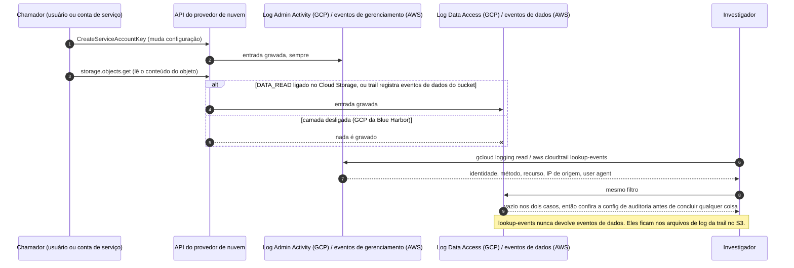
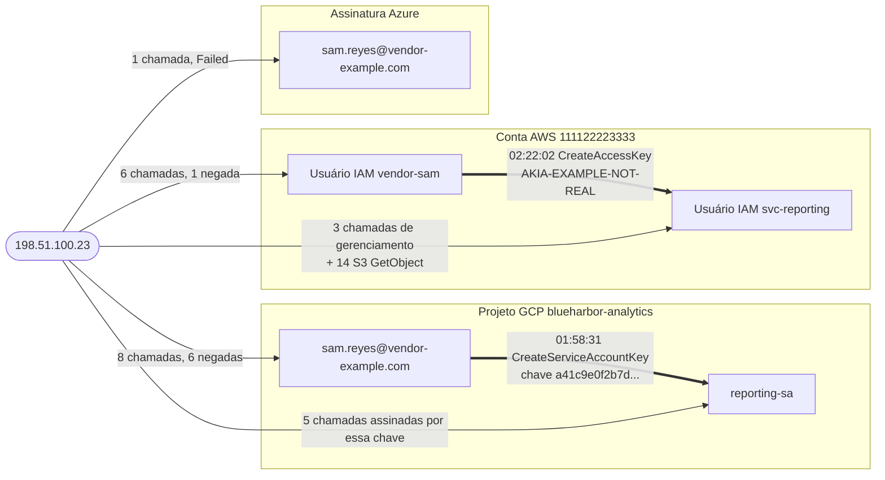

# Dia 77: Lendo logs de auditoria de nuvem no GCP e na AWS

> 🇺🇸 Original: [*Day 77: Reading cloud audit logs in GCP and AWS*](https://github.com/thiefdroppers/cyber-investigator-skills/blob/main/curriculum/phase-6-cloud-ai-system-investigation/day-77.md) — © ThiefDroppers, licença MIT.
> Aqui: tradução fiel **+** camada brasileira. Nada do original foi removido; tudo o que é novo vem marcado com ➕.

**Fase 6. Investigação em nuvem e sistemas de IA** · Meta da trilha: assumir a custódia das evidências do caso Blue Harbor, extrair a trilha de auditoria do plano de controle de duas nuvens e transformar um despejo bruto de eventos numa única linha do tempo de ator, ação e recurso.

Rank Jutsu: `A` · [](https://colab.research.google.com/github/Ridd1kulusC0d3r/investigador-cyber-90-dias/blob/main/curriculo/fase-6-nuvem-e-sistemas-de-ia/dia-77/dia-77.ipynb)

---

## 🎬 ➕ Abertura do caso — *A Lia sabia demais*

Quarta-feira, 21 de outubro. O grafo dos laranjas já foi para a delegacia e você achava que a Serra Azul estava fechando. Marta Quintão liga às 8h40, com a voz mais baixa que o normal.

— Um cooperado reclamou na ouvidoria. O golpista sabia o nome dele, a agência e que ele era cooperado *antes* de mandar o SMS. Ele jura que só falou com a Lia.

A Lia é o chatbot de atendimento do site, hospedado num projeto de nuvem (`serraazul-lia`) que a fornecedora Atende+ Tecnologia mantém. Dr. Hélio entra na ligação: — Se saiu dado de cooperado por ali, a gente tem prazo com a ANPD. Preciso saber *o quê*, *de quem* e *quando*.

Rafa já separou os exports que a Atende+ mandou por e-mail e para na sua frente com um pendrive na mão.

— Primeiro o hash. Depois a pergunta que todo mundo esquece: *o que esse log conseguia ver?* Log vazio de uma camada desligada não prova nada.

É isso que o Dia 77 ensina, primeiro no caso Blue Harbor do original e depois na Lia. *(Personagens e cenário: [Operação Isca](../../../caso-continuo/).)*

---

## 📖 Conceito

A Fase 6 conduz um único caso sintético, Blue Harbor, do recebimento ao relatório final. A evidência fica em [`resources/`](https://github.com/thiefdroppers/cyber-investigator-skills/tree/main/curriculum/phase-6-cloud-ai-system-investigation/resources), e o [`resources/README.md`](https://github.com/thiefdroppers/cyber-investigator-skills/blob/main/curriculum/phase-6-cloud-ai-system-investigation/resources/README.md) descreve a empresa, o registro de logs que estava ligado e cada arquivo. Leia as duas primeiras seções desse README antes de começar, mas não o gabarito do instrutor.

> ➕ Neste repositório, os mesmos arquivos estão em [`upstream/curriculum/phase-6-cloud-ai-system-investigation/resources/`](../../../upstream/curriculum/phase-6-cloud-ai-system-investigation/resources/). Resumo em português do README dos recursos: tudo é sintético; a Blue Harbor Analytics guarda exportações de clientes no bucket `blueharbor-customer-exports` (projeto GCP `blueharbor-analytics`); um job noturno na VM `report-runner-1`, rodando como `reporting-sa`, espelha cada exportação para o bucket S3 `blueharbor-exports-mirror` (conta AWS 111122223333); uma pequena assinatura Azure hospeda o site de marketing. No domingo, 13/set/2026, às 09:40 UTC, um alerta de orçamento dispara: o *egress* de rede de 12/set chegou a cerca de 47 GiB contra 2,2 GiB normais. O `INSTRUCTOR-KEY.md` existe na mesma pasta; não o leia antes de terminar o Dia 82.

Quando um servidor local é comprometido, você faz a imagem do disco. Numa conta de nuvem muitas vezes não existe disco que você controle, então a investigação corre sobre o log de auditoria: o registro, feito pelo provedor, de cada chamada de API que ele processou para a conta. No GCP esse registro é o Cloud Audit Logs, gravado em nomes de log sob `cloudaudit.googleapis.com`. Na AWS é o CloudTrail. Cada entrada responde a quatro perguntas: qual identidade fez a chamada, qual método de API chamou, qual recurso a chamada tocou e de onde a chamada veio (IP de origem e *user agent*). Uma linha do tempo construída com esses quatro campos é a espinha dorsal de todos os dias seguintes desta fase.

A cobertura é onde os iniciantes erram. O GCP grava logs de Admin Activity (mudanças de configuração) de graça e sempre. Os logs de Data Access, que registram leituras de configuração (`ADMIN_READ`) e leituras ou escritas de dados do usuário (`DATA_READ`, `DATA_WRITE`), vêm desligados por padrão na maioria dos serviços e precisam ser habilitados na configuração de auditoria do projeto. O AWS CloudTrail guarda 90 dias de eventos de gerenciamento sem nenhuma configuração, mas leituras de objetos no S3 e outros eventos de dados só aparecem se uma *trail* foi configurada para registrá-los. Então, quando um log não mostra nada, pergunte primeiro se o log para aquele tipo de ação estava ligado. O investigador declara qual camada estava ativa durante a janela, porque um resultado vazio de uma camada desligada não diz nada sobre a ação ter acontecido ou não.

A sequência abaixo acompanha duas chamadas pelo registro de logs e depois pela sua consulta. A mudança de configuração é sempre registrada. A leitura do objeto só é registrada se a camada dela estava ligada, e sua consulta não consegue distinguir "não registrado" de "não aconteceu".



A configuração da Blue Harbor é um bom exemplo de como isso fica desigual. O projeto habilitou `ADMIN_READ` para todos os serviços e deixou `DATA_READ` desligado, então você vê alguém listando buckets, mas não alguém baixando objetos. A *trail* da AWS registra eventos de dados do S3 para um bucket, então lá você vê downloads individuais. Você vai encontrar as duas consequências hoje.

Custódia continua importando quando a evidência é JSON exportado de um console. Se você não consegue mostrar que o arquivo que analisou é o arquivo que recebeu, a linha do tempo construída sobre ele é só uma opinião. O Dia 49 da Fase 4 cobriu o raciocínio; hoje você o aplica em cinco comandos.

## 📚 Recursos

- [Visão geral do GCP Cloud Audit Logs](https://cloud.google.com/logging/docs/audit): os tipos de log e o que cada um registra.
- [Referência do `gcloud logging read`](https://cloud.google.com/sdk/gcloud/reference/logging/read): sintaxe de filtro e flags.
- [AWS CloudTrail `lookup-events`](https://docs.aws.amazon.com/cli/latest/reference/cloudtrail/lookup-events.html): o histórico gratuito de 90 dias de eventos de gerenciamento, sem precisar de *trail*.
- [Manual do jq](https://jqlang.org/manual/): toda consulta offline desta fase usa jq 1.6 ou superior (`brew install jq` ou `apt install jq`).
- Camada gratuita: um projeto GCP pessoal e uma conta AWS pessoal na camada gratuita produzem logs de auditoria reais a partir da sua própria atividade. Use-os para testar os comandos ao vivo abaixo. Nunca aponte esses comandos para uma conta que você não foi autorizado a investigar.

### ➕ Recursos do contexto Brasil

- [LGPD — Lei 13.709/2018](https://www.planalto.gov.br/ccivil_03/_ato2015-2018/2018/lei/l13709.htm): art. 46 (medidas de segurança) e art. 48 (comunicação de incidente de segurança à ANPD e ao titular).
- [ANPD — Comunicação de incidente de segurança](https://www.gov.br/anpd/pt-br/canais_atendimento/agente-de-tratamento/comunicado-de-incidente-de-seguranca-cis): a página oficial com o formulário e as orientações.
- [Resolução CD/ANPD nº 15/2024](https://www.gov.br/anpd/pt-br/acesso-a-informacao/institucional/atos-normativos/regulamentacoes_anpd/resolucao-cd-anpd-no-15-de-24-de-abril-de-2024) (Regulamento de Comunicação de Incidente de Segurança): prazos, conteúdo mínimo e o dever de guardar o registro do incidente.
- [Resolução CMN nº 4.893/2021](https://www.bcb.gov.br/estabilidadefinanceira/buscanormas): política de segurança cibernética e contratação de serviços de nuvem por instituições autorizadas pelo Banco Central (cooperativas de crédito incluídas). Busque pelo número no buscador de normas do BCB.
- [Região `southamerica-east1` (São Paulo) do GCP](https://cloud.google.com/about/locations) e [região `sa-east-1` da AWS](https://aws.amazon.com/about-aws/global-infrastructure/regions_az/): onde costumam ficar as cargas brasileiras; útil ao ler o campo de região num log.

## 🛠️ Prática: jq e as CLIs de log de auditoria, uma linha do tempo de ator em duas nuvens

Artefato: `~/lab-p6/notes/day-77-timeline.csv`, uma única linha do tempo cronológica de todos os eventos da origem suspeita no GCP, na AWS e no Azure, mais um manifesto de hashes e um parágrafo dizendo o que os logs não conseguiam ver.

**Seu checklist de hoje.** Faça na ordem e marque cada item ao terminar:

- [ ] 1. Assuma a custódia da evidência
- [ ] 2. Descubra o que a config de auditoria deixava ver
- [ ] 3. Leia os eventos do GCP da identidade suspeita
- [ ] 4. Siga a chave nova
- [ ] 5. Leia os eventos da AWS
- [ ] 6. Pivote pela origem e junte tudo
- [ ] ➕ 7. Prática BR: custódia e cobertura dos logs da Lia
- [ ] ➕ 8. O notebook do dia no Colab

### 1. Assuma a custódia da evidência

Rode estes comandos a partir de `curriculum/phase-6-cloud-ai-system-investigation/`.

> ➕ Neste repositório, essa pasta é `upstream/curriculum/phase-6-cloud-ai-system-investigation/`.

```bash
mkdir -p ~/lab-p6/{evidence,work,notes}
cp -a resources ~/lab-p6/evidence/resources
chmod -R a-w ~/lab-p6/evidence/resources
cd ~/lab-p6/evidence/resources
find . -type f \( -name '*.json' -o -name '*.jsonl' -o -name '*.csv' \) | sort \
  | xargs shasum -a 256 | tee ~/lab-p6/notes/receipt.sha256
date -u +"%Y-%m-%dT%H:%M:%SZ received Blue Harbor evidence" >> ~/lab-p6/notes/actions.log

cp -a ~/lab-p6/evidence/resources ~/lab-p6/work/resources
chmod -R u+w ~/lab-p6/work/resources
cd ~/lab-p6/work/resources && shasum -a 256 -c ~/lab-p6/notes/receipt.sha256
```

O manifesto tem 15 linhas. Toda linha da conferência deve terminar em `OK`. No Linux, `sha256sum` produz e confere o mesmo formato. Daqui em diante, todo comando roda a partir de `~/lab-p6/work` com esta variável definida:

```bash
cd ~/lab-p6/work && C=resources/case-blueharbor
```

### 2. Descubra o que a config de auditoria deixava ver

```bash
jq '.auditConfigs' $C/gcp/iam-project-policy.json
jq length $C/gcp/audit-activity.json $C/gcp/audit-data-access.json
```

A config de auditoria habilita `ADMIN_READ` para `allServices` e nada mais. O arquivo de Admin Activity tem 26 entradas e o de Data Access, 474. Anote os dois fatos em `actions.log`; o parágrafo no fim do artefato de hoje depende deles.

### 3. Leia os eventos do GCP da identidade suspeita

Num projeto ao vivo, você puxaria os eventos de uma identidade com `gcloud logging read`. Eis o comando na forma ao vivo:

```
gcloud logging read \
  'logName:"cloudaudit.googleapis.com" AND
   protoPayload.authenticationInfo.principalEmail="suspect@example.com"' \
  --project=YOUR_PROJECT --freshness=7d --order=asc \
  --format='table(
     timestamp,
     protoPayload.authenticationInfo.principalEmail,
     protoPayload.methodName,
     protoPayload.resourceName,
     protoPayload.requestMetadata.callerIp)'
```

Para ler só o fluxo de Admin Activity, o filtro nomeia o log diretamente. `%2F` é a barra codificada para URL dentro do nome do log e precisa estar lá:

```
gcloud logging read \
  'logName="projects/YOUR_PROJECT/logs/cloudaudit.googleapis.com%2Factivity"' \
  --project=YOUR_PROJECT \
  --freshness=3d \
  --order=asc \
  --format=json \
  --limit=100
```

Os arquivos do caso são a saída JSON salva de comandos como esses, então o jq faz a filtragem offline. Comece pela conta do prestador de serviço apenas no arquivo de Admin Activity:

```bash
jq -r '.[] | select(.protoPayload.authenticationInfo.principalEmail == "sam.reyes@vendor-example.com")
  | [.timestamp, .protoPayload.methodName] | @tsv' $C/gcp/audit-activity.json
```

Volta uma linha: `google.iam.admin.v1.CreateServiceAccountKey` em 2026-09-12T01:58:31. Agora rode a mesma consulta nos dois arquivos, com o código de status, a origem e a primeira parte do *user agent*:

```bash
jq -r '.[] | select(.protoPayload.authenticationInfo.principalEmail == "sam.reyes@vendor-example.com")
  | [.timestamp, .protoPayload.methodName, (.protoPayload.status.code // 0),
     .protoPayload.requestMetadata.callerIp,
     (.protoPayload.requestMetadata.callerSuppliedUserAgent | split(" ")[0])] | @tsv' \
  $C/gcp/audit-activity.json $C/gcp/audit-data-access.json | sort | tail -10
```

```
2026-09-11T20:18:31.612Z  google.cloud.bigquery.v2.JobService.InsertJob     0  192.0.2.44     Mozilla/5.0
2026-09-11T20:24:55.082Z  google.cloud.bigquery.v2.JobService.InsertJob     0  192.0.2.44     Mozilla/5.0
2026-09-12T01:47:03.176Z  storage.buckets.list                              7  198.51.100.23  google-api-python-client/2.143.0
2026-09-12T01:47:41.960Z  v1.compute.instances.list                         7  198.51.100.23  google-api-python-client/2.143.0
2026-09-12T01:48:15.251Z  ListKeyRings                                      7  198.51.100.23  google-api-python-client/2.143.0
2026-09-12T01:48:52.695Z  GetIamPolicy                                      7  198.51.100.23  google-api-python-client/2.143.0
2026-09-12T01:49:30.897Z  google.iam.admin.v1.ListServiceAccounts           7  198.51.100.23  google-api-python-client/2.143.0
2026-09-12T01:51:02.260Z  google.iam.admin.v1.GetIAMPolicy                  7  198.51.100.23  google-api-python-client/2.143.0
2026-09-12T01:52:47.155Z  google.iam.admin.v1.ListServiceAccountKeys        0  198.51.100.23  google-api-python-client/2.143.0
2026-09-12T01:58:31.207Z  google.iam.admin.v1.CreateServiceAccountKey       0  198.51.100.23  google-api-python-client/2.143.0
```

(Colunas alinhadas aqui para leitura; sua saída é separada por tabulação.) O código de status 7 é `PERMISSION_DENIED`. O arquivo de Admin Activity sozinho mostrava um evento. Com o arquivo de Data Access aparecem seis leituras negadas e uma listagem de chaves nos cinco minutos anteriores à criação da chave, a partir de um endereço novo, com um cliente de script, num sábado à 01:47 UTC. A atividade anterior de Sam vinha de 192.0.2.44, por navegador, em horário comercial.

### 4. Siga a chave nova

A chave que a conta de Sam criou pertence a `reporting-sa`. A partir daí o ator se autentica como a conta de serviço, então filtrar pelo e-mail de Sam o perde de vista. O ID da chave liga os dois:

```bash
jq -r '.[] | select(.protoPayload.methodName | endswith("CreateServiceAccountKey"))
  | .protoPayload.response.name | split("/") | last' $C/gcp/audit-activity.json
jq -r '.[] | select(.protoPayload.authenticationInfo.serviceAccountKeyName != null)
  | [.timestamp, .protoPayload.methodName,
     (.protoPayload.authenticationInfo.serviceAccountKeyName | split("/") | last)] | @tsv' \
  $C/gcp/audit-activity.json $C/gcp/audit-data-access.json
```

A chave `a41c9e0f2b7d...` criada à 01:58:31 assina cinco chamadas posteriores: `instances.start` às 02:03:12, `setMetadata` às 02:04:40 e às 03:05:40, um `DeleteSink` às 03:06:15 e `instances.stop` às 03:07:02.

### 5. Leia os eventos da AWS

A consulta ao vivo dos eventos de gerenciamento de um usuário IAM:

```
aws cloudtrail lookup-events \
  --lookup-attributes AttributeKey=Username,AttributeValue=suspect-iam-user \
  --start-time 2026-09-10T00:00:00Z \
  --end-time   2026-09-13T00:00:00Z \
  --max-items 50 \
  --region us-east-1
```

A resposta aninha os campos úteis dentro de uma string JSON chamada `CloudTrailEvent`. O *pipeline* que achata a saída ao vivo:

```
aws cloudtrail lookup-events \
  --lookup-attributes AttributeKey=Username,AttributeValue=suspect-iam-user \
  --start-time 2026-09-10T00:00:00Z --end-time 2026-09-13T00:00:00Z \
  --region us-east-1 --output json \
| jq -r '.Events[].CloudTrailEvent | fromjson
    | [.eventTime, .userIdentity.arn, .eventName, .sourceIPAddress, .userAgent]
    | @tsv'
```

`cloudtrail-lookup-events.json` é saída salva nesse formato, do evento mais novo para o mais antigo, como o `lookup-events` devolve. Filtre pelos dois usuários que importam e acrescente o código de erro:

```bash
jq -r '.Events[] | select(.Username == "vendor-sam" or .Username == "svc-reporting")
  | .CloudTrailEvent | fromjson
  | [.eventTime, .userIdentity.arn, .eventName, .sourceIPAddress, (.errorCode // "ok")] | @tsv' \
  $C/aws/cloudtrail-lookup-events.json | sort | tail -9
```

Os nove últimos eventos vão de `GetCallerIdentity` às 02:19:48 até `CreateAccessKey` para `svc-reporting` às 02:22:02 (feito por `vendor-sam`), depois o `GetCallerIdentity` do novo usuário, um `StopLogging` negado e um `ListBuckets`. É o mesmo pivô que o ator fez no GCP, repetido cerca de 24 minutos depois. Confirme casando o ID da chave.

```bash
jq -r '.Events[].CloudTrailEvent | fromjson | select(.eventName == "CreateAccessKey")
  | .responseElements.accessKey.accessKeyId' $C/aws/cloudtrail-lookup-events.json
jq '[.Records[] | select(.userIdentity.accessKeyId == "AKIA-EXAMPLE-NOT-REAL")] | length' \
  $C/aws/cloudtrail-s3-data-events.json
```

A chave criada às 02:22:02 é a chave por trás de 14 eventos de dados `GetObject` no bucket espelho. O `lookup-events` nunca devolve eventos de dados, e é por isso que eles ficam num arquivo de log separado da *trail*.

### 6. Pivote pela origem e junte tudo

As identidades mudaram duas vezes, mas o endereço de origem continuou o mesmo. O grafo resume os passos 3 a 5, mais o único evento do Azure que a junção abaixo apanha. Toda chamada veio de um endereço, e os IDs das chaves criadas ligam cada identidade nova à que a emitiu. Os rótulos das arestas contam os eventos que cada identidade contribui para a linha do tempo de hoje.



Filtrar por qualquer campo de identidade isolado dá um fragmento desse quadro. Filtrar pelo endereço dá os 37 eventos. Construa a linha do tempo sobre ele, em todos os logs que você tem:

```bash
IP=198.51.100.23
{
  echo '"time_utc","cloud","identity","action","resource","result"'
  {
    jq -r --arg ip "$IP" '.[] | select(.protoPayload.requestMetadata.callerIp == $ip)
      | [.timestamp[0:19] + "Z", "gcp", .protoPayload.authenticationInfo.principalEmail,
         .protoPayload.methodName, .protoPayload.resourceName,
         (if (.protoPayload.status.code // 0) == 0 then "ok" else "denied" end)] | @csv' \
      $C/gcp/audit-activity.json $C/gcp/audit-data-access.json
    jq -r --arg ip "$IP" '.Events[].CloudTrailEvent | fromjson | select(.sourceIPAddress == $ip)
      | [.eventTime, "aws", .userIdentity.arn, .eventName,
         (.requestParameters.userName // .requestParameters.name // ""), (.errorCode // "ok")] | @csv' \
      $C/aws/cloudtrail-lookup-events.json
    jq -r --arg ip "$IP" '.Records[] | select(.sourceIPAddress == $ip)
      | [.eventTime, "aws", .userIdentity.arn, .eventName,
         "s3://" + .requestParameters.bucketName + "/" + .requestParameters.key, "ok"] | @csv' \
      $C/aws/cloudtrail-s3-data-events.json
    jq -r --arg ip "$IP" '.[] | select(.httpRequest.clientIpAddress == $ip)
      | [.eventTimestamp[0:19] + "Z", "azure", .caller, .operationName.value, .resourceId,
         .status.value] | @csv' $C/azure/activity-log.json
  } | sort
} > ~/lab-p6/notes/day-77-timeline.csv
wc -l ~/lab-p6/notes/day-77-timeline.csv
```

O arquivo tem 38 linhas: um cabeçalho e 37 eventos entre 01:47:03 e 03:07:02 de 12 de setembro. Abaixo da tabela, num arquivo de notas ou numa aba de planilha, escreva o parágrafo sobre cobertura: quais camadas de log estavam ativas em cada nuvem e uma classe de ação que aconteceu nessa janela mas não pode aparecer na sua linha do tempo. (Dica: compare os recursos do GCP que o ator tocou com os da AWS.)

### ➕ Prática BR: custódia e cobertura dos logs da Lia

A Atende+ entregou à Serra Azul um export de Cloud Audit Logs do projeto `serraazul-lia`: [`caso-continuo/dados/dia-77/lia-auditoria.json`](../../../caso-continuo/dados/dia-77/lia-auditoria.json) (18 entradas, 30/set a 02/out/2026, Admin Activity e Data Access juntos, no mesmo formato do Blue Harbor). Tudo fictício.

**Exercício A — custódia antes de tudo.** Calcule o SHA-256 do arquivo e registre o recebimento com hora UTC, exatamente como no passo 1:

```bash
python scripts/registrar_evidencia.py caso-continuo/dados/dia-77/lia-auditoria.json "export de auditoria GCP serraazul-lia, entregue pela Atende+"
```

**Exercício B — cobertura e linha do tempo.** Responda por escrito em `notas/dia-77-lia-cobertura.md`:

1. Que camadas a config de auditoria do projeto ligava? (Ela está em [`caso-continuo/dados/dia-79/lia-iam.json`](../../../caso-continuo/dados/dia-79/lia-iam.json), chave `projeto.auditConfigs`: só `ADMIN_READ`, como no Blue Harbor.) Consequência: as *leituras de linhas* do dataset `cadastro_espelho` não aparecem; o que aparece são os **jobs** do BigQuery (`InsertJob`), registrados como Data Access.
2. Filtre pelo endereço `198.51.100.66`. Quantos eventos? (8.) Quem é a identidade antes e depois de `CreateServiceAccountKey`? Qual o ID da chave que liga `dev.externo@atendemais.example` a `lia-bot`?
3. Converta a janela para horário de Brasília (UTC-3): o primeiro evento é às 03:05:12 UTC de 2/out, ou seja, **00:05 de sexta-feira, 2/out**, em BRT. O padrão anterior do usuário `dev.externo` era navegador, `192.0.2.80`, à tarde.
4. Escreva o parágrafo de cobertura: o que *não* pode aparecer nessa linha do tempo (quais linhas o job leu; se o arquivo extraído foi baixado do bucket, já que `DATA_READ` estava desligado no Cloud Storage).

> Por que isso importa para a cooperativa: o Dr. Hélio vai precisar descrever à ANPD "a natureza dos dados afetados". Um log que só mostra o *job* não diz quais linhas saíram; dizer isso por escrito é parte do relatório honesto (e da comunicação: a natureza dos dados afetados é o inciso I do art. 48, §1º, da LGPD).

### ➕ O notebook do dia

Abra o [notebook do Dia 77 no Colab](https://colab.research.google.com/github/Ridd1kulusC0d3r/investigador-cyber-90-dias/blob/main/curriculo/fase-6-nuvem-e-sistemas-de-ia/dia-77/dia-77.ipynb). Nele você:

1. carrega os 15 arquivos do Blue Harbor direto do GitHub do original, com conferência de SHA-256 e cópia embutida como plano B offline (o recibo de custódia sai pronto);
2. refaz em Python puro cada consulta `jq` dos passos 2 a 6 (os comandos `jq` continuam neste README, intactos);
3. gera `day-77-timeline.csv` com 37 eventos e confere contra os números do original;
4. joga o **quiz da cobertura** ("esse log vazio prova que não aconteceu?");
5. repete a junção por IP nos logs da Lia (Operação Isca) e converte as horas para BRT.

## ✅ Checkpoint

- `shasum -a 256 -c` contra o seu manifesto devolve `OK` para todos os 15 arquivos da cópia de trabalho.
- `actions.log` tem uma linha UTC para o recebimento da evidência.
- `actions.log` registra que a config de auditoria do GCP habilita apenas `ADMIN_READ` para `allServices`.
- `actions.log` registra a contagem de entradas: 26 no arquivo de Admin Activity e 474 no de Data Access.
- `~/lab-p6/notes/day-77-timeline.csv` tem 37 linhas de evento abaixo do cabeçalho.
- As linhas estão numa única sequência cronológica, de 01:47:03 a 03:07:02 de 12 de setembro.
- As linhas cobrem as três nuvens: `gcp`, `aws` e `azure` aparecem, cada uma, na coluna de nuvem.
- Toda linha tem um resultado (`ok`, `denied`, `AccessDenied` ou `Failed`).
- Seu parágrafo de cobertura diz que as leituras de objetos no Cloud Storage não foram registradas porque `DATA_READ` estava desligado.
- Seu parágrafo de cobertura diz que as leituras de objetos no S3 foram registradas porque a *trail* registra eventos de dados daquele bucket.
- Sem consultar notas, você consegue nomear a evidência que liga `reporting-sa` e `svc-reporting` ao mesmo ator de `sam.reyes@vendor-example.com` e `vendor-sam` (IP de origem mais os IDs das chaves criadas), sem depender do campo de identidade.

### ➕ Checkpoint BR

- O SHA-256 de `lia-auditoria.json` está no seu `notas/registro-de-custodia.csv`, com hora UTC.
- Sua linha do tempo da Lia tem 8 eventos de `198.51.100.66`, com hora UTC **e** BRT.
- Você nomeia o ID da chave que liga `dev.externo@atendemais.example` a `lia-bot` (`7c3e91a0...`).
- Seu parágrafo de cobertura diz que o log mostra os jobs do BigQuery, mas não quais linhas foram lidas.
- Você explica por que "o log não mostra download do bucket" **não** quer dizer "ninguém baixou".

## ⚖️ ➕ Camada jurídica BR

**LGPD, art. 46.** Os agentes de tratamento devem adotar medidas de segurança, técnicas e administrativas, aptas a proteger os dados pessoais de acessos não autorizados e de situações acidentais ou ilícitas. Log de auditoria ligado (e guardado) é uma dessas medidas; log desligado vira lacuna na hora de responder à ANPD.

**LGPD, art. 48.** O controlador (aqui, a Cooperativa Serra Azul) deve comunicar à ANPD e ao titular a ocorrência de incidente de segurança que possa acarretar risco ou dano relevante aos titulares. O §1º lista o conteúdo mínimo da comunicação, entre eles: a descrição da natureza dos dados afetados, as informações sobre os titulares envolvidos, as medidas técnicas e de segurança utilizadas, os riscos relacionados ao incidente e as medidas adotadas para reverter ou mitigar os efeitos. A Resolução CD/ANPD nº 15/2024 regulamenta o procedimento e o prazo da comunicação. <!-- TODO jurídico: confirmar o prazo exato (dias úteis) e a contagem na Resolução CD/ANPD 15/2024 antes de citar número no texto. -->

**Quem é quem.** A Serra Azul é a **controladora** dos dados dos cooperados; a Atende+, que opera a Lia, é **operadora** (LGPD, art. 5º, VI e VII). A operadora trata os dados segundo as instruções da controladora (art. 39). Na prática: o export de logs que você recebeu chegou pela controladora, que é quem tem o direito de concedê-lo. Pedir logs direto à Atende+ sem passar pela Marta seria sair do escopo escrito (lembre o Dia 1).

**Cadeia de custódia (CPP, arts. 158-A a 158-F).** Mesmo num caso privado, se o material puder virar prova num processo penal (o estelionato e a fraude eletrônica dos Pix, CP art. 171, §2º-A), o rastreamento do vestígio desde o recebimento importa. O hash + hora UTC do passo 1 é a sua parte nisso.

> Este repositório é material de estudo e não constitui orientação jurídica. No caso real, quem decide a comunicação à ANPD é o controlador, com o encarregado (DPO) e o jurídico.

## 🧠 ➕ Camada 8 — o silêncio que parece inocência

O erro que o Dia 77 previne tem nome: **viés de ausência de evidência**, a tendência de ler "não encontrei" como "não aconteceu". Ele anda junto com o **viés de disponibilidade** (Tversky e Kahneman): o que aparece no log fica vívido e parece ser tudo o que houve; o que não aparece some da cabeça. No Blue Harbor, o Admin Activity sozinho mostra *um* evento de Sam, e um analista cansado escreveria "o prestador criou uma chave, só isso".

Há também a pressão do cliente. Marta quer ouvir "não saiu dado nenhum", e o investigador sente o puxão do **raciocínio motivado** na direção do que alivia todo mundo. O antídoto é mecânico: antes de interpretar qualquer resultado vazio, escreva a frase "a camada X estava ligada? sim/não" no `actions.log`. Consequência prática: no relatório, toda afirmação negativa ("não houve download") vem acompanhada da camada que a sustenta, ou é reescrita como "não há registro, e a camada estava desligada".

## 🤖 ➕ Skill do dia

Hoje o dia propõe para a [skill pt-BR](../../../skills/investigador-cyber/SKILL.md) o procedimento novo **"Linha do tempo de auditoria de nuvem"**: custódia com hash, declaração de cobertura por camada antes de ler resultados vazios, e pivô pela origem e pelos IDs de chave, não pela identidade. Texto e caso de teste em [`_skill-delta.md`](_skill-delta.md).

## 💡 ➕ Inovação OSINT do dia — jq sem jq: um "mini-jq" em Python stdlib

Os comandos `jq` do original são ótimos no terminal, mas no Colab, no Windows ou numa máquina de cliente travada, nem sempre há `jq`. Um caminho de pontos como `.protoPayload.requestMetadata.callerIp` cabe numa função de 5 linhas, e com ela qualquer `select(...)` vira uma *list comprehension*:

```python
import json                                         # stdlib

def pega(obj, caminho, padrao=None):
    """pega(evento, "protoPayload.status.code", 0)  ~  jq '.protoPayload.status.code // 0'"""
    for parte in caminho.split("."):                # anda campo por campo
        obj = obj.get(parte) if isinstance(obj, dict) else None
    return padrao if obj in (None, {}) else obj     # o "// padrão" do jq

eventos = json.load(open("audit-activity.json"))
for e in eventos:
    if pega(e, "protoPayload.requestMetadata.callerIp") == "198.51.100.23":
        print(e["timestamp"], pega(e, "protoPayload.methodName"), pega(e, "protoPayload.status.code", 0))
```

Para JSON aninhado como string (o `CloudTrailEvent` da AWS), o `fromjson` do jq é simplesmente `json.loads(evento["CloudTrailEvent"])`. O notebook do dia usa essa função em tudo. Se quiser algo pronto e real, a biblioteca opcional [`jmespath`](https://pypi.org/project/jmespath/) é a mesma linguagem de consulta que a AWS CLI usa no `--query`.

## 📝 Diário de estudo

- Data:
- Tempo gasto:
- O que ficou claro:
- O que ainda está nebuloso:
- Artefato produzido: `~/lab-p6/notes/day-77-timeline.csv`, `~/lab-p6/notes/receipt.sha256`, `~/lab-p6/notes/actions.log`, `notas/dia-77-lia-cobertura.md`

---
<sub>Baseado em [cyber-investigator-skills](https://github.com/thiefdroppers/cyber-investigator-skills) por ThiefDroppers (MIT). Tradução, camada BR, Camada 8, skill pt-BR e notebook por Deivison Lourenço (@Ridd1kulusC0d3r).</sub>
