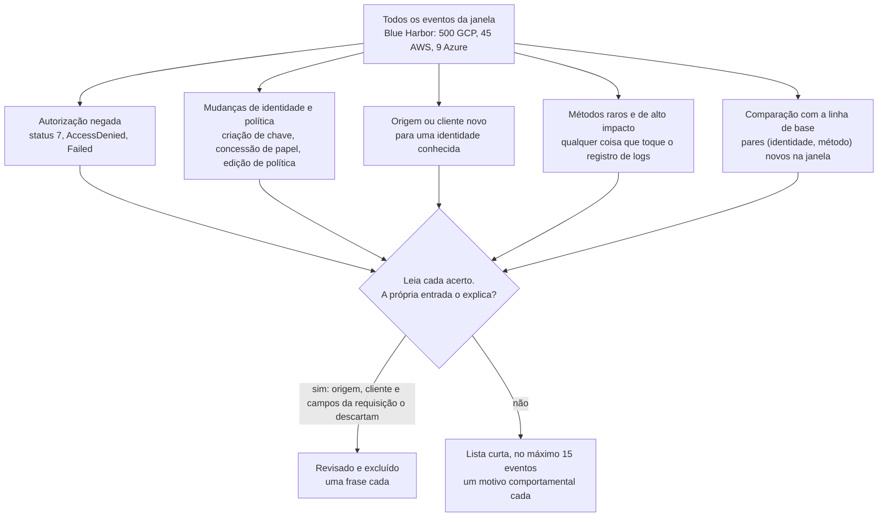
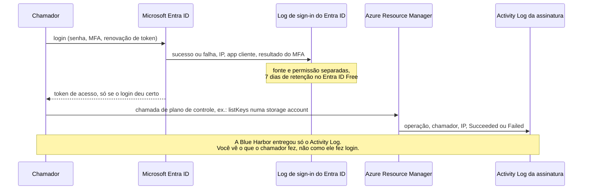

# Dia 78: Filtrando logs de nuvem até o sinal, mais Azure

> 🇺🇸 Original: [*Day 78: Filtering cloud logs to the signal, plus Azure*](https://github.com/thiefdroppers/cyber-investigator-skills/blob/main/curriculum/phase-6-cloud-ai-system-investigation/day-78.md) — © ThiefDroppers, licença MIT.
> Aqui: tradução fiel **+** camada brasileira. Nada do original foi removido; tudo o que é novo vem marcado com ➕.

**Fase 6. Investigação em nuvem e sistemas de IA** · Meta da trilha: escrever filtros que reduzam centenas de eventos rotineiros do Blue Harbor à lista curta que importa, medir quanto cada filtro removeu, e ler o plano de controle do Azure com as mesmas perguntas.

Rank Jutsu: `A` · [](https://colab.research.google.com/github/Ridd1kulusC0d3r/investigador-cyber-90-dias/blob/main/curriculo/fase-6-nuvem-e-sistemas-de-ia/dia-78/dia-78.ipynb)

---

## 🎬 ➕ Abertura do caso — *Cinco minutos da Marta*

Quinta, 22 de outubro, 9h. Marta Quintão tem uma reunião com o conselho às 10h e cinco minutos para você.

— Não me mostra planilha de 18 linhas. Me diz o que é estranho.

Rafa, encostado na divisória, levanta um dedo antes de você abrir a boca.

— E não conta com o IP que você achou ontem. Finge que só tem o log. Se o seu filtro só funciona porque você já sabe a resposta, ele não é filtro, é confirmação.

Você abre o export da Lia de novo. Dezoito entradas. Lá dentro há um `DeleteSink` negado à 00:40 de sexta, mas também uma rotina de `InsertJob` que roda três vezes por dia e parece igualzinha a qualquer outra. O que separa a rotina do ataque?

É isso que o Dia 78 ensina. *(Personagens e cenário: [Operação Isca](../../../caso-continuo/).)*

---

## 📖 Conceito

Ontem você sabia o endereço suspeito antes de começar, então um único pivô produziu a linha do tempo. A maioria das investigações começa com menos: um alerta de orçamento, uma reclamação de cliente, um vago "alguma coisa mudou na conta". Você então encara todos os eventos que a conta produziu, e uma conta real produz dezenas de milhares por dia, quase todos de automação. Lê-los em ordem não funciona. Você filtra primeiro e lê depois, e os filtros que valem a pena descrevem o que um atacante faz.

Quatro filtros merecem lugar em quase toda investigação em nuvem.

Autorização negada. No GCP, uma chamada recusada traz `protoPayload.status.code` 7 (`PERMISSION_DENIED`); no CloudTrail, traz um `errorCode` como `AccessDenied`; no Activity Log do Azure, o status é `Failed`. Automação que funciona não falha repetidamente, então uma rajada de negações vindas de uma identidade geralmente significa alguém sondando o que consegue alcançar.

Mudanças de identidade e de política. Criação de chave de conta de serviço, criação de chave de acesso, concessão de papéis e edição de políticas são como um ponto de apoio vira persistência. São raras numa conta saudável, o que as torna baratas de revisar uma a uma.

Uma origem ou cliente novo para uma identidade conhecida. Uma identidade que sempre chamou de um endereço com um navegador e, de repente, chama de um endereço novo com uma biblioteca de script à 01:47 de um sábado merece uma olhada, mesmo que todas as chamadas tenham dado certo.

Métodos raros e de alto impacto, e qualquer coisa que toque o registro de logs. Apagar um *sink* de log, parar uma *trail* ou mudar a política de um bucket muda o que a conta consegue ver ou quem consegue ler seus dados. Adulterar a trilha de auditoria é um movimento antiforense clássico, então até um `DeleteSink` ou `StopLogging` que falhou é barulhento.

Uma quinta técnica transforma esses filtros numa comparação com a linha de base: liste todo par (identidade, método) visto antes da janela e mostre apenas os pares que são novos dentro dela. Ela não exige saber quais métodos são perigosos, o que a torna uma boa segunda opinião sobre os filtros escolhidos a dedo.

Juntos, os filtros funcionam como um funil. Cada um roda sobre o palheiro inteiro de forma independente, um acerto de qualquer um deles é lido por uma pessoa, e é na leitura que uma entrada é descartada com base na própria evidência ou mantida.



O Azure faz as mesmas perguntas por logs diferentes. Operações do plano de controle (criar recursos, atribuir papéis, listar chaves de armazenamento) vão para o Activity Log da assinatura. Logins, inclusive os que falharam, vão para o log de sign-in do Microsoft Entra ID, que é uma fonte separada, com permissões e retenção separadas. Um login que falhou nunca aparece no Activity Log, então anote qual dos dois você de fato tinha.



## 📚 Recursos

- [Linguagem de consulta do GCP Logging](https://cloud.google.com/logging/docs/view/logging-query-language): operadores de comparação, `AND`/`OR`, substring `:` versus exato `=`.
- [Códigos de status do gRPC](https://grpc.io/docs/guides/status-codes/): o que significam os valores numéricos de `status.code`.
- [Conteúdo de um registro do CloudTrail](https://docs.aws.amazon.com/awscloudtrail/latest/userguide/cloudtrail-event-reference-record-contents.html): `errorCode`, `readOnly`, `userIdentity` e o resto.
- [`az monitor activity-log list`](https://learn.microsoft.com/en-us/cli/azure/monitor/activity-log): eventos do plano de controle do Azure pela CLI.
- Camada gratuita: o Azure oferece uma conta gratuita com crédito de uso, e as mudanças nos seus próprios recursos populam o Activity Log sem configuração extra.

### ➕ Recursos do contexto Brasil

- [CERT.br — Recomendações e boas práticas](https://www.cert.br/docs/): material em português sobre tratamento de incidentes e registro de eventos.
- [ANPD — Guia orientativo de segurança da informação para agentes de tratamento de pequeno porte](https://www.gov.br/anpd/pt-br/centrais-de-conteudo/materiais-educativos-e-publicacoes): inclui o controle de registros (logs) entre as medidas mínimas.
- [MITRE ATT&CK T1562.008 — Impair Defenses: Disable or Modify Cloud Logs](https://attack.mitre.org/techniques/T1562/008/): a técnica por trás do `DeleteSink` e do `StopLogging` de hoje.
- [MITRE ATT&CK T1098.001 — Account Manipulation: Additional Cloud Credentials](https://attack.mitre.org/techniques/T1098/001/): a criação de chave para outra identidade.

## 🛠️ Prática: filtros jq sobre os logs do Blue Harbor, uma lista curta de "só eventos suspeitos"

Artefato: `~/lab-p6/notes/day-78-shortlist.md`, no máximo quinze eventos nas três nuvens, cada um com uma linha de motivo para ter entrado no corte, e uma tabela dos filtros que você rodou com as contagens de antes e depois.

Para este exercício, finja que não sabe a resposta de ontem: você tem o alerta de orçamento e os logs, nada mais. Trabalhe a partir da sua cópia conferida.

```bash
cd ~/lab-p6/work && C=resources/case-blueharbor
(cd resources && shasum -a 256 -c ~/lab-p6/notes/receipt.sha256) | grep -v ': OK$'   # não imprime nada se estiver íntegro
```

**Seu checklist de hoje.** Faça na ordem e marque cada item ao terminar:

- [ ] 1. Meça o palheiro
- [ ] 2. Chamadas negadas
- [ ] 3. Mudanças de identidade, política e logging
- [ ] 4. Origem ou cliente novo por identidade
- [ ] 5. Pares (identidade, método) novos
- [ ] 6. AWS: erros e escritas
- [ ] 7. Azure
- [ ] 8. Escreva a lista curta
- [ ] 9. Registre a fonte ausente
- [ ] ➕ 10. Prática BR: o funil sobre os logs da Lia
- [ ] ➕ 11. O notebook do dia no Colab

### 1. Meça o palheiro

```bash
jq -s 'add | length' $C/gcp/audit-activity.json $C/gcp/audit-data-access.json
jq '.Events | length' $C/aws/cloudtrail-lookup-events.json
jq length $C/azure/activity-log.json
```

500 entradas de auditoria do GCP, 45 eventos de gerenciamento da AWS e 9 eventos do Azure em três dias. Comece sua tabela de filtros com esses três números.

### 2. Chamadas negadas

A consulta ao vivo do GCP para tudo o que uma identidade tentou e teve recusado:

```
gcloud logging read \
  'logName:"cloudaudit.googleapis.com" AND
   protoPayload.authenticationInfo.principalEmail="suspect@example.com" AND
   protoPayload.status.code!=0' \
  --project=YOUR_PROJECT --freshness=7d --order=asc \
  --format='table(timestamp,
     protoPayload.methodName,
     protoPayload.status.code,
     protoPayload.status.message,
     protoPayload.resourceName)'
```

Offline, tire a condição de identidade para que o filtro encontre o suspeito por você:

```bash
jq -s -r 'add | sort_by(.timestamp) | .[] | select((.protoPayload.status.code // 0) != 0)
  | [.timestamp[0:19], .protoPayload.authenticationInfo.principalEmail,
     .protoPayload.methodName, .protoPayload.requestMetadata.callerIp] | @tsv' \
  $C/gcp/audit-activity.json $C/gcp/audit-data-access.json
```

Sete entradas. Seis são de `sam.reyes@vendor-example.com` entre 01:47:03 e 01:51:02, uma contra cada um destes: Cloud Storage, Compute Engine, Cloud KMS, a política de IAM do projeto, a lista de contas de serviço e a política de IAM de uma conta de serviço. A sétima é `reporting-sa` falhando ao apagar o *sink* de log `audit-to-bq` às 03:06:15. Seis recusas em cinco serviços em quatro minutos parecem uma pessoa mapeando a conta; um app mal configurado tentando de novo falha a mesma chamada várias vezes.

### 3. Mudanças de identidade, política e logging

A consulta ao vivo para os nomes de método de alto impacto, qualquer identidade:

```
gcloud logging read \
  'logName:"cloudaudit.googleapis.com" AND
   (protoPayload.methodName:"SetIamPolicy" OR
    protoPayload.methodName:"CreateServiceAccountKey" OR
    protoPayload.methodName:"sinks.delete" OR
    protoPayload.methodName:"CreateServiceAccount")' \
  --project=YOUR_PROJECT --freshness=7d --order=asc \
  --format='table(timestamp,
     protoPayload.authenticationInfo.principalEmail,
     protoPayload.methodName,
     protoPayload.resourceName)'
```

Antes de confiar num filtro por nome de método, confira os nomes exatos nos seus próprios logs. Neste caso, a exclusão do *sink* é registrada como `google.logging.v2.ConfigServiceV2.DeleteSink`, então case com o que o arquivo de fato contém:

```bash
jq -s -r 'add | sort_by(.timestamp) | .[]
  | select(.protoPayload.methodName | test("SetIamPolicy|CreateServiceAccountKey|DeleteSink|setMetadata|instances\\.(start|stop)$"))
  | [.timestamp[0:19], .protoPayload.authenticationInfo.principalEmail,
     .protoPayload.methodName, .protoPayload.requestMetadata.callerIp] | @tsv' \
  $C/gcp/audit-activity.json $C/gcp/audit-data-access.json
```

Treze entradas, e este filtro exige julgamento. O `SetIamPolicy` de Dana Okafor às 15:42 de 10 de setembro veio do endereço do escritório, com um navegador, e adicionou `lee.chen` a `roles/bigquery.dataViewer`; leia o campo `request` e você consegue descartá-lo. As seis chamadas de *start* e *stop* de `scheduler-sa` às 00:28 e 01:12 de cada noite são o job de relatório. O que sobra é a criação de chave à 01:58:31 e cinco chamadas de `reporting-sa` a partir de 198.51.100.23, incluindo um segundo *start* da VM de relatório às 02:03, bem depois de o agendador já tê-la parado.

### 4. Origem ou cliente novo por identidade

```bash
jq -s -r 'add | .[] | [.protoPayload.authenticationInfo.principalEmail,
     .protoPayload.requestMetadata.callerIp,
     (.protoPayload.requestMetadata.callerSuppliedUserAgent | split(" ")[0])] | @tsv' \
  $C/gcp/audit-activity.json $C/gcp/audit-data-access.json | sort | uniq -c
```

Nove linhas resumem 500 eventos. Duas delas devem fazer você parar: `sam.reyes@vendor-example.com` aparece a partir de 192.0.2.44 com um navegador (22 eventos) e a partir de 198.51.100.23 com `google-api-python-client` (8 eventos), e `reporting-sa` aparece apenas a partir de 198.51.100.23. Uma conta de serviço que normalmente roda numa VM dentro do projeto não tem motivo para chamar a API de um endereço externo.

### 5. Pares (identidade, método) novos

```bash
jq -s -r 'add | sort_by(.timestamp)
  | (map(select(.timestamp < "2026-09-12")
       | .protoPayload.authenticationInfo.principalEmail + " " + .protoPayload.methodName) | unique) as $seen
  | .[] | select(.timestamp >= "2026-09-12")
  | select((.protoPayload.authenticationInfo.principalEmail + " " + .protoPayload.methodName) as $k
           | $seen | index($k) | not)
  | [.timestamp[0:19], .protoPayload.authenticationInfo.principalEmail,
     .protoPayload.methodName, (.protoPayload.status.code // 0)] | @tsv' \
  $C/gcp/audit-activity.json $C/gcp/audit-data-access.json
```

Dos 18 eventos do GCP em 12 de setembro, 13 são pares nunca vistos nos dois dias anteriores. Todos os 13 vêm de 198.51.100.23. Os cinco que ficam de fora são a rotina noturna do agendador. Com uma linha de base de dois dias este filtro é grosseiro (uma semana tranquila marcaria jobs legítimos raros), mas aqui ele concorda com os filtros 2 a 4 sem ter sido informado do que procurar.

### 6. AWS: erros e escritas

```bash
jq -r '.Events[].CloudTrailEvent | fromjson | select(.readOnly == false or .errorCode != null)
  | [.eventTime, .userIdentity.arn, .eventName, (.errorCode // "ok"), .sourceIPAddress] | @tsv' \
  $C/aws/cloudtrail-lookup-events.json | sort
```

Oito de 45. Três chamadas noturnas `AssumeRoleWithWebIdentity` a partir do endereço NAT do GCP da Blue Harbor (192.0.2.150) e dois logins no console de `dana-admin` a partir do escritório são linha de base. Os outros três são `vendor-sam` negado em `ListBuckets`, `vendor-sam` criando uma chave de acesso para `svc-reporting`, e `svc-reporting` negado em `StopLogging` na única *trail* da conta. O último é uma tentativa de desligar a evidência que você está lendo.

### 7. Azure

A consulta ao vivo de eventos do Activity Log numa janela:

```
az monitor activity-log list \
  --start-time 2026-09-10T00:00:00Z \
  --end-time   2026-09-13T00:00:00Z \
  --query "[].{time:eventTimestamp,
              caller:caller,
              operation:operationName.value,
              resource:resourceId,
              status:status.value,
              ip:httpRequest.clientIpAddress}" \
  --output table
```

O arquivo do caso é a saída JSON desse comando, do mais novo para o mais antigo. Filtre tudo o que não deu certo:

```bash
jq -r '.[] | select(.status.value != "Succeeded")
  | [.eventTimestamp, .caller, .operationName.value, .status.value,
     .httpRequest.clientIpAddress] | @tsv' $C/azure/activity-log.json
```

Um evento: `sam.reyes@vendor-example.com` tentou `Microsoft.Storage/storageAccounts/listKeys/action` na storage account do site de marketing às 02:44:10 a partir de 198.51.100.23 e falhou. Listar as chaves de uma storage account é o equivalente, no Azure, a emitir uma chave de conta de serviço; então o ator tentou o mesmo movimento na terceira nuvem e foi barrado.

Para logins, que você não tem neste caso, a consulta seria no Entra ID. A requisição é `GET https://graph.microsoft.com/v1.0/auditLogs/signIns`, filtrada por `createdDateTime` para não estourar o tempo. Segundo a referência do Microsoft Graph (conferida em setembro de 2026), ela precisa da permissão `AuditLog.Read.All` e, para acesso delegado, o usuário logado também precisa ter um destes papéis do Entra: Global Reader, Reports Reader, Security Reader, Security Operator ou Security Administrator. Se o token que o `az rest` obtém com o seu próprio login carrega `AuditLog.Read.All` depende do consentimento do *tenant*; se a chamada devolver 403, use um registro de aplicativo com essa permissão concedida. O Entra ID Free guarda logs de sign-in por sete dias (30 dias no P1/P2), então num caso real essa fonte expira primeiro e deve ser exportada no primeiro dia.

### 8. Escreva a lista curta

Escolha no máximo quinze eventos para um líder de incidente que tem cinco minutos. Dê a cada um uma linha de motivo escrita sobre comportamento ("negado, origem nova, cliente de script", "chave emitida para uma identidade mais poderosa", "tentativa de parar a trail"), e uma tabela de filtros:

| Filtro | Antes | Depois |
|---|---|---|
| GCP chamadas negadas | 500 | 7 |
| GCP pares (identidade, método) novos em 12/set | 18 | 13 |
| AWS escritas ou erros | 45 | 8 |
| Azure não bem-sucedidos | 9 | 1 |

Preencha você mesmo as linhas dos filtros 3 e 4. Deixe de fora tudo o que você descartou e acrescente uma frase por item descartado a uma lista "revisado e excluído" abaixo da lista curta, para que um revisor veja que você olhou a mudança de política de Dana e decidiu. Descarte cada item com base na evidência da própria entrada: para o `SetIamPolicy` de Dana, o endereço de origem, o *user agent*, e o papel e o membro na requisição.

### 9. Registre a fonte ausente

Abaixo da lista "revisado e excluído", escreva que o log de sign-in do Entra ID não fazia parte da evidência, e uma coisa que ele poderia ter mostrado (por exemplo, como `sam.reyes@vendor-example.com` fez login às 02:44).

### ➕ Prática BR: o funil sobre os logs da Lia

Mesmo jogo, sem saber o IP. Use [`caso-continuo/dados/dia-77/lia-auditoria.json`](../../../caso-continuo/dados/dia-77/lia-auditoria.json) (18 entradas, 30/set a 02/out). A linha de base são 30/set e 1º/out; a janela é 2/out (UTC).

**Exercício A — os cinco filtros.** Rode os equivalentes dos filtros 2 a 5 (o notebook faz isso em Python) e preencha:

| Filtro (Lia) | Antes | Depois |
|---|---|---|
| Chamadas negadas | 18 | 3 |
| Identidade, política e logging (`CreateServiceAccountKey`, `DeleteSink`, `SetIamPolicy`) | 18 | 2 |
| Origem ou cliente novo por identidade (linhas do `uniq -c`) | 18 | 5 combinações |
| Pares (identidade, método) novos em 2/out | 8 | 6 |

Repare nos dois eventos da janela que ficam de fora: os `InsertJob` de `lia-bot` às 03:12:15 e às 03:18:40 **não** são pares novos, porque a Lia faz `InsertJob` três vezes por dia. O filtro de linha de base os perde, e eles são justamente a extração dos dados; o filtro de origem nova (`lia-bot` de `198.51.100.66`, com `google-api-python-client`, em vez de `private` com `lia-atendimento/1.4`) o pega. É por isso que se usa mais de um filtro.

**Exercício B — a lista curta para a Marta.** No máximo 8 eventos, em `notas/dia-78-lia-shortlist.md`, cada um com motivo comportamental e hora em BRT. Na lista "revisado e excluído", descarte com evidência o `UpdateService` de `deploy-ci` em 30/set (origem `private`, cliente `cloud-build`, horário comercial) e as três consultas de `dev.externo` à tarde de 30/set (navegador, `192.0.2.80`). Na fonte ausente, registre que você **não** tem o log de login do Google Workspace/Cloud Identity da Atende+, que diria como a conta `dev.externo` foi autenticada à 00:05 BRT.

### ➕ O notebook do dia

Abra o [notebook do Dia 78 no Colab](https://colab.research.google.com/github/Ridd1kulusC0d3r/investigador-cyber-90-dias/blob/main/curriculo/fase-6-nuvem-e-sistemas-de-ia/dia-78/dia-78.ipynb). Nele você:

1. escreve cada um dos cinco filtros como uma função Python comentada (o `jq` correspondente fica citado no comentário);
2. gera a tabela de filtros com antes e depois **calculados**, não copiados;
3. joga o **quiz "lista curta ou excluído?"** com 10 eventos reais do caso;
4. roda os mesmos filtros nos logs da Lia e monta a lista curta da Marta em Markdown.

## ✅ Checkpoint

- A lista curta tem no máximo quinze eventos.
- A lista curta inclui pelo menos um evento de cada nuvem: GCP, AWS e Azure.
- Todo evento da lista curta tem uma linha de motivo.
- Todo motivo descreve comportamento (negado, fora de horário, origem nova, cliente novo, método de alto impacto), e nenhum é só um rótulo de severidade copiado do log.
- A tabela de filtros tem uma linha para cada filtro que você rodou, incluindo os filtros 3 e 4.
- Toda contagem de antes e depois na tabela bate com a contagem que o seu comando imprimiu.
- Você consegue apontar, pela tabela, o filtro com a maior queda de antes para depois.
- A lista "revisado e excluído" tem uma entrada para o `SetIamPolicy` de Dana.
- Essa entrada nomeia o endereço de origem, o *user agent*, e o papel e o membro na requisição.
- Suas notas dizem que o log de sign-in do Entra ID não fazia parte da evidência.
- Suas notas nomeiam uma coisa que o log de sign-in poderia ter mostrado.
- Sem consultar notas, você explica por que seis recusas em cinco serviços em quatro minutos apontam para uma pessoa mapeando a conta, e não para um app mal configurado.

### ➕ Checkpoint BR

- Sua tabela de filtros da Lia tem as quatro linhas com contagens que batem com o notebook.
- Você explica por que os `InsertJob` das 03:12:15 e 03:18:40 escapam do filtro de pares novos e qual filtro os pega.
- A lista curta da Marta tem horas em BRT e nenhum motivo é rótulo de severidade.
- A lista "revisado e excluído" tem o `UpdateService` de `deploy-ci` com origem, cliente e horário.
- O `DeleteSink` negado está na lista, com o motivo "tentativa de cortar a cópia dos logs de auditoria" e o ID ATT&CK T1562.008.

## ⚖️ ➕ Camada jurídica BR

**Logs como medida de segurança e como registro do incidente.** A LGPD exige medidas de segurança aptas a proteger os dados (art. 46) e a Resolução CD/ANPD nº 15/2024 pede que o controlador mantenha registro dos incidentes de segurança, inclusive dos que não forem comunicados. A lista curta com "revisado e excluído" é exatamente o tipo de documento que mostra *como* se chegou à conclusão. Pelo Regulamento de Comunicação de Incidente de Segurança (Resolução CD/ANPD nº 15/2024), a comunicação à ANPD e aos titulares é feita em **três dias úteis**, contados do conhecimento de que o incidente afetou dados pessoais (em dobro para agentes de pequeno porte), com complementação à ANPD em até 20 dias úteis. Há risco ou dano relevante quando o incidente pode afetar significativamente os titulares **e** envolve ao menos um destes critérios: dados sensíveis; de crianças, adolescentes ou idosos; financeiros; de autenticação; protegidos por sigilo; ou em larga escala. O registro do incidente, comunicado ou não, é guardado por no mínimo cinco anos.

**Tentativa de apagar log.** O `DeleteSink` negado e o `StopLogging` negado não são crimes autônomos por si, mas descrevem intenção de destruir vestígio. Num eventual processo, a preservação dos logs pelo controlador e a cadeia de custódia (CPP, arts. 158-A a 158-F) são o que permite mostrar essa tentativa. Recomende ao cliente preservar a cópia íntegra **antes** de qualquer correção na nuvem.

**Marco Civil, art. 15.** Provedores de aplicação constituídos como pessoa jurídica devem guardar os registros de acesso a aplicações por seis meses. Isso diz respeito aos registros de acesso (IP, data e hora) que podem ser requisitados judicialmente, não aos logs de auditoria internos da nuvem; não confunda as duas coisas no relatório.

> Este repositório é material de estudo e não constitui orientação jurídica.

## 🧠 ➕ Camada 8 — o filtro que só confirma

O alerta do Rafa ("finge que não sabe o IP") é contra o **viés de confirmação**: quando você já tem uma hipótese, tende a escrever filtros que a encontram e a ler os acertos como prova. Um filtro desenhado a partir da resposta sempre "funciona". É por isso que o original insiste em filtros que descrevem *comportamento de atacante* e numa comparação de linha de base que não sabe o que procurar: são opiniões independentes.

O outro lado é o **efeito de enquadramento** sobre quem lê. "7 eventos críticos" e "7 de 500" contam histórias diferentes para a Marta, que tem cinco minutos e um conselho esperando. A tabela de antes e depois protege contra os dois: mostra quanto do palheiro você jogou fora e com qual critério. Consequência prática: escreva a lista "revisado e excluído" com o mesmo cuidado da lista curta; é ela que prova que você olhou e não apenas confirmou.

## 🤖 ➕ Skill do dia

Hoje o dia propõe acrescentar ao procedimento **"Linha do tempo de auditoria de nuvem"** (Dia 77) o passo de triagem sem pivô conhecido: os cinco filtros, a tabela antes/depois e a lista "revisado e excluído". Texto e caso de teste em [`_skill-delta.md`](_skill-delta.md).

## 💡 ➕ Inovação OSINT do dia — linha de base com `collections.Counter`

O `sort | uniq -c` do passo 4 e o "par novo" do passo 5 são, em Python stdlib, duas linhas com `collections.Counter` e um `set`. Isso escala para logs de verdade e funciona em qualquer formato (CloudTrail, Activity Log, log de chatbot):

```python
from collections import Counter                       # stdlib

def assinatura(e):                                    # identidade + origem + cliente
    p = e["protoPayload"]
    return (p["authenticationInfo"]["principalEmail"],
            p["requestMetadata"]["callerIp"],
            p["requestMetadata"].get("callerSuppliedUserAgent", "").split(" ")[0])

contagem = Counter(assinatura(e) for e in eventos)    # o "uniq -c"
for chave, n in contagem.most_common():
    print(n, *chave)

vistos = {(e["protoPayload"]["authenticationInfo"]["principalEmail"], e["protoPayload"]["methodName"])
          for e in eventos if e["timestamp"] < "2026-09-12"}          # linha de base
novos = [e for e in eventos if e["timestamp"] >= "2026-09-12"
         and (e["protoPayload"]["authenticationInfo"]["principalEmail"],
              e["protoPayload"]["methodName"]) not in vistos]         # pares novos
```

Comparar strings ISO 8601 (`"2026-09-12"`) funciona porque elas ordenam como tempo, o mesmo truque que o `jq` usa no original.

## 📝 Diário de estudo

- Data:
- Tempo gasto:
- O que ficou claro:
- O que ainda está nebuloso:
- Artefato produzido: `~/lab-p6/notes/day-78-shortlist.md`, `notas/dia-78-lia-shortlist.md`

---
<sub>Baseado em [cyber-investigator-skills](https://github.com/thiefdroppers/cyber-investigator-skills) por ThiefDroppers (MIT). Tradução, camada BR, Camada 8, skill pt-BR e notebook por Deivison Lourenço (@Ridd1kulusC0d3r).</sub>
