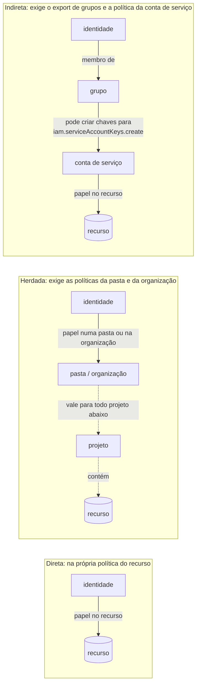
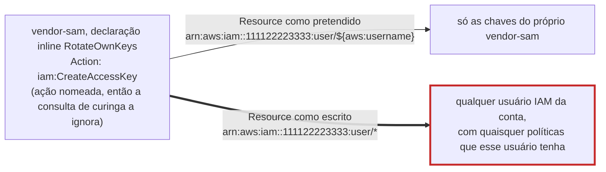

# Dia 79: Auditando IAM na nuvem: quem tem o quê

> 🇺🇸 Original: [*Day 79: Auditing cloud IAM: who has what*](https://github.com/thiefdroppers/cyber-investigator-skills/blob/main/curriculum/phase-6-cloud-ai-system-investigation/day-79.md) — © ThiefDroppers, licença MIT.
> Aqui: tradução fiel **+** camada brasileira. Nada do original foi removido; tudo o que é novo vem marcado com ➕.

**Fase 6. Investigação em nuvem e sistemas de IA** · Meta da trilha: ler os exports de IAM da Blue Harbor no GCP e na AWS, expandir cada grupo e cada concessão no nível do recurso num único inventário, e marcar as concessões que deixam uma identidade de pouco valor virar uma mais poderosa.

Rank Jutsu: `A` · [](https://colab.research.google.com/github/Ridd1kulusC0d3r/investigador-cyber-90-dias/blob/main/curriculo/fase-6-nuvem-e-sistemas-de-ia/dia-79/dia-79.ipynb)

---

## 🎬 ➕ Abertura do caso — *O organograma mente*

Sexta, 23 de outubro. A Atende+ mandou um PDF bonito: "Matriz de acessos do projeto Lia". Segundo ele, o desenvolvedor externo `dev.externo@atendemais.example` tem "somente leitura de logs para suporte".

Rafa larga o PDF na mesa sem abrir.

— Isso é o que eles *acham* que deram. Me traz o que a nuvem *diz* que deu.

O Dr. Hélio aparece na porta com um café.

— Pergunta de leigo: se o rapaz só podia ler log, como é que ele criou chave para o robô?

Você não sabe ainda. Mas sabe onde procurar: não na política do projeto, que está limpa, e sim na política da própria conta de serviço da Lia. É isso que o Dia 79 ensina. *(Personagens e cenário: [Operação Isca](../../../caso-continuo/).)*

---

## 📖 Conceito

A linha do tempo da Blue Harbor dos Dias 77 e 78 mostra o que o ator fez. A pergunta de hoje é por que ele pôde. Na maioria dos incidentes em nuvem, o ator usou uma permissão que uma identidade já tinha e não deveria ter, então o investigador responde "quem alcança o quê" a partir das políticas reais da conta, e trata o organograma e a documentação como alegações a conferir contra elas.

O IAM liga uma identidade (um usuário, um grupo, uma conta de serviço ou um *role*) a um papel ou política (um conjunto nomeado de permissões) num recurso ou escopo (um bucket, uma conta de serviço, um projeto ou conta inteiros). A vinculação (*binding*) que você olha primeiro raramente é a história toda, porque uma permissão pode chegar de três jeitos.

Uma concessão direta nomeia a identidade numa vinculação no recurso. É o caso fácil.

Uma concessão herdada fica mais acima e desce. No GCP, um papel concedido numa pasta (*folder*) ou na organização vale para todo projeto abaixo dela. As organizações da AWS funcionam ao contrário: uma *service control policy* numa unidade organizacional limita o que toda conta abaixo dela pode conceder, então o nível de cima pode explicar por que um acesso foi bloqueado. Uma política de projeto pode parecer limpa enquanto o acesso real vem de cima, então um inventário construído a partir da política de um projeto precisa dizer que não viu os níveis acima.

Uma concessão indireta alcança o recurso por meio de outra identidade. A identidade pertence a um grupo que tem o papel. Ou ela consegue emitir credenciais para uma conta de serviço ou usuário IAM que tem o papel. Ou consegue anexar uma conta de serviço a uma VM que controla e então agir como essa VM. Uma identidade com `iam.serviceAccountKeys.create` sobre uma conta de serviço poderosa tem o poder dessa conta, embora nenhuma vinculação no recurso-alvo a nomeie. Na AWS, `iam:CreateAccessKey` sobre outro usuário faz a mesma coisa. É nesses caminhos que as investigações mais acham a explicação, porque ninguém que revisa uma política isolada os vê.

As três formas lado a lado, com o export que revela cada uma. Só a concessão direta aparece na própria política do recurso.



A Blue Harbor tem um exemplo de cada forma, menos a herdada, que a evidência não consegue mostrar. Seu inventário de hoje precisa colocar cada concessão numa dessas caixas.

Algumas concessões merecem suspeita à primeira vista porque são concedidas em excesso o tempo todo: `roles/owner` e `roles/editor` no GCP, `AdministratorAccess` ou uma política com `"Action": "*"` na AWS, e qualquer coisa que deixe uma identidade criar credenciais para outra. Só o papel `editor` já inclui a permissão de criar chaves de conta de serviço, o que entrega um mecanismo de persistência como conveniência.

## 📚 Recursos

- [`gcloud projects get-iam-policy`](https://cloud.google.com/sdk/gcloud/reference/projects/get-iam-policy): a política no nível do projeto.
- [GCP Policy Analyzer / `gcloud asset analyze-iam-policy`](https://cloud.google.com/policy-intelligence/docs/analyze-iam-policies): expande grupos e personificação (*impersonation*), o que a política bruta não faz.
- [Referência de papéis e permissões do IAM do GCP](https://cloud.google.com/iam/docs/roles-permissions): confira o que um papel realmente contém antes de chamá-lo de inofensivo.
- [`aws iam get-account-authorization-details`](https://docs.aws.amazon.com/cli/latest/reference/iam/get-account-authorization-details.html): todo usuário, grupo, *role* e política anexada num único documento.
- [Variáveis de política do AWS IAM](https://docs.aws.amazon.com/IAM/latest/UserGuide/reference_policies_variables.html): `${aws:username}` e as outras variáveis que restringem uma declaração a quem chama.
- Camada gratuita: os dois comandos de export são só de leitura e seguros de rodar contra a sua própria conta de camada gratuita. Não os rode contra nenhuma conta que não seja sua ou que você não tenha sido autorizado a auditar.

### ➕ Recursos do contexto Brasil

- [LGPD, art. 5º (definições), arts. 37 a 40 (agentes de tratamento) e art. 46 (segurança)](https://www.planalto.gov.br/ccivil_03/_ato2015-2018/2018/lei/l13709.htm): controlador, operador e o dever de segurança que vale para os dois.
- [ANPD — Guia orientativo sobre agentes de tratamento de dados pessoais e encarregado](https://www.gov.br/anpd/pt-br/centrais-de-conteudo/materiais-educativos-e-publicacoes): ajuda a separar quem é controlador e quem é operador quando há fornecedor no meio.
- [CIS Benchmarks para GCP, AWS e Azure](https://www.cisecurity.org/cis-benchmarks): listas de controle que incluem "nenhuma chave gerenciada pelo usuário em conta de serviço" e "nenhum usuário com políticas inline amplas".
- [`constraints/iam.disableServiceAccountKeyCreation`](https://cloud.google.com/resource-manager/docs/organization-policy/restricting-service-accounts): a política de organização que o Dia 82 recomenda.

## 🛠️ Prática: jq e um pequeno *join* em Python, um inventário de IAM em duas nuvens

Artefato: `~/lab-p6/notes/day-79-iam-inventory.csv`, uma linha por (identidade, papel ou política, recurso) com o caminho da concessão e uma coluna de marcação, mais uma coluna de notas que você preenche à mão para toda linha marcada.

```bash
cd ~/lab-p6/work && C=resources/case-blueharbor
```

**Seu checklist de hoje.** Faça na ordem e marque cada item ao terminar:

- [ ] 1. GCP: a política do projeto
- [ ] 2. GCP: as políticas no nível do recurso
- [ ] 3. GCP: expanda os grupos
- [ ] 4. O que o inventário do GCP não consegue mostrar
- [ ] 5. AWS: o documento de autorização
- [ ] 6. Anote as linhas marcadas
- [ ] 7. Nomeie o export que fecha a lacuna
- [ ] ➕ 8. Prática BR: o inventário da Lia e a matriz da Atende+
- [ ] ➕ 9. O notebook do dia no Colab

### 1. GCP: a política do projeto

O export ao vivo:

```
gcloud projects get-iam-policy YOUR_PROJECT --format=json
```

Achatado para uma linha por par (membro, papel), para dar para fazer `grep`:

```
gcloud projects get-iam-policy YOUR_PROJECT \
  --flatten="bindings[].members" \
  --format='table(bindings.role, bindings.members)'
```

`gcp/iam-project-policy.json` é a saída salva do primeiro comando. Achate-a com jq:

```bash
jq -r '.bindings[] | .role as $r | .members[] | [$r, .] | @tsv' $C/gcp/iam-project-policy.json
```

Doze linhas. Três para ler com atenção: `roles/editor` em `ci-deploy` (uma identidade de CI que pode fazer quase tudo no projeto), `roles/compute.instanceAdmin.v1` em `reporting-sa` (a identidade de um job em lote que pode reconfigurar VMs), e o fato de que nenhuma linha nomeia `sam.reyes@vendor-example.com`. Sam alcança este projeto apenas por meio de `group:data-eng`.

### 2. GCP: as políticas no nível do recurso

As vinculações do projeto são só uma camada. A conta de serviço e o bucket têm suas próprias políticas:

```bash
jq -r '.bindings[] | .role as $r | .members[] | [$r, .] | @tsv' \
  $C/gcp/iam-reporting-sa-policy.json $C/gcp/iam-bucket-customer-exports.json
```

A primeira linha é a que a linha do tempo do Dia 77 precisava: `group:data-eng` tem `roles/iam.serviceAccountKeyAdmin` em `reporting-sa`, e administrar chaves inclui criá-las. A política do bucket então dá a `reporting-sa` o papel `roles/storage.objectAdmin`. Os membros `projectEditor:`, `projectOwner:` e `projectViewer:` no bucket são valores de conveniência: significam "quem tiver esse papel básico no projeto", então são concessões indiretas a todo editor, dono e leitor do projeto. Por fim, `gcp/service-accounts.csv` registra que `reporting-sa` é a identidade de execução de `report-runner-1`, o que importa assim que alguém consegue entrar nessa VM.

### 3. GCP: expanda os grupos

A participação em grupos fica no provedor de identidade, então chega como um export separado. Este script a junta às três políticas e escreve a metade GCP do inventário, depois acrescenta a metade AWS do passo 5. Salve como `~/lab-p6/notes/inventory.py`:

```python
import csv, json, sys

C = "resources/case-blueharbor/"
HOME_DOMAIN = "blueharbor.example"
RISKY = {"roles/owner", "roles/editor", "roles/iam.serviceAccountKeyAdmin",
         "roles/iam.serviceAccountTokenCreator", "roles/iam.serviceAccountUser",
         "AdministratorAccess", "AmazonS3FullAccess"}

groups = {}
for row in csv.DictReader(open(C + "gcp/groups-export.csv")):
    groups.setdefault("group:" + row["group_email"], []).append("user:" + row["member"])

out = csv.writer(sys.stdout, lineterminator="\n")
out.writerow(["cloud", "identity", "identity_type", "role_or_policy", "resource", "grant_path", "flag"])

def flag(identity, role):
    f = []
    if role in RISKY:
        f.append("broad-or-escalation-role")
    if identity.startswith("user:") and not identity.endswith("@" + HOME_DOMAIN):
        f.append("external-identity")
    return ";".join(f)

for path, resource in (("gcp/iam-project-policy.json", "project:blueharbor-analytics"),
                       ("gcp/iam-reporting-sa-policy.json", "serviceAccount:reporting-sa"),
                       ("gcp/iam-bucket-customer-exports.json", "bucket:blueharbor-customer-exports")):
    for b in json.load(open(C + path))["bindings"]:
        for m in b["members"]:
            out.writerow(["gcp", m, m.split(":")[0], b["role"], resource, "direct", flag(m, b["role"])])
            for member in groups.get(m, []):
                out.writerow(["gcp", member, "user", b["role"], resource, "group via " + m,
                              flag(member, b["role"])])

aws = json.load(open(C + "aws/iam-authorization-details.json"))
for u in aws["UserDetailList"]:
    for p in u.get("AttachedManagedPolicies", []):
        out.writerow(["aws", u["UserName"], "user", p["PolicyName"], "*", "direct", flag("", p["PolicyName"])])
    for p in u.get("UserPolicyList", []):
        for st in p["PolicyDocument"]["Statement"]:
            acts = st["Action"] if isinstance(st["Action"], list) else [st["Action"]]
            f = ["wildcard-action"] if "*" in acts else []
            if any(a.startswith(("iam:Create", "iam:Put", "iam:Attach")) for a in acts):
                f.append("iam-write")
            out.writerow(["aws", u["UserName"], "user", p["PolicyName"] + " (inline)",
                          st["Resource"], "direct", ";".join(f)])
    for g in u.get("GroupList", []):
        for gd in aws["GroupDetailList"]:
            if gd["GroupName"] == g:
                for p in gd["AttachedManagedPolicies"]:
                    out.writerow(["aws", u["UserName"], "user", p["PolicyName"], "*", "group via " + g, ""])
for r in aws["RoleDetailList"]:
    for p in r.get("RolePolicyList", []):
        for st in p["PolicyDocument"]["Statement"]:
            out.writerow(["aws", r["RoleName"], "role", p["PolicyName"] + " (inline)", st["Resource"], "direct", ""])
```

```bash
python3 ~/lab-p6/notes/inventory.py > ~/lab-p6/notes/day-79-iam-inventory.csv
wc -l ~/lab-p6/notes/day-79-iam-inventory.csv
awk -F, '$7 != ""' ~/lab-p6/notes/day-79-iam-inventory.csv | wc -l
grep sam.reyes ~/lab-p6/notes/day-79-iam-inventory.csv
```

39 linhas (um cabeçalho e 38 concessões), 17 delas marcadas. As três linhas de Sam dizem `group via group:data-eng@blueharbor.example`, e uma delas é `roles/iam.serviceAccountKeyAdmin` em `reporting-sa`, marcada duas vezes (um papel de escalada nas mãos de uma identidade externa).

> ➕ **Nota do tradutor (conferida rodando o script):** o `awk -F, '$7 != ""'` também conta a linha de cabeçalho, cuja sétima coluna é a palavra `flag`. As concessões marcadas são **16**; o 17 do original inclui o cabeçalho. Para contar só as concessões, use `tail -n +2 ~/lab-p6/notes/day-79-iam-inventory.csv | awk -F, '$7 != ""' | wc -l`. O notebook mostra as duas contagens. Isso é exatamente o tipo de coisa que o Dia 78 pede: a contagem da sua tabela tem que bater com o que o comando realmente mede.

Num projeto ao vivo, o Policy Analyzer faz a expansão de grupos e de personificação por você:

```
gcloud asset analyze-iam-policy \
  --project=YOUR_PROJECT \
  --identity="user:contractor@vendor-example.com" \
  --expand-groups \
  --analyze-service-account-impersonation \
  --format=json
```

Ele precisa da Cloud Asset API habilitada no projeto (`gcloud services enable cloudasset.googleapis.com`) e de `roles/cloudasset.viewer` para quem chama; nenhum dos dois vem configurado num projeto novo de camada gratuita, então espere que este passo falhe até você habilitar a API. O export bruto de `get-iam-policy` não precisa de nada extra. Fazer o *join* à mão hoje mostra o que o analisador está calculando.

### 4. O que o inventário do GCP não consegue mostrar

Escreva agora dois limites na coluna de notas. O export cobre o projeto e dois recursos, sem nada da pasta ou da organização acima dele, então as concessões herdadas são desconhecidas. O inventário também não diz o que um papel contém. Antes de chamar `roles/storage.legacyBucketReader` de inofensivo ou `roles/compute.instanceAdmin.v1` de perigoso, consulte cada um e escreva ao lado a permissão que importa.

`gcloud iam roles describe` imprime as permissões de um papel predefinido. Ele lê o catálogo de papéis do Google, não dados de nenhum projeto, então qualquer login autenticado de camada gratuita consegue rodá-lo:

```
for r in storage.legacyBucketReader storage.objectViewer \
         compute.instanceAdmin.v1 iam.serviceAccountKeyAdmin; do
  printf '%s: ' "$r"
  gcloud iam roles describe roles/$r --format=json | jq '.includedPermissions | length'
  gcloud iam roles describe roles/$r --format=json | jq -r '.includedPermissions[]' \
    | grep -E '^storage\.objects\.(get|list)$|^compute\.instances\.(start|stop|setMetadata)$|serviceAccountKeys\.create$'
done
```

Rodado em 30 de setembro de 2026, mostrou que `legacyBucketReader` tem 7 permissões, incluindo `storage.objects.list` mas não `storage.objects.get`. Ele lista nomes de objetos e não consegue ler o conteúdo deles. `objectViewer` acrescenta `storage.objects.get`. `compute.instanceAdmin.v1` tem 533 permissões, entre elas `compute.instances.start`, `stop` e `setMetadata`, que juntas bastam para ligar uma VM e adicionar uma chave SSH a ela. `iam.serviceAccountKeyAdmin` tem 10, uma das quais é `iam.serviceAccountKeys.create`. O Google edita os papéis predefinidos, então suas contagens podem ser diferentes; registre a data em que fez a consulta ao lado de cada linha. Se você não tiver login no GCP, procure os mesmos nomes de papel na página de referência de papéis citada acima.

Acrescente uma coluna `key_permission` às suas notas com uma linha por papel distinto do inventário. O Dia 80 depende da linha `legacyBucketReader` versus `objectViewer`.

### 5. AWS: o documento de autorização

O export ao vivo:

```
aws iam get-account-authorization-details --output json > iam-dump.json
```

Salve o arquivo do caso com esse nome para que as consultas rodem exatamente como escritas:

```bash
cp $C/aws/iam-authorization-details.json iam-dump.json
```

Usuários e suas políticas gerenciadas anexadas:

```
jq -r '.UserDetailList[]
  | .UserName as $u
  | (.AttachedManagedPolicies[]?.PolicyName // "no-managed-policy")
  | [$u, .] | @tsv' iam-dump.json
```

```
dana-admin     AdministratorAccess
vendor-sam     no-managed-policy
svc-reporting  AmazonS3FullAccess
old-etl        no-managed-policy
```

Políticas *inline* com ação curinga:

```
jq -r '.UserDetailList[]
  | .UserName as $u
  | .UserPolicyList[]?
  | select(.PolicyDocument.Statement[]?.Action == "*"
        or (.PolicyDocument.Statement[]?.Action | type=="array" and index("*")))
  | [$u, .PolicyName] | @tsv' iam-dump.json
```

Um acerto: `old-etl` com `etl-everything`. A consulta de curinga deixa passar a concessão que importava, porque a política *inline* de `vendor-sam` usa ações nomeadas. Imprima toda declaração *inline* com seu recurso:

```bash
jq -r '.UserDetailList[] | .UserName as $u | .UserPolicyList[]? | .PolicyName as $p
  | .PolicyDocument.Statement[] | [$u, $p, (.Action | tostring), .Resource] | @tsv' iam-dump.json
```

A declaração `RotateOwnKeys` permite `iam:CreateAccessKey` em `arn:aws:iam::111122223333:user/*`. O Sid diz que a intenção era deixar o prestador girar as próprias chaves, o que se escreve `arn:aws:iam::111122223333:user/${aws:username}`. Do jeito que está escrita, `vendor-sam` pode criar uma chave de acesso para qualquer usuário IAM da conta.



A *tag* de `svc-reporting` diz que ele foi substituído por `MirrorWriterRole` em novembro de 2025, mas ele ainda tem `AmazonS3FullAccess`. Um usuário obsoleto com política ampla, alcançável por uma declaração com escopo errado, é o caminho que o Dia 77 registrou às 02:22:02.

### 6. Anote as linhas marcadas

Para cada linha marcada, escreva uma linha na coluna de notas: por que a concessão é questionável e qual a substituta de privilégio mínimo. Por exemplo: "`roles/editor` em `ci-deploy`: o CI faz deploy de um serviço Cloud Run; `roles/run.developer` nesse serviço mais `roles/iam.serviceAccountUser` na conta de execução dele cobririam isso."

### 7. Nomeie o export que fecha a lacuna

Ao lado do limite das concessões herdadas do passo 4, nomeie o export que você pediria à Blue Harbor para fechá-lo: as políticas de IAM da pasta e da organização acima do projeto.

### ➕ Prática BR: o inventário da Lia e a matriz da Atende+

A cooperativa pediu à Atende+ os exports de IAM do projeto `serraazul-lia`: [`caso-continuo/dados/dia-79/lia-iam.json`](../../../caso-continuo/dados/dia-79/lia-iam.json) (fictício). Ele traz a política do projeto, a política da conta de serviço `lia-bot`, a do dataset `cadastro_espelho` (com a lista de colunas), a do bucket `lia-tmp-exports`, os grupos e as contas de serviço.

**Exercício A — o inventário.** Adapte o `inventory.py` (o notebook já faz isso) com `HOME_DOMAIN = "serraazul.example"` e marque também `roles/bigquery.dataViewer` sobre um dataset com coluna `cpf` como `dado-pessoal`. Responda:

1. Qual linha contradiz a "matriz de acessos" da Atende+ ("somente leitura de logs")? (`roles/iam.serviceAccountKeyAdmin` em `lia-bot` para `group:lia-devs@atendemais.example`, e `dev.externo` é membro do grupo.)
2. Escreva a cadeia, só a partir dos arquivos: `dev.externo` → membro de `lia-devs` → `serviceAccountKeyAdmin` em `lia-bot` → `bigquery.dataViewer` no dataset `cadastro_espelho` (colunas `cpf`, `nome`, `telefone`, `email`, `agencia`).
3. `contas_de_servico` diz que `lia-bot` tinha **0** chaves gerenciadas antes de 2/out. O que isso diz sobre a necessidade operacional da vinculação de key admin?

**Exercício B — controlador, operador e privilégio mínimo.** Em `notas/dia-79-lia-notas.md`, para cada linha marcada escreva a substituta de privilégio mínimo e **quem** deveria aprovar a mudança: a Serra Azul (controladora, dona dos dados) ou a Atende+ (operadora, que administra o projeto). Lembre o Dr. Hélio: a operadora age segundo as instruções da controladora.

### ➕ O notebook do dia

Abra o [notebook do Dia 79 no Colab](https://colab.research.google.com/github/Ridd1kulusC0d3r/investigador-cyber-90-dias/blob/main/curriculo/fase-6-nuvem-e-sistemas-de-ia/dia-79/dia-79.ipynb). Nele você:

1. roda o `inventory.py` do original, comentado linha a linha, e gera `day-79-iam-inventory.csv` (38 concessões);
2. confere as duas contagens de marcadas (17 com o cabeçalho, 16 sem) e entende o porquê;
3. reproduz em Python as consultas `jq` da AWS e vê a de curinga achar `old-etl` e perder `vendor-sam`;
4. joga o **quiz "direta, herdada ou indireta?"**;
5. gera o inventário da Lia com a marcação `dado-pessoal` e preenche as notas por formulário.

## ✅ Checkpoint

- O inventário tem pelo menos 38 linhas de concessão nas duas nuvens.
- A coluna `grant_path` inclui pelo menos uma linha `direct`.
- A coluna `grant_path` inclui pelo menos uma linha `group via`.
- O inventário inclui a concessão no nível do recurso da conta de serviço que deixa uma identidade emitir chaves para outra (`roles/iam.serviceAccountKeyAdmin` em `reporting-sa`).
- Toda linha marcada `external-identity` ou `broad-or-escalation-role` tem a coluna de notas preenchida.
- Cada uma dessas notas nomeia uma alternativa de privilégio mínimo.
- Suas notas têm uma linha `key_permission` para cada papel distinto, com a data em que você fez a consulta.
- Você consegue enunciar, só a partir dos arquivos, a cadeia no GCP de `sam.reyes@vendor-example.com` até o conteúdo dos objetos em `blueharbor-customer-exports`.
- Você consegue enunciar, só a partir dos arquivos, a cadeia na AWS de `vendor-sam` até os objetos em `blueharbor-exports-mirror`.
- Suas notas dizem que as concessões herdadas de cima do projeto não estavam na evidência.
- Suas notas nomeiam o export que você pediria para fechar essa lacuna.
- Sem consultar notas, você explica por que a consulta de curinga achou `old-etl` mas não `vendor-sam`, e qual consulta achou o problema de `vendor-sam`.

### ➕ Checkpoint BR

- Seu inventário da Lia tem as linhas `group via group:lia-devs@atendemais.example` para `dev.externo`.
- A linha de key admin em `lia-bot` está marcada como papel de escalada **e** identidade externa.
- A linha de `bigquery.dataViewer` no `cadastro_espelho` está marcada como `dado-pessoal`.
- Você escreveu a cadeia `dev.externo` → `lia-devs` → `lia-bot` → `cadastro_espelho` citando o arquivo de cada aresta.
- Suas notas dizem quem aprova cada correção (controladora ou operadora) e por quê.

## ⚖️ ➕ Camada jurídica BR

**Controlador e operador.** A LGPD define controlador como quem toma as decisões sobre o tratamento e operador como quem trata dados em nome do controlador (art. 5º, VI e VII). O operador deve realizar o tratamento segundo as instruções do controlador (art. 39). A Serra Azul decidiu que a Lia consultaria o cadastro; a Atende+ opera. Um papel `serviceAccountKeyAdmin` concedido pela Atende+ ao próprio grupo de desenvolvedores, sem instrução da cooperativa, é uma questão contratual e de conformidade, não só técnica.

**Responsabilidade.** O art. 42 trata da obrigação de reparar dano causado em razão do exercício de atividade de tratamento, e prevê hipóteses de responsabilidade solidária do operador (quando descumpre a lei ou as instruções lícitas do controlador). Não é papel do analista concluir responsabilidade; é papel dele deixar documentado, com evidência, qual concessão existia e quem a configurou. <!-- TODO jurídico: confirmar a redação dos incisos do art. 42, §1º antes de detalhar. -->

**Segurança desde a concepção.** O art. 46, §2º pede que as medidas de segurança sejam observadas desde a fase de concepção do produto ou serviço até a sua execução. Privilégio mínimo no IAM de um chatbot que consulta cadastro de cooperados é exatamente isso.

**Setor financeiro.** Cooperativas de crédito autorizadas pelo Banco Central seguem a Resolução CMN nº 4.893/2021 na contratação de processamento e armazenamento em nuvem, o que inclui exigir do fornecedor controles de acesso. A Res. CMN 4.893/2021 se dirige às instituições financeiras e demais instituições autorizadas a funcionar pelo Banco Central, o que inclui as cooperativas de crédito. Ela foi alterada pela Res. CMN 5.274/2025 (publicada em 22/12/2025, com adequação até 1º/3/2026), que acrescentou, entre outros pontos, testes de intrusão ao menos anuais por terceiro independente e controles específicos para os ambientes Pix.

> Este repositório é material de estudo e não constitui orientação jurídica.

## 🧠 ➕ Camada 8 — por que ninguém viu a linha

A concessão perigosa estava num lugar que ninguém olha: a política da conta de serviço, não a do projeto. Isso é **cegueira por desatenção** (*inattentional blindness*, o famoso experimento do gorila de Simons e Chabris): quando a atenção está focada numa tarefa, aquilo que está fora dela não é percebido, por mais óbvio que seja depois. Quem revisa "a política do projeto" não vê o que está noutra política.

E há a **autoridade do documento**. O PDF "Matriz de acessos" da Atende+ tem logo, tabela e assinatura; parece mais confiável que um JSON cru. O original diz: trate organograma e documentação como *alegações a conferir*. Consequência prática: no relatório, toda afirmação sobre "quem pode o quê" cita o export de IAM e a linha, nunca o documento do fornecedor; e onde os dois divergem, a divergência vira achado.

## 🤖 ➕ Skill do dia

Hoje o dia propõe para a skill o procedimento novo **"Inventário de IAM em nuvem"**: concessões diretas, de grupo e indiretas num único inventário, os limites (herança não vista, conteúdo de papéis) e a regra de conferir documentação contra o export. Texto e caso de teste em [`_skill-delta.md`](_skill-delta.md).

## 💡 ➕ Inovação OSINT do dia — achar o `user/*` que devia ser `${aws:username}`

O problema de `vendor-sam` é um padrão que se repete em contas reais: uma ação IAM de escrita com recurso curinga sobre usuários. Uma função stdlib que percorre o documento de `get-account-authorization-details` e sinaliza qualquer `iam:Create*`, `iam:Put*`, `iam:Attach*` ou `iam:Update*` cujo `Resource` termina em `/*` sem variável de política:

```python
import json                                                    # stdlib

def acoes(st):
    a = st.get("Action", [])
    return a if isinstance(a, list) else [a]

def iam_escrita_ampla(doc):
    for u in doc["UserDetailList"]:
        for p in u.get("UserPolicyList", []):
            for st in p["PolicyDocument"]["Statement"]:
                rec = st["Resource"] if isinstance(st["Resource"], list) else [st["Resource"]]
                perig = [a for a in acoes(st) if a.startswith(("iam:Create", "iam:Put", "iam:Attach", "iam:Update"))]
                amplo = [r for r in rec if r.endswith(":user/*") or r == "*"]
                if perig and amplo and not any("${aws:username}" in r for r in rec):
                    yield u["UserName"], p["PolicyName"], st.get("Sid", "-"), perig, amplo

for linha in iam_escrita_ampla(json.load(open("iam-authorization-details.json"))):
    print(*linha)
```

No caso Blue Harbor, ela devolve exatamente `vendor-sam VendorSelfServiceKeys RotateOwnKeys`, que a consulta de curinga do original não pegava. Para auditorias reais e maiores, ferramentas abertas como o [Prowler](https://github.com/prowler-cloud/prowler) e o [ScoutSuite](https://github.com/nccgroup/ScoutSuite) têm checagens equivalentes (opcionais, fora da stdlib).

## 📝 Diário de estudo

- Data:
- Tempo gasto:
- O que ficou claro:
- O que ainda está nebuloso:
- Artefato produzido: `~/lab-p6/notes/day-79-iam-inventory.csv`, `~/lab-p6/notes/inventory.py`, `notas/dia-79-lia-notas.md`

---
<sub>Baseado em [cyber-investigator-skills](https://github.com/thiefdroppers/cyber-investigator-skills) por ThiefDroppers (MIT). Tradução, camada BR, Camada 8, skill pt-BR e notebook por Deivison Lourenço (@Ridd1kulusC0d3r).</sub>
