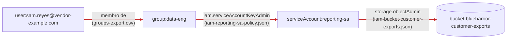
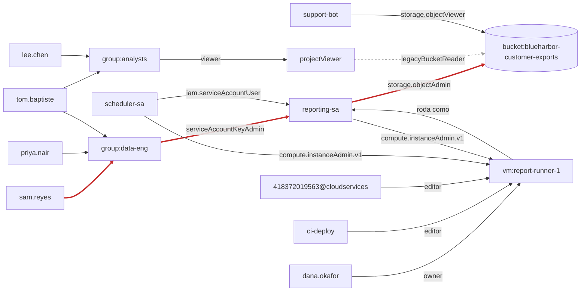
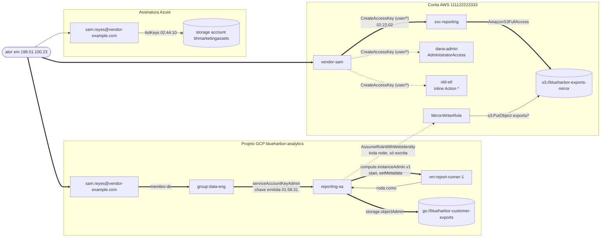

# Dia 80: Construindo um grafo de acesso "quem alcança o quê"

> 🇺🇸 Original: [*Day 80: Building a "who can reach what" access graph*](https://github.com/thiefdroppers/cyber-investigator-skills/blob/main/curriculum/phase-6-cloud-ai-system-investigation/day-80.md) — © ThiefDroppers, licença MIT.
> Aqui: tradução fiel **+** camada brasileira. Nada do original foi removido; tudo o que é novo vem marcado com ➕.

**Fase 6. Investigação em nuvem e sistemas de IA** · Meta da trilha: transformar o inventário de IAM de ontem da Blue Harbor num grafo direcionado, achar o caminho que o ator usou, achar os caminhos piores que ele não usou, e nomear a única aresta a cortar.

Rank Jutsu: `A` · [](https://colab.research.google.com/github/Ridd1kulusC0d3r/investigador-cyber-90-dias/blob/main/curriculo/fase-6-nuvem-e-sistemas-de-ia/dia-80/dia-80.ipynb)

---

## 🎬 ➕ Abertura do caso — *Uma aresta só*

Segunda, 26 de outubro. Reunião de crise na sala da Marta, por vídeo com a Atende+. O gerente da fornecedora fala rápido:

— Já resolvemos. Desativamos a conta do `dev.externo` na sexta.

Marta olha para você. Rafa, ao seu lado, escreve num post-it e empurra: *"E a Ana?"*

Você já sabe por quê. O `dev.externo` chegava à Lia através de um grupo, e o grupo continua lá, com a mesma vinculação, e com outra pessoa dentro. Tirar a pessoa fecha a porta que ela usou; tirar a aresta fecha a porta para quem vier depois.

— Antes de recomendar qualquer corte — diz Rafa —, testa no grafo. Correção é uma afirmação sobre o grafo.

É isso que o Dia 80 ensina. *(Personagens e cenário: [Operação Isca](../../../caso-continuo/).)*

---

## 📖 Conceito

Uma tabela de concessões de IAM esconde cadeias. No projeto GCP da Blue Harbor, nenhuma vinculação dá a `sam.reyes@vendor-example.com` qualquer coisa no bucket de exportações de clientes. Sam é membro de `data-eng`, `data-eng` pode administrar chaves de `reporting-sa`, e `reporting-sa` pode ler e escrever todo objeto do bucket. Cada uma dessas três linhas parece comum no CSV de ontem, e você só vê o problema quando as segue em ordem. Uma tabela obriga você a guardar a cadeia na cabeça; um grafo a desenha.



Cada aresta vem de um export diferente, e nenhum dos três arquivos nomeia ao mesmo tempo Sam e o bucket.

Modele o IAM como um grafo direcionado. Os nós são identidades (usuários, grupos, contas de serviço, usuários e *roles* da AWS) e recursos (buckets, VMs, projetos). Uma aresta significa "consegue chegar a": é membro de, tem um papel em, consegue emitir credenciais para, roda como. Depois que o IAM vira grafo, a pergunta de escalada vira uma pergunta de caminho: existe uma rota de uma identidade que um atacante poderia plausivelmente obter (um prestador, um usuário de pouco privilégio, um token de CI vazado) até um recurso que importa? Os atacantes fazem exatamente essa pergunta. O BloodHound tornou a técnica famosa para o Active Directory, e ferramentas de código aberto como Cartography e awspx montam o mesmo tipo de grafo para contas de nuvem. Você está construindo a cópia do defensor do mapa do atacante.

Dois cuidados mantêm o grafo honesto. Primeiro, as arestas têm forças diferentes. `roles/storage.legacyBucketReader` deixa listar nomes de objetos; `roles/storage.objectViewer` deixa ler o conteúdo deles. Se o grafo trata os dois como "alcança o bucket", ele vai apontar todo leitor do projeto como risco de exfiltração de dados e enterrar os caminhos reais. Decida quais papéis contam como alcançar aquilo que importa, escreva essa decisão no script e confira-a contra a referência de papéis. Segundo, o grafo é tão completo quanto os exports por trás dele. A Blue Harbor não entregou política de pasta nem de organização, então qualquer caminho que comece acima do projeto está faltando.

O resultado que o investigador quer é uma ação. "O IAM parece permissivo demais" não dá a ninguém nada para fazer. "Remova a vinculação `serviceAccountKeyAdmin` de `data-eng` em `reporting-sa`" dá, e um grafo deixa você mostrar que essa única mudança quebra o caminho que o ator usou.

## 📚 Recursos

- [Linguagem DOT do Graphviz](https://graphviz.org/doc/info/lang.html): o formato texto-para-grafo mais simples; `dot -Tpng` o renderiza.
- [Página de download do Graphviz](https://graphviz.org/download/): `brew install graphviz` no macOS, `apt install graphviz` no Debian e no Ubuntu.
- [Noções de Cypher no Neo4j](https://neo4j.com/docs/getting-started/cypher/): para consultas de caminho de verdade (`shortestPath`) em grafos maiores.
- [Cartography](https://github.com/cartography-cncf/cartography) e [awspx](https://github.com/ReversecLabs/awspx): ferramentas de código aberto que montam grafos de ativos de nuvem; vale conhecê-las, mesmo que hoje você monte o grafo sozinho.
- [Rhino Security Labs, métodos de escalada de privilégio no AWS IAM](https://rhinosecuritylabs.com/aws/aws-privilege-escalation-methods-mitigation/): o catálogo que inclui criar chaves de acesso para outros usuários.

### ➕ Recursos do contexto Brasil

- [Viz.js / Graphviz Online](https://dreampuf.github.io/GraphvizOnline/): renderiza um `.dot` no navegador quando você não pode instalar o Graphviz (cole só grafos fictícios ou já anonimizados; nunca dados de cliente).
- [Mermaid Live Editor](https://mermaid.live/): o mesmo para os diagramas `mermaid` deste repositório.
- [LGPD, art. 46, §2º](https://www.planalto.gov.br/ccivil_03/_ato2015-2018/2018/lei/l13709.htm): segurança desde a concepção, o fundamento legal para "cortar a aresta" e não só "trocar a pessoa".

## 🛠️ Prática: Python e Graphviz, um grafo de acesso direcionado com o caminho de escalada destacado

Artefato: `~/lab-p6/notes/day-80-access-graph.png` e sua fonte `.dot` para o GCP, um grafo DOT escrito à mão para a AWS, e `~/lab-p6/notes/day-80-finding.md` nomeando a aresta a cortar em cada nuvem e por quê.

```bash
cd ~/lab-p6/work && C=resources/case-blueharbor
```

**Seu checklist de hoje.** Faça na ordem e marque cada item ao terminar:

- [ ] 1. Monte o grafo do GCP a partir dos exports
- [ ] 2. Renderize e destaque
- [ ] 3. Desenhe à mão o grafo da AWS
- [ ] 4. Opcional: a mesma pergunta no Neo4j
- [ ] 5. Teste cada corte candidato antes de recomendá-lo
- [ ] 6. Escreva o achado
- [ ] ➕ 7. Prática BR: o grafo da Lia e a resposta à Atende+
- [ ] ➕ 8. O notebook do dia no Colab

### 1. Monte o grafo do GCP a partir dos exports

Salve isto como `~/lab-p6/notes/gcp_graph.py`. Ele lê os mesmos quatro arquivos do GCP de ontem, acrescenta uma aresta por concessão e acrescenta à mão as poucas arestas no nível do projeto de que este caso precisa.

```python
import csv, json, sys
from collections import deque

G = "resources/case-blueharbor/gcp/"
PROJECT = "blueharbor-analytics"
REPORT_SA = "serviceAccount:reporting-sa@blueharbor-analytics.iam.gserviceaccount.com"
OUT = sys.argv[2] if len(sys.argv) > 2 else "day-80-access-graph.dot"
edges = []

# 1. group membership
for row in csv.DictReader(open(G + "groups-export.csv")):
    edges.append((f"user:{row['member']}", f"group:{row['group_email']}", "member of"))

# 2. role bindings on the project, the service account and the bucket
def bind(path, target):
    for b in json.load(open(G + path))["bindings"]:
        for m in b["members"]:
            edges.append((m, target, b["role"].removeprefix("roles/")))

bind("iam-project-policy.json", f"project:{PROJECT}")
bind("iam-reporting-sa-policy.json", REPORT_SA)
bind("iam-bucket-customer-exports.json", "bucket:blueharbor-customer-exports")

# 3. project-level grants that reach specific resources in this case
for src, dst, role in list(edges):
    if dst == f"project:{PROJECT}":
        if role in ("owner", "editor", "viewer"):
            edges.append((src, f"project{role.capitalize()}:{PROJECT}", f"is project {role}"))
        if role in ("owner", "editor", "compute.instanceAdmin.v1"):
            edges.append((src, "vm:report-runner-1", role))
edges.append(("vm:report-runner-1", REPORT_SA, "runs as"))

# Only these bucket roles read object contents (check this against the IAM roles reference).
READS = {"storage.objectAdmin", "storage.objectViewer"}
def usable(s, d, label):
    return not d.startswith("bucket:") or label in READS

def path(start, goal):
    prev, q = {start: None}, deque([start])
    while q:
        n = q.popleft()
        if n == goal:
            out = []
            while n:
                out.append(n); n = prev[n]
            return out[::-1]
        for s, d, lab in edges:
            if s == n and d not in prev and usable(s, d, lab):
                prev[d] = n; q.append(d)

def reachers(goal):
    seen, q = {goal}, deque([goal])
    while q:
        n = q.popleft()
        for s, d, lab in edges:
            if d == n and s not in seen and usable(s, d, lab):
                seen.add(s); q.append(s)
    return sorted(x for x in seen if x.startswith(("user:", "group:", "serviceAccount:")))

start = sys.argv[1] if len(sys.argv) > 1 else "user:sam.reyes@vendor-example.com"
goal = "bucket:blueharbor-customer-exports"
p = path(start, goal)
print("PATH:", " -> ".join(p) if p else "none")
print("CAN READ OBJECTS IN THE BUCKET:")
for r in reachers(goal):
    print("  ", r)

hot = set(zip(p, p[1:])) if p else set()
with open(OUT, "w") as f:
    f.write('digraph access {\n  rankdir=LR;\n  node [fontname="Helvetica"];\n')
    for s, d, label in edges:
        style = ", color=red, penwidth=2" if (s, d) in hot else ""
        if not usable(s, d, label):
            style = ", style=dashed, color=gray"
        f.write(f'  "{s}" -> "{d}" [label="{label}"{style}];\n')
    f.write("}\n")
print(f"wrote {OUT} with {len(edges)} edges")
```

> ➕ Comentários do script em português, para quem estiver lendo pela primeira vez: o passo 1 vira cada linha do export de grupos numa aresta "membro de"; o passo 2 vira cada vinculação numa aresta rotulada com o papel; o passo 3 acrescenta à mão o que só existe no nível do projeto (papéis básicos viram os membros de conveniência `projectEditor:` etc., e quem administra VMs alcança `report-runner-1`, que "roda como" `reporting-sa`). `READS` é a decisão de quais papéis de bucket leem conteúdo. `path()` é uma busca em largura (BFS) da origem ao alvo; `reachers()` é a mesma busca andando as arestas ao contrário, a partir do bucket. `removeprefix` exige Python 3.9 ou mais novo.

Rode para Sam e grave o grafo na sua pasta de notas:

```bash
python3 ~/lab-p6/notes/gcp_graph.py user:sam.reyes@vendor-example.com ~/lab-p6/notes/day-80-access-graph.dot
```

```
PATH: user:sam.reyes@vendor-example.com -> group:data-eng@blueharbor.example -> serviceAccount:reporting-sa@blueharbor-analytics.iam.gserviceaccount.com -> bucket:blueharbor-customer-exports
CAN READ OBJECTS IN THE BUCKET:
   group:data-eng@blueharbor.example
   serviceAccount:418372019563@cloudservices.gserviceaccount.com
   serviceAccount:ci-deploy@blueharbor-analytics.iam.gserviceaccount.com
   serviceAccount:reporting-sa@blueharbor-analytics.iam.gserviceaccount.com
   serviceAccount:scheduler-sa@blueharbor-analytics.iam.gserviceaccount.com
   serviceAccount:support-bot@blueharbor-analytics.iam.gserviceaccount.com
   user:dana.okafor@blueharbor.example
   user:priya.nair@blueharbor.example
   user:sam.reyes@vendor-example.com
   user:tom.baptiste@blueharbor.example
wrote /Users/you/lab-p6/notes/day-80-access-graph.dot with 36 edges
```

O caminho mais curto tem três saltos, e nenhum deles é uma concessão no bucket para Sam. Dez identidades alcançam o conteúdo dos objetos. Algumas são esperadas (`reporting-sa` existe para gravar exportações, e Dana é dona do projeto). As que merecem questionamento são os três membros de `data-eng`, que alcançam o bucket só por uma concessão de administração de chaves que ninguém usa, e `ci-deploy`, que o alcança por `roles/editor` e pela VM.

A linha do tempo do Dia 77 mostra que o ator fez mais do que o caminho mais curto exige. Depois de emitir a chave, ele usou o papel `compute.instanceAdmin.v1` de `reporting-sa` para ligar `report-runner-1` e adicionar uma chave SSH a ela, o que o colocou numa VM rodando como a mesma conta de serviço. O grafo explica como ele obteve a identidade, e os *flow logs* do Dia 82 mostram o que ele fez com a VM. Mantenha os dois no achado.

Rode de novo com `user:lee.chen@blueharbor.example`. A resposta é `none`, embora Lee seja leitor do projeto por meio de `analysts`, porque o caminho de leitor termina em `legacyBucketReader`, que o script não conta. Mude `READS` para incluir `storage.legacyBucketReader`, rode de novo e veja Lee aparecer. Esse é o tamanho da decisão que você escreveu no script.

### 2. Renderize e destaque

```bash
dot -Tpng ~/lab-p6/notes/day-80-access-graph.dot -o ~/lab-p6/notes/day-80-access-graph.png
```

O script já desenhou em vermelho as três arestas do caminho e em cinza tracejado as arestas de bucket que não leem conteúdo. Com 36 arestas a imagem fica carregada; se quiser uma figura mais limpa para o relatório, copie o arquivo `.dot`, apague as arestas que não tocam o caminho nem o bucket, e renderize a cópia também. Guarde a versão completa como evidência.

A figura enxuta deve trazer mais ou menos o que o diagrama abaixo mostra. As arestas vermelhas são o caminho que o ator usou. Toda identidade que o script lista alcança o bucket por uma aresta sólida. A aresta cinza tracejada é `legacyBucketReader`, que lista nomes de objetos sem lê-los, então Lee Chen, cuja única rota passa por `analysts`, para ali. As arestas `legacyBucketOwner` de editores e donos do projeto ficaram de fora para manter a legibilidade; elas aparecem em cinza tracejado na sua renderização completa, pelo mesmo motivo.



### 3. Desenhe à mão o grafo da AWS

O lado da AWS é pequeno o bastante para escrever diretamente. A única expansão que exige cuidado é `user/*`: liste o que ela cobre a partir do export.

```bash
jq -r '.UserDetailList[].UserName' $C/aws/iam-authorization-details.json
```

Quatro usuários, então `vendor-sam` tem quatro arestas `CreateAccessKey`, uma delas para si mesmo. Salve como `~/lab-p6/notes/day-80-aws.dot`:

```
digraph aws {
  rankdir=LR;
  node [fontname="Helvetica"];
  "user:vendor-sam"    -> "user:svc-reporting" [label="iam:CreateAccessKey (user/*)", color=red, penwidth=2];
  "user:vendor-sam"    -> "user:dana-admin"    [label="iam:CreateAccessKey (user/*)"];
  "user:vendor-sam"    -> "user:old-etl"       [label="iam:CreateAccessKey (user/*)"];
  "user:svc-reporting" -> "s3:blueharbor-exports-mirror" [label="AmazonS3FullAccess", color=red, penwidth=2];
  "user:dana-admin"    -> "aws:everything"     [label="AdministratorAccess"];
  "user:old-etl"       -> "aws:everything"     [label="inline Action *"];
  "role:MirrorWriterRole" -> "s3:blueharbor-exports-mirror" [label="s3:PutObject exports/*"];
  "gcp:reporting-sa"   -> "role:MirrorWriterRole" [label="AssumeRoleWithWebIdentity"];
}
```

> ➕ Nota do tradutor: o texto diz "quatro arestas, uma delas para si mesmo", e o DOT do original lista três (a aresta de `vendor-sam` para si mesmo fica implícita, por não ampliar o poder). No notebook, o grafo AWS inclui as quatro explicitamente, para bater com o checkpoint.

Duas coisas saltam aos olhos depois de desenhado. O ator pegou `svc-reporting`, mas `dana-admin` estava a um salto e daria controle total da conta. O arquivo de lookup-events tem exatamente um `CreateAccessKey` na janela, que é sua evidência de que o caminho de administrador não foi usado; diga isso no achado, porque define o escopo da limpeza. A última aresta cruza nuvens: `reporting-sa` no GCP assume um *role* da AWS toda noite (os três eventos `AssumeRoleWithWebIdentity` por volta de 00:58 no arquivo de lookup-events). O *role* só consegue escrever, então o ator de posse de `reporting-sa` poderia ter plantado ou sobrescrito arquivos no espelho. Nada nos dados mostra que ele fez isso.

Coloque os dois grafos numa página e acrescente a tentativa no Azure do Dia 78, e você tem o caminho de ataque da Blue Harbor pelas três nuvens. Arestas grossas foram usadas. Arestas pontilhadas estavam disponíveis e, pela evidência, não foram usadas. A aresta cortada foi tentada e recusada.



### 4. Opcional: a mesma pergunta no Neo4j

Se você carregar as arestas no Neo4j (um nó `:Identity` ou `:Resource` por nome, uma relação por aresta), a consulta de caminho é:

```
MATCH p = shortestPath(
  (a:Identity {name:"user:sam.reyes@vendor-example.com"})-[*]->(r:Resource {name:"bucket:blueharbor-customer-exports"})
)
RETURN p
```

Num grafo deste tamanho, o script em Python basta. Numa organização real com milhares de identidades, um banco de grafos é como você mantém a pergunta respondível.

### 5. Teste cada corte candidato antes de recomendá-lo

Uma correção proposta é uma afirmação sobre o grafo, então teste-a no grafo. Copie o script e, na cópia, acrescente uma linha logo acima do comentário `# Only these bucket roles` que apague a aresta que você quer cortar:

```bash
cp ~/lab-p6/notes/gcp_graph.py ~/lab-p6/notes/gcp_graph_cut.py
```

Candidato A, remover a vinculação de administração de chaves de `data-eng` em `reporting-sa`:

```python
edges = [e for e in edges if not (e[0] == "group:data-eng@blueharbor.example" and e[1] == REPORT_SA)]
```

Candidato B, remover Sam de `data-eng`:

```python
edges = [e for e in edges if not (e[0] == "user:sam.reyes@vendor-example.com" and e[1] == "group:data-eng@blueharbor.example")]
```

Coloque uma linha por vez e rode a cópia para Sam, depois para Priya:

```bash
python3 ~/lab-p6/notes/gcp_graph_cut.py user:sam.reyes@vendor-example.com /dev/null
python3 ~/lab-p6/notes/gcp_graph_cut.py user:priya.nair@blueharbor.example /dev/null | head -1
```

Com o candidato A, o caminho de Sam é `none`, o de Priya é `none`, e a lista de identidades que leem o bucket encolhe de dez para seis: o grupo e seus três membros saem. Com o candidato B, o caminho de Sam também é `none`, mas a lista só encolhe para nove, e Priya continua alcançando o bucket pelos mesmos três saltos. Os dois param o ator. Só o A fecha o caminho para o próximo prestador adicionado a `data-eng`. Registre os dois resultados numa pequena tabela no achado, com a contagem de leitores antes e depois de cada corte.

Faça o mesmo para a AWS no papel: conte quantas arestas `CreateAccessKey` do seu grafo AWS cada candidato remove.

### 6. Escreva o achado

Em `day-80-finding.md`, nomeie uma aresta por nuvem e defenda-a. Para o GCP, compare pelo menos dois candidatos: remover Sam de `data-eng`, e remover a vinculação `roles/iam.serviceAccountKeyAdmin` de `data-eng` em `reporting-sa`. `service-accounts.csv` registra zero chaves gerenciadas pelo usuário em `reporting-sa` antes de 12 de setembro, então nada legítimo dependia dessa vinculação. Para a AWS, os candidatos são apagar `svc-reporting` e reescrever o escopo de `RotateOwnKeys` para `user/${aws:username}`. Diga qual mudança quebra mais caminhos, e qual também fecha os caminhos que o ator não tomou. Feche o achado com a lacuna de evidência: nomeie os exports que faltaram (as políticas de pasta e de organização), e diga que tipo de caminho isso poderia esconder (qualquer caminho que comece acima do projeto).

### ➕ Prática BR: o grafo da Lia e a resposta à Atende+

Use [`caso-continuo/dados/dia-79/lia-iam.json`](../../../caso-continuo/dados/dia-79/lia-iam.json). O alvo agora não é um bucket: é o dataset `dataset:cadastro_espelho`, que tem as colunas `cpf`, `nome`, `telefone`, `email` e `agencia` (tudo fictício).

**Exercício A — o caminho e os leitores.** No notebook, monte o grafo da Lia com a mesma lógica (grupos → vinculações → `serviceAccountKeyAdmin` como aresta "pode emitir chave de") e decida quais papéis de dataset contam como "lê linhas" (`bigquery.dataViewer`, `bigquery.dataOwner`). Responda: qual o caminho de `user:dev.externo@atendemais.example` até o dataset? Quantas identidades alcançam as linhas?

**Exercício B — teste a proposta da Atende+.** A fornecedora "desativou a conta do dev.externo" (candidato B). Compare com cortar a vinculação de `lia-devs` em `lia-bot` (candidato A). Preencha:

| Corte | Caminho de dev.externo | Caminho de ana.lider | Leitores do cadastro |
|---|---|---|---|
| nenhum | 3 saltos | 3 saltos | 7 |
| A: tirar `serviceAccountKeyAdmin` de `lia-devs` em `lia-bot` | none | none | 4 |
| B: tirar `dev.externo` de `lia-devs` | none | 3 saltos | 6 |

Escreva em `notas/dia-80-lia-achado.md` a resposta da Vigia à Atende+, em três frases: qual aresta cortar, por que B não basta, e que a vinculação não era necessária (zero chaves antes de 2/out). Acrescente a recomendação da camada de dados: a Lia não precisa de `dataViewer` no cadastro inteiro para responder "consta/não consta" a um cooperado autenticado (Dia 81 volta nisso).

### ➕ O notebook do dia

Abra o [notebook do Dia 80 no Colab](https://colab.research.google.com/github/Ridd1kulusC0d3r/investigador-cyber-90-dias/blob/main/curriculo/fase-6-nuvem-e-sistemas-de-ia/dia-80/dia-80.ipynb). Nele você:

1. roda o `gcp_graph.py` do original, comentado, e confere: caminho de 3 saltos, 10 leitores, 36 arestas;
2. muda `READS` por um formulário e vê Lee Chen aparecer e sumir;
3. testa os cortes A e B e gera a tabela de leitores antes/depois automaticamente;
4. gera o `.dot` e, se houver Graphviz (célula opcional `!apt-get`), o `.png`; sem ele, sai um diagrama `mermaid` para colar no README;
5. joga o **quiz "qual aresta cortar?"** e monta o grafo da Lia com a tabela do Exercício B.

## ✅ Checkpoint

- `~/lab-p6/notes/day-80-access-graph.png` existe e abre.
- No grafo do GCP, o caminho de três arestas de Sam até o bucket está em vermelho.
- Seu script, rodado para Sam, imprime dez identidades que leem objetos no bucket.
- Sua nova rodada para `user:lee.chen@blueharbor.example` imprimiu `PATH: none`.
- Com `storage.legacyBucketReader` acrescentado a `READS`, Lee aparece na lista de leitores.
- O grafo da AWS mostra quatro arestas `CreateAccessKey` saindo de `vendor-sam`.
- A aresta `CreateAccessKey` usada (para `svc-reporting`) está destacada.
- O achado tem uma tabela dos cortes candidatos no GCP, com a contagem de leitores antes e depois de cada um (dez para seis no candidato A, dez para nove no candidato B).
- O achado nomeia uma aresta a cortar no GCP.
- O achado nomeia uma aresta a cortar na AWS.
- Para cada nuvem, o achado explica por que a aresta escolhida é melhor que a alternativa com que você a comparou.
- Para cada nuvem, o achado diz quais caminhos não usados o corte escolhido também fecha.
- O achado nomeia os exports que faltaram (políticas de pasta e de organização).
- O achado diz que tipo de caminho essa lacuna poderia esconder.
- Sem consultar notas, você explica em duas frases por que Lee Chen não aparece na lista de identidades que leem o bucket, e que mudança no script faria Lee aparecer.

### ➕ Checkpoint BR

- Seu grafo da Lia imprime o caminho `dev.externo → lia-devs → lia-bot → cadastro_espelho`.
- A tabela do Exercício B bate com o notebook (7 leitores; 4 com o corte A; 6 com o corte B).
- Você explica por que `deploy-ci` continua na lista depois do corte A (ele tem `serviceAccountUser` em `lia-bot`, papel legítimo para fazer o deploy do Cloud Run) e se isso precisa de outro controle.
- A resposta à Atende+ nomeia a aresta, explica por que desativar a conta não basta e cita as zero chaves anteriores.
- Você recomenda também reduzir o que a `lia-bot` lê (privilégio mínimo na camada de dados).

## ⚖️ ➕ Camada jurídica BR

**Medida adotada para mitigar.** Quando a cooperativa comunicar o incidente à ANPD, a LGPD pede que a comunicação mencione as medidas que foram ou serão adotadas para reverter ou mitigar os efeitos do prejuízo (art. 48, §1º, VI). "Desativamos a conta do prestador" e "removemos a capacidade de qualquer membro do grupo de emitir chaves para o robô" são medidas de tamanhos diferentes; o grafo é como você prova a diferença.

**Segurança desde a concepção (art. 46, §2º).** O corte A é uma correção de desenho; o corte B é uma correção de pessoa. A lei pede a primeira.

**Contrato com o operador.** A recomendação de corte vai para a controladora (Serra Azul), que instrui a operadora (Atende+). A Vigia não altera nada no projeto da fornecedora: está fora do escopo do contrato (lembre o portão de autorização do Dia 1) e mudar a evidência antes da preservação prejudica a cadeia de custódia (CPP, arts. 158-A a 158-F).

> Este repositório é material de estudo e não constitui orientação jurídica.

## 🧠 ➕ Camada 8 — o erro fundamental de atribuição, versão IAM

"Desativamos a conta do `dev.externo`" é uma resposta natural, e é o **erro fundamental de atribuição** (Lee Ross) em forma de política de acesso: explicar o que aconteceu pela pessoa ("o dev mal-intencionado") e não pela situação ("um grupo inteiro podia emitir chaves para o robô"). Remover a pessoa traz alívio emocional imediato, fecha o assunto e encontra um culpado; por isso é tão sedutor.

Há também a **heurística do "fizemos alguma coisa"** (*action bias*): sob pressão, qualquer ação visível parece melhor que analisar. O grafo desarma as duas coisas porque transforma a discussão em contagem: "com o corte B, a Ana continua chegando ao cadastro". Consequência prática: nunca recomende um corte sem rodar o grafo antes e depois e mostrar quem continua alcançando o alvo.

## 🤖 ➕ Skill do dia

Hoje o dia propõe acrescentar ao procedimento **"Grafo de vínculos (link analysis)"** da skill a variante para IAM: arestas "pode chegar a" com força declarada, busca de caminho e de leitores, e a regra de testar cada corte no grafo antes de recomendá-lo. Texto e caso de teste em [`_skill-delta.md`](_skill-delta.md).

## 💡 ➕ Inovação OSINT do dia — "corte mínimo" com BFS: qual aresta quebra mais caminhos?

Testar cortes um a um, como no passo 5, escala mal. Com a mesma função `reachers()` do original dá para pontuar **cada** aresta do grafo pelo número de leitores que ela remove, e listar as melhores candidatas automaticamente. Só stdlib:

```python
from collections import deque

def leitores(edges, goal, usable):
    vistos, fila = {goal}, deque([goal])
    while fila:
        n = fila.popleft()
        for s, d, lab in edges:
            if d == n and s not in vistos and usable(s, d, lab):
                vistos.add(s); fila.append(s)
    return {x for x in vistos if x.startswith(("user:", "group:", "serviceAccount:"))}

base = leitores(edges, goal, usable)
ranking = []
for aresta in edges:                                  # tira UMA aresta por vez
    resto = [e for e in edges if e != aresta]
    ranking.append((len(base) - len(leitores(resto, goal, usable)), aresta))
for ganho, (s, d, lab) in sorted(ranking, reverse=True)[:5]:
    print(f"-{ganho} leitores  cortando  {s} --{lab}--> {d}")
```

Na Blue Harbor, a aresta de topo é `reporting-sa` → bucket (−9), mas ela é a função legítima do job de exportação e não pode ser cortada. A segunda é exatamente a do candidato A (`data-eng` → `reporting-sa`, −4), seguida de `report-runner-1` "roda como" `reporting-sa` (−3). É a lição do dia em código: o algoritmo ordena, o investigador decide.

## 📝 Diário de estudo

- Data:
- Tempo gasto:
- O que ficou claro:
- O que ainda está nebuloso:
- Artefato produzido: `~/lab-p6/notes/day-80-access-graph.png` e `.dot`, `~/lab-p6/notes/day-80-aws.dot`, `~/lab-p6/notes/day-80-finding.md`, `notas/dia-80-lia-achado.md`

---
<sub>Baseado em [cyber-investigator-skills](https://github.com/thiefdroppers/cyber-investigator-skills) por ThiefDroppers (MIT). Tradução, camada BR, Camada 8, skill pt-BR e notebook por Deivison Lourenço (@Ridd1kulusC0d3r).</sub>
