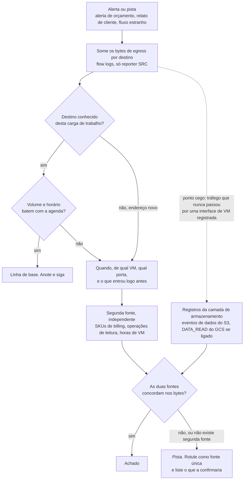
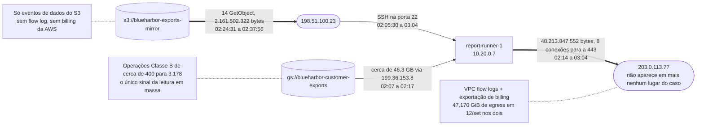
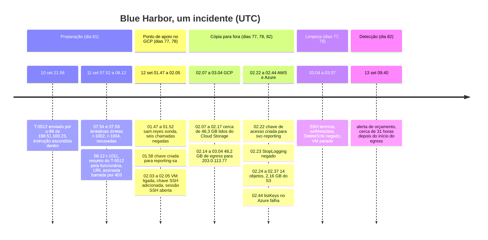

# Dia 82: Sinais de exfiltração de dados, e o encerramento do caso Blue Harbor

> 🇺🇸 Original: [*Day 82: Data exfiltration signals, and closing the Blue Harbor case*](https://github.com/thiefdroppers/cyber-investigator-skills/blob/main/curriculum/phase-6-cloud-ai-system-investigation/day-82.md) — © ThiefDroppers, licença MIT.
> Aqui: tradução fiel **+** camada brasileira. Nada do original foi removido; tudo o que é novo vem marcado com ➕.

**Fase 6. Investigação em nuvem e sistemas de IA** · Meta da trilha: confirmar a exfiltração da Blue Harbor a partir de duas fontes independentes (flow logs e billing), depois juntar todos os arquivos dos Dias 77 a 81 numa única linha do tempo e num único relatório de incidente.

Rank Jutsu: `A` · [](https://colab.research.google.com/github/Ridd1kulusC0d3r/investigador-cyber-90-dias/blob/main/curriculo/fase-6-nuvem-e-sistemas-de-ia/dia-82/dia-82.ipynb)

---

## 🎬 ➕ Abertura do caso — *A conta não mente*

Quarta, 28 de outubro, 18h. O Dr. Hélio quer o rascunho da comunicação à ANPD amanhã cedo. Ele tem três perguntas escritas num post-it amarelo: *Quais dados? De quantos? Saiu ou não saiu?*

As duas primeiras você responde com o log da Lia: 16 CPFs conferidos, 11 confirmados como cooperados, com agência. A terceira é o problema. O log de auditoria mostra que a `lia-bot`, com a chave nova, rodou um job que extraiu alguma coisa do cadastro para o bucket `lia-tmp-exports` às 00:18 de sexta. Se o arquivo foi baixado dali, o log não diz: `DATA_READ` estava desligado.

Rafa abre o export de faturamento que a Atende+ mandou junto e aponta uma linha.

— Quem apaga log não apaga fatura. Agora acha a segunda fonte.

É isso que o Dia 82 ensina, e é com isso que a Fase 6 fecha. *(Personagens e cenário: [Operação Isca](../../../caso-continuo/).)*

---

## 📖 Conceito

A exfiltração transforma acesso em perda, e costuma ser o passo mais barulhento de uma intrusão, se você sabe onde escutar. Dados saindo de uma conta de nuvem precisam mover bytes. Mover bytes aparece nos logs de rede e, na maioria das nuvens, mover bytes para a internet custa dinheiro, então uma cópia para fora deixa rastros em dois lugares que o atacante trata de jeitos muito diferentes. Um atacante com a permissão certa consegue apagar logs, mas a cobrança da transferência fica na fatura.

Alguns padrões valem saber de cor.

Volume e direção. *Egress* (dados saindo) que dispara enquanto o *ingress* fica plano é o formato de uma cópia para fora. Os VPC Flow Logs do GCP e da AWS registram bytes por conexão e qual lado os reportou. Na camada de armazenamento, o mesmo sinal aparece como um salto nas leituras de objetos.

Destino. Egress para um endereço com que a carga de trabalho nunca falou, para uma região em que você não opera, ou para armazenamento na conta de outra pessoa. A exfiltração para armazenamento em nuvem controlado pelo atacante muitas vezes parece uma transferência comum de nuvem para nuvem, então o histórico do destino nos seus próprios logs costuma dizer mais que o protocolo.

Horário. Transferências fora do horário normal da carga de trabalho, ou um fio constante dimensionado para ficar abaixo de um limite diário de alerta. Os dois exigem planejamento, então os dois merecem registro como evidência de intenção.

Billing e uso. Um salto no custo de egress de rede, nas operações de leitura de armazenamento ou nas horas de VM é a exfiltração aparecendo na fatura. Os dados de billing chegam horas depois do evento, mas o atacante não os controla, o que os torna a melhor corroboração que você pode ter para um achado de flow log. Só ajudam se a exportação de billing estava ligada antes do incidente: não dá para preenchê-la retroativamente.

Cada fonte tem pontos cegos. Flow logs cobrem só as sub-redes em que foram habilitados, e só o tráfego que passou pela interface de rede de uma VM; um download direto do Cloud Storage para a internet nunca toca uma VPC. Billing é diário e agregado. Uma afirmação apoiada em só um deles é uma pista. Quando duas fontes independentes concordam sobre os mesmos bytes, você pode chamá-la de achado.

A investigação corre na mesma ordem todas as vezes. Comece pelo que disparou o alarme, ache o destino fora da curva, fixe quando e de onde, e então procure uma segunda fonte que o atacante não conseguia tocar.



O alerta de orçamento da Blue Harbor disparou às 09:40 UTC do domingo, 13 de setembro. Hoje você prova sobre o que ele estava alertando e depois escreve o caso.

## 📚 Recursos

- [GCP VPC Flow Logs](https://cloud.google.com/vpc/docs/flow-logs): campos do registro, incluindo `bytes_sent`, `reporter` e detalhes da conexão.
- [AWS VPC Flow Logs](https://docs.aws.amazon.com/vpc/latest/userguide/flow-logs.html): `bytes`, `srcaddr`, `dstaddr`, `action`.
- [Exportação de billing do GCP para o BigQuery](https://cloud.google.com/billing/docs/how-to/export-data-bigquery): como consultar custo por SKU e por dia, onde os picos de egress aparecem.
- [NIST SP 800-61 Rev. 3, *Incident Response Recommendations and Considerations for Cybersecurity Risk Management*](https://csrc.nist.gov/pubs/sp/800/61/r3/final): para a estrutura do relatório que você escreve hoje.
- Camada gratuita: o exercício inteiro roda sobre os arquivos sintéticos. Nada aqui precisa de conta ao vivo, e nada aqui deve ser apontado para uma que não seja sua.

### ➕ Recursos do contexto Brasil

- [LGPD, art. 48](https://www.planalto.gov.br/ccivil_03/_ato2015-2018/2018/lei/l13709.htm): comunicação de incidente de segurança à ANPD e ao titular; o §1º lista o conteúdo mínimo.
- [ANPD — Comunicação de incidente de segurança (formulário e orientações)](https://www.gov.br/anpd/pt-br/canais_atendimento/agente-de-tratamento/comunicado-de-incidente-de-seguranca-cis).
- [Resolução CD/ANPD nº 15/2024](https://www.gov.br/anpd/pt-br/acesso-a-informacao/institucional/atos-normativos/regulamentacoes_anpd/resolucao-cd-anpd-no-15-de-24-de-abril-de-2024): o Regulamento de Comunicação de Incidente de Segurança.
- [CERT.br — Notificações de incidentes](https://www.cert.br/): para quem e como notificar incidentes envolvendo redes brasileiras.
- [Código de Processo Penal, arts. 158-A a 158-F](https://www.planalto.gov.br/ccivil_03/decreto-lei/del3689.htm): cadeia de custódia, para o material que vai à delegacia junto com o caso dos Pix.

## 🛠️ Prática parte 1: jq e awk, a evidência da exfiltração

Artefato: uma seção do relatório do Dia 82 com o título "Exfiltração", com o destino, a contagem de bytes, a janela de tempo e as linhas de billing que a corroboram.

```bash
cd ~/lab-p6/work && C=resources/case-blueharbor
```

**Seu checklist de hoje.** Faça na ordem e marque cada item ao terminar:

- [ ] 1. Egress por destino
- [ ] 2. Quando, e de onde
- [ ] 3. A corroboração do billing
- [ ] 4. O lado da AWS
- [ ] ➕ 7. Prática BR: saiu ou não saiu? (Lia)
- [ ] ➕ 9. O notebook do dia no Colab

### 1. Egress por destino

Quando os flow logs são exportados para um destino consultável, egress por destino ao longo de uma janela é a consulta que importa. No GCP, ler os flow logs direto do Cloud Logging e somar `bytes_sent` por IP de destino faz o ponto fora da curva aparecer (num projeto grande, roteie os logs para o BigQuery e faça a mesma soma em SQL). `bytes_sent` é um int64, que a saída JSON carrega como string, daí o `tonumber`; `reporter` é `SRC`, `DEST`, `SRC_GATEWAY` ou `DEST_GATEWAY`, e manter só `SRC` evita contar um fluxo duas vezes quando as duas pontas o registram:

```
gcloud logging read \
  'logName:"compute.googleapis.com%2Fvpc_flows"' \
  --project=YOUR_PROJECT --freshness=1d --format=json \
| jq -r '.[].jsonPayload
    | select(.reporter=="SRC")
    | [.connection.dest_ip, (.bytes_sent|tonumber)] | @tsv' \
| awk -F'\t' '{sum[$1]+=$2} END {for (ip in sum) print sum[ip], ip}' \
| sort -rn | head
```

`gcp/vpc-flows.json` é essa saída do `gcloud` para três dias, então rode o resto do *pipeline* sobre o arquivo:

```bash
jq -r '.[].jsonPayload | select(.reporter=="SRC")
  | [.connection.dest_ip, (.bytes_sent|tonumber)] | @tsv' $C/gcp/vpc-flows.json \
| awk -F'\t' '{sum[$1]+=$2} END {for (ip in sum) print sum[ip], ip}' \
| sort -rn | head
```

```
48213847552 203.0.113.77
7198877898 198.51.100.200
61401950 192.0.2.10
412988 198.51.100.23
```

Leia cada linha contra o que a Blue Harbor diz que a VM faz. 198.51.100.200 é o endereço que representa o *endpoint* do S3 para onde o espelho noturno envia, cerca de 2,4 GB por noite em três noites. 192.0.2.10 é o espelho de pacotes do sistema operacional, e 61 MB do total dele caíram às 02:06 de 12 de setembro, quando nada agendado estava rodando (o ator instalando ferramentas é uma leitura razoável; rotule como inferência). 412.988 bytes voltaram para 198.51.100.23, que é tráfego SSH respondendo ao ator. E 48.213.847.552 bytes, cerca de 48,2 GB, foram para 203.0.113.77, um endereço que não aparece em mais nenhum lugar do caso.

### 2. Quando, e de onde

```bash
jq -r '.[].jsonPayload | select(.connection.dest_ip == "203.0.113.77")
  | [.start_time, .end_time, .connection.src_port] | @tsv' $C/gcp/vpc-flows.json | sort | sed -n '1p;$p'
jq '[.[].jsonPayload | select(.connection.dest_ip == "203.0.113.77")] | length' $C/gcp/vpc-flows.json
jq -r '.[].jsonPayload | select(.reporter == "DEST") | select(.start_time | startswith("2026-09-12T0"))
  | [.start_time, .connection.src_ip, .connection.dest_port, .bytes_sent] | @tsv' $C/gcp/vpc-flows.json | sort
```

Oitenta registros de 5 minutos em oito conexões paralelas de `report-runner-1` (10.20.0.7) para 203.0.113.77 na porta 443, de 02:14:00 a 03:04:00. Os registros de entrada completam o resto: SSH de 198.51.100.23 para a porta 22 começando às 02:05:30, cerca de 46,3 GB chegando de 199.36.153.8 (o endereço do Private Google Access, que carrega as leituras de Cloud Storage da VM) entre 02:07 e 02:17, e um último registro SSH às 03:04. A própria leitura do job noturno, às 00:31, é de 2,37 GB. A VM leu do Cloud Storage cerca de vinte vezes o seu volume normal e o empurrou para um destino novo.

A VM empurrou para fora cerca de 1,9 GB a mais do que puxou do Cloud Storage durante a intrusão. Anote isso como ponto em aberto e não arredonde para sumir. Os flow logs não mostram de onde vieram os bytes extras.

### 3. A corroboração do billing

```bash
awk -F, 'NR == 1 || $3 ~ /Egress|Class B|VM time/' $C/gcp/billing-daily.csv | column -s, -t | tail -12
jq -r '.[].jsonPayload | select(.reporter == "SRC") | [.start_time[0:10], (.bytes_sent|tonumber)] | @tsv' \
  $C/gcp/vpc-flows.json | awk -F'\t' '{s[$1] += $2} END {for (d in s) printf "%s %.3f GiB\n", d, s[d]/2^30}' | sort
```

O egress de 12 de setembro é de 47,170 GiB a uma tarifa de laboratório de US$ 5,66, contra 2,2 a 2,3 GiB (US$ 0,26 a 0,28) em todos os outros dias de setembro. O total dos flow logs para o mesmo dia também é 47,170 GiB, então as duas fontes concordam até a terceira casa decimal (no laboratório; numa fatura real, espere pequenas diferenças por tráfego fora da sub-rede registrada e por arredondamento). As operações Classe B do Cloud Storage, que incluem leituras de objetos, foram de cerca de 400 por dia para 3.178, e o tempo de VM de cerca de 0,75 hora para 1,82. Com `DATA_READ` desligado, a contagem de Classe B é o único registro que você tem de que objetos foram lidos em massa: ela não consegue nomeá-los, mas mostra que a leitura aconteceu.

### 4. O lado da AWS

```bash
jq '[.Records[] | select(.sourceIPAddress == "198.51.100.23") | .additionalEventData.bytesTransferredOut] | add' \
  $C/aws/cloudtrail-s3-data-events.json
jq -r '.Records[] | select(.sourceIPAddress == "198.51.100.23") | .requestParameters.key' \
  $C/aws/cloudtrail-s3-data-events.json
```

14 objetos e 2.161.502.322 bytes (cerca de 2,16 GB) foram direto do bucket espelho para 198.51.100.23 entre 02:24:31 e 02:37:56. Esses downloads nunca passaram por uma VPC da Blue Harbor, então nenhum flow log os mostraria, e o caso não tem dados de billing da AWS para corroborá-los. Aqui os eventos de dados do S3 são a fonte única, o que você declara no relatório.

Os passos 1 a 4 numa figura. Arestas grossas são a cópia para fora; cada nota pontilhada nomeia a evidência por trás da aresta ao lado. Use como figura da seção Exfiltração do relatório, ou redesenhe com os seus próprios números se eles forem diferentes.



A figura também mostra o ponto em aberto do passo 2: cerca de 46,3 GB entraram na VM e cerca de 48,2 GB saíram.

## 🛠️ Prática parte 2: o relatório de incidente da Blue Harbor

Artefato: `~/lab-p6/notes/day-82-blueharbor-incident-report.md`, o relato completo do caso.

**Seu checklist de hoje.** Faça na ordem e marque cada item ao terminar:

- [ ] 5. Monte a linha do tempo unificada
- [ ] 6. Escreva o relatório
- [ ] ➕ 8. Prática BR: o rascunho para o Dr. Hélio (art. 48)

### 5. Monte a linha do tempo unificada

Comece pela linha do tempo de 37 eventos do Dia 77 e acrescente o que as outras fontes contribuem: o ticket, as requisições do app e os marcos dos flow logs.

```bash
IP=198.51.100.23
{
  tail -n +2 ~/lab-p6/notes/day-77-timeline.csv
  jq -r --arg ip "$IP" 'select(.client_ip == $ip)
    | [.created, "app", .portal_user, "ticket submitted", .ticket, "ok"] | @csv' $C/app/support-tickets.jsonl
  jq -r --arg ip "$IP" 'select(.client_ip == $ip or .req == "r-1011")
    | [.ts, "app", .user, .channel + " request", .req,
       (if .tool_calls then "tool call " + .tool_calls[0].status else "ok" end)] | @csv' \
    resources/day-81-app-log.jsonl
  jq -r '[.[] | select(.jsonPayload.connection.dest_ip == "203.0.113.77")] as $f
    | [($f | map(.jsonPayload.start_time) | min), "gcp-flow", "vm:report-runner-1", "egress start",
       "203.0.113.77:443", "ok"],
      [($f | map(.jsonPayload.end_time) | max), "gcp-flow", "vm:report-runner-1",
       "egress end, bytes=" + ($f | map(.jsonPayload.bytes_sent | tonumber) | add | tostring),
       "203.0.113.77:443", "ok"] | @csv' $C/gcp/vpc-flows.json
  jq -r --arg ip "$IP" '.[] | select(.jsonPayload.connection.src_ip == $ip and .jsonPayload.connection.dest_port == 22)
    | [.jsonPayload.start_time, "gcp-flow", $ip, "ssh to vm", "10.20.0.7:22", "ok"] | @csv' $C/gcp/vpc-flows.json
} | sort > ~/lab-p6/notes/day-82-merged-timeline.csv
wc -l < ~/lab-p6/notes/day-82-merged-timeline.csv
```

47 linhas, do ticket às 21:58:12 de 10 de setembro ao *stop* da VM às 03:07:02 de 12 de setembro. O alerta de orçamento às 09:40 de 13 de setembro entra à mão como última linha. Duas linhas compartilham 03:04:00 (o último registro SSH e o fim do egress), e os horários dos flow logs são as bordas de janelas de 5 minutos, então diga no relatório que as linhas de flow log têm precisão de cinco minutos.

Antes de escrever, confira o seu CSV contra o formato do incidente. A linha do tempo abaixo agrupa os marcos principais por fase e nomeia o dia em que cada um foi encontrado. Seu arquivo tem mais linhas, e cada uma deve pertencer a uma dessas fases. Uma linha que não se encaixa em nenhuma é um erro no seu filtro ou algo que o caso ainda não explicou; descubra qual. Os horários são UTC, escritos `hh.mm` porque a sintaxe do diagrama reserva os dois-pontos.



### 6. Escreva o relatório

Use esta ordem e mantenha o relatório inteiro numa única linha do tempo. Ele deve ser lido como um incidente, não como cinco relatórios diários grampeados; essa integração é a habilidade que a Fase 6 existe para construir.

1. Achado, em duas ou três frases com que um leitor ocupado consiga agir. Por exemplo: "Entre 01:47 e 03:07 UTC de 12 de setembro, um ator em 198.51.100.23 usou credenciais de prestador para emitir chaves para `reporting-sa` no GCP e para `svc-reporting` na AWS. Ele copiou cerca de 48,2 GB do bucket de exportações de clientes para 203.0.113.77 por meio de `report-runner-1`, e 14 objetos (2,16 GB) diretamente do espelho no S3. Os flow logs e a exportação de billing concordam sobre o volume no GCP."
2. Escopo e evidência: os itens de evidência com seus hashes do Dia 77, e o que cada camada de log conseguia e não conseguia ver.
3. A linha do tempo unificada do passo 5, com os IDs de chave que amarram as trocas de identidade.
4. Como o acesso foi obtido: os caminhos do grafo do Dia 80 nas duas nuvens, incluindo os não usados.
5. O ângulo do assistente de IA do Dia 81: a injeção no T-5512, o que o modelo fez, e a ligação de `u-88` a 198.51.100.23. Diga com clareza que ela falhou e não teve papel na perda de dados, e que mostra o ator mirando a exportação desde 10 de setembro.
6. Exfiltração: a evidência da parte 1, com as duas fontes lado a lado.
7. O que teria pegado ou parado isto antes, cada item um controle específico. A evidência do dia sustenta pelo menos estes: uma política de organização bloqueando a criação de chaves de conta de serviço (`constraints/iam.disableServiceAccountKeyCreation`), remover o papel de administração de chaves de `data-eng` em `reporting-sa`, restringir `RotateOwnKeys` a `${aws:username}`, apagar o usuário obsoleto `svc-reporting`, um alerta para qualquer `CreateServiceAccountKey` ou `CreateAccessKey`, um alerta de volume de egress por destino nos flow logs (teria disparado minutos depois das 02:14, enquanto o alerta de orçamento disparou cerca de 31 horas depois), e tratar o texto de ticket buscado como dado no assistente de suporte (remover comentários HTML e exigir confirmação humana antes de qualquer chamada de ferramenta que produza um link para dados de clientes). Marque quais deles teriam quebrado a cadeia sozinhos.
8. Limitações e perguntas em aberto: se foi Sam Reyes quem agiu ou alguém usou as credenciais de Sam, com a evidência de cada lado; quais objetos do Cloud Storage saíram (sem `DATA_READ`); a diferença de 1,9 GB entre o que foi puxado e o que foi empurrado; quem controla 203.0.113.77; a ausência do log de sign-in do Entra ID, do billing da AWS, da captura de pacotes e da imagem de disco da VM, com uma linha cada sobre o que eles teriam acrescentado.

> ➕ O `INSTRUCTOR-KEY.md` da pasta de recursos ([upstream](../../../upstream/curriculum/phase-6-cloud-ai-system-investigation/resources/)) lista as armadilhas e pontas soltas do caso. Agora que você terminou o Dia 82, pode lê-lo e comparar com o seu relatório. Ele não é resumido aqui de propósito.

### ➕ Prática BR (parte 1): saiu ou não saiu? (Lia)

O post-it do Dr. Hélio, terceira pergunta. Fontes: o log de auditoria ([`dia-77/lia-auditoria.json`](../../../caso-continuo/dados/dia-77/lia-auditoria.json)) e o resumo diário de uso que a Atende+ mandou ([`dia-82/lia-billing-diario.csv`](../../../caso-continuo/dados/dia-82/lia-billing-diario.csv)), 25/set a 2/out, fictício.

**Exercício A — duas fontes.** No notebook, compare 2/out com a linha de base (25/set a 1º/out):

| Sinal | Linha de base | 2/out | Fonte |
|---|---|---|---|
| Egress de internet | cerca de 0,02 GiB/dia | 0,412 GiB | billing |
| BigQuery, bytes lidos | cerca de 0,3 GiB/dia | 2,08 GiB | billing |
| Job de extração para `lia-tmp-exports` | nenhum | 03:18:40 UTC (00:18 BRT), `lia-bot` com a chave `7c3e91a0...`, de `198.51.100.66` | auditoria (Data Access) |
| Leitura do arquivo extraído no bucket | — | **não registrada** (`DATA_READ` desligado) | — |

Conclusão honesta: o log prova que o cadastro foi lido e extraído para o bucket; o billing mostra que cerca de 0,39 GiB a mais que o normal saiu para a internet no mesmo dia. As duas fontes **são compatíveis**, mas não casam bytes a bytes como no Blue Harbor (não há flow log nem `DATA_READ`), então o achado é "provável", não "confirmado". Escreva isso com essas palavras.

**Exercício B — a linha do tempo da Isca.** Junte, pelo IP `198.51.100.66`, as 6 requisições da sessão `s-5521` (Dia 81) e os 8 eventos de auditoria (Dia 77), mais a linha manual do egress do billing em 2/out. 15 linhas, UTC e BRT, de 1º/out 22:38:10 UTC (19:38 BRT) a 2/out 03:40:55 UTC (00:40 BRT). Para o leitor brasileiro: tudo aconteceu na noite de quinta para sexta, poucos dias **antes** do disparo dos SMS de segunda, 5/out.

### ➕ Prática BR (parte 2): o rascunho para o Dr. Hélio (art. 48)

Escreva `notas/dia-82-lia-rascunho-anpd.md` com os campos do conteúdo mínimo do art. 48, §1º da LGPD, preenchidos **só com o que a evidência sustenta**, e com a palavra de confiança certa em cada um:

| Inciso (§1º) | O que pede | O que você escreve |
|---|---|---|
| I | natureza dos dados afetados | vínculo de cooperado e agência para 16 CPFs consultados (11 confirmados); extração do cadastro (`cpf`, `nome`, `telefone`, `email`, `agencia`) para bucket temporário: **provável** saída, volume compatível no billing |
| II | informações sobre os titulares | 11 cooperados confirmados pela Lia (lista interna, não no relatório); total da extração **desconhecido** (o log não mostra linhas) |
| III | medidas técnicas e de segurança utilizadas | log de auditoria `ADMIN_READ`; limite de 16 consultas por sessão; sem `DATA_READ`; chave de conta de serviço criável por grupo da operadora |
| IV | riscos relacionados ao incidente | uso dos dados para dar credibilidade ao golpe do "Pix bloqueado" (o SMS chegou a cooperados reais) |
| V | motivos da demora, se não imediata | (a controladora preenche) |
| VI | medidas adotadas para reverter ou mitigar | corte da vinculação `serviceAccountKeyAdmin` do grupo (Dia 80); revogação da chave `7c3e91a0...`; ferramenta da Lia restrita ao CPF do próprio usuário autenticado (Dia 81); preservação dos logs com hash |

Não envie nada: o rascunho é insumo para o encarregado (DPO) e o jurídico da controladora.

### ➕ O notebook do dia

Abra o [notebook do Dia 82 no Colab](https://colab.research.google.com/github/Ridd1kulusC0d3r/investigador-cyber-90-dias/blob/main/curriculo/fase-6-nuvem-e-sistemas-de-ia/dia-82/dia-82.ipynb). Nele você:

1. refaz em Python o `jq | awk | sort -rn` de egress por destino e confere os 48.213.847.552 bytes;
2. fixa a janela, as 8 conexões, o pull de 46,3 GB e a diferença de 1,9 GB;
3. compara flow logs e billing dia a dia (47,170 GiB nos dois) e a contagem de Classe B;
4. monta `day-82-merged-timeline.csv` com 48 linhas (47 + o alerta) a partir de **todos** os arquivos, e gera o esqueleto do relatório nas oito seções;
5. joga o **quiz "achado ou pista?"**;
6. faz o mesmo para a Lia: as duas fontes, a linha do tempo da Isca e o rascunho do art. 48 por formulário.

## ✅ Checkpoint

- O relatório abre com o achado.
- O achado tem no máximo três frases.
- O achado nomeia o endereço do ator, 198.51.100.23.
- O achado nomeia as identidades para as quais o ator emitiu chaves, `reporting-sa` e `svc-reporting`.
- O achado nomeia o destino 203.0.113.77.
- `~/lab-p6/notes/day-82-merged-timeline.csv` tem 48 linhas: as 47 do passo 5 mais o alerta de orçamento.
- O alerta de orçamento às 09:40 de 13 de setembro é a última linha.
- As linhas estão numa única sequência cronológica.
- As linhas incluem entradas do GCP, da AWS, do Azure, do app de suporte e dos flow logs.
- O relatório diz que as linhas de flow log têm precisão de cinco minutos.
- `r-1003` não aparece na linha do tempo do relatório.
- A seção Exfiltração cita as duas fontes para o volume no GCP, flow logs e billing, cada uma com 47,170 GiB.
- A seção Exfiltração rotula a exfiltração da AWS como apoiada numa única fonte.
- As limitações listam a diferença de 1,9 GB entre o que foi puxado e o que foi empurrado como ponto em aberto.
- As limitações listam a questão de atribuição (Sam Reyes ou alguém usando as credenciais de Sam) como em aberto.
- A entrada de atribuição traz a evidência de cada lado.
- Todo item da lista "pegado antes" nomeia um controle específico.
- Pelo menos um controle está marcado como um que teria quebrado a cadeia sozinho.
- O relatório tem uma única linha do tempo, e suas seções seguem as oito partes do passo 6 em ordem, não uma seção por dia.
- Sem consultar notas, você explica por que a contagem de operações Classe B do Cloud Storage é o único registro de que objetos foram lidos em massa.

### ➕ Checkpoint BR

- Sua conclusão sobre a Lia usa "provável" (não "confirmado") para a saída do cadastro, e diz por quê (sem flow log, sem `DATA_READ`; billing compatível, não casado byte a byte).
- A linha do tempo da Isca tem 15 linhas com UTC e BRT, e mostra que tudo aconteceu antes do disparo dos SMS de 5/out.
- `r-2204` não aparece na linha do tempo da Isca.
- O rascunho do art. 48 tem os seis incisos, e nenhum campo afirma mais do que a evidência sustenta.
- O rascunho não traz CPFs nem nomes: a lista de titulares fica num anexo interno da controladora.

## ⚖️ ➕ Camada jurídica BR

**Comunicação de incidente (LGPD, art. 48).** O controlador deve comunicar à ANPD e ao titular a ocorrência de incidente de segurança que possa acarretar risco ou dano relevante aos titulares. O §1º diz que a comunicação deve mencionar, no mínimo: (I) a descrição da natureza dos dados pessoais afetados; (II) as informações sobre os titulares envolvidos; (III) a indicação das medidas técnicas e de segurança utilizadas para a proteção dos dados, observados os segredos comercial e industrial; (IV) os riscos relacionados ao incidente; (V) os motivos da demora, no caso de a comunicação não ter sido imediata; e (VI) as medidas que foram ou que serão adotadas para reverter ou mitigar os efeitos do prejuízo. O prazo e o procedimento estão na Resolução CD/ANPD nº 15/2024. Pelo Regulamento de Comunicação de Incidente de Segurança (Resolução CD/ANPD nº 15/2024), a comunicação à ANPD e aos titulares é feita em **três dias úteis**, contados do conhecimento de que o incidente afetou dados pessoais (em dobro para agentes de pequeno porte), com complementação à ANPD em até 20 dias úteis. Há risco ou dano relevante quando o incidente pode afetar significativamente os titulares **e** envolve ao menos um destes critérios: dados sensíveis; de crianças, adolescentes ou idosos; financeiros; de autenticação; protegidos por sigilo; ou em larga escala. O registro do incidente, comunicado ou não, é guardado por no mínimo cinco anos.

**Por que a palavra de confiança importa juridicamente.** A comunicação é uma declaração do controlador a um órgão regulador. Escrever "confirmado" onde a evidência sustenta "provável" (ou o contrário) pode prejudicar o controlador e os titulares. A disciplina de confiança calibrada que o curso ensina desde a Fase 2 aqui vira responsabilidade.

**Dois públicos, dois pacotes.** O rascunho do art. 48 vai para o encarregado e o jurídico da Serra Azul. O material sobre a origem do golpe (logs com hash, linha do tempo, ligação por IP com o caso dos Pix) vai para a delegacia especializada junto com a notícia-crime do estelionato/fraude eletrônica (CP, art. 171, §2º-A), com cadeia de custódia (CPP, arts. 158-A a 158-F). A Vigia não identifica o "Pescador": a ligação por IP é um indício para quem pode pedir registros em juízo (Marco Civil, art. 22).

> Este repositório é material de estudo e não constitui orientação jurídica. No caso real, a decisão de comunicar e o texto final são do controlador, com o encarregado e o jurídico.

## 🧠 ➕ Camada 8 — o relatório que todo mundo quer ler

No fim de um caso longo, três pressões empurram o relatório para longe da evidência. A **ilusão de narrativa** (*narrative fallacy*, como Nassim Taleb a chamou): uma história completa e redonda é mais satisfatória que uma com buracos, e a tentação é preencher os 1,9 GB e o "quem é o Pescador" com a explicação mais provável. O **viés de retrospectiva** (*hindsight bias*): depois de ver a linha do tempo inteira, tudo parece óbvio ("era claro que o ticket era ataque"), o que leva a julgar com injustiça a funcionária que pediu o resumo. E o **efeito de enquadramento** sobre o leitor: "a Lia confirmou 11 cooperados" e "a Lia vazou dados de 11 cooperados" descrevem o mesmo fato com cargas diferentes, e o Dr. Hélio vai usar a sua frase num documento oficial.

A estrutura de oito partes do original é o antídoto: achado curto, evidência com hash, uma linha do tempo, limitações com nome. Consequência prática: antes de entregar, releia só a seção de limitações e pergunte se alguém que discordasse de você encontraria ali tudo de que precisa para discordar. Se sim, o relatório está pronto.

## 🤖 ➕ Skill do dia

Hoje o dia propõe para a skill o procedimento novo **"Exfiltração em nuvem e fechamento do caso"**: soma de egress por destino, segunda fonte independente (billing, operações de leitura), "achado" só com duas fontes, e o relatório em oito partes numa linha do tempo única; com o acréscimo brasileiro do rascunho do art. 48 com confiança calibrada. Texto e caso de teste em [`_skill-delta.md`](_skill-delta.md).

## 💡 ➕ Inovação OSINT do dia — linha de base robusta com `statistics` (sem pandas)

"Cerca de 400 por dia para 3.178" é óbvio a olho. Num billing real, com dezenas de SKUs e sazonalidade, você quer que o computador aponte o dia fora da curva. A biblioteca padrão tem `statistics.median`, e com ela dá para fazer um detector robusto (desvio absoluto mediano, MAD), que não é puxado pelo próprio pico como a média seria:

```python
import csv, statistics                                      # stdlib

def picos(caminho, coluna_valor="usage_amount", limiar=5.0):
    por_sku = {}
    for linha in csv.DictReader(open(caminho)):
        por_sku.setdefault(linha["sku"], []).append((linha["usage_date"], float(linha[coluna_valor])))
    for sku, serie in por_sku.items():
        valores = [v for _, v in serie]
        med = statistics.median(valores)                    # o "normal", resistente ao pico
        mad = statistics.median(abs(v - med) for v in valores) or 1e-9
        for dia, v in serie:
            z = (v - med) / (1.4826 * mad)                  # escore robusto (1,4826 ~ normal)
            if z > limiar:
                print(f"{dia}  {sku:45s}  {v:>10}  (mediana {med:.3f}, z robusto {z:.0f})")

picos("billing-daily.csv")    # Blue Harbor: 12/set em Egress, Class B e VM time; Vertex AI não dispara
```

O mesmo código roda no `lia-billing-diario.csv` trocando os nomes das colunas (`data`, `sku`, `uso`). O ponto não é a estatística, é o hábito: a segunda fonte que o atacante não controla merece um alarme próprio, não só uma consulta depois do fato.

## 📝 Diário de estudo

- Data:
- Tempo gasto:
- O que ficou claro:
- O que ainda está nebuloso:
- Artefato produzido: `~/lab-p6/notes/day-82-merged-timeline.csv`, `~/lab-p6/notes/day-82-blueharbor-incident-report.md`, `notas/dia-82-lia-rascunho-anpd.md`

---
<sub>Baseado em [cyber-investigator-skills](https://github.com/thiefdroppers/cyber-investigator-skills) por ThiefDroppers (MIT). Tradução, camada BR, Camada 8, skill pt-BR e notebook por Deivison Lourenço (@Ridd1kulusC0d3r).</sub>
