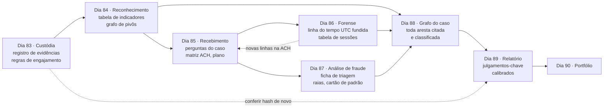
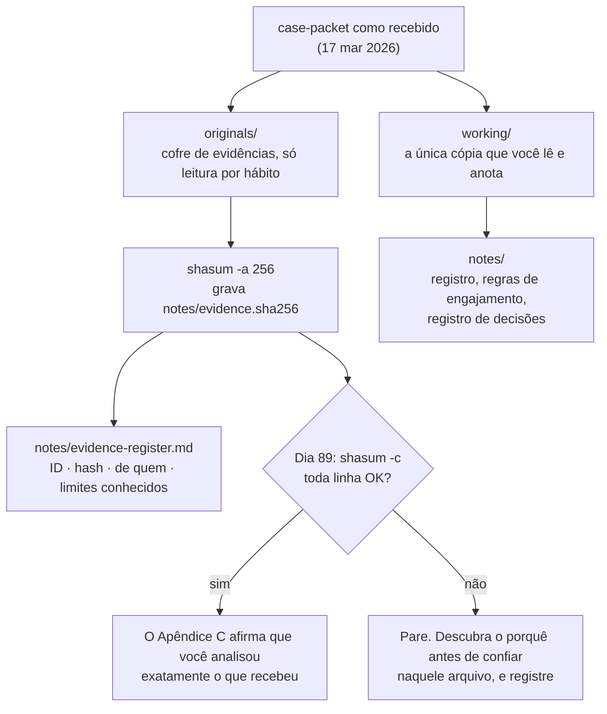
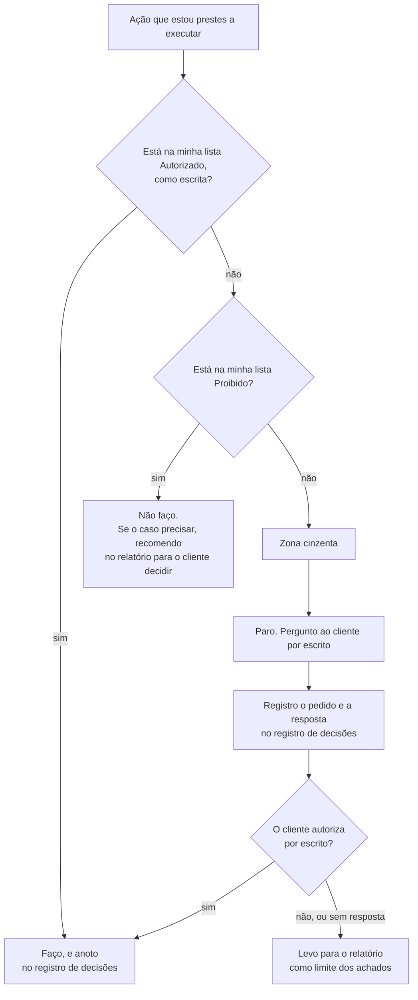

# Dia 83: Briefing do capstone e regras de engajamento

> 🇺🇸 Original: [*Day 83: Capstone briefing and rules of engagement*](https://github.com/thiefdroppers/cyber-investigator-skills/blob/main/curriculum/phase-7-capstone-career/day-83.md) — © ThiefDroppers, licença MIT.
> Aqui: tradução fiel **+** camada brasileira. Nada do original foi removido; tudo o que é novo vem marcado com ➕.

**Fase 7. Capstone e carreira** · Meta da trilha: assumir a custódia das evidências do caso, escrever exatamente o que você pode e o que não pode fazer, e montar o caderno que vai carregar o caso até o Dia 89.

Rank Jutsu: `S` · [](https://colab.research.google.com/github/Ridd1kulusC0d3r/investigador-cyber-90-dias/blob/main/curriculo/fase-7-capstone-e-carreira/dia-83/dia-83.ipynb)

---

## 🎬 ➕ Abertura do caso — *O cofre de evidências*

A sala de reunião da Vigia tem uma parede inteira de post-its da Operação Isca: SMS, domínios, o IscaKit, o notebook da agência Centro, os códigos L-01, L-02, L-03, a Lia. Rafa arranca o primeiro post-it da parede e cola na sua mesa.

— Acabou a fase de achar coisa. Agora é a fase de **provar** coisa. A Marta quer o relatório final, o Dr. Hélio quer saber o que vai para a delegacia, e eu quero saber uma coisa só: você consegue mostrar que tudo o que está nessa parede é exatamente o que a cooperativa te entregou?

Você abre a pasta do caso. Ao lado dela, a coordenação da Vigia deixou um segundo caso para você fechar em paralelo, de treino: uma fraude de pagamento a fornecedor numa marcenaria canadense fictícia, a Orrin Valley.

— Dois casos, o mesmo método — diz Rafa. — Primeiro dia de fechamento é administrativo. Hash de tudo, lista do que pode e do que não pode. Quem pula isso perde o caso no Dia 89.

É isso que o Dia 83 ensina. *(Personagens e cenário: [Operação Isca](../../../caso-continuo/).)*

---

## 📖 Conceito

Todos os laboratórios anteriores entregaram a você um exercício limpo: uma habilidade, um conjunto de dados, um artefato. Os Dias 83 a 89 são um caso só. Um pequeno fabricante pagou US$ 48.612,50 para a conta bancária de um criminoso depois de um e-mail que parecia vir do seu fornecedor de madeira. O cliente quer saber como aconteceu, se o e-mail de algum funcionário foi tomado, onde o atacante conseguiu a fatura verdadeira, se há mais alguma coisa mirando a empresa e o que corrigir. A seguradora do cliente vai ler o seu relatório, e a polícia talvez leia.

A saída de cada dia é entrada de um dia posterior. As linhas pontilhadas são os dois lugares onde o caso volta atrás: a forense do Dia 86 acrescenta linhas à matriz de hipóteses do Dia 85, e os hashes que você calcula hoje são conferidos de novo antes de o relatório sair.



Num trabalho real, o primeiro dia de um caso é trabalho administrativo que decide se o resto se sustenta. Você registra que evidência recebeu, de quem, quando e em que estado, para depois poder mostrar que ela não mudou. Você também acerta as regras de engajamento: que ações o cliente autorizou, quais não autorizou e o que você vai fazer quando uma situação cair entre as duas. Investigadores que pulam esta etapa tendem a provocar uma de duas falhas depois. Ou a evidência deles não pode ser demonstrada como a evidência que receberam, ou eles fizeram, no meio do caso, algo que ninguém autorizou e que agora contamina tudo o que veio depois.

O pacote do caso é tentador de propósito. O site de phishing está nomeado no e-mail. O e-mail é assinado por uma pessoa com nome, no fornecedor. Há um número de telefone que o atacante, presumivelmente, atende. Cada um desses convida a uma olhada rápida que está fora da sua autorização. Decidir de antemão onde ficam essas linhas é muito mais fácil do que decidir sob pressão no Dia 86.

O hash é a metade mecânica da custódia da evidência. Um hash SHA-256 é uma impressão digital de 64 caracteres dos bytes exatos de um arquivo. Se você calcular o hash de cada arquivo hoje e os hashes ainda baterem no Dia 89, você pode afirmar que analisou exatamente o que recebeu. Se um hash mudar, você sabe que precisa descobrir por quê antes de confiar naquele arquivo.

## 📚 Recursos

- [NIST SP 800-86, *Guide to Integrating Forensic Techniques into Incident Response*](https://csrc.nist.gov/pubs/sp/800/86/final). A seção 3 trata de coleta e preservação da integridade; a orientação sobre hash é curta e continua atual.
- [Protocolo de Berkeley sobre Investigações Digitais de Fontes Abertas](https://www.ohchr.org/en/publications/policy-and-methodological-publications/berkeley-protocol-digital-open-source) (ACNUDH da ONU e Human Rights Center da UC Berkeley). Leia os capítulos sobre arcabouço jurídico e sobre preservação. É o padrão público mais citado para documentar trabalho investigativo em fontes abertas.
- [GNU coreutils: utilitários sha2](https://www.gnu.org/software/coreutils/manual/html_node/sha2-utilities.html), para o `sha256sum`, o equivalente Linux do `shasum -a 256` do macOS usado abaixo.
- O pacote do caso: [`case-packet/README.md`](../../../upstream/curriculum/phase-7-capstone-career/case-packet/README.md) e [`case-packet/01-engagement-letter.md`](../../../upstream/curriculum/phase-7-capstone-career/case-packet/01-engagement-letter.md) (cópias locais do original, em inglês).

### ➕ Recursos do contexto Brasil

- [Código de Processo Penal, arts. 158-A a 158-F](https://www.planalto.gov.br/ccivil_03/decreto-lei/del3689compilado.htm) (cadeia de custódia, incluídos pela Lei 13.964/2019, o "Pacote Anticrime"). É o vocabulário que o delegado e o perito vão usar para julgar o seu registro.
- ABNT NBR ISO/IEC 27037: diretrizes para identificação, coleta, aquisição e preservação de evidência digital. É a norma que peritos brasileiros costumam citar em laudos; a versão ABNT é paga, mas o sumário e as resenhas públicas bastam para conhecer as quatro etapas.
- [Lei 13.432/2017](https://www.planalto.gov.br/ccivil_03/_ato2015-2018/2017/lei/l13432.htm): regula a profissão de detetive particular. Leia para entender por que, no Brasil, o que sustenta o seu trabalho privado é o **contrato escrito** com o cliente, e não um poder de investigação.
- Os dados fictícios do caso brasileiro deste dia: [`caso-continuo/dados/dia-83/`](../../../caso-continuo/dados/dia-83/).

## 🛠️ Prática: shasum e um caderno do caso, montando o registro de evidências e as regras de engajamento

Você termina o dia com três coisas num caderno do caso (uma pasta de arquivos Markdown, um *vault* do Obsidian ou o CherryTree servem): um registro de evidências com hashes verificados, uma folha de regras de engajamento e um cronograma do caso.

A estrutura de pastas e a verificação de hash funcionam juntas assim. Nada é editado em `originals/`, então um hash divergente ali sempre precisa de explicação.



**Seu checklist de hoje.** Faça na ordem e marque cada item ao terminar:

- [ ] Passo 1: monte a pasta do caso
- [ ] Passo 2: calcule o hash dos originais
- [ ] Passo 3: escreva o registro de evidências
- [ ] Passo 4: escreva a folha de regras de engajamento
- [ ] Passo 5: comece o registro de decisões e o cronograma
- [ ] ➕ Passo 6: o mesmo cofre para a Operação Isca (Prática BR)
- [ ] ➕ Passo 7: o notebook do dia no Colab

### Passo 1: monte a pasta do caso

Copie o pacote para que o original fique intocado:

```bash
mkdir -p ~/capstone/originals ~/capstone/working ~/capstone/notes
cp -R case-packet ~/capstone/originals/
cp -R case-packet ~/capstone/working/
```

A partir de agora você lê e anota só os arquivos de `working/`. `originals/` é o seu cofre de evidências.

> ➕ Neste repositório, o pacote fica em `upstream/curriculum/phase-7-capstone-career/case-packet/`. Rode o `cp -R` a partir de `upstream/curriculum/phase-7-capstone-career/`.

### Passo 2: calcule o hash dos originais

No macOS:

```bash
cd ~/capstone/originals/case-packet
shasum -a 256 *.md *.eml logs/* > ~/capstone/notes/evidence.sha256
cat ~/capstone/notes/evidence.sha256
```

No Linux, troque `shasum -a 256` por `sha256sum`. No PowerShell do Windows:

```powershell
Get-ChildItem -Recurse -File | Get-FileHash -Algorithm SHA256 | Export-Csv ~\capstone\notes\evidence.csv
```

Depois, prove que a etapa de verificação funciona antes de precisar dela:

```bash
cd ~/capstone/originals/case-packet
shasum -a 256 -c ~/capstone/notes/evidence.sha256
```

Toda linha deve terminar em `OK`. Agora edite um caractere de um arquivo em `working/`, calcule à mão o hash dessa cópia e compare com o valor do original. A divergência é a cara de um arquivo alterado. Desfaça a edição.

### Passo 3: escreva o registro de evidências

Crie `notes/evidence-register.md` com uma linha por arquivo. Use os IDs do pacote que estão no README, para que toda nota posterior possa citá-los.

| ID | Arquivo | SHA-256 (16 primeiros caracteres) | Recebido em | De quem | Descrição | Limites conhecidos |
|---|---|---|---|---|---|---|
| P1 | 01-engagement-letter.md | (do seu arquivo de hash) | 17 mar 2026 | Owen Tran, cliente | Contratação, escopo, depoimentos | Os depoimentos são resumos, não transcrições; os comentários da Castellan são de ouvir dizer |
| P8 | logs/mailbox-audit.csv | (do seu arquivo de hash) | 17 mar 2026 | Priya Anand, prestadora de TI | Auditoria de login e da caixa de correio | Só dois usuários; começa em 9 mar; exportado depois da remediação |

Preencha todos os arquivos. A coluna "Limites conhecidos" é a que mais importa. Escreva nela o que cada fonte não consegue dizer, tirado das notas de recebimento da carta de contratação. Para o P9, isso é, no mínimo, "fuso horário não registrado, uma estação de trabalho só, dois dias só". Você vai reler esta coluna no Dia 89, quando decidir quão confiante cada achado pode ser.

Deixe o `07-instructor-key.md` no registro e não o abra. Ele faz parte do cofre de evidências para a correção, não da sua análise.

### Passo 4: escreva a folha de regras de engajamento

Crie `notes/rules-of-engagement.md` com três seções.

Autorizado: reescreva a Parte B da carta de contratação com as suas palavras, como ações que você vai executar. "Ler e analisar P1 a P9" está bom. "Investigar os atacantes" é vago demais para você se conferir.

Proibido: liste cada item fora do escopo da carta, de novo como ações específicas. "Não carregar nenhuma URL em `cstl-docshare.example`, nem por um *scanner* que eu controle" é verificável. "Ficar no escopo" não é.

Zona cinzenta: escreva pelo menos três situações previsíveis que a carta não resolve com clareza, com a decisão e o motivo. Dois exemplos resolvidos:

> Situação: a página de phishing talvez ainda esteja no ar, e a varredura do P6 é de 17 de março. Posso varrê-la de novo a partir de uma *sandbox* para ver se mudou?
> Decisão: não. A carta proíbe qualquer interação com infraestrutura do atacante, e uma varredura é uma interação que o servidor do atacante pode registrar. Se o caso precisar de uma captura mais nova, peço ao cliente, por escrito, que a prestadora de TI dele faça, e registro o pedido e a resposta no registro de decisões.

> Situação: eu poderia denunciar `cstl-docshare.example` ao contato de abuso do registrador para derrubá-lo.
> Decisão: não por minha própria autoridade. Uma derrubada (*takedown*) altera a evidência e pode importar para a polícia. Recomendo no relatório e deixo o cliente decidir, junto com a polícia, se ela estiver envolvida.

Termine a folha com uma regra de uma linha para qualquer coisa não coberta, como "Se eu não encontrar uma ação na lista Autorizado, paro e pergunto ao cliente antes de fazê-la".

Desenhada como decisão, a folha que você acabou de escrever funciona assim. Passe por ela toda ação que você estiver prestes a executar, inclusive as que parecem inofensivas, como uma varredura "rápida" ou uma consulta reversa de telefone.



### Passo 5: comece o registro de decisões e o cronograma

Crie `notes/decisions-log.md`. Toda vez que você decidir não fazer algo, mudar o plano ou assumir uma premissa, acrescente uma linha datada. Comece com a entrada de hoje: "Dia 83: hash do pacote calculado, 11 arquivos, todos OK. Não abri o P10."

Depois, acrescente o cronograma do caso, para enxergar o arco inteiro:

| Dia | Fase do caso | Entregável |
|---|---|---|
| 83 | Briefing | Registro de evidências, regras de engajamento, registro de decisões |
| 84 | Reconhecimento OSINT e de inteligência de ameaças | Tabela de indicadores, registro de coleta, grafo de pivôs da infraestrutura, rascunho de camada ATT&CK |
| 85 | Recebimento e planejamento | Uma página de recebimento com a pergunta do caso, escopo, hipóteses e plano |
| 86 | Forense | Linha do tempo UTC fundida, tabela de atribuição de sessões |
| 87 | Análise de fraude e engenharia social | Ficha de triagem pontuada, diagrama de raias com pontos de quebra, cartão de padrão |
| 88 | Grafo do caso | Grafo final ligando toda entidade e todo vínculo de evidência |
| 89 | Relatório | Relatório final com confiança calibrada |
| 90 | Carreira | Portfólio, currículo, plano de candidaturas |

### ➕ Prática BR: o mesmo cofre para a Operação Isca

A Operação Isca fecha em paralelo ao capstone. Antes de escrever uma linha do relatório para a Marta, você faz o mesmo trabalho administrativo com três evidências fictícias do caso brasileiro, em [`caso-continuo/dados/dia-83/`](../../../caso-continuo/dados/dia-83/):

| ID | Arquivo | O que é |
|---|---|---|
| I1 | `I1-escopo-assinado.md` | O escopo escrito pela Marta Quintão, com a hora da assinatura |
| I2 | `I2-sms-ouvidoria.csv` | As amostras de SMS que a ouvidoria repassou |
| I3 | `I3-captura-site-falso.txt` | A captura de texto do site falso, feita no navegador isolado da Vigia |

1. Copie a pasta para `originais/` e `trabalho/`, como no Passo 1, e gere `notas/evidencias-isca.sha256` com `sha256sum`.
2. Escreva o registro de evidências do Isca com a coluna **Limites conhecidos**. Para o I2, por exemplo: "horário como aparece no celular (BRT), só quatro amostras de 37 reclamações, repassado pela ouvidoria sem o aparelho original". Para o I3: "captura de texto, não de tela; um único momento (14:02 UTC); o site pode ter mudado depois".
3. Escreva as regras de engajamento do fechamento. A lista **Proibido** precisa ter, como ações verificáveis, pelo menos: não acessar o painel do IscaKit; não ligar nem mandar mensagem para os remetentes `+55 00 00000-0001` a `-0004`; não consultar a chave Pix dos laranjas no app de banco nenhum; não pesquisar o "Pescador" como pessoa; não pesquisar as pessoas por trás dos códigos L-01, L-02, L-03; não pedir logs a provedores diretamente (o caminho é judicial).
4. Escreva duas situações de zona cinzenta próprias do Brasil. Exemplo resolvido:

> Situação: o Dr. Hélio pergunta se a Vigia pode mandar o relatório direto para a delegacia especializada em crimes cibernéticos.
> Decisão: não por conta própria. Quem comunica o crime é a vítima (a cooperativa e os cooperados), e o relatório contém dados pessoais tratados com base no legítimo interesse da cooperativa. Preparo o pacote de comunicação para a cooperativa entregar, e registro o pedido e a resposta no registro de decisões.

### ➕ O notebook do dia

Abra o [notebook do Dia 83 no Colab](https://colab.research.google.com/github/Ridd1kulusC0d3r/investigador-cyber-90-dias/blob/main/curriculo/fase-7-capstone-e-carreira/dia-83/dia-83.ipynb). Nele você:

1. baixa o pacote do caso do GitHub (ou usa a cópia embutida, se estiver sem rede), calcula o SHA-256 de cada arquivo e gera um `evidence.sha256` no formato do `sha256sum`;
2. roda o equivalente Python do `shasum -c`, altera um caractere de uma cópia e vê a divergência acontecer;
3. confere o hash do gabarito do instrutor **sem abri-lo**;
4. joga o **quiz das regras de engajamento** (Autorizado, Proibido ou Zona cinzenta) com ações dos dois casos;
5. sai com o registro de evidências do Isca e o registro de decisões já iniciados.

## ✅ Checkpoint

Confira seu caderno contra estes critérios antes de seguir:

1. `shasum -a 256 -c` contra o seu arquivo de hash devolve `OK` para todo arquivo do pacote.
2. O registro de evidências tem uma linha para cada arquivo do pacote.
3. Toda linha do registro tem uma entrada não vazia em "Limites conhecidos".
4. A lista Proibido tem uma entrada para cada um dos oito itens fora do escopo da carta de contratação.
5. Cada entrada da lista Proibido está escrita como uma ação específica que você conseguiria se flagrar fazendo, e não como uma instrução genérica do tipo "ficar no escopo".
6. Você tem pelo menos três situações de zona cinzenta.
7. Cada situação de zona cinzenta tem uma decisão.
8. Cada decisão tem um motivo que aponta para uma frase da carta de contratação.
9. Sem consultar, você sabe dizer o que faria se no Dia 86 percebesse que precisa de uma evidência que o pacote não contém. (Pedir ao cliente por escrito, registrar e levar a lacuna para o relatório se a resposta for não.)

### ➕ Checkpoint BR

- O registro de evidências do Isca tem I1, I2 e I3, cada um com hash e limites conhecidos.
- A lista Proibido do Isca tem pelo menos as seis ações do item 3 da Prática BR.
- Você tem duas situações de zona cinzenta brasileiras, cada uma com decisão e motivo.
- Sem consultar, você liga o seu registro de evidências a pelo menos três etapas da cadeia de custódia do art. 158-B do CPP.
- Você acertou pelo menos 9 das 12 ações do quiz do notebook.

## ⚖️ ➕ Camada jurídica BR

**Cadeia de custódia, CPP arts. 158-A a 158-F (Lei 13.964/2019).** O art. 158-A define cadeia de custódia como o conjunto de procedimentos usados para manter e documentar a história cronológica do vestígio, da coleta ao descarte, para rastrear sua posse e manuseio. O art. 158-B lista as etapas: reconhecimento, isolamento, fixação, coleta, acondicionamento, transporte, recebimento, processamento, armazenamento e descarte. Tradução para o Dia 83: a pasta `originals/` é o acondicionamento e o armazenamento; o registro de evidências é o recebimento ("de quem, quando, em que estado"); o `shasum -c` do Dia 89 é a prova de que o processamento não alterou o vestígio. O código foi escrito pensando em perícia oficial, mas é a régua que o delegado, o promotor e o advogado da outra parte vão usar para avaliar o seu material. Seguir a mesma lógica no trabalho privado custa pouco e evita a discussão de "quebra da cadeia de custódia" depois.

**O que sustenta o trabalho privado é o contrato.** Uma empresa como a Vigia não tem poder de investigação criminal. O que autoriza o trabalho é o contrato escrito com o cliente e o escopo que ele define, como no Dia 01. A Lei 13.432/2017, que regula o detetive particular, segue a mesma ideia: o trabalho privado depende de contrato com quem contrata, e a investigação criminal continua sendo da polícia. Por isso a lista Proibido não é burocracia: é o limite do que o seu contrato consegue autorizar.

**Remediação antes da coleta.** No capstone, a TI apagou a regra da caixa de correio antes de exportar os logs. No Brasil, quando o material puder virar prova, o ideal é preservar antes de remediar, ou ao menos registrar com hora e responsável o que foi alterado e por quê. O registro de decisões é o lugar disso.

> Este repositório é material de estudo e não constitui orientação jurídica. No seu caso real, quem decide o que vai para a polícia é o cliente, com o jurídico dele.

## 🧠 ➕ Camada 8 — o viés de ação e o contrato de Ulisses

O pacote do caso foi escrito para dar coceira: um site de phishing nomeado, um telefone que o atacante atende, uma pessoa com nome no fornecedor. Na Operação Isca é igual: o painel do IscaKit, os números remetentes, as chaves Pix dos laranjas. Sob pressão, pessoas tendem a preferir **fazer alguma coisa** a esperar, mesmo quando esperar é a melhor opção; a literatura de decisão chama isso de **viés de ação**. Num investigador, ele aparece como "só uma olhadinha", "só uma ligação para confirmar".

O antídoto é o mesmo do Dia 01, em versão mais forte: o **pré-compromisso**. Na *Odisseia*, Ulisses pede para ser amarrado ao mastro antes de passar pelas sereias, porque sabe que, na hora, vai querer se soltar. A lista Proibido escrita como ações específicas é a corda. Ela precisa ser escrita hoje, com a cabeça fria, porque no Dia 86, com três logs abertos e uma hipótese brilhando, você vai encontrar ótimos motivos para "só testar a página".

Consequência prática: quando você se pegar com vontade de executar uma ação que não está na lista Autorizado, trate a própria vontade como sinal. Escreva a ação no registro de decisões **antes** de decidir. O simples ato de escrever devolve a decisão para o seu raciocínio lento.

## 🤖 ➕ Skill do dia

O Dia 83 propõe para a [skill pt-BR](../../../skills/investigador-cyber/SKILL.md) o procedimento novo **"Abertura de caso: custódia e regras de engajamento"**: registro de evidências com hash e limites conhecidos, lista de proibições escrita como ações, zona cinzenta resolvida por pedido escrito. Proposta completa em [`_skill-delta.md`](_skill-delta.md).

## 💡 ➕ Inovação OSINT do dia — um `sha256sum -c` em Python puro

O Colab e muitos computadores corporativos com Windows não têm `sha256sum`. Estas linhas, só com a biblioteca padrão, geram e conferem um arquivo **no mesmo formato** que o `sha256sum` e o `shasum -a 256` entendem (hash, dois espaços, caminho). Assim o arquivo do Dia 83 pode ser conferido no Dia 89 em qualquer máquina, com qualquer das três ferramentas:

```python
import hashlib, pathlib                                         # tudo stdlib

def gerar(pasta, saida):
    linhas = []
    for p in sorted(pathlib.Path(pasta).rglob("*")):            # todos os arquivos, em ordem estável
        if p.is_file():
            h = hashlib.sha256(p.read_bytes()).hexdigest()      # bytes exatos, não texto
            linhas.append(f"{h}  {p.relative_to(pasta).as_posix()}")
    pathlib.Path(saida).write_text("\n".join(linhas) + "\n")

def conferir(pasta, arquivo_hash):
    for linha in pathlib.Path(arquivo_hash).read_text().splitlines():
        h, nome = linha.split("  ", 1)                          # o formato usa DOIS espaços
        atual = hashlib.sha256((pathlib.Path(pasta) / nome).read_bytes()).hexdigest()
        print(f"{nome}: {'OK' if atual == h else 'FALHOU'}")
```

A ideia que vale levar: escolha formatos de custódia que **ferramentas diferentes** consigam conferir. Se só o seu script consegue validar o seu registro, a outra parte vai questionar o script.

## 📝 Diário de estudo

- Data:
- Tempo gasto:
- O que ficou claro:
- O que ainda está nebuloso:
- Artefato produzido: `notes/evidence.sha256`, `notes/evidence-register.md`, `notes/rules-of-engagement.md`, `notes/decisions-log.md`, `notas/evidencias-isca.sha256`

---
<sub>Baseado em [cyber-investigator-skills](https://github.com/thiefdroppers/cyber-investigator-skills) por ThiefDroppers (MIT). Tradução, camada BR, Camada 8, skill pt-BR e notebook por Deivison Lourenço (@Ridd1kulusC0d3r).</sub>
