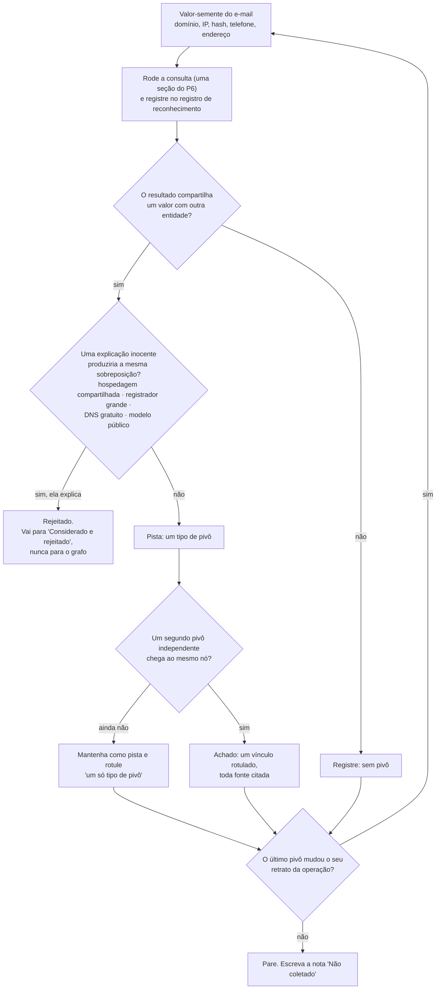
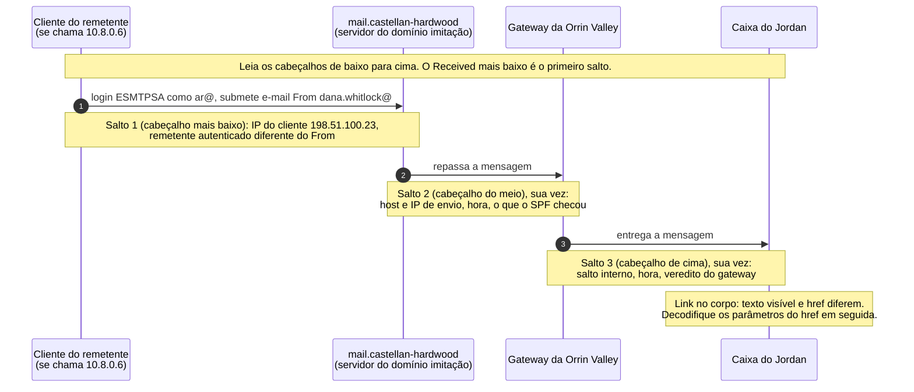

# Dia 84: Reconhecimento da infraestrutura externa do caso

> 🇺🇸 Original: [*Day 84: Recon on the case's external infrastructure*](https://github.com/thiefdroppers/cyber-investigator-skills/blob/main/curriculum/phase-7-capstone-career/day-84.md) — © ThiefDroppers, licença MIT.
> Aqui: tradução fiel **+** camada brasileira. Nada do original foi removido; tudo o que é novo vem marcado com ➕.

**Fase 7. Capstone e carreira** · Meta da trilha: transformar um e-mail de phishing num mapa da infraestrutura por trás dele, usando os métodos de análise de cabeçalho, OSINT e pivô das Fases 2 e 3, e registrar cada passo para que outro analista consiga repeti-lo.

Rank Jutsu: `S` · [](https://colab.research.google.com/github/Ridd1kulusC0d3r/investigador-cyber-90-dias/blob/main/curriculo/fase-7-capstone-e-carreira/dia-84/dia-84.ipynb)

---

## 🎬 ➕ Abertura do caso — *Nove pivôs, três verdadeiros*

Rafa joga na mesa uma folha com nove linhas impressas. Cada uma liga dois pedaços da Operação Isca: certificado, IP, script, encurtador, favicon.

— Essa é a planilha que a gente vai mandar para a Marta como "infraestrutura do Pescador". Quantas dessas linhas aguentam um advogado do outro lado?

Você lê. `serraazul-pix.example` e `coopvale-pix.example` carregam o mesmo `ik.js`. `serraazul-pix.example` e uma loja de doces usam o mesmo encurtador.

— A loja de doces é do Pescador? — você pergunta, meio brincando.

— É exatamente essa a pergunta — responde Rafa, sem rir. — Toda ligação tem uma explicação inocente possível. Seu trabalho hoje é testar cada uma antes de desenhar a seta.

É isso que o Dia 84 ensina. *(Personagens e cenário: [Operação Isca](../../../caso-continuo/).)*

---

## 📖 Conceito

O reconhecimento vem antes do planejamento formal do caso aqui por um motivo prático. Na ligação de recebimento, o cliente contou o que aconteceu do jeito que ele entende. Antes de se comprometer com um plano no Dia 85, você quer uma olhada rápida e delimitada no lado do atacante, para saber que tipo de operação é esta. Um domínio imitação isolado pede um plano diferente de uma campanha que já atingiu clientes de vários fornecedores.

Comece pelo e-mail, porque ele é o único artefato que o atacante construiu e enviou ao cliente. Os cabeçalhos registram quais servidores trataram a mensagem e qual IP a submeteu. O corpo e o HTML registram para onde o link realmente vai, o que o atacante copiou e o que ele mudou. Todo valor que você extrair vira semente para pivotar.

O método de pivô é o do Dia 40, e o padrão para um vínculo é o mesmo. Um único atributo compartilhado é uma pista. Uma relação vira achado quando vários pivôs independentes convergem para os mesmos nós, e quando você já checou a explicação inocente óbvia para cada um. Hospedagem compartilhada, um registrador popular, um serviço de DNS gratuito e um modelo de site que qualquer um pode baixar criam, todos, atributos compartilhados entre sites sem relação. A habilidade de hoje é separar esses dos atributos que um operador cria ao reaproveitar as próprias ferramentas.

Todo pivô que você rodar hoje passa pelo mesmo ciclo. As duas saídas que importam são "rejeitado", que vai para uma nota e nunca para o grafo, e "achado", que precisa de um segundo pivô independente antes de virar vínculo.



Os resultados de consulta em `06-lookup-results.md` substituem consultas ao vivo, porque todo domínio e IP do pacote é um valor reservado que serviços reais não resolvem. Trate cada seção como uma consulta que você rodou: registre, cite e não presuma nada que o resultado não mostre. Tirando digitar a consulta, o método é o mesmo do trabalho ao vivo.

O reconhecimento também precisa de uma regra de parada. Você não está tentando saber tudo sobre o atacante hoje. Está tentando saber o suficiente para escrever um bom plano amanhã. Quando um novo pivô para de mudar o seu retrato da operação, pare e escreva o que você não coletou e por quê.

## 📚 Recursos

- [Google Admin Toolbox Messageheader](https://toolbox.googleapps.com/apps/messageheader/) transforma cabeçalhos brutos numa tabela salto a salto. Cole só cabeçalhos sintéticos ou autorizados em qualquer ferramenta web de terceiros; num caso real, cabeçalhos podem conter dados pessoais e pertencem ao cliente.
- [CyberChef](https://gchq.github.io/CyberChef/) para decodificar parâmetros de URL.
- [Maltego Community Edition](https://www.maltego.com/community-edition/) para o grafo de pivôs. O Gephi também serve, se você preferir a configuração do Dia 40.
- [MITRE ATT&CK Navigator](https://mitre-attack.github.io/attack-navigator/) para o rascunho da camada de técnicas.
- [Meld](https://meldmerge.org/) ou um simples `diff -u` para comparar as duas páginas públicas.
- Referências de volta: [Dia 22](https://github.com/thiefdroppers/cyber-investigator-skills/blob/main/curriculum/phase-2-osint-digital-footprint/day-22.md) para hubs, clusters e pontes, [Dia 40](https://github.com/thiefdroppers/cyber-investigator-skills/blob/main/curriculum/phase-3-cyber-threat-intelligence/day-40.md) para a confiabilidade de pivôs, e o [modelo de registro de reconhecimento OSINT](https://github.com/thiefdroppers/cyber-investigator-skills/blob/main/worksheets/osint-recon-log.md) (➕ versão pt-BR: [`fichas/registro-recon-osint.md`](../../../fichas/registro-recon-osint.md)).

### ➕ Recursos do contexto Brasil

- [RDAP do Registro.br](https://rdap.registro.br/): para domínios `.br`, o equivalente do WHOIS do L1. Exemplo de consulta: `https://rdap.registro.br/domain/registro.br`.
- [crt.sh](https://crt.sh/): busca em logs de *Certificate Transparency* (o L4), com saída JSON (`?q=dominio&output=json`).
- [CERT.br](https://www.cert.br/): o grupo de resposta a incidentes para redes brasileiras. Seus avisos e a [Cartilha de Segurança](https://cartilha.cert.br/) servem de linguagem comum com o cliente.
- [Pivôs da Operação Isca](../../../caso-continuo/dados/dia-84/pivos-isca.csv): nove pivôs pré-coletados (fictícios) para a Prática BR.

## 🛠️ Prática: Maltego CE e ATT&CK Navigator, um grafo de pivôs da infraestrutura e um rascunho de camada de técnicas

Trabalhe a partir da sua cópia `working/`. Comece uma cópia nova de `worksheets/osint-recon-log.md` como `notes/recon-log.md` e preencha a seção Plano antes de abrir qualquer arquivo: a pergunta de hoje é "Que infraestrutura enviou e sustentou o e-mail de phishing de 10 de março, e ela faz parte de uma operação maior?"

**Seu checklist de hoje.** Faça na ordem e marque cada item ao terminar:

- [ ] Parte 1: extraia os indicadores do e-mail
- [ ] Parte 2: compare as páginas públicas real e falsa
- [ ] Parte 3: pivote pelos resultados de consulta
- [ ] Parte 4: monte o grafo de pivôs no Maltego CE
- [ ] Parte 5: rascunhe a camada ATT&CK
- [ ] Parte 6: escreva a nota de parada
- [ ] Parte 7: escreva a leitura do grafo
- [ ] ➕ Parte 8: os nove pivôs da Operação Isca (Prática BR)
- [ ] ➕ Parte 9: o notebook do dia no Colab

### Parte 1: extraia os indicadores do e-mail

Abra `02-suspicious-email.eml` num editor de texto. Não abra num cliente de e-mail, que pode carregar a imagem remota do logo. Leia os cabeçalhos `Received` de baixo para cima, porque cada servidor acrescenta o seu cabeçalho por cima.

Exemplo resolvido para o cabeçalho mais baixo:

```
Received: from [10.8.0.6] (unknown [198.51.100.23])
	(Authenticated sender: ar@castellan-hardwood.example)
	by mail.castellan-hardwood.example (Postfix) with ESMTPSA id 2C4A1E03
```

Isto diz que um cliente em 198.51.100.23, cuja própria máquina se chamava 10.8.0.6 (um endereço privado, típico de VPN ou de rede doméstica), fez login no servidor de e-mail `mail.castellan-hardwood.example` como `ar@castellan-hardwood.example` e entregou a mensagem a ele. ESMTPSA significa submissão autenticada. Então 198.51.100.23 é o que os cabeçalhos registram de mais próximo da conexão do próprio remetente. Repare também que a conta autenticada (`ar@`) é diferente do endereço `From` (`dana.whitlock@`). O servidor permitiu isso, o que sugere que o atacante administra o servidor de e-mail do domínio e pode enviar como qualquer endereço dele.

Cada servidor que trata uma mensagem acrescenta seu cabeçalho `Received` por cima dos que já estão lá, então o caminho de entrega corre na ordem inversa à do arquivo. O diagrama mostra o caminho que você está reconstruindo. O salto 1 já vem preenchido com o exemplo resolvido; as duas notas marcadas "sua vez" são o que você extrai dos outros dois cabeçalhos.



O link no corpo é um caminho à parte. O texto que o Jordan viu e o endereço que o navegador abriria são dois valores diferentes, e os parâmetros do segundo mostram para quem a mensagem foi construída.

Faça o mesmo para os outros dois cabeçalhos `Received` e para o bloco `Authentication-Results`. Depois compare esse bloco com o de M1 em `03-related-messages.md`. Escreva uma frase sobre o que o SPF passar para `castellan-hardwood.example` prova e o que não prova.

Agora o link. O texto visível diz `https://castellanhardwood.example/remittance`, e o `href` do HTML vai para outro lugar. Cole o `href` no CyberChef, aplique `URL Decode` e decodifique o valor de cada parâmetro com `From Base64`:

```
u=b3JyaW52YWxsZXkuZXhhbXBsZQ%3D%3D  ->  b3JyaW52YWxsZXkuZXhhbXBsZQ==  ->  orrinvalley.example
t=anBpa2U%3D                        ->  anBpa2U=                      ->  jpike
```

O link foi construído para uma pessoa numa empresa. Registre isso como um achado sobre direcionamento, citando o P2 e a sua decodificação.

Monte a tabela de indicadores em `notes/indicators.md`, uma linha por valor, desarmado (*defanged*):

| # | Indicador | Tipo | Onde foi encontrado | Primeira observação (UTC) | Notas |
|---|---|---|---|---|---|
| 1 | castellan-hardwood[.]example | Domínio | P2 From, Return-Path | 2026-03-10 14:02 | Imitação de castellanhardwood[.]example, com hífen acrescentado |
| 2 | 198.51.100[.]23 | IPv4 | P2 Received mais baixo | 2026-03-10 14:02 | Submissor autenticado do phishing |

Inclua o endereço Reply-To, o telefone da assinatura, os valores de Message-ID e In-Reply-To, o domínio do link e a URL do logo. Depois acrescente os indicadores de M3 e M6 em `03-related-messages.md`, incluindo o nome do banco da carta, o final da conta e o hash do arquivo. Espere cerca de 15 a 20 linhas.

### Parte 2: compare as páginas públicas real e falsa

Copie o texto renderizado e o *head* da página do Artefato A (`04-vendor-site-archived.md`) e do Artefato B1 (`05-lookalike-site-capture.md`) para dois arquivos de texto e compare com o Meld ou `diff -u a.txt b.txt`. Duas diferenças para você começar:

- O site real tem uma seção *Payments* dizendo aos clientes que a Castellan nunca muda dados bancários só por e-mail e para ligar antes de agir. A imitação removeu essa seção e acrescentou uma seção *Banking update* anunciando uma mudança. O atacante editou exatamente o parágrafo que teria derrotado o golpe.
- O link da folha de estilo da imitação é `site.css?v=2024.1`, carregado do site real, enquanto a página real arquivada usa `v=2025.3`. O clone provavelmente foi feito a partir de uma cópia do site real anterior a novembro de 2025, ou de uma lista de recursos antiga em cache. Registre como inferência.

Encontre o resto. Há pelo menos mais seis diferenças, incluindo uma na lista da equipe e uma na página de privacidade (B2) que vale um pivô completo por si só. Para cada uma, escreva se é indicador da fraude, pista de como o clone foi construído, ou nenhum dos dois.

### Parte 3: pivote pelos resultados de consulta

Percorra L1 a L9 em `06-lookup-results.md`. Registre cada seção na tabela de coleta do seu registro de reconhecimento como uma linha separada, com o ID da seção como fonte e 17 de março de 2026 como data de acesso.

Para cada vínculo candidato entre duas entidades, escreva uma nota de pivô curta com quatro partes: o valor compartilhado, o tipo de pivô, a explicação inocente que você checou e o seu veredito. Duas notas resolvidas:

> Pivô: `cstl-docshare.example` e `portal.marrowline-docs.example` carregam, os dois, `/assets/js/vw-portal.min.js` com SHA-256 `9e41c0b7...c9f218` (P6 L6 S1, S2).
> Tipo: recurso de página compartilhado, hash de arquivo idêntico.
> Explicação inocente checada: uma biblioteca pública apareceria em muitos sites sem relação. Este nome de arquivo não é de uma biblioteca conhecida, e a busca de favicon (L7) mostra que o único outro site que compartilha o favicon da página, Brightquay Legal, usa um script diferente (`viewer.js`, hash diferente). Então o script idêntico é específico destes dois sites.
> Veredito: vínculo forte, o mesmo kit de phishing, possivelmente o mesmo operador. Manter e procurar um segundo pivô independente.

> Pivô: `cstl-docshare.example` compartilha o IP 203.0.113.88 com `ferncastle-bakery.example` e outros 1.411 domínios (P6 L5).
> Tipo: co-hospedagem.
> Explicação inocente checada: 203.0.113.88 é um servidor web compartilhado (L5, L8). Co-hospedagem em hospedagem compartilhada não liga nada.
> Veredito: rejeitado. Não acrescente os vizinhos ao grafo.

Escreva notas de pivô para todo IP do L8, para o padrão de registrador e servidor de nomes do L1, para os hashes de favicon do L7 e para a frase da página de privacidade da Parte 2. Pelo menos um dos IPs está na mesma faixa /24 de infraestrutura sem relação, então cheque o dono e o tipo de rede no L8 antes de ligar dois endereços.

### Parte 4: monte o grafo de pivôs no Maltego CE

Crie um grafo novo. As *transforms* do Maltego não devolvem nada para domínios `.example`, então monte o grafo à mão: arraste entidades da *Entity Palette* (Domain, DNS Name, IP Address, Email Address, Phone Number, e Phrase para hashes se a sua paleta não tiver entidade de hash), depois desenhe os vínculos entre elas.

Regras do grafo:

1. Todo vínculo ganha um rótulo nomeando o pivô e a fonte, por exemplo `shared JS hash (P6 L6)` ou `A record 2026-02-25 to 03-17 (P6 L3)`. Abra as propriedades do vínculo para definir o rótulo e ative a exibição de rótulos.
2. Pivôs rejeitados não viram vínculos. Coloque-os numa nota de texto no grafo intitulada "Considerado e rejeitado".
3. Use uma cor para as entidades da perna Castellan e outra para qualquer coisa que você encontrar além dela.

Com o grafo montado, leia-o como o Dia 22 ensinou: nomeie os clusters, nomeie qualquer nó que faça ponte entre dois clusters e diga por que cada ponte está ligada aos dois lados. Exporte o grafo como PNG e salve o arquivo `.mtgl`.

### Parte 5: rascunhe a camada ATT&CK

Abra o ATT&CK Navigator, crie uma nova camada *Enterprise* e marque só as técnicas que a evidência de hoje mostra. Candidatas incluem adquirir domínios, criar contas de e-mail, preparar um alvo de link, phishing com link e personificação. Para cada técnica marcada, acrescente um comentário citando a evidência do pacote. Deixe tudo o que acontece dentro da caixa de correio do cliente para o Dia 86, mesmo que você consiga adivinhar. Exporte a camada como JSON com o nome `layer-day84-recon.json`.

Links de coleta de credenciais podem ser mapeados para *Phishing* (T1566.002) ou para *Phishing for Information* (T1598.003). Escolha um, ou marque os dois, e escreva uma razão de uma linha no comentário da técnica.

### Parte 6: escreva a nota de parada

Acrescente ao fim de `recon-log.md` uma seção curta chamada "Não coletado". Liste o que você olharia em seguida com mais tempo ou autorização mais ampla, e por que parou. Exemplos: o conteúdo da conta de webmail gratuito (fora do escopo), os logs de e-mail da Castellan (outra organização), o estado ao vivo do site de phishing (proibido pelas regras de engajamento).

### Parte 7: escreva a leitura do grafo

Acrescente ao `recon-log.md` uma seção chamada "Leitura do grafo" e escreva a leitura que você fez no fim da Parte 4. Nomeie cada cluster do grafo. Nomeie cada ponte entre clusters e, embaixo dela, liste os pivôs independentes que a sustentam. Se um cluster se apoia num único tipo de pivô, diga isso na entrada desse cluster.

### ➕ Parte 8 — Prática BR: os nove pivôs da Operação Isca

Rafa trouxe a planilha [`pivos-isca.csv`](../../../caso-continuo/dados/dia-84/pivos-isca.csv): nove pivôs pré-coletados sobre a infraestrutura do IscaKit (V1 a V9). Para cada um, escreva a nota de pivô de quatro partes do original (valor compartilhado, tipo, explicação inocente checada, veredito).

1. Classifique cada pivô como **achado**, **pista (um só tipo de pivô)** ou **rejeitado**. Dica: um certificado TLS com os dois nomes no SAN (V1) só existe porque alguém que controla os dois domínios pediu; um encurtador público (V6) liga milhões de links que não têm nada a ver entre si.
2. Responda: o vínculo entre `serraazul-pix.example` e a campanha contra a Coopvale (`coopvale-pix.example`) se apoia em quantos **tipos** de pivô independentes? O comentário "isca v2 - pescador" (V5) conta como pivô independente do script (V3/V4)? *(Pense: o comentário está dentro do mesmo arquivo.)*
3. Mapeie para o ATT&CK só o que a evidência do Isca mostra: aquisição de domínios (T1583.001), preparo de alvo de link (T1608.005), phishing por SMS com link. Repare que **não existe** uma subtécnica específica de SMS em *Phishing* nas versões que este repositório conhece; registre a sua escolha e a razão no comentário.

### ➕ Parte 9: o notebook do dia

Abra o [notebook do Dia 84 no Colab](https://colab.research.google.com/github/Ridd1kulusC0d3r/investigador-cyber-90-dias/blob/main/curriculo/fase-7-capstone-e-carreira/dia-84/dia-84.ipynb). Nele você:

1. lê os cabeçalhos `Received` de baixo para cima com o módulo `email` da biblioteca padrão;
2. compara texto visível e `href` do link e decodifica `u` e `t` (URL + Base64) sem CyberChef;
3. gera a tabela de indicadores **já desarmada**;
4. faz o `diff` entre o site real e o clone com `difflib`;
5. agrupa domínios por IP e mostra por que o mesmo /24 não liga ninguém;
6. joga o **quiz dos pivôs**: achado, pista ou rejeitado, com os pivôs do capstone e os nove do Isca.

## ✅ Checkpoint

1. Sua tabela de indicadores tem pelo menos 15 linhas.
2. Todo indicador da tabela está desarmado.
3. Toda linha tem uma citação do pacote.
4. Todo vínculo do grafo do Maltego tem um rótulo nomeando o pivô.
5. Todo rótulo de vínculo inclui um ID de fonte.
6. Pelo menos dois pivôs aparecem em "Considerado e rejeitado".
7. Cada pivô rejeitado tem um motivo escrito.
8. A seção "Leitura do grafo" nomeia cada cluster do grafo.
9. A seção "Leitura do grafo" nomeia cada ponte entre clusters.
10. Cada ponte lista os pivôs independentes que a sustentam.
11. Todo cluster que se apoia num único tipo de pivô está marcado como tal.
12. Toda técnica da sua camada ATT&CK tem um comentário apontando para evidência específica do pacote.
13. Nada de dentro da caixa de correio do cliente está marcado na camada ainda.
14. Seu registro de reconhecimento mostra cada seção L como uma etapa de coleta registrada.
15. A nota "Não coletado" existe.
16. Sem consultar, você consegue dizer o que o SPF passar para `castellan-hardwood.example` prova e o que não prova?

### ➕ Checkpoint BR

- Os nove pivôs do Isca têm nota de quatro partes e veredito.
- Você rejeitou pelo menos três pivôs do Isca com motivo escrito (encurtador público, hospedagem compartilhada, favicon copiado da vítima).
- Você sabe dizer quantos tipos de pivô independentes sustentam a ligação Serra Azul–Coopvale, e por que o comentário no código não conta como tipo novo.
- Você acertou pelo menos 10 dos 14 pivôs do quiz do notebook.

## ⚖️ ➕ Camada jurídica BR

**Consulta passiva não é acesso.** WHOIS/RDAP, DNS, logs de CT e bases públicas de varredura são registros que os próprios serviços publicam para qualquer um. Consultá-los não encosta no art. 154-A do Código Penal, que trata de invadir dispositivo informático alheio. O que muda o enquadramento é a interação com o sistema do atacante: carregar a página, enviar formulário, varrer portas. É por isso que o original proíbe até a varredura "da sua própria sandbox": ela fica registrada no servidor de outra pessoa, e a regra do contrato é mais estreita que a lei.

**Marco Civil, registros e guarda.** Os dados que provam quem contratou `203.0.113.77` ou quem se conectou a ele (registros de conexão e de acesso a aplicações) só saem dos provedores por ordem judicial (art. 10, §1º; o pedido em juízo segue o art. 22). Os arts. 13 e 15 fixam prazos mínimos de guarda, e a autoridade policial, administrativa ou o Ministério Público podem requerer que a guarda seja estendida cautelarmente. O seu indicador desarmado, com data e fonte, é o que permite à polícia fazer esse pedido a tempo. Indicador sem data é indicador que ninguém consegue usar em juízo.

**LGPD e o endereço de webmail.** O endereço `freemail` do Reply-To é dado pessoal de alguém (talvez do criminoso, talvez de uma conta roubada). Registrá-lo como indicador, para bloquear e entregar, cabe no legítimo interesse do cliente; pesquisar o titular desse endereço não cabe no escopo, e o original já proíbe.

> Material de estudo; não constitui orientação jurídica.

## 🧠 ➕ Camada 8 — apofenia e a ilusão de agrupamento

O cérebro humano é uma máquina de achar padrões, e ela não tem botão de desligar. **Apofenia** é o nome para a tendência de perceber conexões significativas entre coisas sem relação; a **ilusão de agrupamento** (*clustering illusion*), estudada por Gilovich no fenômeno da "mão quente" do basquete, é a versão estatística: ver aglomerados onde há só acaso. Um grafo de pivôs é um gerador de apofenia: quanto mais linhas você desenha, mais "organizado" o atacante parece.

O antídoto do original é estrutural, não força de vontade: **cada seta precisa sobreviver à explicação inocente antes de existir**, e cada ponte precisa de dois tipos de pivô independentes. O pivô V6 do Isca (o encurtador público) é a armadilha clássica: o grafo fica mais bonito com a loja de doces ligada ao Pescador, e completamente errado.

Consequência prática: escreva a explicação inocente **antes** de olhar o veredito que você gostaria de dar. Se você não consegue imaginar nenhuma explicação inocente, desconfie de você, não do dado.

## 🤖 ➕ Skill do dia

O Dia 84 propõe acrescentar ao procedimento **"Grafo de vínculos (link analysis)"** da [skill pt-BR](../../../skills/investigador-cyber/SKILL.md) a nota de pivô de quatro partes, a regra de dois tipos de pivô independentes para uma ponte e a lista de "Considerado e rejeitado". Proposta em [`_skill-delta.md`](_skill-delta.md).

## 💡 ➕ Inovação OSINT do dia — cabeçalhos de e-mail só com a biblioteca padrão

O módulo `email` do Python lê um `.eml` bruto e devolve os cabeçalhos `Received` como lista, na ordem do arquivo. Invertendo a lista, você tem o caminho na ordem real de entrega, sem colar nada numa ferramenta web de terceiros (o que o original lembra que pode expor dados do cliente):

```python
from email import policy
from email.parser import BytesParser

with open("02-suspicious-email.eml", "rb") as f:
    msg = BytesParser(policy=policy.default).parse(f)       # parser moderno, entende MIME

for salto, rec in enumerate(reversed(msg.get_all("Received")), 1):   # de baixo para cima
    print(f"salto {salto}:", " ".join(str(rec).split()))             # compacta espaços e quebras
print("Reply-To:", msg["Reply-To"], "| In-Reply-To:", msg["In-Reply-To"])
```

A mesma lógica funciona para os e-mails de phishing brasileiros que chegam às ouvidorias: tudo stdlib, nada sai da máquina.

## 📝 Diário de estudo

- Data:
- Tempo gasto:
- O que ficou claro:
- O que ainda está nebuloso:
- Artefato produzido: `notes/recon-log.md`, `notes/indicators.md`, grafo `.mtgl` + PNG, `layer-day84-recon.json`, notas de pivô do Isca

---
<sub>Baseado em [cyber-investigator-skills](https://github.com/thiefdroppers/cyber-investigator-skills) por ThiefDroppers (MIT). Tradução, camada BR, Camada 8, skill pt-BR e notebook por Deivison Lourenço (@Ridd1kulusC0d3r).</sub>
