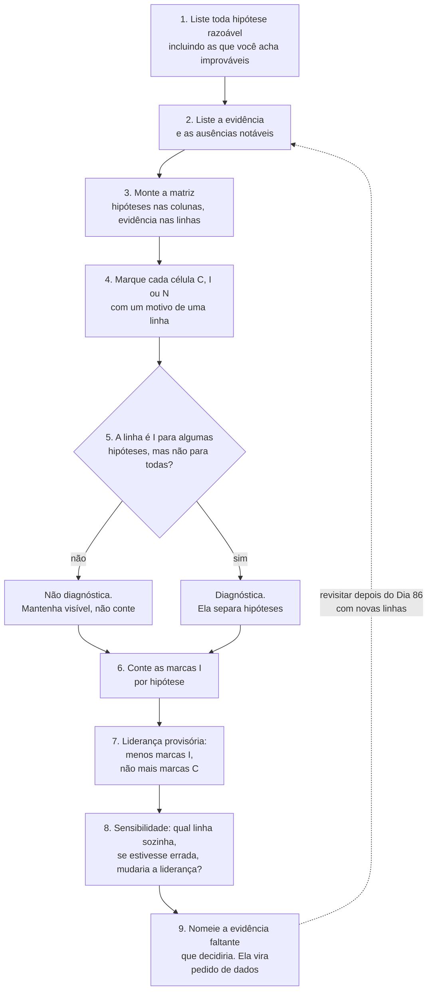
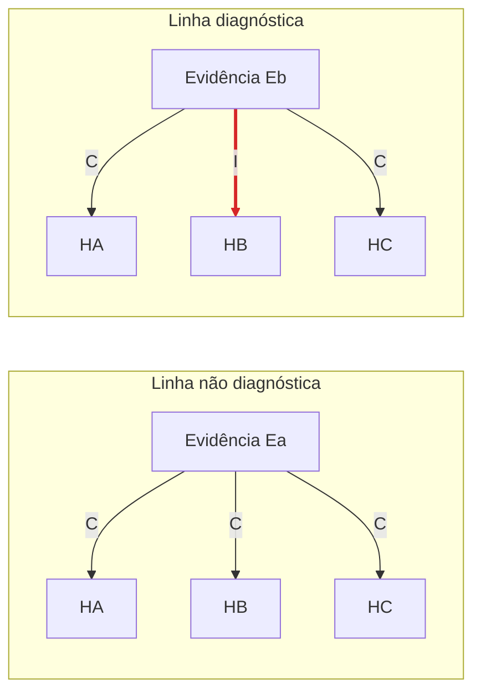

# Dia 85: Recebimento do caso e planejamento

> 🇺🇸 Original: [*Day 85: Intake and planning*](https://github.com/thiefdroppers/cyber-investigator-skills/blob/main/curriculum/phase-7-capstone-career/day-85.md) — © ThiefDroppers, licença MIT.
> Aqui: tradução fiel **+** camada brasileira. Nada do original foi removido; tudo o que é novo vem marcado com ➕.

**Fase 7. Capstone e carreira** · Meta da trilha: transformar as perguntas do cliente em perguntas que a evidência consegue responder, dispor as explicações concorrentes e planejar a forense e a análise de fraude antes de fazer qualquer uma delas.

Rank Jutsu: `S` · [](https://colab.research.google.com/github/Ridd1kulusC0d3r/investigador-cyber-90-dias/blob/main/curriculo/fase-7-capstone-e-carreira/dia-85/dia-85.ipynb)

---

## 🎬 ➕ Abertura do caso — *As cinco perguntas da Marta*

A Marta Quintão manda por e-mail, às 7h40, uma lista numerada. *1. Como os golpistas conseguiram os celulares dos nossos cooperados? 2. Ainda estamos sendo atacados? 3. Foi alguém de dentro? 4. Quanto dinheiro dá para recuperar? 5. O que eu falo para o conselho?*

Você começa a responder a primeira ali mesmo: "Foi a Lia, claro". Rafa lê por cima do seu ombro.

— "Claro"? Você tem quatro explicações possíveis para essa pergunta e escreveu uma. Qual evidência **elimina** as outras três?

— A Lia confirmou celulares de cooperados...

— Isso é consistente com a Lia. Também é consistente com uma base vazada de um fornecedor. Evidência que combina com tudo não decide nada. Monta a matriz.

É isso que o Dia 85 ensina. *(Personagens e cenário: [Operação Isca](../../../caso-continuo/).)*

---

## 📖 Conceito

Os Dias 83 e 84 deram a você a custódia da evidência e uma primeira olhada no lado do atacante. Hoje você não coleta nada novo. Você decide do que o caso trata e como vai saber que terminou.

O cliente fez cinco perguntas em linguagem de negócio. Algumas mapeiam direto para a evidência ("A conta do Jordan foi tomada?"). Outras não podem ser respondidas com o que você tem, pelo menos não por completo ("A informação vazou de nós ou da Castellan?" precisa dos logs da Castellan, que você nunca vai ver). Um recebimento que copia as perguntas do cliente sem mudança prepara você para extrapolar ou para pular as difíceis em silêncio. Um bom recebimento reescreve cada pergunta como algo que a evidência consegue decidir, e diz de saída quais partes provavelmente vão ficar em aberto e por quê.

A segunda tarefa é gerar hipóteses antes de começar a forense. Se você entrar nos logs com uma história na cabeça, todo evento vai parecer que se encaixa. A Análise de Hipóteses Concorrentes (ACH, *Analysis of Competing Hypotheses*), do trabalho de Richards Heuer para a CIA, é uma proteção simples contra isso. Você lista toda explicação razoável, lista a evidência e marca cada evidência como consistente ou inconsistente com cada explicação. A evidência útil é a que é inconsistente com algumas hipóteses, porque elimina opções. Evidência consistente com tudo parece persuasiva e não decide nada.

O processo ACH como você vai rodá-lo hoje e de novo depois do Dia 86:



A diferença entre os dois tipos de linha, com hipóteses genéricas. Ea combina com as três, então parece apoiar qualquer uma em que você já acredite e não elimina nada. Eb é inconsistente com HB, então é a linha que trabalha.



O seu reconhecimento do Dia 84 muda o plano. Se você encontrou sinais de que a mesma infraestrutura foi usada contra clientes de outro fornecedor, você não está mais olhando para um caso isolado. Isso afeta as hipóteses sobre onde a fatura vazou e sobre o que o cliente deve bloquear.

## 📚 Recursos

- Richards J. Heuer Jr., [*Psychology of Intelligence Analysis*](https://www.cia.gov/resources/csi/books-monographs/psychology-of-intelligence-analysis-2/), capítulo 8, sobre Análise de Hipóteses Concorrentes. Gratuito, do *Center for the Study of Intelligence* da CIA.
- [LibreOffice Calc](https://www.libreoffice.org/) ou qualquer planilha, para a matriz ACH.
- Sua folha de regras de engajamento do Dia 83 e seu registro de reconhecimento do Dia 84.

### ➕ Recursos do contexto Brasil

- [Revista Brasileira de Inteligência (ABIN)](https://rbi.enap.gov.br/): periódico com artigos em português sobre metodologia de análise, inclusive técnicas estruturadas como a ACH.
- [Matriz ACH da Operação Isca](../../../caso-continuo/dados/dia-85/ach-isca.csv) (fictícia): seis evidências, quatro hipóteses, para a Prática BR.
- O registro de autorização e a linha pessoal que você escreveu no Dia 01 (`notas/registro-de-autorizacao.md` e `notas/minha-linha.md`): a Seção 5 de hoje pede para relê-los.

## 🛠️ Prática: LibreOffice Calc, uma página de recebimento e uma matriz ACH

O artefato é `notes/intake.md` (uma página) mais `notes/ach-q3.ods` (ou `.xlsx`).

> ➕ **Checklist do dia** (o original distribui as caixas de seleção dentro das seções; aqui elas vêm reunidas também):
> - [ ] Seção 1: as perguntas do caso
> - [ ] Seção 2: escopo e lacunas de dados
> - [ ] Seção 3: hipóteses e a matriz ACH
> - [ ] Seção 4: o plano
> - [ ] Seção 5: confira o escopo contra o seu limite do Dia 1
> - [ ] ➕ Prática BR: as perguntas da Marta e a ACH do Isca
> - [ ] ➕ O notebook do dia no Colab

### Seção 1: as perguntas do caso

Reescreva cada uma das cinco perguntas do cliente como uma pergunta investigativa. Para cada uma, escreva que evidência poderia respondê-la e se você espera respondê-la por completo, em parte ou nada, com o pacote como está.

Exemplo resolvido para a terceira pergunta do cliente:

> Pergunta do cliente: "A informação vazou de nós ou da Castellan?"
> Pergunta investigativa: Onde o atacante conseguiu a mensagem M1 (a fatura real de 3 de março), e qual é o ponto mais antigo em que a evidência mostra que ele a tinha?
> Evidência relevante: o cabeçalho `In-Reply-To` do e-mail de phishing; a atividade mais antiga do atacante no log de auditoria do cliente; as datas de registro dos domínios do atacante; os metadados da carta falsa; os comentários da Castellan.
> Resposta esperada: parcial. O log de auditoria do cliente começa em 9 de março e não cobre a caixa compartilhada `ap@`, e os logs da própria Castellan estão fora de alcance. Espero chegar a uma probabilidade. Uma determinação firme precisaria de logs que não consigo obter.

Faça as outras quatro. Para a quarta ("O mesmo grupo está mirando outros fornecedores ou funcionários?"), incorpore o que você encontrou no Dia 84.

### Seção 2: escopo e lacunas de dados

Resuma suas regras de engajamento do Dia 83 em três ou quatro linhas. Depois liste a evidência de que você precisaria e que o pacote não contém, como um pedido de dados numerado ao cliente. Por exemplo:

**Seu checklist de hoje.** Faça na ordem e marque cada item ao terminar:

- [ ] Pedir os eventos de login e de auditoria da caixa do jpike
- [ ] Pedir os eventos de auditoria da caixa compartilhada ap@
- [ ] Pedir o log de alterações do ERP para o cadastro do fornecedor Castellan

1. Eventos de login e de auditoria da caixa de `jpike` desde a data mais antiga retida até 9 de março de 2026.
2. Eventos de auditoria da caixa compartilhada `ap@orrinvalley.example`, mesmo período.
3. O log de alterações do ERP para o cadastro do fornecedor Castellan.

Acrescente pelo menos mais dois. Para este exercício, a resposta do cliente a todo pedido é "não disponível a tempo do seu relatório". Registre essa resposta no seu registro de decisões. As lacunas então vão para o relatório como limites dos seus achados.

### Seção 3: hipóteses e a matriz ACH

Monte a matriz para a versão investigativa da pergunta 3. Ponha as hipóteses no topo e a evidência na lateral. Comece com estas quatro hipóteses e acrescente qualquer uma que achar que falta:

- H1: O atacante obteve M1 do lado da Castellan, de uma caixa de correio ou sistema da Castellan.
- H2: O atacante obteve M1 da caixa do Jordan, por um acesso anterior a 9 de março que a exportação de auditoria não cobre.
- H3: O atacante obteve M1 da caixa compartilhada `ap@` ou de outro destinatário da Orrin Valley.
- H4: O atacante obteve M1 de outro jeito, por exemplo de um terceiro que trata o e-mail de uma das duas empresas.

Marque cada célula C (consistente), I (inconsistente) ou N (não se aplica) e escreva um motivo curto num comentário. Linha resolvida:

| Evidência | H1 | H2 | H3 | H4 | Diagnóstica? |
|---|---|---|---|---|---|
| E1: O `In-Reply-To` do phishing é exatamente o Message-ID de M1 (P2, P3 M1) | C | C | C | C | Não. Qualquer um com uma cópia de M1 teria o seu Message-ID. Prova que o atacante tinha a mensagem original, e não diz nada sobre de quem era a cópia. |

Configure a planilha no LibreOffice Calc para que ela conte por você:

**Seu checklist de hoje.** Faça na ordem e marque cada item ao terminar:

- [ ] Acrescente os cabeçalhos Evidence, H1-H4, Diagnostic? e Source
- [ ] Acrescente uma linha de evidência por linha, com lista de validação C/I/N
- [ ] Anexe um comentário com o motivo a toda célula C/I/N
- [ ] Acrescente a fórmula diagnóstica/não diagnóstica na coluna F
- [ ] Acrescente a fórmula de contagem de I por hipótese
- [ ] Acrescente formatação condicional para destacar as células I

1. A linha 1 tem os cabeçalhos: `Evidence` em A1, `H1` a `H4` de B1 a E1, `Diagnostic?` em F1, `Source` em G1. Acrescente uma coluna depois de E para cada hipótese que você acrescentar, e desloque as fórmulas abaixo de acordo.
2. Ponha uma linha de evidência por linha a partir da linha 2, com a citação do pacote na coluna G. Digite só `C`, `I` ou `N` nas células das hipóteses. Para evitar erro de digitação, selecione B2:E30 e use Dados, Validade, Permitir: Lista, Entradas `C`, `I`, `N`.
3. Anexe o motivo a cada célula como comentário (Inserir, Comentário). O motivo é o que um revisor vai conferir, então uma célula sem ele está inacabada.
4. Em F2, digite `=IF(OR(COUNTIF(B2:E2;"I")=0;COUNTIF(B2:E2;"I")=COUNTA(B2:E2));"non-diagnostic";"diagnostic")` e arraste para baixo. Uma linha sem nenhum I não pesa contra nada, e uma linha que é I para toda hipótese pesa contra todas igualmente, então nenhuma das duas separa as hipóteses. São essas as linhas em que Heuer diz para não se apoiar.
5. Na primeira linha vazia abaixo da evidência, rotule A como `I count` e em B digite `=COUNTIF(B2:B30;"I")`, depois arraste para a direita até E.
6. Selecione B2:E30 e acrescente Formatar, Condicional, Condição: valor da célula é igual a `"I"`, com fundo vermelho. As colunas com mais vermelho são as hipóteses contra as quais a evidência está trabalhando.

O Calc usa `;` entre argumentos de função por padrão em muitas localidades. Se ele rejeitar a fórmula, use `,`. O Excel e o Google Planilhas aceitam as mesmas fórmulas com vírgulas.

> ➕ No LibreOffice em português, os nomes das funções aparecem traduzidos (`SE`, `OU`, `CONT.SE`, `CONT.VALORES`), mas o Calc converte automaticamente se você digitar em inglês com a opção de nomes de função em inglês ativada (Ferramentas, Opções, LibreOffice Calc, Fórmula). Em pt-BR, o separador padrão é `;`.

Acrescente pelo menos mais cinco linhas de evidência a partir do pacote e do seu reconhecimento. Olhe as datas em especial: quando o domínio imitação foi registrado em relação a quando M1 foi enviado, quando a carta falsa foi criada e para quem ela foi endereçada, para quem o phishing foi enviado e quem recebeu M1, e o que o log de auditoria mostra e não mostra entre 9 de março e 14:31 UTC de 10 de março.

Com a matriz preenchida, conte as marcas I por hipótese. A regra de Heuer é preferir a hipótese com menos evidência contra, e não a com mais evidência a favor. Escreva duas frases: qual hipótese lidera agora, e qual evidência faltante, sozinha, mais mudaria o quadro.

Não trate isto como sua conclusão. Você vai revisitar a matriz depois do Dia 86, quando a forense talvez acrescente linhas.

### Seção 4: o plano

Escreva uma tabela que atribua a cada pergunta investigativa um método, a evidência, uma checagem que diga que a etapa terminou e um dia:

| Pergunta | Método | Evidência | Pronto quando | Dia |
|---|---|---|---|---|
| A conta do Jordan foi tomada, e quando? | Fundir os três logs numa linha do tempo UTC; atribuir as sessões de login | P7, P8, P9, cabeçalhos do P2 | Todo login em `jpike` de 9 a 17 de março está atribuído a Jordan, ao atacante, à TI ou a "desconhecido", com um motivo | 86 |

Cubra as cinco perguntas. Depois liste os tipos de nó que você espera no grafo final do caso (domínios, IPs, endereços de e-mail, contas, mensagens, o pagamento, e assim por diante) e os tipos de aresta que vão ligá-los. O Dia 88 vai conferir o seu grafo contra esta lista.

### Seção 5: confira o seu escopo contra o seu limite do Dia 1

Releia a sua resposta do Dia 1 para "o que me faria parar, mesmo que tecnicamente eu pudesse continuar". A sua declaração de escopo respeita isso de verdade? O pacote oferece várias tentações: uma pessoa com nome no fornecedor, um telefone que o atacante provavelmente atende, uma página de phishing que talvez ainda esteja no ar, a marca de uma segunda empresa na infraestrutura do atacante. Nomeie cada tentação que você percebeu no seu plano, escreva a regra que impede você e confirme que não agiu em nenhuma delas.

### ➕ Prática BR: as perguntas da Marta e a ACH do Isca

**Parte A — recebimento.** Reescreva as cinco perguntas da Marta (na abertura do dia) como perguntas investigativas, com resposta esperada **completa, parcial ou nenhuma** e o motivo. Duas resolvidas para você comparar:

> Pergunta da Marta: "Foi alguém de dentro?"
> Pergunta investigativa: Há evidência, nas fontes que a cooperativa entregou, de ação de funcionário que tenha facilitado o golpe (envio de base, acesso indevido, alteração de cadastro)?
> Resposta esperada: parcial. A Vigia vê só os logs entregues; não pode investigar pessoas. Se aparecer indício, ele vai para a cooperativa e o jurídico, sem nome no relatório da Vigia.

> Pergunta da Marta: "Quanto dinheiro dá para recuperar?"
> Pergunta investigativa: nenhuma. Recuperação é com a instituição de pagamento (MED do Pix) e com a polícia. Resposta esperada: **nenhuma** pela Vigia; o relatório aponta os IDs de contestação e os canais.

**Parte B — a matriz.** Abra [`ach-isca.csv`](../../../caso-continuo/dados/dia-85/ach-isca.csv). Pergunta: *"como o operador obteve os celulares dos cooperados?"* Hipóteses: H1 base vazou de um fornecedor; H2 base genérica vazada comprada; H3 disparo aleatório; H4 o chatbot Lia foi usado para validar números. Marque quais linhas são diagnósticas, conte os I e escreva as duas frases de Heuer. Repare: duas hipóteses empatam. Qual pedido de dados desempataria? *(Pense no horário: a validação na Lia aconteceu antes ou depois de existir uma lista?)*

**Parte C — tentações do Isca.** Nomeie pelo menos quatro (o painel do IscaKit, os números remetentes, as chaves Pix dos laranjas, o perfil "Serra Azul Atendimento" no WhatsApp, o apelido "Pescador") e a regra que impede você em cada uma.

### ➕ O notebook do dia

Abra o [notebook do Dia 85 no Colab](https://colab.research.google.com/github/Ridd1kulusC0d3r/investigador-cyber-90-dias/blob/main/curriculo/fase-7-capstone-e-carreira/dia-85/dia-85.ipynb). Nele você:

1. implementa a matriz ACH em Python: a mesma regra da coluna F e o mesmo `I count` da planilha;
2. preenche (com `input()`) as células de quatro linhas do capstone e vê o diagnóstico na hora;
3. roda a **análise de sensibilidade** do passo 8 automaticamente: o código troca cada linha e mostra qual delas, se estivesse errada, mudaria a liderança;
4. carrega a ACH do Isca e descobre o empate;
5. exporta a matriz em CSV (abre no Calc) e a página de recebimento em Markdown.

## ✅ Checkpoint

1. Cada uma das cinco perguntas do cliente tem uma reescrita investigativa.
2. Cada reescrita tem uma resposta esperada: completa, parcial ou nenhuma.
3. Cada resposta esperada tem um motivo.
4. A matriz ACH tem pelo menos quatro hipóteses.
5. A matriz ACH tem pelo menos seis linhas de evidência.
6. A coluna F marca pelo menos uma linha como não diagnóstica.
7. Toda linha do plano tem uma checagem de "pronto quando" que outra pessoa conseguiria verificar.
8. Seu plano nomeia cada tentação que você percebeu.
9. Cada tentação nomeada tem a regra que impede você.
10. Seu registro de decisões e seu registro de reconhecimento não mostram nenhuma ação tomada sobre nenhuma delas.
11. Sem consultar, você consegue enunciar a regra de Heuer para escolher entre hipóteses?

### ➕ Checkpoint BR

- As cinco perguntas da Marta têm reescrita, resposta esperada e motivo; pelo menos uma tem resposta esperada "nenhuma", com o canal certo apontado.
- Você identificou as linhas não diagnósticas da ACH do Isca e o empate entre H1 e H4.
- Você escreveu o pedido de dados que desempata, endereçado à Marta, e registrou a resposta no registro de decisões.
- O notebook mostrou qual linha da sua matriz do capstone é a mais sensível.

## ⚖️ ➕ Camada jurídica BR

**Pergunta investigativa não é imputação.** A pergunta "foi alguém de dentro?" pode, mal escrita, virar uma acusação contra um funcionário identificável. Uma conclusão leviana num relatório que circula pode expor quem a escreveu e quem a divulgou a discussões de dano moral e, no limite, a crimes contra a honra (calúnia, difamação e injúria, CP arts. 138 a 140). Reescrever a pergunta como "há evidência de ação que facilitou o golpe?" protege o funcionário, o cliente e você. Mesmo raciocínio do original quando proíbe culpar Jordan e Maren.

**Pedidos de dados: o cliente pede, o juiz ordena.** Na Seção 2 você pede dados ao cliente. No Brasil, dados que estão com terceiros (operadora que entregou os SMS, provedor do VPS, instituição que recebeu o Pix) não chegam por pedido seu: registros de conexão e de acesso a aplicações saem por ordem judicial (Marco Civil, art. 10, §1º e art. 22); dados bancários dos titulares das contas recebedoras estão protegidos por sigilo bancário (LC 105/2001) e chegam à polícia por ordem judicial. O seu plano registra essas lacunas como limites e indica **quem** pode supri-las.

**LGPD e a lista de cooperados.** A hipótese H1 (vazamento por fornecedor) envolve dados pessoais de 40 mil cooperados. Se a ACH apontar para ela, a cooperativa, como controladora, avalia com o jurídico a comunicação à ANPD e aos titulares (LGPD, art. 48). Isso é decisão do cliente, não do analista, mas o seu plano deve sinalizar que a pergunta encosta nisso.

> Material de estudo; não constitui orientação jurídica.

## 🧠 ➕ Camada 8 — viés de confirmação e a "evidência que combina com tudo"

O **viés de confirmação** é a tendência de buscar, interpretar e lembrar informação de um jeito que confirme o que já se acredita. Heuer, que era analista da CIA, escreveu o *Psychology of Intelligence Analysis* justamente porque percebeu que treinar mais não basta para corrigir vieses: é preciso **ferramenta**. A ACH é uma ferramenta que inverte a pergunta natural ("o que apoia minha hipótese?") para a pergunta útil ("o que derruba alguma hipótese?").

Na abertura, você escreveu "foi a Lia, claro" porque a Fase 6 inteira foi sobre a Lia. Isso tem nome: **disponibilidade** (Tversky e Kahneman), a tendência de julgar mais provável o que vem à cabeça com mais facilidade. O que você estudou por último parece a explicação de tudo.

Consequência prática: liste as hipóteses **antes** de abrir os logs e inclua pelo menos uma que você acha improvável. Quando uma evidência parecer muito persuasiva, verifique a linha dela na matriz: se é C em todas as colunas, ela é só um bom sentimento.

## 🤖 ➕ Skill do dia

O Dia 85 propõe para a [skill pt-BR](../../../skills/investigador-cyber/SKILL.md) o procedimento novo **"Recebimento do caso e matriz de hipóteses (ACH)"**: reescrever perguntas do cliente com resposta esperada, listar hipóteses antes da análise e escolher pela menor quantidade de evidência contra. Proposta em [`_skill-delta.md`](_skill-delta.md).

## 💡 ➕ Inovação OSINT do dia — análise de sensibilidade da ACH em dez linhas

O passo 8 do fluxograma ("qual linha, se estivesse errada, mudaria a liderança?") quase sempre é pulado porque dá trabalho manual. Em Python puro, ele é um laço: para cada linha diagnóstica, remova-a, recalcule a liderança e veja se mudou.

```python
def lider(matriz):                                    # matriz: {evidência: {hipótese: "C"/"I"/"N"}}
    hips = next(iter(matriz.values())).keys()
    contagem = {h: sum(l[h] == "I" for l in matriz.values()) for h in hips}
    menor = min(contagem.values())
    return sorted(h for h, n in contagem.items() if n == menor)   # pode haver empate

base = lider(matriz)
for ev in matriz:
    sem = {k: v for k, v in matriz.items() if k != ev}            # a matriz sem esta linha
    if lider(sem) != base:
        print(f"{ev} é sensível: sem ela, a liderança vira {lider(sem)}")
```

As linhas sensíveis são as que merecem uma segunda fonte antes de entrarem no relatório, e as primeiras a ir para a seção de riscos.

## 📝 Diário de estudo

- Data:
- Tempo gasto:
- O que ficou claro:
- O que ainda está nebuloso:
- Artefato produzido: `notes/intake.md`, `notes/ach-q3.ods`, recebimento e ACH do Isca

---
<sub>Baseado em [cyber-investigator-skills](https://github.com/thiefdroppers/cyber-investigator-skills) por ThiefDroppers (MIT). Tradução, camada BR, Camada 8, skill pt-BR e notebook por Deivison Lourenço (@Ridd1kulusC0d3r).</sub>
