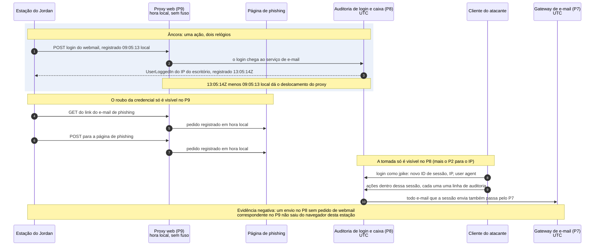
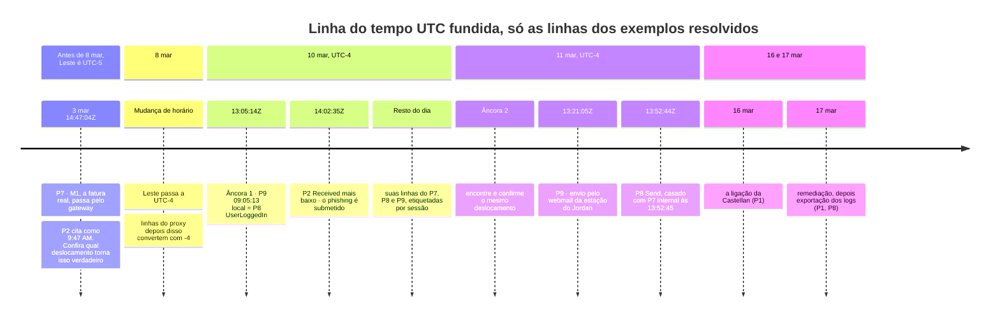
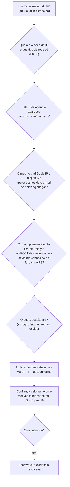

# Dia 86: Forense: fundindo três logs em uma linha do tempo

> 🇺🇸 Original: [*Day 86: Forensics, merging three logs into one timeline*](https://github.com/thiefdroppers/cyber-investigator-skills/blob/main/curriculum/phase-7-capstone-career/day-86.md) — © ThiefDroppers, licença MIT.
> Aqui: tradução fiel **+** camada brasileira. Nada do original foi removido; tudo o que é novo vem marcado com ➕.

**Fase 7. Capstone e carreira** · Meta da trilha: aplicar o método de linha do tempo da Fase 4 (e as habilidades de log de nuvem da Fase 6) aos logs do caso, e estabelecer a partir da evidência quando a conta foi tomada, por quem e o que foi feito com ela.

Rank Jutsu: `S` · [](https://colab.research.google.com/github/Ridd1kulusC0d3r/investigador-cyber-90-dias/blob/main/curriculo/fase-7-capstone-e-carreira/dia-86/dia-86.ipynb)

---

## 🎬 ➕ Abertura do caso — *O relógio que ninguém acertou*

A TI da Serra Azul entregou três arquivos: as reclamações da ouvidoria, os acessos ao internet banking e o log do sistema de contestação de Pix. No e-mail, uma frase: *"o sistema de contestação está em UTC, a gente acha"*.

Você monta a linha do tempo confiando no "a gente acha". O resultado é estranho: o cooperado V1 abriu a contestação **antes** de o Pix dele sair.

— Ou o V1 tem bola de cristal — diz Rafa —, ou o relógio está errado. Qual dos dois você aposta?

— O relógio.

— Então não aposta. Ancora. Procura um evento que aparece em dois sistemas, um deles com relógio confiável, e mede a diferença. Depois procura outro, em outro dia, e confere.

É isso que o Dia 86 ensina. *(Personagens e cenário: [Operação Isca](../../../caso-continuo/).)*

---

## 📖 Conceito

Você tem três fontes de log e cada uma marca o tempo de um jeito. O trace do gateway de e-mail (P7) e a auditoria da caixa de correio (P8) registram UTC. O proxy web (P9) registra o horário local do *appliance* sem fuso, e a prestadora de TI só está "quase certa" de qual fuso é. Os cabeçalhos de e-mail trazem os seus próprios deslocamentos, e esses deslocamentos mudam no meio do caso, porque o horário do Leste passou de UTC-5 para UTC-4 em 8 de março de 2026. Uma linha do tempo montada sem resolver isso põe eventos na ordem errada, e num caso sobre qual login veio primeiro, a ordem é o achado.

A correção para um relógio desconhecido é uma âncora: um evento que aparece em duas fontes, uma delas com relógio confiável. Se o proxy mostra o navegador do Jordan enviando o formulário de login do webmail num horário local, e o log de auditoria mostra o login resultante em UTC um segundo depois, a diferença entre os dois é o deslocamento do proxy. Uma âncora dá um deslocamento de trabalho. Uma segunda âncora, em outro dia, diz se ele se mantém.

Com tudo em UTC, a unidade de análise é a sessão. Um login cria uma sessão, e toda ação posterior nessa sessão herda o endereço IP, o *user agent* e o ator. Atribuir as sessões (Jordan, atacante, controladora, TI, desconhecido) atribui de uma vez quase todos os eventos do caso, e obriga você a escrever o porquê de cada uma.

Mais duas ideias importam hoje. Evidência negativa é um evento que deveria existir sob uma hipótese e não existe. Se o Jordan mandou um e-mail da estação do escritório, o proxy deveria mostrar o pedido de envio do webmail. Checar essa ausência é um teste tanto quanto checar uma presença. O manuseio da evidência também tem uma história neste caso: a TI apagou a regra da caixa de entrada antes de exportar os logs. A exclusão está registrada, e o conteúdo da regra sobrevive no evento de auditoria que a criou, mas você deve anotar no seu relatório que a remediação veio antes da coleta.

A sequência abaixo mostra qual log vê qual etapa de uma tomada de caixa de correio e, portanto, onde procurar cada tipo de evento. O primeiro bloco é a ideia da âncora: uma ação real registrada por dois relógios. O resto é o formato geral de uma cadeia de phishing até a tomada. Preencher as linhas, horários e IDs de sessão reais é o trabalho de hoje.



## 📚 Recursos

- [Guia do usuário do Timesketch: importar CSV e JSONL](https://timesketch.org/guides/user/import-from-json-csv/). Um CSV precisa de pelo menos as colunas `message`, `datetime` e `timestamp_desc`.
- [Documentação do `zoneinfo` do Python](https://docs.python.org/3/library/zoneinfo.html), para converter horários locais com as regras de horário de verão aplicadas.
- [Dia 58](https://github.com/thiefdroppers/cyber-investigator-skills/blob/main/curriculum/phase-4-digital-forensics-incident-investigation/day-58.md) para o método de linha do tempo e os vínculos causais entre fontes.
- [MITRE ATT&CK: Email Hiding Rules (T1564.008)](https://attack.mitre.org/techniques/T1564/008/), para as notas de detecção sobre regras de caixa de entrada.

### ➕ Recursos do contexto Brasil

- [Hora Legal Brasileira (Observatório Nacional)](https://www.horalegalbrasil.mct.on.br/): a referência oficial de horário no Brasil. Útil para saber que o horário de verão brasileiro foi extinto pelo Decreto 9.772/2019 (por isso `America/Sao_Paulo` está fixo em UTC-3 desde então), mas **logs antigos** de 2018 ou antes podem estar em UTC-2 nos meses de verão.
- [NTP.br](https://ntp.br/): o serviço público de sincronização de relógios do NIC.br. Pergunte sempre ao cliente se os servidores sincronizam com NTP; se sim, o relógio deles serve de âncora.
- [Os três logs da Operação Isca](../../../caso-continuo/dados/dia-86/) (fictícios): ouvidoria em BRT, internet banking em UTC, contestação de Pix sem fuso.

## 🛠️ Prática: Timesketch, uma linha do tempo UTC fundida e uma tabela de atribuição de sessões

Artefatos de hoje: `notes/timeline_utc.csv`, um *sketch* do Timesketch com eventos etiquetados (ou uma planilha com uma coluna de etiqueta, se você não conseguir rodar o Timesketch), `notes/sessions.md` e uma camada ATT&CK atualizada.

**Seu checklist de hoje.** Faça na ordem e marque cada item ao terminar:

- [ ] Passo 1: ancore o relógio do proxy
- [ ] Passo 2: normalize tudo para UTC
- [ ] Passo 3: carregue a linha do tempo no Timesketch
- [ ] Passo 4: atribua cada sessão
- [ ] Passo 5: etiquete e conecte os eventos
- [ ] Passo 6: resuma o que o atacante fez e tocou
- [ ] Passo 7: ataque a sua própria conclusão
- [ ] Passo 8: atualize a camada ATT&CK e a matriz ACH
- [ ] Passo 9: declare os limites dos logs
- [ ] ➕ Passo 10: os três relógios da Operação Isca (Prática BR)
- [ ] ➕ Passo 11: o notebook do dia no Colab

### Passo 1: ancore o relógio do proxy

Encontre um evento do P9 que também deveria aparecer no P8. Exemplo resolvido:

```
P9: 2026-03-10 09:05:13 OVM-WS-AP02 jpike POST https://mail.orrinvalley.example/login 302 ...
P8: 2026-03-10T13:05:14Z,jpike,jpike,UserLoggedIn,Success,192.0.2.10,"...Chrome/122...",s-12f4a8,...
```

Um envio de formulário de login seguido, um segundo depois, de um login bem-sucedido do IP do escritório com a mesma família de navegador é o mesmo evento visto duas vezes. 13:05:14 UTC menos 09:05:13 local dá UTC-4, que é o horário de verão do Leste. Isso bate com o palpite da prestadora de TI, e agora você tem evidência para ele em vez de um palpite.

Encontre uma segunda âncora em 11 de março e confirme que ela dá o mesmo deslocamento. Registre as duas âncoras no seu registro de decisões, com as referências de linha, como base de toda conversão do proxy.

Depois confira o único lugar onde o deslocamento mais importa para a história. O e-mail de phishing cita M1 como enviado "Tue, Mar 3, 2026 at 9:47 AM". O registro de M1 no gateway é 14:47:04 UTC de 3 de março. Converta isso com o deslocamento em vigor em 3 de março, antes de começar o horário de verão, e anote se o horário da citação bate com M1. Se você aplicasse UTC-4 em tudo, ficaria uma hora fora e talvez concluísse que a citação foi alterada.

### Passo 2: normalize tudo para UTC

Rode este script a partir da sua pasta `working/case-packet`. Ele lê os três logs, converte os horários do proxy com as regras de horário de verão aplicadas e grava um único CSV ordenado que o Timesketch consegue importar. Antes de rodar, confirme que a linha `PROXY_ZONE` bate com o que você achou no Passo 1.

```python
import csv
from datetime import datetime, timezone
from zoneinfo import ZoneInfo

PROXY_ZONE = ZoneInfo("America/Toronto")  # set from your anchor events, not from the IT note

def rows(path):
    with open(path, newline="") as f:
        return list(csv.DictReader(line for line in f if not line.startswith("#")))

out = []
for r in rows("logs/mail-trace.csv"):
    out.append({
        "datetime": r["received_utc"].replace("Z", "+00:00"),
        "timestamp_desc": "Message received (gateway)",
        "message": f'{r["direction"]} {r["sender"]} -> {r["recipients"]}: {r["subject"]}',
        "source": "P7", "user": "", "client": r["sender_ip"], "session_id": ""})
for r in rows("logs/mailbox-audit.csv"):
    out.append({
        "datetime": r["timestamp_utc"].replace("Z", "+00:00"),
        "timestamp_desc": "Audit event",
        "message": f'{r["operation"]} ({r["result"]}) by {r["actor"]} on {r["target_mailbox"]}: {r["details"]}',
        "source": "P8", "user": r["actor"], "client": r["client_ip"], "session_id": r["session_id"]})
with open("logs/web-proxy.log") as f:
    for line in f:
        if line.startswith("#") or not line.strip():
            continue
        d, t, host, user, method, url, status, size, cat, action = line.split()
        local = datetime.strptime(f"{d} {t}", "%Y-%m-%d %H:%M:%S").replace(tzinfo=PROXY_ZONE)
        out.append({
            "datetime": local.astimezone(timezone.utc).isoformat(),
            "timestamp_desc": "Proxy request (converted from local time)",
            "message": f"{method} {url} -> {status} [{cat}]",
            "source": "P9", "user": user, "client": host, "session_id": ""})

out.sort(key=lambda e: e["datetime"])
with open("timeline_utc.csv", "w", newline="") as f:
    w = csv.DictWriter(f, fieldnames=list(out[0].keys()))
    w.writeheader()
    w.writerows(out)
print(f"{len(out)} events written to timeline_utc.csv")
```

> ➕ O comentário da linha `PROXY_ZONE` diz: "defina a partir dos seus eventos-âncora, não da nota da TI". O script foi mantido como no original para você poder comparar a saída com a do curso.

Ele deve informar 80 eventos. Abra a saída e confira três linhas do proxy convertendo-as à mão. Um script que você não conferiu é uma premissa.

Os horários dos próprios cabeçalhos do e-mail de phishing não estão em nenhum arquivo de log. Acrescente à mão os três carimbos `Received` do P2 como linhas, com fonte `P2`, porque o mais baixo registra o IP de submissão do atacante.

Aqui está o esqueleto da linha do tempo fundida, só com as linhas que esta página e o Dia 84 já deram como exemplos resolvidos. As seções seguem as regras do relógio, porque o mesmo horário do proxy converte de modo diferente de cada lado de 8 de março. O seu CSV final tem cerca de 80 linhas a mais nesses vãos, cada uma etiquetada com a fonte.



### Passo 3: carregue a linha do tempo no Timesketch

Crie um *sketch* com o nome do caso, envie `timeline_utc.csv` como nova *timeline* e confira a contagem de eventos. Se o Timesketch não rodar na sua máquina, use uma planilha com as mesmas colunas mais `tag` e `comment`; a análise é a mesma.

### Passo 4: atribua cada sessão

Liste todo `session_id` distinto do P8, mais os logins com falha, que não têm sessão. Para cada um, preencha uma linha em `notes/sessions.md`. Exemplo resolvido:

| Sessão | IP | User agent | Primeiro e último evento (UTC) | Eventos | Atribuída a | Confiança | Motivos |
|---|---|---|---|---|---|---|---|
| s-7f3a61 | 198.51.100.23 | Linux, Firefox 115 | 10 mar 14:31:12 a 14:44:09 | Login, New-InboxRule, três MailItemsAccessed | Atacante | Confirmado | Mesmo IP do submissor autenticado do phishing (P2). O login veio 10 minutos e 31 segundos depois de o navegador do Jordan enviar credenciais à página de phishing (P9, convertido). O user agent não bate com nenhuma outra sessão deste usuário. A sessão de escritório do próprio Jordan, s-12f4a8, estava ativa naquela manhã (o P9 mostra navegação contínua no escritório). |

Passe cada sessão pelas mesmas perguntas, nesta ordem, e escreva a resposta de cada uma na coluna Motivos. A pergunta do IP vem primeiro, mas nunca resolve uma sessão sozinha, e é por isso que o Checkpoint 7 pede um motivo além do IP.



Faça o resto. Algumas sessões são do Jordan em dispositivos que você ainda não viu; decida pelo dono e tipo de rede do IP no P6 L8, pelo user agent e por o mesmo padrão aparecer ou não antes de o e-mail de phishing chegar. Marque como "desconhecido" qualquer sessão que você não consiga atribuir e diga o que a resolveria.

### Passo 5: etiquete e conecte os eventos

No Timesketch, etiquete todo evento como `attacker`, `jordan`, `maren`, `it-remediation`, `external-mail` ou `noise`, com base na sua tabela de sessões. Marque com estrela os eventos que carregam a história. Para cada evento com estrela, acrescente um comentário que o ligue a pelo menos um evento de outra fonte, em palavras. Por exemplo: "O Send do P8 às 13:52:44 é a mesma mensagem do P7 internal às 13:52:45 (mesmo assunto, mesmo hash de anexo do P3 M3). O P9 não tem envio de webmail da estação do Jordan entre 13:48 e 14:01 UTC, e mostra um às 13:21:05 para o e-mail legítimo do Jordan ao setor de pedidos da Castellan."

Esse último ponto é evidência negativa. Anote qual hipótese ele enfraquece.

### Passo 6: resuma o que o atacante fez e tocou

Em `notes/attacker-activity.md`, liste toda ação do atacante em ordem de tempo, cada uma com a referência da linha. Depois responda, com citações:

1. Quando a tomada começou e quando terminou? Qual é a evidência de que a troca de senha funcionou?
2. O que a regra da caixa de entrada fazia, que mensagens ela pegou e o que o Jordan, portanto, nunca viu?
3. Que pastas o atacante sincronizou ou leu, e quantos itens? Trate itens sincronizados como copiados pelo atacante, já que uma sincronização os baixa.
4. Há alguma evidência de acesso do atacante à conta da controladora? O que a protegeu, e quão confiante você está?

### Passo 7: ataque a sua própria conclusão

Para cada explicação rival abaixo, escreva a observação que teria de existir se a rival fosse verdadeira, e depois cheque se ela existe.

- O *password spray* às 03:11 UTC de 10 de março, e não a página de phishing, deu ao atacante a senha do Jordan. Resposta resolvida: se o spray tivesse funcionado, haveria um `UserLoggedIn` a partir de 203.0.113.200, ou um login do atacante antes de 14:20:41. Toda tentativa do spray mostra `InvalidPassword`, e o primeiro login do atacante vem dez minutos depois do POST da credencial. A rival cai.
- O Jordan mandou a carta bancária para a controladora e está encobrindo isso.
- 198.51.100.23 é uma saída compartilhada de VPN ou proxy, então quem submeteu o phishing e quem fez o login podem ser pessoas diferentes.
- O vínculo de IP com a infraestrutura Marrowline do Dia 84 é coincidência de reaproveitamento de IP, já que o registro DNS Marrowline desse IP terminou na véspera do phishing.

Para cada uma, registre se a rival cai, sobrevive ou não pode ser testada com o pacote. Uma rival que sobrevive vai para a seção de riscos do seu relatório.

### Passo 8: atualize a camada ATT&CK e a matriz ACH

Copie `layer-day84-recon.json` para `layer-day86.json` e acrescente as técnicas que os logs mostram dentro da caixa de correio, cada uma com um comentário citando as linhas do P8. Depois volte à sua matriz ACH do Dia 85 e acrescente linhas para o que o log de auditoria mostra, e não mostra, antes de 14:31 UTC de 10 de março.

### Passo 9: declare os limites dos logs

No fim de `notes/attacker-activity.md`, acrescente uma seção curta "Limites" declarando os limites dos logs: as datas cobertas, as contas cobertas e o que aconteceu antes da coleta.

### ➕ Passo 10 — Prática BR: os três relógios da Operação Isca

Em [`caso-continuo/dados/dia-86/`](../../../caso-continuo/dados/dia-86/):

| Fonte | Relógio |
|---|---|
| `ouvidoria.csv` | Brasília (BRT, UTC-3), digitado pelo atendente |
| `ib-acessos.csv` | UTC, servidor sincronizado por NTP (relógio confiável) |
| `pix-contestacoes.log` | Hora local do *appliance*, **sem fuso**; a TI "acha" que é UTC |

1. **Âncora.** O internet banking registrou o bloqueio preventivo às `2026-10-05T14:20:00Z`, e o sistema de contestação registrou a regra recebida às `2026-10-05 11:20:01` local. No dia seguinte, o teste de integração `TI-0610`: `12:00:01Z` no IB e `09:00:02` local no sistema de contestação. Qual é o deslocamento? O palpite da TI estava certo?
2. **A armadilha.** Se você aceitasse o "acha que é UTC", o V1 teria aberto a contestação às 09:31 UTC, **antes** do Pix das 11:05 UTC. Com o deslocamento ancorado, a contestação fica às 12:31 UTC, depois do Pix. Escreva essa frase no seu registro de decisões, com as duas âncoras.
3. **Sessões.** Atribua as sessões do IB: o celular habitual do V1 (Android, operadora móvel) e o "dispositivo novo" `203.0.113.150` (Linux Firefox) que entra em V1, V2 e V3 em sequência. Quantos motivos independentes do IP você tem para chamar este último de "operador do golpe"?
4. **Evidência negativa.** O V3 não aparece na ouvidoria antes do Pix dele (só registrou depois). O que isso enfraquece, e por que o vínculo "V3 digitou a senha no site falso" fica como *provável*, não *confirmado*?

### ➕ Passo 11: o notebook do dia

Abra o [notebook do Dia 86 no Colab](https://colab.research.google.com/github/Ridd1kulusC0d3r/investigador-cyber-90-dias/blob/main/curriculo/fase-7-capstone-e-carreira/dia-86/dia-86.ipynb). Nele você:

1. encontra as âncoras automaticamente (POST de login no P9 × `UserLoggedIn` no P8) e calcula o deslocamento de cada uma;
2. vê a armadilha de 3 de março acontecer: o mesmo horário convertido com -4 e com -5;
3. roda o script do original (com *fallback* se o `zoneinfo` não tiver a base de fusos) e confere os 80 eventos;
4. monta a tabela de sessões com os motivos do fluxograma;
5. testa a evidência negativa do envio de 11 de março;
6. joga o **quiz das sessões** e faz o mesmo trabalho com os três relógios da Operação Isca.

## ✅ Checkpoint

1. Seu deslocamento do proxy se apoia em dois eventos-âncora.
2. Os dois eventos-âncora estão em dias diferentes.
3. As duas âncoras estão registradas no seu registro de decisões com referências de linha.
4. Você anotou se o horário citado pelo e-mail de phishing para M1 bate com o registro de M1 no gateway, convertido com o deslocamento em vigor em 3 de março.
5. Toda sessão do P8 e todo login com falha têm uma atribuição.
6. Toda sessão do P8 e todo login com falha têm uma confiança.
7. Toda sessão do P8 e todo login com falha têm pelo menos um motivo que cita evidência além do endereço IP.
8. Pelo menos três eventos com estrela carregam um vínculo escrito entre fontes.
9. Pelo menos um achado se apoia em evidência negativa.
10. Cada explicação rival do Passo 7 tem uma observação refutadora nomeada.
11. Cada explicação rival do Passo 7 tem um resultado registrado.
12. Seu resumo da atividade do atacante responde às quatro perguntas.
13. Toda resposta do resumo cita referências de linha.
14. A seção "Limites" declara as datas cobertas.
15. A seção "Limites" declara as contas cobertas.
16. A seção "Limites" declara o que aconteceu antes da coleta.
17. Sem consultar, você consegue explicar por que o cabeçalho de M1 usa um deslocamento diferente do resto do caso?

### ➕ Checkpoint BR

- O deslocamento do sistema de contestação do Isca se apoia em duas âncoras em dias diferentes, registradas.
- Você escreveu a frase sobre a ordem "Pix antes da contestação" e por que o palpite da TI a teria invertido.
- As sessões do internet banking têm atribuição, confiança e pelo menos um motivo além do IP.
- O vínculo do V3 com o site falso está marcado como *provável*, com o motivo.

## ⚖️ ➕ Camada jurídica BR

**Hora é parte da prova.** Na cadeia de custódia (CPP, arts. 158-A a 158-F), registrar quando cada vestígio foi coletado e manuseado é obrigação. Uma linha do tempo com fuso errado não é só um erro técnico: é um ponto que a defesa pode usar para dizer que a sequência de fatos não foi demonstrada. Por isso a âncora, com referência de linha, vai para o registro de decisões, que é parte do seu material de custódia.

**Registros de conexão e o Marco Civil.** O Marco Civil (Lei 12.965/2014, art. 5º, incisos VI e VIII) define registro de conexão e registro de acesso a aplicações como informações de **data e hora** de uso associadas a um endereço IP. Quando a polícia pedir, com ordem judicial, quem usava `203.0.113.150` às 11:03:40 UTC de 5/out, um erro de fuso no seu relatório pode levar o provedor a uma pessoa errada. Em IPs compartilhados por muitos clientes (CGNAT), a individualização pode exigir também a porta de origem, que só o lado do serviço registra. Escreva sempre o horário em UTC **e** o fuso de origem.

**Remediação antes da coleta.** No Isca, a cooperativa ativou o bloqueio preventivo às 14:20 UTC. Isso é a coisa certa para proteger os cooperados e fica registrado; anote no relatório que a mudança aconteceu, quando e por quem, como o original faz com a regra apagada pela TI.

> Material de estudo; não constitui orientação jurídica.

## 🧠 ➕ Camada 8 — ancoragem (a outra) e o "quase certo"

A âncora do Dia 86 é uma ferramenta. Existe outra âncora, que é um viés: a **ancoragem** de Tversky e Kahneman, a tendência de ficar preso ao primeiro número que ouviu, mesmo quando ele é arbitrário. O "pretty sure it is Eastern" da TI do capstone e o "a gente acha que é UTC" da TI da Serra Azul são âncoras desse segundo tipo: o analista tende a ajustar a partir delas em vez de medir do zero.

Repare na ironia do capstone: o palpite da TI estava certo. Mesmo assim, o original exige duas âncoras. A razão é que um palpite certo e um palpite errado têm **a mesma cara** antes de serem medidos; só a medição separa os dois. No Isca, o palpite estava errado, e a consequência seria uma vítima contestando um Pix antes de ele acontecer.

Consequência prática: quando alguém lhe der uma informação de configuração com "acho", "quase certo" ou "deve ser", escreva no registro de decisões como **premissa a verificar**, e não como fato. Só tire a etiqueta depois da segunda âncora.

## 🤖 ➕ Skill do dia

O Dia 86 propõe para a [skill pt-BR](../../../skills/investigador-cyber/SKILL.md) o procedimento novo **"Linha do tempo multifonte e atribuição de sessões"**: duas âncoras para todo relógio sem fuso, conversão com regras de horário de verão, atribuição por sessão com motivos além do IP, e evidência negativa. Proposta em [`_skill-delta.md`](_skill-delta.md).

## 💡 ➕ Inovação OSINT do dia — encontrar âncoras automaticamente

Procurar à mão o par "POST de login no proxy × login no log de auditoria" é lento em logs grandes. Com a biblioteca padrão, dá para casar eventos dos dois relógios por tipo e calcular a diferença de cada par; um deslocamento verdadeiro aparece como um valor **repetido** (até o segundo de latência), e coincidências aparecem espalhadas:

```python
from collections import Counter
from datetime import datetime

def deslocamentos(locais, utcs, janela_h=14):
    """locais/utcs: listas de datetime ingênuos do mesmo tipo de evento. Devolve os deslocamentos mais comuns."""
    cont = Counter()
    for l in locais:
        for u in utcs:
            d = (u - l).total_seconds()
            if abs(d) <= janela_h * 3600:              # fusos reais ficam entre -12h e +14h
                cont[round(d / 900) * 900] += 1        # arredonda para 15 min (há fusos de :30 e :45)
    return [(s / 3600, n) for s, n in cont.most_common(3)]
```

Um deslocamento que aparece em vários pares, em dias diferentes, é a sua âncora. Um que aparece uma vez só é coincidência até prova em contrário.

## 📝 Diário de estudo

- Data:
- Tempo gasto:
- O que ficou claro:
- O que ainda está nebuloso:
- Artefato produzido: `notes/timeline_utc.csv`, `notes/sessions.md`, `notes/attacker-activity.md`, `layer-day86.json`, linha do tempo e sessões do Isca

---
<sub>Baseado em [cyber-investigator-skills](https://github.com/thiefdroppers/cyber-investigator-skills) por ThiefDroppers (MIT). Tradução, camada BR, Camada 8, skill pt-BR e notebook por Deivison Lourenço (@Ridd1kulusC0d3r).</sub>
