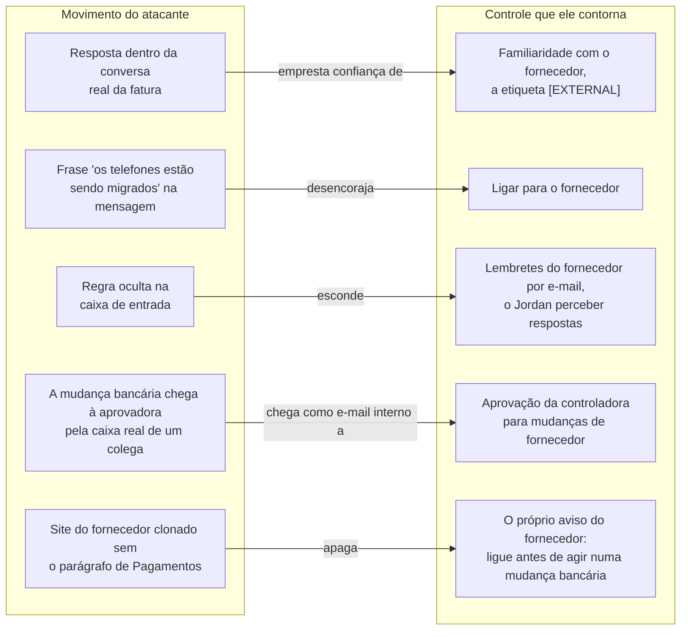
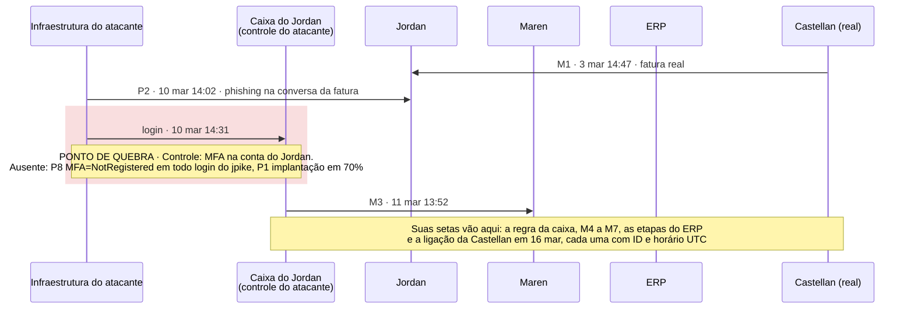

# Dia 87: Análise de fraude e engenharia social

> 🇺🇸 Original: [*Day 87: Fraud and social-engineering analysis*](https://github.com/thiefdroppers/cyber-investigator-skills/blob/main/curriculum/phase-7-capstone-career/day-87.md) — © ThiefDroppers, licença MIT.
> Aqui: tradução fiel **+** camada brasileira. Nada do original foi removido; tudo o que é novo vem marcado com ➕.

**Fase 7. Capstone e carreira** · Meta da trilha: aplicar o método de triagem da Fase 5 às mensagens do caso, mostrar como cada mensagem foi construída para passar por um controle específico e transformar o caso num padrão de fraude reutilizável.

Rank Jutsu: `S` · [](https://colab.research.google.com/github/Ridd1kulusC0d3r/investigador-cyber-90-dias/blob/main/curriculo/fase-7-capstone-e-carreira/dia-87/dia-87.ipynb)

---

## 🎬 ➕ Abertura do caso — *"Não ligue para a agência"*

Você relê pela décima vez a mensagem que o perfil "Serra Azul Atendimento" mandou no WhatsApp: *"Não ligue para a agência: as linhas estão congestionadas por causa do bloqueio."*

— Por que essa frase está aí? — pergunta Rafa.

— Para dar urgência?

— A urgência está na frase de cima, "30 minutos". Essa aqui tem outro trabalho. O que acontecia se o cooperado ligasse para a agência?

Você pensa por um segundo. — O golpe acabava.

— Então essa frase não é enfeite. É uma contramedida contra um controle que a cooperativa tinha. Toda frase de golpe bem feito é. Hoje você vai achar qual controle cada frase derrubou, e vai escrever sobre o Seu Antônio e os outros cooperados como pessoas que um controle deixou na mão, não como gente distraída.

É isso que o Dia 87 ensina. *(Personagens e cenário: [Operação Isca](../../../caso-continuo/).)*

---

## 📖 Conceito

A forense disse o que o atacante fez com a caixa do Jordan. Ela não explica por que dois funcionários cuidadosos mandaram US$ 48.612,50 para um estranho. Essa parte do caso é engenharia social, e ela tem a sua própria evidência: o texto de cada mensagem, o que ela pede, o que ela desencoraja e qual controle de negócio estava entre o atacante e o dinheiro em cada etapa.

O comprometimento de e-mail corporativo (BEC, *business email compromise*) contra contas a pagar costuma seguir um padrão: convencer o pagador de que um fornecedor real tem novos dados bancários, e garantir que a mudança seja aprovada antes que alguém confira com o fornecedor real. A variante deste caso acrescenta dois refinamentos. A primeira mensagem chegou dentro de uma conversa real sobre uma fatura, o que empresta toda a confiança construída pelos e-mails legítimos anteriores. A mudança bancária depois chegou à aprovadora a partir da caixa real de um colega. A controladora nunca viu uma mensagem externa; só uma interna, de alguém com quem ela trabalha todo dia.

Ler as mensagens como um conjunto de contramedidas torna a análise concreta. A Orrin Valley tinha controles, mesmo que informais: a controladora aprova mudanças de fornecedor, a equipe pode ligar para um fornecedor, o fornecedor manda lembretes por e-mail, o Jordan perceberia respostas da Castellan. Cada mensagem ou ação do atacante se alinha contra um desses. A frase "os telefones estão sendo migrados" existe porque uma ligação teria encerrado a fraude. A regra da caixa de entrada existe porque o lembrete real da Castellan, que dizia que os dados bancários não tinham mudado, também a teria encerrado. O próprio site da Castellan dizia aos clientes para ligar antes de agir em qualquer mudança bancária recebida por e-mail. O clone desse site feito pelo atacante removeu esse parágrafo.

Os pares mencionados acima, lado a lado. A Parte 3 pede que você estenda este mapa para todas as mensagens, com evidência para cada par.



Duas disciplinas da Fase 5 se aplicam. Pontue cada mecanismo com as palavras exatas que o mostram, e registre os ausentes, porque a ausência diz algo sobre o direcionamento. Depois escreva o padrão: uma descrição da técnica geral o bastante para ser reconhecida no próximo caso, sem nomes nem identificadores deste. Escreva sobre o Jordan e a Maren como pessoas que um controle deixou na mão, que é o que a evidência mostra.

## 📚 Recursos

- [FBI Internet Crime Complaint Center (IC3)](https://www.ic3.gov/). Os seus avisos de utilidade pública sobre BEC descrevem as variantes de personificação de fornecedor e de mudança bancária, e o relatório anual traz as perdas registradas.
- A [taxonomia de padrões de fraude](https://github.com/thiefdroppers/cyber-investigator-skills/blob/main/ai-agent-skills/reference/fraud-pattern-taxonomy.md) do roteiro (seções de BEC e phishing) e o procedimento de triagem em [`ai-agent-skills/SKILL.md`](https://github.com/thiefdroppers/cyber-investigator-skills/blob/main/ai-agent-skills/SKILL.md) (➕ versão pt-BR: [`skills/investigador-cyber/SKILL.md`](../../../skills/investigador-cyber/SKILL.md)).
- [Dia 68](https://github.com/thiefdroppers/cyber-investigator-skills/blob/main/curriculum/phase-5-fraud-social-engineering/day-68.md) para a pontuação de mecanismos com evidência citada.
- [diagrams.net (draw.io)](https://app.diagrams.net/), gratuito, para o diagrama de raias.

### ➕ Recursos do contexto Brasil

- [Febraban — dicas de segurança](https://portal.febraban.org.br/): campanhas sobre golpes da falsa central e do falso funcionário, úteis como linguagem para o cartão de padrão brasileiro.
- [Banco Central — Pix, Mecanismo Especial de Devolução (MED)](https://www.bcb.gov.br/estabilidadefinanceira/pix): o controle do lado do pagamento que entra **depois** do golpe; vale como "ponto de quebra" tardio no diagrama de raias do Isca.
- [Os três artefatos de engenharia social da Operação Isca](../../../caso-continuo/dados/dia-87/mensagens-isca.txt) (fictícios): SMS, página do site falso e mensagem do WhatsApp.

## 🛠️ Prática: diagrams.net, uma ficha de triagem pontuada, um diagrama de raias com pontos de quebra e um cartão de padrão

Artefatos: `notes/triage.md`, `notes/swimlane.drawio` mais uma exportação PNG, e `notes/pattern-card.md`.

**Seu checklist de hoje.** Faça na ordem e marque cada item ao terminar:

- [ ] Parte 1: pontue cada mensagem do atacante
- [ ] Parte 2: examine a carta bancária como documento
- [ ] Parte 3: ligue cada mensagem ao controle que ela derrotou
- [ ] Parte 4: desenhe as raias no diagrams.net
- [ ] Parte 5: escreva o cartão de padrão
- [ ] ➕ Parte 6: a triagem da Operação Isca (Prática BR)
- [ ] ➕ Parte 7: o notebook do dia no Colab

### Parte 1: pontue cada mensagem do atacante

Faça a triagem de quatro itens: o e-mail de phishing (P2), o e-mail interno para a controladora (M3), o *follow-up* do atacante (M6) e a carta bancária anexada ao M3. Use os mecanismos de BEC e de phishing da taxonomia. Para cada mecanismo, marque presente ou ausente e cite a evidência exata. Exemplo resolvido para o P2:

| Mecanismo | Presente? | Evidência (citada) |
|---|---|---|
| BEC: domínio forjado ou imitação | Sim | `From: ... <dana.whitlock@castellan-hardwood.example>`; o domínio real é `castellanhardwood.example` (P3 M1) |
| BEC: autoridade e urgência | Sim | "We would appreciate it if CHS-20417 could go out in Friday's payment run, as the old account closes on the 16th." |
| BEC: contorno de processo | Sim | "Our office phones are being migrated to a new system this week, so email is the quickest way to reach me." Fecha a ligação telefônica, a única checagem que teria pegado a fraude. |
| BEC: sigilo | Não | Nada pede ao Jordan para guardar segredo. Num esquema de personificação de fornecedor, sigilo pareceria estranho, já que mudança bancária é papelada de rotina. |
| Phishing: remetente não bate | Sim | Mesma evidência da linha do domínio imitação |
| Phishing: link não bate | Sim | Texto `https://castellanhardwood.example/remittance`; `href` para `cstl-docshare.example/view/r?...` |
| Phishing: saudação genérica com medo ou urgência | Não | "Hi Jordan," e os parâmetros do link codificam o *username* do Jordan, o que combina com uma mensagem direcionada. |
| Phishing: canal errado para o pedido | Sim (na página do link) | P6 L6 S1: "Sign in with your work email to view Remittance_Form.pdf", campo de e-mail pré-preenchido |

Linha de veredito, no formato que o procedimento da taxonomia pede: "Corresponde a personificação de fornecedor em BEC (3 de 4 mecanismos de BEC presentes) combinada com um link de phishing de credenciais direcionado (3 de 4 mecanismos de phishing presentes). Evidência citada acima."

Faça o mesmo para M3, M6 e a carta. O M3 é o interessante: ele vem de uma caixa interna genuína, então os mecanismos de domínio do remetente estão ausentes. Registre quais mecanismos o repasse interno tornou desnecessários.

### Parte 2: examine a carta bancária como documento

Compare a carta (P3 M3) com tudo o que você sabe da Castellan real: os dados da fatura no M1, a página *About* arquivada (P4) e as listas telefônicas (P6 L9). Liste toda inconsistência com a sua fonte. Uma para começar:

> A carta é datada de 9 de março de 2026, mas os metadados mostram que foi criada em 26 de fevereiro de 2026 às 19:12 -05:00 e modificada pela última vez em 9 de março às 22:41 -04:00, com o título `vendor_letter_v3`. A carta foi redigida antes de a Castellan emitir a fatura contra a qual foi usada (3 de março), e o "v3" sugere versões anteriores. Inferência: a carta foi preparada como um modelo geral para os clientes da Castellan, e não escrita em resposta à CHS-20417.

Encontre pelo menos mais quatro, cobrindo o nome da empresa, os diretores citados, os contatos e a saudação. Para cada uma, diga se um aprovador cuidadoso conseguiria percebê-la sem ferramentas especiais. Essa resposta alimenta as recomendações do Dia 89.

### Parte 3: ligue cada mensagem ao controle que ela derrotou

Monte uma tabela em `notes/triage.md`:

| Etapa | Mensagem ou ação | Alavanca de persuasão | Controle que ela foi feita para contornar | Evidência |
|---|---|---|---|---|
| 1 | P2 e-mail de phishing | Continuidade: fica na conversa real da fatura, com o texto real citado | A familiaridade do Jordan com o fornecedor, e a etiqueta "[EXTERNAL]" | `In-Reply-To` bate com M1; texto citado idêntico ao M1 |
| 2 | Regra da caixa de entrada | (nenhuma, é um passo técnico) | Os lembretes da Castellan por e-mail, e o Jordan perceber respostas | P8 palavras-chave do `New-InboxRule`; M4, M5, M6 encontrados em RSS Subscriptions |

Continue para M3, M6 e o e-mail de remessa do ERP (M7). Para o M3, nomeie as duas alavancas em que ele se apoia (olhe de quem ele parece vir e o seu último parágrafo).

### Parte 4: desenhe as raias no diagrams.net

Crie um diagrama com uma raia horizontal para cada um: infraestrutura do atacante, caixa do Jordan sob controle do atacante, Jordan, Maren, o ERP e a Castellan real. Desenhe cada mensagem ou ação como uma seta entre raias, rotulada com o seu ID e o horário UTC da sua linha do tempo do Dia 86, por exemplo `M3 · 11 Mar 13:52`. Comece pela fatura real (M1) e termine com o aviso de remessa (M7) e a ligação da Castellan em 16 de março.

Depois acrescente pontos de quebra. Um ponto de quebra é um marcador vermelho na seta onde um controle, se existisse e fosse usado, teria parado a fraude. Para cada um, acrescente uma nota com duas partes: o controle, e a evidência de que ele estava ausente ou foi contornado. Exemplo resolvido:

> Ponto de quebra no login de 10 mar 14:31 UTC. Controle: MFA na conta do Jordan. Evidência de que faltava: P8 `MFA=NotRegistered` em todo login do `jpike` até 17 de março; P1 registra a implantação de MFA em 70%. A conta da Maren tinha MFA e não mostra login do atacante.

Marque pelo menos quatro pontos de quebra. Pelo menos um tem de ser um controle de processo, e não técnico. A controladora ligar para a Castellan num número do cadastro do fornecedor, e não do e-mail, é um controle desses.

Aqui está o formato do diagrama de raias pronto, desenhado só com as setas e o ponto de quebra dados acima como exemplos. Cada participante é uma raia. O bloco sombreado é a cara de um ponto de quebra: a seta, depois uma nota nomeando o controle e a sua evidência. A sua versão no diagrams.net tem todas as setas de M1 até a ligação da Castellan, e pelo menos quatro pontos de quebra sombreados.



Exporte o diagrama como PNG e guarde o arquivo `.drawio`.

### Parte 5: escreva o cartão de padrão

Escreva `notes/pattern-card.md` para a taxonomia, numa forma que você poderia propor pelo processo de contribuição do roteiro. Ele precisa descrever a técnica sem nenhum nome, domínio, IP, valor ou data deste caso. Use esta estrutura:

```markdown
## Vendor thread hijack with internal relay (BEC)
Mechanism: (two or three sentences on how the scheme works)
Stages: (numbered, from infrastructure setup to payment)
Evidence that confirms it in a new case: (what to look for, per stage, and in which log or message)
Detection opportunities: (for each stage, what a defender could alert on)
Controls that break it: (ranked by where in the chain they act)
Common false leads: (what looks connected but usually is not)
```

> ➕ Em pt-BR, os campos ficam: *Sequestro de conversa com fornecedor e repasse interno (BEC)* · Mecanismo · Etapas · Evidência que o confirma num caso novo · Oportunidades de detecção · Controles que o quebram · Pistas falsas comuns. Mantenha os nomes em inglês se for propor ao repositório original.

Teste o cartão relendo-o como se você nunca tivesse visto este caso. Se alguma linha só fizer sentido com o pacote do caso aberto, reescreva.

### ➕ Parte 6 — Prática BR: a triagem da Operação Isca

Use os três artefatos em [`mensagens-isca.txt`](../../../caso-continuo/dados/dia-87/mensagens-isca.txt): S1 (o SMS), S2 (a página do site falso), S3 (a mensagem do perfil "Serra Azul Atendimento" no WhatsApp Business).

1. **Pontue** cada um com os mecanismos da triagem da [skill pt-BR](../../../skills/investigador-cyber/SKILL.md), incluindo os dois ➕ brasileiros ("Pix para chave/conta de terceiro" e "bloqueio/regularização com ação imediata, padrão falsa central"). Cite as palavras exatas. Registre os ausentes com motivo: por exemplo, S1 não tem saudação nominal, o que combina com disparo em massa.
2. **Mapeie frase → controle.** Exemplos para você completar: "Não ligue para a agência" (S3) → o controle "o cooperado liga para o número do cartão"; "Atendimento exclusivo por este portal" (S2) → o controle "o cooperado usa o app oficial".
3. **Raias do Isca.** Raias: infraestrutura do operador, cooperado, internet banking da Serra Azul, contas dos laranjas (L-01, L-02, L-03), ouvidoria, sistema de contestação. Setas com os horários UTC que você ancorou no Dia 86. Pelo menos quatro pontos de quebra, um de processo (exemplo: o bloqueio preventivo de login de dispositivo novo, que só entrou às 14:20 UTC, depois dos três Pix).
4. **Cartão de padrão brasileiro**: *"Falso bloqueio de chave Pix com coleta de credenciais (smishing + falsa central)"*, sem nenhum nome, domínio, número, valor ou data do caso.

### ➕ Parte 7: o notebook do dia

Abra o [notebook do Dia 87 no Colab](https://colab.research.google.com/github/Ridd1kulusC0d3r/investigador-cyber-90-dias/blob/main/curriculo/fase-7-capstone-e-carreira/dia-87/dia-87.ipynb). Nele você:

1. pontua mecanismos com uma função que **só aceita "presente" com citação literal** encontrada no texto (se a citação não estiver na mensagem, a marcação é recusada);
2. extrai automaticamente as inconsistências da carta (nome da empresa, diretores, telefone, endereço, datas dos metadados);
3. gera o diagrama de raias em **Mermaid** a partir da linha do tempo, com os pontos de quebra (cole no GitHub ou no [mermaid.live](https://mermaid.live/));
4. testa o seu cartão de padrão com um **detector de vazamento**: nenhum nome, domínio, IP, valor ou data do caso pode aparecer;
5. faz o mesmo com o SMS, a página e o WhatsApp do Isca.

## ✅ Checkpoint

1. Todo mecanismo marcado como presente na sua ficha de triagem tem evidência citada.
2. Todo item triado tem pelo menos um mecanismo marcado como ausente.
3. Todo mecanismo marcado como ausente tem um motivo.
4. A sua análise da carta lista pelo menos cinco inconsistências.
5. Cada inconsistência nomeia a sua fonte.
6. O diagrama de raias começa no M1.
7. O diagrama de raias termina na ligação da Castellan.
8. Toda seta tem o ID de uma mensagem ou ação.
9. Toda seta tem um horário UTC.
10. O diagrama de raias tem pelo menos quatro pontos de quebra.
11. Pelo menos um ponto de quebra é um controle de processo, e não técnico.
12. Cada ponto de quebra nomeia o controle ausente.
13. Cada ponto de quebra cita a evidência de que o controle estava ausente ou foi contornado.
14. O cartão de padrão não contém nenhum nome, domínio, IP, valor ou data deste caso.
15. A seção "Evidência que o confirma" do cartão de padrão diz, para cada etapa, o que procurar e em qual log ou mensagem.
16. Nada nas suas notas descreve o Jordan ou a Maren como descuidados ou culpados.
17. Onde uma pessoa agiu, a nota nomeia o controle que deveria ter dado suporte a ela.
18. Sem consultar, você consegue dizer o que é um ponto de quebra?

### ➕ Checkpoint BR

- S1, S2 e S3 estão pontuados, com citação literal em todo "presente" e motivo em todo "ausente".
- Pelo menos três frases do Isca estão ligadas ao controle que contornam.
- As raias do Isca têm pelo menos quatro pontos de quebra, um deles de processo.
- O cartão de padrão brasileiro passou no detector de vazamento do notebook.
- Nenhuma nota descreve os cooperados como "distraídos", "ingênuos" ou equivalentes.

## ⚖️ ➕ Camada jurídica BR

**Estelionato e fraude eletrônica.** O golpe do capstone e o da Operação Isca são, no Brasil, estelionato (CP, art. 171). Quando a fraude é cometida com informações fornecidas pela vítima ou por terceiro induzido a erro por meio de redes sociais, contatos telefônicos, e-mail fraudulento ou meio análogo, aplica-se a qualificadora da **fraude eletrônica** (art. 171, §2º-A, incluído pela Lei 14.155/2021), com pena maior. A mesma lei fixou que, nesses casos, a competência é do domicílio da vítima quando há transferência de valores (CPP, art. 70, §4º). Por isso o pacote para a delegacia vai para a do domicílio dos cooperados, não a de onde está o servidor.

**Falsa identidade e uso de marca.** O perfil "Serra Azul Atendimento" e o domínio imitação usam a identidade da cooperativa. Atribuir-se identidade falsa para obter vantagem pode configurar o art. 307 do CP, embora, quando é meio para o estelionato, tenda a ser absorvido por ele. O uso indevido de marca é tratado na Lei de Propriedade Industrial (Lei 9.279/1996); isso interessa ao jurídico da cooperativa para as derrubadas. <!-- TODO jurídico: confirmar o artigo específico da Lei 9.279/1996 sobre uso indevido de marca antes de citá-lo -->

**Responsabilidade e vítima.** O original proíbe culpar Jordan e Maren. No Brasil há uma razão extra: a discussão sobre quem arca com o prejuízo (cooperado ou instituição) é jurídica e costuma passar pelo dever de segurança do fornecedor de serviços (Código de Defesa do Consumidor). Uma frase do relatório chamando o cooperado de "descuidado" pode ser usada contra ele. Descreva controles, não culpas.

> Material de estudo; não constitui orientação jurídica.

## 🧠 ➕ Camada 8 — o erro fundamental de atribuição e a "vítima burra"

O **erro fundamental de atribuição** (Lee Ross) é a tendência de explicar o comportamento dos outros pelo caráter deles ("ele é descuidado") e subestimar o peso da situação ("a mensagem estava na conversa real, com o texto real, numa caixa sem MFA"). Em fraude, ele vira o mito da "vítima burra", e é ruim para a investigação por dois motivos: esconde os controles que falharam e revitimiza a pessoa.

O original encara isso com a pergunta "que controle deveria ter dado suporte a ela?". A engenharia social do caso explica o resto: **autoridade** (o pedido chega de um colega, ou "da Central de Segurança"), **escassez/urgência** ("a conta antiga fecha dia 16", "30 minutos"), **compromisso e consistência** (a mensagem chega dentro de uma conversa que o Jordan já tinha aceitado), três dos princípios de influência descritos por Robert Cialdini. Pessoas atentas caem nesses mecanismos todos os dias, porque eles exploram atalhos que, na maior parte do tempo, funcionam bem.

Consequência prática: no seu texto, troque todo sujeito humano de uma falha por um controle. "O Jordan clicou" vira "o e-mail chegou a uma conta sem MFA, num gateway que não marca domínios imitação". O relatório fica mais útil e mais justo, e a recomendação sai pronta.

## 🤖 ➕ Skill do dia

O Dia 87 propõe acrescentar ao procedimento **"Triagem de padrão de fraude e golpe"** da [skill pt-BR](../../../skills/investigador-cyber/SKILL.md) o mapa mensagem → controle contornado, os pontos de quebra e a regra de escrever controles, não culpas. Proposta em [`_skill-delta.md`](_skill-delta.md).

## 💡 ➕ Inovação OSINT do dia — diagrama de raias como código

Desenhar raias à mão no draw.io é lento e não versiona bem. O Mermaid (que o GitHub renderiza dentro de qualquer `.md`) aceita diagramas de sequência como texto; dá para gerá-los com Python puro a partir da sua linha do tempo:

```python
eventos = [  # (de, para, rótulo, ponto_de_quebra ou None)
    ("INF", "J", "P2 · 10 mar 14#58;02 · phishing", None),
    ("INF", "JMB", "login · 10 mar 14#58;31", "MFA ausente (P8 MFA=NotRegistered)"),
]
linhas = ["sequenceDiagram"]
for de, para, rot, quebra in eventos:
    if quebra:
        linhas.append("    rect rgba(214, 39, 40, 0.15)")
    linhas.append(f"    {de}->>{para}: {rot}")
    if quebra:
        linhas += [f"    Note over {de},{para}: PONTO DE QUEBRA · {quebra}", "    end"]
print("\n".join(linhas))   # cole num bloco ```mermaid
```

Repare no `#58;`: é como o Mermaid escreve dois-pontos dentro de um rótulo sem confundir com a sintaxe. O mesmo truque está nos diagramas do original.

## 📝 Diário de estudo

- Data:
- Tempo gasto:
- O que ficou claro:
- O que ainda está nebuloso:
- Artefato produzido: `notes/triage.md`, `notes/swimlane.drawio` + PNG, `notes/pattern-card.md`, triagem e cartão de padrão do Isca

---
<sub>Baseado em [cyber-investigator-skills](https://github.com/thiefdroppers/cyber-investigator-skills) por ThiefDroppers (MIT). Tradução, camada BR, Camada 8, skill pt-BR e notebook por Deivison Lourenço (@Ridd1kulusC0d3r).</sub>
