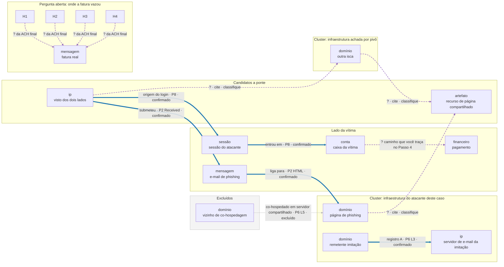
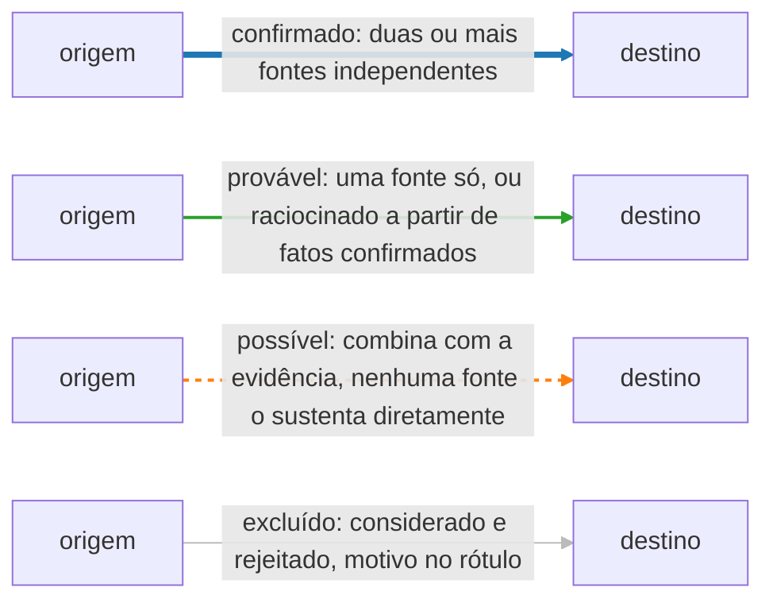

# Dia 88: O grafo final do caso

> 🇺🇸 Original: [*Day 88: The final case graph*](https://github.com/thiefdroppers/cyber-investigator-skills/blob/main/curriculum/phase-7-capstone-career/day-88.md) — © ThiefDroppers, licença MIT.
> Aqui: tradução fiel **+** camada brasileira. Nada do original foi removido; tudo o que é novo vem marcado com ➕.

**Fase 7. Capstone e carreira** · Meta da trilha: amarrar toda entidade e todo vínculo de evidência dos Dias 84 a 87 num único grafo que responde sozinho às perguntas do cliente, com a evidência e a confiança de cada vínculo embutidas nele. Este grafo é o entregável do capstone.

Rank Jutsu: `S` · [](https://colab.research.google.com/github/Ridd1kulusC0d3r/investigador-cyber-90-dias/blob/main/curriculo/fase-7-capstone-e-carreira/dia-88/dia-88.ipynb)

---

## 🎬 ➕ Abertura do caso — *A parede vira um arquivo*

A parede de post-its da sala de reunião está lotada. Rafa tira uma foto dela, depois arranca todos os papéis e joga no lixo reciclável.

— A Marta não vai ver essa parede. O delegado também não. Eles vão ver uma imagem e uma legenda. Em dois minutos, olhando só para ela, alguém de fora precisa responder duas coisas: como o dinheiro saiu, e qual parte da história é a mais fraca.

— E os post-its que eu descartei? O encurtador, a pousada, o favicon?

— Também entram. Pálidos, num canto, com o motivo escrito. Quem não vê o que você excluiu não sabe se você excluiu ou se esqueceu.

É isso que o Dia 88 ensina. *(Personagens e cenário: [Operação Isca](../../../caso-continuo/).)*

---

## 📖 Conceito

A esta altura você tem quatro retratos parciais: um grafo de pivôs da infraestrutura do atacante (Dia 84), uma linha do tempo do que aconteceu na caixa de correio (Dia 86), um diagrama de raias de como a fraude passou por pessoas e controles (Dia 87) e uma matriz ACH sobre onde a fatura vazou (Dias 85 e 86). Cada um está certo dentro do seu próprio quadro, e nenhum mostra o caso inteiro. O grafo final os junta, para que um leitor consiga seguir o caso de um domínio registrado em fevereiro até um pagamento liberado em março sem trocar de documento.

Trate toda aresta como uma afirmação. "`castellan-hardwood.example` resolve para 203.0.113.47" é uma afirmação com uma fonte (P6 L3) e uma confiança (confirmado). "198.51.100.23 é operado pelo mesmo ator da infraestrutura Marrowline" também é uma afirmação, com várias fontes e confiança menor. Um grafo que desenha as duas com a mesma linha simples diz ao leitor que elas são igualmente certas, o que é falso. Então toda aresta carrega três atributos: qual é a relação, que evidência a sustenta e quão confiante você está. A confiança depois é codificada visualmente, para que a incerteza fique visível num relance.

Abaixo está a estrutura de um grafo pronto, com nomes de nó genéricos. As arestas azuis cheias são as cinco linhas do `edges.csv` resolvido no Passo 2, então a confiança delas já está definida. Toda aresta roxa marcada com `?` é uma relação que esta página deixa de propósito para você classificar a partir das suas notas; o exemplo não diz nada sobre quais devem ser essas classificações. A aresta cinza mostra como um item excluído fica no grafo com o seu motivo.



Um jeito de codificar os quatro níveis de confiança, que a sua legenda também deve explicar em palavras:



O grafo também precisa mostrar o que você excluiu. O IP do *spray*, os 1.412 domínios co-hospedados e o escritório de advocacia que compartilha um favicon apareceram todos na sua evidência. Um revisor que não os vê no grafo não consegue saber se você os rejeitou ou não os viu. Ponha-os num grupo de excluídos, ou liste-os na legenda com o motivo da exclusão.

Mantenha honesta a contagem de nós. Inclua toda entidade que carrega parte do argumento e deixe de fora as que só acrescentam poluição.

## 📚 Recursos

- [Gephi](https://gephi.org/) 0.10 ou posterior, gratuito. O [início rápido do Gephi](https://gephi.org/users/quick-start/) cobre o *Data Laboratory*, os *layouts* e a aba *Preview*.
- O Maltego CE também serve, se você montou o grafo do Dia 84 nele; acrescente os novos tipos de nó como entidades e ponha a confiança no rótulo e na cor de cada vínculo.
- [Dia 22](https://github.com/thiefdroppers/cyber-investigator-skills/blob/main/curriculum/phase-2-osint-digital-footprint/day-22.md) para ler hubs, clusters e pontes.
- O seu plano do Dia 85, que lista os tipos de nó e de aresta que este grafo precisa incluir.

### ➕ Recursos do contexto Brasil

- [Grafo final da Operação Isca](../../../caso-continuo/dados/dia-88/) (fictício): `nos.csv` e `arestas.csv` no mesmo formato do original, prontos para o Gephi e para o `check_graph.py`.
- [Gephi em português](https://gephi.org/): a interface tem tradução para pt-BR (Ferramentas, Idioma), útil se você vai mostrar o grafo para um cliente que não lê inglês.
- O [Dia 68](https://github.com/thiefdroppers/cyber-investigator-skills/blob/main/curriculum/phase-5-fraud-social-engineering/day-68.md) do original e o grafo de casos da Fase 5 deste repositório, de onde vêm os códigos de laranja (L-01, L-02, L-03).

## 🛠️ Prática: Gephi, o grafo do caso e um memorando de leitura do grafo

Artefatos: `notes/graph/nodes.csv`, `notes/graph/edges.csv`, o arquivo de projeto do Gephi, uma exportação SVG ou PNG e `notes/graph-memo.md`.

**Seu checklist de hoje.** Faça na ordem e marque cada item ao terminar:

- [ ] Passo 1: defina o esquema
- [ ] Passo 2: escreva as tabelas
- [ ] Passo 3: importe e organize no Gephi
- [ ] Passo 4: confira o grafo contra as perguntas do caso
- [ ] Passo 5: escreva o memorando de leitura do grafo
- [ ] Passo 6: teste a imagem com um leitor novo
- [ ] ➕ Passo 7: o grafo final da Operação Isca (Prática BR)
- [ ] ➕ Passo 8: o notebook do dia no Colab

### Passo 1: defina o esquema

Use estes tipos de nó. Acrescente outros só se o Dia 85 os tiver planejado.

| Tipo | Exemplos do caso |
|---|---|
| domain | a imitação, o domínio de phishing, os domínios Marrowline e Quennmarsh, o domínio real do fornecedor |
| ip | todo IP que carrega um vínculo |
| email_address | o remetente imitação, o Reply-To, o endereço de remessa |
| phone | os números nas assinaturas real e falsa |
| artifact | hash do JS, hashes de favicon, o PDF da carta |
| message | M1 a M7 |
| account | `jpike`, `mbeaulieu` |
| session | as sessões do atacante da sua tabela do Dia 86 |
| mailbox_object | a regra da caixa de entrada |
| financial | a conta recebedora final 8830, o pagamento 000731 |
| organization | Orrin Valley, Castellan, e as marcas usadas sem permissão |

As arestas têm estas colunas: `Source`, `Target`, `Type` (Directed), `Label` (a relação em poucas palavras), `evidence` (citação do pacote), `confidence` (confirmed, likely, possible ou excluded) e `day` (onde você a estabeleceu).

### Passo 2: escreva as tabelas

Comece `nodes.csv` com as colunas `Id,Label,type,cluster` e `edges.csv` com `Source,Target,Type,Label,evidence,confidence,day`. Algumas linhas para mostrar o nível de detalhe:

```csv
Id,Label,type,cluster
d_lookalike,castellan-hardwood[.]example,domain,castellan
d_phish,cstl-docshare[.]example,domain,castellan
ip_023,198.51.100[.]23,ip,bridge
ip_047,203.0.113[.]47,ip,castellan
msg_M2,M2 phishing email 10 Mar,message,castellan
sess_7f3a61,session s-7f3a61,session,castellan
acct_jpike,jpike mailbox,account,victim
```

```csv
Source,Target,Type,Label,evidence,confidence,day
d_lookalike,ip_047,Directed,A record since 2026-02-25,P6 L3,confirmed,84
ip_023,msg_M2,Directed,authenticated submitter of,P2 lowest Received header,confirmed,84
msg_M2,d_phish,Directed,links to (href),P2 HTML part; P9 10 Mar 14:19:07 UTC,confirmed,84
ip_023,sess_7f3a61,Directed,sign-in source,P8 2026-03-10T14:31:12Z,confirmed,86
sess_7f3a61,acct_jpike,Directed,signed in to,P8 2026-03-10T14:31:12Z,confirmed,86
```

> ➕ Os valores da coluna `confidence` ficam em inglês (`confirmed`, `likely`, `possible`, `excluded`) porque o `check_graph.py` do original confere exatamente essas palavras. Os rótulos (`Label`) podem ir em português.

Agora acrescente todo o resto das suas notas: indicadores e pivôs aceitos do Dia 84, sessões e ações do atacante do Dia 86, fluxo de mensagens do Dia 87 e o pagamento. Para cada aresta, copie a citação da nota onde você a estabeleceu. Se não encontrar citação para uma aresta, a aresta é um palpite. Ou ache a evidência, ou apague a aresta.

Acrescente os itens excluídos como nós com `cluster` igual a `excluded`, cada um ligado ao nó que o fez parecer relevante por uma aresta com `confidence` igual a `excluded` e um rótulo dizendo por quê, como `co-hosted on shared server, rejected`.

Antes de importar qualquer coisa, confira os dois arquivos um contra o outro. Por padrão, a importação do Gephi pode criar um nó novo, sem rótulo, para uma aresta cujo `Source` ou `Target` tenha erro de digitação, e ela nunca confere citação ausente. Salve isto como `notes/graph/check_graph.py` e rode a partir de `notes/graph/`:

```python
import csv

LEVELS = {"confirmed", "likely", "possible", "excluded"}
with open("nodes.csv", newline="") as f:
    nodes = list(csv.DictReader(f))
ids = [n["Id"] for n in nodes]
problems = 0
for dup in sorted({i for i in ids if ids.count(i) > 1}):
    print(f"nodes.csv: duplicate Id {dup}"); problems += 1
with open("edges.csv", newline="") as f:
    for line, e in enumerate(csv.DictReader(f), start=2):
        for end in ("Source", "Target"):
            if e[end] not in ids:
                print(f"edges.csv line {line}: {end} '{e[end]}' is not a node Id"); problems += 1
        if not e["evidence"].strip():
            print(f"edges.csv line {line}: no evidence citation"); problems += 1
        if e["confidence"] not in LEVELS:
            print(f"edges.csv line {line}: confidence '{e['confidence']}' not in {sorted(LEVELS)}"); problems += 1
used = set()
with open("edges.csv", newline="") as f:
    for e in csv.DictReader(f):
        used.update((e["Source"], e["Target"]))
for orphan in sorted(set(ids) - used):
    print(f"nodes.csv: {orphan} has no edges; link it or drop it")
print(f"{len(ids)} nodes checked, {problems} problems")
```

Corrija todo problema que ele apontar e rode de novo até ele imprimir `0 problems`. Nós órfãos são avisos, não erros, mas cada um é ou uma aresta faltando ou poluição.

### Passo 3: importe e organize no Gephi

1. Arquivo, *Import spreadsheet*, escolha `nodes.csv` como tabela de nós, depois importe `edges.csv` como tabela de arestas no mesmo espaço de trabalho.
2. No *Data Laboratory*, confira as contagens contra o número de linhas dos seus CSVs. Uma divergência geralmente significa que uma aresta aponta para um `Id` de nó com erro de digitação.
3. Rode o ForceAtlas 2 com "Prevent overlap" ligado até o *layout* se acomodar. Arraste nós à mão depois, se algum rótulo ficar escondido; o *layout* é um ponto de partida.
4. *Appearance*, *Nodes*, *Colour*, *Partition* por `cluster`. *Appearance*, *Edges*, *Colour*, *Partition* por `confidence`. Escolha cores que um leitor consiga distinguir e deixe as arestas excluídas em cinza claro.
5. Em *Preview*, ligue os rótulos dos nós e das arestas, ajuste o tamanho do rótulo das arestas para ficar legível no tamanho da exportação e exporte para SVG e PNG.

Acrescente uma legenda à imagem exportada (em qualquer editor de imagem, ou como bloco de texto no SVG). Ela precisa explicar as cores dos nós, as cores das arestas e o que cada nível de confiança significa neste caso.

### Passo 4: confira o grafo contra as perguntas do caso

Para cada uma das cinco perguntas do cliente, trace a parte do grafo que a responde e escreva o caminho de nós. Exemplo resolvido para a pergunta 2:

> A conta do Jordan foi tomada, e quando? Caminho: `msg_M2` → `d_phish` (link) ← POST da credencial da estação do Jordan (P9, 14:20:41 UTC) ... `ip_023` → `sess_7f3a61` → `acct_jpike` (14:31:12 UTC). Toda aresta do caminho é confirmada.

Se uma pergunta não puder ser traçada, ou o grafo está sem arestas ou a pergunta não pode ser respondida com a evidência. Decida qual dos dois, e corrija o grafo ou anote a lacuna para o relatório.

Para a pergunta 3, a do vazamento, o seu grafo não consegue mostrar um caminho confirmado, porque a evidência não contém um. Mostre as explicações concorrentes. Um jeito é um nó para cada hipótese da ACH, ligado ao M1 por arestas cuja confiança bata com o seu resultado final da ACH. Outro é uma nota de texto no grafo apontando para a matriz ACH. Qualquer um funciona se o leitor conseguir ver que a pergunta está aberta e por quê.

### Passo 5: escreva o memorando de leitura do grafo

Em `notes/graph-memo.md`, escreva meia página cobrindo:

1. Os clusters do grafo, o que cada um representa e quantos nós tem.
2. Cada ponte entre clusters e os pivôs independentes que a sustentam. Conte-os. Se uma ponte se apoia num só tipo de pivô, diga isso e diga o que mais a firmaria.
3. Os hubs, e por que cada um está ligado a tanta coisa. Separe os hubs que importam (um IP do atacante) dos hubs que são artefatos de como você desenhou o grafo (um nó como "Orrin Valley", em que tudo encosta).
4. O grupo de excluídos e por que cada membro foi excluído.
5. A única aresta que, se estivesse errada, mais mudaria a sua resposta a uma pergunta do cliente. Essa aresta é nomeada na seção de riscos do relatório amanhã.

### Passo 6: teste a imagem com um leitor novo

Mostre só a imagem exportada e a legenda a alguém que não viu o caso. Em até dois minutos, a pessoa deve conseguir dizer como o dinheiro saiu e qual parte da história é a menos certa. Se não conseguir, revise o *layout* ou a legenda, não a evidência, e teste de novo.

### ➕ Passo 7 — Prática BR: o grafo final da Operação Isca

Em [`caso-continuo/dados/dia-88/`](../../../caso-continuo/dados/dia-88/) estão `nos.csv` e `arestas.csv` da Operação Isca, no formato do original (25 nós, 28 arestas). Eles juntam o que o caso brasileiro produziu: o SMS e os remetentes, os três domínios imitação, o certificado e o IP compartilhados, o `ik.js` que liga a campanha da Serra Azul à da Coopvale, os cooperados V1 a V3, o IP de onde o operador entrou nas contas, as chaves Pix fictícias dos laranjas L-01 a L-03, as duas hipóteses da ACH que empataram e três excluídos.

1. Rode o `check_graph.py` nesses arquivos (ajustando os nomes `nodes.csv`/`edges.csv` ou copiando-os com esses nomes). Ele deve dar `0 problems`.
2. Trace o caminho **"como o dinheiro saiu"**: `sms_1` → `d_pix` ← `v1` (digitou a senha) ... `ip_150` → `v1` → `l01`. Todas as arestas são confirmadas? E o caminho do V3?
3. Ache a ponte entre o cluster `isca` e o cluster `outras-coops` e conte os tipos de pivô independentes que a sustentam. *(Dica do Dia 84: o script e o comentário dentro dele são um tipo só.)*
4. Nomeie a **aresta mais consequente** do Isca. Candidatas: `ip_150 → v3` (sem ela, o V3 vira caso separado?), `d_vale → art_ik` (sem ela, some o "mesmo operador em outra cooperativa"), `h_lia → sms_1` (muda a recomendação para a Lia).
5. Teste com um leitor novo: mostre a imagem a alguém de fora (colega, familiar) e pergunte as duas coisas de Rafa.

### ➕ Passo 8: o notebook do dia

Abra o [notebook do Dia 88 no Colab](https://colab.research.google.com/github/Ridd1kulusC0d3r/investigador-cyber-90-dias/blob/main/curriculo/fase-7-capstone-e-carreira/dia-88/dia-88.ipynb). Nele você:

1. monta o grafo do capstone com as linhas resolvidas do original e acrescenta arestas por formulário;
2. roda o `check_graph.py` do original sobre os seus CSVs, e vê o que ele pega quando você erra um `Id` de propósito;
3. calcula grau, clusters e pontes com Python puro (sem Gephi), para escrever o memorando;
4. procura o caminho de arestas confirmadas entre a imitação e o pagamento (busca em largura);
5. gera uma versão **Mermaid** do grafo com cores por confiança e legenda, que o GitHub renderiza sem Gephi;
6. faz tudo isso no grafo final da Operação Isca.

## ✅ Checkpoint

1. Toda aresta em `edges.csv` tem um rótulo.
2. Toda aresta tem uma citação de evidência nomeando um ID do pacote mais uma linha, seção, cabeçalho ou carimbo de tempo, como nas linhas resolvidas.
3. `notes/graph/check_graph.py` imprime `0 problems`.
4. As cores de confiança na imagem exportada batem com o CSV.
5. O grafo contém todo tipo de nó que o seu plano do Dia 85 listou, ou o seu memorando explica por que um foi descartado.
6. Um caminho de arestas confirmadas vai do registro do domínio imitação até o pagamento 000731.
7. Os eventos nesse caminho batem com a sua linha do tempo do Dia 86.
8. O memorando nomeia os dois clusters.
9. O memorando nomeia toda ponte.
10. O memorando dá uma contagem de pivôs independentes para cada ponte.
11. O memorando nomeia a única aresta mais consequente.
12. Um leitor que viu só a imagem e a legenda disse, em até dois minutos, como o dinheiro saiu e qual parte da história é a menos certa.
13. Sem consultar, você consegue explicar por que co-hospedagem num servidor compartilhado não liga nada?

### ➕ Checkpoint BR

- O grafo da Operação Isca passa no `check_graph.py` com `0 problems`.
- Você traçou o caminho do dinheiro do Isca e marcou qual trecho é *provável* em vez de *confirmado*.
- O memorando do Isca conta os tipos de pivô da ponte Serra Azul–Coopvale e nomeia a aresta mais consequente.
- Os três excluídos do Isca aparecem no grafo, pálidos, com o motivo.
- Nenhum nó do grafo do Isca é uma pessoa: laranjas são códigos e chaves fictícias; o "Pescador" não é nó.

## ⚖️ ➕ Camada jurídica BR

**O grafo como peça de informação.** Um grafo entregue à polícia ou juntado a um processo vai ser lido como afirmação de fatos. Aresta sem fonte é afirmação sem prova; e afirmação que liga uma pessoa identificável a um crime sem base pode gerar responsabilidade para quem a fez (o mesmo cuidado com calúnia e difamação do Dia 85). É por isso que, no Isca, os laranjas aparecem só como códigos e chaves Pix fictícias, e o "Pescador" **não é nó**: ele é um apelido no código do kit, e atribuição de pessoa é trabalho da polícia com ordem judicial.

**Lavagem e organização criminosa são enquadramentos da polícia, não do analista.** Uma rede de contas recebedoras pode, para a autoridade, ter relação com lavagem de dinheiro (Lei 9.613/1998) ou com organização criminosa (Lei 12.850/2013). O grafo do analista privado descreve **fluxos e infraestrutura**; não rotula ninguém com esses crimes. Se quiser sinalizar, escreva "padrão compatível com uso de contas de passagem", e deixe o enquadramento para quem investiga.

**Dados pessoais no grafo.** Nós de contas de cooperados (V1, V2, V3) são dados pessoais tratados no legítimo interesse da cooperativa (LGPD, art. 7º, IX). Use pseudônimos no grafo que circula, e mantenha a tabela de correspondência só com a cooperativa.

> Material de estudo; não constitui orientação jurídica.

## 🧠 ➕ Camada 8 — a falácia da narrativa e a fluência visual

Nassim Taleb chamou de **falácia da narrativa** a nossa tendência de costurar fatos soltos numa história coerente e, por isso, acreditar mais nela. Um grafo bonito é narrativa em forma de imagem: setas grossas, cores firmes, um centro bem desenhado. A psicologia cognitiva tem um nome para a sensação de verdade que isso dá: **fluência de processamento**, a tendência de julgar mais verdadeira a informação que é mais fácil de processar. Um grafo limpo *parece* mais certo do que é.

O original desarma isso de três jeitos: confiança codificada na aparência da aresta (linha fina e tracejada para o que é fraco), o grupo de excluídos visível, e o teste do leitor novo, que precisa conseguir dizer **qual parte é a menos certa**. Se o leitor só sai com a história e sem a dúvida, o grafo enganou, mesmo com todas as arestas certas.

Consequência prática: depois de montar o grafo, procure a aresta que você mais **gosta**, a que fecha a história. Ela é a primeira candidata a "aresta mais consequente". Confira se a sua confiança nela vem da evidência ou da estética.

## 🤖 ➕ Skill do dia

O Dia 88 propõe acrescentar ao procedimento **"Grafo de vínculos (link analysis)"** da [skill pt-BR](../../../skills/investigador-cyber/SKILL.md) a aresta como afirmação (rótulo, evidência, confiança), o grupo de excluídos e a aresta mais consequente. Proposta em [`_skill-delta.md`](_skill-delta.md).

## 💡 ➕ Inovação OSINT do dia — o grafo em Mermaid, direto no GitHub

Nem todo leitor tem Gephi. O GitHub renderiza blocos `mermaid` em qualquer `.md`, então dá para publicar o grafo do caso como **texto versionado**, com cor por confiança, gerado de `nodes.csv` e `edges.csv` com a biblioteca padrão:

```python
import csv
ESTILO = {"confirmed": "stroke:#1f77b4,stroke-width:4px", "likely": "stroke:#2ca02c,stroke-width:2px",
          "possible": "stroke:#ff7f0e,stroke-dasharray:4 4", "excluded": "stroke:#bbbbbb"}
nos = {n["Id"]: n["Label"] for n in csv.DictReader(open("nodes.csv"))}
linhas, estilos = ["flowchart LR"], []
for i, e in enumerate(csv.DictReader(open("edges.csv"))):
    rot = f'{e["Label"]} · {e["evidence"]}'.replace('"', "'")
    linhas.append(f'    {e["Source"]}["{nos[e["Source"]]}"] -->|"{rot}"| {e["Target"]}["{nos[e["Target"]]}"]')
    estilos.append(f'    linkStyle {i} {ESTILO[e["confidence"]]}')
print("\n".join(linhas + estilos))
```

O texto gerado entra num ` ```mermaid ` do seu portfólio (Dia 90): o recrutador vê o grafo no navegador, e o histórico do Git mostra como ele evoluiu.

## 📝 Diário de estudo

- Data:
- Tempo gasto:
- O que ficou claro:
- O que ainda está nebuloso:
- Artefato produzido: `notes/graph/nodes.csv`, `notes/graph/edges.csv`, projeto Gephi, SVG/PNG com legenda, `notes/graph-memo.md`, grafo e memorando do Isca

---
<sub>Baseado em [cyber-investigator-skills](https://github.com/thiefdroppers/cyber-investigator-skills) por ThiefDroppers (MIT). Tradução, camada BR, Camada 8, skill pt-BR e notebook por Deivison Lourenço (@Ridd1kulusC0d3r).</sub>
