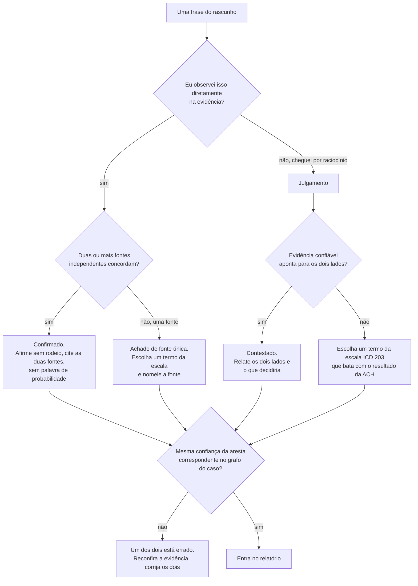
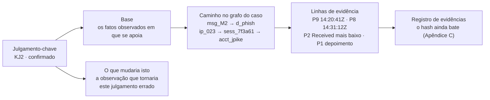

# Dia 89: O relatório final com confiança calibrada

> 🇺🇸 Original: [*Day 89: The final report at calibrated confidence*](https://github.com/thiefdroppers/cyber-investigator-skills/blob/main/curriculum/phase-7-capstone-career/day-89.md) — © ThiefDroppers, licença MIT.
> Aqui: tradução fiel **+** camada brasileira. Nada do original foi removido; tudo o que é novo vem marcado com ➕.

**Fase 7. Capstone e carreira** · Meta da trilha: escrever o relatório sobre o qual um cliente, uma seguradora e a polícia consigam, cada um, agir, em que todo julgamento carrega a confiança que a sua evidência sustenta e aponta para o grafo do caso.

Rank Jutsu: `S` · [](https://colab.research.google.com/github/Ridd1kulusC0d3r/investigador-cyber-90-dias/blob/main/curriculo/fase-7-capstone-e-carreira/dia-89/dia-89.ipynb)

---

## 🎬 ➕ Abertura do caso — *O rascunho que o Dr. Hélio devolveu*

O primeiro rascunho do relatório volta do jurídico da cooperativa com uma folha grampeada. Letra do Dr. Hélio Brandão, caneta azul, sete círculos.

*"Obviamente comprou a base." Obviamente por quê?*
*"Os cooperados foram descuidados." Isto vai parar num processo do cooperado contra nós.*
*"O hacker conhecido como Pescador." Conhecido por quem? A Vigia identificou alguém?*
*"Prova que a quadrilha opera do exterior." O servidor, ou a quadrilha?*

Rafa lê os comentários e devolve a folha para você.

— Ele não está dizendo que você errou o caso. Está dizendo que você escreveu mais do que sabe. A Marta vai ler a primeira página e mais nada. A delegacia vai ler tudo procurando o ponto fraco. Cada frase precisa dizer exatamente o que a evidência sustenta, nem mais, nem menos.

É isso que o Dia 89 ensina. *(Personagens e cenário: [Operação Isca](../../../caso-continuo/).)*

---

## 📖 Conceito

O relatório é onde o trabalho se torna útil para outra pessoa, e também é onde acontece a maior parte do estrago de uma investigação fraca. Um achado exagerado ("o e-mail da Castellan foi hackeado") pode começar uma disputa entre duas empresas. Um achado subdimensionado ("não conseguimos determinar nada sobre a origem") deixa o cliente sem um conselho que ele poderia ter. Calibração significa que cada frase afirma exatamente o que a evidência sustenta, com palavras que o leitor vai interpretar do jeito que você pretende.

Dois tipos de afirmação entram no relatório, e eles precisam de linguagens diferentes. Fatos que você observou diretamente são afirmados sem rodeio, com a fonte: "O atacante criou uma regra na caixa de entrada às 14:36:50 UTC de 10 de março (log de auditoria)." Julgamentos, que são conclusões a que você chegou raciocinando a partir de fatos, carregam uma probabilidade explícita: "É provável que o atacante tenha obtido a fatura do lado da Castellan." Misturar os dois é a falha de calibração mais comum. Ou um julgamento é escrito como se tivesse sido observado, ou um fato observado é tão amortecido que parece palpite.

Para as palavras de probabilidade, use uma escala fixa e coloque-a no relatório, para que "provável" signifique a mesma coisa para você e para a seguradora. O padrão analítico da comunidade de inteligência dos EUA (ICD 203) publica uma:

| Termo | Probabilidade |
|---|---|
| Quase nenhuma chance (*almost no chance*) | 1 a 5% |
| Muito improvável (*very unlikely*) | 5 a 20% |
| Improvável (*unlikely*) | 20 a 45% |
| Chance aproximadamente igual (*roughly even chance*) | 45 a 55% |
| Provável (*likely*) | 55 a 80% |
| Muito provável (*very likely*) | 80 a 95% |
| Quase certo (*almost certain*) | 95 a 99% |

As etiquetas do roteiro se encaixam nisso. "Confirmado" (duas ou mais fontes independentes concordam) é para fatos observados e não precisa de palavra de probabilidade. Achados "prováveis" de uma única fonte, e tudo aquilo a que você chegou por raciocínio, ganham um termo da escala. Achados "contestados" são relatados como contestados, com os dois lados.

Toda frase dos achados passa por esta decisão antes de entrar no relatório:



A estrutura segue o leitor. O cliente e a seguradora leem a primeira página e talvez mais nada, então a primeira página dá as respostas. Tudo depois dela é a evidência dessas respostas, organizada para que um leitor cético consiga conferir qualquer afirmação.

## 📚 Recursos

- [ODNI Intelligence Community Directive 203, *Analytic Standards*](https://www.dni.gov/files/documents/ICD/ICD-203.pdf). Duas páginas de padrões e a tabela de probabilidades acima.
- Sherman Kent, [*Words of Estimative Probability*](https://www.cia.gov/resources/csi/static/Words-of-Estimative-Probability.pdf), o ensaio de 1964 sobre por que essas palavras precisam de significados fixos.
- [Pandoc](https://pandoc.org/) para converter o relatório em Markdown num documento Word ou PDF.
- O seu grafo do caso, memorando do grafo, tabela de sessões, ficha de triagem, matriz ACH e registro de evidências.

### ➕ Recursos do contexto Brasil

- [Rascunho do relatório da Operação Isca](../../../caso-continuo/dados/dia-89/rascunho-relatorio-isca.md) (fictício): o rascunho que o Dr. Hélio devolveu, com os erros de calibração de propósito.
- Delegacia online do seu estado: a maioria das Polícias Civis estaduais tem registro de ocorrência pela internet, inclusive para estelionato. É o caminho do cooperado (vítima pessoa física) para o boletim de ocorrência; procure pelo site da Polícia Civil do estado.
- [SaferNet Brasil — Denuncie](https://new.safernet.org.br/denuncie): canal para crimes contra direitos humanos na internet; não é o canal de golpe financeiro, mas entra na parada obrigatória da skill se aparecer material envolvendo menores.
- Comunicação de incidente à ANPD: a [página da ANPD sobre comunicação de incidente de segurança](https://www.gov.br/anpd/pt-br) orienta o controlador (a cooperativa) quando há risco ou dano relevante aos titulares.

## 🛠️ Prática: Pandoc, o relatório final do caso

Escreva `report/report.md`, exporte com o Pandoc e depois pontue-o contra o gabarito do instrutor.

**Seu checklist de hoje.** Faça na ordem e marque cada item ao terminar:

- [ ] Passo 1: rascunhe o relatório nesta estrutura
- [ ] Passo 2: escreva os julgamentos-chave
- [ ] Passo 3: rode a varredura de exageros
- [ ] Passo 4: verifique a evidência e exporte
- [ ] Passo 5: pontue-se contra o gabarito do instrutor
- [ ] ➕ Passo 6: o relatório da Operação Isca para a Marta e o pacote para a delegacia (Prática BR)
- [ ] ➕ Passo 7: o notebook do dia no Colab

### Passo 1: rascunhe o relatório nesta estrutura

```markdown
# Investigation report: diverted payment to Castellan Hardwood Supply
Prepared for: Orrin Valley Millworks · Date: · Investigator: · Classification: Confidential, client and insurer
SYNTHETIC TRAINING CASE. All organizations, people and indicators are fictional.

## 1. Summary
## 2. Key judgments
## 3. What happened: condensed timeline (UTC)
## 4. Findings by client question
## 5. Indicators to block
## 6. Limits of this investigation
## 7. Recommendations
## Appendix A: case graph and legend
## Appendix B: ATT&CK technique layer
## Appendix C: evidence register and hash verification
## Appendix D: probability scale used in this report
```

> ➕ Em pt-BR: *Relatório de investigação: pagamento desviado à Castellan Hardwood Supply* · Preparado para · Data · Investigador · Classificação: Confidencial, cliente e seguradora · CASO DE TREINO SINTÉTICO. Seções: 1. Resumo · 2. Julgamentos-chave · 3. O que aconteceu: linha do tempo condensada (UTC) · 4. Achados por pergunta do cliente · 5. Indicadores para bloquear · 6. Limites desta investigação · 7. Recomendações · Apêndice A: grafo do caso e legenda · B: camada de técnicas ATT&CK · C: registro de evidências e verificação de hash · D: escala de probabilidade usada.

Orientação por seção:

1. Resumo: no máximo 150 palavras. Responda às cinco perguntas do cliente, em ordem, cada uma em uma ou duas frases, com a palavra de confiança. Quem ler só esta seção deve saber o que aconteceu, se acabou e as duas coisas mais importantes a mudar.
2. Julgamentos-chave: numerados. Cada um tem o julgamento numa frase, a base (IDs de evidência e IDs de nó do grafo do caso) e o que o mudaria. Mire em seis a nove.
3. Linha do tempo: 15 a 25 linhas, UTC, com a fonte de cada linha. Condense o Dia 86 aos eventos que carregam a história.
4. Achados por pergunta do cliente: uma subseção por pergunta, alguns parágrafos cada, citando evidência e apontando para o grafo.
5. Indicadores: uma tabela desarmada de domínios, IPs, endereços de e-mail, hashes e o telefone, com tipo, primeira observação, confiança e uma ação recomendada para cada um. Inclua a infraestrutura relacionada que você julgou pertencer ao mesmo operador, rotulada com a sua confiança.
6. Limites: cobertura dos logs (datas, contas), o que aconteceu antes da coleta, o ouvir dizer em que você se apoiou, os pedidos de dados que o cliente não conseguiu atender e qualquer coisa que você não estava autorizado a examinar.
7. Recomendações: ordenadas por quanto da cadeia da fraude cada uma teria quebrado, ligadas aos seus pontos de quebra do Dia 87. Ponha primeiro as que o cliente consegue fazer esta semana.

### Passo 2: escreva os julgamentos-chave

Exemplo resolvido de um julgamento confirmado:

> KJ2. Um atacante tomou a conta de e-mail de Jordan Pike às 14:31 UTC de 10 de março de 2026, usando a senha que o Jordan digitou numa página de phishing cerca de dez minutos antes. (Confirmado.)
> Base: a estação do Jordan enviou dados para `cstl-docshare[.]example/view/auth` às 14:20:41 UTC (P9, convertido de UTC-4 usando dois eventos-âncora); um login no `jpike` teve sucesso a partir de 198.51.100[.]23 às 14:31:12 UTC sem MFA (P8); o mesmo IP submeteu o e-mail de phishing (P2); o depoimento do Jordan descreve ter digitado a senha (P1). Caminhos no grafo: `msg_M2` → `d_phish`, e `ip_023` → `sess_7f3a61` → `acct_jpike`.
> O que mudaria isto: evidência de que a senha foi exposta antes por outro caminho. Nada disso aparece nos dados de auditoria desde 9 de março, e toda tentativa de *password spray* contra a conta falhou.

Cada julgamento-chave deve permitir que um leitor cético volte à evidência original em poucos passos. Esta é a cadeia por trás do KJ2, e todo julgamento que você escrever precisa de uma igual:



Agora três frases que um primeiro rascunho costuma conter, com o problema e a reescrita:

> Rascunho: "Os atacantes estão baseados na Europa."
> Problema: a localização do servidor está fazendo as vezes da localização do operador. O P6 L8 informa só a localização de datacenters.
> Reescrita: "Dois dos servidores do atacante estavam hospedados num provedor de VPS, num datacenter EU-West. A localização do servidor não indica onde está o operador, e este relatório não faz nenhum julgamento sobre a localização ou a identidade do atacante."

> Rascunho: "O Jordan caiu no e-mail de phishing, e a Maren aprovou a mudança sem conferir."
> Problema: culpa pessoas por lacunas de controle, e vai ser lido pelo empregador e pela seguradora delas.
> Reescrita: "O e-mail de phishing chegou a uma conta sem MFA, e o processo de aprovação de mudança de fornecedor não exigia uma ligação de confirmação ao fornecedor num número já cadastrado. O pedido fraudulento foi escrito para desencorajar exatamente essa ligação ('their phones are down this week')."

> Rascunho: "Os dados da fatura foram roubados do sistema de e-mail da Castellan."
> Problema: afirma como fato algo que a evidência só consegue tornar mais ou menos provável, sobre uma organização que você não examinou.
> Reescrita: afirme o julgamento na confiança que a sua matriz ACH final sustenta, usando um termo da escala; nomeie a evidência que aponta para cada lado; liste os dados que decidiriam (os logs de auditoria mais antigos do cliente, a auditoria da caixa `ap@` e a revisão da própria Castellan). Depois recomende o que o cliente deve compartilhar com a Castellan para que ela confira o seu lado.

### Passo 3: rode a varredura de exageros

Com o rascunho completo, procure nele palavras que costumam sinalizar mais certeza do que a evidência permite:

```bash
grep -n -i -E "prove|clearly|definitely|obviously|certainly|undoubtedly|must have|hacker|confirmed" report/report.md
```

Para cada ocorrência, confira se a frase é um fato confirmado com duas fontes independentes citadas, ou reescreva-a. Depois confira se toda palavra de confiança da seção 2 bate com a cor de confiança das arestas correspondentes no seu grafo do caso. Se o relatório diz "provável" e a aresta diz "confirmado", um dos dois está errado.

> ➕ Para um relatório em português, a mesma varredura:
> ```bash
> grep -n -i -E "prova|provou|claramente|definitivamente|obviamente|certamente|sem d[uú]vida|com certeza|só pode ter|hacker|confirmad" report/relatorio.md
> ```

### Passo 4: verifique a evidência e exporte

Rode de novo a verificação de hash do Dia 83. Ponha o resultado no Apêndice C.

```bash
cd ~/capstone/originals/case-packet && shasum -a 256 -c ~/capstone/notes/evidence.sha256
```

Depois exporte:

```bash
pandoc report/report.md -o report/report.docx
pandoc report/report.md -o report/report.pdf    # needs a LaTeX engine installed; the .docx does not
```

> ➕ O comentário da segunda linha diz: "precisa de um motor LaTeX instalado; o .docx não precisa".

Insira a imagem do grafo do caso no Apêndice A antes de exportar (`` no Markdown).

### Passo 5: pontue-se contra o gabarito do instrutor

Só agora abra [`case-packet/07-instructor-key.md`](../../../upstream/curriculum/phase-7-capstone-career/case-packet/07-instructor-key.md). Pontue o seu relatório e o seu grafo:

| Critério | Pontos |
|---|---|
| Cada um dos oito julgamentos do gabarito alcançado numa confiança equivalente (um ponto cada, meio ponto se estiver um degrau fora na escala) | 8 |
| Armadilhas plantadas que você identificou e tratou corretamente (um ponto a cada duas armadilhas, até 6) | 6 |
| O grafo do caso atende ao conjunto mínimo de nós (2) e tem evidência e confiança em toda aresta (2) | 4 |
| Nenhuma ação fora do escopo tomada ou proposta; nenhuma pessoa culpada ou apontada como suspeita | 2 |

Uma nota de 16 ou mais, de 20, significa que o relatório está pronto para ir ao seu portfólio amanhã. Para cada ponto que você perdeu, acrescente uma linha ao seu registro de decisões dizendo o que você deixou passar e qual etapa dos Dias 84 a 88 teria pegado isso. Essa lista é mais útil do que a nota.

> ➕ Este README, como o original, não resume nem antecipa o conteúdo do gabarito. Termine o relatório antes de abri-lo.

### ➕ Passo 6 — Prática BR: o relatório da Operação Isca e o pacote para a delegacia

**Parte A — conserte o rascunho.** Abra [`rascunho-relatorio-isca.md`](../../../caso-continuo/dados/dia-89/rascunho-relatorio-isca.md) (o que o Dr. Hélio devolveu). Para cada frase, aplique o fluxograma do Conceito: fato observado ou julgamento? Quantas fontes? A confiança bate com a aresta do grafo do Dia 88? Reescreva. Um par resolvido:

> Rascunho: "O servidor do golpe fica em 203.0.113.77, o que prova que a quadrilha opera do exterior."
> Problema: localização de servidor usada como localização de operador; "prova"; "quadrilha" afirmada sem base.
> Reescrita: "O site falso estava hospedado em 203.0.113[.]77, um servidor de inquilino único. A localização de um servidor não indica onde está quem o opera; este relatório não faz julgamento sobre localização ou identidade do operador."

**Parte B — o relatório para a Marta.** Use a mesma estrutura do original, em português, com o título *"Relatório de investigação: golpe do 'Pix bloqueado' contra cooperados da Serra Azul"* e a marca *CASO DE TREINO SINTÉTICO*. Na primeira página (até 150 palavras), responda às cinco perguntas da Marta do Dia 85. Escreva de seis a nove julgamentos-chave. Três para você calibrar (a confiança é decisão sua, a partir do seu grafo e da sua ACH):

1. O operador entrou nas contas de V1, V2 e V3 a partir de `203.0.113[.]150`, com credenciais capturadas pelo site falso. *(Atenção: para o V3, a captura no site falso é provável, não confirmada.)*
2. A campanha contra a Serra Azul e a campanha contra a Coopvale usam o mesmo kit (IscaKit). *(Quantos tipos de pivô independentes? O que o Dia 84 concluiu?)*
3. A origem da lista de celulares: fornecedor (H1) ou chatbot Lia (H4). *(A sua ACH empatou. Como se escreve um empate?)*

**Parte C — o pacote para a delegacia.** A cooperativa decidiu, com o Dr. Hélio, comunicar o caso à *Delegacia Especializada em Crimes Cibernéticos* (fictícia, neste exercício) do domicílio dos cooperados. A Vigia prepara; a cooperativa entrega. O pacote tem:

| Item | Conteúdo |
|---|---|
| Ofício de encaminhamento | Assinado pela cooperativa: quem comunica, fatos em uma página, pedido de providências |
| Relatório técnico | A versão do relatório **sem** dados pessoais além do necessário; cooperados por código (V1–V3) e tabela de correspondência em envelope separado, entregue só se a autoridade pedir |
| Linha do tempo UTC | Com o fuso de origem de cada fonte e as âncoras do Dia 86 |
| Indicadores | Desarmados, com data e fonte: domínios, IPs, números remetentes, IDs de contestação Pix (fictícios) |
| Registro de evidências + hashes | O do Dia 83, com a verificação final |
| O que a Vigia **não** fez | Lista explícita: não acessou o painel do kit, não contatou remetentes, não identificou pessoas, não consultou chaves Pix |
| Pedidos sugeridos à autoridade | Preservação dos registros do provedor de `203.0.113.77` e `203.0.113.150`; dados das contas recebedoras pela via judicial; registros dos números remetentes junto à operadora |

Os cooperados (pessoas físicas) também registram boletim de ocorrência, de preferência pela delegacia online do estado, e acionam a cooperativa para o MED.

**Parte D — lições aprendidas.** Uma página, sem culpados: o que funcionou (a escrita do escopo no Dia 1, as âncoras, o grupo de excluídos), o que falhou (o bloqueio preventivo só entrou às 14:20 UTC, depois dos três Pix), e três mudanças que a cooperativa consegue fazer neste mês.

### ➕ Passo 7: o notebook do dia

Abra o [notebook do Dia 89 no Colab](https://colab.research.google.com/github/Ridd1kulusC0d3r/investigador-cyber-90-dias/blob/main/curriculo/fase-7-capstone-e-carreira/dia-89/dia-89.ipynb). Nele você:

1. roda a **varredura de exageros** do original (em inglês e em português) sobre o rascunho do Isca e sobre o seu texto;
2. joga o **quiz da escala ICD 203**: dada uma probabilidade, qual palavra; dada uma frase, fato ou julgamento;
3. confere automaticamente se a confiança de cada julgamento-chave bate com a aresta do grafo do Dia 88;
4. refaz a verificação de hash do Dia 83 (Apêndice C);
5. monta o esqueleto do relatório da Marta e o **checklist do pacote para a delegacia**, prontos para o Pandoc;
6. preenche a tabela de autoavaliação contra o gabarito (o notebook não mostra o gabarito: você o abre só depois de terminar).

## ✅ Checkpoint

1. O resumo responde às cinco perguntas do cliente.
2. O resumo tem 150 palavras ou menos.
3. Cada resposta do resumo carrega uma palavra de confiança ou está marcada como confirmada.
4. Todo julgamento-chave tem uma base que cita evidência do pacote.
5. A base de todo julgamento-chave cita nós do grafo do caso.
6. Todo julgamento-chave tem uma linha "o que mudaria isto".
7. A seção de limites declara a cobertura dos logs.
8. A seção de limites declara a remediação antes da coleta.
9. A seção de limites lista cada pedido de dados não atendido.
10. A varredura de exageros foi rodada.
11. Toda ocorrência restante da varredura é um fato confirmado com duas fontes citadas.
12. A verificação de hash no Apêndice C mostra todo arquivo original do pacote inalterado.
13. Você pontuou o relatório contra o gabarito do instrutor.
14. Todo ponto perdido tem uma linha no seu registro de decisões dizendo o que você deixou passar.
15. Sem consultar, você consegue explicar por que a localização de um servidor não diz onde está o seu operador?

### ➕ Checkpoint BR

- Todas as frases do rascunho do Isca foram reescritas; a varredura em português não encontra exagero fora de fato confirmado.
- O relatório para a Marta tem resumo de até 150 palavras respondendo às cinco perguntas dela, com confiança.
- O julgamento sobre a origem da lista está escrito como empate (ou com a probabilidade que a sua ACH sustenta), com o que decidiria.
- O pacote para a delegacia tem os sete itens, e a lista "o que a Vigia não fez" está explícita.
- Nenhum documento nomeia ou sugere a identidade do "Pescador" ou dos laranjas.

## ⚖️ ➕ Camada jurídica BR

**Quem comunica o crime.** No Brasil, estelionato (CP, art. 171) passou a ser, como regra, crime de ação penal pública condicionada à representação da vítima (§5º, incluído pela Lei 13.964/2019), com exceções (por exemplo, quando a vítima é a Administração Pública, criança ou adolescente, pessoa com deficiência mental, ou maior de 70 anos ou incapaz). Na prática do caso: a manifestação da vítima importa, e é por isso que o pacote é da cooperativa e de cada cooperado, e não da Vigia. Repare que um cooperado como o "Seu Antônio", de 71 anos, cai numa das exceções.

**Competência pelo domicílio da vítima.** Para estelionato praticado mediante transferência de valores (como o Pix), a competência é do local do domicílio da vítima (CPP, art. 70, §4º, incluído pela Lei 14.155/2021). Por isso o pacote vai para a delegacia do domicílio dos cooperados.

**Cadeia de custódia no pacote.** O Apêndice C (hashes do Dia 83 conferidos de novo) e o registro de decisões são o que permite à autoridade usar o material sem discussão de quebra de custódia (CPP, arts. 158-A a 158-F). Entregue os arquivos originais com os hashes, não só o PDF do relatório.

**LGPD no relatório.** O relatório circula entre cooperativa, seguradora e polícia. Minimização (LGPD, art. 6º, III): só os dados pessoais necessários para a finalidade. Se houve incidente com dados de cooperados (por exemplo, se a hipótese do vazamento por fornecedor se confirmar), a cooperativa avalia com o jurídico a comunicação à ANPD e aos titulares (art. 48).

> Material de estudo; não constitui orientação jurídica.

## 🧠 ➕ Camada 8 — "provável" para quem?

Sherman Kent escreveu o ensaio dos Recursos depois de descobrir que colegas que assinaram juntos a frase "uma possibilidade séria" atribuíam a ela probabilidades que iam de cerca de 20% a 80%. Estudos posteriores com leitores comuns acharam a mesma dispersão para "provável", "possível" e "improvável". Palavras de probabilidade sem escala são **ambíguas por natureza**, e cada leitor preenche a ambiguidade com o que quer ouvir: a seguradora lê "possível" como "não comprovado"; o cliente aflito lê como "foi isso".

Do lado de quem escreve, há dois vieses opostos. O **excesso de confiança** (*overconfidence*) é a tendência, bem documentada, de atribuir às próprias conclusões mais certeza do que os acertos justificam; ele aparece como "obviamente" e "prova". E há o amortecimento defensivo, em que o analista, com medo de errar, escreve "não foi possível determinar" para tudo, o que o original chama de subdimensionar.

Consequência prática: a escala no Apêndice D não é burocracia, é um **dicionário compartilhado** com o leitor. E a varredura de exageros procura o primeiro viés; para o segundo, procure no seu texto "não foi possível", "não há como saber" e "inconclusivo", e confira se a ACH realmente não sustenta nenhum termo da escala.

## 🤖 ➕ Skill do dia

O Dia 89 propõe acrescentar ao procedimento **"Informe de inteligência ou relatório de caso"** da [skill pt-BR](../../../skills/investigador-cyber/SKILL.md) a escala ICD 203, a separação fato/julgamento, a coerência com o grafo, a varredura de exageros e a seção de limites. Proposta em [`_skill-delta.md`](_skill-delta.md).

## 💡 ➕ Inovação OSINT do dia — a varredura de exageros, bilíngue e com contexto

O `grep` do original mostra a linha; para revisar um relatório longo, ajuda ver **qual palavra** disparou e em que **seção** ela está (exagero no resumo é mais grave que no apêndice). Só com `re`:

```python
import re
GATILHOS = r"\b(prove[sd]?|clearly|definitely|obviously|certainly|undoubtedly|must have|hacker|confirmed|" \
           r"prova|provou|claramente|definitivamente|obviamente|certamente|sem d[uú]vida|com certeza|" \
           r"s[oó] pode ter|confirmad[oa]s?)\b"
secao = "(antes do primeiro título)"
for n, linha in enumerate(open("relatorio.md", encoding="utf-8"), 1):
    if linha.startswith("#"):
        secao = linha.strip("# \n")                      # lembra em que seção estamos
    for m in re.finditer(GATILHOS, linha, re.I):
        print(f"{n:4} [{secao[:25]}] «{m.group(0)}»  {linha.strip()[:90]}")
```

Rode antes de mandar qualquer coisa para fora: relatório, e-mail para o cliente, post no LinkedIn sobre o caso.

## 📝 Diário de estudo

- Data:
- Tempo gasto:
- O que ficou claro:
- O que ainda está nebuloso:
- Artefato produzido: `report/report.md`, `report/report.docx`, autoavaliação contra o gabarito, relatório da Operação Isca para a Marta, pacote para a delegacia, lições aprendidas

---
<sub>Baseado em [cyber-investigator-skills](https://github.com/thiefdroppers/cyber-investigator-skills) por ThiefDroppers (MIT). Tradução, camada BR, Camada 8, skill pt-BR e notebook por Deivison Lourenço (@Ridd1kulusC0d3r).</sub>
