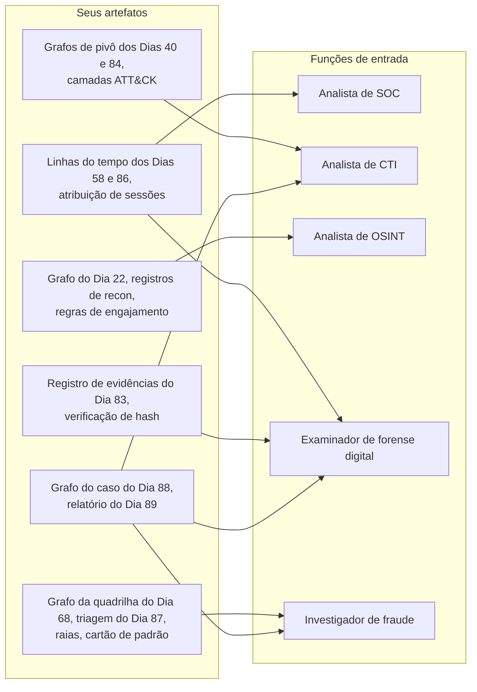
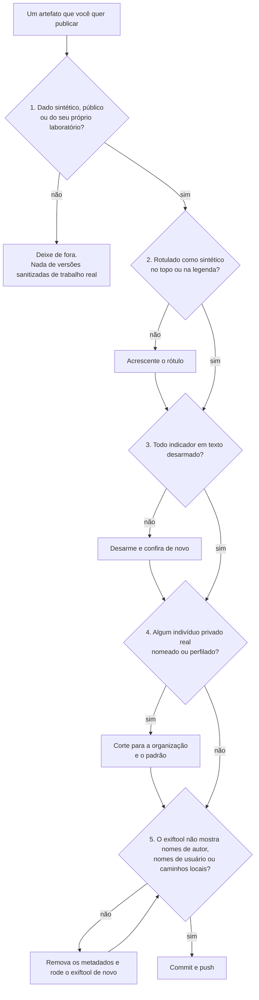

# Dia 90: Portfólio, currículo e onde se candidatar

> 🇺🇸 Original: [*Day 90: Portfolio, resume and where to apply*](https://github.com/thiefdroppers/cyber-investigator-skills/blob/main/curriculum/phase-7-capstone-career/day-90.md) — © ThiefDroppers, licença MIT.
> Aqui: tradução fiel **+** camada brasileira. Nada do original foi removido; tudo o que é novo vem marcado com ➕.

**Fase 7. Capstone e carreira** · Meta da trilha: empacotar os artefatos de 90 dias num portfólio que um gestor de contratação consiga conferir em cinco minutos, escrever um currículo que aponte para eles e montar uma lista de alvos para vagas da trilha de investigação.

Rank Jutsu: `S` · [](https://colab.research.google.com/github/Ridd1kulusC0d3r/investigador-cyber-90-dias/blob/main/curriculo/fase-7-capstone-e-carreira/dia-90/dia-90.ipynb)

---

## 🎬 ➕ Abertura do caso — *O que fica do caso*

Sexta-feira. A Marta Quintão manda um e-mail curto: o relatório foi apresentado ao conselho, a cooperativa entregou o pacote na delegacia especializada, o bloqueio de dispositivo novo virou regra e a campanha "a Serra Azul nunca pede senha" saiu nos canais oficiais. No fim, uma linha: *"Obrigada por ter escrito o que sabia, e só o que sabia."*

Rafa aparece com dois cafés.

— Parabéns. Agora a parte que ninguém ensina: daqui a um ano, numa entrevista, alguém vai perguntar "o que você já investigou?". O que você vai mostrar?

— A Operação Isca.

— Nada da Operação Isca sai daqui. É caso de cliente. — Ele espera você ficar sem graça e sorri. — Por isso a gente treinou o método em casos sintéticos: o da marcenaria canadense, e uma versão fictícia da Isca que você mesmo pode reconstruir do zero. O portfólio mostra o **método**, nunca o cliente.

É isso que o Dia 90 ensina. *(Personagens e cenário: [Operação Isca](../../../caso-continuo/).)*

---

## 📖 Conceito

A contratação para funções investigativas tem um problema de confiança. Qualquer um pode listar "OSINT", "inteligência de ameaças" e "análise de logs" num currículo, e um entrevistador tem uns 30 minutos para descobrir se você consegue mesmo fazer o trabalho. Um portfólio encurta isso. Se o entrevistador consegue abrir o grafo do seu capstone, ler os rótulos das arestas e ver que cada um cita evidência e carrega uma confiança, ele viu o seu método antes de fazer a primeira pergunta. O capstone importa mais porque é de ponta a ponta: recebimento, coleta, forense, análise de fraude, um grafo e um relatório calibrado sobre um mesmo caso.

Os artefatos do roteiro se encaixam em cinco portas de entrada comuns. Um analista de SOC faz triagem de alertas e escala incidentes, então as linhas do tempo e a atribuição de sessões mostram a habilidade central. Um analista de CTI acompanha infraestrutura e comportamento de adversários, então os grafos de pivô e as camadas ATT&CK importam. Um analista de OSINT responde perguntas a partir de fontes abertas dentro de limites legais e éticos, então os registros de reconhecimento e o trabalho de regras de engajamento mostram julgamento além de técnica. Um examinador de forense digital reconstrói eventos a partir de artefatos de um jeito que resista a contestação, então o manuseio de evidência e a verificação de hash importam tanto quanto os achados. Um investigador de fraude reconhece esquemas e segue dinheiro e mensagens, então as fichas de triagem, o diagrama de raias e o cartão de padrão são as peças principais.

Os mesmos artefatos, ordenados pela função que eles vendem melhor. A maioria serve a mais de uma função, e é por isso que um portfólio só pode sustentar várias versões de currículo.



Duas regras valem para tudo o que você publica. Nada de trabalho real entra: nem um log "sanitizado", nem um relatório "levemente editado", nem uma captura de tela com os nomes borrados. Só dados sintéticos, públicos ou do seu próprio laboratório. E todo artefato sintético é rotulado como sintético, para que ninguém que o encontre depois confunda um caso de treino com um real.

## 📚 Recursos

- [NICE Workforce Framework for Cybersecurity](https://niccs.cisa.gov/workforce-development/nice-framework), o catálogo do governo dos EUA de funções de trabalho em cibersegurança, com as tarefas e os conhecimentos de cada uma. Útil para o vocabulário do currículo e para ler anúncios de vaga.
- [CyberSeek career pathway](https://www.cyberseek.org/pathway.html), que mostra funções de entrada, intermediárias e avançadas em cibersegurança e as transições comuns entre elas (dados dos EUA).
- [Trace Labs](https://www.tracelabs.org/), que organiza competições de OSINT que geram pistas sobre casos de pessoas desaparecidas para a polícia. Participar dá a você uma experiência supervisionada e ética de OSINT que dá para descrever numa entrevista.
- Organismos certificadores que você vai ver em anúncios: [CompTIA](https://www.comptia.org/) (Security+, CySA+), [GIAC](https://www.giac.org/) (GCIH, GCTI, GCFE, GCFA, GOSI), [ACFE](https://www.acfe.com/) (*Certified Fraud Examiner*), [ACAMS](https://www.acams.org/) (CAMS, prevenção à lavagem de dinheiro).
- Portais de emprego público: [USAJOBS](https://www.usajobs.gov/) (EUA), [GC Jobs](https://www.canada.ca/en/services/jobs/opportunities/government.html) (Canadá), [Civil Service Jobs](https://www.civilservicejobs.service.gov.uk/) (Reino Unido).

### ➕ Recursos do contexto Brasil

- [Polícia Federal — concursos](https://www.gov.br/pf/pt-br): o cargo de Perito Criminal Federal tem área de Informática; os editais saem quando há concurso autorizado. As Polícias Civis estaduais têm carreiras de perito criminal com a mesma lógica (concurso, edital próprio, área de computação em vários estados).
- [CERT.br](https://www.cert.br/) e [NIC.br](https://www.nic.br/): cursos, eventos e documentação em português sobre resposta a incidentes; bons para vocabulário e para a rede de contatos.
- [Mente Binária](https://www.mentebinaria.com.br/): comunidade brasileira com cursos gratuitos (análise de malware, engenharia reversa, fundamentos), útil para preencher lacunas técnicas citadas em vagas.
- Eventos da comunidade brasileira onde se faz rede e se apresenta trabalho: [H2HC](https://www.h2hc.com.br/), [Roadsec](https://roadsec.com.br/) e as edições locais do BSides em várias capitais.
- [Lei 13.432/2017](https://www.planalto.gov.br/ccivil_03/_ato2015-2018/2017/lei/l13432.htm) (detetive particular) e o Código de Processo Civil, art. 156 (o juiz é assistido por perito quando a prova depende de conhecimento técnico): as duas portas jurídicas do trabalho investigativo privado no Brasil.

## 🛠️ Prática: GitHub e uma planilha, um portfólio público, um currículo de uma página e um rastreador de alvos

Artefatos: um repositório público no GitHub, um currículo de uma página em PDF e `career/targets.ods` (ou uma Planilha Google).

**Seu checklist de hoje.** Faça na ordem e marque cada item ao terminar:

- [ ] Parte 1: monte o repositório de portfólio
- [ ] Parte 2: escreva o currículo
- [ ] Parte 3: conheça os caminhos
- [ ] Parte 4: monte o rastreador de alvos
- [ ] Parte 5: reconcilie com o seu quadro do Dia 1
- [ ] ➕ Parte 6: o mercado brasileiro e a Operação Isca como estudo de caso (Prática BR)
- [ ] ➕ Parte 7: o notebook do dia no Colab

### Parte 1: monte o repositório de portfólio

Crie um repositório público novo, por exemplo `investigation-portfolio`. Estrutura sugerida:

```
investigation-portfolio/
├── README.md                     # who you are, what's here, how to read it
├── capstone-castellan-bec/       # the synthetic Phase 7 case
│   ├── README.md                 # case study write-up (see below)
│   ├── report.pdf
│   ├── case-graph.png
│   ├── case-graph.gephi
│   ├── swimlane.png
│   ├── pattern-card.md
│   └── layer-day86.json          # ATT&CK Navigator layer
├── infrastructure-pivot/         # Day 40
├── incident-timeline/            # Day 58
├── fraud-ring-graph/             # Day 68
└── cloud-iam-graph/              # Phase 6
```

> ➕ Os comentários da árvore: `README.md` raiz = quem você é, o que tem aqui, como ler; `capstone-castellan-bec/` = o caso sintético da Fase 7; `README.md` do capstone = estudo de caso (ver abaixo); `layer-day86.json` = camada do ATT&CK Navigator; as outras pastas = Dias 40, 58, 68 e Fase 6.

Antes de enviar qualquer coisa, passe cada artefato por esta checagem:

1. O dado é sintético, público ou do seu próprio laboratório. Nada veio de empregador, cliente ou vítima real.
2. Material sintético diz isso no topo do arquivo ou na legenda da imagem.
3. Indicadores em texto estão desarmados.
4. Nenhum indivíduo privado real é nomeado ou perfilado em lugar nenhum, incluindo nos trabalhos dos Dias 22 e 68 que usaram fontes públicas. Se um laboratório com fontes públicas nomeou uma pessoa, corte para a organização e o padrão.
5. Os metadados estão limpos. Rode o `exiftool` em toda imagem e PDF e remova nomes de autor e caminhos que você não quer públicos.



Os comandos das checagens 3 e 5, rodados a partir da pasta do portfólio:

```bash
# Check 3: undefanged IPv4 addresses, URLs and .example domains in text files.
# Defanged values (198.51.100[.]23, hxxps://) do not match. Review each hit; links to real
# reference pages are fine.
grep -rnE '([0-9]{1,3}\.){3}[0-9]{1,3}|https?://|[a-z0-9-]+\.example' --include='*.md' --include='*.csv' .

# Check 5: list every metadata tag, with the group it came from.
exiftool -a -G1 -s capstone-castellan-bec/report.pdf capstone-castellan-bec/*.png

# Strip metadata from images.
exiftool -all= -overwrite_original capstone-castellan-bec/*.png

# PDFs need a second step. exiftool edits a PDF by appending a new revision, so the old
# metadata is still in the file. qpdf rewrites the file without the old revision.
exiftool -all:all= -overwrite_original capstone-castellan-bec/report.pdf
qpdf --linearize capstone-castellan-bec/report.pdf capstone-castellan-bec/report-clean.pdf
exiftool -a -G1 -s capstone-castellan-bec/report-clean.pdf
```

> ➕ Os comentários dos comandos, em português: *Checagem 3*: endereços IPv4, URLs e domínios `.example` não desarmados em arquivos de texto; valores desarmados (`198.51.100[.]23`, `hxxps://`) não casam; revise cada ocorrência, links para páginas de referência reais podem ficar. *Checagem 5*: lista toda etiqueta de metadado, com o grupo de onde veio. Depois: remove metadados de imagens. *PDFs precisam de um segundo passo*: o exiftool edita um PDF acrescentando uma nova revisão, então os metadados antigos continuam no arquivo; o qpdf reescreve o arquivo sem a revisão antiga.

Se o último comando ainda mostrar o seu nome ou um caminho da sua pasta pessoal, descubra de onde veio (muitas vezes do bloco de metadados do Pandoc ou das propriedades do documento Word), corrija na origem e exporte de novo. Publique `report-clean.pdf` com o nome `report.pdf`.

Cada pasta de projeto ganha um README escrito como um estudo de caso curto. Exemplo resolvido para o capstone:

```markdown
# Capstone: diverted vendor payment (synthetic BEC case)

Synthetic training case from the Cyber Investigator Roadmap. All organizations,
people and indicators are fictional.

Question: How did a $48,612.50 vendor payment reach an attacker's account,
was an employee's mailbox taken over, and is related infrastructure still active?

What I did:

- Hashed and registered 11 evidence files; wrote rules of engagement before collection.
- Parsed the phishing email's headers and link; pivoted through WHOIS, passive DNS,
  certificate transparency and URL-scan data to a second campaign sharing a phishing kit.
- Anchored an unlabelled proxy clock against the mailbox audit log (UTC-4), merged three
  log sources into one UTC timeline in Timesketch, and attributed 17 sign-in sessions.
- Scored the messages against BEC and phishing mechanisms and mapped each to the control
  it was written to defeat.
- Built a 40-node case graph in Gephi with evidence and confidence on every edge.

Result: account takeover confirmed with timing to the second; source of the leaked invoice
assessed as [your conclusion and confidence]; related infrastructure listed for blocking.

What I would do differently: [one honest paragraph]
```

> ➕ Se o seu portfólio for em português, o mesmo esqueleto: *Capstone: pagamento a fornecedor desviado (caso BEC sintético)* · aviso de caso sintético · Pergunta · O que eu fiz (hash e registro de 11 arquivos de evidência; regras de engajamento antes da coleta; cabeçalhos e link do phishing; pivôs por WHOIS, DNS passivo, CT e varreduras até uma segunda campanha com o mesmo kit; relógio do proxy ancorado em UTC-4; três fontes numa linha do tempo UTC no Timesketch; 17 sessões atribuídas; mensagens pontuadas contra mecanismos de BEC e phishing e ligadas ao controle que derrotavam; grafo de 40 nós no Gephi com evidência e confiança em toda aresta) · Resultado · O que eu faria diferente. Para vagas internacionais, mantenha uma versão em inglês.

Substitua as partes entre colchetes e os números pelos seus. O parágrafo "o que eu faria diferente" é o que os entrevistadores mais perguntam, então seja específico. O seu registro de pontuação do Dia 89 é onde encontrá-lo.

O README do nível de cima deve dizer, em três ou quatro frases, quem você é, para quais funções está mirando e qual pasta abrir primeiro para cada função.

### Parte 2: escreva o currículo

Uma página. Seções: cabeçalho com link para o portfólio, um resumo de duas linhas nomeando a função que você quer, experiência, projetos (o portfólio), certificações se houver, e habilidades relevantes. Formação vai por último, a menos que você tenha se formado há pouco.

Escreva os tópicos de projeto como ação, ferramenta e resultado, com um link. Antes e depois:

> Antes: "Concluí um programa de 90 dias de investigação cibernética cobrindo OSINT, CTI, forense e fraude."
> Depois: "Investiguei de ponta a ponta um comprometimento de e-mail corporativo sintético: fundi logs de gateway de e-mail, auditoria de caixa e proxy numa linha do tempo UTC (Timesketch), atribuí 17 sessões de login e entreguei um relatório com julgamentos em escala de probabilidade e um grafo de evidência com 40 nós (Gephi). [link]"

> Antes: "Experiência com Maltego e inteligência de ameaças."
> Depois: "Pivotei de um domínio de phishing por DNS passivo, *Certificate Transparency* e hashes de recursos de página até uma segunda campanha com o mesmo kit de phishing; documentei e rejeitei três vínculos falsos vindos de hospedagem compartilhada e de um modelo público de site. [link]"

Mantenha duas ou três versões do currículo, cada uma abrindo com projetos diferentes:

| Função-alvo | Abra com | Palavras dos anúncios para usar onde forem verdade |
|---|---|---|
| Analista de SOC | Linhas do tempo dos Dias 58 e 86, atribuição de sessões | triagem, escalonamento, SIEM, análise de logs, linha do tempo de incidente |
| Analista de CTI | Grafos de pivô dos Dias 40 e 84, camadas ATT&CK, os julgamentos-chave do relatório | pivô de infraestrutura, ATT&CK, requisitos de inteligência, linguagem estimativa |
| Analista de OSINT | Grafo e mapa do Dia 22, registros de recon, regras de engajamento | planejamento de coleta, avaliação de fontes, limites legais e éticos |
| Examinador de forense digital | Registro de evidências do Dia 83, linha do tempo do Dia 86, verificação de hash | cadeia de custódia, análise de linha do tempo, integridade da evidência |
| Investigador de fraude | Grafo da quadrilha do Dia 68, triagem e raias do Dia 87, cartão de padrão | tipologia de esquemas, BEC, desvio de pagamento, controles |

### Parte 3: conheça os caminhos

Funções de entrada e os empregadores que contratam para elas:

| Função | Empregadores típicos | Certificações que aparecem com frequência nos anúncios |
|---|---|---|
| Analista de SOC | Provedores de segurança gerenciada e MDR, times internos de segurança em bancos, varejistas, hospitais e universidades | CompTIA Security+, CySA+, GCIH |
| Analista de CTI | Fornecedores de inteligência de ameaças, grandes bancos e empresas, CERTs e CSIRTs nacionais | GCTI |
| Analista de OSINT | Consultorias de *due diligence* e risco, times de segurança corporativa, grupos de jornalismo e de pesquisa em direitos humanos, governo | GOSI |
| Examinador de forense digital | Empresas de resposta a incidentes e a vazamentos (muitas trabalham pelos painéis das seguradoras cibernéticas), provedores de *e-discovery*, funções civis de examinador na polícia | GCFE, GCFA |
| Investigador de fraude | Times de fraude de bancos e de pagamentos, unidades de investigação especial de seguradoras, times de *trust and safety* de marketplaces e plataformas | CFE, CAMS |

Muitos empregadores usam certificações como filtro de triagem, e elas dizem pouco sobre se você consegue fazer o trabalho. Se os anúncios que você quer continuarem listando uma, planeje-se para ela. Se não listarem, o seu portfólio é um uso melhor do tempo.

Movimentos comuns depois da primeira função: analista de SOC para respondedor de incidentes ou analista de CTI; analista de OSINT para CTI ou inteligência de fraude; investigador de fraude para inteligência de crimes financeiros ou PLD; examinador forense para líder de resposta a incidentes. A ferramenta de caminhos do CyberSeek mostra mais.

### Parte 4: monte o rastreador de alvos

Encontre dez anúncios reais em pelo menos duas das famílias de função acima, usando LinkedIn, Indeed, os portais de governo e as páginas de carreira dos empregadores da Parte 3. Para cada um, registre em `career/targets.ods`:

| Coluna | O que vai nela |
|---|---|
| Empregador, função, link, data em que achou | O básico |
| Habilidades exigidas | Copiadas do anúncio |
| Item do portfólio que mostra cada habilidade | Nome da pasta, ou "lacuna" |
| Certificação exigida | Como listada, ou "nenhuma" |
| Versão do currículo a enviar | Da Parte 2 |
| Status | Não candidatado, candidatado, entrevista, encerrado |

Com as dez linhas preenchidas, conte as lacunas. Anote as três que aparecem mais e um plano concreto para cada: um laboratório que você vai montar, uma certificação com data-alvo ou uma comunidade em que vai entrar (um BSides local, um capítulo da OWASP, um evento da Trace Labs). Ponha o plano no topo da planilha.

### Parte 5: reconcilie com o seu quadro do Dia 1

Volte ao seu quadro do Dia 1. Todo dia que você marcou como "Artefato construído" deve agora ter o artefato no portfólio ou ter sido deixado de fora de propósito, por um motivo que você consegue enunciar, como um laboratório com fontes públicas que nomeou uma pessoa. Escreva esse motivo ao lado do dia no quadro.

> ➕ Neste repositório, o quadro também está em [`curriculo/mapa-dos-dias.csv`](../../mapa-dos-dias.csv): a coluna `status` dá o mesmo controle.

### ➕ Parte 6 — Prática BR: o mercado brasileiro e a Operação Isca como estudo de caso

**A. Os nomes das vagas no Brasil.** As cinco funções do original aparecem em anúncios brasileiros com nomes que vale reconhecer (confira sempre o anúncio, porque os títulos variam muito):

| Função do original | Como costuma aparecer no Brasil | Onde costuma estar |
|---|---|---|
| Analista de SOC | Analista de SOC N1/N2/N3, analista de monitoramento de segurança | MSSPs, bancos, grandes empresas |
| Analista de CTI | Analista de inteligência de ameaças, analista de threat intelligence | MSSPs, bancos, fornecedores de segurança |
| Analista de OSINT | Analista de inteligência, analista de investigação digital, analista de due diligence/compliance | Consultorias de risco, compliance, segurança corporativa |
| Examinador forense | Perito em computação forense (privado), assistente técnico, perito judicial; **perito criminal** (concurso público) | Consultorias, escritórios de advocacia, Polícia Federal e Polícias Civis |
| Investigador de fraude | Analista de prevenção a fraudes, analista de PLD/FT (prevenção à lavagem de dinheiro e ao financiamento do terrorismo) | Bancos, cooperativas de crédito, fintechs, meios de pagamento, seguradoras |

**B. Duas portas que só existem aqui.**
- **Concurso público de perito criminal.** É carreira policial com edital próprio (Polícia Federal e Polícias Civis estaduais), conteúdo programático publicado e banca organizadora. O portfólio não substitui a prova, mas o método dos 90 dias (custódia, linha do tempo, relatório calibrado) é exatamente o que o trabalho pericial cobra. Leia o último edital da carreira que você quer e marque, no conteúdo programático, o que o roteiro já cobriu.
- **Perito judicial e assistente técnico.** No processo civil, o juiz nomeia perito quando a prova depende de conhecimento técnico (CPC, art. 156), e as partes podem indicar assistentes técnicos. É uma porta comum para quem trabalha com forense e fraude no setor privado. O relatório calibrado do Dia 89 é o embrião de um laudo.

**C. A Operação Isca no portfólio.** Monte uma pasta `operacao-isca-sintetica/` com o mesmo esqueleto de estudo de caso do original, em português, e o aviso de caso fictício no topo. Você pode publicar o que **você** produziu sobre os dados fictícios deste repositório (grafo do Dia 88, linha do tempo ancorada do Dia 86, cartão de padrão brasileiro do Dia 87, relatório reescrito do Dia 89), sempre rotulado como sintético. Rode o notebook do dia sobre a pasta antes de publicar.

**D. O rastreador em português.** Faça a Parte 4 com pelo menos cinco anúncios brasileiros (LinkedIn, Gupy, páginas de carreira de bancos, cooperativas e MSSPs, e editais de concurso). Para cada lacuna, um plano com data: um laboratório, uma certificação ou uma comunidade (H2HC, Roadsec, BSides, Mente Binária, capítulo local da OWASP).

### ➕ Parte 7: o notebook do dia

Abra o [notebook do Dia 90 no Colab](https://colab.research.google.com/github/Ridd1kulusC0d3r/investigador-cyber-90-dias/blob/main/curriculo/fase-7-capstone-e-carreira/dia-90/dia-90.ipynb). Nele você:

1. roda as checagens 1 a 4 do original sobre uma pasta de portfólio (o `grep` da checagem 3 em Python, com a lista de exceções para links de referência);
2. inspeciona metadados de PDF **sem exiftool**: acha `/Author` e `/Creator` e conta as revisões (`%%EOF`), para ver com os próprios olhos por que o `exiftool` sozinho não basta (Checkpoint 15);
3. transforma tópicos fracos de currículo em ação + ferramenta + resultado, com um verificador;
4. gera o `targets.csv` do rastreador e conta as três lacunas mais frequentes;
5. joga o **quiz função × artefato**;
6. fecha a Operação Isca: o índice dos capítulos 83 a 90 e o seu `minha-linha.md` do Dia 1, relido.

## ✅ Checkpoint

1. Um revisor que abre o README do seu portfólio chega ao grafo do capstone em dois cliques.
2. Todo artefato publicado é sintético, público ou do seu próprio laboratório.
3. Todo artefato sintético está rotulado como tal.
4. Toda ocorrência do `grep` da checagem 3 é um link para uma página de referência real, e não um indicador não desarmado.
5. Nenhum indivíduo privado real é nomeado ou perfilado em lugar nenhum do portfólio.
6. O `exiftool -a -G1 -s` não mostra nome de autor, nome de usuário nem caminho local em nenhuma imagem ou PDF publicado.
7. Todo tópico de projeto do seu currículo leva a uma pasta do portfólio.
8. Todo tópico de projeto nomeia uma ferramenta.
9. Todo tópico de projeto nomeia um resultado.
10. O seu rastreador tem dez anúncios reais.
11. Os anúncios cobrem pelo menos duas famílias de função.
12. Toda habilidade exigida está ligada a um item do portfólio ou marcada como lacuna.
13. As três maiores lacunas têm planos com data.
14. Todo dia marcado como "Artefato construído" no seu quadro do Dia 1 tem o artefato no portfólio ou um motivo escrito para ter ficado de fora.
15. Sem consultar, você consegue explicar por que limpar um PDF só com o `exiftool` não remove os metadados antigos?

### ➕ Checkpoint BR

- A pasta `operacao-isca-sintetica/` está rotulada como fictícia e passou nas checagens do notebook.
- O seu rastreador tem pelo menos cinco anúncios ou editais brasileiros, com o nome da vaga como aparece no anúncio.
- Você sabe dizer a diferença entre perito criminal (concurso, carreira policial), perito judicial (nomeado pelo juiz) e assistente técnico (indicado pela parte).
- Você releu o seu `minha-linha.md` do Dia 1 e escreveu, em duas frases, o que mudou.

## ⚖️ ➕ Camada jurídica BR

**Sigilo e trabalho real fora do portfólio.** A regra do original ("nada de trabalho real") tem base jurídica no Brasil. Contratos de prestação de serviço de segurança costumam ter cláusula de confidencialidade; dados de clientes e de vítimas são dados pessoais (LGPD), e publicá-los sem base legal é tratamento irregular. Revelar segredo de que se tem ciência em razão de função ou profissão, sem justa causa, e com potencial de dano, pode configurar crime de violação de segredo profissional (CP, art. 154). "Sanitizar" não resolve: um log com horários e valores pode reidentificar a vítima.

**Dado anonimizado é outra coisa.** A LGPD só deixa de se aplicar a dado anonimizado de verdade, isto é, que não pode ser revertido por meios razoáveis (art. 12). Trocar nomes por iniciais ou borrar uma captura de tela não é anonimização. Daí a escolha do roteiro por dados sintéticos.

**Perícia e profissão.** Perito criminal é cargo público, com regime próprio (Lei 12.030/2009 trata das perícias oficiais de natureza criminal). Perito judicial é nomeado pelo juiz (CPC, art. 156) e pode ser recusado pelas partes; o trabalho de assistente técnico é indicado pela parte. Detetive particular é regulado pela Lei 13.432/2017. Nenhuma dessas portas autoriza o que a lei proíbe (os arts. 154-A e 147-A do Dia 1 continuam valendo para todo mundo).

> Material de estudo; não constitui orientação jurídica.

## 🧠 ➕ Camada 8 — síndrome do impostor e o portfólio como evidência

Depois de 90 dias, é comum sentir que "não sabe nada" diante de anúncios que pedem cinco anos de experiência. O fenômeno do impostor, descrito por Pauline Clance e Suzanne Imes em 1978, é a experiência de pessoas competentes que atribuem os próprios resultados à sorte e temem ser "descobertas". Do lado oposto está o **efeito Dunning-Kruger**, a observação de que quem sabe pouco num domínio tende a superestimar a própria competência. Os dois são falhas de **calibração** sobre si mesmo, o mesmo problema do Dia 89 aplicado à própria carreira.

O remédio é o mesmo do relatório: trocar opinião por evidência. "Eu sei investigar" é uma opinião; "aqui está um grafo de 40 nós com evidência e confiança em toda aresta, e aqui está a nota que dei a mim mesmo contra o gabarito, com o que perdi" é um achado. O parágrafo "o que eu faria diferente" é a sua seção de limites.

Consequência prática: escreva o seu currículo como escreveu o relatório. Sem "especialista em", sem "domínio completo de"; com ação, ferramenta, resultado e link. Se uma frase do currículo não passaria na varredura de exageros do Dia 89, reescreva.

## 🤖 ➕ Skill do dia

O Dia 90 propõe para a [skill pt-BR](../../../skills/investigador-cyber/SKILL.md) o procedimento novo **"Publicação de artefato de investigação (portfólio)"**: as cinco checagens antes de publicar e a regra de nunca transformar trabalho real em amostra. Proposta em [`_skill-delta.md`](_skill-delta.md). Com ele, a skill fecha o ciclo dos 90 dias: do portão de autorização (Dia 01) até o que pode sair a público (Dia 90).

## 💡 ➕ Inovação OSINT do dia — ler as revisões de um PDF com Python puro

O original avisa que o `exiftool` edita um PDF **acrescentando uma revisão**, e que os metadados antigos continuam no arquivo. Dá para ver isso sem instalar nada: um PDF salvo com atualização incremental tem mais de um marcador `%%EOF`, e os dicionários de informação antigos continuam lá dentro, legíveis:

```python
import re
dados = open("report.pdf", "rb").read()
print("revisões (%%EOF):", dados.count(b"%%EOF"))                         # mais de 1 = atualização incremental
for campo in (b"/Author", b"/Creator", b"/Producer", b"/Title"):
    for m in re.finditer(re.escape(campo) + rb"\s*\(([^)]*)\)", dados):    # valores em texto simples
        print(campo.decode(), "=", m.group(1)[:60])
```

Isso só mostra valores gravados em texto simples (sem compressão nem codificação hexadecimal), então é uma checagem rápida, não uma prova de limpeza: o `exiftool -a -G1 -s` e o `qpdf` continuam sendo o procedimento. A mesma técnica serve no sentido investigativo: um PDF de golpe (como a carta bancária do capstone) pode carregar as versões anteriores do documento.

## 📝 Diário de estudo

- Data:
- Tempo gasto:
- O que ficou claro:
- O que ainda está nebuloso:
- Artefato produzido: repositório de portfólio, currículo em PDF, `career/targets.ods`, pasta `operacao-isca-sintetica/`, `minha-linha.md` relido

---
<sub>Baseado em [cyber-investigator-skills](https://github.com/thiefdroppers/cyber-investigator-skills) por ThiefDroppers (MIT). Tradução, camada BR, Camada 8, skill pt-BR e notebook por Deivison Lourenço (@Ridd1kulusC0d3r).</sub>
